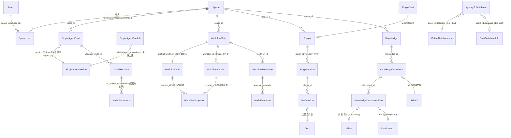
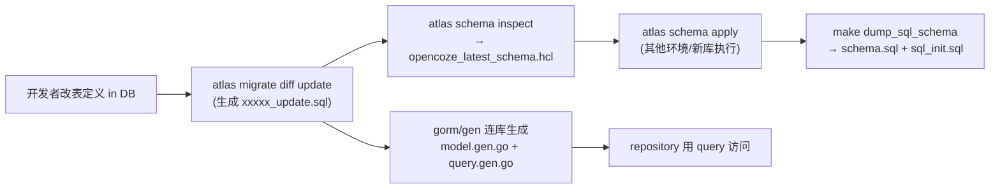
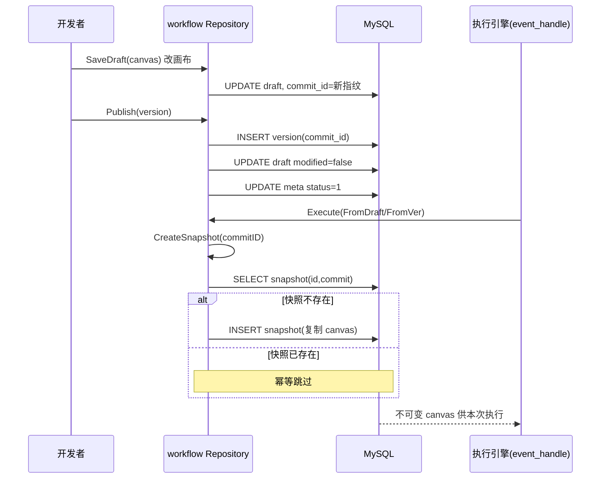

# 数据模型与存储设计深度解读

> 范围：全仓 gorm/gen 实体（约 51 个 `.gen.go`）+ Atlas 迁移
> 叙事主线：**以 MySQL 为元数据中枢、草稿/发布/版本三段式 + `commit_id` 统一指针、异构存储各司其职的数据模型设计。**
> 协作：实体被各领域消费——Agent 见 [`agent-runtime.md`](agent-runtime.md)、工作流见 [`workflow-engine.md`](workflow-engine.md)、知识库见 [`rag-knowledge.md`](rag-knowledge.md)、插件见 [`plugin-system.md`](plugin-system.md)。

## 根因：一次回答「每个资源长什么样、怎么演化、谁在读写」

Coze 是低/无代码 AI Agent 平台，用户反复搭建 Agent/工作流/插件/知识库再发布成线上版本被持续调用。数据模型要回答的根本问题：**弹性可变的创作态（草稿）与不可回溯变动的运行态（已发布/进行中执行）如何在单一 MySQL schema 里共存，同时把高维/高频/非结构化数据准确倒到专用存储。**

由此推导三条设计主线，贯穿全篇：
1. **草稿/发布/版本三段式 + `commit_id` 统一指针**：创作时只在草稿表更新，发布时把草稿物化成不可变 version，执行时经 `commit_id` 锁定某快照——「画布还在改，线上跑的是当初那份」。
2. **MySQL 是元数据中枢，专用存储只当引擎**：结构化归属/权限/生命周期/账号在 MySQL；向量/全文检索与文件精度交给 Milvus/ES/MinIO，MySQL 只存指针。
3. **schema 演进有一致来源**:模型 `.gen.go` 不是手写而是 gorm/gen 从真实 MySQL 表生成，表变更由 Atlas 迁移驱动，形成「DDL → 生成实体 → 实体服务请求」闭环。

## 实体关系总览

**图外补叙**：这张 ER 图只画业务域内强相关关系。跨域引用大多是**逻辑外键 + JSON 列存快照**而非物理外键约束——大量字段本身就是 JSON（`single_agent_draft.prompt/plugin/workflow`、`knowledge_document.parse_rule`），把对象图序列化进单列，靠上层应用层维护关系，这是本模型与「重外键关系系统」最大的分野。

## 存储选型与理由

| 存储 | 承担数据 | Why（权衡） |
|------|-----------|-------------|
| MySQL | 全部业务实体元数据、归属/权限/生命周期、工作流画布 JSON、执行记录 | 强事务 + 多条件过滤 + 唯一约束 + Atlas 迁移，支撑低复杂度高交错关联查询 |
| Elasticsearch | 知识库切片关键词/全文检索、重排 | 分词/相关性打分强；向量非主索引时兜底 |
| Milvus | 知识库切片 embedding 向量检索（topK=4） | 高并发 ANN 近邻搜索，MySQL 做不到 |
| Redis | 运行时缓存（token/limit/checkpoint） | 高频读低持久化 |
| MinIO(S3 兼容) | 知识库源文件、图标、用户上传 | 大文件二进制不入库，MySQL 只存 uri 指针 |
| NSQ | 异步事件（知识索引等） | 解耦写入与索引、削峰 |
| etcd | Milvus 元数据/分布式协调 | 陪跑 Milvus |

### 为什么草稿/发布/版本要建模成「三表 + 不可变快照」

以工作流为例：`workflow_meta`（身份+状态）、`workflow_draft`（可变当前画布）、`workflow_version`（每次发布不可变副本）、`workflow_snapshot`（按需固化执行画布）。**为什么不用一张「当前表 + 版本号」？** 那会让「回滚」和「审计」变得不可能——画布被覆盖即丢失，线上调用与调试现场对不上。

设计取舍：
- **草稿与版本内容重复存储**——用存储成本换不可变性。画画布廉价高频，物化成版本低频，重复一份换来「历史任何时候都能精确复现线上行为」。
- **`commit_id` 是统一指纹**：draft/version/snapshot 三表都由它标识，运行时凭它精确取画布。
- **snapshot 是「执行时冻结」**：`CreateSnapshotIfNeeded` 在某 commit 第一次执行时才复制草稿进 snapshot，避免为每个草稿版本造快照。
- **发布不改草稿内容只改状态位**：新建 version + 把 draft 打标 + 更新 meta 的 `latest_version`，草稿继续可编辑，下次发布生成新 version——「发布不影响线上运行」。

单 Agent（single_agent）是同模式另一形态：`single_agent_draft`（可变）→ `single_agent_version`（不可变副本，多 `connector_id`）→ `single_agent_publish`（发布流水，`(agent_id,version,connector_id)` 唯一索引表达多渠道发布）。

## 核心表设计

> 字段表由 gorm/gen 实体 `.gen.go` 的 struct tag 反推，字段/约束以 `文件:行号` 可核。JSON 类字段由 `serializer:json` 标记。

### 用户与空间

**`user`**（`backend/domain/user/internal/dal/model/user.gen.go`）

| 字段 | 类型 | 约束 | 说明 |
|------|------|------|------|
| unique_name | string | not null, UNIQUE | 唯一昵称（对外路径身份） |
| email | string | not null, UNIQUE | 邮箱登录标识 |
| password | string | not null | 加密密码 |
| created/updated/deleted_at | int64 | milli | 时间戳全用**毫秒 int64**，软删 |

**`space` + `space_user`**：`space.owner_id` 与 `creator_id` 分离（为所有权转移预留）；`space_user (space_id,user_id,role_type)` 唯一约束 + 默认 3 member，是空间维度 RBAC。

[backend/domain/user/internal/dal/model/space_user.gen.go:10-17]() 空间成员三元组

<!-- anchor: type SpaceUser struct { -->

### 工作流：meta / draft / version / snapshot / execution

**`workflow_meta`**（`.../workflow_meta.gen.go`）：`id` 即 workflow_id（draft/version 同值 1:1 共享）；`status`(0未发布/1已发布)；`mode`(0 workflow/3 chat_flow)；`latest_version` 冗余缓存免 JOIN version 表。

**`workflow_draft`**（.../workflow_draft.gen.go）：`canvas` 是工作流本体（mediumtext），`commit_id` 锁定「当前最新可执行画布」。

| 字段 | 类型 | 约束 | 说明 |
|------|------|------|------|
| canvas | string | not null | 前端画布 schema（mediumtext） |
| commit_id | string | not null, INDEX | 草稿当前快照指纹，改画布换新 |
| modified / test_run_success | bool | — | 发布状态位 |

**`workflow_version`**：版本级画布快照 + `commit_id` 绑定草稿，保证「发布的版本 = 当次草稿」。
**`workflow_snapshot`**：主键 `(workflow_id, commit_id)`，`CreateSnapshotIfNeeded` 按需写防重复。

[backend/domain/workflow/internal/repo/dal/model/workflow_draft.gen.go:14-23]() 草稿画布与 commit_id

<!-- anchor: type WorkflowDraft struct { -->

**`workflow_execution`**：`mode`(1 debug/2 release/3 node debug)、`root_execution_id`（子工作流父执行）、`commit_id`（本次执行锁定画布）——执行可溯到具体画布/版本。完整读写路径见 [`workflow-engine.md`](workflow-engine.md)。

### 插件族 + 知识库 + 记忆 + 对话

- **插件**：`plugin`（最新态，含 version 冗余 + manifest/openapi_doc JSON 快照）→ `plugin_version`（`UNIQUE(plugin_id,version)` 不可变）→ `plugin_draft`（草稿无 version）。`tool`（`UNIQUE(plugin_id,sub_url,method)`）→ `tool_version`（`UNIQUE(tool_id,version)`）版本化 operation schema。详见 [`plugin-system.md`](plugin-system.md)。
- **知识库**：`knowledge`（`format_type` 0文本/1表格/2图片）→ `knowledge_document`（存 `uri` 指针 + `source_type` + `parse_rule` JSON）→ `knowledge_document_slice`（`content` 保留但检索不走这里，`hit` 累积热度，真正检索维度在 Milvus/ES）。详见 [`rag-knowledge.md`](rag-knowledge.md)。
- **记忆-变量**：`variables_meta`（定义，`UNIQUE(biz_id,biz_type,version)`，version 空=草稿态）→ `variable_instance`（运行时 KV/list 实例），构成「定义-实例」二分。
- **记忆-数据库**：`draft_database_info` ↔ `online_database_info` **双指针互链**（`related_online_id`/`related_draft_id` 镜像双写），`physical_table_name` 指向真实物理表；`agent_to_database` 绑定含 `is_draft` 区分草稿/线上。
- **对话会话**：`conversation`（`connector_id + agent_id + user_id` 定位一次 Chat）→ `message`（`run_id` 关联执行 + `section_id` 段落 + `status` 流式状态机）→ `run_record`（token 消耗审计）。

## Schema 演进策略

Coze 的 schema 演进不是「手写实体再加 migration」，而是 **Atlas 单向驱动 + gorm/gen 反向跟随的闭环**。

- **迁移脚本**：`docker/atlas/migrations/` 下是 `时间戳_类型.sql`（`20250703095335_initial.sql` 作 baseline，其余递增）。`atlas.hcl` 的 `baseline` + `exclude=["atlas_schema_revisions","table_*"]` 规定从 initial 起、跳过运行时动态表（`table_*` 是 `rdb` 面向用户建的表，不属于平台 schema）。
- **三环境一致**：本地开发用 `atlas schema apply --to opencoze_latest_schema.hcl`；本机 docker 用 `schema.sql` 挂 initdb；K8s（Helm）复用同源 `files/mysql/schema.sql`——由 `make dump_sql_schema` 一次生成三处。
- **新增字段**：改表 → `atlas migrate diff update` 自动生成差异 SQL → 人工检查后 `atlas migrate hash` 重算 → `atlas schema inspect` 刷新 hcl → `make dump_sql_schema` 同步 volumes/helm。`backend/types/ddl/gen_orm_query.go` 连活库用 gorm/gen 按真实表生成实体 + 查询器。

## 读写路径：工作流「发布锁定 + 按需冻结快照」

「不可变快照」哲学的直接落地。运行时 `event_handle` 在真正执行前调 `CreateSnapshotIfNeeded` 物化当前 `commit_id` 画布进 snapshot，执行期间无论草稿怎么改都对齐同一份画布；已存在该 commit 快照则跳过（幂等）。

[backend/domain/workflow/internal/repo/repository.go:1406-1441]() 按需冻结快照

<!-- anchor: func (r *RepositoryImpl) CreateSnapshotIfNeeded(ctx context.Context, id int64, commitID string) error { -->

## 全局关联：数据模型如何连回整条哲学

1. **DDD 域边界落表 = 每个域自带 dal/model + dal/query**。实体按 domain 目录归属，聚合根独立演进；跨域引用靠**逻辑外键 + JSON 快照**而非物理外键，正是不破坏域独立的自然结果。
2. **gorm/gen 一致性 = 表即真相**。`.gen.go` 从真实 MySQL 表生成，Atlas 改表重新生成查询器即同步——「表结构频繁演进却总能前后端对齐」的根基。
3. **版本不可变快照 = 创作与运行分离的普适模板**。三段式在 Agent（draft/version/publish）、工作流（draft/version/snapshot）、插件（draft/version/当前态）、记忆（variables_meta 草稿/发布态）、数据库（draft/online 双写）里反复出现，是对「谁能看到半成品、谁能拿到可回滚成品、执行永远对齐确定性状态」这一共性的统一回应；`commit_id` 是这条抽象在每个资源身上的落点。

## 亮点与问题

**亮点：**
1. 创作/运行分离的不可变快照：用「重复冗余 + commit_id 指针」换无条件可回滚、可审计、执行确定性；`CreateSnapshotIfNeeded` 按需物化避免为每个编辑版本造快照。
2. schema 即真相：Atlas 单向驱动 + gorm/gen 反向生成，天然免疫手写漂移，适合频繁加域的低代码平台。
3. 异构存储「各司其职」：MySQL 管元数据，Milvus/ES 管检索，MinIO 管文件，NSQ 管解耦，接口边界清晰。

**问题 / 风险：**
1. **JSON 列即宽表反模式**：`single_agent_draft`/`plugin` 等把整棵对象图塞进 JSON 列，查询走不了索引、SQL 层无法结构校验，高并发复杂检索受限。
2. **跨表无物理外键靠应用层**：domain 间依赖逻辑外键，service 漏联动易产生孤儿/悬空引用，一致性压力转移给代码审查。
3. **动态业务表（table_*）被排除在 Atlas 之外**：`rdb` 面向用户自建的表不走统一迁移，schema 演进与备份策略另有机制，「平台表 vs 用户表」迁移责任边界有隐患。
4. 快照冗余存储成本：draft/version/snapshot 三处存同一段 canvas，高频发布 + 高频调试产生可观冗余，长期或需增量/dedup。
