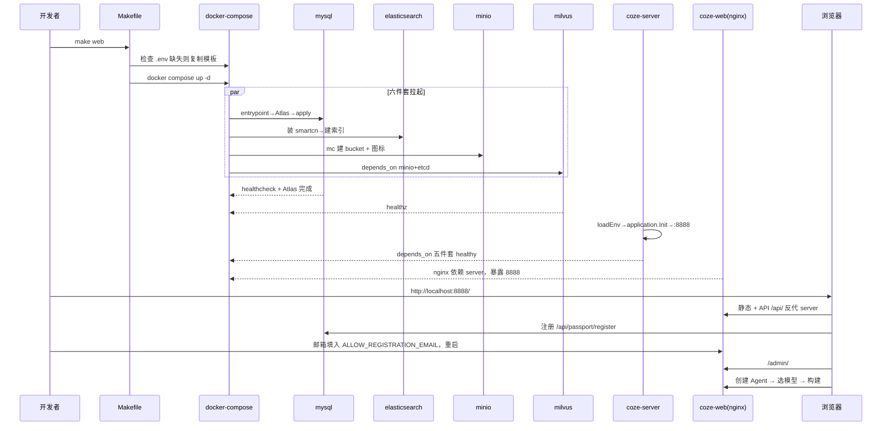

# 部署体系深度解读

> 模块：`Makefile`、`docker/`、`backend/Dockerfile`、`frontend/Dockerfile`、`backend/main.go`、`helm/charts/opencoze/`
> 叙事主线：**把「六件套中间件 + 单 Go 进程 + 前端产物」收拢成 `make web` 一条命令自托管的 docker-compose 形态，并旁路提供 Helm/K8s 企业形态，通过一套幂等初始化协议让商业级 Agent 平台在 2 Core/4GB 开发机裸跑。**

## 一句话定位

部署体系把扣子从「字节内网 SaaS」里的「全部中间件 + 单 Go 进程 + 前端产物」整套收拢成 **`make web` 一条命令自托管的 docker-compose 形态**，并用 Helm/K8s 提供企业级形态。它是自我分发的盖子：去掉它，代码再漂亮社区也装不起来，自托管价值归零。

## 在项目中的角色

扣子后端本质是巨型 Go 单体：`application.Init` 一次性装配十几套 `*ApplicationService`，`main.go` 起一个 Hertz HTTP server 暴露 400+ 路由。这只在「已有能跑的 DB+缓存+ES+向量库+对象存储+MQ」前提下才能活。部署体系把这份**隐藏前提显式化、版本锁死、一键装配**：

- 用 `docker-compose.yml` 把 MySQL/Redis/ES/Milvus/MinIO/NSQ/etcd 六件套钉在指定镜像 tag，消除版本漂移；
- 用 healthcheck + `depends_on: condition: service_healthy` 让后端只在中间件就绪后起来；
- 用 MySQL entrypoint + Atlas 做 schema 迁移固化库结构；
- 用 nginx 把 `coze-server:8888`(API) 与 `coze-web:80`(静态+反代) 收敛成一个对外端口 `8888`。

**去掉它**：社区无法自托管（README quickstart 全挂在 `make web`）；`appinfra.Init` 任一中间件 init 失败即 panic；前端 `/admin/#model-management` 无模型可选；MySQL 空库/图标 404；企业拿不到 K8s 声明式形态。

## 根因：一个「生产级商业平台」如何落到两种交付形态

扣子的内在张力：功能面需要重型中间件栈（这是 SaaS 后端结构性依赖），目标用户既有想 3 分钟在笔记本体验的个人、又有要求可观测可扩缩可替换存储的企业。两者对「怎么装」的诉求几乎相反，不可能用一个 Dockerfile 满足。

**根因三件事同一根木桩（可交付性）：**
1. **为什么是单 Go 进程聚合所有 domain（而非拆微服务）**：所有 `*ApplicationService` 通过结构体字段互相注引用共享同一个 `gorm.DB`/缓存/OSS。拆微服务意味着把注入引用改写 RPC、拆共享事务——改动量巨大。部署层的对策是**保留单体，但让单体对外部依赖完全外置 + 环境变量驱动**，从而能同时被 docker-compose 和 K8s 喂配置。
2. **为什么需要 Atlas 与 init 脚本**：schema 几十张表且持续演进，不能靠手写 SQL 或 GORM AutoMigrate（会与 Atlas 冲突）。用 Atlas `schema apply` 幂等对齐 + Atlas 导出的 `schema.sql` 兜底，保证「全新空库」和「已有旧库」收敛到同一 schema。
3. **为什么前端不能只靠后端打包**：135+ Rush 包的 monorepo 构建产物 `dist` 被两处消费——后端静态目录（debug 自启）和 nginx 独立镜像。部署需同时覆盖「后端托管」与「nginx 托管」两条前端交付路径。

## 核心结构：三层设计

### 镜像双层分离

`docker-compose.yml` 的 `coze-server`/`coze-web` 直接拉远端镜像（CI 或 `make build_docker` 出），`docker-compose-debug.yml` 用 `profiles: ['build-server']` 挂本地构建——两条形态，一个 `backend/Dockerfile`。

`backend/Dockerfile` 是两段式（`golang:1.24-alpine` 编译 → `alpine:3.22` 运行时），运行期附加物很关键：
- **Python 运行环境**（`apk add python3` + `/app/.venv` 装 httpx/plumber/numpy）——PDF/Docx 解析与 code 节点 Python 跑批。
- **Deno sandbox**（`deno run -A jsr:@langchain/pyodide-sandbox`）预拉一次，供工作流 code 节点 sandbox runner 用，避免运行时冷下载。
- `COPY backend/conf /app/resources/conf/`（模型模板/plugin 元数据/admin 页），`EXPOSE 8888`、`CMD ["/app/opencoze"]`。

`frontend/Dockerfile`：Stage1 `node:22-alpine` `rush build --to @coze-studio/app`，Stage2 `nginx:1.25-alpine` `COPY dist`。**前端镜像只承载静态产物，由 nginx 对外服务，API 反代到 coze-server**。

这个「后端镜像内置全部语言运行时、前端镜像独立 nginx」的分层是第一根柱子——运行态所有运行时钉进后端镜像，前端交付与运行时解耦。

### 双轨编排：docker-compose vs Helm 共用同一套「配置外置」协议

- **docker-compose**：`docker/.env.example → .env → 各容器 env_file`，所有可调项（地址/密钥/bucket/模型）都是 shell 环境变量，`x-env-file` 锚点注入每个 service。MySQL 用 entrypoint + `--profile` 在 debug 下拆成一次性 Job 等 schema/种子落库。
- **Helm**（`helm/charts/opencoze/`）：六个 statefulset + server Deployment + web Deployment 全部模板化。**关键：后端仍不硬编码连接串**，用 `deployment.yaml` 的 `env:` 注入 `MYSQL_DSN/REDIS_ADDR/ES_ADDR/MILVUS_ADDR/MQ_NAME_SERVER`，值从 `values.yaml` 或服务名推导——**和 docker-compose 喂的是同一批环境变量名**。这就是「双轨共存」的根：后端只认 env，不认编排方式。

「同一套 env 被两套编排消费」是第二根柱子：后端与中间件的连接全走环境变量接口，docker 与 K8s 只是不同驱动器。

### 中间件栈选型

| 中间件 | 承担职责 | 选型理由 |
|---|---|---|
| MySQL 8.4.5 | 业务主库（Agent/工作流/用户元数据） | gorm 主力；可用 OceanBase 替换 |
| Redis 8.0 | 缓存/会话/checkpoint | 单机低延迟 |
| Elasticsearch 8.18 | 知识库全文检索 | 自带 analysis-smartcn 中文分词 |
| Milvus 2.5.10 | 知识向量检索 | 依赖 etcd + MinIO |
| MinIO | 对象存储 S3 兼容（OSS/图标/文档） | docker 内同时作 Milvus 底层 |
| NSQ | 事件总线（知识/search） | `COZE_MQ_TYPE=nsq`；Helm 默认换 RocketMQ |
| etcd | Milvus 元数据/协调 | 陪跑 Milvus |

MinIO 有两个身份（业务 OSS + Milvus 底层），导致启动顺序：minio 健康 → milvus 才允许起。`VECTOR_STORE_TYPE/STORAGE_TYPE/COZE_MQ_TYPE/EMBEDDING_TYPE` 都是可替换抽象。**OceanBase 替换 MySQL**：`docker-compose-oceanbase.yml` 用 `oceanbase-ce` 替换 `mysql`，`VECTOR_STORE_TYPE=oceanbase` 级联让知识库也走 OceanBase 向量——一个替换同时换关系库+向量库。

## 关键配置（`.env.example` 变量族）

`.env.example`（274 行）按族组织，每族对应一个可替换后端依赖：
- **Server 族**：`LISTEN_ADDR=":8888"`（Hertz 监听，主安全面）、`WEB_LISTEN_ADDR="127.0.0.1:8888"`。
- **MySQL 族**：`MYSQL_HOST/PORT/USER/PASSWORD` + 派生 `MYSQL_DSN` + `ATLAS_URL`。
- **上传/存储族**：`STORAGE_TYPE=minio`（可 tos/s3）、`FILE_UPLOAD_COMPONENT_TYPE=storage`（可切 ImageX）。
- **事件总线族**：`COZE_MQ_TYPE=nsq`（可 kafka/rmq/pulsar/nats）+ 各自连接串。
- **向量族**：`VECTOR_STORE_TYPE=milvus`（可 vikingdb/oceanbase）。
- **Embedding/OCR/Parser 族**：`EMBEDDING_TYPE=ark`（可 openai/ollama/gemini/http）。
- **模型主配族**：带后缀 `_0` 的 `MODEL_PROTOCOL_0/MODEL_ID_0/MODEL_API_KEY_0/MODEL_BASE_URL_0`——唯一直接定义「给 Agent 用哪个模型」的入口，加后缀号加多模型。
- **注册与安全族**：`DISABLE_USER_REGISTRATION` + `ALLOW_REGISTRATION_EMAIL`——公共网络风险第一个开关。
- **插件加密切钥族**：`PLUGIN_AES_AUTH_SECRET/STATE_SECRET/OAUTH_TOKEN_SECRET`（16/24/32 字节）。**默认值写死在上游 image，敏感部署必须覆盖。**

### 管理员初始化：没有独立 seed，是「第一个注册 + AdminEmails 白名单」

- 没有预置 admin 账号：`sql_init.sql` 只插模板，不含用户/管理员。
- 管理员判定在运行时：`AdminAuthMW` 取当前会话邮箱与 `baseConf.AdminEmails`（来自 `ALLOW_REGISTRATION_EMAIL` env 或 admin 后台）比对，命中的才有权访问 `/api/admin/*`。「配模型」= 先注册一个邮箱 → 写进 `ALLOW_REGISTRATION_EMAIL` → 重启后该账号是管理员。
- 注册开关：`DISABLE_USER_REGISTRATION` 走 `base.go` 注入配置，注册路由在 `api/router/coze/api.go`。

### 模型模板供给

`model_meta.json` 定义提供方能力元数据，`backend/conf/model/template/*.yaml`（ark/openai/deepseek/claude/gemini...）是「一个可配模型的骨架」：`id` → `default_parameters`（UI 定义温度/maxtokens）→ `meta.protocol` → `meta.conn_config`（base_url/api_key/model）→ `meta.capability`（function_call 等）。运行时 `modelmgr` 把模板 + auth 落库，前端编辑只改 conn 字段不改协议；`readDirYaml` 批量解析模板目录即「模型供给源」。

## 核心流程：`make web` 主链路

[backend/main.go:107-121]() 启动即连线中间件

<!-- anchor: func loadEnv() (err error) { -->

**Helm 形态**：`helm install opencoze` → `values.yaml`（mysql.enabled/env/cozeServer.env）→ `mysql-init-job`（建用户 + 灌 schema）→ statefulset 六件套 → server Deployment（initContainers 等端口 + env 注入连接串）→ coze-web Deployment（nginx）→ LoadBalancer:80。同一配置语义由 `{{ range .Values.cozeServer.env }}` 模板翻译器消费。

## 部署与运维要点 + 安全风险

### 运维要点

- **对外端口仅一个 8888**：`coze-web` 把 `WEB_LISTEN_ADDR:8888 → 容器:80`；nginx 内部把 `/api|[v1-3]|admin` 反代到 `coze-server:8888`，`/local_storage/` 反代到 `minio:9000` 并 `sub_filter` 重写 `minio:9000 → $http_host/local_storage`。后端 8888 与 MinIO 不对公网暴露。
- **初始化幂等**：mysql entrypoint `atlas schema apply --auto-approve` 幂等对齐；`mysql-setup-init-sql` 用 `INSERT ... ON DUPLICATE KEY` 防重复种子。
- **资源**：最低 2 Core/4GB。ES 默认挺大，小内存需调 `ES_JAVA_OPTS`；Milvus 独占 etcd+MinIO 且 `seccomp:unconfined`。
- **数据目录**：`docker/data/{mysql,bitnami,minio,milvus}` 持久卷；`make clean` 会 `rm -rf ./docker/data`（破坏性）。
- **升级**：镜像 tag 由 values/compose 锁定，DB schema 演进走 `docker/atlas/migrations/` + `make sync_db`/`atlas migrate hash`。

### 公共网络六类安全风险（代码依据）

1. **注册功能**：默认 `DISABLE_USER_REGISTRATION=""` → 注册开关默认开，任何人可建号。关法：置 true + `ALLOW_REGISTRATION_EMAIL` 白名单。
2. **Python 执行环境**：code 节点 runner 二选一——默认 `sandbox`（deno pyodide，权限默认全关）安全；**若 `CodeRunnerType=local` 走 `direct/runner.go` 的 `exec.Command(python3, "-c", code)` 直接本机执行，源码注释亲自标 `ignore_security_alert RCE`**——对自指宿主机的最大风险，无隔离。
3. **Coze Server 监听**：`LISTEN_ADDR=":8888"` 绑 0.0.0.0 全接口；`WEB_LISTEN_ADDR` 默认只绑本机。改对外会直接把 admin 面暴露。
4. **SSRF**：`/local_storage/` 直连反代 `minio:9000` + 工作流出参 http 节点存在内网请求风险，部署层未内置内网 IP 过滤兜底。
5. **API 水平越权**：OpenAPI 鉴权仅按 Bearer token + `md5(token)` 查 key 校验，**无资源级 owner 校验**的 `/v3/chat` 等路径仅验证 token 有效，存在跨用户风险，依赖业务层 handler 自校验。
6. **Admin 面**：`/api/admin/*` 由 `AdminAuthMW` 白名单邮箱控；但 `ALLOW_REGISTRATION_EMAIL` 为空时 `GetBaseConfig` 回退空管理员列表。

> 运维结论：公网必须（a）关注册或加白名单；（b）确保 code runner 走 sandbox；（c）HTTP 入口只暴露 nginx:8888；（d）给插件/文件上传配 SSL 与内网网段白名单；（e）关注 SSRF 与越权的业务层鉴权。

## 关键设计决策与权衡

### 决策一：`make web` = 一条命令，但把初始化协议藏进 compose

把所有依赖钉进 compose 换来开箱即用 + 版本锁定，代价是镜像体积大（后端内置 python/deno/venv）、启动串行等待长、6 容器吃内存。对比 SaaS 拆分微服务则单机起不来——「单体进程 + 多中间件」以「起始成本高、运行成本适中」换「社区可跑」。

### 决策二：环境变量作为唯一配置接口

不引入的 config-server/配置中心，只用 env 桥接，换来 docker-compose 与 K8s「同一套变量名」互迁零改码。代价：敏感信息明文写 `.env` 会泄露；Helm 下靠 Secret 承载，纯 env 对密钥轮换不友好。

### 决策三：用 Atlas 描述 schema 而非 GORM AutoMigrate

Atlas 让 schema 以 `.hcl` 声明式版本化、可 diff/可迁移，比手写 upgrade SQL 少错、比 AutoMigrate 可控。代价：新增一张表必须同步改 `.hcl` + 出 migration + 在 compose 的 mysql-setup 执行；误用会与 ORM 建表逻辑打架。运维需理解「Atlas 是 schema 的唯一真实源」。

## 亮点与问题

**亮点：**
1. 单一配置接口（env 桥接 docker/Helm）是最大可演进性设计，开发机到 K8s 不改业务代码。
2. 三路初始化协议自洽：schema（Atlas/init.sql）+ 对象（MinIO 种子）+ 索引（ES setup）+ 模型（模板+env），全部幂等。
3. 前/后端镜像分离且各自自足：前端 nginx 只塞 dist（轻），后端内置全部运行时（重但自足）。
4. 安全默认值值得肯定：默认 sandbox runner、前端默认绑 127.0.0.1、admin 需白名单邮箱。

**问题 / 风险：**
1. **后端镜像过肥**：python+deno+venv+build-deps 叠加导致镜像数百 MB~1GB+。
2. **`direct` code runner 有 RCE 语义**：配成 `local` 把任意 Python 跑在宿主机，公共网络高风险。
3. **`.env.example` 写死默认密钥**：默认部署零门槛但零机密，任何看仓库的人都知道默认弱口令。
4. **单进程 + 无状态外置**使 AI 能力高度依赖六件套可用性，任意件挂（尤其 ES/Milvus）后端直接点崩，无优雅降级。
5. Helm 实际「企业级」偏演示：默认 `replicaCount:1`、`storageClass:''` 空、多 StatefulSet 各管各，无统一 PVC/存储类声明。
6. 缺贯穿的一键式升级/备份任务：schema 迁移靠 Atlas 手动/GHA，「版本升级+数据迁移+回滚」无端到端脚本。

## 与其他模块协同

- **启动依赖**：`appinfra.Init` 强依赖 MySQL/Redis/OSS/MinIO 在线（任一 init 失败 panic），ES/Milvus/MQ 由依赖链按健康度串接。
- **前端产物双路托管**：debug 走后端静态目录，发布走 nginx 独立镜像——前后端镜像共同构成一个对外服务面。
- **模型配置供给运行时**：`config.Init` + `modelmgr` 产出的「入 DB 的模型实例」被运行时 `modelbuilder` 的单 Agent/工作流 chat model 消费，形成「部署层配置 → DB → 运行时模型选择」闭环。
