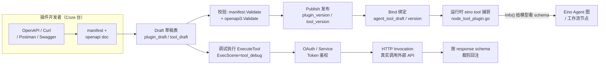
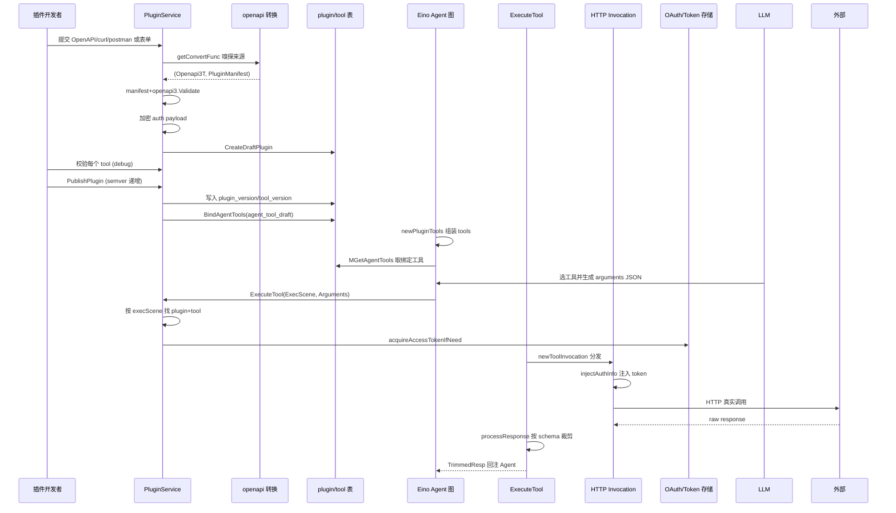
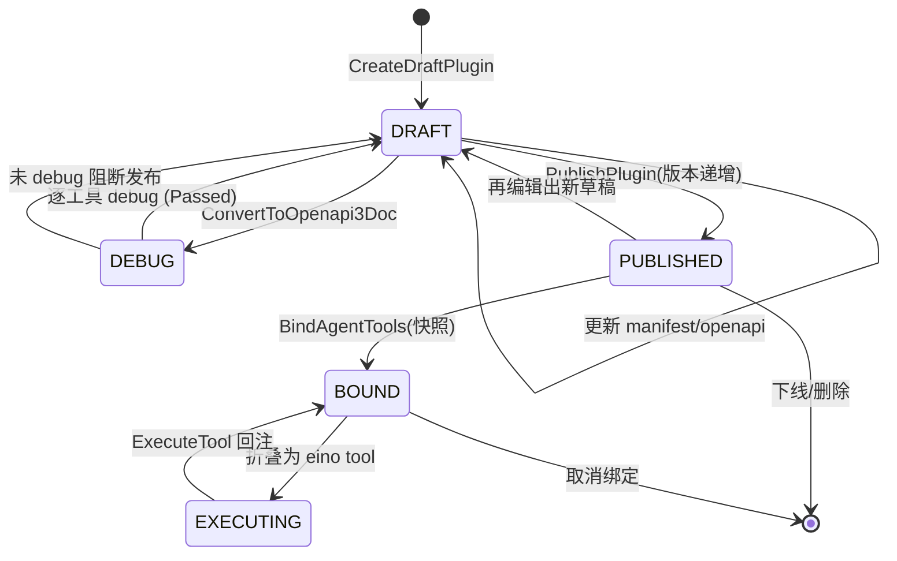

# 插件与外部工具系统深度解读

> 模块：`backend/domain/plugin`（插件领域）+ `backend/crossdomain/plugin`（跨域门面）
> 叙事主线：把开发者的第三方 HTTP API / OAuth 凭证 / MCP / 自定义能力，**声明式地**折叠成一份可被 Eino `tool.InvokableTool` 捕获、由 Agent 图与工作流在运行时调用的标准工具，打通「Agent 发起决策 → 插件鉴权 → 调外部 API → 结构化回注」闭环。
> 协作：被 Agent 折叠为工具执行见 [`agent-runtime.md`](agent-runtime.md)；工作流节点调用见 [`workflow-engine.md`](workflow-engine.md)；数据表见 [`data-model.md`](data-model.md)。

## 一句话定位

插件系统是 Coze 让 Agent「长出手脚」的接缝层：把任何「有 HTTP API 的东西」翻译成 Agent 能理解且能安全调用的一等公民——工具。它同时承担建模（manifest + OpenAPI 规约）、鉴权（Service Token / OAuth）、版本与发布治理（草稿/版本/绑定三层）三类非平凡职责。

## 根因：如何把第三方能力建模成声明式插件清单

根因问题拆解：
1. **如何让「任意 HTTP API」成为 Agent 能协作的对象？** 答案是声明式规约而非命令式代码——开发者上交 manifest（怎么鉴权）+ OpenAPI 文档（每个 endpoint 是什么、参数如何），由平台解释成工具。
2. **如何让 LLM 理解并调用它？** OpenAPI 的 operation（method + subURL + request/response schema + summary）被降级成 eino 的 `schema.ToolInfo`（name/desc/ParamsOneOf）。
3. **如何让调用安全且可回注？** 运行时 `ExecuteTool` 按 ExecScene 找到对应草稿/线上/agent 绑定的 plugin+tool，注入鉴权 token，构造真实 HTTP 请求，再拿 openapi 声明的 response schema 对返回做类型裁剪，把 `TrimmedResp` 回注给 Agent。

[backend/crossdomain/plugin/model/openapi.go:140-274]() OpenAPI operation 降级为 eino 参数 schema

<!-- anchor: func (op *Openapi3Operation) ToEinoSchemaParameterInfo(ctx context.Context) (map[string]*schema.ParameterInfo, error) { -->

## 核心结构

### 声明式清单（manifest）+ OpenAPI 双文档

`PluginManifest` 承载「插件身份 + 鉴权 + 通用参数」，`Openapi3T` 承载「每个工具的方法与 schema」。`PluginInfo` 同时持有 `Manifest *PluginManifest` 与 `OpenapiDoc *Openapi3T` 两个指针，`SetName` 同时改名 manifest 与 openapi title，保证「双文档必须对齐」的强约束。

被放弃的替代：不采用「写死 HTTP 请求实现类 + 让模型读注释」的命令式方式——无法运行时动态驱动、无法标准 schema 校验裁剪、无法声明式表达鉴权。声明的收益在「生态」：新插件只需交文档就能上线，无需平台发版。

### OpenAPI 自动解析 vs 手工 schema：全都要

`getConvertFunc` 按前缀/特征嗅探输入类型，把 **curl、Postman、Swagger2、原生 OpenAPI3** 四种输入归一为 `(*Openapi3T, *PluginManifest)`：

- curl → `CurlToOpenapi3Doc`（go-shellwords 解析）
- Postman → `PostmanToOpenapi3Doc`（go-postman-collection）
- Swagger2 → `SwaggerToOpenapi3Doc`（openapi2conv.ToV3 一键升级）
- OpenAPI3 → `ToOpenapi3Doc`（kin-openapi loader）

同时保留「手工表单一行行填参数」路径。自动解析降基础门槛，手工保证精确 schema，两条路径汇合到同一存储与运行时——「低代码友好」与「schema 严谨」的平衡。

[backend/domain/plugin/service/plugin_draft.go:828-859]() 输入类型嗅探，四源归一

<!-- anchor: func getConvertFunc(ctx context.Context, rawInput string) (convertFunc, common.PluginDataFormat, error) { -->

### 密钥加密：AES-CBC 带随机 IV + 兼容旧版

`encrypt` 包用 AES-CBC。`EncryptByAES` 每次随机 IV，密文结构 `AESEncryption{Version, IV, EncryptedData}` 再 JSON + `base64.RawURLEncoding`——随机 IV 保证同一明文两次加密结果不同，避免 token 密文被比对猜出（旧版最大短板）。`DecryptByAES` 先按新结构解、失败回落旧的无 IV 版本（注释明确「为兼容既有数据保留」）。这是「安全升级 + 向后兼容」双轨。

[backend/domain/plugin/encrypt/aes.go:57-93]() 随机 IV 的新式加密

<!-- anchor: func EncryptByAES(val []byte, secret string) (string, error) { -->

加密发生在 `PluginManifest.EncryptAuthPayload`（写库前加密 `Auth.Payload`），解密发生在 `AuthV2.UnmarshalJSON`（读库时还原）——「数据库里永远只见密文、内存在运行时才见明文」。

### 草稿/版本/发布 三段式

数据层用 6+2 张表跑两条平行轨：`plugin_draft ↔ plugin_version`、`tool_draft ↔ tool_version`、`agent_tool_draft ↔ agent_tool_version`。核心差异：版本轨是**不可变快照**，草稿轨是**可变工作区**。发布做三件事：校验工具都已 debug 通过 → 校验新版本号 > 线上版本号（`semver.Compare`）→ 写版本表使线上生效。`agent_tool_*` 更进一步：不是复制工具本体，而是「绑定元数据快照」（`agent_id + tool_id + version + tool_name + operation`），`Merge` 逻辑把 agent 局部覆盖叠加到线上工具 schema。每次 agent 发布得到「绑定了哪些工具、各自哪个版本、参数如何覆盖」的完整快照，重放任意历史 agent 版本都能精确恢复。

### 运行时「执行场景」分派

`ExecuteTool` 不直接知道工具来自哪，靠 `ExecScene` 分派收敛差异：`tool_debug`（草稿 plugin+tool）、`draft_agent`（线上 tool + agent 草稿覆盖）、`online_agent`（线上 tool + agent 版本快照）、`workflow`（草稿或线上工具）。

[backend/domain/plugin/service/exec_tool.go:152-163]() 按执行场景分派工具来源

<!-- anchor: 	switch req.ExecScene { … 		return nil, fmt.Errorf("invalid execute scene '%s'", req.ExecScene) -->

拿到 plugin+tool 后，`newToolInvocation` 按插件类型（`Manifest.API.Type`）选调用实现：

[backend/domain/plugin/service/exec_tool.go:602-610]() 按插件类型选调用实现

<!-- anchor: func newToolInvocation(t *toolExecutor) tool.Invocation { … 	default: // default to http call -->

三路实现体现「插件类型 = 调用策略」：
- `PluginTypeOfCloud`（openapi，HTTP）→ **`invocation_http.go`，真实业务主力**。
- `PluginTypeOfMCP` → **`invocation_mcp.go`，当前是 stub**（返回 `"mcp call not implemented"`，仅 tool debug 用）——MCP 是新引入但未完成打通的能力，公开源码半成品，诚实标注。
- `PluginTypeOfCustom` → `invocation_custom_call.go` 兜底。

Saas 插件（官方应用市场）走 `NewSaasCallImpl`，不经本地 invocation。

### OAuth 鉴权：三步两段式确认 + 后台续期

1. 构造授权 URL：`genAuthURL` 把 `OAuthState{UserID, PluginID, IsDraft, Nonce}` 用 `PLUGIN_AES_STATE_SECRET` 加密塞进 oauth2 的 state。
2. 回调 + 两步确认：`PluginOauthCallback` 解密 state、校验 nonce（防 CSRF）、校验 pluginID 一致性；随后不立即换 token，先生成一次性 `confirm_code`。用户确认后 `ConfirmPluginOauth` **用当前登录用户 ID 覆盖 state 里的 userID**（防钓鱼）才真正换 token。

[backend/domain/plugin/service/plugin_oauth.go:447-461]() 确认阶段用当前用户覆盖 state 防钓鱼

<!-- anchor: func (p *pluginServiceImpl) ConfirmPluginOauth(ctx context.Context, confirmCode string, currentUserID int64) error { … 	return p.exchangeAndSaveToken(ctx, data.AuthCode, state) -->

3. 运行时取/续期：`getAccessTokenByAuthorizationCode` 从 `plugin_oauth_auth` 取 token，后台 `processOAuthAccessToken` 常驻循环把即将过期的 token 批量刷新，连续失败 5 次清理。

### 响应裁剪

`processResponse` 用 openapi 声明的 response schema 递归裁剪 `respMap`，支持三策略：`ReturnRaw`（类型不符删字段）、`ReturnDefault`（填默认值，Agent/工作流默认用）、`ReturnErr`（抛错）。schema 还有 `x-global-disable`/`x-local-disable` 扩展整体剔除字段——安全回注的最小副作用面，也是 eino `tool.BaseTool`「返回字符串」得到稳定结构的关键。

## 核心流程

### 插件定义 → 发布 → 被 agent 捕获 → 工具调用 → 鉴权 → 回注

### 插件生命周期

## 设计决策与权衡

### 决策一：声明式规约（manifest + openapi）为唯一事实源

生态可扩展性要求「新增能力 = 交文档」而非「交代码」（后者必须上层发版审核）。声明式还让「运行时按 schema 校验/裁剪/让 LLM 按 schema 生成参数」成为可能。**权衡**：牺牲表达能力——复杂逻辑（重试、多步、状态机、版本化 API）无法纯声明表达，靠平台内置通用策略（固定 3 种响应裁剪策略、OAuth 只支持 client_credentials/authorization_code 两种）兜底。

### 决策二：草稿/版本/绑定三层解耦，以空间换时间而非覆盖写

Agent 是「可回滚、可重放」的产物。若覆盖写（改工具就改线上），历史 agent 版本会指向「已变的工具」，行为不可重放。三层让每次发布与 agent 发布都定格当时工具事实。**权衡**：表数量爆炸与同步复杂——6+2 张表、发布要维护草稿→版本迁移、agent 绑定维护两个快照轨。对原型/小规模过度，对「商业级可回滚 Agent 平台」是必要投资。

### 决策三：安全升级走「双轨兼容」而非一次性切换

OAuth token、auth payload 的加密方式若一次性换 IV 策略会把存量密文作废。`DecryptByAES` 设计成「先按新格式解、失败回落不安全旧式」；默认密钥保留为 Deprecated 但仍可用直到 env 注入密钥。**权衡**：给攻击者留了旧式弱 IV「老化后门」，是否彻底移除旧式路径、是否强制密钥轮换是后续迭代风险点。

## 与其他模块协同

- **Agent 运行时（全局叙事落点）**：`newPluginTools` 把绑定工具转成 `[]tool.InvokableTool`，每个元素是 `pluginInvokableTool`。`Info()` 把 openapi op 降级为 eino 参数 schema（LLM 知道工具入口），`InvokableRun()` 把 arguments JSON 透传给 `ExecuteTool`、`ExecScene` 由 `isDraft` 决定、`TrimmedResp` 回注入 eino 图工具输出流。

[backend/domain/agent/singleagent/internal/agentflow/node_tool_plugin.go:98-117]() 插件折叠为 eino tool 的 Info

<!-- anchor: func (p *pluginInvokableTool) Info(ctx context.Context) (*schema.ToolInfo, error) { -->

[backend/domain/agent/singleagent/internal/agentflow/node_tool_plugin.go:119-147]() 实际执行回 plugin service

<!-- anchor: func (p *pluginInvokableTool) InvokableRun(ctx context.Context, argumentsInJSON string, _ ...tool.Option) (string, error) { -->

- **工作流节点**：`domain/workflow/plugin/plugin.go` 的 `GetPluginInvokableTools` 把工具组装成 `pluginInvokeTool`，`ExecSceneOfWorkflow` + 工作流自定义「请求/响应参数配置」覆盖工具原始 operation。
- **加密**：`domain/plugin/encrypt` 被 manifest 与 oauth 双向引用，密钥来自 `PLUGIN_AES_*` 环境变量。
- **配置**：`domain/plugin/conf/load_plugin.go` 加载 `conf/plugin/pluginproduct/*.yaml`（官方产品插件如 lark_base、gaode_map）+ `oauth_schema.json`。

## 亮点与问题

**亮点：**
1. 双文档同生命周期（`SetName` 同改 manifest 与 openapi title），避免「描述改了 schema 没改」漂移。
2. 四源输入归一（curl/Postman/Swagger2/OpenAPI3 收敛同一种 `(*Openapi3T, *PluginManifest)`）。
3. 返回裁剪策略化（ReturnRaw/Default/Err）兼顾灵活与安全。
4. OAuth 防钓鱼纵深（nonce 校验 + pluginID 一致性 + 两步确认 + 当前用户覆盖 state userID）。
5. 执行场景统一收敛（四种 call 场景共用 `toolExecutor`）。

**问题 / 风险：**
1. **MCP 是「声明存在但实现缺失」的空壳**：`invocation_mcp.go` 仅返回 `"mcp call not implemented"`，`PluginTypeOfMCP` 运行时不真正可调。
2. 密钥轮换与默认密钥：加密依赖 env，未注入会用硬编码默认（Deprecated），且无轮换机制。
3. 表/轨高度复杂：草稿/版本/绑定三层 + Saas 旁路导致大量 `PluginFrom==FromSaas` 分支判断，可读性付出代价。
4. `Openapi3T` 仅存 root，复杂 `$ref` 引用的 API 可能丢失嵌套 schema。
