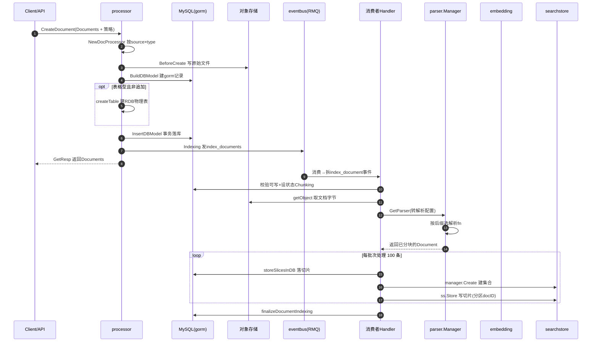

# RAG 知识库系统深度解读

> 模块：`backend/domain/knowledge`（知识库领域）+ `backend/infra/document`（解析/检索）+ `backend/infra/embedding`（嵌入）
> 叙事主线：**扣子把「文档→切片→embedding→索引→检索→重排→注入 Agent 上下文」整条 RAG 链路做成领域内可插拔的 processor/searchstore/embedding 三层抽象，索引走异步事件、检索走 eino 并行链，让一个知识库能被 Agent 的 tool 与 workflow 节点同时复用。**
> 协作：知识被 Agent 运行时/工作流注入上下文，见 [`agent-runtime.md`](agent-runtime.md) 与 [`workflow-engine.md`](workflow-engine.md)；持久化实体见 [`data-model.md`](data-model.md)。

## 一句话定位

知识库是对抗大模型幻觉、注入专业知识的**地基设施**。它承接 RAG 全流程：文档上传→解析→分块→向量化→索引检索→重排→拼进 LLM 上下文。去掉它，Agent 的「记忆/知识注入」能力整体消失，企业级垂直场景（报表答疑、私域知识问答）的准确率与可溯源能力断崖式下跌。

## 在项目中的角色

- **`domain/knowledge`**：领域层（最重），含 processor（入库管道）、service（用例）、entity、`internal/dal`（gorm 实体）、`internal/events`（事件）。
- **`infra/document`**：解析、检索、重排、NL2SQL 的可插拔实现（searchstore 抽象 + milvus/es/vikingdb/oceanbase 实现；parser 抽象 + builtin/ppstructure 实现）。
- **`infra/embedding`**：embedding 抽象 + ark/openai/gemini/ollama/http 实现。
- **`crossdomain/knowledge`**：跨域门面，给 agent / workflow 提供唯一入口 `DefaultSVC()`。

调用链：`api/handler → application → crossdomain → domain/knowledge → infra/{document, embedding, eventbus, rdb, storage}`。

[backend/domain/knowledge/service/knowledge.go:316-362]() 文档创建入口

<!-- anchor: func (k *knowledgeSVC) CreateDocument(ctx context.Context, request *CreateDocumentRequest) (response *CreateDocumentResponse, err error) { … 	return &CreateDocumentResponse{ -->

## 根因：RAG 链路如何被编排成「处理器管道 + 检索链」

扣子要交付商业级 Agent 知识库而非玩具级向量检索 demo，需解决：**多格式文档**（pdf/docx/md/txt/csv/xlsx/json/图片，解析策略差异 + 用户自定义分块）；**文档型 vs 表格型**（表格库按行切片、映射列类型、写独立物理表 + NL2SQL）；**异步可断点索引**（解析/向量化慢且可能失败，不能塞 HTTP 同步请求）；**多后端多召回通道检索**（向量+全文+表格 NL2SQL 三通道混合重排）；**数据一致**（切片先写 MySQL 再写向量库）。

核心取舍：**把「入库」和「检索」拆成两条相互独立的编排链**：
- **入库侧**是**状态机 + 管道**：`processor` 把「上传→建库/建表→落库→触发索引→返回」定义为 5 阶段模板方法，由数据源（custom/local）与类型（doc/table）组合出具体处理器；耗时解析/向量化/索引交给 **eventbus 异步事件**，配合 Redis 断点缓存实现可观察、可续跑、可清理重做。
- **检索侧**是 **eino compose 链**：`query rewrite → [vector ∥ es ∥ nl2sql] → rerank → pack`，多召回通道并行执行再合并，天然映射到 eino 的 `AppendParallel`。
- 二者通过**统一 searchstore 抽象**落地到不同向量/全文后端，只上层定义 `Indexer + Retriever + Delete` 三件事。

## 核心结构：三层抽象 × 两条编排链

### processor 管道——「数据源 × 文档类型」的模板方法组合

`processor/interface.go` 定义 5 阶段：`BeforeCreate → BuildDBModel → InsertDBModel → Indexing → GetResp`。base 提供通用实现，`init.go` 工厂按 `DocumentSource × DocumentType` 决定具体子类（`customDoc / customTable / localTable`）。新增数据源或类型只写差异子类，公共逻辑全在 base 复用。

[backend/domain/knowledge/processor/impl/init.go:50-84]() 处理器工厂按来源×类型选择

<!-- anchor: func NewDocProcessor(ctx context.Context, config *DocProcessorConfig) (p processor.DocProcessor) { … 		return base -->

### searchstore 抽象——把「索引 + 检索 + 删除」绑成一组能力

`SearchStore` 复合了 eino 的 `indexer.Indexer` 与 `retriever.Retriever` 并追加 `Delete`——一个实例天然同时是「写入器+读取器+删除器」。`Manager` 负责集合生命周期（Create/Drop/GetSearchStore），`GetType()` 区分 `TypeVectorStore` 与 `TypeTextStore`。`impl.go:New` 固定装配 ES 全文 + 一个向量 store（milvus/vikingdb/oceanbase 按 `VECTOR_STORE_TYPE` 二选一），向量+全文双通道同时在线。

[backend/infra/document/searchstore/impl/impl.go:42-52]() 双 manager 固定装配

<!-- anchor: func New(ctx context.Context, conf *config.KnowledgeConfig, es es.Client) ([]Manager, error) { … 	return []searchstore.Manager{esSearchstoreManager, mgr}, nil -->

检索参数经 eino 的 `WrapImplSpecificOptFn` 下沉后端差异，`dsl.go` 抽象一套 `Op Eq/Ne/Like/In/And/Or` 结构，milvus 转 milvus 表达式、ES 转 bool 查询。

### 检索链——eino compose 的可并行多通道编排

`Retrieve` 用 eino `compose.NewChain` + `AppendParallel` 构建四段：rewrite（多轮查询改写）→ 并行向量/全文/NL2SQL/pass-context → rerank → pack。每条通道返回 `[]*schema.Document`，在 rerank 节点按 `SearchType` 决定取哪些通道合并（hybrid 取 vector+es、semantic 取 vector、fulltext 取 es、nl2sql 始终可加）。

[backend/domain/knowledge/service/retrieve.go:68-92]() 检索链的并行编排

<!-- anchor: 	chain := compose.NewChain[*RetrieveContext, []*knowledgeModel.RetrieveSlice]() … 		AppendLambda(packResult). -->

### 异步索引 + 断点缓存

`processor.Indexing` 只发 `IndexDocumentsEvent` 进 eventbus。消费者内拆 `index_documents → index_document → index_slice` 三级事件，配合 Redis 缓存 `index_doc_cache` 实现断点续传，`batchSize=100` 批量写库与 searchstore，依据 `ErrKnowledgeNonRetryableCode` 决定重试/丢弃。

[backend/domain/knowledge/internal/events/events.go:21-24]() 索引事件构造器

<!-- anchor: func NewIndexDocumentsEvent(knowledgeID int64, documents []*entity.Document) *entity.Event { -->

## 关键数据结构（精简）

- **`Knowledge`**（库，`format_type` 0文本/1表格/2图片）1→N **`KnowledgeDocument`**（文档）1→N **`KnowledgeDocumentSlice`**（切片），另有 `KnowledgeDocumentReview`（解析预览审核）。
- `KnowledgeDocument` 存 `uri`（对象存储指针，内容不入库）、`source_type`（0本地/2自定义/103飞书/104Lark）、`parse_rule`/`table_info`（JSON）。
- `KnowledgeDocumentSlice` 的 `content` 留在 MySQL 但**检索不从这里走**——真正的检索维度在 Milvus/ES，`hit` 累积检索热度。

[backend/domain/knowledge/internal/dal/model/knowledge_document_slice.gen.go:14-27]() 切片实体

<!-- anchor: type KnowledgeDocumentSlice struct { -->

## 核心流程

### 全链路：上传 → 解析 → 分块 → 嵌入 → 索引

### 检索 → 重排 → 注入 Agent 上下文

三种进入 RAG 检索的路径（Agent tool / Agent retriever / workflow 节点）汇合到同一个 `crossknowledge.DefaultSVC().Retrieve`，再经 eino 链产出可注入 LLM 的切片文本。完整时序见 [`agent-runtime.md`](agent-runtime.md) 的检索注入部分。

## 设计决策与权衡

### 决策一：searchstore 多后端抽象 vs 锁死单一向量库

定义 `SearchStore = Indexer + Retriever + Delete` 复合接口，ES 全文固定 + 向量后端（milvus/vikingdb/oceanbase）由 `VECTOR_STORE_TYPE` 环境变量选配。好处是「基础设施不绑定厂商」——本地用 milvus、云环境切 vikingdb、结构化用 oceanbase，业务代码零改动。代价是抽象要**覆盖各后端能力差集**：milvus 的 hybrid/RRF、vikingdb 内建 embedding、oceanbase 的 cache/batch 只能经 `WrapImplSpecificOptFn` 下沉、无法在统一层暴露。抽象保留 `FieldType`（int64/text/dense/sparse vector）这类中立于后端的能力维度，把差异包在实现内部——把「换后端」从代码改造成配置改造。

[backend/infra/document/searchstore/searchstore.go:26-31]() 复合接口

<!-- anchor: type SearchStore interface { … 	Delete(ctx context.Context, ids []string) error -->

### 决策二：表格型 vs 文档型分用两条处理管道

文档型把表格当普通文本向量化会丢失列结构语义，故表格型**每行是一个切片 + 落在独立物理表**，既能向量召回又能 NL2SQL 精确取数。代价是表格管道显著复杂（建表/改表、类型推断、追加行、Upsert 物理表、检索时拼行）。仓库保留 `enableCompactTable` 开关，把表格行压成单文本 content 换取轻量检索——同一表格能力内置「精确/紧凑」两档。

[backend/domain/knowledge/processor/impl/utils.go:41-44]() 表格追加判定

<!-- anchor: func isTableAppend(docs []*entity.Document) bool { … 		docs[0].IsAppend -->

### 决策三：异步索引如何保证一致性

索引不塞 HTTP 同步路径，发 `index_documents` 事件进 MQ，消费者按 `DocumentStatus` 状态机推进（Uploading→Chunking→Enable/Failed）。断点续传靠**幂等 + 可清理**：每批次先分配 slice ID 并缓存，`LastProcessedNumber==0` 时清理旧切片旧索引保证不残留脏数据；失败分级——`ErrKnowledgeNonRetryableCode` 置 Failed 不入队重试，其余置 Chunking 由 MQ 重投。每批次**先落 MySQL 源数据、再写 searchstore**，进度推进到批次粒度。

[backend/domain/knowledge/service/event_handle.go:416-418]() 批次处理切片的主循环实现

<!-- anchor: func (k *knowledgeSVC) batchProcessSlice(ctx context.Context, doc *entity.Document, … progressBar progressbar.ProgressBar) error { -->

## 亮点与问题

**亮点：**
1. **抽象分层的克制与中立**：`SearchStore`（写/读/删）/`Manager`（集合生命周期）/`Embedder`（dense/hybrid）/`Parser`（多格式）各单一职责，上层不感知后端差异，检索链以 `[]*schema.Document` 统一数据流贯通 eino 生态。
2. **eino 只在编排处用、不污染领域**：检索用 `compose.Chain/Parallel` 编排多通道，但领域实体（RetrieveContext/RetrieveSlice）仍自命名 DTO，仅在与 infra 边界转 `schema.Document`。
3. **表格型双轨（向量 + NL2SQL）**：把非结构化检索与结构化取数统一进同一 `Retrieve` 接口，是商用 RAG 与玩具 demo 的分水岭。
4. **进度可观测**：`progressbar` 贯穿异步索引，前端可轮询 `MGetDocumentProgress` 拿到「第几个切片/剩余秒数」。

**问题 / 风险：**
1. 抽象层能力泄漏：表格库新增「列的语义化索引」需同时改 service 的 DSL 构造与各后端实现。
2. 表格类型推断脆弱：`transformColumnType` 用首行示例猜列类型，混型/空值回落 `Unknown→String`，缺稳定 schema。
3. vikingdb/oceanbase 实现成熟度不均：milvus 最完整（hybrid/RRF/进度），其余更多是「可用」。
4. NL2SQL 注入面依赖 `rdb` 层隔离（无 DDL 权限），知识库层未见额外 SQL 形态白名单校验。

## 与其他模块协同

- **被 Agent 运行时消费**：tool 形态（`recallKnowledge`）+ retriever 形态（`knowledge_retriever`）都打进 `crossknowledge.DefaultSVC().Retrieve`——「预填充 + 按需 pull」双轨，见 [`agent-runtime.md`](agent-runtime.md)。
- **被 Workflow 消费**：`knowledge_retrieve.go` 的 `Retrieve.Invoke` 直接调 `DefaultSVC().Retrieve`；LLM 节点把切片拼进 prompt 再走 chatModel，见 [`workflow-engine.md`](workflow-engine.md)。
- **数据一致**：切片先写 MySQL 再写向量库，「Split + write vector library operation transactionality is guaranteed by the implementation itself」注释明示。
