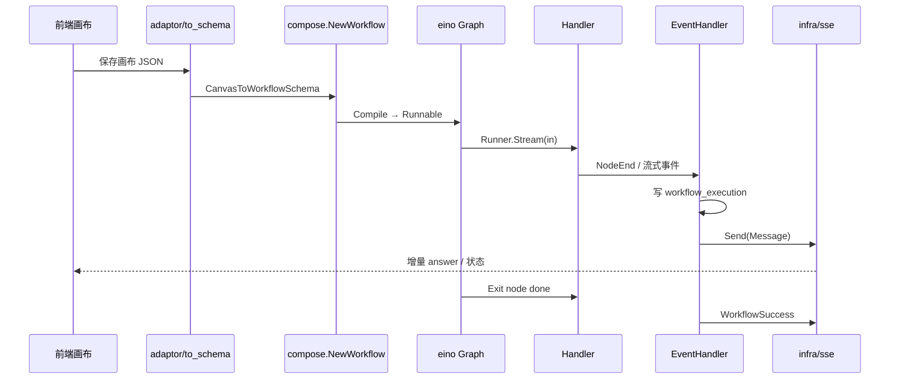
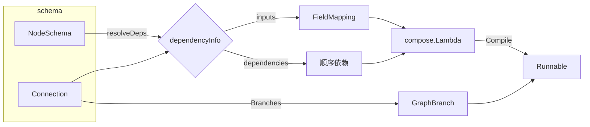

# 工作流运行时引擎（Workflow Engine）深度解读

> 模块：`backend/domain/workflow`（工作流运行时）
> 核心代码：`internal/compose`、`internal/execute`、`internal/schema`、`internal/nodes`
> 叙事主线：**扣子站在 CloudWeGo Eino 之上，把「可视化画布 JSON」编译成 eino `compose.Graph`，再挂上一套事件 / 流式 / 状态 / 中断机制，让它可执行、可流式、可恢复、可被 Agent 当作 tool 复用。**
> 协作子文档：运行时复用同一套 eino 编排，见 [`agent-runtime.md`](agent-runtime.md)；数据持久化见 [`data-model.md`](data-model.md)。

## 一句话定位

工作流运行时引擎是 Coze Studio 的**执行中枢**：用户在前端 FlowGram 画布拖拽节点（LLM/知识库/插件/工具/开始/结束/分支/循环/子工作流），后端这层把画布 JSON 变成能真正被执行的指令流。去掉它，扣子的「可视化编排能力」整体坍塌——画布只是静态 JSON、LLM 节点无法串成流水线、工作流无法被 Agent 作为 tool 调用。

## 在项目中的角色

在 DDD 分层中：`domain/workflow` 是领域层（最核心），`crossdomain/workflow` 是跨域门面，`infra/{eventbus, sse, checkpoint}` 是基础设施。调用链是 `api/handler → application → crossdomain → domain/workflow → infra`。

它被三处消费：
1. **被 Agent 复用为 tool**：LLM 节点里挂工作流，通过 `WorkflowAsTool` 把任意工作流编译成 eino tool 塞进 react agent 的 `ToolsNode`。
2. **被知识库 / 插件 / LLM 复用**：工作流节点内部其实也是 eino 图（LLM 节点就是 `template→model→convert` 子图），递归复用了同一套引擎。
3. **独立产品形态**：「Build a workflow」独立运行。

## 根因：可视化工作流如何编译成可执行图

扣子要解决四个原生问题：**异构节点**（LLM/知识库/插件/代码/HTTP 形态迥异却统一进一个图，各自支持 Invoke/Stream/Collect/Transform）；**数据流依赖**（节点间是字段级映射而非仅调用顺序）；**流式与分支**（LLM 边生成边返回、条件/循环改变路径、Agent 嵌套调的流式透传）；**中断与恢复**（工作流停在"要用户输入"后带恢复数据续跑）。

核心取舍：**不自研 DAG 执行器，而是站在 Eino 之上**，把「业务编排复杂度」翻译成 eino 的三套原语（Graph 节点、FieldMapping 字段映射、GraphBranch 分支），把「运行时横切关注点」（事件、token、流、上下文、恢复）做成包裹在 eino 之外的壳。eino 负责并行执行、流式调度、条件分支、checkpoint；扣子负责画布语义、节点能力声明、事件协议、持久化；二者以 `compose.Workflow[map[string]any, map[string]any]` 统一 map 形状互操作。

## 核心结构：三层递进

### 设计一：eino compose.Graph 作为「可执行中间表示」

画布 JSON → `WorkflowSchema` → `compose.NewWorkflow` + `Compile`，最终产物是 `compose.Runnable[map[string]any, map[string]any]`，用 `Invoke` / `Stream` 两态执行。

[backend/domain/workflow/internal/compose/workflow.go:83]() 构造 `Workflow`

<!-- anchor: func NewWorkflow(ctx context.Context, sc *schema.WorkflowSchema, opts ...WorkflowOption) (*Workflow, error) { -->

[backend/domain/workflow/internal/compose/workflow.go:318]() 编译出 Runnable

<!-- anchor: func (w *Workflow) Compile(ctx context.Context, opts ...compose.GraphCompileOption) (compose.Runnable[map[string]any, map[string]any], error) { -->

### 设计二：NodeRunner 统一节点执行壳

所有节点（无论 LLM 还是代码）最终被 `toNode` 包成 eino `compose.Lambda`，暴露四种范式。`nodeRunner` 统一实现超时（`context.WithTimeout`）、重试、错误处理三大策略（默认数据/异常分支/抛出）、callbacks 事件上报、前后处理器管线。

[backend/domain/workflow/internal/compose/node_runner.go:301]() 节点执行的 invoke 范式

<!-- anchor: func (nc *nodeRunConfig[O]) invoke() func(ctx context.Context, input map[string]any, opts ...O) (output map[string]any, err error) { -->

### 设计三：callbacks + 事件总线驱动「引擎之外」的横切逻辑

eino 每个 Lambda/Workflow/Tool 的 `OnStart/OnEnd/OnError/OnEndWithStreamOutput` 挂上扣子的 Handler，把执行生命周期翻译成 `Event`，推给 goroutine 消费（`HandleExecuteEvent`）——持久化执行历史、SSE 推流、判成功/失败/中断/取消。执行本身在 eino 图里跑，运行态发生了什么由事件总线承接，关注点彻底分离。

## 关键数据结构（精简）

### WorkflowSchema — 画布的形式化

画布 JSON 编译后的唯一事实来源，核心字段 `Nodes / Connections / Hierarchy / Branches`。`Init()` 建节点索引、组复合节点、**前向探测是否需要 checkpoint / 是否需要流式**。`doRequireStreaming()` 从 InputSources 反向构建数据流图，看「某 producer 能否 reach 某 consumer」——有径需流式、否则退化为全 Invoke，避免无谓的 Stream 调度开销。

[backend/domain/workflow/internal/schema/workflow_schema.go:35]() 画布 schema 结构

<!-- anchor: type WorkflowSchema struct { -->

### State — 跨节点共享态

eino `compose.Graph` 的 GenLocalState，承载 `NodeExeContexts`（已持久化执行上下文）、`ExecutedNodes`（幂等配合 checkpoint）、`SourceInfos`（运行时字段来源解析）、`Inputs`（中断时输入快照）、`ResumeData`（续跑数据）。通过 `RegisterSerializableType` 注册所有需进 checkpoint 的类型，保证可序列化恢复。

[backend/domain/workflow/internal/compose/state.go:39]() 图内状态

<!-- anchor: type State struct { -->

### Event — 引擎对外输出

枚举 17 种事件（Workflow 生命周期 + 节点 + 流式 + 工具调用）。`Event` 是执行器与持久化/SSE 之间唯一的「消息协议」。

[backend/domain/workflow/internal/execute/event.go:27-43]() 事件枚举与结构

<!-- anchor: const ( … ToolError             EventType = "tool_error" -->

### NodeTypeMeta — 节点能力声明

每个节点类型用一组布尔开关声明自身能力（`PreFillZero/MayUseChatModel/InputSourceAware/IncrementalOutput/PersistInputOnInterrupt`），node_runner 据此组装管线——声明式驱动而非硬编码节点差异。

[backend/domain/workflow/entity/node_meta.go:48]() 节点能力声明

<!-- anchor: type NodeTypeMeta struct { -->

### workflow_execution / node_execution — 持久化

`workflow_execution` 记录每次执行状态、输入输出、token、`RootExecutionID`（子工作流归根）、`ParentNodeID`、`CommitID`，让断点续跑、跨层审计、失败归因有据可循。

[backend/domain/workflow/internal/repo/dal/model/workflow_execution.gen.go:10-37]() 执行实体

<!-- anchor: type WorkflowExecution struct { -->

## 核心流程

### 链路一：画布 JSON → 编译 → 执行 → 流式返回

### 链路二：依赖解析与图装配

`resolveDependencies`（workflow.go:625）从节点输入字段推导三类关系：`inputs`（FieldMapping 字段走线）、`dependencies`（仅顺序）、`inputsNoDirectDependency`（字段引用但非直接连线）。`arrayDrillDown` 对「上游路径含数组」的映射自动取 `arr[0]`，避免下游收到整个数组报错。

### 复合节点 / 子工作流

`getInnerWorkflow` 把复合节点的内层子节点单独编成一个 eino 子图 `Runnable` 嵌进父图；`subworkflow` 节点用 `WithIDAsName` 直接 `NewWorkflow` 编译另一独立工作流再嵌进去——**递归复用整套引擎**。

[backend/domain/workflow/internal/compose/workflow.go:331]() 内层工作流装配

<!-- anchor: func (w *Workflow) getInnerWorkflow(ctx context.Context, cNode *schema.CompositeNode) (*innerWorkflowInfo, error) { -->

## 与其他模块协同

### 被 Agent 复用为 tool（核心跨模块场景）

Agent（eino react agent）在 LLM 节点里挂工作流作为 FC 工具。`WorkflowAsModelTool` 批量把多个工作流编译为 eino tool，返回 `[]workflow.ToolFromWorkflow`；`WithResumeToolWorkflow` 把「恢复中断」以 tool option 注入。`invokableWorkflow.InvokableRun` 处理非流式调用：从工具参数反序列化输入 → 编译执行；若内部中断用 `ExtractInterruptInfo` 把中断事件包成 `NewInterruptAndRerunErr` 抛回 eino，让 react agent 层暂停等待用户。工作流的流经 `WithMessagePipe` 的 `StreamContainer` 汇聚到 agent 侧——实现「工作流内部 LLM 边生成，agent 边透传给用户」。

[backend/domain/workflow/internal/repo/repository.go:1444]() 工作流折叠为 tool

<!-- anchor: func (r *RepositoryImpl) WorkflowAsTool(ctx context.Context, policy vo.GetPolicy, wfToolConfig vo.WorkflowToolConfig) (workflow.ToolFromWorkflow, error) { -->

> 工作流被 Agent 消费的完整链路（含 `node_tool_workflow.go` 折叠入口与断续跑）见 [`agent-runtime.md`](agent-runtime.md)。

### 复用 knowledge / plugin / LLM

- **知识库**：LLM 节点通过 `injectKnowledgeTool` 把知识库召回做成 tool 包进 react agent，也调 `crossknowledge.DefaultSVC().Retrieve`。RAG 细节见 [`rag-knowledge.md`](rag-knowledge.md)。
- **插件 / 工具**：LLM 节点的 `FCParam.PluginFCParam` 经 `wrapPlugin.GetPluginInvokableTools` 转成 `tool.BaseTool` 挂进 ToolsNode。插件系统见 [`plugin-system.md`](plugin-system.md)。
- **LLM**：`modelbuilder.BuildModelByID` 构建 eino `ChatModel`，`react.NewAgent` 用 eino 的 react 流搭 Function Call 子图。

### 与 infra 的协同

`infra/sse` 是到前端的唯一流出口；`infra/eventbus`（NSQ/Nats/Pulsar 抽象）承担异步 side-effect；`infra/checkpoint` 提供 eino `CheckPointStore` 的 Redis/内存实现供 `compose.WithCheckPointStore` 注入。

## 关键设计决策与权衡

### 决策一：用 eino compose.Graph 承载，而非自研 DAG 执行器

**Why**：低代码工作流最难的执行问题（并行、流式、分支、checkpoint）恰是 eino 已解决的。三个直接收益：**递归复用**（LLM 节点、子工作流、整个工作流都是 eino 图，三层同一执行引擎心智统一）；**社区红利**（eino 是 CloudWeGo 生态，Agent 运行时同样基于 eino，二者天然互操作）；**把精力放在画布语义 + 事件协议**。

**权衡**：深度绑定 eino 版本与 API；`map[string]any` 泛型形状让全链路弱类型，字段级映射与类型转换承担大量隐性兜底逻辑，运行时错误定位依赖这些转换器，调试成本高。

### 决策二：状态 + 事件双通道分离「执行」与「可观测/持久化」

**Why**：eino 图是执行器，不该知道 MySQL/SSE/token。用两条正交通道：**State（图内）**随 eino 图流动，承载节点需要实时共享/恢复的数据；**Event（图外）**由 callbacks handler 转成 `Event` 流，`HandleExecuteEvent` 消费做持久化、SSE、取消轮询。结束前握手（WorkflowSuccess ↔ Exit node done 双事件确认）保证落库与推送完整。

**权衡**：双通道带来状态一致性责任——事件有「时间隙」（代码注释自认 TODO），高并发下 Event channel 需缓冲；但换来执行路径与观测解耦，是生产级可审计性的来源。

### 决策三：分支用 eino GraphBranch + 异常/默认分支三等分

**Why**：画布分支来自 connection 的 `from_port`（`default/branch_error/branch_N`）。`BuildBranches` 按 port 归类，运行时 `GetFullBranch` 生成 eino `NewGraphMultiBranch`，条件函数按节点输出 `isSuccess`（异常优先）或 BranchBuilder 索引选择去向。把「画布可拖异常分支」映射到 eino 通用多路分支，异常既可用「异常分支」静默转道、也可返回默认数据降级或抛出终止。

**权衡**：异常也要消耗一个 branch 槽位，图分支数线性增长。

## 亮点与问题

**亮点：**
1. **递归自举**：工作流、子工作流、复合节点、LLM 节点全部是 eino 图，同一套 State + Handler + Runner 包裹，架构高内心智统一。
2. **声明式节点能力**：`NodeTypeMeta` 布尔开关声明能力，`node_runner` 细粒度组装管线，新增节点类型只需声明 + 实现 `NodeBuilder`。
3. **画布与执行解耦**：Canvas ↔ WorkflowSchema ↔ Runnable 三层隔离，前端可演进画布格式而不动执行内核。
4. **生产级可审计**：workflow_execution 带 `RootExecutionID/ParentNodeID/CommitID`，事件即审计，中断带 `NodePath` 精确定位并行分支。

**问题 / 风险：**
1. 双通道状态一致性弱：State（图内）与 Event（图外）各自推进，高并发多并行中断时对齐薄弱。
2. eino 深度绑定：eino 升级会波及全部 `compose.*` 调用点与 `RegisterSerializableType` 注册表。
3. `map[string]any` 泛型之痛：全链路弱类型输入输出，`preTypeConverter` 承担大量隐性转换/兜底。
4. node_runner 对每个节点都做完整管线（超时/重试/错误/callbacks），纯 transform 类节点也走完整壳，有性能冗余（工程权衡）。
