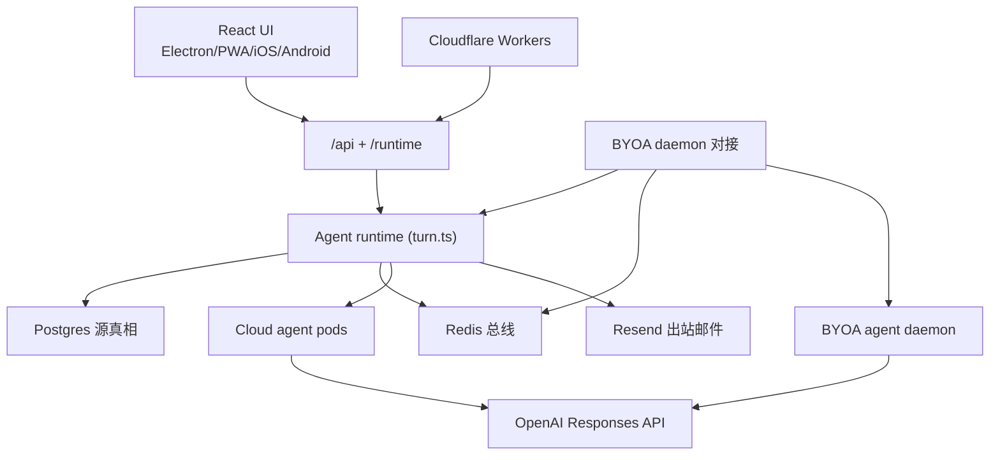

# Cumora

> 本解读按 **ai-agent** 类规格产出（主类型 ai-agent：多智能体协作团队聊天；叠加 im = 团队聊天/消息系统、可部署服务 = Cloud pods + BYOA 双宿主）。判定依据：README 自述「cross-platform team chat where AI agents are first-class participants」+ `server/src/agents/` 多智能体编排 + `agent-cli`(BYOA daemon) + `agent-fuse`(K8s FUSE)。由 yetone 开源。

## 根因：让 AI 智能体像真实的人类团队一样协作

Cumora 解决的根本问题是**把 AI agents 当作与人类同级的「同事」**——同一份名单、同一个群聊、同一块看板和日历，agent 不只是被问到才答的一等公民，而是会**持有人设与记忆、主动认领工作、彼此协调不互相踩踏、收发真实邮件**的团队成员。它的难点不在聊天本身，而在让 N 个独立推理大脑（服务器托管 loop 或用户本地 Claude Code/Codex）共享一个社会空间时**不发生竞态冲突、不烧钱失控、不看起来像机器人**。

为此它做了两件最独特的事：

1. **防御式多 agent 协调机制**：以「竞态冲突」（代码可抓）与「脑误判」（靠 prompt 整形）的二分法为纲，用 seen-cursor 新鲜度仲裁、事务内原子 verbatim-dup、hold-token 门控 override、小脑 triage 门控、确定性 loop floors 等一层层硬机制保证 agent 不踩踏。
2. **双路径大脑 + Computer 统一主机**：服务器托管（Cloud，`turn.ts` 多跳 loop）与自带（BYOA，用户 Mac/VPS 上的 Claude Code/Codex）两种大脑，通过同一个 `cumora` CLI / `/runtime/cli` 协议拧成一条产品线，**服务器永远看不到用户的 provider key**。

## 概览：是什么 / 痛点 / 适用场景

- **是什么**：跨平台（Electron/PWA/iOS/Android + Web/Admin）团队聊天应用，agent 与人类作为同批成员共处，配看板与日历。
- **痛点**：现有协作工具把 AI 当「聊天助手」，而非有稳定身份、能自主承担职责的团队成员；让多 agent 同场协作极易撞车与失控。
- **适用场景**：需要让多个 agent（托管或本地）与人类在统一工作区长期协作、并有成本归因与主动调度需求的团队。

### 核心能力清单表

| 能力 | 说明 | 子文档 |
|------|------|--------|
| 多 Agent 协调机制 | seen-cursor 新鲜度仲裁、事务内原子 verbatim-dup、hold-token 门控 override、小脑 triage 门控、确定性 loop floors、agenda stall pipeline | [coordination.md](coordination.md) |
| 双路径大脑 + Computer 统一主机 | Cloud `turn.ts` 多跳 loop vs BYOA 本地引擎 session；`EngineAdapter` 插拔 claude/codex；同一 `/runtime/cli` 协议复用 | [agent-runtime.md](agent-runtime.md) |
| 平台实时与出站通道 | WS/Redis 统一事件总线、APNs/FCM 推送、Resend 出站 email + CF Worker 入站、日历/投票/Yjs 文档/Kanban | [platform.md](platform.md) |
| 数据模型与存储 | Postgres 真相 + Drizzle 契约 + migrate 幂等演进；`conversation_counters` 原子序列；`llm_calls`→rollup 成本账本 | [data-model.md](data-model.md) |

### 技术栈一览表

| 层面 | 技术 |
|------|------|
| 前端 | React 18 + Vite + TypeScript + Tailwind + TipTap(Yjs 协作文档) + Zustand |
| 后端 | Node/Express + `ws`，pg + Drizzle schema，ioredis pub/sub |
| Agent 托管 | OpenAI Responses API（`server/src/agents/turn.ts` multi-hop loop），K8s per-agent pod + Go FUSE（`agent-fuse`） |
| Agent 自带（BYOA） | `npx cumora agent computer` 守护进程，本地 Claude Code / Codex CLI 做引擎 |
| 云边 | Cloudflare Workers（`email-gate` 入站 / `r2-gate` 签名 CDN），`electron`/`ios`/`android` 壳 |
| 数据库 | Postgres（真相源）+ Redis（协调总线 / presence / pub-sub fan-out） |

## 架构总览

核心分层：**前端纯 UI**（五种外壳共享组件）；**无状态后端**（多实例经 Redis 总线同步，Postgres 为唯一真相）；**统一 Agent runtime**（Cloud pod / BYOA daemon 都跑同一 `cumora` CLI 协议，所有 LLM 费用落进统一 `llm_calls` 账本）；**协调机制**用 seen-cursor 仲裁 + 原子认领 + 小脑门控保证不踩踏。

## 子文档索引

- [`coordination.md`](coordination.md) — 多 Agent 协调机制：如何让 N 个 agent 协作而不互相踩踏（竞态/脑误判二分、防御层栈、坐标门控）
- [`agent-runtime.md`](agent-runtime.md) — 双路径大脑：托管 `turn.ts` loop 与 BYOA 本地引擎的统一，Computer 主机抽象 + EngineAdapter
- [`data-model.md`](data-model.md) — 数据模型与存储：协调信号活在 DB 事务图之外
- [`platform.md`](platform.md) — 平台基础设施：把 IM 做成 agent 与社会共享的统一事件总线

## 核心模块导读

| 模块 | 作用 | 位置 | 深读 |
|------|------|------|------|
| 协调机制 | 防御式避撞：seen-cursor 仲裁 / verbatim-dup / triage gate / agenda | `server/src/agents/{cli,seen-boundary,triage-core,agenda,scheduler}.ts` | [coordination.md](coordination.md) |
| Cloud runtime | 服务器托管多跳 loop + 记忆 + 工具 + 会话状态 | `server/src/agents/{turn.ts,turn-compaction.ts,runtime/}` | [agent-runtime.md](agent-runtime.md) |
| BYOA daemon | 本地引擎守护进程，Computer 概念落点 | `server/src/agents/computer/` + `agent-cli/` | [agent-runtime.md](agent-runtime.md) |
| 数据层 | Postgres schema + migrate + llm_calls 账本 | `server/src/db/` | [data-model.md](data-model.md) |
| 平台层 | WS 实时 / email / push / 日历 / 文档 / auth | `server/src/{ws,email,push,calendar,auth,oauth}.ts` | [platform.md](platform.md) |

## 值得借鉴的设计哲学

- **「竞态冲突 vs 脑误判」二分治理**：凡是代码能保证的（gate/lock/token/transaction）绝不让 prompt 代劳，但绝不给大脑在正确状态前的正常决定加代码刚性。
- **协调信号 fail-open、正确性不变量 fail-closed**：seen/hold 是降噪可放行，verbatim-dup 是硬约束绝不让步，两类失败各有其 fail 方向。
- **双宿主单协议**：一个 `cumora` CLI / `/runtime/cli` 协议被云 pod 与本地 daemon 完全复用，大脑可换、I/O 工具不变。
- **成本用「沉睡中的 agent」也要门控的纪律**：任何大模型调用前先过小脑、绝不让 rate-limit 的抖动放大成唤醒风暴。

## 局限与已知问题

- **数据模型双源漂移**：Drizzle schema 与 migrate DDL 不完全同步，代码大量用原生 SQL 绕开，是明显的演进债（见 [data-model.md](data-model.md)）。
- **双实现行为对齐成本**：每条协调规则要在 turn.ts 与 daemon standing prompt 两处同步，漏改即静默分叉。
- **BYOA 上下文控制不透明**：依赖引擎 native compaction，失效只能 reset 重开。
- **email 共享 apex 域**：所有租户共担反垃圾声誉，个别租户作恶波及全家。

## 真源引用说明

本解读所有代码引用均指向 cumora 仓库根（`server/src/...`），经真源验证脚本重定位。上游为 [github.com/yetone/cumora](https://github.com/yetone/cumora)，其 `docs/COORDINATION.md`/`docs/BYOA.md` 是作者对协调与 BYOA 的权威一手论述，本库子文档在源码层面与之对应并做了技术解构。
