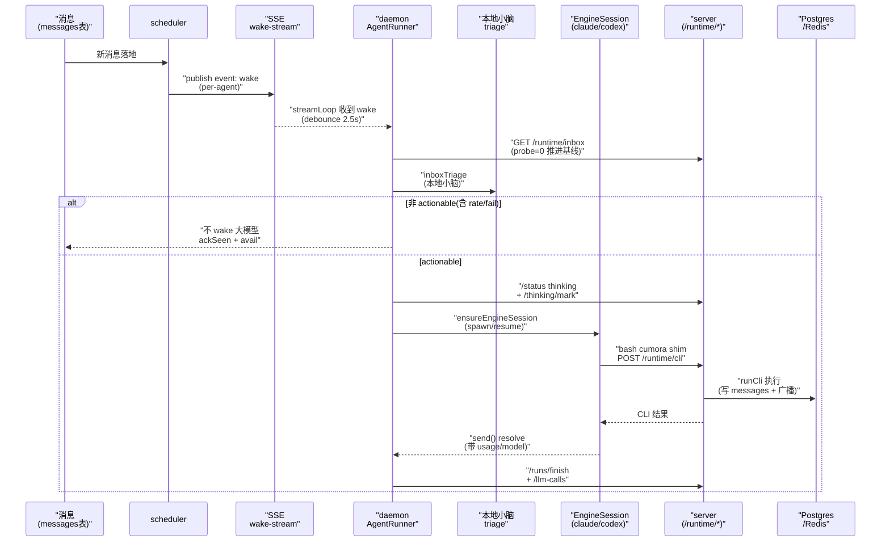

# 双路径大脑：托管 loop 与 BYOA 的统一，以及 Computer 主机抽象

> 本解读按 **ai-agent** 类规格产出。本文是 Cumora 的 **Agent Runtime / 双路径 brain** 关注面深读。核心论点：**Cumora 不发明新推理后端，而是用「同一个 `cumora` CLI / `/runtime/cli` 协议」把托管（Cloud）与自带（BYOA）两种大脑拧成一条产品线；`Computer` 是统一的主机心智模型，`EngineAdapter` 是可插拔引擎。** 协调机制见 [`coordination.md`](coordination.md)，平台实时/出站通道见 [`platform.md`](platform.md)。

## 在项目中的角色

这是把「AI agent 的脑子」接到 Cumora 聊天产品上的全部接线层。去掉它，Cumora 还是一个能收消息、能协调的聊天框架，但**没有任何 agent 会思考、会说话、会动手**——它只是空转的参与者表。它承担三件事：

1. **托管 loop（Cloud 路径）**：`server/src/agents/turn.ts` 的 `runAgentTurn` 是服务器上每个 agent 的「一回合执行器」。
2. **BYOA loop（本地路径）**：`server/src/agents/computer/daemon.ts`（用户 Mac/VPS 上的守护进程）把每个 wake 转交给本机 `claude`/`codex` CLI，推理完全发生在用户机器上。
3. **统一主机抽象（Computer）**：`computer/registry.ts` 定义 `ComputerKind = cloud | local | vps` 与 `EngineId = managed | claude | codex`，把云 pod 和用户自带机器统一成「agent 跑在某个 Computer 上」。

## 解决的根本问题

**agent 的「意识」从哪来，且怎么让托管与自带引擎在同一产品模型下运作（服务器永不碰用户 provider key）。**

Cumora 复用两套业界现成的大脑，并在这两层坚持同一铁律：**每次 agent 真正「思考」都必须先经小脑门控（triage gate），小脑同意才允许动用大模型。** Cloud 路径在 `turn.ts` 内用 server 侧 `classifyInboxTriage` 判定（[server/src/agents/turn.ts:1865-1873]()）：

<!-- anchor:       const verdict = await classifyInboxTriage({ -->

BYOA 用本地小脑（claude→haiku / codex→gpt-5.4-mini）跑，代价记在用户账号、不留服务器（[server/src/agents/computer/daemon.ts:1076-1078]()）：

<!-- anchor:   /** Triage the inbox on the LOCAL small brain. The whole point of BYOA is that -->

关键：**triage 绝不 fail-open 到无脑 wake 大模型**——daemon 对「rate-limited」和「fail-open」两种小脑异常都拒绝唤醒大模型并退避。

## 核心抽象

### Computer：统一主机概念

三态在 [server/src/agents/computer/registry.ts:22-30]()：

```ts
export type ComputerKind = 'cloud' | 'local' | 'vps'
export type EngineId = 'managed' | 'claude' | 'codex'
```

- **cloud**：Cumora 托管，总是 online，engine = `managed`（turn.ts + orchestrator 起的 K8s pod）。
- **local / vps**：用户配对机器，engine = `claude` 或 `codex`。**两者在代码上等价**（区别仅在语义），调度都用同一个 `isByoaKind`（[server/src/agents/computer/registry.ts:425]()）。

调度分支看 `resolveAgentHost`，回答「一个 wake 该催哪个 pod 还是唤醒用户机器」。**托管↔自带切换不是改架构，而是改一台 `participants` 上的 `computer_id + engine` 列**（[server/src/agents/computer/registry.ts:434]() 的 `assignAgentToComputer`）。

### EngineAdapter：可插拔「大脑」

`engine.ts` 把「跑一个本地回合」抽象成 `EngineAdapter` 接口（[server/src/agents/computer/engine.ts:274-300]()）：

```ts
export interface EngineAdapter {
  readonly id: EngineId
  seedHome(home, persona): Promise<void>   // 铺设 CLAUDE.md / AGENTS.md / memory/ / skills/
  run(args): Promise<EngineRunResult>      // one-shot 兜底
  startSession?(args): EngineSession | null // 持久会话（首选）
  classify(args)                            // 本地小脑
  probe / probeWake                         // doctor 健康探针
}
```

claude / codex 两个实现：持久会话为主（claude 走 stream-json，codex 走 app-server JSON-RPC），`startSession` 返回 null 时退到 one-shot `run`。两种模式都提供 **same-turn steering**（`steer(text)`）：一条直接 DM 在 turn 中到达时被注入正在跑的 turn，agent 回答后再继续，而非排队等 turn 结束。

### Cumora I/O 面与大脑解耦：同一份 CLI 两种宿主复用

这是把两条路径拧成一条产品线的粘合剂：引擎（无论云 pod 里的 `cumora` 还是用户机器上的 shim）都通过**同一个 `/runtime/cli` 协议 + 同一个 `cumora` CLI 语法**交互，server 侧 `buildRuntimeArgv` 统一执行（[server/src/agents/runtime/server.ts:90-99]()）：

<!-- anchor: runtimeRouter.post('/cli', withAgent(async (c, req, res) => { -->

于是 `cutting`/`reply`/`dm` 这些业务逻辑只写一遍，两种宿主只是「怎么把 `cumora` 命令送进 server」的传输层差异。**大脑（推理引擎）可以换，I/O 工具不变**——这是能支持 claude/codex 两引擎的根本原因。

## 托管 loop vs 本地引擎 loop 的本质差异

**一句话：turn.ts 是「服务器被动作的推理循环 + 服务器自身 compaction」；BYOA 是「引擎自带的 agentic loop + native 上下文管理」，Cumora 只递 wake、gate（triage）、frame 紧凑 turn prompt、记录可观测性。所以 turn.ts 对 BYOA 被完全 bypassed。**

| 维度 | 托管 Cloud（turn.ts） | BYOA 本地（daemon + engine） |
|---|---|---|
| 推理执行者 | server 进程（getLlmClient） | 用户机器上的 `claude`/`codex` 子进程 |
| 多跳循环归属 | server 写死 `for(hop<MAX_HOPS)` | **引擎自带 agentic loop**，Cumora 不数 hop |
| 上下文管理 | turn-compaction（LLM 摘要 splice）| **引擎 native auto-compaction** |
| 停止条件 | server 判定 | **引擎判定 turn 结束** |
| 成本记账 | server `recordLlmCall` 每 hop 一行 | daemon `HopReporter` 批量 POST `/llm-calls` |

### 托管 turn.ts 的 multi-hop loop

骨架是 `for (let hop = 0; hop < MAX_HOPS; hop++)`（[server/src/agents/turn.ts:2396]()）：过硬阈值 → 进程内 auto-compaction → `client.responses.create({ input: history, tools })` → 收到 toolCalls → 执行工具 → 回注 history → 下一 hop。**停止条件显式**：`set_turn_status` 经 `verifyTerminalCompletion` 语义验收 → break；声明终态被拒 → 注回原因继续；不声明 → nudge 最多 2 次要状态，仍不给则 `protocol_violation`；循环耗尽则 `cap_reached`。

它不用 OpenAI 的 `previous_response_id`（sub2api OAuth 拒绝它），改用进程内全量 `history` 重发——用 token 换供应商兼容，配套 compaction 抵消。每条 hop 单独 `recordHop` 记账（[server/src/agents/turn.ts:2580]()）。

### BYOA 的 turn prompt 极短

daemon 给引擎喂**一回合很短的 turn prompt**（standing scaffold + 每次的 delta），引擎自己跑完 agentic loop。turn.ts 被完全绕过有三个理由：执行点不同（推理在用户子进程）、协议不同（原生 stdin/RPC）、职责划分（Cumora 只做 wake/gate/frame/observe）。turnPrompt 只在会话没带 standing prompt 时内联整段 scaffold（[server/src/agents/computer/daemon.ts:1416-1422]()）：

<!-- anchor:   private turnPrompt(session: EngineSession | null, delta: string): string { -->

## 关键流程（BYOA wake → turn 生命周期）



要点：**triage 门槛永远先于大模型**；`?probe=1` 的读取不推进 freshness 基线（[server/src/agents/runtime/server.ts:133-142]()），供「要不要打扰正在忙的 turn」等探索用：

<!-- anchor:   const probe = String(req.query.probe ?? '').trim() === '1' …     const { recordSeen } = await import('../seen-boundary.js') -->

## 记忆 / 会话状态

**BYOA 的记忆就是磁盘文件**：`CLAUDE.md`/`AGENTS.md`（persona header，`seedHome` 幂等铺一次）、`memory/MEMORY.md`（记忆索引，`PERSONA_HEADER` 明确告诉 agent「说 will remember 没用，必须写文件才算数」）；每次 wake 把 `MEMORY.md` 前 4000 字符塞进 turn prompt。

**standing prompt 一次性 out-of-band 注入**是关键：不变的操作脚手架只在会话 spawn 时经引擎原生通道注入一次（claude 用 `--append-system-prompt-file`，codex 用 `developerInstructions`），每 turn 只发很短 delta，transcript 小到引擎 native auto-compaction 跟得上。

**`/thinking/mark-unmark`：Redis 每个 convo 一个 ZSET**（score = 首次 claim 的 ms 时间戳）实现「谁在写」的可视信号，`ZADD NX` 保留先到者，`peekThinking` 按 score 升序返回。turn 结束由 `unmarkThinking` 清掉，顺带清除本 turn 未用的 HELD ack（见 [`coordination.md`](coordination.md) 的 token 死亡条件）。

## 工具调用与 Skill 体系：单工具 + CLI 子命令 = 大脑 I/O 解耦的落点

Cumora 对工具调用的设计极简，却直指「大脑可换、I/O 工具不变」的根因：**LLM 的响应模型只暴露一个 `bash` 工具，其余所有能力（发 DM、拉群、react、调色板、图片生成、私有状态）都是 `cumora` CLI 的子命令**——新增能力 = 加一个 CLI 子命令，无需更新 LLM 工具 schema（[server/src/agents/tools.ts:40-40]()）：

<!-- anchor: * capability = adding a CLI subcommand; no LLM tool definition update needed. -->

服务端 `executeTool` 分发 `bash`/`dm_with`/`pull_group`/`react`/`palette` 等，并把每次调用写进 `tool_calls` 表便于审计（[server/src/agents/tools.ts:43-56]()）。BYOA 路径的工具面 = 同一个 `cumora` shim 写进 agent home 的 `bin/`，与 Cloud pod 完全一致。

**Skill 体系按 Agent Skills 规范实现**（`server/src/agents/skills.ts:1-19`），落在 `agent_workspace` 虚拟文件系统上。核心是**渐进式披露**：wake prompt 只列每个 skill 的 `name + description`（约 100 token/skill），agent 真正要用时才 `cumora skills read <name>` 把完整 SKILL.md 拉进下一轮上下文，脚本/参考/资源文件同样按需加载（[server/src/agents/skills.ts:9-9]()）：

<!-- anchor: * Progressive disclosure is the whole point: the wake prompt lists ONLY -->

**Skill 是 per-agent 的**：Iris 装一个 skill 不会给 Atlas（镜像 `agent_workspace` 语义），想共享就发消息让对方自己拉取安装。SkillHub 搜索/安装走 manifest 校验（路径穿越、大小、重名防护）。

## 与其他模块的协同

- → **[`coordination.md`](coordination.md)**：freshness 基线推进只发生在「真正展示给大脑」的读取（`/runtime/inbox` 默认推进、`?probe=1` 不推进）；turn-end 的 `unmarkThinking` 清 `reply:*` hold token，是协调「token 死亡三件套」的 turn 边界清理点。
- → **[`data-model.md`](data-model.md)**：Cloud 每 hop 落一行 `llm_calls`、BYOA 批量 POST，落进同一 `llm_calls` 账本（`source` 区分）；`/runs` 构成 run 级可观测。
- **FUSE**（`agent-fuse`）：Cloud pod 的 `/workspace` 由 Go FUSE 挂载 agent 的 `agent_workspace` 切片，文件写回 DB，给 pod 一个「本地文件幻觉」而无需直连 PG；BYOA 是真实磁盘目录。两者对 turn 都是「一个可读写工作目录」。

## 关键设计决策与权衡

### 决策一：Computer 三态 + `engine` 列一个字段决定托管/自带（而非两套系统）

让「把 agent 从云搬到自己的 Mac」变成一次 UPDATE。为这个统一付出了**两条推理循环必须行为对齐**的代价——同样的 triage gate、同样的 GLANCE_YIELD_RULES、同样的 seen-cursor，否则同一 agent 换宿主后行为漂移。替代方案（两套独立协议）代价是产品语义分裂 + 账本/协调两套实现。

### 决策二：turn.ts 不用 `previous_response_id`，改用进程内全量 `history` 重发

sub2api 的 OAuth `/v1/responses` 拒绝 `previous_response_id`。代价是每 hop 重付历史 input token（所以配 compaction）；收益是绕开供应商限制、历史完全本地掌控。一次「用 token 换供应商兼容」的典型取舍。

### 决策三：BYOA 的上下文管理交给引擎 native compaction

不自己 compaction（不像 turn.ts），靠 standing prompt out-of-band 注入让每 turn 输入极小，然后信任引擎自己的 claude-compaction/codex contextCompaction。代价是把上下文控制权交给了不透明实现，只能靠 `carriesStandingPrompt` 间接感知；若某引擎版本 compaction 失效，用 `mustResetSession` 兜底重开。

## 亮点与风险

**亮点**：
- **双宿主单协议**：一份 `cumora` CLI / `/runtime/cli` 被云 pod 和本地 daemon 完全复用，是互换的根本。
- **铁的小脑门槛**：Cloud 和 BYOA 在「任何大模型调用前先过 cerebellum gate」上严格一致，BYOA 对 rate-limited/fail-open 明确不 wake 大模型并退避，从根上防住历史上一度发生的「130 次 rate-limit 刷屏」。
- **可观测全链路**：每 hop 一行 llm_calls、run 级 `/runs`+`/events`+heartbeat，让「这个 agent 的钱花在哪个 hop」可精确回答。

**风险**：
- **BYOA 上下文控制不透明**：native compaction 是黑盒，失效只能 reset，可能丢中间状态。
- **双实现行为漂移**：任何新增协调规则要在 turn.ts 和 daemon standing prompt 两处同步，漏改即静默分叉（仓库里已见过 BYOA 静默案例）。
- **BYOA 记忆是文件、Cloud 是 DB 向量检索**：虽路径命名一致但检索机制不同，换宿主后记忆检索行为不同，是潜在的统一工作。
