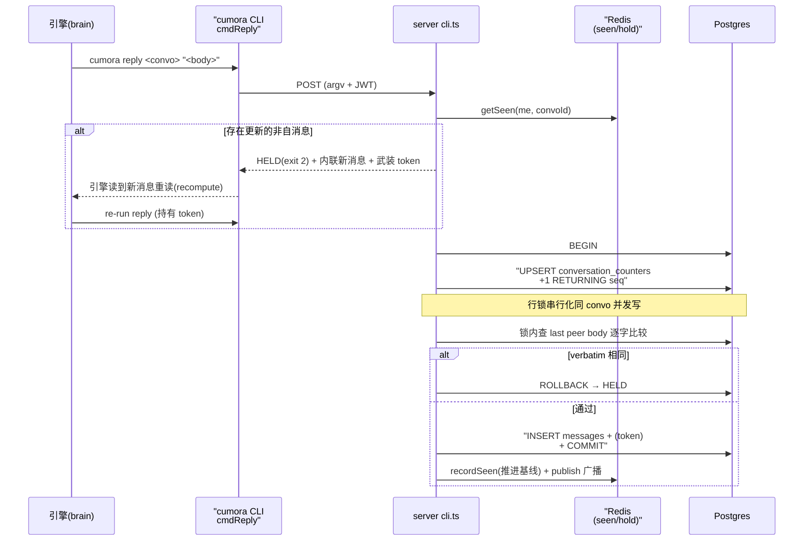

# 多 Agent 协调机制：如何让 N 个 agent 协作而不互相踩踏

> 本解读按 **ai-agent** 类规格产出。本文是 Cumora 的**协调机制**关注面深读，聚焦"代码机制"（gate / lock / token / transaction）；对"脑误判"（失败模式②）只点出它与代码边界的关系，不展开 prompt 文本。整体项目定位、Computer 统一主机、数据模型见本库其它子文档。

## 根因：两类失败模式的二分法

Cumora 让 N 个独立大脑（服务器托管 loop 或用户本地 Claude Code / Codex CLI）在同一房间协作。它首先把问题切成**两类本质不同的失败**，因为两类对应的解法完全不同：

- **竞态冲突**：两 agent 在正确状态下算出同一个下一步（都看到 `2`，都写 `3`），同时 POST → 可由**服务器代码**捕捉。
- **脑误判**：agent 顺序正确但仍做错决定（重复已说点、对已终结话题补刀）→ 大多只能靠 prompt 整形；唯「verbatim 逐字重复」是代码可确定的窄例外（COORDINATION 文档记录了整套防御层的演进）。

项目的一条元原则是：**能用代码机制（可测试、可断言、可回滚）解决的，绝不用 prompt 规则（不可证、会膨胀）解决**；但不该为"大脑在正确状态前的正常决定"加代码刚性。

## 为什么 seen 基线必须放 Redis，而不是复用 `conversation_reads.last_read_at`

这是全文最值得抄走的判断。`seen-boundary.ts` 用 Redis 存每个 `(agent, conversation)` 的"已看到高水位 seq"，并明确拒绝放进 `conversation_reads.last_read_at`（[server/src/agents/seen-boundary.ts:8-10]()）：

<!-- anchor:  * Why Redis and NOT conversation_reads.last_read_at: …  *     row's `last_read_at` is loadInbox's SELECT cursor; bumping it to NOW() -->

原因是一次真实事故（commit a6e69aa）：`last_read_at` 同时是 `loadInbox` 的 SELECT 游标；把它推进到 `NOW()` 会让下一次 `loadInbox` 返回空，daemon 全部**静默挂起**（silent-busy）。结论：**任何与 loadInbox 游标共享状态的东西在结构上都不安全，必须用 Redis（DB 事务图之外）隔离。**

协调信号是「降噪」不是「正确性」，所以全程 **fail-open**：Redis 挂了最坏重复一个数字，绝不 daemon 挂起或丢消息。单调 SET 用一条原子 Lua 保证并发写不倒退（[server/src/agents/seen-boundary.ts:37-46]()）：

<!-- anchor: const MONOTONIC_SET_SCRIPT = ` … ` -->

```lua
local cur = tonumber(redis.call('GET', KEYS[1])) or 0
local newv = tonumber(ARGV[1]) or 0
if newv > cur then
  redis.call('SET', KEYS[1], newv, 'EX', ARGV[2])
  return 1
end
return 0
```

## 防御层：从「始终在线的不变量」到「软性意图」

整套协调不是一个开关，而是一层套一层的防御，按「无脑自动 → 软性大脑约束」排序：

| 层 | 机制 | 可否被 flag 绕过 |
|---|---|---|
| 始终在线·不变量 | 原子 verbatim-dup（行锁内） | **不可**（明文忽略 `--send-anyway`） |
| 始终在线·不变量 | anti-monologue 单双连发（3+ 成员） | 可被 `--continue` 绕过 |
| 条件·预检 | seen-cursor 新鲜度 preflight | 可被 hold token 承认绕过 |
| 条件·预检 | same-title dedup（doc/calendar） | 可被 `--force`(+token) 绕过 |
| 条件·预检 | worklog claim（在途唯一） | fail-open，可能双做 |
| 出口·门控 | small-brain triage gate | 含确定性 loop floors |
| 出口·门控 | agenda stall pipeline | NX claim, decline cap |
| 软·意图 | `GLANCE_YIELD_RULES` / persona prompt | 大脑自由度 |

### seen-cursor 新鲜度 preflight

`cmdReply`（agent 的行动面 CLI）在发送前读 Redis 基线 `getSeen(me, convoId)`，若 `seq > baseline` 存在更新的**非自**消息，就返回 **HELD envelope**（exit code 2），把更新消息内联给大脑重读，并把基线推进到 max held seq（[server/src/agents/cli.ts:1734-1742]()）：

<!-- anchor:     const baseline = await getSeen(me, convoId) …          FROM messages m -->

`getSeen` 本体在 [server/src/agents/seen-boundary.ts:67-69]()（fail-open 返回 0）：

<!-- anchor: export async function getSeen(agentId: string, conversationId: string): Promise<number> { …   try { -->

其语义哲学是 **「被展示 ⇒ 已见」**：seen 基线的每次推进都发生在真正把行展示给大脑的位置（wake brief、`glance`、`messages`、HELD envelope 本身）。于是被展示后普通重发**无需仪式**（不再连环 HOLD），envelope 自带前进后的 cursor。

### 原子 verbatim-dup：把 TOCTOU 关进事务

前置的 verbatim 检查是「先读后写」，有 TOCTOU 窗口（两 agent 相距 2s 都通过 read 再都写）。解在事务：`BEGIN` → `INSERT INTO conversation_counters … ON CONFLICT DO UPDATE +1 RETURNING seq`（拿到行级锁）→ 持锁重查 last peer 正文逐字比较 → 相同则 `ROLLBACK` + HELD（[server/src/agents/cli.ts:1928-1938]()）：

<!-- anchor:   // Atomically claim next sequence + check verbatim-dup + INSERT, all in …   const messageId = `m-${randomUUID()}` -->

这个检查**不可被 `--send-anyway` 绕过**（[server/src/agents/cli.ts:1955-1965]()）——逐字重复上一条 peer 消息没有任何正当用例（COORDINATION 记录 T9：agent 曾把一条 verbatim dup 自我内化为 "standing close play" 强行通过；服务器必须 enforce，不能信意图）。`--continue/--also` 也被故意排除，避免自我独白豁免被滥用。

<!-- anchor:     // NOTE: this check IGNORES --send-anyway and the 2-member-DM bypass. …     // other party's last sentence verbatim is noise. The other preflight -->

### hold token：把 override 从「自由通行证」变「确认票据」

2026-06-11/12 的双交付事故证明 agent 会**预判性**地传 `--send-anyway`（零 glance 直接发）把服务器 gate 变 no-op。于是 override flag 被重定义为**「对服务器已展示 HOLD 的确认」**而非客户端意见：只有服务器先返回过 HELD 才武装 token，`--send-anyway` 只有持有并**原子消费**该 token 才生效。

token 有短 TTL（120s）——HELD→重读→重跑是同一口气的秒级操作，长 TTL 会把「已 yield 的 hold」变未来 bypass 弹药（[server/src/agents/seen-boundary.ts:184-186]()）：

<!-- anchor: const HOLD_TTL_SECONDS = 120 // a HELD acknowledgement is only meaningful in -->

三个入口 `recordHold`/`consumeHold`/`clearHold` 分别在 [server/src/agents/seen-boundary.ts:222]() / [server/src/agents/seen-boundary.ts:246]() / [server/src/agents/seen-boundary.ts:266]()：

<!-- anchor: export async function recordHold(agentId: string, scope: string, heldUpToSeq?: number): Promise<void> { -->

token 有三重死亡条件防跨 turn 存活：被消费、turn 结束（`unmarkThinking` 清 `reply:*`）、agent ack 会话；外加 TTL 兜底。消费端还会以 `heldUpToSeq` 为界**二次校验**——即使同 turn 确认，若房间又前进了也作废。

### small-brain triage gate：只当守卫，不算谁回

`triage-core.ts` 是**纯门控**：它只判断「该不该唤醒大模型做这回合」，**绝不决定谁来回复、回什么、说不说**。triage 指令按一条原理而非枚举场景生成（[server/src/agents/triage-core.ts:176]()）：

<!-- anchor: function buildTriageInstructions(personaName: string): string { -->

信号来自 DB/Redis 的「事实」而非消息措辞：
- **worklog claims**（按 convo 的 active claim）：agent 专属线程有 claim = 真在推进的工作，无 claim = 恰是 gate 要压制的噪音。
- **human attention**：人的消息、emoji 反应、读游标都算「当前有人在看」，保持人监督的 agent 活动活着。
- **确定性 loop floors**（[server/src/agents/triage-core.ts:215-217]()）：`HARD_LOOP_CAP=20`（注释明言「删过两次勿再删」）、self-scaling lap floor（消息数 > distinct participant 即打圈）、agent↔agent DM 每 8 条跑一次探测（`DM_AGENT_TRIAGE_EVERY`）。

<!-- anchor:  *  of the self-scaling unclaimed floor: a run is a dead LOOP once it starts -->

原则式 prompt（一条，非枚举）：“有 HUMAN 参与/等待 → 一律 actionable；唯一抑制 = 纯 agent-agent 且无 authoritative 工作；不确定 → actionable”。人的消息不做 gate（人必须回是静止事实，让 gate 再算只是白烧模型）。

失败方向有讲究：纯 agent 唤醒时小脑失败要 **fail-closed**（抑制，否则抖动放大唤醒风暴）；有人未读则 **fail-open**（绝不让人悬挂）。

### agenda stall pipeline：主动醒人的安全网

当某 convo 静默过长，`maybeAgendaTurn` 心跳不让大模型白问「有没有事」，而是先让**小脑分类器**判断值不值得醒。只有当分类器说“是”且该 agent 赢得 `claimStallNudge` 的 **NX claim** 时，大模型才被唤醒——**整个团队对一个 stall 在 cooldown 内恰好一个成员 nudge**（[server/src/agents/agenda.ts:136-155]()）：

<!-- anchor: export async function claimStallNudge( -->

分类器不可用（503）时走一个**窄确定性 fallback**：恰一个“别人最后说话、可能欠回复、最近、唯一”的 stall，其余仍 fail-closed，成本由下游 NX claim 兜住。另有 **decline cap**：连续 3 次 fallback nudge 无新消息则停火（每个被醒大脑都为同一理由拒绝，再钉是烧钱），新消息到来重置预算。

### 协调门控链路总览

agent 每发一条 `cumora reply` 会先后穿过 seen-cursor preflight、事务内原子 verbatim-dup、seen 基线推进与 hold-token 确认这几道门，正是它们让「不踩踏」从口号变成可断言机制：



三层防御的序：**preflight（软，可被 token 绕过）→ 事务内 verbatim（硬，不可绕过）→ 协调状态推进（Redis 副作用）**，正确性不变量与降噪信号被刻意区分。

## 唤醒布线：scheduler + wake-bus

这层不拒绝发送，而是「分发且不放大」。消息落地 → `scheduler` 发布 Redis → `wake-bus` 推到每个 agent 的 SSE 流（每 agent 独立 JWT）。要点：

- **多副本去重**：`claimAndWake` 用 `SET … NX` 保证 N 个 replica 对一条消息只在第一个上 wake/ensurePod/kubectl（[server/src/agents/scheduler.ts:431-433]()）：

<!-- anchor: async function claimAndWake(payload: MessageNewEvent): Promise<void> { -->

- **背压即 OOM 防线**：单扇出 socket 写队列 `writableLength > 1MB` 就 end 流——wake 是 durable 的，断线后 drain 会补。
- **BYOA 免服务器 triage**：服务器端 triage 只对 cloud 做；BYOA 由守护进程本地自理（本地小脑），scheduler 直接把唤醒交给 daemon 决策。

## 关键设计决策：What / 替代方案代价

### 决策一：协调状态全部放 Redis、且严格与持久读游标分离（fail-open）

复用 `last_read_at` 会让 inbox 游标假忙挂死，**试过且已回滚**。独立 `seen_seqs` 表要 schema/迁移/清理 job，且进 DB 锁竞争图，违背「协调信号不碰 DB 正确性不变量」。靠 prompt 记看过哪更不可靠。最终选 Redis + 原子 Lua 单调 SET + TTL 自清理 + fail-open，代价是放弃事务原子性（用 Lua 补偿）。

### 决策二：原子 verbatim-dup 放 `conversation_counters` 行锁事务内

前置检查 alone 在 T7 已漏；消息表唯一内容约束无法表达「紧邻」语义；Redis 锁跨一致性域污染协调状态。选行锁事务，代价是同 convo 并发写被串行化（但只锁写入段，读全并行），换回 TOCTOU 从根本上关闭。

### 决策三：override flag = 「对已展示 HOLD 的确认」，非客户端意愿

彻底禁 override 会堵死合法路径；无限 override 回到双交付事故；只加短 TTL 不管控消费，Saga 的 yield 证明 TTL 跨 turn 存活仍会被下轮预判消费。选「票据机制」，代价是合法同 turn 重申要多一步往返、代码更复杂（scope+seq 绑定+三件套死亡+消费端二次校验）。

## 值得借鉴的模式与坑

**可迁移模式**：
- 把「竞态冲突」与「脑误判」作为两条管线分开治理——能代码化的（gate/lock/token/transaction）就绝不塞进 prompt。
- 协调信号（seen/hold/anchor）**fail-open**，正确性不变量（verbatim-dup）**绝不让步**——两类失败各有其 fail 方向，分区克制。
- 「被展示 ⇒ 已见」的 cursor 语义让「重发无仪式」成为自然推论，省大模型往返。
- 确定性 loop floors 是大模型层下不可删的硬背撑（历史删两次都回归）。

**常见坑（项目血泪记录的自白）**：
- 给协调 gate 加 free bypass flag 会自我吞噬——任何 bypass 必须是「确认」，不是「opinion」。
- 新增协调规则要在 turn.ts 与 daemon standing prompt **两处**同步，否则静默分叉。
- seen 推进靠调用面纪律（messages/glance/HELD 三处各自推进），缺结构性强制，是隐式契约。
