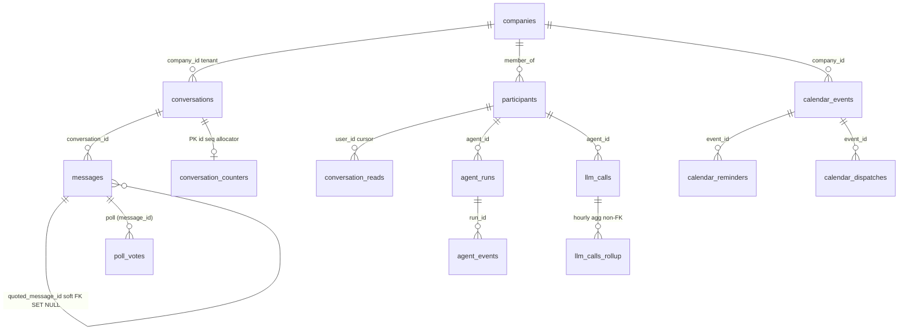
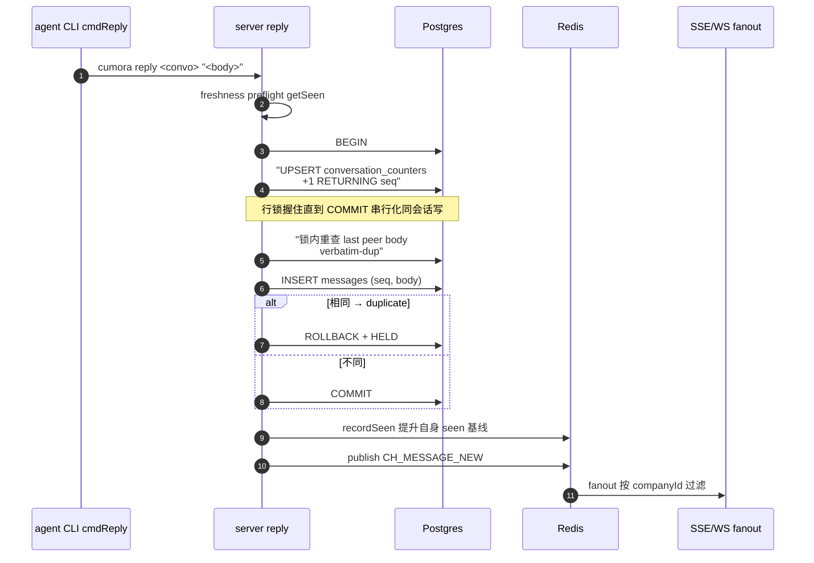
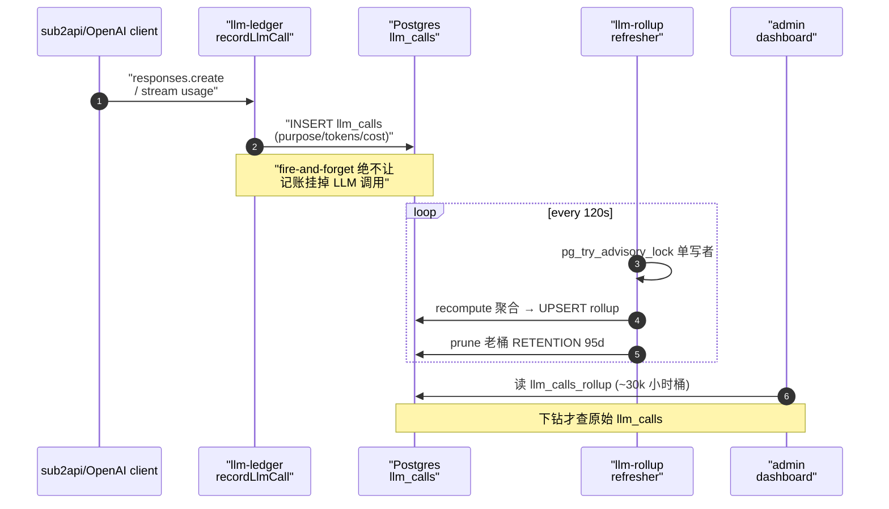

# 数据模型与存储：协调信号活在 DB 事务图之外

> 本解读按 **ai-agent** 类规格产出。本文是 Cumora 的**数据模型**关注面深读（数据模型主动探测命中：`server/src/db/schema.ts` 为 Drizzle 建表入口）。核心论点是：**Postgres 是唯一真相，Redis 是协调总线，二者用一条清晰边界隔离；这套数据模型直接支撑协调机制与成本归因。**

## 在项目中的角色

Cumora 把 agent 当作与人类同等的一等参与者，聊天因此不是临时状态，而是 agent 的「工作记忆 + 会话历史 + 记账本」——全部落在一个强类型关系型真相源（Postgres）里。数据模型承担三类角色：

1. **会话事实（source of truth）**：`conversations`/`messages`/`participants`/`conversation_reads` 是全部聊天的权威存储；Redis 只做跨实例通知扇出与轻量协调，**从不存储聊天事实**。
2. **agent 的世界模型**：`agent_workspace`（虚拟文件系统）、`agent_memory`、`agent_runs`/`agent_events`（每次思考的可追溯轨迹）。
3. **成本账本**：`llm_calls`（逐次通用账本）+ `llm_calls_rollup`（预聚合）+ `agent_triages`（小脑门控的经济学凭证）。

一条贯穿全部的分层哲学：**Postgres 是唯一的真相；Redis 是「快、易失、防呆」的协调总线；Drizzle 是编译期 schema 契约；migrate.ts 是幂等的进程内演进器。**

## 存储选型与理由

### 为什么 Postgres 做源真相 + Drizzle 做强类型契约

- Postgres 提供关系一致性原语：`messages.sequence` 单调递增依赖 `conversation_counters` UPSERT 的**行级锁**；`quoted_message_id` 的 `ON DELETE SET NULL` 软外键；`company_id` 多租户过滤 + 每表索引。
- **JSONB** 让「一部分结构化、一部分自由」的 payload 共栖：`messages.reactions/tool/attachment/poll` 全是 JSONB；字段要参与 SQL 过滤时提升为独立列/表（`poll_votes` 从 `messages.poll` 旁路提升，[server/src/db/migrate.ts:1420-1432]()）：

<!-- anchor: ALTER TABLE messages ADD COLUMN IF NOT EXISTS poll JSONB; -->

- **Drizzle 不是运行期 ORM，而是编译期 schema 契约**：`schema.ts` 用 `pgTable` 声明列类型 + 主键 + 索引 + `$inferSelect` 推导（[server/src/db/schema.ts:1]()）。真正落库的表结构由 `migrate.ts` 的幂等 DDL 演进——**二者并不完全等同**（见下「演进债」）。
- 连接池配了护栏：`statement_timeout: 60_000` + `idle_in_transaction_session_timeout: 30_000` 防止一条未索引热查询占死全部槽位（[server/src/db/pool.ts:11-16]()）——注释直接点名历史事故：`idle.ts` 的 `MAX(created_at)` 全表扫描把池子吃光、整站 503。

<!-- anchor:   // Defense-in-depth against connection-pool exhaustion. A single slow or stuck …     // at ~8s each and 503-ed the entire API. 60s is far above any healthy request -->

### 为什么 Redis 做 seen 基线 / pub-sub / presence，而不是塞进 DB

**核心教训**：`seen-boundary.ts` 用 Redis 存每个 (agent, conversation) 的「已看到高水位 seq」，并**明确拒绝**放进 `conversation_reads.last_read_at`（[server/src/agents/seen-boundary.ts:8-10]()）：

<!-- anchor:  * Why Redis and NOT conversation_reads.last_read_at: …  *     row's `last_read_at` is loadInbox's SELECT cursor; bumping it to NOW() -->

> 历史提交 a6e69aa 曾把 seen 基线放进 `conversation_reads`，而该表同一行 `last_read_at` 恰是 loadInbox 的 SELECT 游标；把 seen 基线推进到 NOW()，下一轮 loadInbox 就「以为已看完」而返回空，daemon 全部**静默挂起**。任何与 inbox 游标共享状态的东西在结构上都不安全。

这是全仓库最核心的设计格言：**协调信号必须活在 DB 事务图之外。** Redis 的 pub/sub 通道常量是跨 pod 扇出总线（`CH_MESSAGE_NEW` 等）；单调 SET 用原子 Lua 保证并发写不倒退。seen/hold/anchor 都 fail-open——它们是降噪不是正确性，最坏重复一条，绝不挂死 turn；对比 `conversation_counters` 的 sequence claim 是**正确性**，绝不能 fail-open。

## 实体关系总览（ER 图）

## 核心表设计

### conversations（会话；[server/src/db/schema.ts:3-14]()）

| 字段 | 类型 | 约束 | 说明 |
|---|---|---|---|
| id | text | PK | 会话主键 |
| kind | text | NOT NULL | `group`/`direct`；migrate 增至含 `email` |
| title / subtitle | text | | 标题 / 副标题 |
| members | jsonb | NOT NULL | 成员 id 数组，配 GIN 包含索引 |
| pinned / tag | bool/text | | 置顶 / 自由标签 |
| company_id | text | ALTER 增加 | 多租户归属 |

**职责**：`kind` 区分消息形态，`members` 用 GIN 索引支撑 loadInbox 的 `@>` 包含查询。

<!-- anchor: import { pgTable, text, integer, timestamp, jsonb, boolean, index } from 'drizzle-orm/pg-core' … export const conversations = pgTable('conversations', { -->

### messages（消息；[server/src/db/schema.ts:16-41]()）

| 字段 | 类型 | 约束 | 说明 |
|---|---|---|---|
| id | text | PK | `m-<uuid>` |
| conversation_id | text | NOT NULL, FK CASCADE | 所在会话 |
| author_id | text | NOT NULL | 用户 id 或 agent id |
| kind | text | NOT NULL | text/tool/attachment/thought/system/email/poll |
| body | text | NOT NULL | 正文 |
| sequence | int | NOT NULL | 会话内单调序（协调刻度的权威）|
| reactions / tool / attachment / poll | jsonb | | 富载荷混合存储 |
| quoted_message_id | text | 软 FK, ON DELETE SET NULL | 引用线程 |
| ind | | (conversation_id, sequence) 等 | 覆盖最热读取 |

**关键设计**：`sequence` 不是 `created_at` 的替代，而是**顺序仲裁的权威**——协调机制的 seen 基线、HELD 确认的 `heldUpToSeq` 都以它为整数刻度（单调、无重复、紧凑，适合「已看到 ≤ N」阈值比较），因为 `created_at` 有微秒级同刻冲突。

<!-- anchor: import { pgTable, text, integer, timestamp, jsonb, boolean, index } from 'drizzle-orm/pg-core' … export const messages = pgTable( -->

### conversation_counters（序号分配器；[server/src/db/schema.ts:56-62]()）

| 字段 | 类型 | 约束 | 说明 |
|---|---|---|---|
| conversation_id | text | PK, FK CASCADE | 与会话一一对应 |
| next_sequence | int | NOT NULL DEFAULT 1 | 下一个待分配 seq；UPSERT 行锁原子 claim |

**为什么用独立窄表而非 `MAX(sequence)+1`**：后者高并发下两条 INSERT 竞争同一 MAX 得重复 seq 或读-改-写竞态；窄表一行做到 compare-and-set 的原子语义。agent 的 `cmdReply` 把 sequence claim + verbatim-dup 检查 + INSERT 放进**一个事务**，`ON CONFLICT DO UPDATE` 的行锁把并发写同会话的请求串行化（[server/src/agents/cli.ts:1942-1947]()）。

<!-- anchor:       `INSERT INTO conversation_counters (conversation_id, next_sequence) …       RETURNING next_sequence - 1 AS seq` -->

### participants（参与者=人类+agent；[server/src/db/schema.ts:43-54]() + migrate 复合 PK）

| 字段 | 类型 | 约束 | 说明 |
|---|---|---|---|
| id | text | 复合 PK (id, company_id) | 参与者 id，可跨租户重复 |
| kind | text | NOT NULL | agent / human |
| name / initial / avatar_bg | text | | 显示 + 头像回退 |
| status | text | NOT NULL | presence：avail/resting（lease，非永久真相）|
| tools / system_prompt | jsonb/text | | agent 工具集 + 系统提示 |
| computer_id / engine / model / fast_model | text | ALTER 增加 | BYOA 归属 + 引擎 + 模型覆盖 |

**设计要点**：`participants` 同时容纳人和 agent（`kind` 区分），`status` 是**租约**（busy lease 带刷新时间戳，读者过期回落），不是持久真相——presence 走活跃度而非布尔。

<!-- anchor: import { pgTable, text, integer, timestamp, jsonb, boolean, index } from 'drizzle-orm/pg-core' … export const participants = pgTable('participants', { -->

### llm_calls（通用成本账本；[server/src/db/migrate.ts:251-290]()）

| 字段 | 类型 | 约束 | 说明 |
|---|---|---|---|
| id | text | PK | `llm-<uuid>` |
| company_id / agent_id / run_id / conversation_id | text | nullable | WHO：租户/agent/turn/会话 |
| purpose | text | NOT NULL | 业务目的 |
| source | text | NOT NULL DEFAULT cloud | cloud / byoa-claude / byoa-codex |
| model | text | NOT NULL | 模型 id |
| input/cached_input/cache_creation/output/reasoning_tokens | int | NOT NULL DEFAULT 0 | 缓存感知分割 |
| cost_usd | double | NOT NULL DEFAULT 0 | 插入时计价 |
| latency_ms / status / error / extras | | | 结果 + WHY 标签 |

**设计要点**：写路径 fire-and-forget（INSERT 失败只 log 不重抛，绝不让记账挂掉 LLM 调用）；`source` 区分托管与 BYOA，让两宿主成本可比。

<!-- anchor: CREATE TABLE IF NOT EXISTS llm_calls ( …   source                TEXT NOT NULL DEFAULT 'cloud', -->

### llm_calls_rollup（预聚合；[server/src/db/migrate.ts:309-333]()）

| 字段 | 类型 | 约束 | 说明 |
|---|---|---|---|
| bucket_hour | timestamptz | NOT NULL | 小时桶 |
| company/agent/purpose/model/source/daemon_version | | 复合唯一(NULLS NOT DISTINCT) | 维度键 |
| calls / ok / failed / rate_limited | bigint | | 预组状态计数 |
| *tokens / cost_usd | bigint/double | | 预组总量 |

**为什么**：原表 ~470k 行、100% 在 30 天窗内，6 个聚合并发全表扫 5-25s；rollup 缩到 ~30k、~230ms。唯一键用 `NULLS NOT DISTINCT` 唯一索引（PG15+）让两个 NULL-company 桶合并。刷新用 **recompute 而非增量**——每 tick 从原始表重新聚合最近窗口再 UPSERT，幂等自愈（[server/src/agents/llm-rollup.ts:95-96]()）。

<!-- anchor: const lock = await client.query<{ ok: boolean }> … if (lock.rows[0]?.ok !== true) return { skipped: true } -->

## Schema 演进策略（migrate.ts）

演进模型是**幂等 boot schema 建立**。核心机制：

1. **一切 `IF NOT EXISTS` 化 + 老表靠 `ALTER … ADD COLUMN IF NOT EXISTS`**——`CREATE TABLE IF NOT EXISTS` 对旧表是 no-op，新列必须另走 ALTER，让已有 prod 库平滑演进。
2. **advisory lock 串行化多实例迁移**（[server/src/db/migrate.ts:1747]()）：`SCHEMA_LOCK_KEY` 用 `pg_advisory_lock` 让同时 boot 的多个 pod 只有一个执行 DDL，其余排队发现全是 no-op。
3. **`lock_timeout='5s'`** 防止 DDL 与实时流量死锁（注释点名一次 prod 事故：两副本同时 unhealthy、LB 502）。
4. **锁冲突但 schema 已最新 → 跳过**而非崩溃循环：`schemaAlreadyCurrent` 用哨兵表判断已是最新。
5. **`CONCURRENTLY` 索引放事务外、best-effort**（热表 `GIN`、`llm_calls` BRIN），重启不阻塞 boot。
6. **一次性数据迁移内嵌**：多租户 `company_id` 逐表 ALTER + 回填、participants 单列 PK → 复合 PK 探测式换键。

<!-- anchor: const SCHEMA_LOCK_KEY = 7_643_178_926_104n -->

## 读写路径

### 消息写入链路（sequence claim + 协调 HOLD → fanout）

核心写路径：agent 的 `cmdReply` 在**一个事务**内做 sequence claim + verbatim-dup + INSERT（协调机制子文档详述）；人类走 `/messages`。写后推进自身 seen 基线、publish `CH_MESSAGE_NEW` 扇出。read 路径靠 `conversation_reads` 每用户游标 + `ROW(...) > ROW(...)` 词典比较取 unread tail。

### 成本账本写入 → 预聚合 → admin 读取链路

## 与全局的系统关联

- **支撑协调机制**：`conversation_counters` 行锁原子 claim、`sequence` 单调刻度、`seen-boundary` 基线，三者构成「协调信号在 DB 事务图之外」的两面。
- **支撑成本归因**：`llm_calls.source`（cloud/byoa-claude/byoa-codex）+ rollup 维度列，让「这个 agent 的钱花在哪个 hop、是买模型还是工具链」可精确回答，为托管↔自带的可比性提供数据基础（见 [`agent-runtime.md`](agent-runtime.md)）。

## 关键设计决策与权衡

### 决策一：协调信号放 Redis、与 inbox 游标严格分离（fail-open）

把 seen 基线放 DB 曾让 daemon 静默挂死（a6e69aa）；放 Redis 失去事务原子性，用原子 Lua 单调 SET + TTL 自清理 + fail-open 补偿。产出的正是「降噪而非正确性」的分层：**协调用易失状态，且绝不与持久化读游标共享行**。

### 决策二：Drizzle schema 与 migrate DDL 双源（演化中的债）

`schema.ts` 只声明 6 张核心表，真正落库 40+ 张、列由 migrate 大量 ALTER 加列（`company_id`/`topic`/`model` 等），Drizzle 类型在核心表上落后于实际结构，`$inferSelect` 无法反映新增列。实际代码大量用原生 `pool.query` 绕开。**演进债**：迁移在 DDL 层完全自洽、幂等、并发安全，但 Drizzle 契约失同步——建议后续 `drizzle-kit pull` 重生成或只以 DDL 为真相。

### 决策三：llm_calls 通用账本 + 细粒度 rollup（重算而非增量）

逐次 INSERT 保真但扫不动（470k→30k）；rollup 用 recompute + UPSERT 换来自愈与前向兼容，`NULLS NOT DISTINCT` 合并 NULL 维。代价是每次刷新重扫最近窗口（~150ms，可接受）。

## 亮点与问题

**亮点**：
- 原子 sequence claim + 锁内复核（vberbatim-dup 复核也在这里），一张窄表扛住跨实例串行写 + TOCTOU 闭合。
- 成本账本「缓存感知」：`cached_input_tokens` 分列、`cost_estimated` 标估，是观测设计的标杆。
- migrate 的「防 DDL 死锁」工程完备（advisory lock + lock_timeout + 哨兵 skip + boot retry + CONCURRENTLY 外移）。

**问题**：
- Drizzle 与 migrate 双源漂移（如上决策二），属最值得后续治理的点。
- email/boards/documents/shipping 表多而杂（40+ 张，每张 3-5 个索引），部分表缺 `created_at` 主清列，后台 GC 依赖裸 `created_at` 的假设可能落空。
- `quoted_message_id`/`company_id` 等软 FK 全靠约定，无 DB 层强制。
