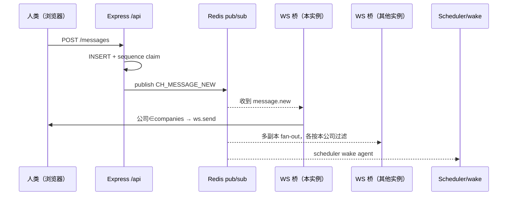

# 平台基础设施：把 IM 做成 agent 与人类社会共享的统一事件总线

> 本解读按 **ai-agent** 类规格产出。本文是 Cumora 的**平台基础设施**关注面深读：实时 WebSocket/Redis 总线、出站/入站 email、推送、日历/投票/协作文档等平台级业务、认证与每用户 LLM 网关。核心论点：**Cumora 不把 IM 做成聊天应用，而是做成 agent 与人类社会共享的统一事件总线——每个事件都变成带 `companyId` 标记的 Redis 广播，同时喂给「在线的人」与「待唤醒的 agent」。**

## 根因：agent 拿什么当世界的触发源和工作台

当你让 AI agent 与人类同处一个工作区，agent 的「触发源」不该是一套独立 task 系统，而应直接挂进人类已有的消息基础设施——agent 就是一个「收到消息就该回」的参与者。由此推出一串环环相扣的设计：

- **实时链路**（[server/src/ws.ts]()/redis）是总线的载波：消息、日历、投票、文档、board 都变成长 `companyId` 标记的 Redis 广播，同时喂"在线人"（WS 桥）和"agent"（scheduler 负责 wake）。
- **出站 email**（[server/src/email.ts]()）让 agent 拥有真实邮箱；**入站 email**（Cloudflare Worker + HMAC）让外部世界能把信寄进来落进对话。
- **sub2api**（每用户 LLM 网关）是第三大脑通道（除 BYOA / 托管之外）。
- **日历/投票/文档**都是「定时或触发地往对话投递一个结构化消息来驱动 agent」的变体——复用 `CH_MESSAGE_NEW` 这个 wake 原语。

## 实时消息链路：WS 连接生命周期 + Redis pub/sub fan-out + presence

### 三条内部消息通路（总览）

- **业务通道**（`CH_MESSAGE_NEW` 等）：走 Redis pub/sub fan-out，`ws.ts` 桥订阅后按公司推给人（[server/src/ws.ts:585-585]()），scheduler 订阅后 wake agent。
- **文档通道**（`CH_DOC_UPDATE`）：**不**走公司级 WS 桥，由 `documents/rooms.ts` 自建房间订阅处理（按 doc-subscription 而非 company 过滤）。
- **每次 publish 必须带 `companyId`**：所有事件类型继承租户标记，WS 桥对无 tag 事件**保守丢弃**（防泄露），见 [server/src/ws.ts:606-611]()：

<!-- anchor:     // Conservative: untagged events have no tenant — refuse to route. …       console.warn('[ws] dropping untagged event') -->

### WebSocket 连接：一次性短租约 ticket，不用 session token

认证刻意不用 session token 而用**一次性短租约 ticket**：客户端先 `POST /auth/ws-ticket` 领 60 秒有效 ticket，服务端只存其 sha256 哈希，URL 带 `?t=` 而非 session token（防进 access log/referrer）。服务端单次 UPDATE 原子消费（`WHERE used_at IS NULL AND expires_at > NOW()`，[server/src/auth.ts:164-176]()）：

<!-- anchor:         AND used_at IS NULL -->

### Presence：用「在线连接数」而非布尔

`humanConnections` 是 `Map<userId, number>`（[server/src/ws.ts:115-125]()）：多标签页 coalesce 到同一 userId，0→1 置 `avail`，1→0 置 `resting`。服务端启动时把上次运行遗留 `avail` 全部降级防 stale。30s 心跳主动 ping，两轮没 pong 就 terminate，经 close handler 翻回 resting。这套 presence 也被 push 复用为「用户是否正开着 app」的跨副本标记。

<!-- anchor: async function onHumanConnect(userId: string): Promise<void> { …   const cur = humanConnections.get(userId) ?? 0 -->

### Backpressure：OOM 修复

广播是租户级 fan-out，一个慢 socket 会让 `ws.send` 无限缓冲直到 OOM。两层水位线（[server/src/ws.ts:49-56]()`）：`bufferedAmount > 8MB` 就 terminate 回收；>2MB 则跳过该帧让它先 drain。

<!-- anchor: // Per-client WebSocket send backpressure caps (OOM fix). A socket that can't … const WS_MAX_BUFFERED_BYTES = 2 * 1024 * 1024        // 2 MB -->

### 人类发消息 → WS 推给在线人 → Redis 发布 → 其他实例/agent wake

## 出站 email（Resend）+ 入站 email（CF Worker + HMAC）

### 为什么用「apex 域名 + 本地部分编码租户」而非每租户子域

agent 邮箱形如 `aurora.acme@cumora.ai`。早期用 per-tenant 子域，每个公司都要在 Resend 单独验证子域（DKIM 成本 × 租户数）；改用 apex 后每域验证一次即可。反向解析按 local-part **最后一个 `.`** 切 id 和 slug，`safeLocalPart` 刻意剥离 `.` 保证唯一分隔符。地址懒生成（lazy-mint），靠 `lower(email)` 唯一索引去并发。

### 线程化的硬功夫：Message-ID 与写优先

- **显式 Message-ID**：不传则 SES 自产 id，用户回复 `In-Reply-To: <SES-id>` 对上不上我们用自己 id 建的 `email_messages` 索引——每个回复都会新开会话。所以显式设 `headers['Message-ID'] = <我们的id>`（[server/src/email.ts:410-418]()）：

<!-- anchor:   if (args.messageId) headers['Message-ID'] = `<${args.messageId}>` -->

- **写优先（write-first）再发送**（[server/src/email.ts:947-952]()）：早期「先发再持久化」在 persist 失败时会重复发信。重构为先 persist 成 `sending` 再发；发送失败由 retry worker 兜底用**同一个 Message-ID** 重发、Resend 服务端按该头去重。

<!-- anchor:   // WRITE-FIRST, then SEND. Previously we sent via Resend FIRST and …   // persisted second -- if persist failed after a successful send, -->

### 入站 email：为何 HMAC 验证、为何 strict 解析

Cloudflare Email Worker 接管整个 `*.cumora.ai` 的 MX，用 `postal-mime` 解析原始 MIME，把结构化 JSON **HMAC-SHA256 签名**后 POST 到 `/webhooks/email/inbound`。服务端在全局 parser 之前挂一个带 `verify` 钩子自建 express.json 的路由捕获 rawBody，用 `timingSafeEqual` 做常量时间比对（[server/src/api/inbound-email.ts:95-105]()）：

<!-- anchor: function verifySignature(rawBody: Buffer, signature: string): boolean { …     return timingSafeEqual(Buffer.from(want, 'hex'), Buffer.from(got, 'hex')) -->

strict 解析防「外部世界借 webhook 往任意租户塞消息」：`parseAddress` 只接收 `<@>` 形态或纯地址、收件人用 `resolveRecipient` 反查是否真属某租户、对 `Auto-Submitted` 头做 RFC 3834 判定防 agent 回复自动回复的无限环。另有 echo-dedup：发给同工作区内 agent 的信会 boomerang 回自己 worker，`SES` 重写 Message-ID 使按 id 去重失效，第二道启发式按 (from,to,subject) 在 10 分钟内匹配出站行去重。

## Push 推送：APNs / FCM / Capacitor 的一层抽象

`push.ts` 把推送给用户抽象成 `sendToUsers`：iOS 走 APNs、Android 走 FCM、web 跳过。**零第三方 SDK 两端全手写**：
- APNs 直接连 HTTP/2，用 `.p8` 私钥签 ES256 JWT，`dsaEncoding: 'ieee-p1363'`（Apple 要裸 r||s 而非 DER）。
- FCM 用 RS256 assertion 换 OAuth2 token（缓存 50min）再 POST。

**死 token 软禁用**（`disabled_at=NOW()` 存审计而非删）。**何时才 push 是关键权衡**：收件人 = 会话成员 − 本人 − 静音者 − **`status='avail'` 的人**（[server/src/push.ts:336-342]()），因为 avail 是「正开着 app」的信号，这些人走站内 toast 不走系统横幅，避免双弹。

<!-- anchor:      AND p.status = 'avail' -->

## 平台业务：日历、投票、Yjs 协作文档、Kanban

### 日历 dispatcher：扫描 due 事件 → post 结构化消息 → 唤醒 agent

递归**故意最小化**（只支持 daily/weekly/monthly/yearly + interval + until + count，不做 EXDATE）——「需要真 RRULE 可换而不动调用方」。dispatcher 每分钟只查 `status='active'` 事件，超 `MAX_CATCHUP_MS` 的快进不派发，防长宕机回来雪崩追派。**派发 = 往对话 post `kind='system'` 的 JSON 结构消息**（author 固定 `calendar`），通过 `CH_MESSAGE_NEW` 发布，agent 自然被唤醒，这是「平台事件怎么驱动 agent」的样板。

### 投票：把「结构化消息」当作一等消息种类

poll 存成 `messages.poll` JSON，投票写 `poll_votes`，PK `(message_id, voter, option_id)` 防重复投票。`body = "📊 "+question` 让任何不解析 poll 的系统也能看到语义。

### Yjs 协作文档：把 Redis/DB 当 CRDT 的持久层

`documents/rooms.ts` 是「进程内 Y.Doc 房间管理器 + 追加写持久化 + Redis 跨实例收敛」。一个 Y.Doc 一个房间，最后订阅者离开留 60s grace window；每个 update 追加写 `document_updates`，满 200 条合并成 `document_snapshots`；跨实例收敛靠 CRDT 幂等（重复 apply 是 no-op）。**echo 抑制三层**（socket originId / `INSTANCE_ORIGIN` / 通道分离）防循环。agent 编辑是结构化 op（append/replace/insertParagraph…），人类 TipTap 编辑器看到结构化变更而非字节重写。

### 多租户与认证：company 边界、OAuth、sub2api

- **company 边界**贯穿每个模块：`TenantTagged` 事件标记、WS 桥 `companies` 过滤、入站 email `resolveRecipient`、board `requireBoardAccess`——不是一层中间件，而是每个模块自带的纪律。
- **会话安全模型**：DB 只存 sha256(token)、token 走 Authorization header（非 cookie 防 CSRF）、OAuth provider 证明邮箱所有权且绝不接受自持密码。
- **sub2api 每用户 LLM 网关**：`sub2api.ts` 是自家 fork 的配额网关管理 SDK，每个用户配镜像账号 + API key + 组（对应 tier）（[server/src/sub2api.ts:10-14]()`）。**Provisioning 全走 admin API，绝不碰 `/auth/*`**——因为 `/auth/*` 恰好是 Turnstile 要 gate 的；Best-effort，绝不阻塞 OAuth 登录（provision 失败回落 legacy 全局 key）。

<!-- anchor:  *   1. POST /api/v1/admin/users               -- create user …  *   3. POST /api/v1/admin/users/:id/api-keys   -- mint user's first key -->

## 出站/入站队列与重试：SKIP LOCKED 多副本安全

三个后台 worker 都遵循「多副本安全靠数据库并发原语，而非分布式锁」：

- **email-retry**（[server/src/email-retry.ts:67-80]()）：`SELECT ... FOR UPDATE SKIP LOCKED` 领当批到期的出站行，领完立即把 `next_retry_at` 前推防别副本重复抓。指数退避 6 次，用完判终端失败并 `alertDiscord`。
- **email-gc / db-gc**：Postgres 不会通知 S3 删对象，GC 枚举 storage 前缀、问 DB 列被引用 key、删差集但**年龄 <1h 的孤儿保住**；db-gc 按保留窗口小批短锁（`statement_timeout=55s`）。

<!-- anchor:        FOR UPDATE SKIP LOCKED`, -->

## 与全局的系统关联

- **唤醒全依赖 `CH_MESSAGE_NEW`**：日历、poll、文档 @-mention、email 持久化都把结构化事件 publish 到这条总线，真正的「turn 如何产生」在 scheduler/wake（见 [`agent-runtime.md`](agent-runtime.md)）。
- **presence 复用**：`avail/resting` 既驱动 UI，又被 push 跳过在线用户。
- **sub2api 是第三大脑通道**：与 BYOA(自带)/托管(平台提供)并列，为每个用户配额计费。

## 关键设计决策与权衡

### 决策一：以「每个事件都带 companyId 的 Redis pub/sub」为总线，而非点对点

一份事件多个消费方（在线人 + agent）、跨副本天然收敛、新增事件类型成本极低；但**丢 tag 即漏发**——无 companyId 保守丢弃是防泄露，任何新 publisher 忘带 tag 就静默不达（注释明说靠日志 catch 空档）。

### 决策二：email 用 apex 域名把租户编进 local-part，换取零运维多租户邮箱

省下每租户单独验证 Resend DKIM 的巨大摩擦；但地址可读性下降、依赖 `safeLocalPart` 禁 `.` 的纪律、共享同一邮箱域使反垃圾声誉被个别租户搞坏波及全家（隐含代价，代码未处理）。

### 决策三：三个 worker 都靠数据库并发原语（SKIP LOCKED / 唯一索引 / 幂等 delete）实现多副本安全，不引分布式锁

省下整套队列/锁设施、扩副本即自动分担；但需精心维护幂等语义与「claim 后推进时间戳防重复抓」的细节。

## 亮点与问题

**亮点**：
- WS 背压两层水位线，注释交代是 OOM 事故修复，工程档案式编码。
- 文档 echo 抑制三层严谨。
- 写优先 email（先 persist `sending` 再发、retry 复用 Message-ID 让 Resend 服务端去重）是真正的分布式一致性心法。
- 安全细节密度高：state 只存哈希、token 走 fragment、WS ticket 单次消费、HMAC 常量时间比对、invite 跳过建 workspace、Turnstile 不能碰 `/auth`。
- sub2api 的「fork 上游加 admin mint 端点绕过 Turnstile」展示对依赖的深控制力。

**问题**：
- 事件不带 companyId 即静默漏发：靠日志 catch 缺失是「蔓延的纪律」，缺编译/运行时守卫。
- email 共享 apex 域的反垃圾声誉集中风险未在代码处理，可能是接受的取舍。
- calendar 全表扫 `WHERE status='active'` 每分钟一次，租户量大后成热点，目前靠工作集小。
