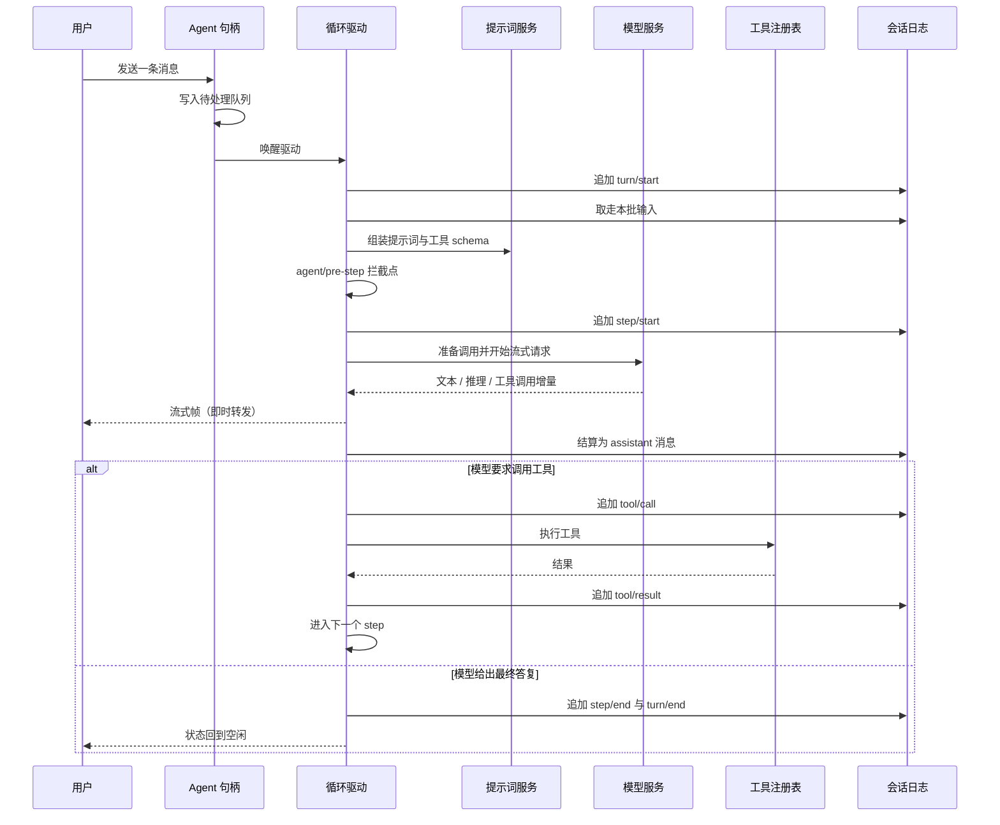
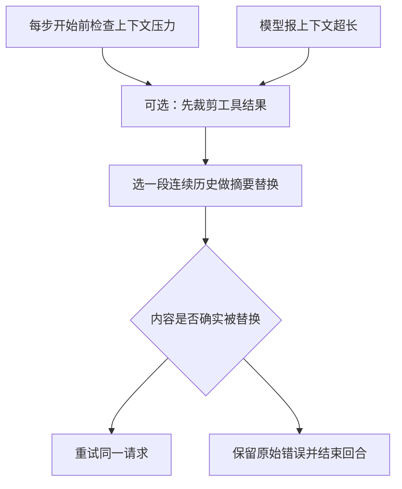

# Agent 循环与回合生命周期

这一页讲清「一次请求在系统里怎么走完」。读完你应该能回答：为什么有的内容进系统提示词、有的却以用户消息形式注入；模型报上下文超长时会发生什么；按下中断之后已经输出的内容去哪了。

## 两个词：turn 与 step

整个循环建立在两个概念上，它们定义了「欠不欠工作」：

- **step（步骤）** = 一次模型请求，加上它要求调用的那批工具（如果有）。
- **turn（回合）** = 零个或多个 step。它在第一批输入被取走之前打开，在「没有任何欠账」时关闭。

一个 turn 里可以有多个 step，因为模型可能连续要求调用工具；也可能一个 step 都没有——如果第一批输入被拦截点拒绝或改成了空。

循环的实现位于 `packages/core/agent-loop`，它对外表现为 `ctx.agentLoop`；面向插件编程用的 `Agent` 句柄接口在 `packages/core/agent`，默认由前者实现——**驱动是可替换的，扩展插件依赖的是接口**。

## 一次回合的完整链路

下图是一次典型回合：从用户消息进入，到模型答复或转去调用工具。

该看的三个细节：

- **流式帧是即时转发的，只有终结帧等落盘**。所以界面上看到的文字会比「已持久化」更超前——这是有意的：中断时已经展示给用户的文字必须保留，不能因为没落盘就消失。
- **系统提示词的提交发生在请求真正被派发之前**，而且在提交前有一次「用准备句柄的能力重新对齐」的动作。取消如果发生在这一步，系统提示词与用户消息**都不会**被提交——不会留下半截历史。
- **工具结果按模型给出的顺序提交**。即使工具是并发执行的，结果也不能越过顺序上更早、但尚未就绪的那个槽位；否则模型历史里的调用与结果会错位。

## 终止原因

一个 turn 结束总是带着一个明确原因。原因集合是闭合的，其中两个成员只会由「事后修复」产生，而不是循环实时发出的：

| 终止原因 | 触发情形 |
|---------|---------|
| 正常完成 | 模型没有要求调用工具，或调用结果显式宣告本回合结束 |
| 输出上限 | 模型因达到输出上限而停止（该状态是**粘性**的，不会被后续正常步骤降级） |
| 被拦截 | 拦截点在第一步就拒绝了本批输入 |
| 零步骤完成 | 输入被改写成空，回合开着但没花掉任何 step |
| 已取消 | 收到取消信号（用户、父代理、插件、或插件被卸载） |
| 出错 | 模型错误或其他错误链未能被插件处理 |
| 中断 | 进程崩溃后，恢复会话时**补写**的收尾（循环从不实时发出） |
| 已分叉 | 分叉出的新会话种子收尾 |

## 提示词与运行上下文怎么拼

这里有一个容易误解的地方：**模型看到的内容不是从单一模板渲染出来的，而是走三条不同通道**。

| 通道 | 内容 | 为什么走这条通道 |
|------|------|-----------------|
| 提示词分区（section） | 固定身份声明、部署人格前后缀、工具说明与工具 SDK、引用语法、计划策略、目标策略、运行上下文说明 | 需要在每次请求里稳定存在，且要参与「有序拼接 + 变量插值」 |
| 运行上下文快照 | 沙箱模式、审批策略、子代理运行环境 | 内容会变，且只需在变化时提交，不必每次重渲染 |
| 拦截点注入的用户消息 | 工作区指令文件、时间上下文、技能目录 | 它们本质上是「本次输入的一部分」，需要参与拦截点的改写与拒绝决策 |

第三条通道最容易被忽略。工作区里的指令文件（例如 `AGENTS.md`）、时间上下文、以及可用技能目录，都**不是提示词分区**，而是通过拦截点以用户角色消息注入的——这样它们和用户输入走同一条准入路径，可以被同一套策略拦截或改写。

拼接本身有两条硬规则：分区按声明顺序渲染，同名分区由作用域近的覆盖远的；**变量引用是严格失败**——引用了未注册或没有值的变量会直接抛错，而不是渲染成空。另外，某个分区可以声明自己是「完整提示词」，此时它独占最终结果，其余分区被忽略。

提示词在请求里的投递方式也值得注意：它是**会话表面上的一个系统消息节点**，而不是请求信封里的 `system` 字段。这样做的好处是——提示词的每次变化和用户消息一样，都成为可重放、可迁移的日志事实。

## 事件分域：什么持久、什么只活在进程里

循环对外发出的信号分两类，用途完全不同：

| 类别 | 例子 | 持久化 | 谁消费 |
|------|------|--------|--------|
| 会话事件 | `turn/start`、`user/message`、`assistant/message`、`tool/call`、`tool/result`、`turn/end` | 是，进会话日志 | 需要可重放转录的程序、界面历史、迁移与审计 |
| 进程内协调事件 | `agent/status`、`agent/inbox/*`、`agent/assistant-stream`、`agent/error` | 否 | 需要实时队列与状态、监听中断与错误的界面 |

**要可重放的转录就读会话事件，要实时协调就读 Agent 事件**——这是一个经常被混用的分界。流式帧本身是三态（开始、增量、结束），带尝试标识与单调递增值，便于界面做增量渲染与断线重连。

## 取消与失败回填

取消是**协作式**的，这是理解行为的关键前提：循环会在每个等待点检查信号，但**它无法强杀一个不响应信号的工具**，只能等它返回。好处是不会留下撕裂的中间状态。

一次取消会留下一组明确的收尾，而不是「什么都没发生」：

- 已经流出的文本被收尾成一条**标记为中断**的 assistant 消息；如果还没有任何内容，则记为一次「尝试」（不进模型历史）。
- 尚未派发的工具调用会得到一对合成的调用与结果，结果是一个「派发前已中止」的结构化错误——这样模型历史里不会出现悬空的调用。
- 回合以「已取消」结束，并带上取消来源（用户、父代理、插件被卸载、被拦截点取消）。

对于**异常**导致的步骤失败，处理方式类似但原因不同：在关闭步骤之前，已记录但无结果的调用会被补上「结果未知」，未开始记录的被补上「未启动」。文档里的表述很明确——要区分「已发出但结果不明」与「根本没发出」，因为前者可能需要先核对外部状态。

## 上下文压缩

上下文压力有两条触发路径，但汇聚到同一套处置：先做可选的工具结果裁剪，再选一段**位置连续**的历史做成摘要替换，最后判断「内容是否确实被替换」——只有确实前进才重试。

四条性质决定了它的实际表现：

- **替换是「表面操作」，不是删除**。被摘要遮蔽的旧事件仍然留在日志里，只是不再属于模型可见的表面。所以压缩不破坏可重放性，也不会丢审计线索。
- **摘要是被建模成一条用户消息的**，插入到被替换区间的位置上。
- **区间边界必须工具调用与结果配对平衡**，否则会切出悬空调用。
- **计量是估算的**：token 数按固定字符比例推算，因此阈值本身也是估算值。极端大的单个节点或请求信封无法靠这种方式修复。

失败时宁可保留错误也不用可疑区间：如果摘要并不比被遮蔽的内容更短，压缩会直接报错而不是接受。

## 计划、目标、待办与回合的关系

这三者都在同一个会话的日志里，但**生命周期尺度不同**，混为一谈会得出错误预期：

| | 状态存哪 | 与 turn 的关系 | 是否限制工具 |
|---|---------|---------------|-------------|
| **计划模式** | 日志事件 + 投影，切换意图在内存 | 跨回合存续 | **不限制**。它只是提示词策略；权限由沙箱与审批独立执行 |
| **目标** | 日志事件（整份快照）+ 投影；激活状态在进程内 | **每个推进轮就是一个新回合**，默认上限数百轮 | 通过策略分区影响行为 |
| **待办清单** | 日志事件（整表替换）+ 投影 | **属于本回合**：回合开始时会清空 | 只是模型可见的清单 |

计划模式的退出要经过人工审批：模型调用退出工具时，会通过「提问」通道请用户确认，批准后在下一个拦截点**静默**退出。目标超过轮次上限时会被标记为「受阻」而不是无限推进。

## 循环卫生

这一层只有两个守卫，且都很克制：

- **重复调用提醒**：按「工具名 + 规范化参数」统计连续次数，达到若干阈值（默认 3、5、8 次）后，在工具结果之后附带一条提醒，注入**下一步**的输入。它只提醒、不否决，也不改写结果；用户插话会重置计数。
- **工具超时**：按每个工具声明的超时包一层期限，命中时把结果替换成结构化的超时错误。

需要明确的是：**循环层没有回合级别的期限或步骤预算**。项目自己的文档也承认这一点，现有唯一可用的扩展点是「回合即将停止」这个串行检查点。

## 取舍与边界

- **每步都重新派生并冻结完整请求**：这让重放与修复变得简单，代价是每步重发全部历史、提示词与工具 schema；前缀缓存的复用要靠调用方与厂商行为配合。
- **提示词准入有三条分支**（在历史后追加 / 合并回首节点 / 清空），因为不同路由对「中途改提示词」的容忍度不同。合并回首节点会让缓存从第一个改动的 token 起失效——这是**正确性优先于缓存**的取舍。
- **失败处理是组合而不是内建**：循环只提供错误拦截点。没有插件处理失败，回合就结束；插件自身抛错也会结束回合，而不是让循环继续。
- **工具并发分类是单值的**：依赖兄弟调用或共享资源的工具必须声明为独占，否则会被并入并发组。
- **本文档发现的一处文档与源码冲突**：循环 README 称「每个流式增量都在对应持久结算之后才发出」，而源码是增量即时发出、只有终结帧等待持久化。**以源码为准**。

> 依据：`packages/core/agent-loop/src/agent.ts:150-400`、`packages/core/agent-loop/src/agent.ts:400-688`、`packages/core/agent-loop/src/tool-calls.ts:80-290`、`packages/core/agent-loop/src/assistant-stream.ts:45-100`、`packages/core/agent-loop/src/runtime-context.ts:85-165`、`packages/core/agent-loop/src/inbox.ts:100-135`、`packages/core/agent-loop/src/constants.ts:1-7`、`packages/core/agent/src/runtime-types.ts:120-395`、`packages/core/system-prompt/src/index.ts:120-165`、`packages/core/system-prompt/src/index.ts:275-365`、`packages/core/system-prompt/src/index.ts:555-638`、`packages/core/session/src/types.ts:200-260`、`packages/core/session/src/types.ts:430-520`、`packages/core/session/src/repair.ts:1-212`、`packages/core/session/src/known-event-types.ts:20-85`、`packages/context/agent-instructions/src/index.ts:310-355`、`packages/context/time-context/src/index.ts:55-225`、`packages/skill/tool-skill/src/index.ts:170-280`、`packages/compaction/compaction-basic/src/index.ts:150-235`、`packages/compaction/compaction-basic/src/config.ts:15-110`、`packages/compaction/compaction-basic/src/region.ts:200-250`、`packages/compaction/compaction-basic/src/region.ts:460-525`、`packages/llm/token-meter/src/estimate.ts:10-18`、`packages/guard/repeat-tool-reminder/src/index.ts:30-240`、`packages/guard/timeout-policy/src/index.ts:20-80`、`packages/plan/plan-mode/src/index.ts:1-60`、`packages/plan/plan-mode/src/index.ts:190-360`、`packages/goal/goal/src/index.ts:235-270`、`packages/goal/goal-round-driver/src/index.ts:140-210`、`packages/todo/tool-todo/src/index.ts:110-205`、`packages/api/session-controller/src/commands.ts:305-375`、`packages/api/session-controller/src/commands.ts:505-530`
