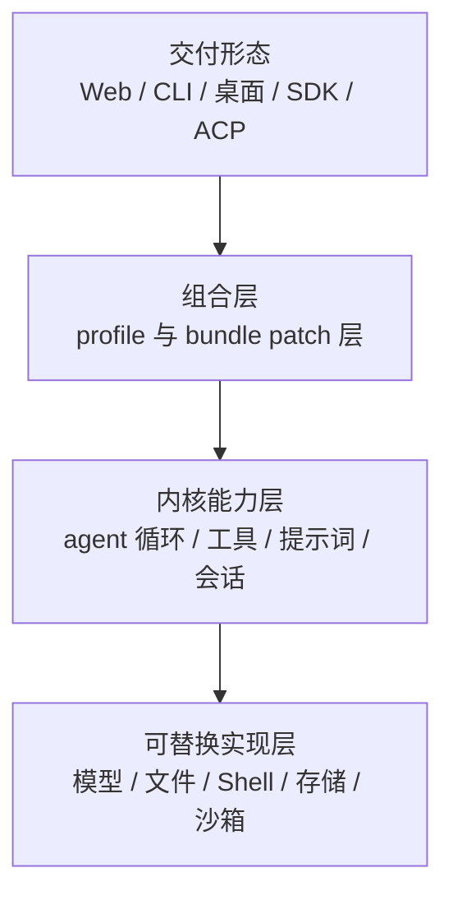
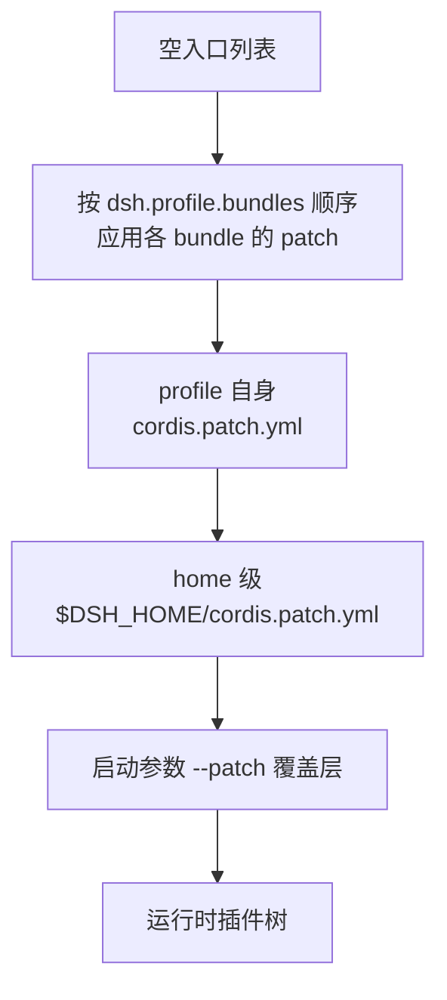

# 系统架构

这一页回答一个问题：**这个系统的边界在哪，它凭什么能被无侵入地改造？** 读完你应该能说清「一切皆插件」的具体含义、插件树是怎么被组装出来的，以及新增一种能力应该挂在哪里。

## 整体形态

系统可以理解成四层，自下而上每一层都只依赖下一层暴露的能力位（而不是具体实现）。最上面的交付形态之间共享同一个内核，差异由组合层决定。

读这张图要抓住两点。**第一，没有「特权核心」层**：内核能力层里的每一项本身也是插件，可以被替换，所以这张图不是「框架 + 应用」而是「插件 + 插件」。**第二，改造入口在第二层**：想改变产品行为，正常情况下改的是组合层的配置，而不是上面两层的代码。

## 无特权内核意味着什么

底层框架是 **Cordis**，一个依赖注入与插件运行时。它提供的核心契约是：插件向共享上下文（`ctx`）贡献**服务、类型化事件与可回滚的 effect**。

「可回滚」是这个架构能成立的关键。插件注册一个工具、一个事件监听器或一条路由，本质上都是往 `ctx` 上挂 effect；插件被卸载时，这些 effect 按注册的逆序自动解开，不需要插件作者手写清理逻辑。于是「运行时装卸插件」不会留下脏状态——这也是后文「运行时自我修改」能力的基础。

项目对这个框架做了一个不寻常的选择：**把它内联进仓库而不是作为普通依赖**。`vendor/` 下是 Cordis 及其基础库的源码副本（Cordis 内核、loader、include、group、timer、hmr、logger-console，以及 cosmokit 与 schemastery 两个基础库），全部改到 `@deepseek-ai` 作用域下，并在 `vendor/README.md` 里登记上游仓库、版本与提交号。

| 取向 | 好处 | 代价 |
|------|------|------|
| 内联框架层 | 完全拥有框架层：可审计、可打补丁、版本钉死，不受上游发布节奏影响 | 框架升级变成仓库内的手工搬运；改框架源码必须同步维护清单文件，有专门的仓库守卫检查这件事 |
| 框架层用工作区引用 | 本地构建直接走源码，发布后的依赖范围允许同一 minor 内的补丁更新 | 贡献者需要同时理解「本项目」与「被内联的框架」两套代码 |

值得单独一提的是：项目理论上允许**没有特权内核**，但实践上仍有一个事实上的核心——`packages/core` 定义的产品 API 骨架（`Agent` 接口、会话日志、工具注册表、提示词组装、默认循环）。它被称为「骨架」而非「内核」：默认实现可以被替换，但扩展插件普遍依赖它定义的接口。

## 启动链路：插件树怎么组装出来

一个运行中的 `dsh` 是一棵**插件树**，在启动时由有序的层叠配置组合而成。它不从某个手写的配置文件长出来，而是从一个**空入口列表**开始，被逐层打补丁。

层叠顺序是有语义的，**后应用的层覆盖先应用的层**：

| 顺序 | 层 | 内容 | 说明 |
|------|----|------|------|
| 1 | bundle 层 | 各 bundle 自带的 patch 文件 | 按 profile 清单里 `bundles` 数组的顺序依次应用 |
| 2 | profile 用户层 | profile 目录下的 `cordis.patch.yml` | 该 profile 自己的定制 |
| 3 | home 用户层 | `$DSH_HOME/cordis.patch.yml` | 机器级偏好，对所有 profile 生效，因此**压过**第 2 层 |
| 4 | 启动覆盖层 | 命令行 `--patch <文件>` | 按参数出现顺序应用，优先级最高 |

**覆盖是整块替换，不是深度合并。** 补丁按行的 `id` 定位目标，替换掉该行的**整份配置**。这意味着想保留原有设置就必须显式重述——这是最容易踩的坑，也是官方文档反复强调的一点。

三个概念的分工是清晰的，不要混用：

| 概念 | 是什么 | 存放在哪 | 谁维护 |
|------|--------|---------|--------|
| **profile**（配置档） | 一次命名的组合：它叠哪些 bundle、装了哪些树外插件、自己的补丁层 | `$DSH_HOME/profiles/<名字>/` 下的 `package.json` 与 `cordis.patch.yml` | 使用者；首次使用时由安装自带的模板创建 |
| **bundle**（打包层） | 一份可分发的 Cordis 配置行集合及其挂载的代码 | 一个 npm 包，在其 `package.json` 的 `dsh.bundle` 字段声明补丁文件 | 包作者 |
| **patch**（补丁） | 对某一行配置的整块替换，或插入新行 | YAML 文件 | 各层维护者 |

bundles 的解析是**双锚点**的：一个 bundle 名字先从 dsh 安装目录解析，再从 profile 目录解析；profile 下由 pnpm 管理的 `node_modules` 条目优先。这让「安装自带的 bundle」与「用户自己装的插件」可以共存于同一棵插件树。

随项目发布五种 profile 模板与六个 bundle 包：

| profile | 叠加的 bundle | 面向场景 |
|---------|--------------|---------|
| `web` | `dsh-base` + `dsh-web-app` | 浏览器图形界面（默认形态） |
| `headless` | `dsh-base` + `dsh-headless` | 一次性任务，无服务器 |
| `sdk` | `dsh-base` + `dsh-sdk-app` | 供 SDK 调用，暴露 JSON-RPC 服务 |
| `acp` | `dsh-base` + `dsh-acp-app` | 自动化场景的 ACP 服务 |
| `sdk-minimal` | 仅 `dsh-sdk-minimal` | 刻意不复用 `dsh-base` 的最小独立组合 |

`dsh-base` 是共享的第一层，也是「开箱能得到什么」的答案：模型连接、完整工具集、持久会话、默认权限策略。各形态的差异由第二个 bundle 决定。

查看你机器上实际装配出的插件树，用 `dsh --profile web --dump-config`——它打印出的每一行都可以被你自己的补丁替换掉。

## 能力位：换一个实现就换一种产品

这是整套架构里最值得理解的设计约定。一个**能力位**（capability seam）由三个角色组成，缺一不可：

| 角色 | 职责 | 例子 |
|------|------|------|
| Service Definition（服务定义） | 声明接口，不含实现 | 「文件系统能做什么」的接口 |
| Service Provider（服务提供者） | 给出实现 | 本地文件系统、沙箱文件系统、远端 SSH 文件系统 |
| Consumer（消费者） | 使用该能力，通常就是面向模型的工具 | 读文件、写文件、编辑文件这几个工具 |

关键在于**替换提供者会整体改变产品行为**：文件系统与子进程提供者共享同一个执行世界，把它们一起指向远端沙箱，Bash、持久终端与语言服务器就跟着搬过去，而不需要为远端分叉出另一套工具。反过来，只写一个函数、不设计另两个角色，就不构成能力位——这是新增能力时最常被低估的工作量。

## 事件分域

系统的事件不是一锅粥，而是按**谁能消费、是否持久**分成三个域。新增行为时，选对域是第一个决定。

| 事件域 | 例子 | 是否持久 | 用途 |
|--------|------|---------|------|
| **会话事件** | `turn/start`、`user/message`、`tool/result` | 是，追加进会话日志 | 必须能跨重启重建的事实 |
| **Agent 事件** | `agent/pre-step`、`agent/status`、`agent/assistant-stream` | 否，仅存活于运行期 | 观察或拦截进行中的工作 |
| **能力事件** | `fs/*`、`tools/*`、`telemetry/*` | 否 | 给能力位挂策略与适配器，而不必引入主循环 |

在这个分域之上还有一条更强的不变量：**模型可见即已落日志**（model-visible means logged）。运行时有检查器验证「模型的每一次请求都能从会话日志重建」。它的直接后果是——新增任何模型可见的输入都必须走会话事件，而不能临时拼进请求里。

三类事件里有一部分是 **waterfall（瀑布）**：监听器必须显式调用 `next()` 才能把控制权交给下一个，因此可以用来改写、拒绝甚至替换一次请求。`agent/pre-step` 就属于这一类，这也是审批、压缩等策略能够介入循环而不修改循环的原因。

## 模块地图

仓库有约 300 个包目录，按能力家族分组。下表只列影响理解全局的部分，完整清单见 `packages/README.md`。

| 分组 | 负责什么 | 关键契约 |
|------|---------|---------|
| `core/` | 产品 API 骨架：会话日志、提示词组装、工具注册表、Agent 接口、默认循环 | `ctx.sessions`、`ctx.systemPrompt`、`ctx.tools`、`ctx.agents`、`ctx.agentLoop` |
| `llm/` | 模型接入能力家族：抽象服务 + 各 provider 适配器 | `ctx.llm` |
| `session/`、`session-query/` | 会话持久化数据面与检索 | 持久化接口 |
| `sandbox/`、`subprocess/`、`shell/`、`terminal/`、`fs/` | 进程约束与执行世界 | `ctx.sandbox`、`ctx.shell`、`ctx.fs` |
| `interaction/` | 人机协作面：审批、提问、权限预设 | `ctx.approval` |
| `skill/`、`mcp/`、`subagent/`、`workflow/`、`hooks/`、`jobs/` | 扩展与自动化能力 | 各自的注册表 |
| `boot/` | 引导胶水：profile 解析、命令行、插件管理、热重载 | 启动入口 |
| `bundle/` | 可安装的 profile 补丁层 | 六个 bundle 包 |
| `sdk/`、`acp/`、`host/`、`client/` | 对外接口与图形界面两侧 | 见「运行形态」页 |

新增行为应当挂到已有的扩展点上；只有当改动落在「循环本身」时，才需要同时更新这张地图。仓库为此维护了一份**目标 → 机制**的对照表（例如「加一个模型提供者」注册到 `ctx.llm`，「加一个面向模型的能力」注册到 `ctx.tools` 并让 schema 进入提示词组装）。

## 关键设计取舍

| 取舍 | 选了什么 | 没选什么 | 代价 |
|------|---------|---------|------|
| 内核形态 | 无特权内核 + 插件树 | 可 patch 的中心化内核 | 定位一段行为要先弄清它在树里的位置；阅读成本转移给使用者 |
| 框架来源 | 源码内联到 `vendor/` | npm 依赖 | 升级靠手工搬运，需维护清单与守卫 |
| 组合方式 | 有序 patch 层，按 id 整块替换 | 配置深度合并 | 覆盖必须重述全部设置，容易漏项 |
| 能力扩展 | Service Definition + Provider + Consumer 三段式 | 直接写实现 | 新增能力必须同时设计三段，门槛更高但可替换性有保障 |
| 事实来源 | 会话日志是唯一真源，历史由它推导 | 另行维护模型消息副本 | 写入更重，且引入格式版本与迁移链的长期维护成本 |
| 事件模型 | 三域分离 + waterfall 可拦截 | 单一事件总线 | 需要理解「这件事该用哪个域」，学习曲线更陡 |

> 依据：`docs/architecture.md:10-58`、`docs/architecture.md:60-110`、`docs/architecture.md:118-166`、`packages/boot/app-boot/src/profile.ts:1-45`、`packages/boot/app-boot/src/profile.ts:36-41`、`apps/cli/src/profile-boot.ts:66-80`、`apps/cli/src/profile-boot.ts:183-215`、`vendor/README.md:1-30`、`packages/core/README.md:20-40`、`packages/README.md:20-72`、`packages/bundle/base/README.md:40-80`
