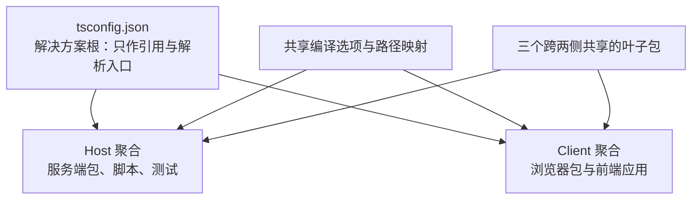
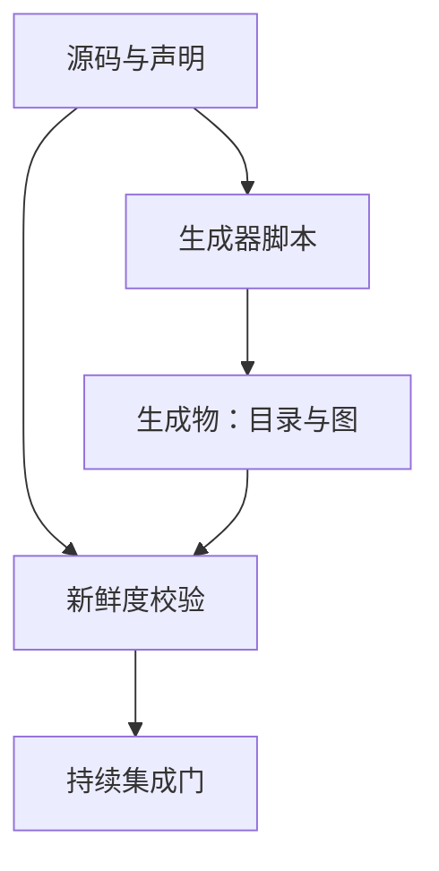

# 工程体系与协作约定

这一页回答「这个仓库是怎么维护的」。它值得单独一页，因为**这个仓库把文档与门禁当成一等公民**：大量看似"写得讲究"的约定，背后都有可执行的校验在兜底。

## 顶层布局

| 目录 | 内容 |
|------|------|
| `vendor` | 内置的插件框架源码（**不是 npm 依赖**，由清单守卫保护） |
| `packages` | 主体：按能力域分组的工作区包 |
| `apps` | 应用外壳：命令行、前端构建、桌面端 |
| `python` | Python SDK 与其运行时轮子 |
| `native` | 原生插件的源码 |
| `benchmarks` | 性能门禁 |
| `.agents` | 内部工作流与决策笔记（见下） |
| `docs` | 面向贡献者与用户的文档 |
| `scripts` | 门禁与生成器 |
| `website` | 文档站点的投影 |

包按能力域分组，这一层分组本身就是架构的一部分——它把「模型接入」「工具体系」「会话存储」「沙箱」「子代理」等能力域显式隔开。分组清单由包目录的说明文件维护。

## 双 TypeScript 聚合

这个仓库有一个不常见但很关键的安排：**服务端与浏览器端是两个独立的 TypeScript 编译程序，而不是一个**。

原因很具体：两侧都会对框架的上下文接口做**声明合并**，但合入的是**不同的服务**。一个编译程序若同时看见两份合并，会报告键冲突。而这个冲突只存在于编译程序内部——模块解析永远不触发它——所以解决方案根可以同时引用两个聚合，一个路径映射门面也可以横跨两侧。

由此产生三条必须遵守的纪律：

- **共享的基准配置永远不能加包含或文件清单**，否则会渗进每一个继承它的包工程，把「匹配一切」的门面收窄。
- **要构建全仓类型图的脚本必须显式指定某一个聚合**，不能指向解决方案根——把两个聚合拍平进一个程序会撞上上下文合并冲突。
- **新包只能注册进一个聚合**；只有拆分包的共享叶子才同时出现在两侧，因为两侧都要对同一份源码做类型检查。

有六个包真的拆成了两侧（远程层、网关、会话控制器、工作区控制器、浏览器连接、会话日志导出），因为它们的宿主半与浏览器半职责不同。工作区约束门会遍历可达的工程引用图，检查每个引用方用的是**与自己那一侧匹配的叶子配置**；它靠「两个叶子配置同时存在」自动识别拆分包，所以新增拆分包会自动纳入检查。

## 常用命令

| 命令 | 作用 |
|------|------|
| 安装 | 安装依赖，并自动配置工作树本地的 Git 钩子 |
| 清理 | 删除构建产物与已删包留下的残留 |
| 类型检查 | 先构建宿主侧，再对浏览器侧做契约就绪检查 |
| 代码检查 | 静态检查，含自动修复变体 |
| 单元测试 | 全部单元测试 |
| 覆盖门 | 带覆盖率的门禁运行 |
| 真实接口端到端 | 对线上模型与外部服务发起真实调用，缺密钥自动跳过 |
| 快照测试 | 用录制的会话回放，无需密钥 |
| 浏览器快照 | 在真实浏览器中比对界面输出 |
| 基准测试 | 构建后跑性能门禁 |
| 全量门禁 | 一次跑完主干所需的全部门 |

运行时要求是 Node.js 支持 22.19 以上与 24 以上（持续集成覆盖 22.19、24、26），包管理器由 Corepack 提供且版本被固定，Git 需要 2.26 以上（钩子设置会启用工作树级别的配置扩展）。

有一条仓库级硬规则值得单独指出：**只有命令行 profile 可以启动受支持的 Node 应用**，包自带的 bin、示例程序与公开 SDK 的命令行逃逸都被禁止。

## 测试分层

测试被分成用途明确的若干层，每层解决一类"绿灯但坏掉"的失败：

| 层 | 解决什么问题 | 关键约束 |
|----|------------|---------|
| 单元 | 边缘情况、错误路径、事件顺序、并发竞态 | 每个注册表都要有热重载安全测试；契约回归写成常驻测试 |
| 覆盖门 | 未被覆盖的行 | **逐文件 100%**，覆盖的是包的源码目录 |
| 期望输出 | 组装的命令行与进程输出 | 无需密钥，不走录制回放 |
| 真实接口端到端 | 管道通但产品坏 | 缺密钥自动跳过，**不以成本为由节省** |
| 快照 | 真实模型转录下的端到端行为 | 回放无需密钥；录制与刷新只在本地 |
| 浏览器快照 | 真实浏览器中的界面行为 | 持续集成强制只读回放模式 |
| 基准 | 时间、堆与规模预算 | 计时代码跑在纯 Node 下，绝不跑在 TS 转译器下 |

其中几条原则很有个性，也解释了为什么它的测试值得信任：

- **覆盖门把未覆盖的行当成"该删的死代码"，而不是"该补的测试"**。同时明确写着：行覆盖是必要条件、永远不是充分条件——它只证明那行跑过，不证明功能按发布形态工作。
- **真实接口测试的定位是"推理在这里很便宜"**。无密钥的测试只能证明管道通；只有带密钥的运行才能证明 Agent 在真实模型下工作。单测绿、产品坏这一类问题靠冒烟测试抓。
- **优先真实实现而不是替身**。只对昂贵或不确定的边界做替身（模型适配器、网络、时钟），其余下游保持真实。
- **验证世界，而不是验证自报**。断言要重新执行命令或从外部重读文件；对 Agent 自己输出的关键词探测是可以通过作弊的。
- **测真实入口路径**。产品可见的插件必须有真实的完整组合测试，且"真实入口"指的是**已发布的产物**——用纯 Node 跑构建后的入口，才能暴露转译器掩盖的失败。
- **测试解析只走源码面**。所有测试配置把工作区导入解析到源码，绝不通过包导出走到构建产物——陈旧产物会加载第二份单例模块。
- 有一处平台例外：某类本地执行器的逐文件 100% 覆盖需要一个真实存在的 Shell，没有它时用配置豁免，让没有该 Shell 的机器保持绿灯，而带它的持续集成机器执行完整标准。

## Git 钩子与持续集成

钩子被刻意做得很轻——**完整的全仓门禁矩阵归持续集成所有**。提交前只做几件本地快检：配对文件的一致性、被归档笔记的格式、对暂存文件的静态检查与自动修复、第三方声明文件的重新生成、空白检查、以及内置框架清单守卫。推送前跑一次类型检查。

钩子通过一个包装脚本安装为**工作树本地**配置（随依赖安装自动执行），它会拒绝既有的冲突配置或陈旧锁，并按诊断提示处理——不鼓励手工改工作树元数据。

持续集成的门被组织成可组合的批次，而不是一条长链：静态检查、覆盖、单元、基准、快照、产物、消费者、Linux 主批次、Windows 阻塞与观察批次、Node 兼容性检查。还有面向原生插件、沙箱、Python 发行与供应商框架发布的独立工作流。

## 生成物与新鲜度

这是本仓库最有特色的工程实践：**大量参考文档是生成物，且有配对的新鲜度校验**。生成器与校验器成对存在（十六对，另有一个只生成不校验的翻译简报）。

被这样管理的生成物包括：工具目录、配置目录、持久化目录、事件词表、模块图、依赖目录、框架接口目录、检查目录、客户端目录、包清单、第三方声明、会话格式目录、工作流宿主代码与文档图。

有几条由此产生的规矩：

- **生成的英文源禁止手写修改**，改法永远是改生成器或改源码再重新生成。
- **中文对照不走独立翻译**，而是通过配对流程产出；配对一致性由提交前钩子与持续集成共同保证。
- **相邻迁移可以新增以版本命名的后继，但永远不能移动、覆盖或删除已提交的代**；前驱既不隐含回退支持，也不隐含降级支持。

## 文档分层：一个事实只有一个归属

这套文档体系的核心规则是「每个事实只有一个家」，其他位置只放链接。分层与各自的职责如下：

| 层 | 职责 | 不该放什么 |
|----|------|-----------|
| 根级约定文件 | 常驻指令：每次会话都需要在上下文里的规则，每条一到三行并链到归属地 | 故事、示例、情境化流程、任何从归属地复述的内容 |
| 子树约定文件 | 该子树特有的指令 | 根级文件已经承载的全仓规则 |
| 架构文档 | 有序地图：组合、核心包、循环、能力位、扩展点 | 类型定义、单包细节、决策理由、实现状态标注 |
| 子系统文档 | 每个子系统一页参考：类型定义、语义、生成的框架接口 | 行为叙述 |
| 内部笔记 | 活跃的决策记录：为什么、放弃了什么、需要什么验证 | 迁移计划、验收清单、规格口吻 |
| 事故复盘 | 事件故事——唯一允许写"战史"的层 | — |
| 持久化历史 | 类型变更确认、发布比较、完整的历史格式模式 | 纯行为变更、当前运行时契约 |
| 操作指南 | 带编号验证步骤的分步做法 | 设计理由 |
| 用户文档 | 面向产品的指南，由文档站发布 | 生成的参考表、贡献者流程、决策历史 |
| 包说明文件 | 单包契约：配置、语义、限制、扩展点 | JSDoc 复述、生成目录复述、其他包的事务 |
| 生成参考 | 从源码重新生成且有新鲜度门的英文源 | 对生成英文源的手工编辑 |

书写规则里几条比较特别的：**每段占一个物理行**（用编辑器的软换行，靠校验脚本保证）；文档里围栏标注为 TypeScript 的代码块**必须能编译**，粘贴的类型声明要登记在清单里以防漂移；**被记录的类型一旦变形，归属它的子系统页必须在同一次改动中更新**；注释与文档注释要陈述**完整契约**而不是推理过程——保留行为、失败、时序、所有权、模态、异常、后果与非显然的定位，删除叙述、测试走查与代码复述。

**字数预算也是门禁**：一份清单为常驻文档设定上限，超出或缺失都会被拒绝。预算处理有三步：把内容迁到该去的层、就地压缩、或在上限确实不够时提高上限并在改动说明里给出理由。规则里还有一句很务实的话——**上限是护栏而不是缩减目标**，处于目标上限以内时要保留至少 5% 的余量。

## 代码与仓库门禁

除常规静态检查外，有一批针对仓库自身一致性的校验脚本，覆盖面相当广：

| 关注点 | 校验内容 |
|--------|---------|
| 结构不变量 | 包路径、包元数据、包不变量、构建后不变量、依赖声明、导出与工作区约束 |
| 运行封闭性 | 运行时闭包、可选依赖导入、默认产品隔离、应用入口点、npm 安装布局 |
| 客户端专用 | 客户端包、界面国际化、路由解析、领域图、浏览器外部依赖 |
| 类型与契约 | 类型等价、TypeScript 路径映射、未知类型断言的禁用 |
| 文档 | 换行、链接、片段、公开仓库链接、仓库引用、具体术语、文档引用、子系统页、文档图、字数预算、文档类型检查 |
| 生成物新鲜度 | 上述十六对生成器与校验器 |
| 发布 | 第三方声明、供应商清单、发布前的打包安装验证、包注册表呈现 |
| 重复度 | 对包与脚本运行重复代码检测 |

值得注意的是有一批门禁专门针对**文档中的具体术语与引用**——例如禁止模糊措辞、禁止未知类型断言、要求引用可解析。这说明文档被视为需要编译级保障的产物。

## 内部笔记与技能

仓库在 `.agents` 下维护两套内部资产：

- **决策笔记**，按状态分四类（已实现、提议、已拒绝、已归档），当前合计约两千四百份。已实现的笔记用现在时描述**已发布的现实**；已归档的笔记是冻结的历史，**永远不是当前权威**。
- **技能**，当前十五个，覆盖代码评审、文档写作、文案规范、性能优化、测试可靠性、升级指南生成、翻译、归档笔记等。技能本身只承载可复用工作流与决策标准，不承载产品与运行时契约。

这套东西的存在解释了本文档在阅读源码时会反复遇到的现象：**几乎每个非显然的设计决定，都能在笔记里找到"为什么"与"放弃了什么"**。

## 贡献模型

需要提前知道：**这个仓库不接受外部拉取请求**。贡献渠道是 Discussions、以插件形式的外部扩展（有对应的仓库话题标签）、以及博客文章。安全相关的声明同样直接：项目处于实验阶段、未经安全审计、使用需自担责任、按 MIT 许可不提供担保。

## 边界与代价

- **门禁很重，所以钩子很轻**。提交前只做快检，完整矩阵归持续集成——本地快速迭代与全量保障之间的取舍是明确的。
- **逐文件 100% 覆盖很严格**，会把"未被覆盖的行"推向删除而不是补测试；这对死代码有利，对新代码的落地节奏是压力。
- **生成物体系带来双重成本**：写文档要理解"这个事实归哪一层"，改代码要记得同步重新生成；换来的是参考文档不会与源码漂移。
- **中文对照与英文源强耦合**，不能用独立翻译流程产出。
- **不接受外部拉取请求**意味着外部贡献只能通过插件、讨论与文章；想直接改主干的人需要另找路径。
- **构建是重的前置条件**：类型检查先构建宿主侧，浏览器侧依赖"契约就绪"的产物；这保证了契约一致，也意味着冷启动的门禁耗时较长。
- 有一条容易踩的坑写在这里：包的 bin、示例与公开 SDK 的命令行入口都**不允许**自己启动运行时，必须经由命令行 profile；这是为了保证"真实入口路径"只有一条。

> 依据：`AGENTS.md:1-184`、`docs/AGENTS.md:1-76`、`docs/development.md:1-189`、`docs/testing.md:1-55`、`docs/architecture.md:1-166`、`docs/session-format-status.md:1-63`、`docs/i18n/README.md:1-69`、`packages/README.md:1-120`、`README.md:1-77`、`CONTRIBUTING.md:1-23`、`package.json:1-265`、`lefthook.yml:1-55`、`tsconfig.json:1-15`、`tsconfig.host.json:1-481`、`tsconfig.client.json:1-147`、`tsconfig.base.json:1-561`、`tsconfig.base.client.json:1-12`、`scripts/doc-budgets.manifest.json:1-10`、`scripts/run-gates.ts:1-1687`
