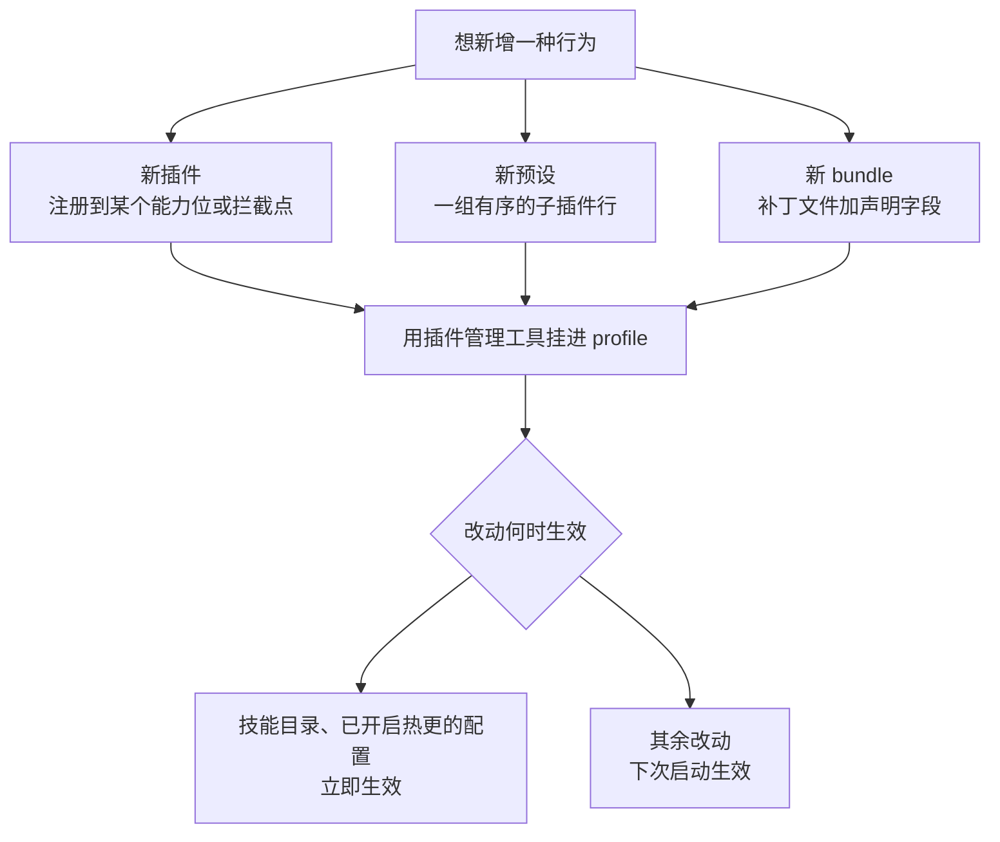
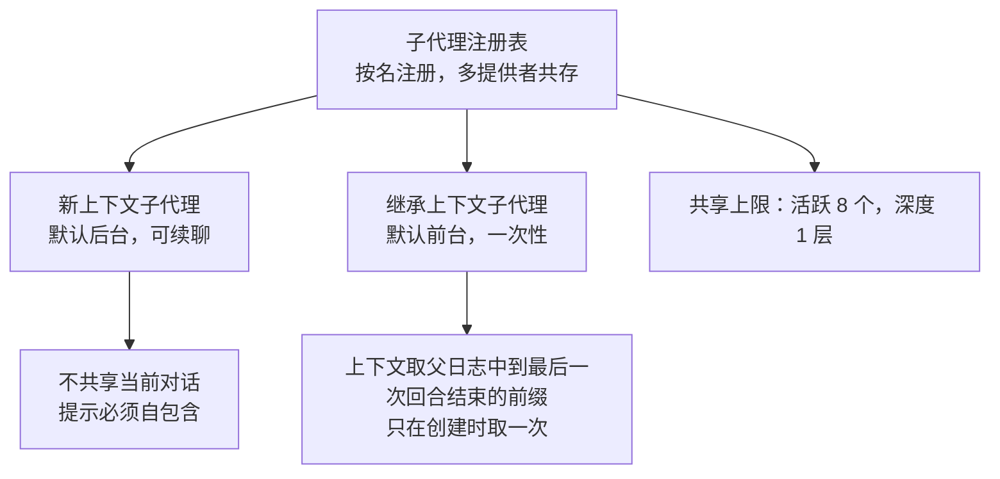

# 扩展机制

这一页回答「想加东西该往哪加」。读完你应该能判断：一件事该写成插件、技能还是预设；哪些改动能立刻生效、哪些要重启；以及哪些"扩展"其实**不是安全边界**。

## 先建立正确的心理模型

这套系统是**微内核 + 配置分层**，不是「插件 API 目录」。三句话概括：

- **插件本体不被"发现"**。它只是加载器条目列表里的一行（一个标识加一个模块名或路径）。它有什么能力，取决于它注册到哪个 `ctx.*` 能力位或哪个拦截点。
- **组合即配置**：一个运行中的树 = 若干补丁层按固定顺序叠出来的结果。整行替换、按标识定向，不做深合并。
- **一切都是可撤销的副作用**。每个注册都绑定在插件的生命周期上，卸载自动回滚——热重载就是靠这个性质天然成立。

一个真实的极简插件只有几十行，核心就三样：声明的名字、依赖的服务清单、以及接管函数。**普通插件不需要任何 manifest 扩展字段**——那些字段只服务于另外三种角色（bundle 的补丁路径、profile 的 bundle 列表、双端包的浏览器半声明）。

插件能贡献的东西可以穷举：

| 贡献面 | 机制 |
|--------|------|
| 服务 | 继承服务基类，暴露新的 `ctx.*` 能力位 |
| 拦截与事件 | 挂到瀑布式或串行拦截点上，参与决策 |
| 人类命令 | 注册命令，供界面或命令行调用 |
| 模型工具 | 向工具注册表注册工具定义 |
| 界面面板 | 双端包的浏览器半，通过导出入口被发现 |

想加一种行为时，路径大致是这样的：

## 技能：给模型的可加载说明书

技能是「按需加载的文档包」，适合沉淀流程、规范与检查清单。

磁盘上有六个来源，**序号小的先、同名先到先得**：

| 序 | 来源 | 位置 |
|----|------|------|
| 100 | 项目自有 | 项目下的技能目录 |
| 200 | 项目级代理约定 | 项目下的另一技能目录 |
| 300 | 自定义 | 配置里声明的目录 |
| 400 | 用户级 | Harness home 下的技能目录 |
| 500 | 用户级代理约定 | 代理 home 下的技能目录 |
| 600 | 随产品分发 | 内置技能目录或环境变量指定 |

目录约定是「一个技能一个目录，内含说明文件」或者「一个技能一个扁平文档」，**不支持递归查找**。说明文件用 frontmatter 声明：名字与描述必填（名字必须是短横线命名，非法则整个文件被忽略），是否可被模型调用、是否可被用户调用可选，默认都允许。旧键名会被**显式报错拒绝**，而不是被静默兼容。

进入模型上下文的方式有两条刻意的约束：

- **目录里只有名字和描述**，不含正文、路径与来源。正文只有在模型显式调用时才读取，而且**不缓存**——改了正文只影响后续调用。
- 目录以一条用户角色的系统提醒注入，并且**按摘要去重**：内容没变就不重复注入；技能被全部删除时会追加一条显式的空替换，避免模型记着已不存在的技能。

技能**没有审批门禁**，只有两个可用性开关和工具可见性。技能目录由文件监听实时跟踪，模型自己的写文件动作命中相关路径时也会同步失效——这是少数**不需要重启**的扩展。

## MCP：一个服务一个条目

接入外部 MCP 服务的方式是**一个服务对应一个插件条目**，放在目标作用域里，没有共享的服务注册表，也没有默认启用的服务。

| 维度 | 行为 |
|------|------|
| 传输 | 只有标准输入子进程与可流式 HTTP 两种；SSE 没有独立分支 |
| 工具命名 | 派生为 `mcp__服务名__原工具名`；非法字符或超长时确定性归一，避免不同身份塌缩 |
| 装载方式 | **整代原子替换**：全部拉取成功才替换旧代，注册冲突则整代回滚 |
| 启动失败 | 默认只记录错误并继续启动（可用配置改为失败即中止） |
| 断线 | 旧工具仍在列表里，但调用会失败 |
| 重连 | 退避翻倍，连续失败达到上限后注销工具并停止重连，直到重载配置或重启 |
| 健康检查 | **没有独立的 ping 工具**；健康信号就是握手与工具同步成功 |

有一处需要明确记录的现状：**本版本不存在「按服务或按工具」的允许/拒绝治理层**。可用的手段是通用的工具执行管道（拦截点返回拒绝或转人工审批），以及一个**要求作用域上下文**的可见性过滤器——后者被显式限制为不能全局使用，因为它会屏蔽所有 Agent。需要精细治理时应在外层另做控制。

不支持的能力也值得列出，避免期待落空：MCP 的提示模板、交互式询问、任务执行、资源订阅都不支持。每个服务的指令会以具名分区形式进入**已记录**的系统提示词。

## 子代理：两种形态，同一个包

子代理是**按名注册、多提供者共存**的注册表。默认组合里装载的两个工具其实是**同一个包被加载了两次**，只换了提供者与后台模式：

- **继承上下文的语义要精确理解**：它是父会话日志里「到最后一条回合结束为止」的连续前缀。当前正在进行的工具调用所属回合不闭合，因此不能被重放。如果父会话还没有任何已完成的回合，就退化为全新子代理。
- **前缀只取一次**：写入子会话自己的日志后，后续冷恢复重放的是那份前缀，而不是重新去读父会话的最新历史。
- **结果回传方式随模式不同**：前台返回工具结果；后台一次性任务注册成作业；可续聊模式立即返回一个持久标识，之后可以继续发消息、列举、打断。
- **能力差异必须显式处理**：外部提供者（例如其他协议控制器）在启动传输前就拒绝不支持的选项；声明了但提供者做不到的能力会**大声失败**，而不是静默忽略。
- **工具过滤在子代理身上等同于权限**：被过滤的工具既从提示词消失，也无法执行；未知名字在启动时就失败。

深度默认只允许一层（零表示禁止再委派），这个限制解释了为什么本仓库里的取证子代理无法再向下委派。

## 工作流：受限脚本里的多代理编排

工作流工具接受一段**纯 JavaScript 函数体**（不是 TypeScript），允许顶层等待，用返回结束。带模块导出语句会显式报错。

脚本运行在双层受限环境里：先是脚本虚拟机，而虚拟机本身又运行在受限的 Node 子进程内。脚本里**只有六个全局可用**（委派、并发、流水线、阶段、日志、输入参数），**没有文件系统、网络、定时器或 Node API**。返回值与选项必须是可无损 JSON 化的值。

编排原语有两个，差别是是否有屏障：

| 原语 | 语义 |
|------|------|
| 流水线 | 每个条目独立走完整阶段链，**阶段间没有屏障** |
| 并发 | 并发执行并等待全部完成，**有屏障** |

普通失败只影响该条目（变成空值并跳过其余阶段），但**致命错误会终止整个脚本**。

## 钩子：兼容适配器，不是万能钩子

钩子的定位需要说清：它是兼容层，只跑参考实现里**命令类型**的钩子子集；同一事件上，原生插件才是完整 API。外部钩子事件映射到内部拦截点：

| 外部钩子 | 内部拦截点 | 能做什么 |
|---------|-----------|---------|
| 会话开始 | Agent 创建（等待完成，首个回合前） | 只注入上下文 |
| 用户提交提示 | 步骤前瀑布 | 可阻止该输入 |
| 工具调用前 | 工具执行前瀑布 | 可拒绝，也可转人工审批 |
| 工具调用后 | 工具执行后瀑布 | 可带反馈地阻断结果，或追加上下文 |
| 停止 | 回合即将停止（串行） | 可要求再走一步 |
| 子代理开始与结束 | 子代理生命周期事件 | 开始可注入上下文，结束只观察 |

线协议上有三条硬规则：命令通过统一的 Shell 执行器运行、JSON 走标准输入；**退出码 2 表示阻止**，标准错误作为理由；其他非零退出码只是非阻塞失败，记录后继续。

同事件多个钩子按配置顺序串行，决策按「拒绝优先于询问、询问优先于允许」取最严。配置读取或解析失败只会警告并跳过全部钩子，**绝不因此中断回合**。持久化证据是成对写入的事件记录。

一条必须知道的代价：钩子配置是**进程级、启动时读一次**的，换配置要重启进程。

## 后台作业

作业是「运行时长 + 生命周期状态 + 输出环」的记录，**不是进程**。职责划分很明确：生产者拥有执行资源，运行时只拥有身份、访问控制、生命周期状态和输出缓冲。

- 产生作业的来源：命令工具的后台运行、持久终端的后台写入、后台一次性子代理。
- 模型侧的控制工具与种类无关：读取、列举、终止。读取默认只给「上次读之后的新输出」，等待可选且有预算钳制。
- 输出按每个作业一个**有界环**收集；模型用游标消费，观察者按绝对字节偏移读取，互不干扰。
- **作业不跨重启**。跨重启能恢复的是子代理会话，不是作业本身。

## 运行时自我修改

这一层允许在运行中定义并启动插件，是「Agent 能改自己」的实现。它的模型很讲究：

- **Plugin 是稳定身份，Package 是不可变版本**。定义一个 Plugin 会铸出标识，之后可以对它追加新版本；启动或切换版本走运行入口；停止只停当前运行、**保留所有版本**；撤销定义才删除全部版本。因此**回滚等于切回旧版本，而不是删除**。
- 宿主半在独立的虚拟机领域里执行，控制台输出带包标识前缀，网络与定时器等能力被替换成报错陷阱。**源码自己明确写了这句：这不是隔离（containment），宿主领域的辅助函数仍是逃逸路径。**
- 浏览器半的包在激活前需要**审批**；一次授权可以选择覆盖该插件之后的版本。
- 动态插件拿到的是**只读上下文外观**，写属性会被直接拒绝；工具注册需要带标记的定义；客户端还有同构的第二套守卫。
- 检查面是两个**只读**工具；源码默认不外露，只有按精确包标识查询才会返回源码。
- **持久性边界**：动态插件是进程本地、会话所有的，重启即失。要长期生效必须写成 bundle 再用插件管理工具安装。

插件管理工具本身的权限代价值得一提：每个动作都要求完全放开模式或针对该次调用的审批，而且**审批只授权这一次，不改变会话权限模式**。更要紧的是——**装了插件就等于让它跑在沙箱之外**：安装的宿主代码在进程内执行，工作区沙箱不覆盖它。安装失败会回滚依赖清单，但**故意不回滚工作区配置**（包管理器把待批脚本记在那里）。

## 会话预设

预设是**一份声明的子插件行列表**，按会话挂载——工具、提示词分区、技能都由此而来，而宿主仍然共享同一个主循环。

- 内置预设各有标识与排序值；部署设定默认项，用户设置可以覆盖默认选择。
- 会话创建时把预设记进头部；**会话可以在空白期（首个回合之前）更换预设**，改动以只读事件形式记录，此后所有回合跑在新组合上；一旦已经跑起来，更换请求会被拒绝。
- 每个声明**急切地**创建独立作用域与内存加载树；更新或删除声明会「退役」上一版本，但已有代理仍在使用，引用归零才真正释放。
- **写预设的路径是一个 bundle 补丁**——注册表不扫描目录、也不接受预设文件路径。想在对话里直接生成这种 bundle，需要 Creator 模式。
- 启动失败的定义**仍然可见**（标记为损坏并记日志），但会**阻止新代理绑定**它；等待宿主服务的行保持挂载，每次读取都会在加载树稳定后重新审计，因此启动顺序不决定结果。

## 三类代价：什么时候必须重启

这是本节最实用的一张表，它解释了「为什么有的改动要重启」：

| 代价类型 | 涉及机制 | 表现 |
|---------|---------|------|
| 进程本地、不跨重启 | 后台作业、动态插件、预设的旧版本实现 | 重启后作业信息消失；动态插件全部失效；预设按当前定义恢复，定义缺失则拒绝 |
| 启动时读一次 | 钩子配置、profile 组成 | 换配置要重启进程 |
| 可热更新 | 技能目录、已开启热更时的配置层 | 文件监听实时生效；源码级热更需在 profile 补丁里把监听根从空改为当前目录，并需要额外的调试开关 |

## 边界：三处明确"不是安全边界"

项目自己在三处源码或文档里声明了这一点，选型时不应把它们当作隔离手段：

- **动态插件的宿主沙箱不是隔离**：它限制的是 API 入口，宿主领域的辅助函数仍是逃逸路径。
- **预设不是安全沙箱**：它的声明与插件可以执行宿主代码。
- **钩子是兼容适配器，不是全能钩子**：只覆盖命令类型子集。

真正的一致性保障来自框架的**副作用与版本机制**（不可变版本、引用计数、注册即副作用），而不是沙箱。也就是说：**能自我修改，不等于能自我保护**。

> 依据：`docs/architecture.md:135-167`、`docs/cookbook/extension-cookbook.md:10-133`、`packages/util/package-manifest/src/types.ts:25-95`、`packages/boot/app-boot/src/profile.ts:1-22`、`packages/boot/app-boot/src/profile.ts:610-739`、`packages/skill/skill-badge/src/index.ts:1-60`、`packages/skill/skill-badge/package.json:1-38`、`packages/skill/skill/src/index.ts:20-35`、`packages/skill/skill/src/index.ts:350-360`、`packages/skill/skill-filesystem/src/index.ts:30-45`、`packages/skill/skill-filesystem/src/index.ts:240-270`、`packages/skill/skill-filesystem/src/index.ts:670-740`、`packages/skill/skill-filesystem/src/index.ts:810-845`、`packages/skill/skill-filesystem/src/index.ts:995-1045`、`packages/skill/tool-skill/src/index.ts:50-90`、`packages/skill/tool-skill/src/index.ts:220-300`、`packages/skill/skill-office/src/index.ts:60-90`、`packages/mcp/mcp-client/src/transport.ts:25-47`、`packages/mcp/mcp-client/src/tools.ts:65-160`、`packages/mcp/mcp-client/src/tools.ts:180-315`、`packages/mcp/mcp-client/README.md:65-215`、`packages/mcp/mcp-resources/src/index.ts:1-130`、`packages/mcp/mcp-resources/src/tools.ts:30-55`、`packages/subagent/subagent/src/index.ts:185-210`、`packages/subagent/subagent-fork-in-process/src/index.ts:35-95`、`packages/subagent/tool-subagent/src/index.ts:100-115`、`packages/subagent/tool-subagent/src/index.ts:315-390`、`packages/subagent/tool-subagent/src/index.ts:530-570`、`packages/subagent/tool-subagent-control/src/index.ts:25-80`、`packages/subagent/tool-subagent-control/src/list-agents.ts:82-90`、`packages/subagent/subagent-in-process-driver/src/structured.ts:100-115`、`packages/workflow/workflow/src/index.ts:1-30`、`packages/workflow/workflow-ptc/src/index.ts:28-115`、`packages/workflow/workflow-ptc/src/runtime.ts:30-95`、`packages/workflow/workflow-ptc/src/runtime.ts:120-345`、`packages/workflow/workflow-ptc/src/host.ts:20-30`、`packages/workflow/workflow-ptc/src/host.ts:270-285`、`packages/hooks/hook-protocol/README.md:25-70`、`packages/hooks/hooks-claude-code/src/index.ts:200-300`、`packages/hooks/hooks-claude-code/README.md:40-105`、`packages/hooks/hooks-codex/src/index.ts:185-270`、`packages/jobs/jobs/src/types.ts:5-35`、`packages/jobs/tool-jobs/src/index.ts:80-380`、`packages/extensions/cordis-host-runner/src/sandbox.ts:1-95`、`packages/extensions/cordis-host-runner/src/guard.ts:1-15`、`packages/extensions/cordis-host-runner/src/guard.ts:635-775`、`packages/extensions/cordis-host-runner/src/index.ts:260-360`、`packages/extensions/cordis-host-runner/src/index.ts:900-915`、`packages/extensions/tool-cordis/src/index.ts:20-45`、`packages/extensions/ui-cordis/src/index.ts:1-10`、`packages/extensions/README.md:1-20`、`packages/preset/README.md:1-35`、`packages/preset/agent-preset/src/index.ts:1-31`、`packages/preset/agent-preset-registry/src/definition.ts:1-15`、`packages/preset/agent-preset-registry/src/index.ts:305-330`、`packages/preset/agent-preset-registry/src/session.ts:1-30`、`packages/preset/agent-preset-registry/README.md:40-100`、`packages/boot/plugin-manager/src/tools.ts:15-45`、`packages/boot/plugin-manager/README.md:10-35`、`packages/bundle/base/cordis.patch.yml:10-30`、`packages/bundle/base/cordis.patch.yml:295-305`、`packages/bundle/base/cordis.patch.yml:365-395`、`packages/bundle/web-app/package.json:1-40`、`packages/bundle/web-app/presets/standard.patch.yml:1-15`、`docs/config-catalog.md:130-160`、`docs/config-catalog.md:1320-1390`、`docs/config-catalog.md:1530-1570`、`docs/config-catalog.md:2010-2090`、`docs/config-catalog.md:3600-3650`、`docs/config-catalog.md:3810-3890`、`docs/subsystems/jobs.md:1-60`、`docs/subsystems/jobs.md:170-260`、`docs/subsystems/jobs.md:285-335`、`docs/subsystems/mcp.md:20-140`、`docs/subsystems/skills.md:1-30`、`docs/subsystems/skills.md:60-90`、`docs/subsystems/skills.md:185-235`、`docs/subsystems/skills.md:265-275`、`docs/subsystems/subagent.md:1-20`、`docs/subsystems/subagent.md:35-130`、`docs/subsystems/extensions.md:15-100`、`docs/subsystems/extensions.md:115-250`、`docs/tool-catalog.md:20-45`、`docs/tool-catalog.md:2045-2060`、`docs/tool-catalog.md:2140-2200`、`docs/tool-catalog.md:2560-2590`
