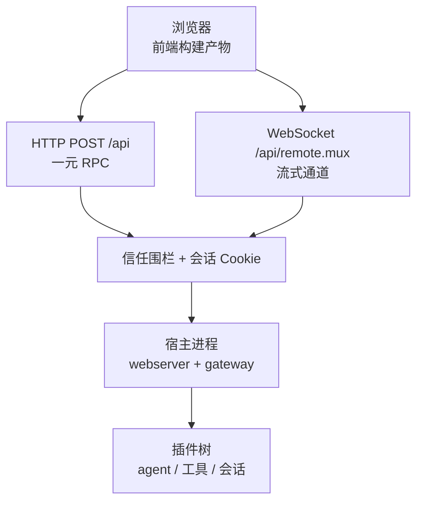
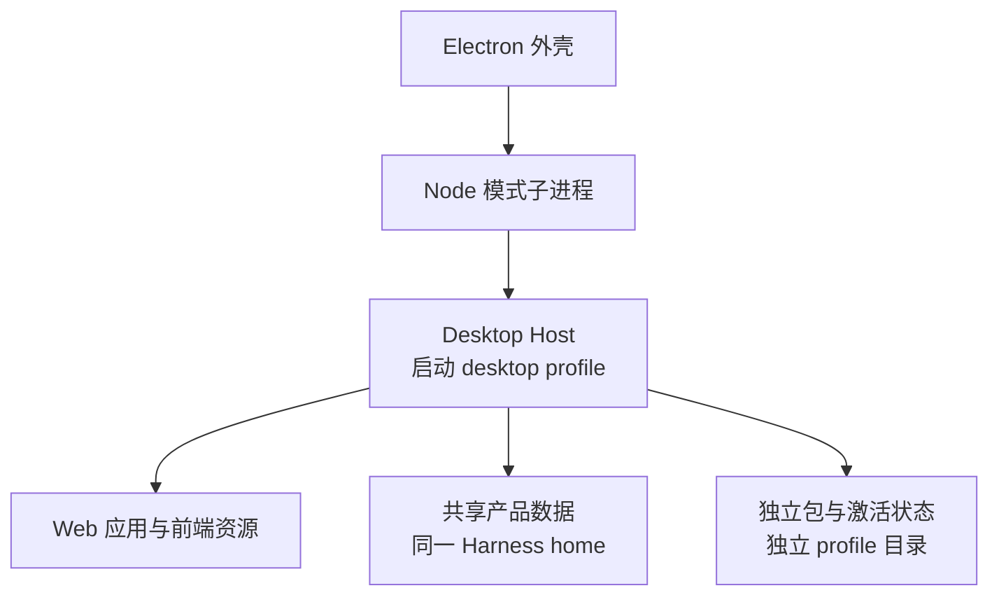

# 运行形态与安装

这一页回答「它到底以什么形式跑起来、我怎么装、默认暴露什么」。读完你应该能选定形态、知道最小可跑路径，并清楚每种形态的边界。

## 一个容易搞错的命名约定

先纠正一处：`dsh` **只有一个真正的子命令 `plugin`**。`web`、`headless`、`sdk`、`sdk-minimal`、`acp` 都不是子命令，而是 **profile 名**——当第一个参数不是选项也不是 `plugin` 时，它会被展开成 `--profile <名字>`。

由此带来两个实际影响：

- **命令行参数分两段**：启动器只解析自己认识的那些（选 profile、加补丁层、转储配置、版本）；**其后所有内容原样交给形态自己的应用**去解析。所以 `dsh web --help` 打印的是 Web 应用的帮助，`dsh --help` 打印的是启动器的帮助。
- **想新增一种形态，做法是加一个 profile + bundle，而不是加一个可执行文件**。这也是仓库里有一条守卫检查「不存在绕过启动器的 Node 应用入口」的原因。

## 五种形态的分工

| 形态 | 组合 | 面向场景 | 交互方式 | 网络暴露 |
|------|------|---------|---------|---------|
| `web` | `dsh-base` + `dsh-web-app` | 日常使用；唯一交互完整的图形界面 | 浏览器 | 默认仅回环，见下 |
| `headless` | `dsh-base` + `dsh-headless` | 一次性任务、脚本与 CI | 位置参数或标准输入 | **不开监听端口** |
| `desktop` | 桌面发行版自有 | 桌面应用（随安装包分发） | Electron 窗口 | 仅回环，端口固定 |
| `sdk` / `sdk-minimal` | `dsh-base` + `dsh-sdk-app` / 独立最小树 | 被其他程序内嵌调用 | 标准输入输出上的 JSON-RPC | 无网络监听 |
| `acp` | `dsh-base` + `dsh-acp-app` | 受信程序驱动的自动化 | 标准输入输出上的 ACP | 无网络监听 |

`headless` 的边界值得单独说明：它能跑**一次**任务（位置参数，或用 `-` 从标准输入读）、可用 `--json` 输出事件流、可用 `--session-id` 续接一个已持久化的会话；它只把最后一段非空助手文本写到标准输出，推理内容写到标准错误，任务完成退出码为 0、否则为 1。它**不支持**交互追问，随附的 headless 组合也不挂 HTTP 服务与浏览器客户端。

## 安装与最小可跑路径

| 路径 | 命令 | 说明 |
|------|------|------|
| 从 npm 运行 | `npx @deepseek-ai/dsh web` | 不需要克隆仓库；默认在回环地址的 3080 端口起服务 |
| 从源码运行 | `pnpm install` → `pnpm run build` → `pnpm dsh web` | `pnpm dsh` 使用构建产物，不会重新构建 |
| 源码免构建直跑 | `pnpm dsh` | 通过 TS 加载器直接跑源码入口，适合改代码时用 |
| 开发热更 | `pnpm run dev:web` | 构建、起服务，并在源码改动时重建浏览器端 bundle |

```sh
# 从 npm 直接运行
npx @deepseek-ai/dsh web

# 从源码运行
pnpm install
pnpm run build
pnpm dsh web
```

运行时要求 **Node.js `^22.19.0 || >=24.0.0`**，包管理器由 Corepack 提供。桌面形态是例外：它自带运行时，不要求机器上预装 Node。

## Web 形态：一个宿主进程 + 一个浏览器进程

`dsh web` 是**宿主进程内跑 HTTP/WebSocket 服务端，浏览器是另一个进程**——不存在「客户端与服务端同进程」的形态。页面资源是构建产物，服务端只负责投递页面与处理 RPC。

浏览器与宿主之间有两条通道，职责分明：**一元调用走 HTTP POST，流式调用走一条独占的 WebSocket 多路复用通道**。



读这张图要看清**校验顺序**：请求先过「Host/Origin 信任围栏」（防 DNS rebinding 与跨站请求），再过浏览器会话认证，都通过才进入派发。没过围栏返回 403，过了围栏但未认证返回 401——这两种失败含义不同，排错时不要混。

安全边界的细节值得逐条记住，因为它们决定了默认配置能承受什么：

| 项 | 默认行为 | 含义 |
|----|---------|------|
| 监听地址 | 仅回环（`127.0.0.1`） | 命令行**显式拒绝**绑定全网卡，避免把可执行命令的入口暴露到网络 |
| 端口 | 3080；传 0 让系统选空闲端口 | 实际端口从服务读回并打印 |
| 打开浏览器 | 本机启动时自动打开；SSH 启动只打印地址 | SSH 场景下本地转发地址由客户端持有，进程推不出来 |
| 认证 | 每进程随机令牌换取签名的会话 Cookie | 令牌只在根路径换一次，随后 302 到不带令牌的干净地址 |
| Cookie | 仅 HttpOnly、SameSite 严格、**故意不带 Secure** | 因为默认是回环明文 HTTP；这意味着同 authority 走明文网络会暴露该凭据 |
| 吊销 | **没有登出操作** | 清 Cookie 只结束单个浏览器会话；要吊销全部需删除对应凭据记录并重启 |
| 额外主机名 | 可用参数显式声明受信 authority | 绑定全网卡时，局域网地址字面量会自动成为受信项 |

## 桌面形态：Electron 借自己当 Node

桌面端不是「另一个 Agent 实现」，而是**同一套 runtime 的一个受控启动路径**。Electron 主进程以 Node 模式启动一个子进程（给自己设 `ELECTRON_RUN_AS_NODE=1`），这个子进程用的是私有宿主包，它调用共享的 profile 启动器，参数是 desktop profile 与固定端口，并关闭「自动打开系统浏览器」——因为页面由 Electron 自己加载。



这里最关键的一条设计边界是**共享数据、隔离执行**：桌面端与 npm 安装版共用同一个 Harness home 下的产品数据，但**从不共享**可执行包、插件激活状态、锁文件与依赖目录。桌面端在触碰任何 profile 之前先取进程级单实例锁，独占自己的 profile 目录。

代价也很直接：为了让用户机器上不需要预装 Node 与包管理器，桌面端把 Electron 与 dsh 的版本绑死——**升级 dsh 就等于发一次桌面版本**。另外命令行**不能**启动 desktop profile（保留名），只有桌面安装版自带的控制台命令能管理它的插件。

## SDK：把运行时当子进程用

「进程外（out-of-process）」在这里的字面含义是：调用方进程**启动一个独立的 `dsh` 运行时子进程**，用标准输入输出上的换行分隔 JSON-RPC 通信。客户端不导入运行时，协议本身是一个纯库。

协议面刻意做得极小：

| 方向 | 消息 | 说明 |
|------|------|------|
| 客户端 → 服务端 | `initialize` | 建立会话与环境 |
| 客户端 → 服务端 | `session/prompt` | 投递一轮输入，只回入队回执 |
| 客户端 → 服务端 | `shutdown` | 优雅关闭 |
| 服务端 → 客户端 | `session.event`、`session.status` | 会话事件与状态通知 |
| 服务端 → 客户端 | `subagent.started`、`subagent.finished` | 子代理生命周期通知 |

边界因此很清楚：**没有轮内取消**（要放弃一轮只能关掉运行时进程）、没有逐轮结果（`prompt` 只回执）、没有版本协商。TypeScript 客户端在未显式给出可执行文件时会解析同版本的 dsh，并**校验版本完全相同**；源码工作树里则回退到用 TS 加载器直跑源码入口。

Python SDK 遵循同一架构：它自己**不实现应用**，而是随轮子附带一个打包好的 dsh 运行时（因此不需要系统 Node.js），启动时选 `sdk` profile。一个刻意的差异是：**Python 侧强制要求显式指定 Harness home**，不会隐式去用默认的 `~/.dsh`——避免库调用悄悄读写开发者的个人数据。

## ACP：能力更强、但只面向受信控制器

ACP 是标准协议，面向「受信程序或自动化」驱动一个持久 Agent：进程外子代理、测试运行器、脚本化控制器。它与 SDK 的差别不是协议方言，而是**能力面**：

| 维度 | SDK | ACP |
|------|-----|-----|
| 协议归属 | 本项目自定义 JSON-RPC | 标准 ACP |
| 会话生命周期 | 只有投递一轮 | 新建、列举、恢复、关闭、取消 |
| 多会话 | 无会话管理面 | 一条连接可并发多个独立会话 |
| 运行中改配置 | 不支持 | 可切换模型与思考级别 |
| MCP | 无 | 可挂标准输入或 HTTP 传输的 MCP 服务 |
| 权限请求 | 无 | 有，可由客户端自动应答 |
| 认证 | 无 | 立即成功（声明不需要认证） |

它刻意**排除**人类需要的专有呈现（计划、标题、待办、终端视图等），只暴露标准协议；模型可见数据也被收窄到已提交的消息与思考、通用工具生命周期、配置变更与上下文用量——原始增量、重试等不入线。

## 首次启动会创建什么

所有用户数据集中在一个 Harness home 下（默认 `~/.dsh`，可用环境变量覆盖）。

| 对象 | 何时创建 |
|------|---------|
| `profiles/<名字>/package.json` | 首次使用某个形态时按随附模板初始化，内含 `bundles` 清单 |
| `profiles/<名字>/cordis.patch.yml` | 同上，这是用户自己的补丁层 |
| `profiles/<名字>/pnpm-workspace.yaml` | 同上，用于把树外插件的依赖扁平化 |
| `profiles/<名字>/cordis.yml` | **每次启动都被重写为空列表**（组合结果由补丁层决定，写回会污染下次启动） |
| `sessions/` | 首次落盘会话时 |
| `.credentials.yaml` | 首次写入凭据或浏览器会话密钥时，权限收紧到仅所有者可读写 |
| `logs/startup-*.log` | 仅当必需插件激活失败时 |

## 边界与取舍

- **Web 是唯一「交互完整」的界面**，但不是唯一能跑 Agent 的形态；headless、SDK、ACP 都能独立完成任务，只是没有图形交互面。
- **Web 依赖已构建产物**（类型化远程契约、前端资源、客户端 bundle）。启动器不检查新鲜度，陈旧产物会继续跑旧代码——这是开发时容易困惑的点。
- 绑定范围是刻意收紧的：默认仅回环，命令行拒绝绑定全网卡；信任围栏**不是认证层**，也不解决网络可达性。需要远程访问时应在其前面加一层真正的认证与加密通道。
- 桌面端为「零系统依赖」付出了版本绑定的代价；SDK 与 ACP 为「受信控制器」定位付出了能力面的代价（无人类审批交互、无轮内取消）。
- 本文档依据的参考文档中，headless 的参数说明与源码存在出入（参考文档只列了位置参数，源码还支持 JSON 输出与会话续接）。**以源码为准**。

> 依据：`apps/cli/src/args.ts:76-211`、`apps/cli/README.md:1-64`、`packages/bundle/web-app/src/startup.ts:38-88`、`packages/bundle/web-app/src/index.ts:110-301`、`packages/bundle/web-app/cordis.patch.yml:160-180`、`packages/host/webserver/src/index.ts:55-160`、`packages/bundle/headless/src/startup.ts:30-60`、`packages/bundle/headless/src/index.ts:370-400`、`packages/client/connection/README.md:28-89`、`packages/client/connection/src/api-request-trust.ts:60-118`、`packages/api/gateway/README.md:10-50`、`packages/api/gateway/src/stream-protocol.ts:1-12`、`apps/desktop/src/host-process.ts:180-205`、`apps/desktop/src/paths.ts:1-22`、`apps/desktop/README.md:70-100`、`apps/desktop-host/src/index.ts:20-45`、`packages/sdk/README.md:10-49`、`packages/sdk/protocol/README.md:10-125`、`packages/sdk/client/src/launch.ts:50-158`、`packages/sdk/client/README.md:50-135`、`python/sdk/README.md:10-72`、`python/sdk/src/deepseek_harness/client.py:450-490`、`packages/acp/acp/README.md:10-182`、`packages/boot/app-boot/src/profile.ts:170-270`、`apps/cli/src/profile-boot.ts:76-172`、`package.json:1-40`
