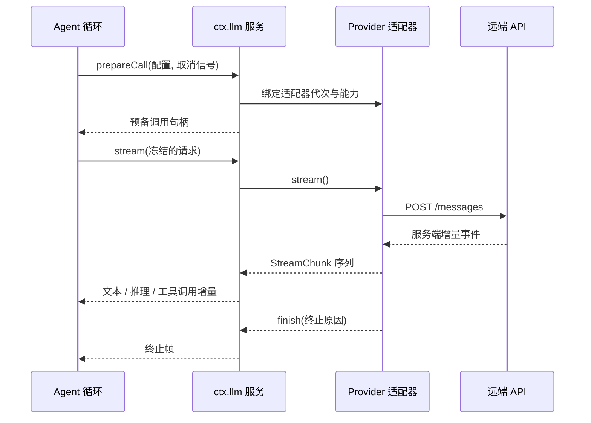
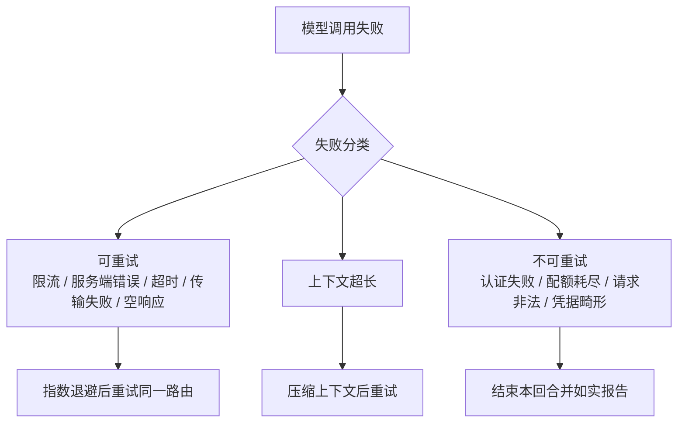

# 模型接入与凭据

这一页讲清「模型是怎么接进来的」。它回答四个问题：支持哪些接入方式、一次调用在协议层长什么样、失败时系统会做什么、密钥和配置存在哪里。

## 这一层解决什么

模型厂商的接口在细节上差异很大：有的用文本增量，有的把「思考过程」单独成块；有的原生支持图片，有的只接受文本；工具调用的参数是**未解析的 JSON 字符串**，各家的分块方式还不一样。

如果每个上层功能都去适配这些差异，整个系统会被厂商细节渗透。所以这里定义了一套**与厂商无关的消息与流式词汇**，把差异收敛到适配器内部；适配器再通过**声明的模型能力元数据**告诉上层「这个模型能做什么」，上层据此在派发前投影请求。

## 适配器地图

| 包 | 角色 | 接入的协议/厂商 |
|----|------|---------------|
| `llm/llm` | 抽象服务与适配器注册表（provider 中立的消息、块、chunk 词汇） | 中立，不含厂商 |
| `llm/llm-deepseek` | DeepSeek 传输与配置、模型能力表 | **Anthropic Messages 协议的 DeepSeek 子集**，默认指向官方端点 |
| `llm/llm-deepseek-api-key` | API key 认证与模型发现，注册路由 `deepseek-official` | 同上 |
| `llm/llm-deepseek-account` | 账号令牌认证、失效处理与模型发现，注册路由 `deepseek-account` | 同上 |
| `llm/llm-pi-ai` | 经第三方 pi-ai 库接入任意已配置路由 | 三种可手写协议：`openai-completions`、`openai-responses`、`anthropic-messages` |
| `llm/llm-retry` | 在步骤边界执行 provider 重试策略 | 中立 |
| `llm/token-meter` | 从会话日志测量请求与上下文压力 | 中立 |
| `llm/deepseek-llm-api-extensions`、`llm/plugin-package-inventory-deepseek` | 向官方请求附加顶层字段 | DeepSeek |

有几个边界值得先说清，因为它们决定了「能用什么」：

- **DeepSeek 直连适配器的协议不可配置**——它走的是 Anthropic Messages 协议的一个子集；想换协议形态，得走 `llm-pi-ai` 或另写适配器。
- **`llm-pi-ai` 的手写路由只开放三种协议**，并**显式拒绝**那些配置形状表达不了认证方式的方案（例如带签名与区域的云厂商方案、带项目与位置的服务账号方案、以及交互式登录的网关），而不是给一个会失败的半成品。
- **适配器按「路由名」注册**，重名会整体拒绝（全有或全无），因此「同一个厂商不同认证方式」是两条路由，而不是一个适配器里分叉。

## 一次模型调用的管道

调用分两步：先**准备**，再**流式消费**。准备阶段把「模型能力声明」和「实际派发」绑定到同一个适配器代次，这样后续每一步都基于同一份能力判断，不会中途漂移。

响应在协议层被建模成 **7 种 chunk**，上层只认这 7 种，因此各家分块方式的差异不会外泄：

| chunk | 含义 |
|-------|------|
| `block-start` | 一个内容块开始，带索引与块类型 |
| `text-delta` | 可见文本增量 |
| `reasoning-delta` | 推理（思维）内容增量 |
| `tool-call-delta` | 工具调用参数增量，内容是**原始 JSON 字符串** |
| `block-end` | 一个内容块组装完成 |
| `usage` | 用量统计，出现在终止之前 |
| `finish` | 终止原因，可携带适配器私有的回放元数据 |

终止原因有五种：正常停止、转去调用工具、达到输出上限、被取消、出错。这里有一个容易踩的语义点：**块一旦组装完成就被冻结，`tool-call` 的参数解析不是模型层的职责**——模型层只负责把原始参数串交出去，解析与校验属于工具层。

内容块本身是可合并扩展的词汇：文本、推理、图片、文件、工具调用、工具增删。其中「工具增删」用于表达**对话中途工具集合发生变化**，适配器按自己声明的策略决定是重写历史还是在历史后追加。

## 能力差异怎么被抹平

这一层的原则是：**未声明就是未知，显式缺席就是负能力**；抹平差异时必须留下痕迹，不能静默丢弃内容。

| 差异 | 处理方式 | 为什么这样处理 |
|------|---------|---------------|
| 模型不支持图片 | 派发前把图片替换为**确定性占位文本** | 保留「这里原本有一张图」的信息，而不是让模型以为什么都没有 |
| 图片超出字节/数量预算 | 返回显式的「需要卸载图片」失败，并在失败里带上是**几张**，由上层决定怎么办 | 静默截断会让模型基于残缺输入作答，风险更高 |
| 文件 | 所有路由都拿不到原生文件，一律投影成**确定性文本句柄**（名字、字节数、只读路径） | 跨厂商无法统一「文件」语义，宁可统一降级 |
| 工具调用参数 | 只传原始 JSON 字符串，不解析 | 解析失败要由工具层按工具语义报错，而不是在传输层报错 |
| 推理内容 | 作为一等块与增量通道 | 不做「有就拼进去、没有就算了」的字符串拼接 |
| 缓存 | 没有统一的缓存语义，只有用量里的读/写计数字段 | 前缀复用是厂商行为，只如实计入用量 |
| 工具集合中途变化 | 适配器声明策略：改写历史内的声明，或只允许追加 | 不同协议的容忍度不同，由适配器决定而不是上层猜 |

用量统计有个反直觉但重要的约定：`inputTokens`、`cacheReadTokens`、`cacheWriteTokens` **互斥计数**——`inputTokens` 只算未命中的输入，计费输入是三者之和。跨厂商做成本估算时这一点必须先对齐。

## 失败时系统做什么

所有适配器抛出的异常都会被**归一化成终止帧**（取消或错误），不会穿透给消费者——消费者只需要处理「流结束了，原因是这个」，不必同时处理异常与流两条控制路径。而中间件自身的失败仍然照常抛出，以免把编程错误伪装成模型故障。

失败被归一化成一组稳定的机器码，再按码决定处置：

三条处置路径的差别值得记住：

- **重试有默认上限与退避曲线**（默认最多 5 次，可重试码为上面那五类，指数退避从数百毫秒涨到十秒并带抖动）。厂商若在响应里给了合法的「稍后重试」时间，会优先按它安排。
- **重试是持久的**：每次排定的重试会先落盘再等待，因此进程崩溃后同一回合仍可重建，而不是丢掉等待状态。
- **上下文超长不走重试**，而是触发**压缩**：先做可选的工具结果裁剪，再选摘要，压缩确实推进了内容才重试；否则保留原始错误。它带自己的重试次数上限，避免「压缩—再超长」的死循环。
- **不存在跨模型或跨 provider 的自动回退**。失败要么重试同一路由、要么压缩、要么结束这一回合。想换路由只能改配置，或用 `llm/stream` 这个瀑布事件介入。

## 凭据与设置的分离

这一层有一条明确的纪律：**配置文件里只放引用名，绝不放值**。因此「哪些字段是密钥」和「密钥是什么」是两个不同的问题，由两个不同的服务回答。

| 概念 | 是什么 | 举例 |
|------|--------|------|
| 凭据引用 | 一个名字，指向某处的一个值 | 环境变量名 |
| 凭据记录 | 实际的可写凭据产物 | API key 记录、授权（OAuth）产物 |
| 设置项 | 插件自己的配置字段中被标记为「易变」的那些 | API key 的**引用名**、默认模型、思考级别 |

取值来源有优先级，从高到低：

| 优先级 | 来源 | 可写性 |
|--------|------|--------|
| 1 | 进程继承的环境变量 | 只读 |
| 2 | Harness home 下的凭据文件 | 可写，由提供者管理 |
| 3 | 调用目录下的 `.env` | 只读兜底 |
| 4 | Harness home 下的 `.env` | 只读兜底 |

可写的凭据文件以仅所有者可读写的权限原子落盘；解析发生在**每次请求**而不是启动时，所以外部轮换凭据后不需要重启。凭据相关的报错也刻意不回显密钥片段——只报「哪个引用、怎么修」。

设置项没有一份全局清单：**每个插件在自己配置中标记为易变的字段，就是设置项**，按插件在 profile 里的条目 id 分命名空间。取值分三层（schema 默认值 → 组合基座 → 用户层），写入带乐观锁，敏感字段在跨进程读取时被结构性摘除，只回「有没有设置过」而不回值。

需要向人要凭据时（例如浏览器授权登录），走的是另一条通道：一个「授权流」注册表，把提问类型（文本、密文、选择）交给调用方注入的交互接口。这里有一个刻意的限制——**同一个凭据键同时只允许一次尝试，第二个调用者被拒绝而不是被合并**，因为两个人会被同一个流问同样的问题。

## Typert：为什么需要类型化 RPC

Web 客户端运行在浏览器里，而 Agent 运行在宿主进程里，两者之间必须通信。手写 wire 协议的问题是：每一次改动都要在两侧同步维护类型与校验，而且没有任何机制阻止它们漂移。

Typert 的做法是**从源码类型生成跨进程契约**：构建期分析宿主侧的业务服务类型，生成反射产物与「面向客户端的 Remote 投影」；业务服务只需用装饰器声明哪些方法可以远程调用，运行期注册表把这些产物挂到 `ctx.typert`，客户端就能把它们当**类型化方法**调用。

| 组成 | 职责 |
|------|------|
| `typert/protocol` | Remote 装饰器、wire 描述符、编解码与提供者契约 |
| `typert/generator` | 构建期把 TypeScript 类型分析成反射、schema 与 Remote 描述符 |
| `typert/registry` | 运行期注册表：生成的包反射 + 活的 schema 校验 |
| `typert/loader` | 从组合自动发现并注册各包的生成产物 |

几条边界：生成**只在构建期跑，绝不在运行中的会话里跑**；产物体现在包的导出字段里、不进版本库（未构建的工作树里没有）；注册是按插件作用域的原子操作，插件卸载自动撤回；产物缺失时，从组合自动发现会静默跳过，而显式声明却损坏时会**响亮失败**。

传输上，単次调用走请求—响应（浏览器侧即 HTTP POST），流式调用走宿主网关持有的 WebSocket 多路复用通道。返回值被包装成显式的成功/失败结果类型，**载体故障永不 reject**——调用方拿到的是「失败」这个值，而不是异常。

## 遥测与隐私开关

遥测在这一层只有**传输能力**，没有默认采集策略：它提供两条互不共享队列的上报通道（普通分析事件、完整会话日志），挂载本身不创建任何连接。谁上报什么，由各业务消费者自己拥有。

与使用者直接相关的是两个开关：

- **会话日志上传默认是「仅在显式反馈时上传」**：只有用户提交反馈时，才释放此前未上传的记录前缀，内容包括上下文；`DISABLED` 则完全不构造传输。可选的模式只有这两种。
- **一个环境变量可全局关闭**：只要该变量非空即关闭遥测，包括取值写成 `0` 或 `false` 的情况——这是一个刻意偏保守的设计，宁可错关。

另外需要区分的是**桌面客户端的产品分析**：它是桌面形态专有的，默认开启，字段限定在交互与版本信息，明确不含 prompt、响应与密钥。普通 Web 客户端不挂载该服务。

## 边界与限制

- 模型能力靠**适配器声明**，声明缺失即按未知处理；新增厂商要同时提供适配器与能力元数据，否则图片、推理、工具更新等特性不会被正确投影。
- 协议差异被收敛成 7 种 chunk 与一组机器码；**新增能力（例如新的块类型）需要同时改动词汇定义与所有消费方**，这是统一词汇的代价。
- 原始回放元数据留在适配器私有信封里，组装后**按块数对齐，块数不匹配就整体丢弃**。这是「可回放」与「厂商私有格式不外泄」之间的取舍。
- Typert 的生成产物与源码的一致性由构建过程保证；本文档**未能确认**运行期是否存在独立的产物版本/代次校验。

> 依据：`packages/llm/README.md:20-50`、`packages/llm/llm/src/index.ts:208-291`、`packages/llm/llm/src/index.ts:1020-1110`、`packages/llm/llm/src/types.ts:60-200`、`packages/llm/llm/src/types.ts:420-465`、`packages/llm/llm/src/types.ts:494-553`、`packages/llm/llm/src/retry-policy.ts:10-100`、`packages/llm/llm-deepseek/src/transport.ts:25-45`、`packages/llm/llm-pi-ai/src/provider.ts:31-51`、`packages/llm/llm-retry/src/index.ts:60-105`、`packages/credentials/credentials/src/types.ts:10-75`、`packages/credentials/credentials-local/src/index.ts:1-20`、`packages/credentials/authorization/src/types.ts:7-64`、`packages/settings/settings/src/types.ts:8-60`、`packages/typert/README.md:10-52`、`packages/typert/loader/src/index.ts:9-50`、`packages/api/gateway/README.md:12-46`、`packages/telemetry/otel/README.md:12-33`、`packages/session/session-telemetry-otel/src/index.ts:30-90`、`packages/client/product-analytics/src/index.ts:16-51`、`packages/boot/app-boot/src/profile-context.ts:28-73`
