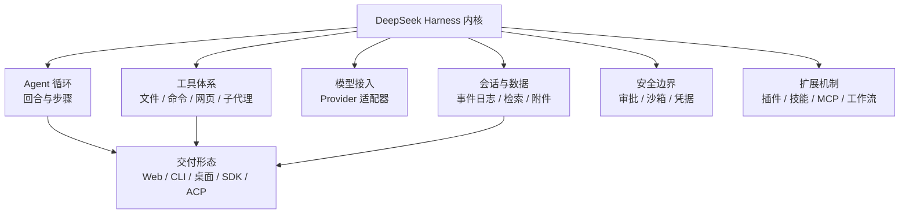

# 项目概览

## 一句话定位

DeepSeek Harness（命令名 `dsh`）是一个**可组合的智能体运行框架**：它提供让大模型读写文件、执行命令、检索网页、调用外部服务并记住历史的基础设施，同时允许把其中任何一部分——模型、工具、会话存储、甚至主循环——当作插件替换掉。

它既是一个开箱可用的产品（Web 界面、命令行、桌面应用），也是一个插件宿主（第三方可以发布插件改变它的行为）。

下面这张能力地图先给出全貌，后续各页分别展开其中一块。中间是内核，向外是它支撑起来的能力分区，最外层是用户真正接触到的交付形态。读图时注意：**外层是形态差异，内层是同一套内核**——这正是「一切皆插件」在能力视角下的样子。

## 它要应对的几类问题

理解这个项目的最好方式，是先看它选择正面处理哪些麻烦：

**「换个模型或工具就得改源码」。** 常见做法是把工具调用逻辑和某个模型厂商的接口写在一处，换供应商等于重写。这里把模型接入、工具注册、会话存储都定义为**可替换的能力位（capability seam）**，替换一个实现即可整体改变产品行为，上层代码不需要知道换过。

**「会话历史只是一段聊天记录」。** 这里把会话当作**事件日志**：每一次用户输入、模型请求、工具调用、结果回填都是追加式事件，模型看到的历史是从日志**推导**出来的，而不是另一份独立维护的副本。代价是写入路径更重，收益是恢复、分叉、审计、迁移都建立在同一份事实之上。

**「Agent 能对机器做什么，用户说不清」。** 项目把风险控制做成三层：能力位层面可替换的沙箱、执行前的审批策略、以及可配置的权限档位（例如把文件写入限制在工作区内）。它同时明确声明这些**不能保证隔离**。

**「同一种能力要在多个形态里各写一遍」。** 通过 profile 与 bundle 的组合机制，Web、一次性命令行任务、SDK、桌面端共享同一套内核能力，差异只体现在组合层。

## 给谁用 / 典型场景

| 角色 | 典型用法 |
|------|---------|
| 个人开发者 | 用 Web 界面或命令行让 Agent 在本地仓库里改代码、跑测试、查资料 |
| 团队/平台工程 | 把它当作可嵌入的 Agent runtime，通过 SDK 或自定义 profile 集成进自有产品 |
| 插件作者 | 发布一个插件改变模型接入、工具集、界面面板或会话存储 |
| 技术选型者 | 评估「自建 Agent 基础设施」与「直接采用一个成熟 harness」之间的取舍 |
| 安全/合规评估者 | 判断默认权限边界、沙箱后端、数据落盘位置与遥测行为是否可接受 |

## 核心能力一览

下表的每一项都可以在「依据」列出的位置找到实现，而不是路线图承诺。

| 能力 | 说明 | 典型场景 |
|------|------|---------|
| 模型接入 | 抽象的 LLM 服务 + 多家 provider 适配器；默认连接 DeepSeek，其他 provider 可在设置中启用 | 换模型不改业务代码 |
| 完整工具体系 | 文件读写编辑、命令执行、持久终端、网页搜索与公开 HTTP(S) 抓取、子代理、后台作业、待办与目标追踪 | 一次任务里连续读改测 |
| 持久会话 | 会话可跨重启恢复，支持分叉与检索 | 长任务、回到昨天的上下文 |
| 权限与沙箱 | 默认把文件写入限制在工作区、风险操作前询问；沙箱有平台化后端 | 在本机安全地让 Agent 动手 |
| 多形态交付 | 同一内核可运行成 Web 界面、一次性命令行任务、桌面应用、SDK 服务、ACP 服务 | 本地用 GUI，CI 里用 headless |
| 扩展机制 | 插件、技能（skill）、外部 MCP 服务、子代理、工作流脚本、钩子、后台作业 | 接入自有工具或复用社区能力 |
| 上下文治理 | 提示词按有序分区组装；上下文压力大时自动压缩；有循环卫生守卫 | 长会话不崩、不反复空转 |

## 技术栈

| 组件 | 用途 | 说明与代价 |
|------|------|-----------|
| TypeScript + Node.js | 全部实现语言与运行时 | 要求 Node `^22.19.0` 或 `>=24`；无其他语言版本的产品实现 |
| Cordis | 底层插件/依赖注入框架，决定「一切皆插件」的机制 | 项目把它**内联到 `vendor/`** 而不是普通依赖，改动需同步维护清单；这也意味着理解本项目绕不开理解 Cordis |
| pnpm workspaces | 单仓库多包管理 | 仓库内约 300 个包目录，依赖关系靠工作区约束与生成式配置维护 |
| tsdown + tsc | 打包与类型产物 | 采用「tsc 先出类型、tsdown 再打包」的两阶段构建，并按 Host/Client 两个聚合并行推进 |
| Vite | Web 客户端构建 | Client 包同时产出 Node loader 与浏览器 bundle |
| Electron | 桌面应用外壳 | 桌面端与 npm 安装版共享产品数据但各自管理包与激活状态 |
| Vitest | 测试框架 | 分层：单元、端到端（真实 API，无密钥自动跳过）、录制会话回放 |
| Oxlint / Lefthook | 静态检查与本地 Git 钩子 | 钩子刻意只做快速检查，完整门禁交给 CI |

## 设计取向与代价

这套文档不打算给出「比某某项目更好」的结论——那需要实测。更诚实也更有用的，是把这个项目**主动做出的取舍**列清楚：

| 取向 | 得到什么 | 付出什么 |
|------|---------|---------|
| 无特权内核，一切皆插件 | 任何能力都能被替换，产品形态由配置决定 | 没有「改一处就全局生效」的中心；定位一段行为要先弄清它在插件树里的位置 |
| 会话即事件日志 | 恢复、分叉、迁移、审计共用一份事实 | 写入更重，且引入格式版本与迁移链的长期维护成本 |
| 能力位（Service Definition / Provider / Consumer）三段式 | 换一个 provider 就整体改变能力，例如把文件与命令执行一起指向远端 | 新能力必须同时设计好这三段，不能只写一个函数 |
| 组合靠 layers + patch，按 id 整块替换 | 覆盖关系确定、可回溯 | 覆盖是**整块替换而非合并**，想保留原设置必须显式重述 |
| 面向模型可见性做运行时校验 | 「模型看到的东西必须来自日志」成为可检查的不变量 | 新增任何模型可见输入都要走会话事件，扩展成本更高 |
| 开发者预览、预稳定 API | 迭代速度快 | 升级可能破坏兼容，使用者需要跟进 |

## 它在文档上的处境

一个反直觉的事实：这个项目的**内部**文档远比**对外**文档丰富。仓库里同时存在近 130 份子系统文档（中英双语）、一份架构总纲、一份工具目录与一份配置目录（其中多份由脚本生成以保证与代码同步），以及上千份按日期归档的工程决策笔记。缺的是给外部读者的一条自顶向下的阅读线——本 Wiki 就是为补这个位置而写。

因此，本 Wiki 的定位是**导览**而非**权威定义**：它能让你在几十分钟内理解这套系统怎么运转、边界在哪；当你需要精确到字段与事件签名时，应转向仓库内对应子系统文档。

## 现状与边界

- 处于**开发者预览**阶段，官方明示会有破坏兼容性的变更；公共 API 预稳定。
- **没有经过安全审计**，不应被当作安全边界使用。它会执行模型生成的代码与命令、加载第三方插件、访问网络与文件；官方建议在最小权限、可丢弃的环境中运行并做好备份。
- 官方**暂不接受外部代码贡献**，参与方式是反馈、发布插件与写使用指南。
- 会话数据格式采用不可变世代 + 相邻迁移，**支持从旧读新，不承诺从新读旧**。
- 若要长期跟进，需要把「会话格式版本演进」当作常态而非例外来对待。

详细边界与依据见首页的「现状与边界」一节。

> 依据：`README.md:1-77`、`packages/bundle/base/README.md:1-80`、`packages/README.md:1-120`、`docs/architecture.md:1-60`、`docs/development.md:1-100`、`SAFETY.md:1-27`、`CONTRIBUTING.md:1-23`、`packages/core/README.md:1-62`、`pnpm-workspace.yaml:1-30`
