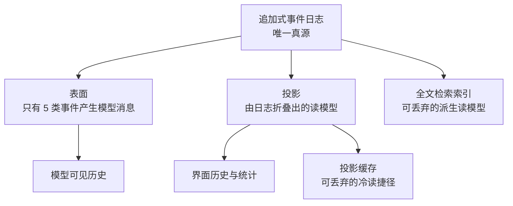
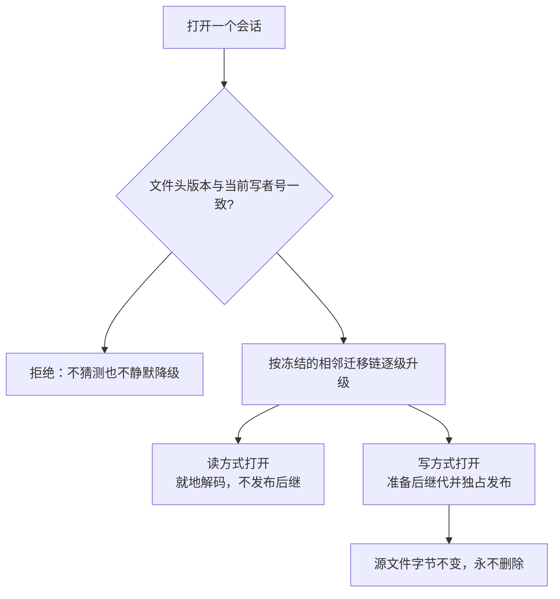

# 会话与数据持久化

这一页讲清「数据长什么样、存在哪里、升级时怎么办」。读完你应该能回答：崩溃丢掉的是哪一段；为什么压缩历史不会破坏可重放性；为什么升级程序不会毁掉旧会话。

## 一句话概括数据模型

**会话 = 一段不可变的头部元数据 + 一份只追加的事件日志。** 消息、工具结果、标题、交付物全都不是独立记录，而是日志里的事件。理解这一点，后面所有性质都是它的推论。

这一层的实现位于 `packages/core/session`，对外是 `ctx.sessions`；它**刻意不实现持久化**，落盘由一个可替换的后端能力位承担。

## 三层：日志、表面、投影

模型看到的历史、界面看到的历史、存在磁盘上的东西，是三个不同的东西：

- **表面（surface）** 是模型可见的那部分历史。只有五类事件会产生模型消息：系统消息、开发者消息、用户消息、助手消息、工具结果。携带这些事件时必须同时声明一个表面操作——「追加」或者「替换某个区间」。
- **非表面事件禁止携带表面操作**。这让「哪些事件能影响模型」成了一条可机械校验的规则，而不是约定。
- **替换操作是压缩能改写历史的机制**。旧事件仍然留在日志里，只是不再属于表面——所以压缩不破坏可重放性，也不丢审计线索。
- **投影与索引都是派生读模型**，可以随时丢弃重建。投影缓存、全文检索索引都属于这一类。

事件类型是闭合词表，核心事件包括回合开始与结束、步骤开始与结束、四类消息、助手尝试、工具调用与结果、请求头与请求上下文、种子结束标记。插件可以**声明合并**扩展词表，现有的扩展事件包括会话标题、交付物声明、工作区变更。

另有一个体量优化值得一提：连续三个以上的来源序号会被压缩成区间对，读取时再展开。

## 存在哪里

所有数据集中在一个 Harness home 下（默认 `~/.dsh`，可用环境变量覆盖；解析优先级是显式配置、环境变量、默认路径）。位置解析工具还提供一个缓存目录约定。

会话根目录是 `<home>/sessions`。它**没有默认值兜底**——代码注释说明，默认到进程当前目录会让会话文件随进程散落各处，所以宁可要求显式配置。

目录布局是从工作目录推导出来的：工作目录被编码成项目目录名（路径分隔符替换、非法码元转义、超长截断，没有工作目录时落到一个专用名字），其下每个会话一个目录，目录名是转义后的会话标识，里面是日志文件与锁文件。日志文件名带格式代数，压缩时追加后缀。

| 层级 | 规则 |
|------|------|
| 根 | `<home>/sessions` |
| 项目目录 | `--<工作目录 slug>--`，分隔符与冒号替换为连字符，非法码元转义，超长截断 |
| 会话目录 | 项目目录下的转义会话标识 |
| 日志文件 | `session.v<代数>.jsonl`，压缩时为 `.jsonl.zstd` |

日志格式是**逐行一条 JSON**，默认用 Zstandard 分帧压缩、每帧带校验和，头部独占第一帧。选这个格式的理由很直接：追加就是写一行；崩溃造成的撕裂尾部可以截断修复；关闭压缩时人可以直接读；每个会话一个文件便于外部工具处理与导出。代价是跨会话查询必须另建索引——这正是检索能力存在的原因，而且它默认关闭。

后端能力位提供创建、打开、刷写、查询与列举，返回每个会话的句柄。**随附的落盘后端只有一个**，默认开启压缩；另有一个最小组合把它关掉，便于调试。

## 写入与恢复的真实语义

这是最容易被高估的一段，值得逐条说清：

- **追加只是尽力而为**。事件被接受、排好序、本实例可读，就返回成功；**只有显式刷写才承诺崩溃存活**。
- **刷写只发生在三个语义边界**：模型请求的首块之前、顶层工具体执行之前、以及每个步骤开始之前。也就是说，崩溃最多丢掉「最后一个检查点之后的间隙」。
- **刷写失败是失败关闭的**：适配器或工具体根本不会被调用。宁可这一步不执行，也不在无持久保障的情况下产生副作用。
- **恢复靠补写收尾事件，而不是回滚**。已提交的内容永远不被重写。
- **崩溃修复是有语义的**：扫描日志找出未闭合的回合与步骤，先为没有得到答复的工具调用补上错误结果，再补步骤结束与回合结束。序号严格续接，**时间戳复用最后一个真实事件**——不发明未来时间。两条面向模型的文案刻意区分「已记录调用但没有结果」（建议先核对外部状态）与「根本没开始」。
- **恢复会话时先取写所有权**，从而天然排除并发恢复。

分叉（fork）的构造方式是：拷贝到边界（含）、插入一个带继承标记的种子结束事件、再为前缀补上「已分叉」的收尾。血缘由头部里的父会话标识、种子标记、以及**继承事件数量**表达；最后一项故意不进事件日志，而是存在物理头部行里——日志中的切割点由那个带继承标记的事件标出。子代理则额外记录来源与委派深度，**深度是持久化的**，这样递归预算才能跨重启存活。

## 单写者与它的代价

一个会话同时**只允许一个持有写权限的句柄**：进程内先做认领，跨进程再加一道内核级锁（POSIX 用文件锁，Windows 用命名内核信号量）。竞争失败会得到明确的「已被占用」错误。

有一条刻意的设计取舍：**锁没有过期机制**。注释给出的理由是——抢走一个卡住的写者的锁，会让它恢复后的追加撕裂日志。所以一个僵死但存活的持锁进程会一直挡住后继，直到它真正退出。读取者完全不碰这把锁。

## 检索

检索能力以五个只读工具暴露给模型：跨会话搜索、会话内事件搜索、会话血缘追溯、事件关系追溯、以及有界的窗口读取。服务面另外提供会话列举、按语义过滤搜索、读取表面、以及追溯能力。

几处值得注意的性质：

- **全文匹配是字面量匹配**，大小写不敏感，空白灵活（分词后用空白通配连接），正则元字符被转义以防注入。
- **读取窗口有上限**（默认 50 条），避免一次拉出整份日志。
- **血缘追溯会检测环**并报错；父会话不在语料里时会明确标记结果不完整并给出未解析的父标识。
- **事件关系追溯能回答「这条事件被谁替换了」「它来源于哪些事件」「谁由它派生」**，直接读表面操作与来源序号。
- SQLite 全文索引把**活跃会话放在临时表**里、只有已落盘的会话永久索引。索引带自己的 schema 版本与标识；外来库或版本不匹配的库会被**整表丢弃重建，不做迁移**——因为它本来就是可丢弃的派生数据。
- **随附组合默认关闭全文检索**（配内存库且不打开），原因是不拖慢启动。关闭时它根本不加载 SQLite 模块。
- 索引不需要时有降级路径：界面侧的搜索只匹配标题与工作区名。

## 附件与交付物

**附件是内容寻址的不可变字节对象**。图像与普通文件走不同的对象路径，文件另有一个按显示名建立的别名。会话日志里只放不透明的附件标识，从不放文件系统路径或带凭据的 URL。

两条明确的边界：**附件永远不会被自动删除**（代码里只找到临时文件清理与请求缓存淘汰，没有对象回收）；引用感知的回收被推迟，因为分叉与恢复出来的会话会共享对象。

交付物有两类完全不同的东西，混淆会导致错误预期：

| | 交付物声明 | 工作区变更 |
|---|-----------|-----------|
| 内容 | 声明的已有文件（路径与描述），**不复制文件内容** | 每个顶层回合的文件变更摘要：路径、增删行数、二进制或超大标记、版本控制快照标识 |
| 存放 | **进会话日志**（事件带完整文件列表） | **不进日志**：事件只带回合号，摘要与差异留在宿主进程内存里 |
| 后果 | 重启后仍可重放 | **重启后能重放日志，但看不到当时某个回合的变更明细** |

工作区变更的记录方式是：回合开始与结束时对工作树取快照，再加上对版本控制不覆盖的路径做文件编辑前后的整文件截获；非版本控制目录退化为「只列出文件编辑工具改过的文件」。它只对「有工作目录且不是子代理」的会话生效。

另有一个与会话存储**完全独立**的键值存储中枢：它本身不做 IO，只是「命名后端注册表 + 已挂载的数据形态」，后端拥有介质、数据形态拥有语义。默认后端把数据放在 home 下的一个目录里，支持两种布局（整单元单文件、或按记录分文件）。它承载的是派生的键值数据——最相关的消费者是投影缓存。会话日志**不经**这个中枢。

## 格式版本与迁移

版本号只有一个权威常量，全仓唯一手维护。升版判据写得很清楚：**由写者发出什么决定，而不是由新读者能否接受决定**；只有头部形状、事件信封、核心事件语义、表面机制这四类结构变化才升版。**新增普通事件类型不升版**，靠每个事件上的「可忽略」守卫来覆盖词表增长。

迁移脚本位于冻结的相邻迁移包里（逐级一对一），由一个生成脚本组装成目录，**禁止手改**。目录只包含相邻边，没有跳级迁移。另有一个独立的历史目录（只覆盖到更早的代数），专门在收集迁移前置事实时解码历史子会话，不对外发布。

升级老会话的路径是这样的：

关键性质：

- **只读打开不会产生新文件**：它在内存里迁移到当前逻辑格式。
- **写方式打开才发布后继代**：先写同目录临时文件（分片流式编码）、再用工作线程校验、复查源版本、最后用**独占发布**（不覆盖）落定。竞争通过「已存在」错误判定。
- **源文件字节不变且永不删除**，旧代作为不可变历史保留在会话目录里，与当前代并排。
- **两道门都是拒绝而非猜测**：文件头版本不等于当前版本时拒绝；遇到未知事件类型且它没被标记为可忽略时，**拒绝整份日志**。后者的注释解释得很清楚——漏标导致过度拒绝只是不便，而静默跳过会恢复出一份被掏空的会话。

不同派生数据各有自己的版本策略，处理方式并不统一：

| 数据 | 版本机制 | 不匹配时 |
|------|---------|---------|
| 会话日志 | 单一权威常量 + 冻结相邻迁移链 | 拒绝，或迁移并发布新代 |
| 全文检索索引 | 自己的 schema 版本 + 应用标识 | 就地整表丢弃重建，不迁移 |
| 投影缓存 | 域版本 + 兼容版本清单 | 结构兼容的前驱可读，其余按记录丢弃 |
| 键值存储单元 | 单元版本戳在介质头部 | 拒绝 |
| 另一个键值后端 | 数据库自身版本号 | 拒绝（未发布格式不提供迁移） |

值得记录的一处状态：本基线的写者号是 4，而项目自己的格式状态文档记录的最后**已发布**版本是 3。也就是说这个代数在当前基线尚未被记录为已发布。

## 边界与取舍

- **为什么用日志文件而不是数据库**：追加即写、撕裂尾部可修复、可人读、便于导出，而更深的驱动是**事件溯源**——消息历史完全从事件推导，所以格式升级必须是可重放的语义迁移，而不能是改表结构。
- **持久化的真实保证小于直觉**：追加不承诺耐久，只有检查点承诺；恢复靠补写而非回滚。
- **没有删除 API**：能力位只有创建、打开、刷写、查询、列举。会话文件会一直累积在根目录下，直到被外部清理。
- **容量瓶颈在恢复路径**：恢复与冷读要解码整份日志并把完整事件数组交给会话对象；缓解手段只有有限缓存（后端侧的恢复交接缓存上限是个位数，检索侧的准备句柄缓存也只有个位数）。历史格式会话的列举还要为历史条目指纹化整个根目录下的文件，**会话数量增长时列举成本随之上升**。
- **每个会话目录只增不减**，旧代与当前代并排留存。
- **单写者无过期**：僵死持锁进程会挡住后继。
- **跨会话查询必须付额外索引成本**，因此默认关闭。
- 一个根目录只支持一种编码；压缩转换、混合根回退、双写都不支持。

> 依据：`packages/core/session/src/types.ts:85-135`、`packages/core/session/src/types.ts:195-260`、`packages/core/session/src/types.ts:270-430`、`packages/core/session/src/types.ts:435-520`、`packages/core/session/src/index.ts:440-500`、`packages/core/session/src/index.ts:725-780`、`packages/core/session/src/index.ts:900-930`、`packages/core/session/src/repair.ts:1-212`、`packages/core/session/src/fork.ts:15-31`、`packages/core/session/src/seq-ranges.ts:15-35`、`packages/core/session/src/known-event-types.ts:20-85`、`packages/core/agent-loop/src/index.ts:810-890`、`packages/session/README.md:25-45`、`packages/session/session-persistence/src/index.ts:110-205`、`packages/session/session-persistence/src/handle.ts:10-115`、`packages/session/session-persistence/src/storage-contract.ts:40-110`、`packages/session/session-persistence-jsonl/src/index.ts:55-105`、`packages/session/session-persistence-jsonl/src/format.ts:30-310`、`packages/session/session-persistence-jsonl/src/storage.ts:530-560`、`packages/session/session-persistence-jsonl/src/lease.ts:1-45`、`packages/session/session-persistence-jsonl/src/generation.ts:780-950`、`packages/session/session-persistence-jsonl/src/generation.ts:1000-1020`、`packages/session/session-checkpoint-policy/src/index.ts:55-84`、`packages/session/session-format/src/filename.ts:10-25`、`packages/session/session-format-catalog/src/generated.ts:1-35`、`packages/session/session-format-catalog/src/historical.ts:5-22`、`packages/session/session-title/src/index.ts:70-80`、`packages/session/session-title/src/types.ts:35-58`、`packages/session/session-projection-cache/src/spec.ts:75-109`、`packages/session-query/session-query/src/index.ts:145-365`、`packages/session-query/session-query/src/config.ts:1-25`、`packages/session-query/session-query/src/types.ts:60-235`、`packages/session-query/session-query/src/tracing.ts:115-150`、`packages/session-query/session-query/src/filters.ts:100-120`、`packages/session-query/session-query/src/documents.ts:25-76`、`packages/session-query/session-query/src/cold-read.ts:25-58`、`packages/session-query/session-query-sqlite/src/index.ts:75-100`、`packages/session-query/session-query-sqlite/src/index.ts:200-345`、`packages/session-query/session-query-sqlite/src/index.ts:400-470`、`packages/session-query/session-query-sqlite/src/schema.ts:5-170`、`packages/session-query/tool-session-query/src/index.ts:60-112`、`packages/attachment/attachment/src/types.ts:10-45`、`packages/attachment/attachment-local/src/index.ts:170-290`、`packages/attachment/attachment-local/src/store.ts:45-60`、`packages/attachment/attachment-local/src/store.ts:310-325`、`packages/attachment/attachment-local/src/file-store.ts:70-85`、`packages/deliverables/tool-present/src/types.ts:8-18`、`packages/deliverables/tool-present/src/index.ts:10-35`、`packages/deliverables/workspace-changes/src/types.ts:1-110`、`packages/deliverables/workspace-changes/src/index.ts:1-60`、`packages/storage/storage/src/index.ts:1-60`、`packages/storage/storage/src/backend.ts:5-30`、`packages/storage/storage-domain/src/index.ts:1-55`、`packages/storage/storage-domain/src/spec.ts:18-75`、`packages/storage/storage-json/src/format.ts:40-75`、`packages/storage/storage-json/src/single-unit.ts:28-40`、`packages/storage/storage-sqlite/src/schema.ts:10-90`、`packages/util/home-paths/src/index.ts:10-115`、`packages/bundle/base/cordis.patch.yml:125-180`、`docs/session-format-status.md:15-50`
