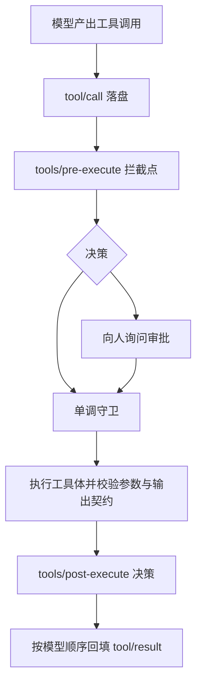
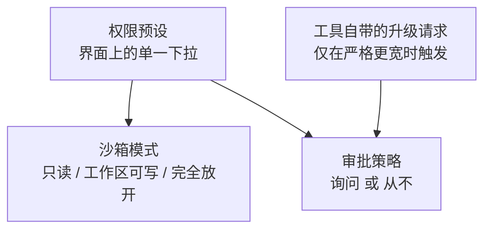
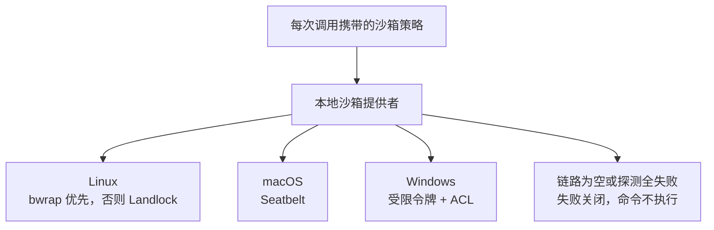

# 工具体系与安全边界

这一页讲清「Agent 究竟能对这台机器做什么、系统怎么拦住它」。**这是技术选型与安全评估最该细读的一页**，因为这里的边界直接决定你敢把什么目录交给它。

## 工具是注册出来的，注册表本身也是插件

工具注册表就是 `ctx.tools` 这个服务，它本身也是插件树里的一行——可以被替换。插件通过注册定义来贡献工具，注册返回一个精确的注销句柄，因此热重载与卸载不会留下幽灵工具。

一个工具定义由四部分组成：**对模型可见的 schema**（名字、描述、参数）、**输出契约**（输出 schema 与渲染方式）、**执行体**、以及若干可选钩子（超时、并发安全性、呈现方式、内容投影）。注册时会强制校验输出契约与超时值，并拒绝占用保留的工具名。

只有四个字段会被送给模型（名字、描述、参数 schema、是否延迟加载），其余都是宿主侧的实现细节。**工具对某个 Agent 是否可见，由作用域链加一层允许/拒绝过滤器算出**；有一处刻意的例外——本层自己注册的工具不被过滤，子代理的结构化输出工具靠这条豁免才得以存在。

外部 MCP 工具与内建工具有三处实质差别，值得单独记住：

| 维度 | 内建工具 | MCP 工具 |
|------|---------|---------|
| 名字 | 作者声明 | 派生的：`mcp__服务名__原工具名`，超长或含非法字符会截断并加哈希前缀，避免不同身份塌缩 |
| 参数 schema | 由项目自己的参数描述编译成 JSON Schema | 服务器给出的**裸 JSON Schema**，直接使用 |
| 参数校验 | 注册时编译的校验器在调用前拦截 | **没有本地校验**，缺参数依赖服务器报错 |
| 装载方式 | 逐行装配 | **整代同步**：全部拉取成功才替换旧代，冲突则整代回滚 |

## 内建工具清单

默认组合装载的工具按用途分组如下（名称即模型看到的工具名）：

| 分组 | 工具 | 说明 |
|------|------|------|
| 文件 | `read`、`edit`、`write`、`read_image`、`glob`、`grep` | 文本读写与字面替换编辑；图片读取；按路径模式与内容检索（自带搜索二进制，不依赖 shell） |
| 命令 | `bash` | macOS 与 Linux 上装载 |
| 命令 | `pwsh` | Windows 上装载的孪生实现 |
| 后台作业 | `job_output`、`job_list`、`job_kill` | 读取、列举、终止后台任务，与任务种类无关 |
| 委派 | `subagent`、`subagent_fork`、`list_subagent_models`、`send_message`、`interrupt_agent`、`list_agents` | 同一套委派包的多个实例：全新上下文与继承上下文两种子代理，以及续聊、打断、列举 |
| 编排 | `workflow`、`ralph` | 多代理脚本编排；固定形态的前台循环工作流 |
| 会话组织 | `todo_write`、`skill`、`create_goal`、`get_goal`、`update_goal`、`exit_plan_mode` | 待办、技能加载、目标生命周期、计划模式退出 |
| 网络 | `web_search`、`web_fetch` | 联网搜索与抓取公开网页 |
| MCP 资源 | `list_mcp_resources`、`list_mcp_resource_templates`、`read_mcp_resource` | 读取 MCP 资源；外部工具则按 `mcp__*` 动态注册 |
| 运行时 | `plugin_manager` | 列举、启停、安装插件与 bundle |
| PTC 传输 | `run_code` | 程序化工具调用的唯一入口，保留名不可被注册或遮蔽 |

图形界面形态还会额外装载三个工具：`ask_user_question`（向人提问）、`present`（声明交付物）、以及只读的运行时检视工具。此外还有一批**源码存在但默认不装载**的可选工具，例如持久终端、`str_replace_editor`、语言服务器查询、历史会话检索工具、定时任务管理与实验性的浏览器自动化。

一个容易忽略的默认：**文件编辑默认是 `read`/`write`/`edit` 三件套**，`str_replace_editor` 需要显式启用；Shell 工具按平台二选一，同一台机器上只会有一套。

## 一次工具调用的执行管道

管道把「谁来决定」和「真正干活」分开：拦截点做策略决策，执行环绕点做超时与重试，工具体只负责干活。这条管道能同时容纳权限策略、钩子、审计与输出裁剪，而不让它们互相耦合。

几个值得留意的设计细节：

- **参数的决策词汇刻意不支持改写**。拦截点的决策只有允许、拒绝、取消、转人工审批四种；不能修改参数——因为参数已经落盘、也已经呈现给用户了，改写会让两边不一致。
- **审批发生在守卫之前，而守卫是单调的**。守卫只能拒绝，不能翻转别人的拒绝——避免插件之间互相推翻结论。
- **拒绝会物化成模型可读的结构化错误**，并且**刻意区分不同原因**（用户说不、审批被取消、没有审批通道、工具没有 Agent 可路由），好让模型知道该停下解释还是换个方式。
- **并发分类是失败关闭的**：只有工具**显式声明**本次参数下并发安全才会并行，未声明、未知、隐藏或声明过程抛异常一律按独占处理。
- **并行只重叠执行，不重叠结果顺序**：结果严格按模型给出的顺序回填，避免调用与结果错位。
- **输出契约是硬的**：返回值先做无损快照、校验输出 schema、深冻结，再渲染成内容块；结果通知的观察者即使抛错也只记日志，不能改变结论。

## 权限：两个正交的开关

这里有一个非常常见的误解需要澄清：**「只读 / 工作区可写 / 完全放开」是沙箱模式（文件效果档位），不是审批策略**。审批策略是另一个独立开关，取值只有「询问」与「从不」两种。界面上把它们捆成一个下拉，是为了好用，不是因为它们是同一件事。

由此推出几条实际行为：

- 默认组合把沙箱模式设为**工作区可写**，并在完全放开时把审批策略自动变为**从不**。需要注意：沙箱服务自身的失败安全默认是**只读**，是组合层把它显式覆盖成工作区可写的。
- **审批的粒度是「一次调用」**。没有「本次会话都允许」或按操作类别永久放行；被批准的一次只对那一次生效。审计记录只有工具名、调用标识与原因。
- **长任务里会出现审批疲劳**，这是设计的直接后果，不是缺陷。
- **审批必须发生在已开启的回合内**：等待审批与审批结果两条日志必须被回合包住，否则重放时会被当成崩溃残留丢弃。
- **没有审批通道时是失败关闭**：不会静默放行，而是明确告诉模型「需要审批但没有可用通道」。
- **真正触发询问的通常不是中央策略插件，而是工具自己的升级路径**：当某次调用需要比当前生效策略**严格更宽**的权限时，工具携带理由发起升级请求，由审批通道问人。理由字段是必填的，缺了会在参数校验阶段就被拒。
- 自动化场景（ACP）也可以作为审批应答方，做一次性的允许或拒绝。

## 沙箱：谁在执行、平台怎么选

沙箱是一个能力位：抽象服务只声明一件事——`confine(argv, policy)`，把要跑的命令行转换成受限的命令行。它的契约里明确写着**禁止静默无约束透传**：做不到就抛错，不放行。策略是**逐调用携带**的，因此同一时刻两个消费者可以处于不同档位。

按平台选择后端，链上只有一项时不做探测直接选用，多项时按顺序功能探测取第一个通过者：

执行强度是**明确声明的**，不是「有沙箱就等于完全隔离」：

| 后端 | 声明的执行强度 | 已知缺口 |
|------|--------------|---------|
| bwrap（Linux） | 完全 | — |
| Seatbelt（macOS） | 完全 | — |
| Landlock（Linux） | 视探测结果，运行时会自报为部分 | 由预编译原生启动器承担 |
| Windows 受限令牌 + ACL | **部分** | NTFS 硬链接别名、读不受限、部分目录树不可读 |

可写范围是推导出来的，并且**Shell 与文件工具共用同一份推导**（都做真实路径规范化），这是为了消除「命令能写临时目录、但写文件工具不能」这类不对称。只读模式不授予任何可写根；工作区可写模式授予工作区根加临时目录。

拒绝的呈现被统一成结构化标记，并区分两种完全不同的失败：

- 被沙箱拒绝：带模式名的拒绝标记；如果组合提供了升级能力，还会附带一条「可用什么参数重试」的提示。
- **沙箱运行器自身失败**：明确标注「命令没有运行，这是沙箱问题，不是命令失败」。这个区分很重要，否则模型会把基础设施故障误当成自己命令写错了。判定依据是结构化规则（特定退出码加特定 stderr 前缀），**绝不只凭非零退出码**。

文件系统侧的栅栏需要特别说明：它是**可信代码里的路径包含检查，不是内核边界**。它只作用于写入类操作，读取一律通过；存在的检查—使用竞态被「委托前重新规范化」收窄并显式接受。**不要把这一层当作安全边界。**

## 结果外溢：两套独立机制

模型上下文装不下大输出，这件事由两套机制分别处理，容易混淆：

| 机制 | 处理对象 | 触发阈值 | 模型看到什么 |
|------|---------|---------|-------------|
| 子进程流内溢写 | 命令的持续输出流 | 每流内存上限默认 64 KB，溢写文件上限默认 64 MiB | `[output truncated; full output: <路径>]` |
| 工具结果外溢 | 单次工具结果整体 | 估算 token 超上限（默认 12 500，不配置则整条机制关闭） | 头尾片段 + 省略说明 + 完整结果位置 + 检索指引 |

两者共同的纪律是**失败即降级、不阻断**：溢写文件打不开或写失败时只警告一次并继续用内存里的内容；工具结果落盘失败时保留内联原文，绝不因此把工具调用变成错误。

工具结果外溢还有两条细节：保留的头尾各占一半预算，而**图片不可切分**——整块保留或整块丢弃，因此预算可能「没用满也没保留」；片段保留后如果连提示都超预算，它会直接报错，而不是产出一个仍然超预算的结果。

落盘位置的默认值写在操作系统临时目录下（私有权限），并配一个激活时的启动清扫（默认保留 30 天）。**保留是有意的**：恢复或分叉出来的会话可能仍然引用旧的位置。这也意味着很久之后重启的会话里，旧位置可能已被系统清理。

## 边界与取舍

以下都是源码里可以看到的、有意的边界，选型时应当逐条评估：

| 边界 | 含义 |
|------|------|
| 完全放开模式直接本机执行 | 沙箱与文件栅栏都被显式短路 |
| 存在「从不约束」的非沙箱执行器 | 未配置沙箱时的本地执行路径，策略字段在那里是惰性的 |
| MCP 的标准输入子进程**不过沙箱** | 外部 MCP 服务以本地子进程方式拉起，只做凭据环境擦洗 |
| 文件**读**不受栅栏约束 | 只有写入类操作受限 |
| 沙箱词汇**不覆盖网络与进程可见性** | 它约束的是文件效果；网络出口与进程可见性不在其语义内 |
| 操作者可以自带沙箱运行器并声明完全执行 | 这会跳过内置选择与探测 |
| 超时是协作式的 | 超时策略只对**声明了超时值**的工具生效，且不与工具的 Promise 赛跑，也不抛弃它；工具若不响应取消信号，只能等它返回 |
| 审批粒度是一次调用 | 无持久授权，长任务会出现反复确认 |
| 预设与底层开关可能不一致 | 代码因此引入派生状态，并在无法推断时直接报错 |

> 依据：`packages/core/tools/src/index.ts:200-300`、`packages/core/tools/src/index.ts:590-700`、`packages/core/tools/src/index.ts:1040-1200`、`packages/core/tools/src/index.ts:1295-1320`、`packages/core/tools/src/index.ts:1500-1620`、`packages/core/tools/src/index.ts:1630-1900`、`packages/core/tools/src/schema.ts:450-610`、`packages/core/agent-loop/src/tool-calls.ts:70-290`、`packages/core/agent-loop/src/constants.ts:1-7`、`packages/mcp/mcp-client/src/tools.ts:10-320`、`packages/interaction/user-approval/src/index.ts:25-310`、`packages/interaction/user-approval/src/types.ts:75-94`、`packages/interaction/permission-presets/src/index.ts:60-235`、`packages/sandbox/sandbox/src/index.ts:20-180`、`packages/sandbox/sandbox/src/roots.ts:15-56`、`packages/sandbox/sandbox/src/diagnostics.ts:15-100`、`packages/sandbox/sandbox/src/escalation.ts:20-209`、`packages/sandbox/sandbox-local/src/index.ts:40-60`、`packages/sandbox/sandbox-local/src/index.ts:150-250`、`packages/sandbox/sandbox-local/src/index.ts:500-555`、`packages/sandbox/sandbox-local/src/profiles.ts:10-59`、`packages/sandbox/sandbox-policy/src/index.ts:35-120`、`packages/sandbox/sandbox-policy/src/session-mode.ts:20-56`、`packages/fs/fs-sandbox/src/index.ts:1-30`、`packages/fs/fs-sandbox/src/index.ts:118-148`、`packages/fs/tool-fs/src/sandbox.ts:105-132`、`packages/shell/tool-bash/src/render.ts:10-120`、`packages/shell/bash-sandbox/src/index.ts:80-193`、`packages/shell/bash-local/src/index.ts:30-170`、`packages/subprocess/subprocess-local/src/output.ts:185-275`、`packages/spill/spill-policy/src/index.ts:20-155`、`packages/spill/spill-policy/src/notice.ts:1-30`、`packages/spill/spill-policy/src/retention.ts:45-105`、`packages/spill/spill-local/src/index.ts:25-165`、`packages/spill/spill-local/src/store.ts:15-132`、`packages/guard/timeout-policy/src/index.ts:20-82`、`packages/guard/repeat-tool-reminder/src/index.ts:1-240`、`packages/bundle/base/cordis.patch.yml:226-500`、`packages/bundle/web-app/presets/cordis.patch.yml:125-155`
