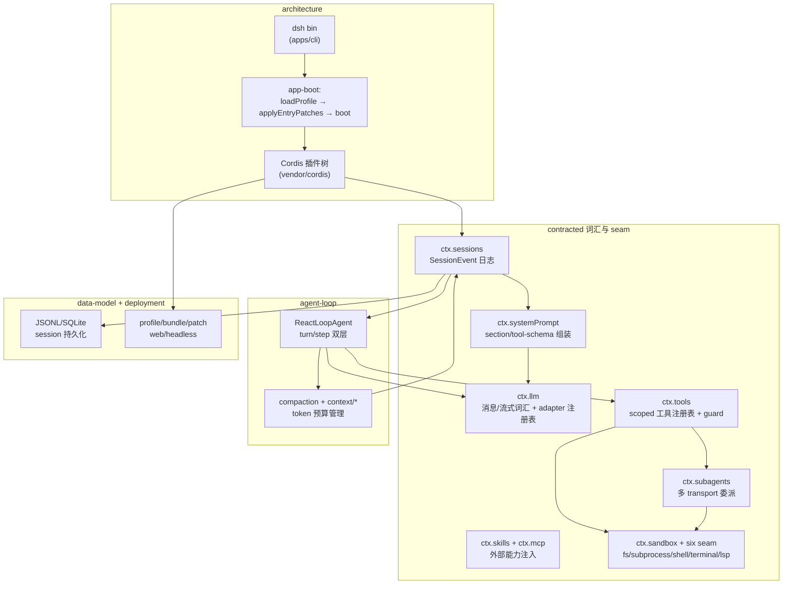

# DeepSeek Harness (`dsh`)

> 本解读按 **ai-agent ⊗ framework** 类规格产出（ai-agent 主类型 + framework 副类型叠加，因 dsh 向插件作者开放 SDK/扩展接口）。判定依据：README 自述「agent harness / everything is a plugin」+ 顶层 `packages/*/` 插件式扩展接口 + vendored Cordis 插件运行时。由 DeepSeek AI 开源。
>
> **本版增量更新（0.1.1-rc.2 / 2026-08-23）**：项目无官方 changelog，依上游 0.1.0-rc.7 → 0.1.1-rc.2 git diff 比对更新。本次增量跨 rc.1、rc.2 两版，主要变更 (1) **新增凭据能力面**——`ctx.credentials`（双键空间 + 持久化记录的 Capability Seam）+ `ctx.authorization`（可交互授权：OAuth/device-code 登录），见 [credentials.md](credentials.md)；(2) **图片/附件管线统一**——canonical admission 归一化 + `readImageRequest` 对象投影 + DeepSeek Files API file-id 首选/base64 兜底，见 [attachments.md](attachments.md)、[llm.md](llm.md)；(3) **LLM 适配器两阶段 `prepareCall`** 与 Files/stream 超时解耦（[llm.md](llm.md)）；(4) **Session 投影状态/视图分离 + 跨 boot checkpoint**（[session.md](session.md)）；(5) 沙箱 bwrap 加 PID 命名空间隔离（[sandbox-capability-seams.md](sandbox-capability-seams.md)）。rc.1 曾短暂引入 `reuseWorkspaceBlank` 空白会话继承默认权限、在 rc.2 整体回滚。各版本变更一览见 [CHANGELOG.md](CHANGELOG.md)。

## 根因：没有特权内核的 agent harness

DeepSeek Harness（`dsh`）是一个 TypeScript 编写的 agent harness（智能体框架），核心主张 **一切皆插件（everything is a plugin）**，并基于 vendored [Cordis](https://github.com/cordiverse/cordis) 插件运行时（设计来自论文 _A Programming Paradigm for Spatiotemporal Composability_）搭建。

它解决的根本问题是传统 agent 框架的**「特权内核」问题**：主循环、工具注册、记忆、沙箱、多 agent 协作往往被写死在框架内部，用户只能通过有限配置点去改造，状态不可审计、工具执行无边界、扩展要么侵入核心要么被护栏卡死。dsh 的解法是——

> 把执行过程的所有环节（主循环、工具注册表、会话日志、模型适配器、沙箱）都做成**可替换的插件**，任何部分都可配置、可热卸载；同时以**不可变的 Session 事件日志**作为唯一事实源（`Model-visible means logged`），让「模型看到的一切」都可回放、可审计、可派生。

## 概览：是什么 / 痛点 / 适用场景

- **是什么**：DeepSeek 官方开源的 agent harness，`npx @deepseek-ai/dsh web` 即可启动 Web UI（默认 `http://127.0.0.1:3080`），另有 `headless` 无服务器一次性 runner。目前处于 developer preview，仍在快速迭代、未来有破坏性变更。
- **痛点**：传统 agent 框架「内核不可扩展、状态不可审计、工具无边界」。
- **适用场景**：需要深度定制 agent 行为的团队；想用插件化方式扩展工具/记忆/模型接入；对可审计、可回放、可崩溃恢复有强要求的多 agent 产品。

### 核心能力清单表

| 能力 | 说明 | 子文档 |
|------|------|--------|
| 无特权内核 / 插件运行时 | 一切皆插件，主循环也可替换，注册是可逆副作用 | [architecture.md](architecture.md) |
| 会话事件溯源日志 | append-only 事件日志作为唯一事实源，`Model-visible means logged` | [session.md](session.md) |
| 主 Agent 循环 + Runtime | turn/step 双层、waterfall 事件拦截、inbox 唤醒 | [agent-loop-runtime.md](agent-loop-runtime.md) |
| 受控工具管道 | scoped 注册、guard/approval/spill 三段把关 | [tools.md](tools.md) |
| 系统提示词组装 | 插件 section 按 order 排序拼装 + tool-schema 并入 | [system-prompt.md](system-prompt.md) |
| 沙箱 + 可交换后端 | 六族 capability seam + Landlock 原生沙箱 + E2B 级联迁移 | [sandbox-capability-seams.md](sandbox-capability-seams.md) |
| 多 Agent / Subagent | 统一接口下 spawn/fork/ACP/Claude Code 多 transport 委派 | [subagent.md](subagent.md) |
| Agent Teams 协调域 | 隐式根 Lead + 持久邮件队列 + 版本化任务板（实验面） | [agent-teams.md](agent-teams.md) |
| 技能体系 + MCP | 外部指令注入与外部工具桥接 | [skill-mcp.md](skill-mcp.md) |
| LLM 适配器 seam | 消息/流式词汇 + 多 provider 路由注册表 | [llm.md](llm.md) |
| 凭据系统 | 双键空间（CredentialRef/CredentialKey）+ 持久化记录 + 可交互授权 | [credentials.md](credentials.md) |
| 上下文管理与压缩 | compaction capability seam + token 预算 | [memory-compaction.md](memory-compaction.md) |
| 持久化数据模型 | JSONL/SQLite 双后端（rc.8 SQLite Schema 17 打包物理行）、schema「不迁移只拒绝」 | [data-model.md](data-model.md) |
| 部署形态 | profile/bundle/patch 分层、web/headless 双形态 | [deployment.md](deployment.md) |
| 持久化附件 | 不可变内容寻址对象库 + `ImageAttachmentRef`、全量先验后写 | [attachments.md](attachments.md) |

### 技术栈一览表

| 层面 | 技术 |
|------|------|
| 语言 | TypeScript（主）、C11（Landlock 沙箱 addon `landlock-run`） |
| 插件运行时 | vendored [Cordis](https://github.com/cordiverse/cordis)（DI / fiber 生命周期 / 可逆 effect / 事件 dispatch） |
| 持久化 | SQLite（`node:sqlite`） + JSONL（zstd 压缩帧）；JSON/存储 KV |
| 沙箱 | Landlock / bwrap / Seatbelt / Windows ACL / E2B（POC） |
| 外部协议 | MCP（stdio / streamable-http）、ACP（Agent Client Protocol） |
| 凭据 | `$DSH_HOME/.credentials.yaml`（版本化文档 + 0600 + 跨进程写锁）、OAuth/device-code 授权（rc.1） |
| 分发 | pnpm workspace + npm（`@deepseek-ai/dsh` bin） |
| 前端 Web UI | 浏览器端插件 roster（`dsh-client-*`）+ VitePress 文档站 |

## 架构：五大支柱

- **支柱一 · 无特权内核**：扩展 dsh = 在旁边挂一个插件，注册是可逆副作用（`ctx.effect()`/`ctx.on()`），卸载自动撤销。没有需要 patch 的核心。
- **支柱二 · 会话日志是唯一事实源**：`Model-visible means logged` —— 任何到达模型请求的输入都必须能从日志重建，运行时 invariant 强制这点。
- **支柱三 · Capability Seam 三件套**：一个可交换能力 = Service Definition（接口）/ Provider（实现）/ Consumer（消费方，常是模型面向工具）。一个 provider 交换 = 整体产品随之迁移。
- **支柱四 · Profile/Bundle/Patch 分层启动**：运行中的 dsh 是从空 entry 列表按分层 patch 组合出的插件树。
- **支柱五 · 事件是扩展点**：session 事件（持久事实）、agent 事件（`agent/*`，观察/拦截在途工作）、capability 事件（把策略挂到 seam 上）。

## 核心模块导读

| 模块 | 职责 | 深度子文档 |
|------|------|-----------|
| 架构组合层 | Cordis 插件树装配、Profile/Bundle/Patch 分层 | [`architecture.md`](architecture.md) |
| 会话系统 | 事件溯源日志、Model-visible means logged | [`session.md`](session.md) |
| 主循环 + Runtime | turn/step、waterfall 拦截、循环与引擎分离 | [`agent-loop-runtime.md`](agent-loop-runtime.md) |
| 工具管道 | scoped 注册、guard/approval/spill | [`tools.md`](tools.md) |
| 系统提示词 | section 排序 + tool-schema 组装 | [`system-prompt.md`](system-prompt.md) |
| 沙箱 + Capability Seam | 六族可交换后端 + Landlock | [`sandbox-capability-seams.md`](sandbox-capability-seams.md) |
| 多 Agent | 统一接口多 transport 委派 | [`subagent.md`](subagent.md) |
| Agent Teams | 隐式根 Lead/队友队形 + durable 邮件 + 版本化任务板（实验面） | [`agent-teams.md`](agent-teams.md) |
| 技能 + MCP | 外部能力注入 | [`skill-mcp.md`](skill-mcp.md) |
| LLM 能力层 | 词汇 + 适配器 seam | [`llm.md`](llm.md) |
| 凭据与授权 | 双键空间 + 持久化记录 + 交互授权 (rc.1) | [`credentials.md`](credentials.md) |
| 上下文与压缩 | compaction + token 预算 | [`memory-compaction.md`](memory-compaction.md) |
| 数据模型 | 持久化布局与演进 | [`data-model.md`](data-model.md) |
| 部署形态 | profile/bundle/patch 与双形态 | [`deployment.md`](deployment.md) |
| 持久化附件 | 不可变内容寻址对象库 + Ref 引用 | [`attachments.md`](attachments.md) |

## 启动 / 请求链路

一个 `turn` 的完整生命周期（含 waterfall 事件归属与源码落点）在 [`agent-loop-runtime.md`](agent-loop-runtime.md) 有 `sequenceDiagram`；启动链路（`dsh web` → loadProfile → 组合 → boot → 挂 Browser UI）见 [`deployment.md`](deployment.md)。

## 子文档索引

- [`architecture.md`](architecture.md) — Cordis 插件树与 Profile/Bundle/Patch 分层启动
- [`session.md`](session.md) — 会话事件溯源日志，`Model-visible means logged`
- [`agent-loop-runtime.md`](agent-loop-runtime.md) — 主 Agent 循环（turn/step）与 Runtime 分离
- [`tools.md`](tools.md) — 受控工具调用管道（scoped/guard/approval/spill）
- [`system-prompt.md`](system-prompt.md) — 系统提示词与工具 schema 组装
- [`sandbox-capability-seams.md`](sandbox-capability-seams.md) — 沙箱与六族可交换后端 + Landlock
- [`subagent.md`](subagent.md) — 多 agent / subagent 多 transport 委派
- [`agent-teams.md`](agent-teams.md) — Agent Teams 协调域（隐式根队形 + durable 邮件 + 版本化任务板，实验面 | rc.8 新增）
- [`skill-mcp.md`](skill-mcp.md) — 技能体系 + MCP 外部能力接入
- [`llm.md`](llm.md) — LLM 消息/流式词汇与适配器 seam
- [`credentials.md`](credentials.md) — 凭据系统：双键空间、持久化记录与交互授权（rc.1 新增）
- [`memory-compaction.md`](memory-compaction.md) — 上下文管理与自动压缩
- [`data-model.md`](data-model.md) — 持久化数据模型（事件日志地面实现）
- [`deployment.md`](deployment.md) — 部署形态（web/headless、profile/bundle/patch）
- [`attachments.md`](attachments.md) — 持久化附件能力面（不可变内容寻址对象库 `ctx.attachments`）

## 可借鉴的设计

- **可交换后端 = Seam 三件套**：把「一个能力」切成 Definition/Provider/Consumer，让「换后端」等于「整体产品迁移」而非 provider 分叉——沙箱六族与 LLM 适配器都验证了这套抽象的可扩展性。
- **事件溯源而非可变状态**：append-only 日志 + 派生投影，换来可重放、可审计、可崩溃恢复；`Model-visible means logged` 把「模型看到什么」变成编译期强制。
- **分层 patch 组合**：profile/bundle/patch 把「发行、组合命名、覆盖行为」正交化，任何升级/换默认都退化为一个 patch，且 `--dump-config` 保证「看到的 = 跑起来的」。
- **零特权拦截**：所有关键决策点（pre-step/request/request-error/turn-stopping、tools/*）都以 waterfall 事件开放，让插件在洋葱式 `next()` 委派下无优先级地参与——连主循环本身都可替换。
- **坚持「可回放」优先于「方便」**：二进制图像也没能绕开唯一事实源——用不可变内容寻址对象库 + `ImageAttachmentRef` 引用而非 base64/URL，让 `Model-visible means logged` 从文本扩展到媒体（[attachments.md](attachments.md)）。
- **把「协作」也变成可回放事件（rc.8）**：Agent Teams 把队形、邮件队列、任务板全部写成 Lead 日志里的 `team/*` log-only 事件，`foldTeam` 折叠重建——连"多 agent 一起干活"都不引入旁路可变状态（[agent-teams.md](agent-teams.md)）。
- **存储效率与真相不可变不冲突（rc.8）**：SQLite 后端用打包物理行 + zstd + varint 压缩存储，仍严格还原逻辑 `SessionEvent[]`、seq 连续、`readFrom` 尾读语义不变——压缩的是物理布局，未放宽"日志即真相"（[data-model.md](data-model.md)）。
- **凭据也是"记录即事实"的可交换 seam（rc.1）**：授权产出一条 owner 自解释的持久记录而非内存令牌，`GrantRecord` 的 payload 对 harness 完全不透明——授权一次 = 落一条可回放、可审计、可随会话共享的记录（[credentials.md](credentials.md)）。
- **"确定性归一化 + 对象投影"换取松耦合（rc.2）**：图片落库前先归一化成 provider 无关版本，再由存储侧按模型字节预算投影出可寻址变体（file-id 首选、base64 兜底）——把"图片怎么变"收敛进存储层，消费方只吃确定性制品（[attachments.md](attachments.md)）。

## 不足 / 风险

- **pre-release 快速迭代**：设计一致但兼容性未稳定，`SESSION_FORMAT_VERSION=0` 等「无兼容承诺」的紧急出口意味着升级可能需迁移磁盘格式。
- **patch by-id 整行替换的维护税**：上层 patch 需重述整行 config，bundle 重构字段名会静默「断」上层重述该字段的 patch。
- **学习曲线**：三实体（profile/bundle/patch）与分层概念需要理解成本；不少 invariant companion 是空安装，正确性部分押在测试而非运行时自证。
- **示例/工具集合覆盖**：本解读聚焦架构主干，`extensions/tool-*` 的每把工具 schema 未逐一展开。
- **附件对象 GC deferred**：附件对象库尚无可达性 GC，恢复/分叉共享不可变对象会留下不可达对象占磁盘；v1 仅收四种栅格格式（见 [attachments.md](attachments.md)「演进与未完成」）。
- **Agent Teams 尚属实验面（rc.8）**：包名带 `experimental-` 前缀、服务键 `agentTeams`，协调吞吐受日志写速限制，且不保证跨进程 exactly-once 邮件投递（见 [agent-teams.md](agent-teams.md)）。
- **SQLite 打包是 timing 依赖 + 仅本地 codec（rc.8）**：打包率依赖 write-behind 窗口边界，统一关系库多后端设计仍 deferred，pre-release 不保证 schema/codec 稳定（见 [data-model.md](data-model.md)）。
- **凭据记录无 owner 卸载即清理策略（rc.1）**：卸载插件的 record 会滞留（靠 owner scope 命名区分而非自动回收），与附件对象 GC deferred 同类（见 [credentials.md](credentials.md)）。
- **图片归一化是额外渲染开销（rc.2）**：删除元数据/降采样/重编码增加一次 CPU 代价与 Variant 缓存管理，换取长会话与跨 provider 的可重复性（见 [attachments.md](attachments.md)）。

## 同类对比

| 项目 | 形态 | 核心主张 | dsh 差异点 |
|------|------|----------|-----------|
| **dsh** | agent harness | 一切皆插件 + 事件溯源日志 | 无特权内核、session log 唯一事实源、可交换后端 seam |
| Claude Code / Codex | 商用 harness | 对话驱动 + hooks | dsh 抽象成可交换 provider（subagent 可直接接它们） |
| opencode / goose | agent harness | 插件化 | dsh 更彻底：连主循环、会话日志本身都是可替换插件 |
| LangChain | 编排库 | 链式/图式编排 | dsh 是运行时 harness，强调可交换后端 + 可审计日志 |

## 总结

DeepSeek Harness 用一个反传统的前提改造了 agent 框架：**没有特权内核，反而因此获得了更强的确定性**——主循环是插件、工具是插件、会话日志是唯一事实源，一切都可替换、可配置、可回放。它的架构是对「agent 框架如何既保持可扩展性又保持可审计性」这一根本问题的犀利回答，贯穿五大支柱（无特权内核 / 日志即事实源 / 可交换后端 / 分层启动 / 事件即扩展点）。从 [`architecture.md`](architecture.md) 的地基，到 [`session.md`](session.md) 的事实源，再到 [`agent-loop-runtime.md`](agent-loop-runtime.md) 的发动机与沙箱/多 agent/压缩等外围能力，最终都汇到「把执行过程的每个环节都变成可回放、可交换的插件」这一根因上。

---

> 仓库：https://github.com/deepseek-ai/deepseek-harness ｜ 上游源码根：`/Users/morehao/Documents/study/ai-agent/deepseek-harness`
