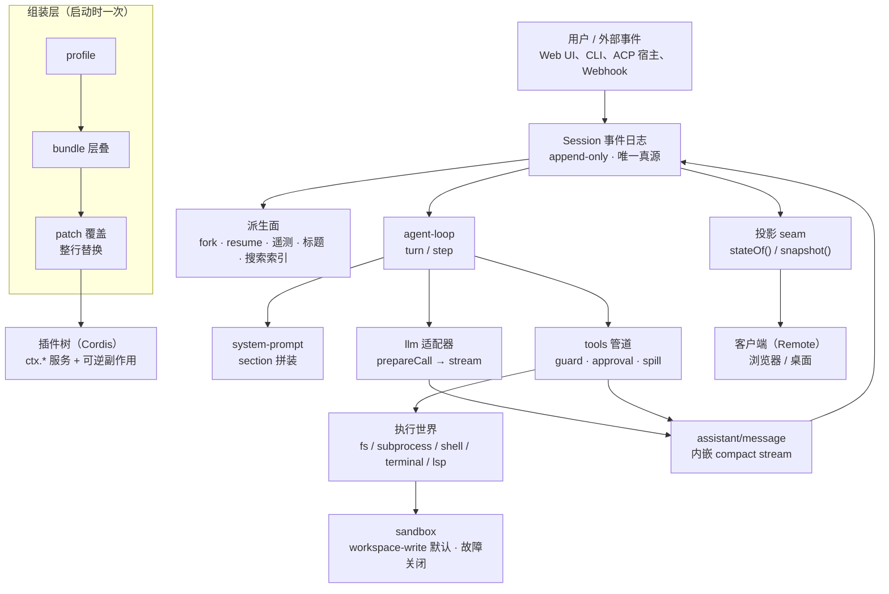
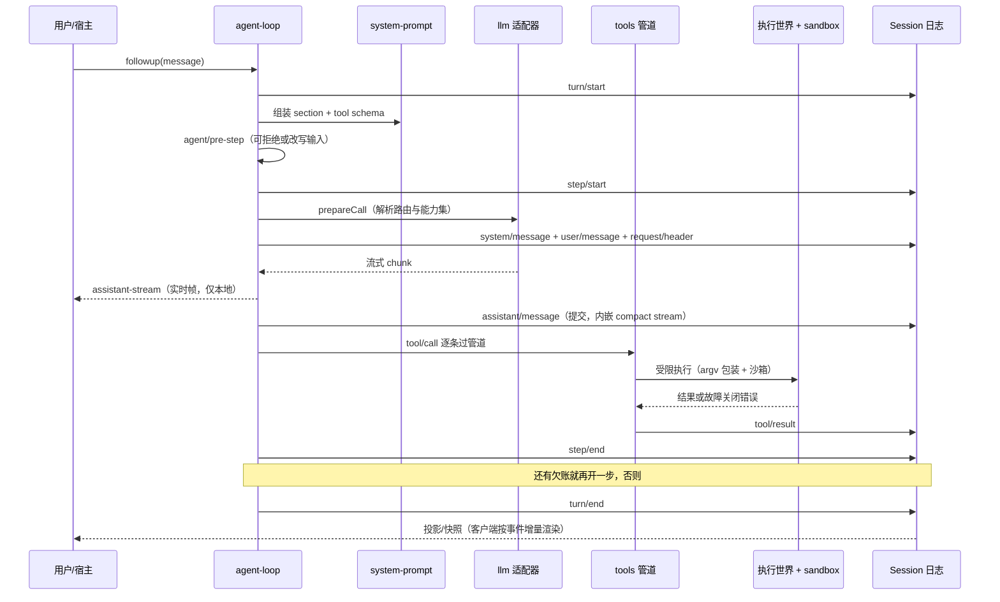

# DeepSeek Harness（`dsh`）

> 本解读按 **ai-agent ⊗ framework** 类规格产出：ai-agent 为主类型（主循环、工具调用、记忆与压缩、多智能体、Skill/MCP/ACP 全部命中），framework 为副类型（对外暴露插件 SDK、`ctx.*` 服务契约、profile/bundle 分发格式）。判定依据是被分析项目 README 自述「agent harness / everything is a plugin」+ 顶层 `packages/*/` 的扩展接口设计 + vendored Cordis 运行时。
>
> **解读基线**：`dsh-v0.2.1-rc.3`（commit `1f81c047fc`，2026-10-23）。该标签是当前最新发布，且仍属开发者预览（README 明示"THERE WILL BE COMPATIBILITY-BREAKING CHANGES"），不是稳定版。

## 子文档索引

- [`architecture-design.md`](architecture-design.md) — **建议先读**：叙述型架构设计说明，讲清楚"系统为什么长成这样"、每条决策的代价、什么条件下该回头重估，不含代码索引。
- [`plugin-kernel.md`](plugin-kernel.md) — 插件内核与组装：Cordis 的可逆副作用与作用域、profile/bundle/patch 五层叠加、启动序列、"替换主循环"实际被拆成的四个可分离位置。
- [`session-event-log.md`](session-event-log.md) — 会话事件溯源：日志即状态、已发布格式的不可变世代与相邻迁移链、投影 seam、跨代读与修复语义。
- [`agent-loop-and-tools.md`](agent-loop-and-tools.md) — 主循环与工具管道：turn/step 的"欠账"语义、三事件域切分、pre-step 与请求两阶段、inbox/inject/cancel、三段把关、系统提示词作为 surface node 0。
- [`memory-subagent-longrunning.md`](memory-subagent-longrunning.md) — 记忆与压缩、多智能体、长时任务：压缩是"改投影"而非"删历史"、dsh 没有 curated memory 的代价、subagent 提供方与信任边界、Agent Teams、jobs/workflow/goal/schedule 四种载体。
- [`llm-adapters.md`](llm-adapters.md) — LLM 适配与流式：协议库与凭据插件分离、`prepareCall` 两阶段、能力集与路由、DeepSeek 专有 wire 扩展、attempt 结算与三条失败路径。
- [`execution-world.md`](execution-world.md) — 执行世界：fs/subprocess/shell/terminal/lsp 五族 provider 与"同一执行世界"约束、subprocess seam、沙箱三层分工与故障关闭、审批与沙箱的真实边界。
- [`external-capabilities.md`](external-capabilities.md) — 外部能力接入四条通道：Skill 的目录注入、MCP 的代际切换与有损桥接、ACP 的角色方向与权限往返、动态 Cordis 扩展、Webhook。
- [`clients-and-distribution.md`](clients-and-distribution.md) — 客户端与分发：HTTP 载体的路由席位、Typert 生成式双契约、浏览器侧的插件树与 Slots、Electron 壳与 Desktop Host、桌面零依赖运行时。
- [`data-model.md`](data-model.md) — 数据模型与配置存储：领域 KV 与 `$DSH_HOME` 布局、实体关系与字段表、SQLite 的真实地位、凭据"只存引用"边界、真源 vs 派生总表。
- [`deployment-and-operations.md`](deployment-and-operations.md) — 部署与运维：四条运行入口、npm 包形态、Harness home 真源/派生分层、自托管三层边界、桌面发布与更新、可观测性、升级语义。
- [`CHANGELOG.md`](CHANGELOG.md) — 本知识库对 dsh 的解读版次记录与各版差异。

## 根因：agent 产品的"内核"被写死了

dsh 要解决的根本问题不是"再做一个 coding agent"，而是**agent 产品长期缺乏可替换的骨架**。当前绝大多数 agent 框架把四件事写死在核心里：主循环、工具注册表、会话状态、模型适配。由此产生三个具体失效形态：

- **状态不可审计**：模型这一轮到底看到了什么，只能靠日志猜；出问题无法回放，只能复现。
- **扩展要么侵入、要么被拦**：想改循环行为就得 fork 内核，想安全扩展就只能等框架开出配置点。
- **执行无边界**：模型生成的命令直接跑在宿主上，"沙箱"常常只是启动参数。

dsh 的解法是把这几件事同时做成**可替换的插件**与**可回放的日志**。两条主张贯穿全篇：

> **一切皆插件。** 没有特权内核——主循环、工具注册表、会话日志、模型适配器、沙箱都是插件；扩展方式是"在旁边挂一个插件"，而不是"打补丁进核心"；注册即副作用，插件卸载时自动回退。
>
> **Model-visible means logged。** 凡是能进入模型请求的内容，都必须能从会话日志重建；需要新增模型可见输入时，必须新增一个会话事件。

这两条不是口号，而是有程序化门禁与结构约束支撑的工程契约——本解读的十篇子文档，基本都在回答"这条主张在某个子系统里具体付出了什么代价"。

## 概览：是什么 / 痛点 / 适用场景

- **是什么**：DeepSeek AI 开源的 agent harness，TypeScript 编写，MIT 许可。`npx @deepseek-ai/dsh web` 起一个本地 Web UI（默认 `http://127.0.0.1:3080`）；另有 `headless`、`sdk`、`sdk-minimal`、`acp`、`desktop` 等 profile 形态。
- **痛点**：内核不可扩展、状态不可回放、执行无边界（见上节）。
- **适用场景**：需要深度定制 agent 行为的团队；要在同一套内核上同时产出 Web / 桌面 / CLI / SDK / 编辑器接入多形态；对"模型看到了什么"有审计与回放要求的产品。
- **明确的非适用场景**：把 dsh 当作安全边界来隔离不可信负载。`SAFETY.md` 直接声明项目未做安全审计、不得视为生产就绪，沙箱与审批"只能降低风险，不保证隔离"。

### 核心能力清单

| 能力 | 一句话说明 | 深读 |
|---|---|---|
| 无特权内核 | 空根配置 + 层叠 patch 组装插件树，注册即副作用、卸载即回退 | [`plugin-kernel.md`](plugin-kernel.md) |
| 日志即状态 | append-only 会话事件日志是唯一真源，模型历史、UI、遥测、fork 全部由它派生 | [`session-event-log.md`](session-event-log.md) |
| 已发布格式的不可变世代 | `session.vN.jsonl` 并列共存，N→N+1 相邻迁移链，源文件永不改写、不承诺降级 | [`session-event-log.md`](session-event-log.md) |
| turn/step 主循环 | turn 是"欠账清零"，step 是"一次模型请求 + 它引发的工具"；durable 与 live 事件分域 | [`agent-loop-and-tools.md`](agent-loop-and-tools.md) |
| 三段工具管道 | guard / approval / spill 各自防一类事故，`pre-execute → execute → post-execute` 瀑布式介入 | [`agent-loop-and-tools.md`](agent-loop-and-tools.md) |
| 系统提示词作为 surface node 0 | prompt 变成日志里的一个可替换节点，换提示词不必开新会话 | [`agent-loop-and-tools.md`](agent-loop-and-tools.md) |
| 上下文压缩 | 压缩是一次"换投影"的日志事件，原文仍在日志里；`replaceGeneration` 决定能否重试 | [`memory-subagent-longrunning.md`](memory-subagent-longrunning.md) |
| 多智能体 | 命名 subagent 提供方 + 可继续子代 + 实验性 Agent Teams（共享任务 DAG、peer inbox） | [`memory-subagent-longrunning.md`](memory-subagent-longrunning.md) |
| 长时任务 | jobs / workflow / goal / schedule 四种载体，各自解决不同存活条件 | [`memory-subagent-longrunning.md`](memory-subagent-longrunning.md) |
| 可交换执行世界 | fs/subprocess/shell/terminal/lsp 共享一个执行世界，换 provider 即整体迁移 | [`execution-world.md`](execution-world.md) |
| 故障关闭沙箱 | 默认 `workspace-write` + `ask`；沙箱不可用时拒绝执行而不是降级放行 | [`execution-world.md`](execution-world.md) |
| 四条外部接入 | Skill（指令）/ MCP（工具）/ ACP（宿主接 agent）/ 动态扩展（代码）+ Webhook（事件） | [`external-capabilities.md`](external-capabilities.md) |
| 生成式 RPC 双契约 | `@Remote` 声明一次，构建期生成 Host/Client 两侧契约，取代手写 RPC | [`clients-and-distribution.md`](clients-and-distribution.md) |
| 客户端即插件树 | 浏览器侧 `dsh.client` 声明 + boot 图 + 类型化 Slots，与服务端插件同构 | [`clients-and-distribution.md`](clients-and-distribution.md) |
| 桌面零依赖 | Electron 自己当 Node 运行 Host，用户机器无需预装 Node/pnpm/Python | [`clients-and-distribution.md`](clients-and-distribution.md) |
| 领域 KV 存储 | 每域一份带版本戳的 JSON，`backup-and-skip` 兜损坏，真源与派生显式分离 | [`data-model.md`](data-model.md) |

### 技术栈一览

| 层 | 选型 | 关键理由 / 代价 |
|---|---|---|
| 语言 | TypeScript（strict、全 ESM） | 类型即契约，但需要生成式工具链与构建产物两套平面（源码面 `src` / 产物面 `lib` 严格不混用） |
| 运行时 | Node `^22.19.0 \|\| >=24.0.0`，pnpm 11 | 用上较新的 Node 能力（loader hooks、native TS 模式之外的自有启动路径），代价是引擎下限较高 |
| 插件框架 | vendored [Cordis](https://github.com/cordiverse/cordis)，rescope 为 `@deepseek-ai/cordis` | 上游名发布等于占用他人 registry 名字；vendored 换来可控演进，代价是需自己维护 sync 流程 |
| 配置/组合 | Schemastery schema + `cordis.patch.yml` 层叠 patch | 整行替换而非深合并，读者"打开文件就能看到整行"；代价是写 patch 必须重述 |
| 会话存储 | JSONL（可选 Zstandard 压缩）+ 不可变世代 | 纯 append、跨进程可见、可逐行修复；代价是没有查询能力，需另建投影与可选索引 |
| 查询索引 | SQLite FTS5（`openAt: never` 默认关闭） | 索引是派生物不是真源；默认关掉意味着默认没有全文检索 |
| 原生能力 | 预编译 Node-API addon `node-addon-system`（Landlock 等） | 零构建期编译依赖，代价是多平台产物与签名 |
| 客户端 | React 浏览器客户端 + Electron 桌面壳 | 与服务端插件同构复用；代价是构建期图与双平面产物 |
| RPC | Typert：`@Remote` 声明 + 构建期类型图 | 契约集中在声明处；代价是必须先 build 才能跑 Web |

### 项目规模（基线快照，可复核）

| 指标 | 数值 | 口径 |
|---|---|---|
| workspace 包数 | 343 个，分属 52 个家族 | `packages/<家族>/<包>/` 一级目录计数 |
| TypeScript 文件 | 5226 个 | `git ls-files '*.ts'` |
| `packages/*/*/src` 行数 | 约 38.0 万行 | 仅包内源码目录，不含测试与 `apps/` |
| `apps/*` 行数 | 约 11.6 万行 | CLI / Web / Desktop / Desktop Host 等入口 |
| 测试文件 | 1853 个 | `*.test.ts` / `*.spec.ts` |
| 子系统参考文档 | 67 页（中英双语各一份） | `docs/subsystems/*.zh.md` |
| 设计决策笔记 | 296 篇 | `.agents/notes/implemented/**`（未计中文副本） |
| 许可 | MIT | `LICENSE` |

> 规模本身不是结论，但它解释了一件事：这个项目把"设计理由"当作可检索的一等产物（近 300 篇决策笔记 + 67 页子系统参考 + 程序化校验门禁）。本解读大量引用这些笔记来说明 Why，但所有论断都回源码核对过。

## 架构总览

读 dsh 的架构，建议按"一条请求的旅程"来理解：**启动时把插件树拼出来 → 用户一句话变成被接纳的输入 → 主循环向模型要一次回复 → 工具在受限世界里执行 → 每个事实落进日志 → 客户端与恢复路径都从日志派生**。下面这张图把这条旅程的元件与依赖方向放在一起。

这张图有三个地方值得停一下。

**第一，组装层只在启动时介入，运行期不受它影响。** profile/bundle/patch 把一切压成"一棵有 id 的配置行表"，之后系统怎么动，全由 `ctx.*` 服务与事件驱动。这正是"没有内核"的代价被集中到一处：组合的复杂性被关在启动阶段，运行期只有插件树。

**第二，日志在图的中心，而不是末端。** 绝大多数系统的"日志"是旁路产物；这里的日志同时喂着恢复（fork/resume）、UI（投影）、遥测、标题、搜索索引五条下游。任何"上游没记账"的行为，都会在五条下游同时表现为缺失——这也解释了为什么项目把"Model-visible means logged"写成硬约束。

**第三，执行世界是与模型层并列的独立接缝。** 模型只产出"要执行什么"，真正决定风险的是执行世界与沙箱；两者通过工具管道相连，工具管道是唯一能同时看见"模型意图"与"宿主能力"的位置——这也是三段把关放在这里的原因。

### 分层与依赖方向

| 层 | 代表包 | 允许依赖 | 不许做的事情 |
|---|---|---|---|
| 组装层 | `packages/boot/*`、`packages/bundle/*`、`apps/cli` | 只依赖"装配所需"的接口 | 不在运行期干预业务；不持有会话状态 |
| 核心脊 | `packages/core/{session,agent,agent-loop,tools,system-prompt,scope}` | 依赖能力接缝的**定义** | 不直接依赖具体 provider（本地/远端的差别必须藏在接缝后） |
| 能力接缝 | `llm`、`fs`、`subprocess`、`shell`、`sandbox`、`terminal`、`lsp`、`web`… | 定义 + provider + consumer 三角色 | 三个角色不可只做一半；换 provider 不应改 consumer |
| 表面 | `packages/api`、`packages/typert`、`packages/client`、`apps/web`、`apps/desktop` | 通过 Remote 契约访问 Host | 不绕过 RPC 直接读宿主内部状态 |
| 派生 | `session-projection`、`session-query`、`session-title`、遥测 | 只读日志 | 不成为新的真源 |

依赖方向被脚本门禁约束：例如"只有 `dsh` profile 能启动 Node 应用"（禁止包自带的 bin 或 demo 绕过 profile 启动）、"非实验包不得依赖实验包"、"`cordis.yml` 里裸插件必须出现在 resolver manifest 的 dependencies 中"。这些规则都在 [`plugin-kernel.md`](plugin-kernel.md)。

### 运行形态

同一内核，六种装配：

| 形态 | profile | 额外接入 | 典型用途 |
|---|---|---|---|
| 浏览器 | `web` | Web 服务端 + Remote + 客户端插件树 | 日常使用、图形化审批与文件交付 |
| 桌面 | `desktop` | Electron 壳 + Desktop Host（回环 HTTP） | 零依赖本地分发 |
| 一次性任务 | `headless` | 无服务器，跑完即退 | CI、脚本、批处理 |
| SDK | `sdk` / `sdk-minimal` | JSON-RPC 服务端 / 完整显式树 | 被别的程序嵌入 |
| 编辑器接入 | `acp` | ACP stdio 服务端 | Zed 等宿主自动化 |
| 插件管理 | `plugin` | 包管理命令 | 安装/卸载 bundle |

装配差异全部来自"叠了哪些 bundle、patch 覆盖了哪几行"，不是代码分支——这点在 [`plugin-kernel.md`](plugin-kernel.md) 里有展开，在 [`deployment-and-operations.md`](deployment-and-operations.md) 里有运维视角的对照。

## 一次对话的完整链路

下面的时序图串起主循环、模型、工具、执行世界与日志。它省略了重试与并发的细节，目的是让读者一眼看清"谁在哪一步写日志"。

这条链路里有四个"反直觉"的设计点，值得单独说明，它们分别在对应子文档里展开：

- **实时流与持久提交是两条路。** `agent/assistant-stream` 是进程内的 live 事件，只喂本地客户端；真正写进日志的是 `assistant/message`，它内嵌了产生这段文本的完整 stream。好处是回放绝对精确，代价是日志会变大（[`llm-adapters.md`](llm-adapters.md)）。
- **`prepareCall` 与"提交用户消息"分离。** 先解析路由拿到"这一次调用能做什么"（能力集），再决定是否提交 system/user 消息；取消发生在这两步之间时，两边都不提交（[`agent-loop-and-tools.md`](agent-loop-and-tools.md)）。
- **工具结果写回日志前先过三段把关**，其中审批由"人"而不是代码给出最终裁决；批准之后 owner 的单调 guard 仍可拒绝（[`execution-world.md`](execution-world.md)）。
- **turn 可能一步都不走。** 首步被拒或改写为空时，turn 以"零步"关闭——日志里仍有一个完整的 turn 边界，这样"用户发过这句话"和"模型没被调用"两件事都不会丢（[`agent-loop-and-tools.md`](agent-loop-and-tools.md)）。

## 核心模块导读

| 模块 | 它回答的问题 | 深读 |
|---|---|---|
| 组装与插件内核 | 没有内核的系统，靠什么把 300+ 个包拼成一个应用而不失控？ | [`plugin-kernel.md`](plugin-kernel.md) |
| 会话事件溯源 | 为什么日志能当状态用？格式演进怎么做到"旧数据永远读得懂、但绝不改写"？ | [`session-event-log.md`](session-event-log.md) |
| 主循环与工具管道 | turn 与 step 的边界在哪？三段把关分别防什么？提示词为什么变成日志节点？ | [`agent-loop-and-tools.md`](agent-loop-and-tools.md) |
| 记忆、压缩与多智能体 | 上下文塞满时"忘掉"的是什么？子 agent 能做什么、不能做什么？ | [`memory-subagent-longrunning.md`](memory-subagent-longrunning.md) |
| LLM 适配与流式 | 一家模型协议怎么被拆成"协议库 + 凭据插件"？失败与重试凭什么可回放？ | [`llm-adapters.md`](llm-adapters.md) |
| 执行世界与沙箱 | 为什么"文件系统在本地、子进程在远端"是最危险的组合？ | [`execution-world.md`](execution-world.md) |
| 外部能力接入 | Skill / MCP / ACP / 动态扩展 / Webhook 各自接的是哪一层？为什么不合并？ | [`external-capabilities.md`](external-capabilities.md) |
| 客户端与分发 | 生成式 RPC 换来了什么？桌面为什么最终仍需要真实 HTTP？ | [`clients-and-distribution.md`](clients-and-distribution.md) |
| 数据模型与存储 | 什么状态必须备份、什么重建即可？凭据"只存引用"的边界在哪？ | [`data-model.md`](data-model.md) |
| 部署与运维 | 开发者预览项目该怎么用？远程访问的三层边界是什么？ | [`deployment-and-operations.md`](deployment-and-operations.md) |

## 设计亮点

### 亮点一：把"可回放"做成硬约束，而不是事后补的日志

多数 agent 框架的记录是"事后能查到调用过什么"；dsh 把方向反过来——**模型能看到的每一件事，都必须先有日志事件**。由此带来三个别的框架很难复制的性质：任意一次请求可以逐字节重建；UI 与 SDK 读的是同一份投影，不会出现"界面显示和实际请求不一致"；fork/resume/标题/遥测都不需要各自维护状态。

代价同样明确：新增任何模型可见输入都变成"加事件 + 写迁移 + 更新快照"三件套，一次小改动会牵动多个包。项目接受这笔账，因为它把"审计与回放"当产品能力而不是调试辅助（[`session-event-log.md`](session-event-log.md)）。

### 亮点二：格式演进用"不可变世代 + 相邻迁移"，而不是原地升级

会话文件命名成 `session.vN.jsonl`，**已提交的世代永不移动、覆盖、删除**；需要新格式时发布一个并列的后继文件，并把 N→N+1 的转换实现成独立包。这让"旧数据永远读得懂"变成可证明的性质，而不是"我们尽量兼容"的承诺。

反直觉的代价在实现层：一次真实的 116 MB 会话曾让"整文件迁移"实现耗尽 16 GB 进程内存，最终改成"有状态流式 stage"逐事件转换。这条教训被写成了决策笔记而不是藏在 commit 里——它说明"不可变世代"这个模型只在流式实现下才成立（[`session-event-log.md`](session-event-log.md)）。

### 亮点三：执行世界是架构级约束，而不是部署选项

fs provider 与 subprocess provider 必须指向**同一个执行世界**。这条约束看起来是工程规范，实际上是安全性质的来源：如果文件系统在本地而子进程在远端，写文件会"成功"，但任何进程都看不见它——**安静地成功**比报错危险得多。因此迁移单位必须是成组的 provider（`fs-ssh` + `subprocess-ssh` + `sandbox-ssh`），历史上 E2B 那组 provider 是被移除而不是修补的。

沙箱侧则选择"故障关闭"：约束无法建立时拒绝执行，而不是降级为不受约束执行。这条选择的代价是可用性——环境不支持时功能直接不可用（[`execution-world.md`](execution-world.md)）。

### 亮点四：系统提示词被降格为"日志里的一个节点"

把 prompt 提升为 surface 的 node 0，解决了四个旧问题：提示词无法在会话中途替换、提示词变更导致缓存前缀整体失效、"到底哪段 prompt 生效"无法从日志判定、以及压缩与提示词的耦合。代价是 node 0 永久占据 surface 预算、且受"head 不变量"保护——压缩永远碰不到它；prompt 一变更就要写新的 `request/header`。

这个改动的动机不是"省 token"，而是"一个事实只能有一个家"。缓存收益只是派生结果（[`agent-loop-and-tools.md`](agent-loop-and-tools.md)）。

### 亮点五：四条外部接入通道不合并，因为它们接的不是同一层

Skill 接的是**上下文**（一段文字进系统提示词），MCP 接的是**工具**（远端 schema 与结果都不可信），动态扩展接的是**代码**（模型当场写、进程内跑），Webhook 接的是**事件**（外部世界推来的一条事实）。四者的信任级别、失败单元、撤销粒度全都不同：单 skill 失败只是 warn+跳过，单 MCP 服务器失败是整代工具回滚，单次动态 run 可以 retract，单条 webhook 投放只记日志不重试。

把它们合并成"一套通用扩展点"，等于让最弱的那条通道的信任假设成为所有通道的下限（[`external-capabilities.md`](external-capabilities.md)）。

### 亮点六：区分"真源"与"派生"，并且在代码里给两者安排不同的失败策略

派生数据（投影缓存、查询索引）坏了就丢，owned 数据（工作区、定时任务、凭据引用）坏了就显式拒绝——这不是一句设计原则，而是分别有 `backup-and-skip` 与"版本不符即报错"两条代码路径来落实。

更细的一层是：标题、goal、todo、feedback、job 生命周期的真源都在**会话日志的事件**里，领域 KV 一个都没碰；领域 KV 只接"归属关系不属于任何单个会话"的状态。这条边界让"删掉某份 KV 只损失什么"可以精确回答（[`data-model.md`](data-model.md)）。

## 不足与风险

以下每条都给出对比基准，不作空泛批评。

### 风险一：复杂度总量已经很高，且"没有内核"把成本转移给了读者

343 个包、38 万行包内源码、296 篇决策笔记、67 页子系统参考。装配一个应用需要同时理解 profile、bundle、patch、preset、isolate 五个概念，以及"patch 是整行替换不是深合并"这条与几乎所有构建工具直觉相反的规则。

对比：成熟的插件系统（VS Code 扩展、Obsidian 插件）通常只有"清单文件 + 激活函数"两层抽象。dsh 的复杂度换来了"连主循环都能换"，但绝大多数使用者永远不需要换主循环——这意味着**大部分复杂度对大部分用户是纯成本**。项目自身的缓解手段是"四种替换位置按需选择 + 默认实现可缺省"，但学习曲线依然陡峭（[`plugin-kernel.md`](plugin-kernel.md)）。

### 风险二：日志膨胀与"完整流内嵌"的长期代价

把产生文本的完整流内嵌进 `assistant/message`，让回放绝对精确；但一个长会话的日志体积会明显大于"只存最终文本"的方案。上游基准里已经出现 1.5 GB 级的会话语料与 127,400 事件的单个会话，说明这不是理论担忧。

对比：以"最终消息"为存储单位的 agent 产品（多数）代价小得多，但放弃了"重放逐 token 过程"的能力。项目目前靠 Zstandard 压缩与"可选查询索引"兜底，没有看到对日志体积的硬性上限设计（[`session-event-log.md`](session-event-log.md)、[`data-model.md`](data-model.md)）。

### 风险三：安全边界依赖"人"，而文档反复强调它不是安全边界

审批与沙箱双重把关，但真实的门控是"用户看着命令和理由点同意"。上游明确否决了"硬匹配前次拒绝"的做法（命令字符串同一性太脆弱），所以模型可以主动申请更宽权限——`approveEscalation` 只校验"严格更宽 + 有审批通道"。`enforcement: 'partial'` 目前是信息披露，没有任何消费者据此拒绝执行。

对比：把沙箱当硬边界的产品（如容器化 coding agent）会把"能不能执行"交给内核策略而不是用户判断。dsh 的选择更适合本地个人使用，**不适合多租户或无人值守执行不可信负载**——这一点与 `SAFETY.md` 的说法一致（[`execution-world.md`](execution-world.md)）。

### 风险四：文档与代码在个别细节上已经漂移

本解读核对过程中确认了几处不一致，它们本身不算致命问题，但说明"上游文档不能直接当事实"：

- 某处 wire 扩展文档声称"每个提供方 HTTP 请求都带归属头（含 Files API）"，代码里 Files 请求未带。
- 桌面 README 称 Windows 安装目录可修改，实际配置为 `allowToChangeInstallationDirectory: false`。
- `storage-sqlite` 后端写完了却没有被任何 bundle 挂载，也没有文档解释原因。

这类漂移在小步快跑的项目里常见，但对使用者意味着：**关键结论要回源码，不能只读文档**（[`data-model.md`](data-model.md)、[`deployment-and-operations.md`](deployment-and-operations.md)）。

### 风险五：默认关闭的能力比想象中多，容易误判"有/没有"

几处容易被误读的默认值：

| 能力 | 直觉 | 实际 |
|---|---|---|
| 权限模式 | schema 默认 `read-only` | 随附 base profile 覆盖为 `workspace-write`（`DSH_PERMISSION_MODE` 可改） |
| 全文检索 | 有 SQLite FTS5 就是开了 | shipped profile 显式 `openAt: never` + 内存库，默认关闭 |
| curl / fetch 的审批 | 联网危险，应该每次问 | web fetch 默认不逐次审批，由 provider 拒绝非公开目标 |
| 沙箱隔离 | partial 意味着部分强制 | 是信息披露，没有消费者据此拒绝 |

这些默认值单看都合理，合起来却容易让使用者高估或低估风险（[`execution-world.md`](execution-world.md)、[`data-model.md`](data-model.md)）。

## 可借鉴的设计

### 一、把"不可变事实 + 相邻转换"作为格式演进的默认模型

任何"持久化格式会随版本变化"的系统都可以借用：**已提交的文件永不改写，新版本以并列后继文件出现，每次只实现 N→N+1 的一步转换**。好处是"读旧数据"从承诺变成可测试的性质；代价是迁移链的包数量随版本线性增长，且必须为每条边写测试。

落地要点：转换必须写成**流式 stage**（状态属于单个 stage 实例，不跨会话共享），否则大文件会打爆内存——这是 dsh 用一次真实事故换来的。

### 二、接缝三角色：定义、提供方、消费者必须一起设计

"可替换"能不能成立，不取决于接口写得好不好，而取决于**是否三个角色同时存在**：只有定义没有 provider 是空想，只有 provider 没有 consumer 是死代码。dsh 的 `packages/<family>/<pkg>/` 目录结构基本就是这个三角的物理映射。

可迁移的做法：把"换 provider 会连带换掉哪些 consumer"写成显式约束（dsh 的"同一执行世界"就是一条），并在代码里用成组安装（bundle）保证它们不会单飞。

### 三、把 prompt / 指令当作数据而不是代码

把系统提示词的每一段做成"可注册、可排序、可替换的 section"，并让最终渲染结果进日志。项目指令（AGENTS.md 之类）也按普通用户消息注入，同样可回放、可被压缩。

代价要说清楚：被当作数据就意味着它**会**被摘要、会随措辞变化；如果某种信息绝不能丢，就不该放在会被压缩的位置。

### 四、把"实时流"与"持久事实"分成两条路径

实时帧只服务本地 UI，持久事件服务回放。分开了，UI 可以追求低延迟（不等提交就渲染），回放可以追求精确（以提交为准）。反面做法是"UI 直接渲染流并把流当历史"，一旦提交失败就会出现"用户看见过但系统没记住"的裂缝。

### 五、派生数据必须保证"丢了能重建"，owned 数据必须保证"丢了会喊"

这条可以当成任何本地优先应用的存储分层原则：为每类数据显式标注它是真源还是派生物，并让代码路径体现这个判断——派生坏了静默重建（或备份后跳过），真源坏了显式报错并停止。混用两者的系统，最终会在"数据损坏时该不该继续跑"上做出随机选择。

### 六、用程序化门禁守住架构声明

dsh 有大量"规则脚本"：禁止绕过 profile 启动应用、禁止非实验包依赖实验包、禁止 `as unknown`、检查文档与类型等价、检查会话格式发布记录与 writer 常量一致等。原则是：**凡是能被脚本判定的架构声明，就不要只写在文档里**。

这条几乎不花运行时代价，对小团队的长期收益极高——本解读的十篇子文档里，"有程序验证"的部分正是最不容易漂移的部分。

## 总结

回到开篇的根因：agent 产品缺少可替换的骨架。dsh 给出的答案不是"更好的框架 API"，而是四个结构性选择——**把内核拆成插件**、**把日志升格为状态**、**把执行世界设为不可分割的约束**、**把每条新增能力都归到某个接缝的三角色上**。

这四步换来的是可替换、可回放、可审计；付出的代价是复杂度总量、日志体积、以及"安全最终要靠人判断"。它更适合"愿意读代码、需要深度定制、在单机或受控环境里使用"的团队，而不是"开箱即用的安全沙箱"或"多租户平台"。

如果你只想记住一句话：**dsh 把 agent 的每一件事都变成了"可以换个实现、可以从日志重建"的东西——这是它最大的优点，也是它复杂度的唯一来源。**

## 延伸阅读与阅读路径

- **想先理解设计意图**：读 [`architecture-design.md`](architecture-design.md)，它按"为什么做 → 约束是什么 → 整体怎么长成 → 怎么落地 → 边界在哪"展开，不含代码索引。
- **想理解一次请求怎么跑完**：按 [`agent-loop-and-tools.md`](agent-loop-and-tools.md) → [`llm-adapters.md`](llm-adapters.md) → [`execution-world.md`](execution-world.md) 的顺序读。
- **想改内核行为**：先读 [`plugin-kernel.md`](plugin-kernel.md) 弄清组装与接缝，再读 [`session-event-log.md`](session-event-log.md) 弄清"为什么新增模型可见输入要先加事件"。
- **想在生产里用**：直接读 [`deployment-and-operations.md`](deployment-and-operations.md) 与 `SAFETY.md`，并先读 [`data-model.md`](data-model.md) 的"真源 vs 派生"表来定备份策略。
