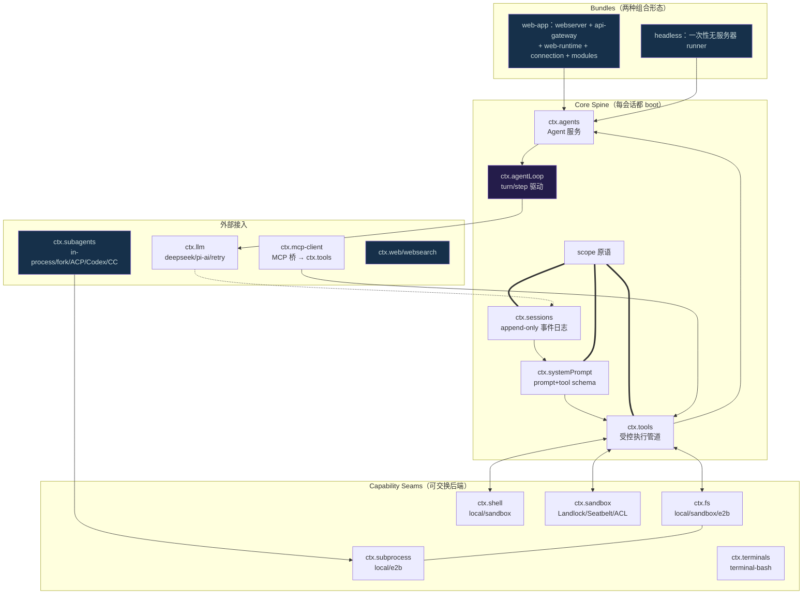
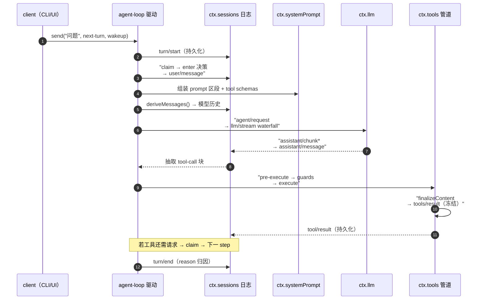

# DeepSeek Harness（dsh）：万物皆插件的 Agent Harness

> 本解读按 **agent ⊗ framework** 类规格产出（主类型智能体、副类型框架，因为它基于 Cordis 构建"Everything is a plugin"的插件化 agent 运行时）。解读针对 `/Users/morehao/Documents/study/ai-agent/deepseek-harness`（约 50 万行 TypeScript monorepo，v0.1.0-rc.5，MIT）。

## 子文档索引

- [`runtime.md`](runtime.md) — Cordis 运行时与"万物皆插件"：可逆副作用、Loader 配置树、profile/bundle 分层
- [`session.md`](session.md) — 会话日志与事件溯源：SessionEvent append-only 日志、deriveMessages 投影、JSONL/SQLite 持久化
- [`agent-loop.md`](agent-loop.md) — 主 Agent 循环与 turn flow：Agent 生命周期、turn/step 双层、agent/* 事件、inbox
- [`tool-calling.md`](tool-calling.md) — 工具系统与受控执行管道：pre/execute/post 瀑布、monotonic guards、approval
- [`capability-seams.md`](capability-seams.md) — 可交换能力边界：fs/subprocess/shell/terminal/sandbox/lsp 三角色 seam
- [`subagent.md`](subagent.md) — Subagent 体系：多 transport 委派、Activation 续接、in-process/fork/out-of-process
- [`mcp.md`](mcp.md) — MCP 接入与外部能力层：MCP 桥、与内置工具共享管道、能力边界
- [`context-and-compaction.md`](context-and-compaction.md) — 上下文与压缩：compaction seam、token 计量、spill 溢出、注入三通道
- [`sandbox.md`](sandbox.md) — 沙箱与安全边界：wrap-don't-spawn、Landlock 原生实现、单一策略根
- [`data-model.md`](data-model.md) — 持久化数据模型：《数据模型文档》五要素（SQLite/JSONL/Storage 存储层）
- [`planning-and-orchestration.md`](planning-and-orchestration.md) — 规划/目标/调度/工作流：goal、plan-mode、schedule、workflow 引擎
- [`apps.md`](apps.md) — CLI 与 Web 应用层：web/headless 双形态、host-browser 连接、启动流程
- [`llm.md`](llm.md) — LLM 适配与流式：ctx.llm seam、StreamChunk 协议、重试、凭证解析
- [`system-prompt.md`](system-prompt.md) — 核心提示词装配：identity/persona/tool-guidance 三段、变量插值、作用域遮蔽、complete 段
- [`skill-system.md`](skill-system.md) — Skill 技能体系：catalog 前缀 + 按需加载、provider 注册表 seam

## 概览

**一句话根因**：DeepSeek Harness 要让 agent 系统的每一个能力（模型适配器、工具注册表、会话日志、沙箱、子代理，乃至 agent 循环本身）都成为**可就地替换的插件**，无特权核心——你从配置里换掉一行，就换了整个产品的一角。

- 它是 DeepSeek AI 官方开源的 agent harness（CLI `dsh`），当前 developer preview（主动声明"将有破坏性变更"）。
- 跑起来就是一条 Cordis 插件树：`dsh web` 启浏览器应用（默认 `127.0.0.1:3080`），`dsh headless "任务"` 做无服务器一次性运行。
- **核心不变量 `Model-visible means logged`**：模型看到的一切都必须记入 append-only 会话日志并能从日志完全重建，这决定了整个系统的架构走向。

### 核心能力清单

| 能力 | 承载 |
|---|---|
| Everything is a plugin | 每个子系统都是 Cordis 插件，从配置替换一切（见 [`runtime.md`](runtime.md)） |
| 事件溯源的会话历史 | append-only SessionEvent 日志 + deriveMessages 投影，可 fork/resume/崩溃恢复（见 [`session.md`](session.md)） |
| 可替换主循环 | `agent` 接口与 `agent-loop` 实现解耦，循环整体可换（见 [`agent-loop.md`](agent-loop.md)） |
| 受控工具执行管道 | tools/pre-execute/execute/post-execute 瀑布 + guards + approval + spill（见 [`tool-calling.md`](tool-calling.md)） |
| 执行世界可交换 | fs/subprocess/sandbox 同世界迁移，本地→沙箱→远端 E2B 一键切（见 [`capability-seams.md`](capability-seams.md)） |
| 多形态子代理 | in-process/fork/ACP/Codex/Claude Code transport，持续可续接（见 [`subagent.md`](subagent.md)） |
| 自动上下文压缩 | compaction seam 从日志做可重放改写，token 计量 + spill 溢出（见 [`context-and-compaction.md`](context-and-compaction.md)） |
| 原生沙箱隔离 | Landlock（Linux）等可插拔后端，wrap-argv 原则（见 [`sandbox.md`](sandbox.md)） |

### 技术栈一览

| 层 | 技术 |
|---|---|
| 语言 | TypeScript（pnpm monorepo，host/client 双构建面）+ C11（native/landlock-run）+ 部分 Python SDK |
| 运行时框架 | 自研 vendored **Cordis**（@deepseek-ai/*，auditable/patchable/pinned） |
| 持久化 | JSONL（zstd 压缩、readable）+ SQLite（批量/事务/后缀读）+ KV storage |
| 前端 | React（`packages/client/web`），node:http webserver + WebSocket/SSE 下行流 |
| 协议 | 内部 Connection RPC + typert @Remote 描述符；对外 agent 协议：ACP 客户端协议、MCP client |
| 构建/校验 | tsdown、vitest、oxlint；极强的**生成式文档**体系（cordis-catalog、capability graph、event map 等） |

## 架构总览

一次 `dsh` 启动 = 一条按层套叠的 Cordis 插件树。核心 spine 六包（session→system-prompt→tools→agent→agent-loop→scope）吃掉一次 turn，能力 seam 从周边挂载，UI/CLI 只是两种组合形态。

模块职责与阅读路径见下方核心模块导读；各 seam 的具体接口签名、取舍与源码锚点在对应子文档。

## 启动与请求链路

**一次 turn 的完整旅程**（turn = 零或多个 step；step = 一次模型请求 + 其工具调用）是理解全系统的钥匙：

- turn/step 边界、user/assistant/tool 消息是**持久化事件**；`agent/*`、`llm/stream`、`tools/*` 是**运行时扩展点**（waterfall 必须 `next()` 委托，`agent/turn-stopping` 是 serial 无 next）。
- 模型看到的**每一比特**都必须来自日志（"Model-visible means logged"），新 model-visible 输入 = 新增 `SessionEventMap` 事件。
- 详细层叠见 [`agent-loop.md`](agent-loop.md) 与 [`session.md`](session.md)。

## 核心模块导读

| 模块 | 关注面 | 一句话定位 |
|---|---|---|
| [`runtime.md`](runtime.md) | Cordis 插件运行时 | 一切皆插件的地基：可逆副作用、Loader 配置树、profile 分层 |
| [`session.md`](session.md) | 事件溯源日志 | append-only 会话历史 = 单一事实源，全部读模型派生 |
| [`agent-loop.md`](agent-loop.md) | 主 Agent 循环 | turn/step 双层 + agent/* 事件 + inbox，可换循环 |
| [`tool-calling.md`](tool-calling.md) | 工具受控管道 | 三瀑布 + guards + approval，不依赖 loop 插入策略 |
| [`capability-seams.md`](capability-seams.md) | 可交换能力 | 同执行世界级联迁移 bash/PTY/LSP/子代理 |
| [`subagent.md`](subagent.md) | 子代理委派 | 多 transport，one-shot vs 可续接 |
| [`mcp.md`](mcp.md) | 外部能力接入 | MCP 桥与内置工具共享管道（弱项如实标注） |
| [`context-and-compaction.md`](context-and-compaction.md) | 上下文压缩 | 日志内可重放改写，token 计量 + spill |
| [`sandbox.md`](sandbox.md) | 沙箱隔离 | wrap-argv、Landlock 原生、单一策略根 |
| [`data-model.md`](data-model.md) | 持久化数据模型 | SQLite/JSONL/Storage 存储层选型与演进 |
| [`planning-and-orchestration.md`](planning-and-orchestration.md) | 规划编排 | goal/plan/schedule/workflow 从日志折叠 |
| [`apps.md`](apps.md) | 应用层 | web/headless 双形态 + host-browser 连接 |
| [`llm.md`](llm.md) | LLM 适配 | ctx.llm seam + StreamChunk 协议 + 重试 |
| [`skill-system.md`](skill-system.md) | 技能体系 | catalog 前缀 + 按需加载（轻量） |

## 设计亮点

- **"无特权核心"兑现到行级**：模型/工具/会话/权限/sandbox/agent-loop 都是 `base/cordis.patch.yml` 里的配置行，替换 = 改一行 patch，卸载 = 自动逆序回滚（`runtime.md`）。这来自 vendored Cordis 的**可逆副作用**承诺——这是"从配置替换一切"能成立的地基。
- **事件溯源而非存消息数组**：模型历史、标题、投影、审计全部从同一条 `SessionEvent` 日志派生（`session.md`）。`deriveMessages` 增量投影 + `surfaceOp` 区分"模型可见表面"与"人类 transcript"，让压缩影藏历史不污染可读流。
- **Model-visible means logged 的构造期强制**：`agent-loop-invariant` 在 `llm/stream` 前冻结比较 `messages === deriveMessages()`，把"log 与请求脱钩"这种最隐蔽的 bug 变成**确定性构造失败**（`agent-loop.md`）。
- **capability seam 的"同一执行世界"**：fs 与 subprocess 共享坐标，`SandboxMode` 单根解析，一次 provider 交换（本地→E2B）级联迁移 bash/PTY/LSP/子代理，无需任何 provider fork（`capability-seams.md`）。
- **工具管道不依赖 loop**：pre/execute/post 三瀑布 + monotonic guards + approval + spill，全部可在不改 agent 循环的前提下叠加策略；`run_code` Code Mode 用 parent token 区分"模型直接调用"与"程序内子调用"（`tool-calling.md`）。
- **生成式文档把"契约"变可校验资产**：Cordis catalog、capability graph、event map、persistence catalog 全部由脚本生成并由 CI 校验——文档不是说明，是可执行的规范。

## 不足与风险

- **无限迁移层 + 版本 0 拒绝策略**：无 upgrader 链，任何结构变更都可能让旧 harness 无法读新日志；`SCHEMA_VERSION=15` 演进史也无法从本地 git 追（`data-model.md`、`session.md`）。pre-release 期可接受，发布后是隐患。
- **类型安全靠字符串键 + TS 声明合并**：服务仓库按字符串键存取、类型靠 `declare module` 兜底，键拼错/声明漏写会静默变 `undefined`（`runtime.md`）。
- **MCP 是明确弱项**：只桥接 tools（1/3 协议），resources/prompts 无消费者；dsh 的对外 agent 强项是 ACP 而非 MCP（`mcp.md` 据实标注）。
- **vendored 同步成本**：18+ 条 Local modifications 每次上游同步要重放，框架演进被"钉死"（`runtime.md`）。
- **三方可扩展仍有摩擦**：`SessionEventMap` 靠声明合并，但 `KNOWN_SESSION_EVENT_TYPES` 是生成物，出仓外插件事件在持久化读路径可能被拒（`session.md`）。

## 可借鉴的设计

1. **"配置行=插件=可逆副作用"的运行时**：把每个能力做成可从配置替换的插件，注册物统一可逆——这是 agent/framework 类产品"无特权核心"的可落地范式（迁移到任何插件化系统）。
2. **事件溯源 + 派生读模型**：用 append-only 日志做单一事实源，所有读（历史/标题/投影/审计）从日志派生，消灭"内存与存储漂移"（迁移到需回放/审计的系统）。
3. **capability seam 三角色**（Definition/Provider/Consumer）+ "同一执行世界"坐标统一：让一次后端交换级联迁移一组相关能力（迁移到多后端可插拔工具系统）。
4. **工具执行管道与主循环解耦**：policy/hook/sandbox 全挂在事件瀑布上，改策略不动循环（迁移到高扩展性 agent 工具层）。
5. **Markdown 目录前缀 + 按需加载 body**：上下文成本与 KV-cache 友好，是轻量 skill 注入的克制设计（对比全量注入）。
6. **生成式文档即契约**：让文档由源码生成并接入 CI 校验，文档失真被自动拦截（迁移到大型 monorepo 的 doc 治理）。

## 总结：回扣根因

DeepSeek Harness 的全部设计都在为**"一切皆可替换、无特权核心"**这一个根因服务：Cordis 提供可逆副作用的插件运行时（`runtime.md`），session 日志保证任何替换都可重放回退（`session.md`），capability seam 让一次交换级联迁移整组能力（`capability-seams.md`），agent-loop 与 agent 接口解耦使循环本身都可换（`agent-loop.md`）。它不是把一个 agent 写好，而是**把"写 agent 的每个零件"都变成了可在配置层替换的积木**——这是它与绝大多数把某一种 agent 写死为产品的开源项目最根本的差异。
