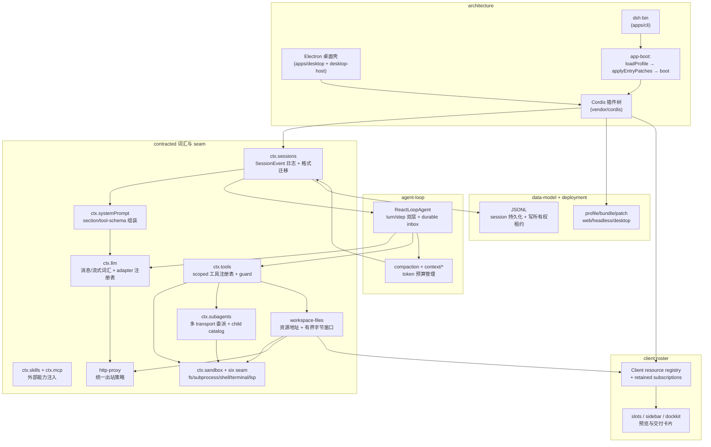

# DeepSeek Harness (`dsh`)

> 本解读按 **ai-agent ⊗ framework** 类规格产出（ai-agent 主类型 + framework 副类型叠加，因 dsh 向插件作者开放 SDK/扩展接口）。判定依据：README 自述「agent harness / everything is a plugin」+ 顶层 `packages/*/` 插件式扩展接口 + vendored Cordis 插件运行时。由 DeepSeek AI 开源。
>
> **解读基线**：本版解读基于 **`dsh-v0.1.7-rc.2`**（commit `477b4f4205`，2026-09-24）；上一版解读基线为 `dsh-v0.1.5-rc.2`（`fb2c4b9e69`，2026-09-11）。
>
> **本版增量更新（0.1.5-rc.2 → 0.1.7-rc.2 / 2026-09-24）**：本次增量跨 0.1.6 与 0.1.7 两条发布线，上游 `dsh-v0.1.5-rc.2..HEAD` diff 达 3650 commits、约 135 万行新增。**本轮按"桌面专项重写 + 全库机械重锚定"两遍推进**：桌面章节逐段重写，其余子文档则程序化对齐引用行号（545 条引用被修正，全库 OK 由 811 升到 1356；范围与逐文件待办见文末「本轮增量范围与引用复核状态」）。桌面端有三条旧结论被直接反转：
> **(1) 传输面从「无端口 + 分帧字节管道」改为「回环 HTTP + `dsh-app://` 协议代理」**——Host 现在真的监听 `127.0.0.1` 并回报带鉴权信息的 URL，壳侧只保留静态资产与协议转发；决策笔记直言这笔交换 "gives up the portless guarantee"。见 [desktop-app.md](desktop-app.md)、[deployment.md](deployment.md)。
> **(2) 首次启动的「seed 离线安装」被整体删除**——`seed-store.ts` / `prepare-seed.ts` / `macos-seed-store.ts` 三处实现消失，改为**构建期物化**的生产依赖树 + `desktop-runtime.json` 逐文件完整性清单，启动只做校验；配套的 profile staging/回滚激活事务一并下线。
> **(3) 打包内运行时从「随包上游 Node」改为「Electron 自己当 Node」**——`ELECTRON_RUN_AS_NODE=1` + `runAsNode` fuse + `--expose-internals`，Node/pnpm/Python 版本另由 primary-runtime 载荷与预编译 Node-API addon 承担，**用户机器不需要预装 Node、pnpm 或 Python**。逐条拆解见新增专题 [desktop-zero-dependency.md](desktop-zero-dependency.md)。
> 桌面壳另补齐托盘常驻/关窗到后台/退出确认、欢迎窗与 DeepSeek 账号登录、Platform 内嵌页、普通与强制双更新通道、Windows NSIS 目录式安装器，以及签名流水线的工程化（并发公证、签名缓存、dotenv 配置）。各版本逐条变更见 [CHANGELOG.md](CHANGELOG.md)。
>
> **本版增量更新（0.1.2-rc.1 → 0.1.5-rc.2 / 2026-09-11）**：本次增量一次跨 **6 个发布版本**（0.1.3-alpha.1 / 0.1.3-alpha.2 / 0.1.5-alpha.1 / 0.1.5-alpha.2 / 0.1.5-rc.1 / 0.1.5-rc.2；**0.1.4 被整段跳过**），上游 diff 达 1490 commits、约 17 万行新增。依 `dsh-v0.1.2-rc.1..HEAD` git diff 与 `verify-references --diff` 预检清单比对更新，主题可归为五条主线：
>
> **(1) 会话格式进入「已发布不可变世代 + 相邻迁移链」**——`feat(session)!: add released format migration` 把"只写当前版、旧版拒绝"改成不可变世代 + N→N+1 相邻转换链（流式 stage），assistant 流内嵌 v2、system prompt 在 v3 提升为 **surface node zero**，「谁拥有当前 writer 版本号」收敛到代码常量 + 生成式 catalog + release record 三方权威。见 [session-format-migration.md](session-format-migration.md)。
> **(2) 多形态分发**——新增 **Electron 桌面端**（`apps/desktop` + `apps/desktop-host`，mac 签名公证 / Windows 签名 / 自动更新 / IPC 优化）与 **原生 addon 家族 `node-addon-system`**（`native/landlock-run` 迁入 `native/system`、Landlock 走 capability subpath、新增预编译 Node-API flock）。见 [desktop-app.md](desktop-app.md)。
> **(3) 文件能力面贯通**——`workspace-path` 定义 Session/绝对文件资源地址、`api/workspace-files` 双面文件 API、**有界字节区间读取**下沉到 fs seam（fs-local / fs-e2b 可取消窗口）、`/api/file` 只认 `bytes` range + 扩展名 allowlist、`tool-present` 交付不可变产物。见 [workspace-files.md](workspace-files.md)。
> **(4) 浏览器客户端成型**——Client resource registry + 保留订阅、侧栏 tab / fullscreen 外壳 / **可逆 dock 引擎**、惰性 workspace 文件树、文档预览管线（文本 / Markdown / HTML / 图片 / PDF / 代码六类渲染器）、交付下载卡片、统一反馈对话框。见 [web-client.md](web-client.md)。（窗口内曾合入把 `mermaid`/`graphviz`/`svg`/`html` 代码栅栏直接渲染成图的能力，随即被完整回滚，未进入任何发行版——详见 [web-client.md](web-client.md)。）
> **(5) 运行时与地面加固**——**Inbox 由内存服务改为 durable projection**、附件从"图片专用"泛化为通用文件、subprocess 原生 containment 收敛（本周期提交数最多的子系统）、**所有出站请求统一走配置代理**。见 [agent-loop-runtime.md](agent-loop-runtime.md)、[session.md](session.md)、[attachments.md](attachments.md)、[subprocess.md](subprocess.md)、[networking-proxy.md](networking-proxy.md)。
> 各版本逐条变更一览见 [CHANGELOG.md](CHANGELOG.md)。
>
> **本版增量更新（0.1.2-alpha.4 → 0.1.2-rc.1 / 2026-09-03）**：依上游 alpha.5 → rc.1 两版 git diff 比对更新。本次增量的代码面高度聚焦存储层（约 1300 行变更含测试夹具、全落在 storage-domain / storage-json / session-projection-cache），主题是 **schema 演进从「一刀切版本拒绝」软化为「owner 显式背书的跨版本读兼容 + 失效派生数据 backup-and-skip」**：(1) `DomainSpec`/`KvUnitDescriptor` 新增 `compatibleVersions` 白名单——per-record 布局读侧接受旧版本戳（`acceptedStamps` = 当前版 + 兼容列表）、legacy 整文件 bootstrap 也校验 stored version，owner 靠把旧版缺的字段声明为 optional 来背书；`single` 布局仍 exact-version 拒绝；(2) `DomainSpec.invalidRecords: 'backup-and-skip'` + `KvUnit.backupRecord`——某条记录 schema 校验失败时移走 `<key>.json.bak.<stamp>`、按缺席续开，绝不因坏缓存 brick 整个 boot；(3) projcache 域 spec 演进为 `version:5 + compatibleVersions:[3,4] + invalidRecords:'backup-and-skip'`，谱系位 `isSeeded`/`inheritedEventCount` 变可选（缺席读作 unseeded）。主体更新在 [data-model.md](data-model.md)；各版本变更一览见 [CHANGELOG.md](CHANGELOG.md)。
>
> **本版增量更新（0.1.1-rc.2 → 0.1.2-alpha.4 / 2026-09-01）**：依上游 4 个 alpha 版本 git diff 比对更新。本次增量 (1) **SQLite 会话持久化后端整体移除**，事件日志收敛为 JSONL 单一后端（[data-model.md](data-model.md)）；(2) **session 事件 seq/log offset 分离**——`SessionSeq`（事件身份）与 `SessionLogOffset`（位置）品牌化、`seedLength`→`isSeeded`+`inheritedEventCount`（[session.md](session.md)）；(3) **Typert Remote 控制器体系取代 apiproxy RPC**——`@Remote`/`@RemoteScope` 声明式暴露 + 构建期生成双契约，session/workspace/settings/credentials 四控制器落地（[remote-controllers.md](remote-controllers.md)）；(4) **新增 webhook 子系统**——无状态 fire-and-forget 规则运行时 + GitHub 适配器（[webhook.md](webhook.md)）；(5) 新增 experimental inspector（CDP 跨域检视，[inspector.md](inspector.md)）与 webworker（浏览器 worker 跑整棵插件树，[webworker.md](webworker.md)）；(6) storage-json per-record 布局 + projection-cache 冷读播种 + sdk-minimal profile。各版本变更一览见 [CHANGELOG.md](CHANGELOG.md)。
>
> **本版增量更新（0.1.1-rc.2 / 2026-08-23）**：项目无官方 changelog，依上游 0.1.0-rc.7 → 0.1.1-rc.2 git diff 比对更新。本次增量跨 rc.1、rc.2 两版，主要变更 (1) **新增凭据能力面**——`ctx.credentials`（双键空间 + 持久化记录的 Capability Seam）+ `ctx.authorization`（可交互授权：OAuth/device-code 登录），见 [credentials.md](credentials.md)；(2) **图片/附件管线统一**——canonical admission 归一化 + `readImageRequest` 对象投影 + DeepSeek Files API file-id 首选/base64 兜底，见 [attachments.md](attachments.md)、[llm.md](llm.md)；(3) **LLM 适配器两阶段 `prepareCall`** 与 Files/stream 超时解耦（[llm.md](llm.md)）；(4) **Session 投影状态/视图分离 + 跨 boot checkpoint**（[session.md](session.md)）；(5) 沙箱 bwrap 加 PID 命名空间隔离（[sandbox-capability-seams.md](sandbox-capability-seams.md)）。rc.1 曾短暂引入 `reuseWorkspaceBlank` 空白会话继承默认权限、在 rc.2 整体回滚。各版本变更一览见 [CHANGELOG.md](CHANGELOG.md)。

## 根因：没有特权内核的 agent harness

DeepSeek Harness（`dsh`）是一个 TypeScript 编写的 agent harness（智能体框架），核心主张 **一切皆插件（everything is a plugin）**，并基于 vendored [Cordis](https://github.com/cordiverse/cordis) 插件运行时（设计来自论文 _A Programming Paradigm for Spatiotemporal Composability_）搭建。

它解决的根本问题是传统 agent 框架的**「特权内核」问题**：主循环、工具注册、记忆、沙箱、多 agent 协作往往被写死在框架内部，用户只能通过有限配置点去改造，状态不可审计、工具执行无边界、扩展要么侵入核心要么被护栏卡死。dsh 的解法是——

> 把执行过程的所有环节（主循环、工具注册表、会话日志、模型适配器、沙箱）都做成**可替换的插件**，任何部分都可配置、可热卸载；同时以**不可变的 Session 事件日志**作为唯一事实源（`Model-visible means logged`），让「模型看到的一切」都可回放、可审计、可派生。

## 概览：是什么 / 痛点 / 适用场景

- **是什么**：DeepSeek 官方开源的 agent harness，`npx @deepseek-ai/dsh web` 即可启动 Web UI（默认 `http://127.0.0.1:3080`），另有 `headless` 无服务器一次性 runner。目前处于 developer preview，仍在快速迭代、未来有破坏性变更。
- **痛点**：传统 agent 框架「内核不可扩展、状态不可审计、工具无边界」。
- **适用场景**：需要深度定制 agent 行为的团队；想用插件化方式扩展工具/记忆/模型接入；对可审计、可回放、可崩溃恢复有强要求的多 agent 产品。
- [`CHANGELOG.md`](CHANGELOG.md) — 各版本变更汇总

### 核心能力清单表

| 能力 | 说明 | 子文档 |
|------|------|--------|
| 无特权内核 / 插件运行时 | 一切皆插件，主循环也可替换，注册是可逆副作用 | [architecture.md](architecture.md) |
| 会话事件溯源日志 | append-only 事件日志作为唯一事实源，`Model-visible means logged`；inbox、catalog、投影全部由日志重建 | [session.md](session.md) |
| 会话格式的已发布世代 | 不可变 generation + 相邻 N→N+1 流式迁移链，writer 常量 / 生成式 catalog / release record 三方权威（0.1.3 起） | [session-format-migration.md](session-format-migration.md) |
| 主 Agent 循环 + Runtime | turn/step 双层、waterfall 事件拦截、durable inbox 投影唤醒、实时流帧与模型切换通知 | [agent-loop-runtime.md](agent-loop-runtime.md) |
| 受控工具管道 | scoped 注册、guard/approval/spill 三段把关；`str_replace_editor` 已退出 base/sdk/minimal 三个默认组合（改为显式 opt-in，代码仍在） | [tools.md](tools.md) |
| 系统提示词组装 | 插件 section 按 order 排序拼装 + tool-schema 并入；persona 前缀 / cwd 后缀的缓存友好布局，v3 起落为 surface node zero | [system-prompt.md](system-prompt.md) |
| 沙箱 + 可交换后端 | 六族 capability seam + Landlock 原生沙箱（node-addon-system）+ E2B 级联迁移 + 有界字节窗口 | [sandbox-capability-seams.md](sandbox-capability-seams.md) |
| 子进程运行时 | `ctx.subprocess` seam + 平台原生 runner（进程组 / Windows job object）容纳逃逸后代，流式结算与错误形状保真 | [subprocess.md](subprocess.md) |
| 多 Agent / Subagent | 统一接口下 spawn/fork/ACP/Claude Code 多 transport 委派；父方拥有的 child catalog 可观察 | [subagent.md](subagent.md) |
| Agent Teams 协调域 | 隐式根 Lead + 持久邮件队列 + 版本化任务板（0.1.5-alpha.2 起随发行版公开，仍标 experimental） | [agent-teams.md](agent-teams.md) |
| 技能体系 + MCP | 外部指令注入与外部工具桥接；技能候选共享模糊名排序、MCP 工具发现游标去重 | [skill-mcp.md](skill-mcp.md) |
| LLM 适配器 seam | 消息/流式词汇 + 多 provider 路由注册表；两阶段 `prepareCall`、模型目录与发现 | [llm.md](llm.md) |
| 出站网络代理 | 所有出站请求按策略走配置代理，进程树 / Worker 继承同一路由，本机流量豁免 | [networking-proxy.md](networking-proxy.md) |
| 凭据系统 | 双键空间（CredentialRef/CredentialKey）+ 持久化记录 + 可交互授权 | [credentials.md](credentials.md) |
| 上下文管理与压缩 | compaction capability seam + token 预算；派生 system head 作为消息重放 | [memory-compaction.md](memory-compaction.md) |
| 持久化数据模型 | 事件日志 JSONL 单一后端、session-persistence handle 化 seam + **跨进程写所有权租约**、per-record 域可声明 `compatibleVersions` + `invalidRecords:'backup-and-skip'`、projection-cache 冷读播种、chunked-list 持久长列表 | [data-model.md](data-model.md) |
| 工作区文件能力面 | Session/绝对资源地址 + 双面文件 API + 有界字节区间读取 + 不可变交付（present）+ 本地应用打开 | [workspace-files.md](workspace-files.md) |
| 浏览器客户端 | Client resource registry（保留订阅）+ slot roster + 侧栏 tab/dock 引擎 + 文档/图表预览 + 交付卡片 | [web-client.md](web-client.md) |
| 远程访问自托管 dsh Web | 服务器只监听回环 + SSH 隧道从本地访问（不新增暴露面）；一次性 token 换取绑定 authority 的会话 cookie，Settings 因此完全可用；含启动取 token、免密 SSH、踩坑与解法、排障速查 | [web-remote-access.md](web-remote-access.md) |
| 部署形态 | profile/bundle/patch 分层、web/headless/**desktop** 三形态、sdk-minimal/ACP/SDK app bundle | [deployment.md](deployment.md) |
| 桌面形态 | Electron 壳 + 独立 Host 进程、回环 HTTP + `dsh-app://` 协议代理、跨平台打包/签名/公证、普通与强制双更新通道、托盘与会话外壳 | [desktop-app.md](desktop-app.md) |
| 桌面零依赖运行时 | 构建期物化依赖树 + Electron RunAsNode + primary-runtime 载荷 + 预编译原生 addon；用户机器无需预装 Node/pnpm/Python | [desktop-zero-dependency.md](desktop-zero-dependency.md) |
| 持久化附件 | 不可变内容寻址对象库；0.1.3 起从 `ImageAttachmentRef` 泛化为**通用文件**制品与投影，prompt admission 上收 service | [attachments.md](attachments.md) |
| Remote 控制器体系 | Typert `@Remote`/`@RemoteScope` 声明式 API + 构建期生成双契约，session/workspace（含 workspace-files）/settings/credentials 控制器取代 apiproxy RPC | [remote-controllers.md](remote-controllers.md) |
| Webhook 子系统 | 无状态 fire-and-forget 规则运行时 + GitHub 适配器，外部投递→普通 root Session | [webhook.md](webhook.md) |
| Inspector（experimental） | CDP 跨 Host/浏览器双域检视，Worker 隔离 + 快照投影 | [inspector.md](inspector.md) |
| WebWorker（experimental） | 浏览器 worker 跑整棵插件树 + VFS 镜像打包，代理 / 文件句柄语义对齐 Node | [webworker.md](webworker.md) |

### 技术栈一览表

| 层面 | 技术 |
|------|------|
| 语言 | TypeScript（主）、C11（原生沙箱 / Node-API addon，统一收进 `native/system`） |
| 插件运行时 | vendored [Cordis](https://github.com/cordiverse/cordis)（DI / fiber 生命周期 / 可逆 effect / 事件 dispatch） |
| 持久化 | 会话日志 JSONL（zstd 压缩帧，0.1.2-alpha 起唯一事件后端）+ 会话格式世代迁移链（`packages/session/session-format*`）；KV 层 storage（json single/per-record + sqlite 双后端） |
| 会话格式 | `SESSION_FORMAT_VERSION` 为唯一 writer 权威；生成式 catalog 校验相邻迁移可达；release record 声明已发布格式（当前第 3 代，0.1.5-alpha.1 发布） |
| 沙箱与执行 | Landlock / bwrap / Seatbelt / Windows ACL / E2B；`node-addon-system` 提供预编译 Node-API addon（Landlock、flock） |
| 子进程 | 平台原生 runner（POSIX 进程组 / Windows job object）承接逃逸后代容纳 |
| 外部协议 | MCP（stdio / streamable-http）、ACP（Agent Client Protocol） |
| 网络 | 统一出站代理策略（`packages/util/http-proxy`），子进程 / Worker 继承父路由 |
| 凭据 | `$DSH_HOME/.credentials.yaml`（版本化文档 + 0600 + 跨进程写锁）、OAuth/device-code 授权（rc.1） |
| 分发 | pnpm workspace + npm（`@deepseek-ai/dsh` bin）+ Electron 桌面安装包（mac 签名公证 / Windows 签名 / 自动更新） |
| 桌面运行时供给 | 随包只读生产依赖树（`app.asar/dsh` + `desktop-runtime.json`）+ Electron RunAsNode 当 Node + primary-runtime 载荷（Node 24.21 / Python 3.12 / 内置 pnpm）+ 预编译 Node-API addon |
| 前端 Web UI | 浏览器端插件 roster（`dsh-client-*`）+ Client resource registry + VitePress 文档站 |

## 架构：五大支柱

- **支柱一 · 无特权内核**：扩展 dsh = 在旁边挂一个插件，注册是可逆副作用（`ctx.effect()`/`ctx.on()`），卸载自动撤销。没有需要 patch 的核心。
- **支柱二 · 会话日志是唯一事实源**：`Model-visible means logged` —— 任何到达模型请求的输入都必须能从日志重建，运行时 invariant 强制这点。
- **支柱三 · Capability Seam 三件套**：一个可交换能力 = Service Definition（接口）/ Provider（实现）/ Consumer（消费方，常是模型面向工具）。一个 provider 交换 = 整体产品随之迁移。
- **支柱四 · Profile/Bundle/Patch 分层启动**：运行中的 dsh 是从空 entry 列表按分层 patch 组合出的插件树。
- **支柱五 · 事件是扩展点**：session 事件（持久事实）、agent 事件（`agent/*`，观察/拦截在途工作）、capability 事件（把策略挂到 seam 上）。



## 核心模块导读

| 模块 | 职责 | 深度子文档 |
|------|------|-----------|
| 架构组合层 | Cordis 插件树装配、Profile/Bundle/Patch 分层 | [`architecture.md`](architecture.md) |
| 会话系统 | 事件溯源日志、Model-visible means logged | [`session.md`](session.md) |
| 会话格式迁移 | 不可变世代 + 相邻迁移链 + writer 版本权威 | [`session-format-migration.md`](session-format-migration.md) |
| 主循环 + Runtime | turn/step、waterfall 拦截、durable inbox、循环与引擎分离 | [`agent-loop-runtime.md`](agent-loop-runtime.md) |
| 工具管道 | scoped 注册、guard/approval/spill | [`tools.md`](tools.md) |
| 系统提示词 | section 排序 + tool-schema 组装，v3 surface node zero | [`system-prompt.md`](system-prompt.md) |
| 沙箱 + Capability Seam | 六族可交换后端 + Landlock + 有界字节窗口 | [`sandbox-capability-seams.md`](sandbox-capability-seams.md) |
| 子进程运行时 | 原生 runner 容纳逃逸后代 + 流式结算 | [`subprocess.md`](subprocess.md) |
| 多 Agent | 统一接口多 transport 委派 + child catalog | [`subagent.md`](subagent.md) |
| Agent Teams | 隐式根 Lead/队友队形 + durable 邮件 + 版本化任务板（实验面） | [`agent-teams.md`](agent-teams.md) |
| 技能 + MCP | 外部能力注入 | [`skill-mcp.md`](skill-mcp.md) |
| LLM 能力层 | 词汇 + 适配器 seam + 模型目录/发现 | [`llm.md`](llm.md) |
| 出站网络代理 | 策略路由 + 进程树/Worker 继承 | [`networking-proxy.md`](networking-proxy.md) |
| 凭据与授权 | 双键空间 + 持久化记录 + 交互授权 (rc.1) | [`credentials.md`](credentials.md) |
| 上下文与压缩 | compaction + token 预算 | [`memory-compaction.md`](memory-compaction.md) |
| 数据模型 | 持久化布局与演进（JSONL 单一事件后端 + 写所有权租约） | [`data-model.md`](data-model.md) |
| 工作区文件 | 资源寻址 + 双面 API + 有界读取 + 交付 | [`workspace-files.md`](workspace-files.md) |
| 浏览器客户端 | resource registry + slot roster + 侧栏/预览/交付 | [`web-client.md`](web-client.md) |
| 远程访问自托管 Web | SSH 隧道 + token/cookie 会话 + 客户端 loopback 降级 | [`web-remote-access.md`](web-remote-access.md) |
| 部署形态 | profile/bundle/patch 与 web/headless/desktop 三形态 + SDK 分发 | [`deployment.md`](deployment.md) |
| 桌面形态 | Electron 打包/签名/自动更新 + 原生 addon 家族 | [`desktop-app.md`](desktop-app.md) |
| 桌面零依赖运行时 | 四条供给线：构建期物化依赖树 / Electron 当 Node / primary-runtime 载荷 / 预编译 addon | [`desktop-zero-dependency.md`](desktop-zero-dependency.md) |
| 持久化附件 | 不可变内容寻址对象库 + Ref 引用 | [`attachments.md`](attachments.md) |
| Remote 控制器 | Typert 生成式 API + session/workspace/settings/credentials 控制器 | [`remote-controllers.md`](remote-controllers.md) |
| Webhook 子系统 | fire-and-forget 规则运行时 + GitHub 适配器 | [`webhook.md`](webhook.md) |
| Inspector（experimental） | CDP 跨 Host/浏览器双域检视 | [`inspector.md`](inspector.md) |
| WebWorker（experimental） | 浏览器 worker 跑整棵插件树 + VFS 镜像 | [`webworker.md`](webworker.md) |

## 启动 / 请求链路

一个 `turn` 的完整生命周期（含 waterfall 事件归属与源码落点、实时流帧与 durable inbox 唤醒）在 [`agent-loop-runtime.md`](agent-loop-runtime.md) 有 `sequenceDiagram`；启动链路（`dsh web`/桌面壳 → loadProfile → 组合 → boot → 挂 Browser UI）见 [`deployment.md`](deployment.md) 与 [`desktop-app.md`](desktop-app.md)；旧版会话日志的读取链路（识别世代 → 相邻迁移链 → 当前 writer 校验）见 [`session-format-migration.md`](session-format-migration.md)。

## 子文档索引

- [`architecture.md`](architecture.md) — Cordis 插件树与 Profile/Bundle/Patch 分层启动
- [`session.md`](session.md) — 会话事件溯源日志，`Model-visible means logged`
- [`session-format-migration.md`](session-format-migration.md) — 会话格式的已发布不可变世代与相邻迁移链（0.1.3 起）
- [`agent-loop-runtime.md`](agent-loop-runtime.md) — 主 Agent 循环（turn/step）、durable inbox 与 Runtime 分离
- [`tools.md`](tools.md) — 受控工具调用管道（scoped/guard/approval/spill）
- [`system-prompt.md`](system-prompt.md) — 系统提示词与工具 schema 组装（v3 surface node zero）
- [`sandbox-capability-seams.md`](sandbox-capability-seams.md) — 沙箱与六族可交换后端 + Landlock + 有界字节窗口
- [`subprocess.md`](subprocess.md) — 子进程运行时与原生 containment（POSIX 进程组 / Windows job object）
- [`subagent.md`](subagent.md) — 多 agent / subagent 多 transport 委派与父方 child catalog
- [`agent-teams.md`](agent-teams.md) — Agent Teams 协调域（隐式根队形 + durable 邮件 + 版本化任务板，实验面）
- [`skill-mcp.md`](skill-mcp.md) — 技能体系 + MCP 外部能力接入
- [`llm.md`](llm.md) — LLM 消息/流式词汇与适配器 seam
- [`networking-proxy.md`](networking-proxy.md) — 出站网络代理策略与进程树继承（0.1.3 新增）
- [`credentials.md`](credentials.md) — 凭据系统：双键空间、持久化记录与交互授权（rc.1 新增）
- [`memory-compaction.md`](memory-compaction.md) — 上下文管理与自动压缩
- [`data-model.md`](data-model.md) — 持久化数据模型（JSONL 单一后端 + 写所有权租约 + per-record 存储）
- [`workspace-files.md`](workspace-files.md) — 工作区文件能力面（资源寻址 + 双面 API + 有界读取 + 交付，0.1.5 新增）
- [`web-client.md`](web-client.md) — 浏览器客户端（resource registry + slot roster + 侧栏/预览/交付，0.1.5 新增）
- [`web-remote-access.md`](web-remote-access.md) — 远程访问自托管 dsh Web 实录（终局形态 + 隧道操作 + 踩坑与解法 + 排障速查，机制与源码依据入附录）
- [`deployment.md`](deployment.md) — 部署形态（web/headless/desktop、profile/bundle/patch、SDK 分发）
- [`desktop-app.md`](desktop-app.md) — 桌面形态（Electron 打包/签名/自动更新 + 原生 addon 家族，0.1.5 新增）
- [`desktop-zero-dependency.md`](desktop-zero-dependency.md) — 桌面零依赖运行时（随包依赖树 + Electron RunAsNode + primary-runtime + 预编译 addon，0.1.7 新增）
- [`attachments.md`](attachments.md) — 持久化附件能力面（不可变内容寻址对象库 `ctx.attachments`，0.1.3 起泛化为通用文件）
- [`remote-controllers.md`](remote-controllers.md) — Typert Remote 控制器体系（`@Remote` 生成式 API 取代 apiproxy RPC）
- [`webhook.md`](webhook.md) — Webhook 子系统（无状态 fire-and-forget 规则运行时 + GitHub 适配器）
- [`inspector.md`](inspector.md) — Inspector 跨域检视（experimental CDP，Worker 隔离 + 快照投影）
- [`webworker.md`](webworker.md) — WebWorker 浏览器运行时（experimental VFS 镜像 + 嵌套 Worker 子进程）

## 可借鉴的设计

- **可交换后端 = Seam 三件套**：把「一个能力」切成 Definition/Provider/Consumer，让「换后端」等于「整体产品迁移」而非 provider 分叉——沙箱六族与 LLM 适配器都验证了这套抽象的可扩展性。
- **事件溯源而非可变状态**：append-only 日志 + 派生投影，换来可重放、可审计、可崩溃恢复；`Model-visible means logged` 把「模型看到什么」变成编译期强制。
- **分层 patch 组合**：profile/bundle/patch 把「发行、组合命名、覆盖行为」正交化，任何升级/换默认都退化为一个 patch，且 `--dump-config` 保证「看到的 = 跑起来的」。
- **零特权拦截**：所有关键决策点（pre-step/request/request-error/turn-stopping、tools/*）都以 waterfall 事件开放，让插件在洋葱式 `next()` 委派下无优先级地参与——连主循环本身都可替换。
- **坚持「可回放」优先于「方便」**：二进制图像也没能绕开唯一事实源——用不可变内容寻址对象库 + `ImageAttachmentRef` 引用而非 base64/URL，让 `Model-visible means logged` 从文本扩展到媒体（[attachments.md](attachments.md)）。
- **把「协作」也变成可回放事件（rc.8）**：Agent Teams 把队形、邮件队列、任务板全部写成 Lead 日志里的 `team/*` log-only 事件，再由注册式 `agentTeam` session 投影（`stateVersion: 3`）折叠重建——连"多 agent 一起干活"都不引入旁路可变状态（初始版本用 `foldTeam` 纯函数折叠，0.1.5 已换成投影，见 [agent-teams.md](agent-teams.md)）。
- **存储效率与真相不可变不冲突**：JSONL 后端用 chunk 打包物理行 + zstd 压缩存储，仍严格还原逻辑 `SessionEvent[]`、seq 连续、`readFrom` 尾读语义不变——压缩的是物理布局，未放宽"日志即真相"（[data-model.md](data-model.md)）。**（rc.8 的 SQLite Schema 17 打包行已随 0.1.2-alpha.1 移除，此原则收敛进 JSONL 单一后端）**
- **"一个真相、一类读法"（alpha.1）**：移除 SQLite 会话后端、把事件日志收敛为 JSONL 单一后端——不是性能退让，而是用 `readFrom` 的物理后缀语义消解双后端的差异化收益，维护成本降到"单一契约、单一媒介"（[data-model.md](data-model.md)）。
- **位置与身份从类型层分离（alpha.1）**：`SessionSeq` vs `SessionLogOffset` 让"标识一条事件"与"标识日志中的位置"编译期不可互换——事件溯源系统里最贵的 bug 之一（offset 当身份用）被品牌化直接堵死（[session.md](session.md)）。
- **API 面变成业务源码声明（alpha.1）**：`@Remote`/`@RemoteScope` + 构建期生成双契约，让"host 能力暴露给浏览器"从手写的 apiproxy RPC 层变成挂在业务包自己身上的装饰器声明，契约一致性交给编译器（[remote-controllers.md](remote-controllers.md)）。
- **外部事件入口不引入旁路状态（alpha.1）**：webhook 用无状态 fire-and-forget——无队列/重试/去重/完成回调，投递一旦变 Session 就归日志管；交付语义外包给上游（GitHub 重试）、去重决策推给规则（[webhook.md](webhook.md)）。
- **调试器也走"投影快照"而非 live 引用（alpha）**：Inspector 把 CDP 状态隔离在 Worker、收集器投影验证快照再传输——连调试都不破坏业务运行时的对象流动纪律（[inspector.md](inspector.md)）。
- **"不打编译的浏览器运行"（alpha）**：WebWorker packer 直接打包真实构建产物 + 运行时零编译器，worker 只是"怎么挂载镜像、怎么补 node 语义"的执行者——预览调试的就是线上要发的字节（[webworker.md](webworker.md)）。
- **凭据也是"记录即事实"的可交换 seam（rc.1）**：授权产出一条 owner 自解释的持久记录而非内存令牌，`GrantRecord` 的 payload 对 harness 完全不透明——授权一次 = 落一条可回放、可审计、可随会话共享的记录（[credentials.md](credentials.md)）。
- **"确定性归一化 + 对象投影"换取松耦合（rc.2）**：图片落库前先归一化成 provider 无关版本，再由存储侧按模型字节预算投影出可寻址变体（file-id 首选、base64 兜底）——把"图片怎么变"收敛进存储层，消费方只吃确定性制品（[attachments.md](attachments.md)）。
- **"拒绝"也可以分级（rc.1）**：schema 演进从"一刀切版本拒绝"细化为两层逃生阀——`compatibleVersions` 让 owner **显式背书**旧版本记录可读（不自动迁移、只开白名单），`invalidRecords:'backup-and-skip'` 让可丢弃的派生数据在单条失效时**移走续开**而非 brick 整个 boot；权威数据仍走默认整体拒绝。拒绝不是非黑即白，而是按"这条数据扔了会不会错"分级（[data-model.md](data-model.md)）。
- **"已发布格式"是不可变契约，不是可重构代码（0.1.3）**：一旦某个格式随任何 release 发出去（含 alpha/rc），它就成为不可变 generation——代码可以重构，但读侧必须永远认得那份旧字节，只能靠**相邻 N→N+1 转换链**逐代前进，不许跳版、不许就地改写历史夹具。"当前版本号"也只有一个手工权威（代码常量），catalog 与 release record 都是它的**派生物**而非并列真相（[session-format-migration.md](session-format-migration.md)）。
- **迁移要做成"流式 stage"而不是一次性重写（0.1.3→0.1.5）**：老会话可能极大，一次性把所有事件读进内存再转换会在真实用户数据上爆掉；把每代迁移拆成可流式推进的 stage，换来常数内存与可取消（[session-format-migration.md](session-format-migration.md)）。
- **连"收件箱"都从日志重建（0.1.5）**：inbox 原本是内存服务，重启即丢待处理投递；改成 durable projection 后，进程崩溃后能靠日志重放出未消费的唤醒——这是"日志即事实源"对**运行时可变状态**的最后一次收编（[agent-loop-runtime.md](agent-loop-runtime.md)）。
- **有界窗口 > "读整份再切片"（0.1.5）**：把 range 读取做成 seam 上的一等能力（且必须可取消），而不是让上层读整个文件再切——后者在远端沙箱后端上会把网络与内存成本乘以文件大小（[workspace-files.md](workspace-files.md)、[sandbox-capability-seams.md](sandbox-capability-seams.md)）。
- **客户端订阅要"保留"而不是"重建"（0.1.5）**：Client resource registry 把"组件要什么数据"注册成可保留的订阅，组件重挂/重连时续用同一份订阅，而不是重新拉一遍——把生命周期从组件扩到连接（[web-client.md](web-client.md)）。
- **信任 ≠ 授权，而且要拆成可达性 / 请求可信 / 身份 / 能力四层（0.1.5）**：栅栏只证明「请求发给了本服务」，cookie 才建立身份，而「这个页面能不能持久化设置」是客户端主动放弃的能力、不是 Host 的权限判断——三层各有自己的失败码（403 / 401 / 页面级 `unavailable`），排障一步定位；这也解释了为什么把域名加进 `trustedHosts` 打通了 `/api` 却打不开 `Settings`（[web-remote-access.md](web-remote-access.md)）。
- **"默认不代理本机"是安全默认（0.1.3）**：统一出站代理时最容易踩的坑是把自己的 loopback / 内网流量也塞进代理；把"本机流量豁免"做成默认策略而非配置项，比事后补救更省事（[networking-proxy.md](networking-proxy.md)）。
- **原生错误形状必须逐字保真（0.1.3）**：subprocess 层专门收敛"spawn 错误的 stack/shape 与原生一致"，因为上层按 `code`/`path`/`errno` 做分支——包装层顺手美化错误，等于让上层的结构化判断全部失效（[subprocess.md](subprocess.md)）。
- **提示缓存靠"稳定前缀 + 变动后缀"（0.1.3）**：把 cwd 这类每次会话都变的**环境事实**从系统提示开头挪到末尾、把可复用指令放前面，是零成本的缓存命中率优化——同时也解释了 v3 为什么要把 system prompt 变成可独立寻址的 surface 节点（[system-prompt.md](system-prompt.md)）。

## 不足 / 风险

- **pre-release 快速迭代**：设计一致但兼容性未稳定，升级仍可能需迁移磁盘格式。
  > **演进说明（0.1.3）**：此前"`SESSION_FORMAT_VERSION=0` 无兼容承诺"的紧急出口已收敛——0.1.3 起格式进入**已发布不可变世代 + 相邻迁移链**，写侧只写当前版本、读侧必须逐代迁移（当前 writer 为第 3 代，随 0.1.5-alpha.1 发布）。兼容承诺仍在 pre-release 期间随时可能加代，但不再有"旧字节直接拒绝"的出口（见 [session-format-migration.md](session-format-migration.md)）。
- **patch by-id 整行替换的维护税**：上层 patch 需重述整行 config，bundle 重构字段名会静默「断」上层重述该字段的 patch。
- **学习曲线**：三实体（profile/bundle/patch）与分层概念需要理解成本；不少 invariant companion 是空安装，正确性部分押在测试而非运行时自证。
- **示例/工具集合覆盖**：本解读聚焦架构主干，`extensions/tool-*` 的每把工具 schema 未逐一展开。
- **附件对象 GC deferred**：附件对象库尚无可达性 GC，恢复/分叉共享不可变对象会留下不可达对象占磁盘；v1 仅收四种栅格格式（见 [attachments.md](attachments.md)「演进与未完成」）。**（0.1.3 起附件已泛化为通用文件，接入面变宽，GC 缺口的影响面同步变大）**
- **Agent Teams 尚属实验面（rc.8 → 0.1.5）**：包仍带 `experimental-` 前缀，协调吞吐受日志写速限制，且不保证跨进程 exactly-once 邮件投递；0.1.5-alpha.2 起虽已随发行版公开分发，实验定位不变（见 [agent-teams.md](agent-teams.md)）。
- **SQLite 会话后端移除后的取舍（alpha.1）**：事件日志失去"按 seq 随机寻址"媒介，长会话冷读全靠 JSONL 整读 + 投影缓存播种；统一关系库多后端设计仍 deferred，pre-release 不保证 schema/codec 稳定（见 [data-model.md](data-model.md)）。
- **webhook 无去重/无完成语义（alpha.1）**：上游重试与并发投递可产生重复 Session，且发起方无法得知投递最终是否执行——"确定性地交付给日志"与"完成回调"之间选择了前者（见 [webhook.md](webhook.md)）。
- **Remote 控制器严格性有学习成本（alpha.1）**：方法参数形状约束严（禁默认值/rest/可选）、复杂对象必须建 `TypertLookupMap`，且生成管线要求 Host 阶段先于 Client 阶段（见 [remote-controllers.md](remote-controllers.md)）。
- **experimental 工具不进发行版**：Inspector / WebWorker 均 `private: true`，接口随 pre-release 演进；WebWorker 打包是构建时间依赖（stale build 打包 stale bytes）、Inspector 无自动 Worker 重启（见 [inspector.md](inspector.md)、[webworker.md](webworker.md)）。
- **凭据记录无 owner 卸载即清理策略（rc.1）**：卸载插件的 record 会滞留（靠 owner scope 命名区分而非自动回收），与附件对象 GC deferred 同类（见 [credentials.md](credentials.md)）。
- **图片归一化是额外渲染开销（rc.2）**：删除元数据/降采样/重编码增加一次 CPU 代价与 Variant 缓存管理，换取长会话与跨 provider 的可重复性（见 [attachments.md](attachments.md)）。
- **迁移链只能逐代前进（0.1.3）**：相邻转换链保证每一步可验证，代价是跨多代升级要串行跑完整条链，冷启动成本随代数线性增长；且"已发布世代不可改"意味着早期代里的设计缺陷只能靠后续代修正，无法回头修补（见 [session-format-migration.md](session-format-migration.md)）。
- **平台原生化带来的构建矩阵（0.1.3→0.1.5）**：subprocess 的 POSIX/Windows 双原生 runner、桌面端的 mac 签名公证 / Windows 签名、`node-addon-system` 的预编译产物，把"一次编译处处运行"换成多平台构建与发布流水线成本（见 [subprocess.md](subprocess.md)、[desktop-app.md](desktop-app.md)）。
- **客户端包数量膨胀（0.1.5）**：`packages/client/ui-*` 细分成十几个包，换来关注面隔离与按需组合，代价是 slot/契约变更要跨多包同步，且 Host/Client 两侧存在重复投影（如系统提示词面的客户端推导）（见 [web-client.md](web-client.md)）。
- **「非 loopback 页面用不了设置」是客户端自我约束而非 Host 强制（0.1.5）**：Host 侧并未按 loopback 收窄 settings 写入，所以它是产品策略而不是安全边界，且全有全无——远端页面连只读的设置视图也拿不到；官方推荐的解法是 SSH loopback 隧道，而不是放开 `trustedHosts`（见 [web-remote-access.md](web-remote-access.md)）。
- **统一代理是全局开关（0.1.3）**：走 Node `fetch` 的出站（LLM 请求、web 搜索、HTTP MCP、E2B 等）都过同一策略，意味着代理配置错误会一次性影响它们；代价是例外必须显式管理——usage telemetry 的 OTLP exporter 用 Node 自带 HTTP 客户端、**刻意不代理**（导出失败静默丢弃，不影响任何功能）、loopback 结构性直连、模型自写代码拿不到代理设置、进程内 `worker_threads` 也不继承（逃逸防护），浏览器 Worker 侧则只求值、没有 transport 那一半（见 [networking-proxy.md](networking-proxy.md)）。
- **有界读取把复杂度推给 provider（0.1.5）**：fs 的 range 能力要求每个后端（本地、沙箱、E2B）各自实现可取消的字节窗口，新增后端必须先补齐这块才算合格（见 [workspace-files.md](workspace-files.md)）。
- **桌面端用「无端口」换「零重复路由」（0.1.7）**：桌面 Host 改为监听回环端口并用 `dsh-app://` 代理，于是"不监听任何端口"这条旧保证不再成立——安全边界从"结构上不可达"变成"回环 + 一次性鉴权 cookie + 响应头过滤"；换来的是 Web 侧每条路由/鉴权/流式实现都不必再写一份桌面版本（见 [desktop-app.md](desktop-app.md)）。
- **零依赖是"构建期成本换运行期成本"（0.1.7）**：核心依赖不再在用户机器上安装，代价是安装包体积固定膨胀（Windows 目录式安装器一次 staging 出约 617 MB / 11735 个文件）、每次依赖变更都要重跑物化与完整性清单，且 `app.asar` 内不可改写意味着任何"运行时补依赖"的做法都被排除在外（见 [desktop-zero-dependency.md](desktop-zero-dependency.md)）。

## 同类对比

| 项目 | 形态 | 核心主张 | dsh 差异点 |
|------|------|----------|-----------|
| **dsh** | agent harness | 一切皆插件 + 事件溯源日志 | 无特权内核、session log 唯一事实源、可交换后端 seam |
| Claude Code / Codex | 商用 harness | 对话驱动 + hooks | dsh 抽象成可交换 provider（subagent 可直接接它们） |
| opencode / goose | agent harness | 插件化 | dsh 更彻底：连主循环、会话日志本身都是可替换插件 |
| LangChain | 编排库 | 链式/图式编排 | dsh 是运行时 harness，强调可交换后端 + 可审计日志 |

## 总结

DeepSeek Harness 用一个反传统的前提改造了 agent 框架：**没有特权内核，反而因此获得了更强的确定性**——主循环是插件、工具是插件、会话日志是唯一事实源，一切都可替换、可配置、可回放。它的架构是对「agent 框架如何既保持可扩展性又保持可审计性」这一根本问题的犀利回答，贯穿五大支柱（无特权内核 / 日志即事实源 / 可交换后端 / 分层启动 / 事件即扩展点）。从 [`architecture.md`](architecture.md) 的地基，到 [`session.md`](session.md) 的事实源与其 [`session-format-migration.md`](session-format-migration.md) 的世代契约，再到 [`agent-loop-runtime.md`](agent-loop-runtime.md) 的发动机，以及 [`workspace-files.md`](workspace-files.md)、[`web-client.md`](web-client.md)、[`desktop-app.md`](desktop-app.md)、[`subprocess.md`](subprocess.md)、[`networking-proxy.md`](networking-proxy.md) 等外围能力，最终都汇到「把执行过程的每个环节都变成可回放、可交换的插件」这一根因上。

0.1.3 → 0.1.5 这条线特别能说明这套前提的**代价与红利同时兑现**：红利是——会话格式可以"发出去就冻结、读侧逐代迁移"，收件箱可以"删掉服务、从日志重建"，外部文件可以"下沉成 seam 上的一等字节窗口"、桌面端可以"换一层壳而不用改核心"；代价是——每一处都要求把隐式状态显式化、把平台差异原生化、把历史字节当作不可变契约来对待。这正是"事件溯源 + 无特权内核"在真实产品化压力下的样子。

## 本轮增量范围与引用复核状态（0.1.7-rc.2）

### 本轮识别到的结构级变化（0.1.5-rc.2 → 0.1.7-rc.2）

上游这 3650 个 commit 里，机制级的变化不止行号漂移。以下十处是逐子文档复核时确认的"事实本身变了"，全部给出可直接点开的真实引用：

1. **执行世界换血：E2B 退役，POSIX SSH provider 族接棒。** `packages/e2b/{e2b,fs-e2b,subprocess-e2b}` 已整体删除，远端执行改由 `packages/ssh/{ssh,fs-ssh,subprocess-ssh,sandbox-ssh}` 承担；`ctx.sandbox.confine` 同时从同步签名变成异步并接受可选 `signal`。退役理由写在决策记录里——PTC 需要一条独立于程序 stdin/stdout 的双向控制通道，而 pinned 的 `e2b@2.29.1` 只暴露标准流。
（[.agents/notes/implemented/simplification/2026-09-11-remove-e2b-providers.md:17-17]()、[packages/ssh/README.md:12-12]()、[packages/sandbox/sandbox/src/index.ts:177-177]()）
<!-- anchor: The repository excludes the E2B sandbox owner, filesystem provider and subproces --> <!-- anchor: This family runs files, ordinary processes, terminals and sandbox enforcement on --> <!-- anchor: abstract confine(argv: readonly string[], policy: SandboxPolicy, signal?: AbortS -->

2. **会话格式走到 v4，而且是"已定稿、未发布"的状态。** writer 常量升到 4，catalog 组装函数改名为 `sessionFormatCatalogOptions`（五个 codec、四条相邻边）；v4 把工具结果从 user 消息里解出来升成独立的 `tool` 角色消息（顶层 `toolCallId`、wrapper 消失），来源从 `plugin:` 字符串换成受控 `kind`；未知标签统一命名空间化成 `plugin:<原类型>`。权威链第一次分歧：finalization 记录是 4，release 记录仍是 3。
（[packages/core/session/src/types.ts:89-89]()、[packages/session/session-format-catalog/src/generated.ts:16-30]()、[packages/session/session-format-v3-to-v4/src/tool-role.ts:36-65]()、[docs/session-format-status.md:31-39]()）
<!-- anchor: export const SESSION_FORMAT_VERSION = 4 --> <!-- anchor: export const sessionFormatCatalogOptions: SessionFormatCatalogOptions = { … sessionFormatV3ToV4, --> <!-- anchor: export function liftToolResult(event: SessionFormatEvent): SessionFormatEvent { … ...(isError === undefined ? {} : { isError }), --> <!-- anchor: ```yaml session-format-finalization … Before the first V4 publication, every integration of a newer V3-writing master  -->

3. **subprocess 多了一条 fd 7 控制通道。** 新增 Definition 常量 `SUBPROCESS_CONTROL_FD = 7`，parent 侧由 `control-spawn.ts` 用一条 Socket 承载控制面；`subprocess-local` 同时拆出 `output.ts`（有界输出尾部 + spill）与 `shell-activity.ts`（交互 shell 生命周期证据），win32-process 家族从 4 个源文件长到 7 个。
（[packages/subprocess/subprocess/src/control.ts:7-7]()）
<!-- anchor: export const SUBPROCESS_CONTROL_FD = 7 -->

4. **LLM 层收敛到 Messages 协议。** `llm-deepseek` 变成纯协议库，凭据拆成 `llm-deepseek-api-key` / `llm-deepseek-account` 两个插件；消息词汇随之重排——工具结果升为 `tool` 角色消息、新增 developer 角色与 tool-addition / tool-removal 块；`reasoning_content` 回放下线，改原生 thinking + signature。
（[packages/llm/llm/src/message.ts:138-147]()）
<!-- anchor: /** Shared immutable fields of every conversation message. */ … readonly source: MessageSource -->

5. **工作区文件：`readBytes` 吃掉四种读法，`changes` 变成真 watcher。** `readAll` / `readRelated` 并入 `readBytes(path, { range?, baseFile? })`，二进制结果走 Connection multipart（原生 `Uint8Array` 而非 base64）；`changes` 升级为"必须带 path + 启动 `fs.watch`（本地 Chokidar）"并新增 `watch-unsupported` 错误码——上一版"用户改文件不产生帧"的结论被反转。
（[packages/api/workspace-files/README.md:50-50]()、[packages/api/workspace-files/README.md:58-58]()）
<!-- anchor: Pass the required options object as `{}` for a complete file under `maxFileBytes --> <!-- anchor: `changes` is a `stream` Remote accepting only a target path. The Host derives th -->

6. **preset 从"组合文件"变成"插件行"，热更新搬进树。** `packages/preset/agent-presets` 拆成 `agent-preset` + `agent-preset-registry`，`agent.cordis.yml` 下线，具体 preset 改由 bundle 的 patch 插入一条 `@deepseek-ai/dsh-agent-preset` 声明；`watchUserPatches` 与 `Profile.patchReload` 一并删除，热重放改由 base 树里的 `hmr` 行调用 `reconcileProfilePatches`。
（[packages/bundle/web-app/presets/minimal.patch.yml:1-8]()、[packages/boot/hmr/src/index.ts:229-235]()）
<!-- anchor: # Agent preset minimal: one `@deepseek-ai/dsh-agent-preset` declaration inserted … id: minimal --> <!-- anchor: const patches = readProfilePatches('dsh', profile) … for (const filename of patchFiles) await this.watchConfig(filename, () => refres -->

7. **MCP 的桥接面扩大，分页交还 SDK。** resources 现在由兄弟包 `mcp-resources` 承担（prompt 模板与 resource subscriptions 仍不支持）；上一版自建的"重复游标即失败"判环守卫整体删除，README 明确"分页与页上限由 SDK 拥有，畸形游标链跟随 SDK 行为"。
（[packages/mcp/mcp-client/README.md:209-209]()、[packages/mcp/mcp-client/README.md:80-80]()）
<!-- anchor: - **Resources are read on demand** — shipped profiles provide the [shared resour --> <!-- anchor: - The SDK owns discovery pagination and its page limit. A discovery failure pres -->

8. **agent-loop 两处机制搬家，崩溃闭合泛化。** inbox 投影注册从 `ReactLoopInbox` 构造函数上移到插件装配（并显式排在配置校验之后）；"崩溃闭合"抽成通用的 `openTurnClosers(events, cause)` 并新增 `forked` 因由，fork 与崩溃恢复共用同一条路径。
（[packages/core/agent-loop/src/index.ts:362-365]()、[packages/core/session/src/repair.ts:63-162]()）
<!-- anchor: // Register only after every config validation above has passed, so a … ctx.sessionProjections.register(inboxProjectionDefinition) --> <!-- anchor: export function openTurnClosers(events: readonly SessionEvent[], cause: OpenTurn … closers.push({ type: 'turn/end', seq: SessionSeq(seq++), time, data: { turn: ope -->

9. **实验包分发策略反转：默认公开。** `PUBLIC_EXPERIMENTAL_PACKAGE_DIRECTORIES` 白名单删除，改为"默认公开 + 一份当前为空的私有例外名单"；agent-team 的生成式 Remote API（`agentTeams/view` / `createTask` 等）下线，面板改为直读共享 Session 投影。
（[scripts/experimental-package-policy.ts:10-15]()）
<!-- anchor: export function isPublicExperimentalPackageDirectory( … && !privateDirectories.includes(directory) -->

10. **家族地图与两个搬家的包。** `packages/` 现有 54 个家族、312 个包；`packages/code-runtime` 随 PTC 词汇统一改名 `packages/ptc-runtime`，`packages/fs/tool-present` 迁到 `packages/deliverables/tool-present`。
（[packages/ptc-runtime/README.md:6-6]()、[packages/deliverables/tool-present/src/index.ts:40-42]()）
<!-- anchor: # ptc-runtime/ — PTC execution capability family --> <!-- anchor: description: 'Declare existing files as final deliverables for the user. ' … + 'prefer your final response when that suffices. The user opens the current fil -->

本轮按**两遍**推进：先做桌面专项的内容重写，再做全库引用的机械重锚定。

**第一遍：桌面专项内容重写**

- **重写/重锚定**：[desktop-app.md](desktop-app.md)、[deployment.md](deployment.md) 的桌面章节、[README.md](README.md)、[CHANGELOG.md](CHANGELOG.md)。
- **新增**：[desktop-zero-dependency.md](desktop-zero-dependency.md)（23 条引用全部通过首末行锚点双向校验）。

**第二遍：全库机械重锚定（本次新增）**

上游 3650 个 commit 让大量"论断没变、代码只是挪了位置"的引用失效。这类失效不需要改写论断，只需要把行号对齐真实位置，因此对所有子文档跑了一次程序化重锚定：脚本读出 `verify-references.mjs` 报出的真实行号，**只改 `[path:start-end]()` 里的数字**，锚点注释与正文一字不动。

| | OK | MISMATCH | UNVERIFIED | 合计引用 |
|---|---|---|---|---|
| 重锚定前 | 811 | 727 | 158 | 1696 |
| 重锚定后 | **1356** | **182** | 158 | 1696 |

即 **545 条引用被机械修正**（占全部失效引用的 61%）。为避免"把指针改到一个假位置"这种更隐蔽的错，改写受两道守卫约束，两者都通过才允许自动改：

1. **跨度守卫**：新老区间长度差异不得超过 `max(4 行, 35%)`——长度骤变通常意味着末锚片段命中了文件里别处的同名字符串；
2. **唯一性守卫**：首锚与末锚片段必须各自在源文件中**恰好出现一次**。

未通过守卫的 182 条 MISMATCH 与 158 条 UNVERIFIED 是"指针指向的代码本身已经变了、或锚点文本已不存在"，只能逐条读源码判断：换到后继实现、改写论断、或以 `> **演进说明(0.1.7-rc.2)**：…` 保留旧描述再补新引用。

**第三遍：剩下的 340 条逐条读代码改写（本次新增）**

这 340 条分布在 17 份子文档里，按文件分给并行复核单元处理，加上我自己处理的几份，**全部归零**。各子文档当前的通过引用数：

| 子文档 | 通过 | 子文档 | 通过 |
|---|---|---|---|
| [session.md](session.md) | 136 | [subagent.md](subagent.md) | 136 |
| [sandbox-capability-seams.md](sandbox-capability-seams.md) | 122 | [llm.md](llm.md) | 105 |
| [memory-compaction.md](memory-compaction.md) | 105 | [desktop-app.md](desktop-app.md) | 104 |
| [architecture.md](architecture.md) | 98 | [deployment.md](deployment.md) | 95 |
| [workspace-files.md](workspace-files.md) | 95 | [data-model.md](data-model.md) | 85 |
| [subprocess.md](subprocess.md) | 84 | [attachments.md](attachments.md) | 83 |
| [agent-loop-runtime.md](agent-loop-runtime.md) | 71 | [session-format-migration.md](session-format-migration.md) | 68 |
| [web-client.md](web-client.md) | 61 | [system-prompt.md](system-prompt.md) | 51 |
| [skill-mcp.md](skill-mcp.md) | 45 | [web-remote-access.md](web-remote-access.md) | 44 |
| [agent-teams.md](agent-teams.md) | 42 | [remote-controllers.md](remote-controllers.md) | 42 |
| [networking-proxy.md](networking-proxy.md) | 39 | [tools.md](tools.md) | 34 |
| [desktop-zero-dependency.md](desktop-zero-dependency.md) | 23 | [README.md](README.md) | 20 |
| [webhook.md](webhook.md) | 20 | [webworker.md](webworker.md) | 19 |
| [credentials.md](credentials.md) | 18 | [CHANGELOG.md](CHANGELOG.md) | 18 |
| [inspector.md](inspector.md) | 7 | — | — |

**全库现状（本轮收尾）**：`verify-references.mjs` 对 29 份文档、**1870 条引用**（含本文件与 CHANGELOG）给出 `OK=1870 WEAK=0 MISMATCH=0 UNVERIFIED=0 TRAVERSAL=0`；`check-mermaid.mjs` 对全部 Mermaid 代码块报"语法/渲染通过"。

- **复核方式**：每条引用都是 `[path/to/file.ext:start-end]()` 形式，紧跟一行不参与渲染的 `<!-- anchor: <首行> … <末行> -->` 指纹；程序按首末行双向匹配真实文件即可验证，读者点开链接也能直接对照。含 `--` 的锚点用 `<!-- anchor-base64:… -->` 规避 HTML 注释截断。
- **已知验证盲区（下一轮待办）**：程序只认 `[path:start-end]()` 这一种形式。KB 里另有 **87 处"反引号短引用"**（形如 `` `index.ts:216` ``、`` `json-schema.ts:227-376` ``，其中 27 处连文件名都是裸的）**不参与校验**——[agent-loop-runtime.md](agent-loop-runtime.md) 38 处、[tools.md](tools.md) 27 处是大头。它们未必失效，但无法用程序证伪；下一轮的机械任务是把它们逐条解析到真实文件（裸文件名要按所在子文档推断包路径）再补锚点。

---

> 仓库：https://github.com/deepseek-ai/deepseek-harness ｜ 上游源码根：`/Users/morehao/Documents/study/ai-agent/deepseek-harness`
