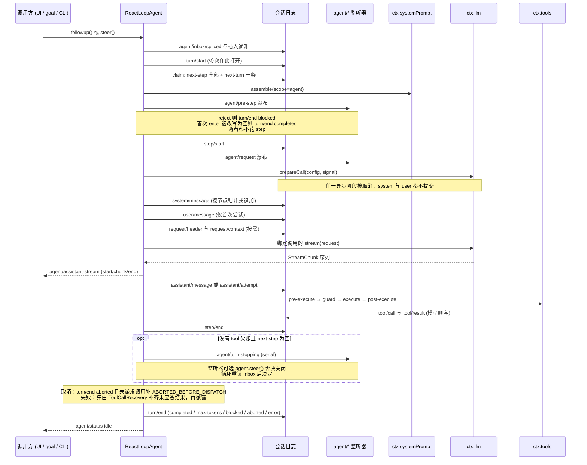
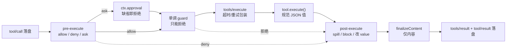
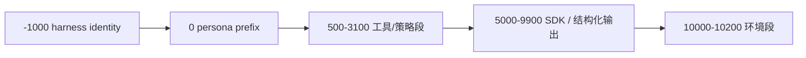

# Agent 循环、工具管道与系统提示词

> dsh 的 driver 只做四件事：从 queue 里领取输入、把"模型能看见的一切"写进会话日志、把日志投影成一次请求、把结果再写回去——所有可替换的策略都挂在这四个动作之间的事件上。

DeepSeek Harness 把「agent loop」本身也做成了一个可卸载的插件（`dsh-agent-loop`）。这不是象征性的抽象：`packages/core/agent` 只声明 `Agent` 接口与 `agent/*` 事件词汇，而具体循环是 `AgentFactory` 的一个实现，Cartesian 产品里的其它循环（测试替身、SDK 宿主自定义 driver）与它地位相同。因此本文关心的不是"循环怎么写得漂亮"，而是它把哪些职责留给了事件，把哪些必须自己扛。

去掉这个包，`ctx.agents.create()` 无处可去，Web UI 的 status、goal 的续跑轮次、subagent 的子会话全部悬空——系统不会"退化"，而是启动即 `NO_ADAPTER` 级别的缺失。反过来，正因为它是插件，它不能把策略内嵌：pre-step、请求、错误恢复、轮次停止全部是 waterfall，`agent/*` 是唯一合法的拦截面。

## 主循环：turn 与 step 是两种不同的"一次"

文档里的一句话定义了整套双层语义：**step 是一次模型请求加它请求的工具；turn 包含零个或多个 step，在领取第一条输入之前打开，在不再欠任何工作时关闭**。这两层的差别不是嵌套命名，而是**欠账的主体不同**：

- step 级的欠账是"模型刚刚提出了工具调用，结果还没落账"——`toolCalls.length > 0` 就继续，`concluded` 就直接收工；
- turn 级的欠账是"inbox 里还有下一条要进入模型的消息"——`next-step` 或 `next-turn` 非空就再开一个 step。

落成代码是非常朴素的三个退出条件。第一步除了 `step()` 的返回值之外，还看 inbox：

```ts
signal.throwIfAborted()
if (turnEnds && this.inbox.nextStep.length === 0) {
  await this.dispatch.serial('agent/turn-stopping', { turn, signal })
  signal.throwIfAborted()
}
if (turnEnds && this.inbox.nextStep.length === 0) break
target = 'next-step'
```

[packages/core/agent-loop/src/agent.ts:361-366]()

<!-- anchor: if (turnEnds && this.inbox.nextStep.length === 0) { … target = 'next-step' -->

注意它在 `step()` 返回非空（表示"本 step 没有欠模型的工作"）**之后**才触发 `agent/turn-stopping`，并且**触发之后重新读 inbox**。这是全套设计里最关键的时序选择：`turn-stopping` 不是"关轮次通知"，而是"关轮次前最后一次可以否决的机会"——监听者通过 `agent.steer()` 往 inbox 塞数据，循环重读后发现有新输入就继续跑 step。dsh 刻意让否决权**表现为数据而不是返回值**：

> Data decides, so listener order cannot change the outcome. The inverse control (stop a tool loop early) is data too: a tool result carrying `concludesTurn` ends the turn at its step.

[packages/core/agent/src/runtime-types.ts:365-373]()

<!-- anchor: * The turn is about to close: the model owes no response (no live tool … * `additionalContexts` or racing steering still runs, and the turn -->

这条规则的收益是可组合性：三个插件都想延长轮次时，不需要协商优先级，谁塞的 steering 都算数；代价是**监听器不能"取消"另一个监听器的延长**，也只能在轮次将闭的那一刻施加影响。而"提前结束"用同构的另一半实现——工具在自己的执行对象上调用 `concludeTurn()`，这个标记搭着权威结果 `concludesTurn` 回到 driver，`step()` 直接返回 `{ kind: 'completed' }`。两点同构（用数据说"多跑一步"、用数据说"少跑一步"）让 turn 的边界完全由日志内容与 inbox 内容决定，不看任何 hook 的返回类型。

一个容易忽略的状态是 `max-tokens` 的**粘性**：一旦某步撞到输出上限，后续正常完成的 step 不得把轮次结局降级为 `completed`。这对上层是语义问题而非统计问题——压缩策略与用户提示都要知道"这一轮是被截断的"。

```ts
// max-tokens is sticky: once any step hits the ceiling, later steps
// that complete normally must not downgrade the turn outcome.
const stepEnd = await this.step(decision)
```

[packages/core/agent-loop/src/agent.ts:340]()

<!-- anchor:           const stepEnd = await this.step(decision) -->

`turn/end` 的写入在 `finally` 里，且**必须有原因**（`turnEnds!`）：成功、`max-tokens`、`blocked`、`aborted`、`error` 五选一。这让"打开过的轮次一定关闭"成为日志不变量，而不是调用方的义务。

## 事件域的切分：durable、live、以及两者之间那条线

dsh 把事件分成三域：**会话事件**（`turn/*`、`step/*`、`system/message`、`user/message`、`assistant/message`、`assistant/attempt`、`tool/*`，追加进日志、可重放）、**agent 事件**（`agent/*`，携带活跃 `Agent`，用于观察与拦截进行中的工作）、**能力事件**（`tools/*`、`fs/*`、`llm/stream`，seam 的挂点）。为什么要拆这么细，而不是像多数框架那样搞一个 `onStep` 回调数组？

因为**两类消费者对"事实"的定义不同**。UI 与恢复逻辑要的是"模型看到了什么"，这个必须能被日志重建（Model-visible means logged）；而 hook、审批、goal、subagent 协调需要的是"现在在做什么、能不能拦"，这类信息天然是进程内、易变、无法重放的。混在一个事件流里会出现两种坏设计：要么把 hook 的临时状态写进日志（污染真源），要么让 UI 从 hook 回调里拼历史（重放失真）。

分界线画在 `assistant-stream` 上最清楚。流式 chunk 是典型的"实时"，但 dsh 规定：**每个 chunk 只有在对应的持久结算发生后，才通过 `agent/assistant-stream` 发出；且在 `end` 帧之前，完整紧凑流已经作为一个 `assistant/message` 或 `assistant/attempt` 落盘**。于是 live 事件永远是持久事实的"回放缓存"，进程在结算前硬崩，什么也没留下——而不是留下半截可重放的历史。`assistant/attempt` 的存在则解决另一半：失败、重试、取消的尝试也必须有序号与流证据，却不进入模型历史（`deriveMessages()` 会跳过它）。

这条规则对插件作者有直接后果：**想"注入模型可见内容"不能靠改 live 流**。`agent/request` 的文档写死了这一点——"Model-visible content must use logged channels; this waterfall cannot mutate messages"，它能换的只有冻结的调用配置。

[packages/core/agent/src/runtime-types.ts:322-329]()

<!-- anchor: * Replace the frozen call configuration. `await next()` yields the config … * this waterfall cannot mutate messages. -->

### pre-step 的 enter / reject 与"不花 step 的轮次"

`agent/pre-step` 是请求推导前唯一的 waterfall。它拿到的不是"用户说的话"，而是**已经从 inbox 领取（claim）出来的整批消息**——也就是说，监听者看到的 `messages` 已经离开队列。决定只有两种：`reject` 或 `enter(messages, startsRequestSeries?)`。领了就不可撤销这一点，配合下面两个分支构成了一个反直觉但必要的语义：

- `reject`：轮次以 `blocked` 关闭，**不花任何 step**；
- 首次 `enter` 但消息被改写成空：轮次以 `completed` 关闭，同样不花 step。

```ts
if (phase.step === 0 && decision.messages.length === 0) {
  turnEnds = { kind: 'completed' }
  return false
}
```

[packages/core/agent-loop/src/agent.ts:326]()

<!-- anchor: if (phase.step === 0 && decision.messages.length === 0) { -->

为什么值得为"空批次"写一条专门分支？因为预算策略、goal 轮次驱动、去重过滤器都会吃掉消息。如果没有这条，一次被吃掉的唤醒会变成"用空 prompt 请求一次模型"，既花钱又可能让模型在没有指令的情况下自由发挥。代价是轮次开始与模型调用之间出现了非一一对应：日志里会存在**没有 `step/start` 的 `turn/start…turn/end`**，任何"turn 必有 step"的直觉假设都不成立，消费方必须按事件而不是按计数遍历。

`startsRequestSeries` 则是 enter 决策上的"可选声明"。它不是"我要开新请求"，而是"**复用旧 header 的假设对我这一批不成立**"：包装监听器必须原样透传（`{ ...decision, messages }`），否则下游的声明会被静默丢失。

## 一次请求的组装：为什么拆成两阶段

先把整条时间线画出来，后面每一节都是在解释图上某个 Note 为什么存在。




单次请求要确定的两个东西——**往日志里写什么**、**往网络上发什么**——在 dsh 里被彻底切开。

阶段一（`prepareRequest`）：`agent/request` waterfall 拿到"上次记录的 header 配置"或"agent options"，返回一个 `LlmCallConfig`；交给 `ctx.llm.prepareCall()` 解析路由、校验适配器自有字段、物化 reasoning-effort / max-tokens 的默认值。此刻 `preparedCall` 是唯一的"能力凭据"：它声明的 `contextWindow`、`systemPromptUpdate`、`toolUpdate`、`retryPolicy` 决定后续一切分支。

阶段二（`step()` 主体）：`refreshContext` 刷新运行时事实（不重新组装 section / tool）、`SystemPromptProjection.project()` 决定系统节点怎么改、首次尝试提交 `user/message`、按需写 `request/header` 与 `request/context`、`deriveMessages()` 派生并冻结请求、最后才 `preparedCall.stream(request)`。

拆开的收益直接体现在取消语义上：`step/start` 之后、`agent/request` 之前，**待提交的系统提示词与已接纳的用户消息都不在历史里**；在 `agent/request` 或 `prepareCall()` 任一异步阶段取消，两者都不提交。换句话说，取消的提交点是"恰好晚于所有异步解析"。

再看重试。`agent/request-error` 返回 `retry` 时，循环回到 `while (true)` 顶部**而不是回到 turn**：

```ts
while (true) {
  const { config, preparedCall } = await this.prepareRequest(turn, step, signal)
  const currentContext = this.loopCtx.systemPrompt.refreshContext(assembly, assembleContextFor(this, signal))
```

[packages/core/agent-loop/src/agent.ts:409-409]()

<!-- anchor: while (true) { -->

`assembly` 来自 `decision`，而 `decision` 只由 `preStep()` 产出。所以重试**复用同一份已渲染组装**：不重跑 `agent/pre-step`、不重新组装提示词和工具、不重复接纳用户消息。唯一重来的部分是路由解析（因为错误恢复策略可能换模型）。这条设计对压缩子系统是关键支撑：`compaction-basic` 在 `pre-step` 阶段处理压力、在 `agent/request-error` 阶段只处理规范的上下文溢出，而"替换语料并重试"必须发生在同一个 step 内，否则日志里会出现两次用户消息、一次真实、一次幻影。

但要注意一个实现层面的偏差：代码里每次尝试都调用 `refreshContext(...)`，所以在当前基线上，重试**会重新求值 runtime-context provider 的文本**（不重新组装 sections 与 tools）。这通常是良性的（cwd、沙箱模式本来就可能变），但它意味着"重试完全冻结"只对 section 与 tool 成立，对 runtime context 不成立——文档口径比实现略强。

### `request/header`：一次请求的"信封"与它的四种理由

header 里只有 `config`、`adapterDefaults`、`tools` 三样，**没有 system**。这是 v3 之后的刻意设计（下一节展开）。写入逻辑按优先级四选一：

| 条件 | 写入 | reason |
|---|---|---|
| 本实例从未写过 | 写全量 | `initial` / `resume`（+ `startsSeries`） |
| 与最新 header 不等 | 写全量 | `change`（+ `startsSeries`） |
| 需要开新序列但 header 相同 | 写全量 | `series` |
| 都不是（后续 step、重试、同序列的普通后续轮次） | 不写 | 继承 |

先读一遍 `requestHeader()` 是对的：header 从不"增量合并"，每条都是完整快照，后一条遮蔽前一条。这套设计让"重放时这次请求用的什么工具"可以 O(1) 找到锚点，而不必回放所有注册/注销事件。

工具集合变化还会额外产出一条模型可见的 `developer/message`：added / removed 的名字列表。**它不依赖模型能力**——`toolUpdate` 只影响 declaration 是否要重写，而"有个工具没了"这个事实必须让模型知道，否则它会继续调用一个已经从 schema 里消失的工具。

[packages/core/agent-loop/src/agent.ts:652-658]()

<!-- anchor: if (baseline !== undefined && headerSeq !== undefined) { … .map(tool => ({ type: 'tool-removal' as const, toolName: tool.name })) -->

### 每次 attempt 的"提交四件套"，以及内联带来的代价

把每个 attempt 都会做（但只在需要时才写事件）的动作排一下，会发现三条提交铁律：

| 动作 | 是否每次 attempt 都执行 | 是否每次 attempt 都写日志 |
|---|---|---|
| `refreshContext` 重求值运行时事实 | 是 | 否——值没变就不提交 |
| `systemPrompt.project` 归并/追加 system 节点 | 是 | 否——文本相同则无事发生 |
| `user/message` 批量接纳 | 仅首次尝试 | 是（首批） |
| `request/header` / `request/context` | 是 | 否——信封/路由没变就继承 |

这套"执行但按需提交"的模式让日志的可读性接近手写 transcript：一次十步的工具轮次不会产生十份重复的 header。代价是全套逻辑变得**高度依赖"与上一次比"的局部状态**：`requestHeaderLogged`、`requestSurfaceGeneration`、`RuntimeContextProjection.retained`、`SystemPromptProjection` 每次重扫 surface。这些状态在恢复时必须能从日志重建（前三者确实都从事件回填），任何新插件的作者都得回答"我的状态在 resume 后怎么重建"，而框架没有强约束。

## inbox：durable 队列与"等一条唤醒消息"的注入

inbox 有两个待处理的列表：`next-turn`（各自独占一个轮次）与 `next-step`（在最近一个 step 边界被领取）。关键在于它**不是内存队列**：每次变更都提交一条归一化的 `agent/inbox/spliced`，由一个标准 projection 折叠回状态。
```ts
apply(state: InboxState, event) {
  if (event.type !== 'agent/inbox/spliced') return state
  const splice = event.data
  try {
    const inbox = state[splice.target]
    const removedCount = splice.removedCount ?? 0
```

[packages/core/agent-loop/src/inbox.ts:31-36]()

<!-- anchor: apply(state: InboxState, event) { … const removedCount = splice.removedCount ?? 0 -->


为什么队列也要落盘？因为"用户发了一条消息，但进程重启了"是真实场景，而如果队列只在内存里，重启后那条消息就消失了、`turn/start` 却没有对应的输入。把 splice 归一化落盘还有两个副产品：

1. **删除语义统一**。插入、编辑、删除、领取、取消全部用同一套 `start / removedCount / inserted` 坐标表达，回放只需一个 `apply`；
2. **两类删除有不同语义**。领取用"纯删除"（无 outcome）并发 `agent/inbox/claimed`；用户侧移除带 `outcome: 'canceled'` 并发 `agent/inbox/discarded`。需要在删除后拿到那条消息的消费方必须订阅这两个通知，而不能去对比 splice 前后的 `session/event` 快照。

```ts
const outcome = discardRemoved && actualDeleteCount > 0 ? 'canceled' as const : undefined
const splice: SessionEventMap['agent/inbox/spliced'] = {
  target,
```

[packages/core/agent-loop/src/inbox.ts:226]()

<!-- anchor:     const outcome = discardRemoved && actualDeleteCount > 0 ? 'canceled' as const : undefined -->

`claim` 的语义值得细看：它总是先领 `next-step` 的全部，再在 turn 边界额外领**恰好一条** `next-turn`。所以"一个 turn 只对应一条用户提示"不是礼貌约定，而是 claim 的算术结果；同时队列里的 steering 会与该提示拼成同一批，一起进入 `agent/pre-step`。

### `inject()` 为什么要设计成"不唤醒"

三个投递 API 只差两个布尔量：目标是 `next-turn`/`next-step`、是否唤醒。

| API | 目标 | 唤醒 | 典型使用者 |
|---|---|---|---|
| `followup()` | `next-turn` | 是 | 用户提示、goal 续跑轮次、headless 一次性任务 |
| `steer()` | `next-step` | 是 | UI 的"边跑边改"、`turn-stopping` 里的否决 |
| `inject()` | `next-step` | 否 | 工作目录变更、计划模式旁白、审批结果、file-change 通知 |

[packages/core/agent/src/runtime-types.ts:234-239]()

<!-- anchor:    * Queue model-facing context for the next pre-step without waking the …    * @param message - identified injected context and the source that supplied it. -->

`inject()` 的文档写得很坦白："**It may miss a request whose pre-step already claimed its batch**"。这不是缺陷，而是它存在的理由：注入的上下文是**补充说明**，不是工作项。如果它也能唤醒，那么"每 30 秒检测一次文件变更"会变成"每 30 秒起一个新轮次"，把成本模型彻底破坏。反过来，`steer()` 能唤醒是因为它承载的是人的意图，人的意图必须被响应。

唤醒本身也有一处精细处理：`send()` 在插入之前就把"这次唤醒是否落在已被 abort 的活动之后"算出来，避免 splice 观察者里的重入 cancel 改变分类；落在 abort 之后的唤醒一律降级为 `next-turn`（aborted 活动不能容纳新输入）。`wakeDriver()` 在非 idle 阶段只把唤醒**闩存**（`wakeRequested`），在收敛点重放；`disposed` 原因不闩存，所以销毁不会等一个模型轮次。

[packages/core/agent-loop/src/agent.ts:214-215]()

<!-- anchor: private wakeDriver(wakeAfterAbort = false): void { … if (this.phase.kind !== 'idle') { -->

### interrupt / cancel / cancelAll：一个不存在的 API 与两个真实的回收

先说清一个事实：**当前基线上没有 `cancelAll`（也没有 `cancelAllAgents`）**。这个动词在旧版本/外围脚本里出现过，v0.2.1-rc.3 的仓库里检索不到任何实现或文档残留。要停一批 agent，正确做法是遍历 `ctx.agents.list()` 逐个 `cancel({ kind: 'user' })`，或者卸载持有者 fiber（teardown 内部就是一次 `disposed` 原因的 cancel + `whenIdle()`）。

"interrupt" 同理没有独立入口，它映射到 `cancel()`。`cancel()` 的全部逻辑只有七行：

```ts
cancel(cause: AgentCancelCause, options: CancelOptions = {}): void {
  if (!options.keepInbox) {
    this.inbox.clear()
    if (this.phase.kind !== 'idle') this.phase.wakeRequested = false
```

[packages/core/agent-loop/src/agent.ts:175]()

<!-- anchor:   cancel(cause: AgentCancelCause, options: CancelOptions = {}): void { -->

回收有两条路径，取决于取消发生在哪个窗口：

- **轮次内**：`turn()` 的 `catch` 看到 `abortedCancelCause(signal)` 非空，把 `turnEnds` 定为 `{ kind: 'aborted', reason }`，然后仍然走 `finally` 写 `turn/end`。所以取消不会留下悬空轮次。
- **未派发的工具调用**：一旦 scheduler 观察到 abort，它会给每个尚未开始的调用补一对合成 `tool/call` + `tool/result`（错误码 `ABORTED_BEFORE_DISPATCH`），让历史的 call/result 配对保持完整。

```ts
if (outcome.aborted) {
  for (const call of planned.slice(next)) appendSkippedToolCall(session, turn, step, call.block)
  return { concluded }
}
```

[packages/core/agent-loop/src/tool-calls.ts:96]()

<!-- anchor:     if (outcome.aborted) { -->

取消原因本身也被"净化"过一次：live 的 `signal.reason` 是调用方的对象，Node 的 fetch 会往上挂 `stack`；`turn/end` 不能把这种不可 JSON 化的东西写进日志，所以只复制 `kind` 与 `reason` 文本。这类"live 对象 → 可持久化摘要"的转换在 dsh 里反复出现，是 live/durable 分域的直接成本。

## 工具管道：注册表只提供事实，把关全靠挂载

`ctx.tools` 是 scoped 注册表：全局注册对所有 agent 可见，通过 `agent.ctx.tools.register()` 注册的只属于该 agent，并且遮蔽同名全局。`restrict()` 是"反向"的作用域操作——它只能加在 agent scope 上，只过滤**继承来的**工具（全局 + 祖先层），永远不影响本层自己的注册。这条豁免不是漏洞：subagent 运行时会往子层注册结构化输出工具，如果限制也能裁掉自己的注册，子 agent 就会失去它用来作答的通道。

注册时唯一的硬性要求是声明 `output { schema, render }`：`execute` 只返回规范 JSON 值，模型看到的是 `render(value)` 的投影。这个"值 vs 渲染"的二分让策略可以安全地看结果（校验 schema、算 token）而不必猜文本格式，也让 PTC 程序拿到完整值、模型拿到裁剪文本成为可能。

### 三处扩展点、一个单调层

| 阶段 | 类型 | 决策 | 谁在用 |
|---|---|---|---|
| `tools/pre-execute` | waterfall（可重排） | `allow` / `deny` / `ask` / `cancel` | 各工具自己的参数级前置检查（如 bash 的沙箱提权分支）、Claude Code / Codex 兼容 hook |
| `ctx.tools.guard()` | 单调同步层 | 返回字符串即拒绝，`undefined` 弃权（无 allow） | 结构化输出的"已捕获"终止守卫 |
| `ctx.approval` 一次性请求 | seam 调用 | `allowed-once` / `rejected` / `cancelled` / `unavailable` | 人类或机器应答者 |
| `tools/execute` | waterfall（环绕） | 可换 signal，可换结果 | 超时、重试、指标 |
| `tools/post-execute` | waterfall | `accept`（可换 content/value）/ `block`（带纠正反馈） | spill 裁剪、结果策略 |
| `finalizeContent` | 工具自有、同步、仅 content | 返回替换或 `undefined` | 工具自己的末次内容不变式 |
| `tools/result` | emit（只观察） | 无 | 审计、UI 桥 |

该表读起来像"什么都可插"，但真正的约束在类型里。`ToolDefinition` 要求**每个工具都声明 `output`**，而 `execute` 只能返回规范 JSON 值：

```ts
export interface ToolDefinition extends ToolSchema {
  /** Mandatory canonical output declaration. */
  readonly output: ToolOutputDefinition
```

[packages/core/tools/src/index.ts:224-226]()

<!-- anchor: export interface ToolDefinition extends ToolSchema { … readonly output: ToolOutputDefinition -->

这一条把"值"与"渲染"钉成两个不同的东西：注册表拿到的是可校验、可深冻结、可交给 PTC 程序的规范值；模型拿到的是 `output.render(args, value)` 产出的 `ContentBlock[]`。于是校验（schema）、裁剪（spill）、替换（`tools/post-execute` 的 value 分支）可以各自在正确的层面上工作，而不会互相踩。

作者侧的写法是同一套 schema DSL 描述输入与输出，`InferValue<S>` 在 16 层容器内保留精确类型、之后退化为 `JsonValue`；运行时则把 DSL 编译成受强制的 JSON Schema 子集。不合规的 schema 在注册时就被拒绝，参数不匹配抛 `ToolArgsError`（`INVALID_ARGS`），函数体返回值的类型不符抛 `ToolOutputError`（`INVALID_TOOL_OUTPUT`），两者都走普通工具错误路径——**不会让一次坏调用结束整个轮次**，这与前面"拒绝不短路"是同一条原则的另一面。



图中的虚线与实线之别就是这套管道的核心约定：**拒绝不是短路**。被 deny、被 ask 拒批、被 guard 拦下、甚至参数非法，结果都会继续流经 `post-execute` 与 `finalizeContent`，因为只有到那里才能被统一物化为模型可读的错误结果（`isError: true`）。如果 deny 直接抛异常，模型看到的将是管道崩溃而不是"这个工具被策略禁止了"，它就无法纠正自己的行为。

`prepareExecution` 是这段逻辑的浓缩：

```ts
const gate = await this.ctx.waterfall(
  carrier, 'tools/pre-execute', exec,
  () => Promise.resolve<PreToolDecision>({ kind: 'allow' }),
)
const askResolution = gate.kind === 'ask'
  ? await this.serviceAsk(exec, gate)
  : { decision: gate, approvalCancelled: false }
```

[packages/core/tools/src/index.ts:1513-1513]()

<!-- anchor: const gate = await this.ctx.waterfall( -->

注意 `guard` 只在前面的 waterfall 返回 `allow` 时才求值（`decision.kind === 'allow' ? this.guardReason(exec) : decision.reason`）。这个顺序是有意的：guard 的契约是"**单调**"——它可以收缩权限，但永远不能把 listener 的 deny 翻回 allow。若允许 guard 先跑，一个写错的 guard 返回 `undefined` 就可能被后来的 listener 解读为"没人反对"，于是"最终否决权"取决于谁排在后面。

### 三段把关各自防的事故，以及去掉之后

这里必须用 dsh 自己的实现回答，而不是泛泛的"安全"。

**第一段 guard（单调、不可撤销）防的是"同一轮内已结束的语义被继续践踏"。** 最实在的例子在 subagent 的结构化输出：子 agent 一旦提交了结构化结果，同一条 assistant 消息里排在它后面的工具调用就不该再执行——它们是在结果产生之前"计划的"，执行它们等于让一次已完成的任务产生额外副作用。

```ts
childCtx.tools.guard(exec => captured === undefined && pending === undefined
  ? undefined
  : `structured output already recorded: the run is complete, so \`${exec.name}\` is not executed`)
```

[packages/subagent/subagent/src/structured.ts:115-119]()

<!-- anchor: // Terminal WITHIN the step. Guards run after the whole pre-execute … childCtx.tools.guard(exec => captured === undefined && pending === undefined -->

注释直接写出了为什么必须是 guard 而不是 listener：「Guards run after the whole pre-execute waterfall and compose monotonically (deny or abstain, never allow), so a later prepended listener cannot resurrect dispatch」。**去掉 guard**：该约束只能写在某个 listener 里，而任何后来者（包括用户配置的 hook）都能把它翻回放行——安全边界依赖加载顺序。

**第二段 approval 防的是"无人值守下扩大副作用半径"。** 关键不在"弹窗问人"，而在**三态失败闭合**：没有 `ctx.approval`、调用没有 agent、应答者不可用，三种情况都是 deny 而不是 allow；`policy: 'never'` 则在进入任何交互前确定性拒绝。审批绑定的粒度是一次请求（`allowed-once`），授权不会延续到下一次调用。**去掉 approval**：`ask` 决策只能退化为 allow（"没人能问就算了吧"）或直接抛错；前者等于策略静默失效，后者让模型看到的是基础设施故障而不是"人被问了、说不行"——它无法通过换一种做法来继续。

**第三段 spill 防的是"结果把上下文窗口吃掉"。** 它挂在 `post-execute`，位于**接受之后**，这样它只处理"将被模型看到"的内容，不会与 block/替换决策竞争；它的失败策略是"记录 warning、保留原内容"，因为丢结果比爆上下文更糟。文本与图片共享一个估计预算，超出部分保留头尾 + 一个可 `read`/`grep` 的落盘路径。**去掉 spill**：单个 `bash` 命令或 `grep` 的输出就能吃掉整步的窗口，且在 agent 自主运行场景下没有任何人有机会中断它。

值得强调的是 `pre-execute → guard → ask` 的箭头的真实含义：**人工批准落在单调否决之前**——`ask` 是在 pre-execute 内部被解析成 `allow`/`deny` 之后，才去求 `guardReason` 的。所以"人批了，但 owner 的 guard 仍然拒绝"成立；而"guard 拒了，仍然有人被叫去批准"不成立（顺序正好避免了这种无意义的打扰）。如果把这个顺序倒过来（先问人再跑 guard），人批的就在 guard 之前生效——人工批准会覆盖程序策略，这恰恰是很多系统的真实漏洞。

### 结果如何写回日志，以及"补齐"

scheduler 的分工从接口就能看出：`prepare`（有序 pre + guard）、`dispatch`（并发环绕 + body）、`finalize`（post + 内容收尾）、`finish`（跳过 post 的收尾）。driver 只负责"什么时候调哪一段"，具体见下面的滚动池。

[packages/core/agent-loop/src/tool-calls.ts:199-209]()

<!-- anchor: const fillPool = async (): Promise<void> => { … await commitReady() -->

并发模型有三层约束叠加：`isConcurrencySafe` 只认精确的 `true`（抛出、未声明、无效一律按 exclusive），`maxParallelToolCalls` 限制在飞数量，而**结果是按模型顺序提交的**——`commitReady` 只跳过连续的、已就绪的槽位。于是"并发执行、串行记账"成立：策略、`additionalContexts` 的 FIFO、持久事件的顺序都与模型给出的顺序一致。中途重新分类是另一个细节：池在启动每个调用前重新问一次 `executionMode`，所以前一个调用的 `post-execute` 若注销了某个工具，后面的调用会立刻变成屏障。

写回日志是两段式：`tool/call` 先落盘并拿到 `seq`，`tool/result` 再以 `sourceEventSeqs: [callSeq]` 引用它。

```ts
const event = session.append('tool/call', { turn, step, callId: block.id, name: block.name, arguments: block.arguments })
return event.seq
```

[packages/core/agent-loop/src/tool-calls.ts:263-265]()

<!-- anchor: function appendToolCall(session: Session, turn: number, step: number, block: Too … return event.seq -->

`tool/call` 保存的是**模型原样产出的 JSON 字符串**（`ToolCallBlock.arguments` 是 `string`），解析发生在 driver 侧（坏 JSON 就原样保留成字符串交给工具），持久层不做解释。这样"模型发了一坨非法 JSON"本身也是可重放的事实。

"补齐"有两个不同的事故源，机制也不同：

| 事故 | 补齐方式 | 错误码 |
|---|---|---|
| 取消发生在调用派发前 | scheduler 补合成 call+result 对 | `ABORTED_BEFORE_DISPATCH` |
| step 失败，调用尚未结算 | `ToolCallRecovery` 在 `step/end` 前补结果 | `TOOL_OUTCOME_UNKNOWN` / `TOOL_NOT_STARTED` |
| 进程崩溃 / fork 在开放轮次内 | `interruptedTurnClosers` 生成闭合事件 | 同上 |

第三行的机制值得单独看：driver 在每个 step 内订阅 `session/event` 喂给 `ToolCallRecovery`，`catch` 里一次性追加所有未应答调用的结果，然后才 `throw`。若补齐本身失败，抛 `AggregateError`——原始失败与补齐失败都要保留。

```ts
try {
  for (const event of toolRecovery.results()) {
    this.session.append('tool/result', event.data, {
      surfaceOp: 'append',
```

[packages/core/agent-loop/src/agent.ts:348-348]()

<!-- anchor: surfaceOp: 'append', -->

为什么必须补？因为几乎每个模型 provider 都要求 assistant 的 tool call 后面紧跟一个 tool result，缺失会直接 400。所以"补齐"不是数据洁癖，而是**可继续对话的前提**；而两条错误文案的差别（"结果未知，只在只读或幂等时才重试"vs"还没记录为开始，需要就重试"）是被刻意区分的安全指令：对未知副作用的操作做盲目重试是 agent 最危险的行为之一。

[packages/core/session/src/repair.ts:25-31]()

<!-- anchor: * deterministic synthetic message-id prefix. The error codes … /** Model-visible wording of the synthetic error tool results, keyed by cause. * -->

这里的**已知不一致**值得点名：scheduler 的本地合成结果（`appendSkippedToolCall`）、`ToolCallRecovery` 的实时补齐、`interruptedTurnClosers` 的崩溃修复各写一份文案。三套并存让"取消后模型看到的话"与"崩溃后模型看到的话"必然不同；它们语义相近但不共享单一来源。

## 系统提示词：从"请求字段"到"surface node 0"

这是 v2→v3 最重要的语义迁移，也是本关注面里"旧问题—新方案—代价"链条最完整的一处。

### 旧问题不止一个

在 `system/message` 成为 surface 事件之前，提示词住在 `request/header` 的 `system` 字段里。文档记录的代价是对称的四重分裂：

1. **一个模型可见事实有两个家**：消息由 surface 折叠，而"消息前面那句话"由 header 拥有。所有"模型看到了什么"的读者都得 join 两个来源。
2. **变更检测分不清对象**：`headerEquals` 逐字节比较 `system`，于是"提示词变了"与"工具变了"在日志里都是 `reason: 'change'`，尽管它们是对话上的不同操作。
3. **做不到会话中途改提示词**：模型若接受对话中间的 system 消息，harness 必须往历史里追加一条 system-role 消息——而 header 里的 prompt 没有 surface 表示可追加。
4. **KV 缓存前缀脆**：任何提示词变化都必须重写"第 0 条"，缓存从第一个 token 起失效。

### 新方案：两种 surface 操作，一条 head 不变量

新模型下，提示词的生命周期操作**只有两种** `SurfaceOp`：首次追加（占据 node 0，即使渲染为空也要占位），或不匹配时原地替换某个现存节点。决策逻辑短到可以整段读完：

```ts
if (!input.inHistory || input.startsSeries || rendered.length === 0) {
  const updates = nodes.slice(1).filter(node => node.text !== '')
    .map(node => this.replace(node.seq, ''))
  if (head.text !== rendered) updates.push(this.replace(head.seq, rendered))
  return updates
}
if (latest.text === rendered) return []
return [{ message: createSystemMessage(rendered), intent: { surfaceOp: 'append' } }]
```

[packages/core/agent-loop/src/runtime-context.ts:89]()

<!-- anchor:     const nodes = this.systemNodes() -->

四种分支各自对应一条产品规则：

| 条件 | 行为 | 为什么 |
|---|---|---|
| 无 system 节点 | 追加（含空渲染） | 为空也必须占 node 0，否则后来的非空提示词只能排在用户消息之后 |
| 路由不支持 in-history，或被迫开新序列，或渲染为空 | 归并：逐节点清空后续非空节点，再按需改写 head | "归并"路径上模型只读第一条 system 消息 |
| 支持 in-history 且序列延续、文本未变 | 不产事件 | 前缀缓存完整保留 |
| 支持 in-history 且序列延续、文本变了 | 在历史之后追加 | 已缓存的前缀不动，更新跟在后面 |

空渲染这一条尤其硬：**它清空所有存活的 system 节点**。没有"软清空"选项，因为软清空就等于旧指令对模型仍然可见——一次错误的空渲染会静默推翻整个提示词体系。head 本身受 surface 层不变量保护（改写 node 0 的替换事件必须恰好是覆盖该节点的 `system/message`），所以压缩范围永远吃不到提示词：

[packages/core/session/src/surface.ts:501-506]()

<!-- anchor: if (startIdx !== 0) return -->
代价也很明确：**一条 system 节点永远占着 surface 长度预算**，压缩只能从第二个节点开始。

`startsSeries` 的来源有四个，全部是"复用上次 header 的假设已不成立"的证据：`agent/pre-step` 声明、`surface.contentGeneration` 自上次请求以来变了（替换或图片省略决策）、路由无 `toolUpdate` 且工具集合变了、恢复后的首个 pre-step 发生过替换。这里 `contentGeneration` 而非 `replaceGeneration` 是刻意的——插件拥有的消息投影改变内容也算。

```ts
const startsSeries = startsRequestSeries
  || this.requestSurfaceGeneration !== surfaceGeneration
```

[packages/core/agent-loop/src/agent.ts:632-633]()

<!-- anchor: const startsSeries = startsRequestSeries … || this.requestSurfaceGeneration !== surfaceGeneration -->

### 能力路由：增量还是归并，由 provider 决定

`SystemPromptUpdate = 'in-history'` 是适配器对"我的模型会不会读对话中间那条 system 消息"的**声明**，不是通用开关。声明了，就被允许走"追加"分支保住缓存前缀；没声明，就必须归并到头部。

[packages/llm/llm/src/types.ts:414-414]()

<!-- anchor: export type SystemPromptUpdate = 'in-history' -->

这条设计把"缓存友好"变成了**逐路由的能力协商**，而不是全局优化：同一个提示词变更，在 A 模型上是"追加一条小消息"，在 B 模型上是"重写第 0 条、整段前缀作废"。这也是为什么 `request/context` 要把 `systemPromptUpdate` 落盘——事后分析一次请求为什么贵，必须知道当时是按哪种策略提交的。

`refreshContext` 则是"每次 attempt 刷新但不重组装"的落点：它只重求值已注册的 context provider 文本、应用当前的抑制状态、把缺失的 required 条目按 order 补回，sections / tools / variables 一律沿用已接受的组装。

[packages/core/system-prompt/src/index.ts:582-601]()

<!-- anchor: refreshContext(assembly: PromptAssembly, context: AssembleContext = {}): PromptA … return { ...assembly, contexts } -->

这里的取舍很清楚：**"组装"（可能很贵：跑 provider、排序、waterfall）与"刷新"（便宜且可能每 attempt 变）被分成两个成本层级**，而冻结的只有前者。运行时事实（cwd、沙箱模式、委派策略）天然会变，把它们冻在组装里会让模型收到过期信息；把它们放进 section 则会让每次 attempt 都重写 system 节点、缓存全炸。所以它们只能是"独立的 user-role 快照"——`RuntimeContextProjection` 只在当前快照与保留的不同时才提交，且用一句固定前缀声明"本快照取代此前所有快照"。

### 组装本身：order 与"环境在下游"的布局

`assemble()` 做的事按序是：收集变量 → 合并 scoped section/context（同名 scoped 遮蔽 global）→ 收集工具 schema（深拷贝参数、去掉执行与展示字段）→ 按 order 再按 name 的代码单元序排序 → 组装 waterfall → 若有一个 `complete: true` 段则恢复它作为唯一 section。

```ts
const transformed = await this.ctx.waterfall(
  scopeTarget(this, scope), 'system-prompt/assemble', assembly, context,
  () => Promise.resolve(assembly),
)
```

[packages/core/system-prompt/src/index.ts:677-680]()

<!-- anchor:     const transformed = await this.ctx.waterfall( …     ) -->

`SECTION_ORDERS` 是一张集中的稀疏编号表，本身就是布局决策的文档——下面的分区只是把相邻编号归并后的样子，真实的表逐段精确定位到个位。



- `-1000` 与 `0` 是**稳定前缀**：identity 与部署 persona 组合定了就定了，缓存从第一个 token 起可复用；
- `500–3100` 是按工具分段的指令（bash 1000、read 1100、write 1200…），稀疏编号留出插入空间；
- `10000+` 放**每会话会变的东西**：harness 源码路径、Web surface 地址、部署 persona 后缀。注释直说"Local paths and endpoints follow reusable instructions"——把易变内容推到提示词尾部，让不变前缀尽可能长。

[packages/core/system-prompt/src/index.ts:128-135]()

<!-- anchor:   variables: Record<string, string | undefined> …   TEAM_POLICY: 600, -->

`cwd` 的处置是同一思路的极端版本：它不是 section，而是**独立的 runtime context**（`CONTEXT_ORDERS.WORKING_DIRECTORY = 100`），并且 `{{cwd}}` 变量被明确禁止——"the loop does not register it, so unresolved references fail prompt assembly before any model request"。宁可让错误在组装期炸掉，也不让一次路径变化重写整个 system 前缀。

### 代价清单

把"提示词 = surface node 0"的账单算清楚：

1. **一条永久的 surface 节点**：压缩不能碰它，空渲染只是把它清空而不删除。`system/message` 会出现在每个会话的日志里（SDK 的期望输出也必须包含它）。
2. **每个消费者都要改读法**：compaction、token-meter、Web 的 request-prompt 卡片、快照归一化器的 `{{system}}` 占位、SDK 夹具，全部从"读 header 的 system"改成"折叠 surface"。反过来这也是收益：它们第一次有唯一来源。
3. **system 节点与 header 必须协同**：prompt 变了 → node 0 被替换 → `replaceGeneration` 前进 → `startsSeries` 为真 → 即使 header 没变也要写一条 `reason: 'series'` 的 header。任何直接改 surface 的插件都必须理解这条因果链。
4. **归并路径的缓存代价不动声色**：不支持 in-history 的路由上，一次提示词变化 = 整段前缀失效，而且日志里看起来只是"一次普通替换"。
5. **`complete` 段与 waterfall 的权威性有例外**：`complete` 段会在 waterfall 之后**被恢复**为唯一 section——即监听器可以改 tools/contexts/variables，但不能靠加 section 逃出"完整提示词"的约束。

## 子 agent 的 loop 复用（点到为止）

子 agent 不复制循环：`subagent` 通过 `ctx.agents.create()` 拿到同一个 `ReactLoopAgent`，只换 `AgentOptions`（继承父的 provider/model/reasoningEffort/maxTokens，除非显式覆盖）与 `setup`（往子层注册 scoped 工具、section、guard）。因此"子 agent 是一次新会话上的同构 driver"，而不是另一套执行器——它也拥有自己的 inbox、turn/step 计数、tool 管道与系统提示词节点。细节见多智能体那一篇。

## 亮点与问题

**值得学的三处。**

其一，**用数据而非返回值表达边界决定**（steering 延长轮次、`concludesTurn` 提前收工）。这让多个插件的意图可以叠加而无需优先级协商，也让"谁会改变轮次"在日志里可见。

其二，**把"能力"（preparedCall）作为准入依据**。提示词是否追加、工具是否需要 `developer/message`、重试策略从哪来，全部由已经解析好的路由能力回答，而不是由配置预判。这让新 provider 可以在不改循环的前提下获得更好的缓存行为。

其三，**拒绝不短路**。策略拒绝与管道失败都走 `post-execute → finalizeContent`，最终统一成 `isError` 结果。这是一个非常实际的取舍：模型对"被禁止"与"系统崩了"的纠正策略截然不同，而只有让两者都用同一种形状抵达模型，才能既保住安全边界又不毁掉自愈能力。

**不够好的地方。**

`step()` 每次 attempt 都 `refreshContext`，与文档"重试不重复组装"的强口径存在细微落差（section/tool 确实冻结，runtime context 不冻结）。对 `bash`/`read` 这类工具无感，但一个把昂贵计算放进 context provider 的插件会在重试时被反复调用。

三处补齐工具的文案各自维护，是明显的可收敛点。同理，`prepareRequest` 在 `NO_ADAPTER` 时静默降级为"用未解析配置继续"（为了允许中间件自己服务请求），这条旁路径绕过了全部能力声明——提示词归并、工具更新策略在这一支上退化为默认行为，而日志里看不出差别。

最后是体验层面的：`turn()` 里 `turnEnds!` 的非空断言照顾了 `finally` 的可读性，却也让"每个出口都必须赋结局"从类型系统退回到注释约束。

## 与其他部分的连接

本文只讲到一个 agent 内部的时间线；它写出的 `turn/step/tool/system` 事件如何被 projection 折叠、被压缩改写、被持久化为 v3 generation，是 Session 与压缩两篇的主线——理解了这里的"谁能改 surface、改动如何推进 generation"，那边的迁移与压缩范围才有依据。
