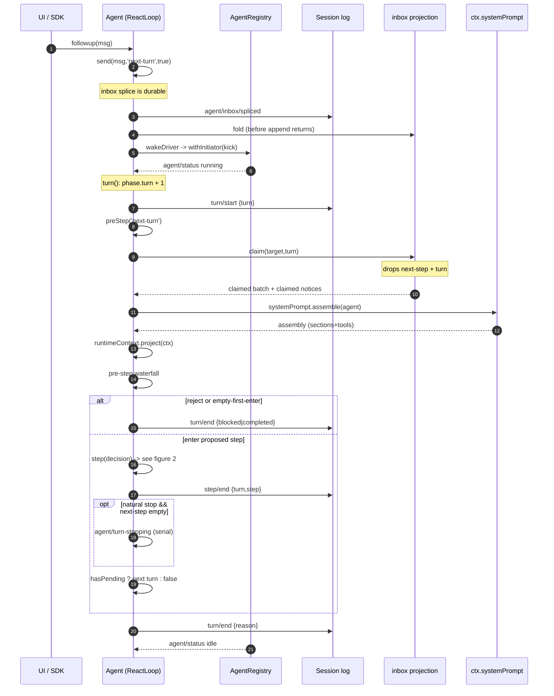
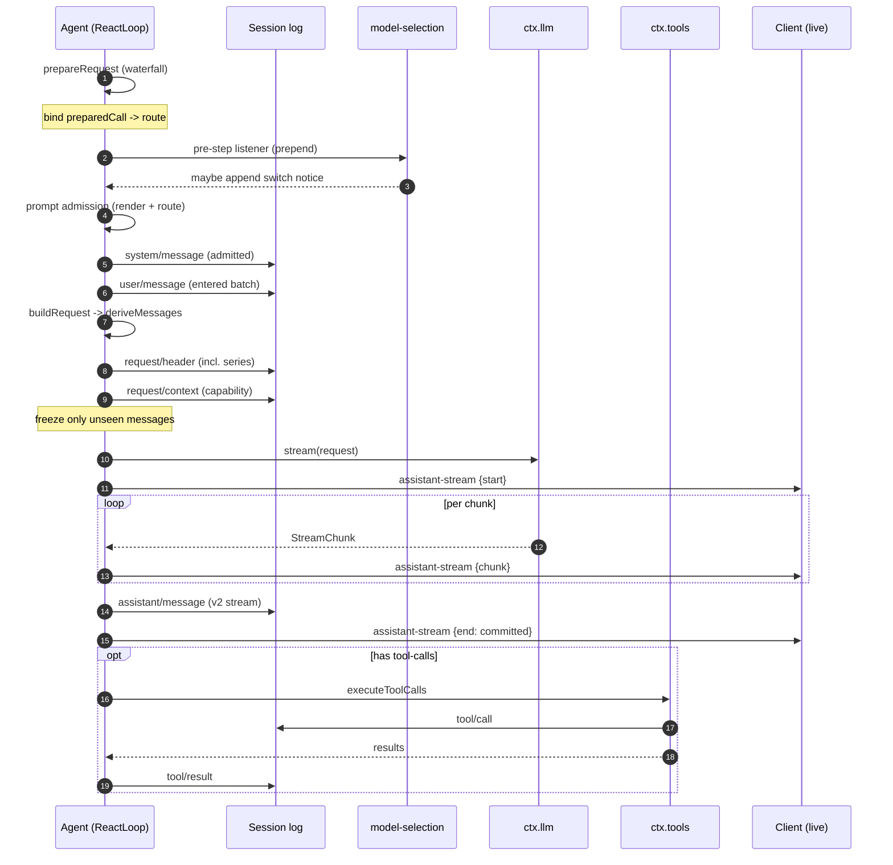

> **本轮增量复核补充（0.1.5-rc.2 → 0.1.7-rc.2 @ 477b4f4205 / 2026-09-24）**：本文已按新基线逐条复核并改写受影响论断（含"谁 append 哪个事件"对照表的 21 条引用由短引用升级为带指纹的规范引用）；上一版解读基线为 `dsh-v0.1.5-rc.2`。

# 主 Agent 循环 + Runtime：turn/step 与 waterfall 拦截

> 子文档之一，聚焦「循环（策略）」与「Runtime（执行引擎）」的分离。覆盖 `packages/core/agent-loop` 与 `packages/core/agent`。整体哲学见 [README](README.md)；本文上承 [session.md](session.md)（从日志 derive 模型历史）、下启 [tools.md](tools.md)（循环驱动的工具执行管道）。

叙事位置：本模块把 session（从日志 derive 历史）当作唯一事实源，把 tools（注册表）当作执行管道，中间靠一组 waterfall 事件让所有插件参与决策——「主循环也是可替换插件」正是 `一切皆插件` 哲学的集中体现。

> **本版增量更新（0.1.2-rc.1 → 0.1.5-rc.2）**：依 `git log --format=%s dsh-v0.1.2-rc.1..HEAD` 中 `agent` / `agent-loop` 作用域的提交与 `verify-references.mjs --diff` 预检清单比对更新。循环侧本周期有四条主线：(1) **实时 assistant 流帧**（0.1.3-alpha.1）——新增 `agent/assistant-stream` 的 start/chunk/end 瞬态帧，与 v2 内嵌持久流明确分工，客户端不再重放已 settled 的流；(2) **模型切换通知**（0.1.3-alpha.2）——路由切换落成一条可回放的 `user/message` notice；(3) **系统提示词变更的准入记账**（0.1.5-alpha.1）——在具备 in-history 能力的路由上追加 `system/message` 以保住前缀缓存，循环侧把提示词、运行时上下文快照、模型切换提示统一当作 admitted input 记账（一串 fix 都是这条规则的补漏）；(4) **inbox 从内存服务改为 durable projection**（0.1.5-alpha.1）——本周期最大的结构改动，inbox 定义随 loop 走、状态从 `agent/inbox/spliced` fold 重建。另有消息冻结的增量证明复用（`WeakSet<Message>`）与运行时身份的显式化（`parentAgent` 进 options）。同会话历史消息编辑曾合入但被完整回滚，本文只记录仍然存活的 pending 队列编辑路径。各版本逐条变更一览见 [CHANGELOG.md](CHANGELOG.md)，会话格式侧（surface node zero / v2 内嵌流 / v3 envelope）见 [session-format-migration.md](session-format-migration.md)。

## 在项目中的角色

`core/agent-loop` 是唯一一个实现了公共 `Agent` 契约的**具体**驱动（driver），`core/agent` 则声明 `Agent` 接口、live 注册表与 `agent/*` 事件词汇。二者的分离正是"策略（loop）与其执行引擎（runtime）"刻意拆分的落点。

若把本模块整体去掉，系统会怎样：

1. **模型请求永远不会被驱动。** `ctx.agents.create()` 只能查到注册工厂为空而抛 `no agent factory registered (load an agent-loop plugin)` [packages/core/agent/src/index.ts:206-209]()。没有任何代码在 `llm/stream` 上消费，turn/step 计数器永不前进。
<!-- anchor: const NO_FACTORY_MESSAGE = 'no agent factory registered (load an agent-loop plugin)' … const DISPOSED_INITIATOR_MESSAGE = 'agent initiator scope is disposed' -->
2. **inbox 连可读的投影都不会存在。** 承载两条 pending 列表（`next-turn` / `next-step`）的 `inbox` 投影定义本就由循环侧贡献：定义写在循环包里，注册则发生在 **agent-loop 插件装配阶段**，而且刻意排在所有配置校验之后，保证构造被拒时不留下投影单元（[packages/core/agent-loop/src/index.ts:362-365]()
<!-- anchor: // Register only after every config validation above has passed, so a … ctx.sessionProjections.register(inboxProjectionDefinition) -->）；`ReactLoopInbox` 自己只持有注册表引用与被折叠出来的 pending 列表（[packages/core/agent-loop/src/inbox.ts:74-76]()
<!-- anchor: export class ReactLoopInbox implements InboxContract { … private readonly projections: SessionProjectionRegistry, -->）。0.1.5 起已从 runtime 完全下移到 loop。没有 agent-loop 时，即便有代码 append `agent/inbox/spliced` 事件，也没有 fold 去物化它，`Agent.inbox` 无从构造，输入永远停在日志里。

3. **任务转向工具。** `tool/*` 事件仍在注册表里，但没有循环驱动它们，工具永远不会被调度执行。

一句话：没有循环的 DeepSeek Harness 是一个"有会话日志、有工具注册表、有模型适配器"但互不咬合的静止集合；循环是那个把它们串成一个可交互产品的唯一胶水。

A `step` = 一次模型请求 + 它所调用的工具；`turn` = 零或多个 step。该定义是 `docs/architecture.md:65` 的权威描述，与 `agent.ts` 的驱动实现严格对应。

<!-- anchor: A **step** is one model request plus the tools it calls. A **turn** is zero or more steps: … closes once nothing is owed. -->
> 注：此为单行区间，锚点取自 `docs/architecture.md:65` 原文（≥80 字符截断后仅保留首行前半，末行同源截断已在省略号处示意）。

---

## 解决什么问题 / 根因

根因是两个相互拉扯的需求：

- **一切皆插件，无特权内核。** 产品哲学是 Cordis 插件树里没有不可替换的内核（`docs/architecture.md:11-13`，谓语句：`There is no privileged core to patch`）。主循环作为产品里最"核心"的逻辑，同样必须是一个可被替换、可被观测的插件。
- **但循环必须唯一、决定性地工作。** 任何一个 session 同一时刻只能有一个 driver 在推进 turn，否则会出现两个线程同时 append `turn/start` 的竞态。

这个矛盾指向一个关键结论：**循环不能由插件各自实现"自己那套"，只能由单个具名插件实现一次，然后把所有可定制点暴露为事件。** 于是出现两个包的分工：

| 包 | 职责 | 可否替换 |
|---|---|---|
| `core/agent`（runtime） | 声明 `Agent` 接口、registry、`agent/*` 事件词汇与 wire 契约、initiator 作用域 | 接口层，可被任何"看似 Agent 的东西"实现 |
| `core/agent-loop`（loop） | `ReactLoopAgent` 具体驱动：turn/step 推进、**durable inbox 投影**、**提示词准入**、**实时流帧**、请求构建、工具调度 | 具体的默认驱动，可被另一 loop 插件整体替换 |

`agent-loop` 作为唯一 factory 通过 `ctx.agents.setFactory()` 注册 [packages/core/agent-loop/src/index.ts:369-370]()，使消费者只依赖 `ctx.agents` 抽象而不依赖具体 loop 包（`packages/core/agent/src/runtime-types.ts` 无 loop 依赖，`packages/core/agent-loop/src/agent.ts:7-18` 从 `dsh-agent` 导入接口）。这是"无特权内核"的直接体现：连内核自己也是被注册进去的。
<!-- anchor: ctx.effect(() => ctx.agents.setFactory(this), 'agentLoop.setFactory()') … ctx.systemPrompt.variable('provider', context => context.agent?.options.provider) -->

核心的观测力量来自**事件是扩展点**（`docs/architecture.md:55`）：循环内部不再直接调用任何能力，而是通过 Cordis 的 `waterfall` / `serial` / `emit` 三种派发打开拦截缝隙。这保证"主循环可替换"和"插件能拦截每一次交互"同时成立。

---

## 设计思路（方案 / 替代方案 / 核心模式）

### turn/step 双层

`architecture.md:65` 定义了双层：`step` = 一次模型请求 + 它调的工具；`turn` = 零或多个 step。为什么需要两层而不是一层？

- **一层（只有 step）无法表达"一次用户输入应归属到哪个结束点"。** 一个 step 的请求 + 工具往往不止一轮（工具结果要回喂模型再请求），如果每个 step 都算"一次交互"，用户无法知道"我这番话到底跑完了没有"。
- **两层给了停止判定一个边界。** `turn/end` 是稳定的"这轮对话结束了"的事实；`step/end` 只是中间态。代理要回答"何时候我该把手交回给用户"，必须在日志里找到一个可判定的停止点。

`ReactLoopAgent` 用 `Phase` 联合体显式建模两层状态（`packages/core/agent-loop/src/agent.ts:41-49`）：`idle` 之外，`running` 阶段同时携带 `turn` 与 `step` 两个计数器。`turn()` 每次 `turn/start` 后嵌套一层 `while(true)` 迭代 step（`agent.ts:269`），直到满足停止条件。

### waterfall 事件链：拦截而非直调

循环把三种决策点全部开放为 **waterfall**（围绕式中间件，listener 必须调 `next()` 委派）：

```yaml
agent/pre-step      消息批进入前拦截/改写/拒绝      agent.ts:240-258
agent/request       冻结请求配置前替换 provider/model agent.ts:530-533
agent/request-error 请求失败后决定重试或终结          agent.ts:448-458
```

同理还有 `llm/stream`（模型流；由 `dsh-llm` 的适配器层触发）与 `tools/*`（`tools/pre-execute`/`execute`/`post-execute`；在 `dsh-tools` 管道触发），以及 `agent/turn-stopping` 这个串行停止检查点（`agent.ts:316`）。

选用 waterfall 而非"直接调用 + 子类重写"的原因在【关键设计决策】中详述，核心是：**零特权内核要求所有可定制点都以数据为媒、以 next() 委派为序**，让若干插件能以无优先级的洋葱顺序各自贡献。

> **演进说明（0.1.3-alpha.1 / 0.1.3-alpha.2）**：本周期新增一个 **emit 型**第四条通道 `agent/assistant-stream`（实时 assistant 流帧），它不是拦截点而是纯观测点——见下文§实时流帧；同时 `agent/pre-step` 的语义被扩展为"准入"（admission）而非仅"改写"，模型切换通知与运行时上下文快照都经它追加。见 [system-prompt.md](system-prompt.md)。

### inbox 唤醒机制

输入不是直接塞进循环，而是投进 `Inbox` 的两条有序 pending 列表，再由唤醒机制决定 driver 是否启动（`packages/core/agent-loop/src/agent.ts:187-208`）。`send(input, target, wakeup)` 把 wakeup 拆开：`followup`/`steer` 唤醒，`inject` 不唤醒（`agent.ts:128-135`）。唤醒事件如何合流见【关键设计决策】§inbox。

### inbox 为什么要从内存服务改成 durable projection

0.1.5-alpha.1 是本周期循环侧最大的一次结构改动：`refactor(agent): remove inbox service` + `refactor(agent): back Inbox with a durable projection` + `refactor(agent-loop): own inbox projection in loop` 三步，把 inbox 从"runtime 里一个持有内存数组的服务"改成"**从 session 日志 fold 出来的标准投影**"。改动前后对比：

| 维度 | 旧：内存服务 | 新：durable projection |
|---|---|---|
| 状态存放 | `core/agent` 内的内存数组 | 投影注册表按 `inbox` key 折叠 `agent/inbox/spliced` |
| 事实源 | 内存（进程内即真相） | 会话日志（唯一事实源，与 `Model-visible means logged` 同源） |
| 崩溃恢复 | 待处理输入随进程消失 | 重开日志即重建待处理队列 |
| 归属 | runtime 拥有 | loop 拥有（`ReactLoopInbox` 构造函数里注册定义） |
| wire 契约 | 无 | `SessionProjectionMap.inbox` 提供 JSON-safe 视图 |

**动机一：可崩溃恢复。** 输入一旦被 append 成 `agent/inbox/spliced`，它就和 `turn/start`、`user/message` 一样是日志里的持久事实。进程在"用户已提交、driver 尚未 claim"的窗口里死掉，重启后 fold 出的 pending 列表与死前一致——旧的内存服务在同一个窗口里会静默丢掉输入。

**动机二：可回放与单一 fold 点。** 投影注册表允许多个 agent 共享同一份定义（引用计数，[packages/session/session-projection/src/index.ts:277-283]()），而 cell 是唯一 live 状态：`Session.append()` 返回时投影已反映该 splice，冷消费方读同一份 fold。这消除了"内存 inbox 与日志各说各话"的二次真相源。读取走 `stateOf(session, 'inbox')`，未注册时返回 `undefined` 而不是静默给一份空队列（[packages/session/session-projection/src/index.ts:319-327]()）。
<!-- anchor: this.registrations.set(key, { def: erased, cells: new WeakMap(), refs: 1 }) … existing.refs += 1 -->
<!-- anchor: stateOf<K extends keyof SessionProjectionStateMap>( … return this.cellFor(registration, session).state as SessionProjectionStateMap[K] -->

**动机三：编辑/移除变成同一套坐标。** 待处理消息的编辑（`replace`）与移除（`remove`）不再需要单独的内存语义，它们都被规范化成一次 splice，并在拼不出合法历史时**大声失败**：[packages/core/agent-loop/src/inbox.ts:31-55]() 会在 rebuild 时拒绝越界/非安全整数的 splice 坐标与跨两条列表重复的 `MessageId`，并把错误指向出问题的 `event.seq`；而 `ReactLoopInbox.current()` 在投影注册未生效时直接抛 `agent "<id>" cannot read inbox state: its projection registration is not active`（[packages/core/agent-loop/src/inbox.ts:187-194]()）。
<!-- anchor: apply(state: InboxState, event) { … throw new Error(`invalid persisted inbox splice at session seq ${event.seq}`, { cause: error }) -->
<!-- anchor: private current(): InboxState { … return state -->

**代价。** 一是热路径上每次读写待处理队列都要经过投影物化（`mutate` → `current()`），而非直接数组索引——项目用"注册在装配阶段、`Session.append` 同步折叠"把这个成本压到与 append 同阶（[packages/core/agent-loop/src/inbox.ts:198-242]()）。二是**inbox 不再是 loop 可以私自持有的实现细节**：它必须带 `stateVersion` 与 `wire` 视图，于是格式演进（v3 canonical envelope / projection-cache 兼容版本）会把 inbox 一并卷入，见 [session-format-migration.md](session-format-migration.md)。三是 runtime 侧只剩契约（`Inbox` 接口）而无实现，任何不使用 `dsh-agent-loop` 的 driver 都必须自己贡献 `inbox` 投影，否则 `Agent.inbox` 不可用——能力缺席被显式化，而不是回落到一份空数组。
<!-- anchor: private mutate( … return removed -->

同会话历史消息的编辑（改一条**已经进入 step** 的 user 消息再重跑）本周期曾落地，但随即被上游整体回滚，未进入任何发行版；当前可编辑的只有**仍 pending** 的队列项——`updateQueue` 把 `edit`/`remove` 落到 `agent.inbox.replace/remove`（[packages/api/session-controller/src/commands.ts:432-496]()），因此改的是一条尚未被 claim 的 durable splice，下一轮 step 自然按新内容重跑，无需"回退历史"。
<!-- anchor: async updateQueue(request: SessionUpdateQueueRequest): Promise<SessionUpdateQueu … agent.inbox.remove(request.itemId) -->

> **演进说明（0.1.3-alpha.1 开发窗口内）**：`feat(session, agent, web): support same-session message editing` 合入后随即被 `Revert "feat(session, agent, web): support same-session message editing"` 完整回滚——两者都落在 `dsh-v0.1.2-rc.1..HEAD` 区间内，且回滚先于 `dsh-v0.1.3-alpha.1` 打标签。因此该能力未进入任何发行版，本文不把"编辑已发送消息"列为现存能力，只记录仍然存活的候选编辑路径（pending 队列项）与其落点。

### 实时流帧：进程内呈现，持久结算不变

0.1.3-alpha.1 的 `feat(agent): emit live assistant stream frames` 引入 `agent/assistant-stream` 事件：每次模型 attempt 发一组 `start` / `chunk*` / `end` 帧。它解决的问题是**呈现与持久的分工**：

- **持久侧**（v2 session 格式）已经可以在一条 `assistant/message` / `assistant/attempt` 里内嵌整段带时间的紧凑 stream，replay、冷读、遥测、请求重建全部读这一份（见 [session-format-migration.md](session-format-migration.md)）。
- **实时侧**需要"请求还在跑就逐字渲染"。若把每个 chunk 都当持久事件写盘，就把 v2 好不容易收敛掉的 token 粒度事件基数请了回来，还会让纯进程内的呈现事实（attempt id、revision、重连基线）跨重启留存。

所以帧是**瞬态**的：`start` 给出该 attempt 的 turn 与 step，`chunk.index` 从 0 密集递增，`end.index` 等于下一个 chunk 位置，`end.outcome` 要么命名已提交的持久事件与 `seq`，要么是 `{ kind: 'abandoned' }`（[packages/core/agent/src/runtime-types.ts:127-161]()）。关键顺序约束是：**先提交持久结算、再发 committed end 帧**（[packages/core/agent-loop/src/assistant-stream.ts:78-97]()），因此任何按帧到达顺序消费的客户端都不会看到一个"已被宣告结束、却在日志里查无此事"的 attempt。
<!-- anchor: /** One process-local live assistant streaming publication. */ … | { readonly kind: 'abandoned' } -->
<!-- anchor: settle( … outcome: { kind: 'committed', eventType, seq }, -->

`fix(agent): terminate live assistant attempts` 补上了另一个方向：当 attempt 已经发出 `start`、却在无法提交任何持久事件的情况下失败时，必须补一个 `abandoned` end 帧（[packages/core/agent-loop/src/assistant-stream.ts:99-109]()），否则消费方会永远等一个不会再来的终结帧。循环侧对此有显式兜底：`live.start()` 之前的失败（取流、首次取消检查）不产生任何帧，之后的失败一定终结（[packages/core/agent-loop/src/agent.ts:417-429]()），而 `step` 的兜底 catch 里若 `!live.ended` 就补 `abandon()`（[packages/core/agent-loop/src/agent.ts:523-523]()）。
<!-- anchor: /** Publish abandonment when no durable attempt event can be committed. */ … outcome: { kind: 'abandoned' }, --><!-- anchor: let started = false … if (!started) throw error -->
<!-- anchor: if (!live.ended) live.abandon() -->

**为什么客户端不再重放已 settled 的流**（`perf(client): avoid replaying settled assistant streams`）：既然持久结算里已经有完整 stream，客户端在重连/翻页时若把已结算 attempt 的帧再"放一遍"，就会把确定的历史渲染成第二次流式输出。落点是把 assistant 呈现统一从 `message.content` 结算（帧只服务活跃 attempt），因此 v2 内嵌流的逐记录读取也顺势下移到 host 侧——`perf(llm,host): read embedded Assistant streams per compact record` 把原先"先展开成 per-member 数组再 find/break"的消费改成**单遍早退的记录级 reader**，因为保留展开结果约等于紧凑 stream 的十倍内存。

### 模型切换通知：把路由切换写进可回放历史

`feat(agent): announce model switches`（0.1.3-alpha.2）解决的是一类**只有模型自己能察觉的信息缺失**：会话历史标了消息角色，却没告诉新选中的模型"上面那些 assistant 消息是哪个路由生成的"。上游给出的真实事故是两个模型对图片能力的理解错位，新模型把前一个模型的限制当成了自己的限制。

修法不是新加事件类型，而是复用已有的 user 角色消息通道：`installModelSelection` 在 `agent/pre-step` 上挂一个 `prepend: true` 的 listener，把提示词组装时**捕获**的路由与最新持久请求 header 比较，不同就追加一条带标识的 notice（[packages/core/agent/src/model-selection.ts:113-125]()，文案与 source 见 [packages/core/agent/src/model-selection.ts:47-58]()）。它之所以是"可观察/可回放的事件帧"，是因为这条 notice 在被接纳时会走普通 `user/message` 落盘——于是模型输入、Chat、Trajectory 三处都能看到它，而**请求 header 仍是"新路由已被真正使用"的持久记录**：若步骤在 header 落盘前失败，日志里的前一路由不变，下一个 step 会再次发提示（幂等重试，代价是可能留多条重复提示）。
<!-- anchor: const disposeNotice = agentCtx.on( … { prepend: true }, --><!-- anchor: function modelSwitchNotice(previous: ModelSelection, selected: ModelSelection) { … summary: boundContextSummary(`${from} → ${to}`), -->

它和 `model-selection.ts` 的关系是本设计最精巧的一处：`ModelSelectionRef` 把"当前选择"与"本次 step 进入组装时捕获的快照"拆成两个字段，**提示词组装快照、请求路由读快照**，所以 step 跑到一半的并发切换只会作用于更晚的 step，不会把 provider/model 两个面撕裂；notice 则拿快照与 header 对比，因此"仅 effort 变化"和"未真正发出请求的步骤"都不产生噪音。

### 系统提示词变更在循环侧的准入记账

`feat(agent-loop): append system prompt changes on capable routes`（0.1.5-alpha.1）把"提示词变更"从"重写消息 0"改成"**在具备能力（`systemPromptUpdate === 'in-history'`）的路由上追加一条新的 `system/message`**"，从而保住 provider 前缀缓存；完整能力声明、UI 呈现与 token 分类见 [system-prompt.md](system-prompt.md)。本文只讲循环侧如何把它当成一次 **admitted input** 记账——这是本周期最密集的一串 fix，每一条都对应一个"记账错了"的具体反例：

| 上游修复 | 记账缺陷 | 循环侧落点 |
|---|---|---|
| `reserve the initial empty system head` | 首次渲染为空就跳过系统节点，导致首个被接纳的 user 占了 surface 第 0 号节点，后续非空提示词只能追加在用户历史之后（不具备 in-history 的路由会丢失前导 system 角色） | 首次一律写入系统节点，即使内容为空 |
| `admit prompts under the prepared route` | 用"上一次调用"的能力决定准入，首次请求/恢复/路由或能力变更后会选错表示 | 准入读 `agent/request` 之后实际 bind，`prepareCall()` 返回的 `PreparedLlmCall.systemPromptUpdate` |
| `append … on capable routes` | 每次变更都重写头节点，缓存从第一个 token 起失效 | 能力路由 + 序列延续 → 追加；否则归并回头节点 |
| `clear every retained system instruction` / `clear noncanonical retained system content` | 只清最新节点会让更早的提示词"复活" | 空渲染文本清空**每一个**生效节点 |
| `reconcile prompts after retry compaction` | 重试期间发生的压缩可能遮蔽刚追加的更新，或让更新落在已接纳用户消息之后 | 协调在 `pre-step` waterfall **之后**做，看到压缩结果；重试复用已接纳的组装，不重复接纳用户批次 |
| `detect first resumed pre-step replacement` | 恢复被误当成"序列开始"而重新基线化 | 恢复属于序列延续——`resume` header 不是序列开始 |

准入在 `step()` 里的位置是硬约束：先把 assembly 渲染成文本，再解析本次真正要用的 route，然后才计算提交并把 `system/message` 写在**本 step 的 `user/message` 之前**（[packages/core/agent-loop/src/agent.ts:387-404]()）。顺序反过来就会让模型先读到用户输入、再读到指令，与"system 在最前"的语义相悖。至于"是否算新序列"，判断依据是三选一：pre-step listener 显式声明、surface 替换代数自上次请求以来移动（压缩或任何替换）、可见工具 schema 与已记录 header 不同（[packages/core/agent-loop/src/agent.ts:392-397]()）。
<!-- anchor: const { assembly } = decision … this.session.append('user/message', message, { surfaceOp: 'append' }) -->
<!-- anchor: const startsRequestSeries = firstAttempt && decision.startsRequestSeries === true … || (preparedCall?.toolUpdate === undefined && this.toolsChanged(assembly.tools)) -->

### 消息冻结复用与准入

长工具会话里 `buildRequest` 的 `deepFreeze` 曾是请求构建的主要 CPU 开销（`perf(agent-loop): reuse proven message freezes per agent`）。循环为每个实例持有一个 `WeakSet<Message>`，只记录**该实例上完整 `deepFreeze` 成功过的对象身份**，之后逐条跳过（[packages/core/agent-loop/src/agent.ts:119-120]()、[packages/core/agent-loop/src/agent.ts:652-658]()）。它不能退化成 `Object.isFrozen` 判断：浅冻结的根对象不证明其后代已冻结，而恢复路径明确允许接管独立所有权的未冻结对象图；用弱引用则是为了不延长被压缩历史的生命周期。同 `id` 不能证明同对象——替换操作可以保留 id 而换掉身份与内容，所以证明表以对象身份为键。
<!-- anchor: /** Identities fully frozen by this loop; weak references do not retain replaced history. */ … private readonly frozenMessages = new WeakSet<Message>() -->
<!-- anchor: // canonicalHeader is shallow; append logs a detached snapshot, not these local values. … this.frozenMessages.add(message) -->

### Runtime 与循环分离

`Agent` 接口只谈"交互契约"（send/cancel/whenIdle/status/runMaintenance，`packages/core/agent/src/runtime-types.ts:164-242`），不谈"如何驱动"。`ReactLoopAgent` 负责驱动策略，`AgentRegistry` 提供执行引擎侧的服务（`packages/core/agent/src/index.ts:245-256`）：live 存储、initiator 作用域、factory 委托。运行时的父子关系不在 agent 身份上，而是**显式选项**：`CreateAgentOptions` 与 `ResumeAgentOptions` 各自带一个可选 `parentAgent`，省略即运行时根级（[packages/core/agent/src/index.ts:63-67]()、[packages/core/agent/src/index.ts:125-133]()）——这是 `refactor(agent): make runtime identity explicit` + `refactor(agent): move runtime parent into options` 收敛出的规则：`Agent.id` 只表持久身份，所有权走参数，不再依赖任何 context 上的反向指针。
<!-- anchor: export interface CreateAgentOptions { … readonly parentAgent?: Agent -->
<!-- anchor: export interface ResumeAgentOptions { … readonly signal?: AbortSignal -->

分离的好处：测试/自定义 loop 只需实现 `Agent` 接口，复用 registry 与全部 `agent/*` 事件语义；而 `Agent` 接口的稳定性让 UI、hooks、编排器都能稳定地擦除具体 driver。

### 为什么 step 内有一个 `while(true)` 内部循环

`step()` 里除了外层 turn 的 while，`step` 自身又是一个 `while(true)`（`agent.ts:361`）。它承载的是"重试"语义：当 `agent/request-error` 决定 `{ kind: 'retry' }` 时，`continue` 会**在同一个 step 内**重新 `buildRequest` + 重新 `stream`（`agent.ts:443-463`）。这保证一个失败的请求尝试不会污染 turn 边界，重试对模型和日志都像一个 step 内的连续尝试。

---

## 关键数据结构

### `Agent`（公共句柄）

[packages/core/agent/src/runtime-types.ts:164-242]()。一句话定位：外部世界（UI、hooks、编排器）接触 session 交互的唯一句柄。六个只读字段（`id`/`options`/`session`/`inbox`/`status`/`ctx`）+ 七个方法（`cancel`/`whenIdle`/`runMaintenance`/`send`/`followup`/`steer`/`inject`）。
<!-- anchor: interface Agent { … inject(message: UserMessage): void -->

接口层只有一个工厂（`AgentFactory.createAgent`/`resume`，[packages/core/agent/src/index.ts:171-203]()），具体 `ReactLoopAgent` 是其实现。
<!-- anchor: export interface AgentFactory { … resume(ownerCtx: Context, options: ResumeAgentOptions): Promise<AgentHandle> -->

> 本周期该契约的字段语义有一处重要收紧：`inbox` 从"runtime 提供的内存队列"改为"runtime 只声明读取契约、存储归 driver"（[packages/core/agent/src/runtime-types.ts:47-100]()）；`options.parentAgent` 从 context 上的反查改为创建/恢复选项里的显式参数。见下文§Runtime 与循环分离。
<!-- anchor: /** Agent-owned access to pending work; concrete storage belongs to the driver. */ … ): UserMessage[] -->

### Phase：turn/step 运行时状态机

[packages/core/agent-loop/src/agent.ts:42-50]()。一句话定位：`ReactLoopAgent` 的私有状态机，区分 `idle` / `maintenance`（非 model 的维护任务）/ `running`（携带 `turn`+`step`+共享 `AbortController`）。
<!-- anchor: type Phase = … | { kind: 'running'; abort: AbortController; turn: number; step: number; wakeRequested: boolean } -->

`setPhase` 在状态切换时发散 `agent/status`（[packages/core/agent-loop/src/agent.ts:145-150]()），对外只有 `idle`/`running` 两态（`packages/core/agent/src/runtime-types.ts:109`）。
<!-- anchor: private setPhase(next: Phase): void { … this.dispatch.emit('agent/status', { status }) -->

### Inbox：driver 自有的 durable 投影

[packages/core/agent-loop/src/inbox.ts:74-113]()。一句话定位：本周期起 inbox 的**实现随 loop 走**——`ReactLoopInbox` 在自己构造函数里向 `ctx.sessionProjections` 注册标准 `inbox` 投影，再用 `stateOf(session, 'inbox')` 读回状态，`claim` 供 step 边界消费，`splice` 记录每次规范化变更。
<!-- anchor: export class ReactLoopInbox implements InboxContract { … return claimed -->

投影定义本身是显式 schema + fold（[packages/core/agent-loop/src/inbox.ts:21-65]()）：`stateVersion: 1`、`init` 给出两条空列表、`apply` 只处理 `agent/inbox/spliced` 且对非法 splice 大声失败；`wire` 把 fold 状态直接当 JSON-safe 视图暴露给 Typert 远端。
<!-- anchor: export const inboxProjectionSchema = z.object({ … stateVersion: 1, -->

runtime 侧于是只剩契约与 wire 类型：`InboxState`（两条 `readonly UserMessage[]`）与 `InboxWireState`（两条 `readonly JsonValue[]`，因为 `UserMessage.source` 联合体带 `unknown` 回放字段，无法跨 Typert Remote 边界），并声明 `SessionProjectionStateMap.inbox` / `SessionProjectionMap.inbox` 两个映射（[packages/core/agent/src/types.ts:41-65]()）。
<!-- anchor: /** Complete pending Inbox value reconstructed from durable splices. */ … inbox: InboxWireState -->

持久事件是唯一的变更入口：`agent/inbox/spliced` 携带 `target/start/removedCount/inserted` 与可选的 `outcome: 'canceled'`（[packages/core/agent/src/types.ts:96-101]()），注册表在 `Session.append()` 返回前就已折叠它，随后的 `agent/inbox/inserted` / `claimed` / `discarded` 通知才逐条发出。
<!-- anchor: 'agent/inbox/spliced': { … outcome?: 'canceled' -->

`claim(target, turn)` 的语义不变：取全部 next-step + 一个 next-turn，且不产生 discarded 通知。

### AssistantStreamFrame：一次 attempt 的帧词汇

[packages/core/agent/src/runtime-types.ts:127-161]()。一句话定位：`agent/assistant-stream` 的 payload 联合体，三种帧共享 branded `LlmAttemptId` 与 Agent-lifecycle 内单调的 `revision`。`start` 带 turn/step；`chunk` 带从 0 密集递增的 `index`、可复用于持久紧凑 stream 的 `time` 与原始 `chunk`；`end` 的 `index` 等于下一个 chunk 位置，`outcome` 二选一——命名已提交的 `assistant/message`/`assistant/attempt` 及其 `seq`，或 `abandoned`。
<!-- anchor: /** One process-local live assistant streaming publication. */ … | { readonly kind: 'abandoned' } -->

事件声明本身明确了分工（[packages/core/agent/src/runtime-types.ts:355-363]()）：chunk 帧是瞬态的，循环会在 committed end 帧之前把"同一份 stream"作为 v2 内嵌记录提交一次。
<!-- anchor: * Process-local assistant-stream publication. Chunk frames are transient; … 'agent/assistant-stream'(this: Scoped<Agent>, payload: { agent: Agent; frame: AssistantStreamFrame }): void -->

### SystemPromptProjection / RuntimeContextProjection：两条 surface 记账

两者同在 `agent-loop` 的 runtime-context 模块，职责对称：都不拥有提交，只**决定要不要提交什么**，把结果交给循环按顺序 append。

`SystemPromptProjection`（[packages/core/agent-loop/src/runtime-context.ts:65-102]()）接收"完全渲染后的提示词文本 + `{ inHistory, startsSeries }`"，返回有序的逐节点提交；没有存活系统节点时即使文本为空也要预留第 0 号节点。
<!-- anchor: export class SystemPromptProjection { … return [{ message: createSystemMessage(rendered), intent: { surfaceOp: 'append' } }] -->

决策输入被显式建模成一个结构体而不是若干布尔参数（[packages/core/agent-loop/src/runtime-context.ts:39-48]()），并把"是否清空全部生效节点"与"是否重新基线化"的判据写进文档注释，使 0.1.5 那一串记账 fix 有单一落点。
<!-- anchor: /** The request-series facts one prompt decision is made under. */ … startsSeries: boolean -->

`RuntimeContextProjection`（[packages/core/agent-loop/src/runtime-context.ts:114-161]()）负责另一类会变化的事实——运行时上下文快照：构造时从日志倒序恢复"最近一个仍存活"的 owned `user/message`，之后跟随 `session/event` 更新；`project()` 只在快照文本真的变化时返回新候选，清空时写入一条显式的 `CLEARED` 标记而不是删除节点。
<!-- anchor: export class RuntimeContextProjection { … : { kind: SOURCE, form: 'snapshot', sections }, -->

### ConsumedWork：为日志回答"我消耗了什么"

`packages/core/agent/src/consumed-work.ts:18-31`。一句话定位：单遍折叠日志，回答"某个 turn 是否真的把输入跑完了，还是被中断/拒绝"——因为 `turn/end` 本身无法区分"无操作 turn"与"消费后失败的 turn"。

```text
<!-- anchor: /** How one agent log accounts for the work it consumed. */
<!-- anchor:   readonly droppedUnrun: boolean -->
```
`accountsForClaim` 把 `blocked/aborted/interrupted/error` 视为消费了输入、`completed` 视为没有（`consumed-work.ts:42-58`）。

### ModelSelectionRef

[packages/core/agent/src/model-selection.ts:32-36]()。一句话定位：把"可变的当前模型选择"与"当前 step 进入 prompt 组装时捕获的快照"耦合，避免并发切换撕裂 provider/model 两个面。
<!-- anchor: export interface ModelSelectionRef { … assembled: ModelSelection | undefined -->

通过三个 listener 注入：`system-prompt/assemble` 快照当前选择、`agent/request` 用快照覆盖 provider/model/effort、`agent/pre-step`（`prepend: true`）按需要追加模型切换通知（[packages/core/agent/src/model-selection.ts:81-125]()）。第三个是本周期新增的，见上文§模型切换通知。
<!-- anchor: export function installModelSelection(agentCtx: Context, selection: ModelSelectionRef): () => void { … { prepend: true }, -->

---

## 核心流程：一个 turn 的完整生命周期（sequenceDiagram）

Mermaid 中的 `next()` 归属：每个 waterfall 事件的行内都注明了它是"谁调用 next() / 谁启动这条链"。
- `agent/pre-step`、`agent/request`、`agent/request-error`：由 `ReactLoopAgent`（driver）作为触发方调用 `dispatch.waterfall(...)`，其默认 innermost next 由 driver 提供（agent.ts:249-255, 448-457, 530-533）。
- `llm/stream`、`tools/*`：由 `dsh-llm` / `dsh-tools` 管道触发，循环只是消费者（精确启动点详见 [llm.md](llm.md) / [tools.md](tools.md)）。
- `agent/assistant-stream`：由循环 `emit`，无 `next()`（emit 型，不可拦截）。0.1.5 起 inbox 的 `claim`/`splice` 也不再是纯内存操作，而是"写日志 + 折叠投影"。

因加入实时流帧、模型切换通知与 durable inbox 后单图过长，下面拆成两张：**图一**是 turn 骨架（唤醒 → 准入 → step 迭代 → 收尾），**图二**放大单个 step 内部（提示词准入 → 实时流帧 → 持久结算）。

### 图一：turn 骨架



### 图二：单个 step 内部（准入 → 实时流帧 → 结算）



> 图二的 `assistant/message` 与随后的 committed end 帧是**不可交换**的顺序：先有持久结算，才有终结帧（[packages/core/agent-loop/src/assistant-stream.ts:78-97]()）。失败路径则先补 `assistant/attempt` 或 `abandoned` 帧，再走 `agent/request-error` 决定重试或终结。
<!-- anchor: settle( … outcome: { kind: 'committed', eventType, seq }, -->

关键行内引用与 `next()` 归属，我逐一说明：

| 步骤 | 谁做 | `next()`/委派关系 | 引用 |
|---|---|---|---|
| `agent/inbox/spliced` 写盘 + 折叠 | 循环经 `ReactLoopInbox` 写日志，注册表同步折叠 | — | [packages/core/agent-loop/src/inbox.ts:227-235]()<!-- anchor: const splice: SessionEventMap['agent/inbox/spliced'] = { … const event = this.session.append('agent/inbox/spliced', splice) --> |
| `turn/start` | 循环 | — | [packages/core/agent-loop/src/agent.ts:305-305]()<!-- anchor: this.session.append('turn/start', { turn }) --> |
| `preStep` 内 `claim` | 循环驱动，投影读回两条 pending 列表 | — | [packages/core/agent-loop/src/agent.ts:267-271]()<!-- anchor: private async preStep(target: InboxTarget, position: { turn: number; step: numbe … const claimed = this.inbox.claim(target, position.turn) -->、[packages/core/agent-loop/src/inbox.ts:109-113]()<!-- anchor: claim(target: InboxTarget, turn: number): UserMessage[] { … return claimed --> |
| `preStep` 内 `agent/pre-step` waterfall | 循环驱动，innermost `next` 由循环传入；模型切换 listener 以 `prepend` 追加 notice | 外层 listener 调 `next()` 委派到内层 | [packages/core/agent-loop/src/agent.ts:277-277]()<!-- anchor: 'agent/pre-step', { messages: claimed, ...position, signal }, -->、[packages/core/agent/src/model-selection.ts:114-125]()<!-- anchor: 'agent/pre-step', … { prepend: true }, --> |
| `step/start` | 循环 | — | [packages/core/agent-loop/src/agent.ts:329-329]()<!-- anchor: this.session.append('step/start', { turn, step }) --> |
| 提示词准入 `systemPrompt.project` | 循环在 `agent/request` 之后、接纳用户批之前 | — | [packages/core/agent-loop/src/agent.ts:393-394]()<!-- anchor: const commits = this.systemPrompt.project(renderedPrompt, { … inHistory: preparedCall?.systemPromptUpdate === 'in-history', --> |
| `buildRequest` 内 `deriveMessages` | 循环从 session 日志衍生历史并增量冻结 | — | [packages/core/agent-loop/src/agent.ts:654-660]()<!-- anchor: const boundaryMessages = session.deriveMessages() … Object.freeze(boundaryMessages) --> |
| `agent/request` waterfall | 循环驱动，innermost `next` 返回 `seedConfig` | listener 可改 provider/model | [packages/core/agent-loop/src/agent.ts:560-560]()<!-- anchor: 'agent/request', { turn, step, signal }, --> |
| `request/header` 写盘 | 循环，避免重复请求时重写 header；序列开始用 `series`/`startsSeries` | — | [packages/core/agent-loop/src/agent.ts:603-616]()<!-- anchor: headerSeq = this.session.append('request/header', { … this.session.append('request/header', { header, reason: 'series' }) --> |
| `request/context` 写盘 | 循环，记录路由与 `systemPromptUpdate` 能力 | — | [packages/core/agent-loop/src/agent.ts:648-648]()<!-- anchor: session.append('request/context', requestContext) --> |
| `llm/stream` | 循环消费，适配器/中间件触发 | — | [packages/core/agent-loop/src/agent.ts:419-419]()<!-- anchor: const stream = preparedCall?.stream(request) ?? this.loopCtx.llm.stream(request) --> |
| `agent/assistant-stream` 帧 | 循环 `emit`（不可拦截） | — | [packages/core/agent-loop/src/agent.ts:415-415]()<!-- anchor: (frame) => { this.dispatch.emit('agent/assistant-stream', { frame }) }, -->、[packages/core/agent-loop/src/assistant-stream.ts:49-60]()<!-- anchor: start(): void { … push(chunk: StreamChunk): void { --> |
| `assistant/message` / `assistant/attempt` | 循环以 v2 内嵌紧凑 stream 提交，随后发 committed end 帧 | — | [packages/core/agent-loop/src/agent.ts:451-452]()<!-- anchor: 'assistant/attempt', … () => this.session.append('assistant/attempt', { turn, step, stream: live.stream -->、[packages/core/agent-loop/src/agent.ts:503-511]()<!-- anchor: live.settle( … }, { surfaceOp: 'append' }).seq, -->、[packages/core/agent-loop/src/assistant-stream.ts:78-78]()<!-- anchor: settle( --> |
| `agent/request-error` waterfall | 循环驱动；失败 attempt 先补终结帧 | `{kind:'retry'}` 则 `continue` 同 step 重试 | [packages/core/agent-loop/src/agent.ts:478-478]()<!-- anchor: 'agent/request-error', { --> |
| `executeToolCalls` → `tools/*` | 循环调 `dsh-tools`，其内部 `pre/execute/post` 由 `dsh-tools` 触发（跨界，见 tools 子文档） | — | [packages/core/agent-loop/src/agent.ts:517-517]()<!-- anchor: const { concluded } = await executeToolCalls( --> |
| `step/end` | 循环，`finally` 保证写入 | — | [packages/core/agent-loop/src/agent.ts:339-339]()<!-- anchor: this.session.append('step/end', { turn, step }) --> |
| `agent/turn-stopping` serial | 循环，在无续作时做最终 checkpoint | — | [packages/core/agent-loop/src/agent.ts:343-343]()<!-- anchor: await this.dispatch.serial('agent/turn-stopping', { turn, signal }) --> |
| `turn/end` | 循环，`finally` 保证写入 | — | [packages/core/agent-loop/src/agent.ts:368-368]()<!-- anchor: this.session.append('turn/end', { turn, reason: turnEnds! }) --> |


---

## 与其他模块的协同

- **session 喂历史 + durable inbox**：`deriveMessages()` 从 session 日志派生出每个 step 的模型历史（`agent.ts:603`）。日志是唯一事实源，`Model-visible means logged`（`docs/architecture.md:96`）由 `agent-loop/invariant.ts:39-42` 强制执行——它校验每个 loop 构建的请求的 `messages` 与 `deriveMessages()` 逐字一致，否则 fail `log-reconstruction desync`。本周期这条原则又收进了一个新成员：待处理输入本身也变成日志事实（`agent/inbox/spliced` + `inbox` 投影），于是"用户提交了什么"与"模型看到了什么"共享同一个可回放的真源。

- **session-format 与 assistant 流**：v2 把每次 attempt 的紧凑带时间 stream 内嵌进 `assistant/message` / `assistant/attempt` 单条记录，循环负责在 committed end 帧之前提交它（[packages/core/agent-loop/src/assistant-stream.ts:111-114]()、[packages/core/agent-loop/src/agent.ts:503-511]()）。格式迁移的世代与读取器契约见 [session-format-migration.md](session-format-migration.md)。
<!-- anchor: /** Exact compact stream for the final durable event. */ … return [...this.accumulator.snapshot()] as AssistantStreamRecord[] -->
<!-- anchor: live.settle( … }, { surfaceOp: 'append' }).seq, -->

- **tools 管道**：`executeToolCalls` 调用 `ctx.tools.executionMode`、`TOOL_RUNTIME_SCHEDULER.prepare/dispatch/finalize`（`tool-calls.ts:88,152-153,169-173`）。三类调度：exclusive 单发屏障、parallel 有界滚动池（默认并发上限 `DEFAULT_MAX_PARALLEL_TOOL_CALLS = 10`，`constants.ts:6`）、中止时合成结果保持 replay 有效（`tool-calls.ts:40-48,249-259`）。工具结果上的 `concludesTurn` 是循环的停止信号之一（`tool-calls.ts:158`）。`tools/executionMode` 与 `pre-execute/execute/post-execute` 事件的精确触发点在 `dsh-tools` 包内（见 [tools.md](tools.md)）。

- **system-prompt 组装与准入**：`preStep` 在 `agent/pre-step` 前先调 `loopCtx.systemPrompt.assemble(assembleContextFor(this, signal))` 与 `runtimeContext.project(...)`（`agent.ts:245-248`），`agent-loop` 注册 `provider/model/cwd` 三个 prompt variable（`index.ts:421-423`）。`assemble` 与 `renderContextSections/renderPrompt` 的确切契约在 `dsh-system-prompt` 包（见 [system-prompt.md](system-prompt.md)）；循环侧的追问只剩"这条渲染结果要不要提交、提交成 append 还是 replace"，由 `SystemPromptProjection` 回答。

- **llm 流式与实时帧**：`buildRequest` 生产冻结请求 `markAgentLoopRequest(Object.freeze({...}))`（[packages/core/agent-loop/src/agent.ts:661-669]()），再由 `preparedCall?.stream(request) ?? loopCtx.llm.stream(request)` 消费（`agent.ts:390`）。`agent/request` waterfall 在请求前替换配置，`llm/stream` 在请求后在适配器层拦截流式；实时呈现走 `agent/assistant-stream` 帧、持久呈现走 v2 内嵌 stream，两条路互不冒充。`PreparedLlmCall`/`prepareCall` 的确切语义在 `dsh-llm` 包（见 [llm.md](llm.md)）。
<!-- anchor: const request = markAgentLoopRequest(Object.freeze({ … return request -->

- **模型选择**：`core/agent` 侧的 `installModelSelection` 同时服务三个面——提示词变量快照、请求路由覆盖、以及把路由切换写成 `user/message` 通知（`model-selection.ts:76-121`）。它不依赖 loop 的任何内部类型，只用 `agent/pre-step` 与 `agent.session.requestHeader()`，因此自定义 driver 也能复用同一套切换语义。

- **invariants（防御性内观）**：除了上面的请求重建不变量，`agent/invariant.ts:17-23` 校验 `agent/status` 不能有重复的无操作转换（`no-op transition` 会 fail）。这是把"事件是扩展点"再加固一层：连状态机的内部自检都通过事件横切实现。

---

## 关键设计决策

### 决策一：为什么 turn/step 双层

**Why > What**：双层不是给开发者的额外概念负担，而是为了给"交互结束"一个**可判定的、持久化的边界**。单层 step 只能回答"一次请求+工具跑完没有"，无法回答"用户的这一番输入整体有没有跑完"——后者才是 UI、编排器、持久化真正需要的契点。日志也是按此建模：`turn/start` 与 `turn/end` 夹住一个稳定归巢点，`step/start`/`step/end` 只是中间态。`consumed-work.ts` 的存在本身就证明：即便双层，也还需要额外在日志上折叠（[packages/core/agent/src/consumed-work.ts:68-68]()）才能知道一个 turn "真正"消费了什么——说明双层解决的是"何时算完"，而"算不算有效消费"是另一个正交问题。
<!-- anchor: export function foldConsumedWork(events: readonly SessionEvent[]): ConsumedWork { -->

**权衡**：双层引入的复杂度是状态机必须显式处理 `turn`/`step` 双计数器的初始化、回卷（[packages/core/agent-loop/src/agent.ts:373-377]() 在换 turn 时重置 `step = 0`）。代价用一个简单模型换来了清晰的可观察停止语义，值得。
<!-- anchor: if (!this.inbox.hasPending) return false … phase.step = 0 -->

### 决策二：为什么用 waterfall 事件做拦截，而非直接调用/子类重写

**Why > What**：无特权内核的哲学下，循环不能"知道"有多少插件要拦截，也不能给插件排序。Cordis 的 `waterfall` 用 `next()` 表达洋葱式委派：每个 listener 可以选择改、拒或放行，顺序无关紧要，因为每个节点都能让数据继续往下走。这比"子类重写 `protected` 方法"更彻底地解耦——子类化假设只有一个继承链、一次定制，而事件允许多个正交插件同时拦截同一决策点（例如 compaction 插件拦截 `pre-step` 做压力清理，同步还有另一个插件改写消息）。

同时，`dispatch.ts` 把这些事件做成**融合 dispatcher**（`agentEvents`），把 `agent` 主体注入 payload 并绑定作用域 carrier（[packages/core/agent/src/dispatch.ts:107-149]()），让拦截天然按 agent 隔离。`agent.ts:74` 在构造函数里构建一次 dispatcher，热路径零分配。
<!-- anchor: export function agentEvents(ctx: Context, agent: Agent, carrier: Scoped<Agent> = agentCarrier(agent)): AgentEventDispatch { -->
<!-- anchor:     return waterfall(carrier, name, fused(payload), ...rest) -->

**权衡**：waterfall 要求每个 listener 记得调 `next()`，忘调会截断链。项目用 `agent/invariant` 之类的自检兜底，但这是框架层的约定成本。换取的是"任何人都能成为内核的观察者/改写者"这一产品级的灵活性。

### 决策三：inbox 为何"多数消息即时唤醒，注入内容等待下一条"

**Why > What**：把输入分成"唤醒型"（`followup`/`steer`，wakeup=true）与"非唤醒型"（`inject`，wakeup=false）（`agent.ts:128-135`）。原因：**注入的 context 不是"交互的发起者"，它只应消费在"已经由别的东西开启的 step"里**。若 inject 也唤醒 driver，会导致：中断性的、纯填充的 context 会凭空启动一个 turn，而后端没有任何真实用户意图要响应。而唤醒型输入（真正的提问或转向）才会驱动 turn/step 前进。`architecture.md:86-87` 明确写：`Some messages wake it immediately; injected context waits in the inbox until another message does`。

**权衡**：注入内容的"时效性"被牺牲——如果注入后一直没人唤醒，它就留在队列里。但换来的是"turn 总是由真实意图驱动"的语义稳定性，且可被 `steer` 或 `followup` 在需要时触发。0.1.5 起这个权衡的收益又扩大了一层：由于队列本身 durable，跨进程重启后"等待唤醒的注入内容"不会丢，只会继续等。

（补充：`send` 里还有个微妙分支——若 wake 发生在 abort 之后的活跃 phase，`wakingAfterAbort` 会把目标重分类为 `next-turn`（`agent.ts:129-134`），保证唤醒不加入一个已中止的 activity。）

### 决策四：停止条件 / 最大步数

**Why > What**：循环必须能证明"我该停止"，否则 tool 化 agent 会无限自我驱动。停止条件是一个**数据判定**而非一个显式的"最大步数常量"：

1. `agent/pre-step` 返回 `reject` → `turnEnds = blocked`，本轮无 step（`agent.ts:290-293`）。
2. 首个 enter 被改写为空 → `turnEnds = completed`，仍然占住初始 turn 边界但不花模型调用（`agent.ts:294-300`）。
3. `max-tokens` 是"粘性的"：一旦某 step 触发，后续正常完成的 step 不得把 turn 降级（`agent.ts:305-310`）。这是显式的最大输出长度门槛，等价于在 token 维度上的"最大步数"。
4. 工具结果携带 `concludesTurn` → step 返回 `completed`（`tool-calls.ts:158`），tool 自身可宣告"到此为止"。
5. `agent/turn-stopping` serial 检查点：当模型无应当响应、无未决工具、无 fresh steering 时最终拦截一次（`agent.ts:315-318`），等待 listener 可能补投的 steering。
6. 无 pending 工作 → turn 返回 `false`，`kick` 退出（`agent.ts:344,235`）。

没有单一的"最大 steps"硬常量——因为**工具的 `concludesTurn` 和 `turn-stopping` 已经是数据化的停止信号**，比固定计数器更语义化。最大并行工具调用数反而是唯一显式常量（`maxParallelToolCalls`，默认 10，[packages/core/agent-loop/src/constants.ts:5-6]()，`index.ts:396-397`），它约束的是并发而非总步数。
<!-- anchor: /** Default maximum in-flight parallel-safe calls per agent step. -->
<!-- anchor: export const DEFAULT_MAX_PARALLEL_TOOL_CALLS = 10 -->

**权衡**：依赖事件判定停止意味着"谁来宣告结束"被分散到多个 listener（compaction、tool、UI），需要 `turn-stopping` 这个串行兜底点来汇聚。若某个 listener 一直投 steering，turn 会无限延续——但这正是"代理可被外部持续转向"这一特性的必要代价，而非漏洞。

### 决策五：为什么实时流帧不能同时充当持久日志

**Why > What**：一处"看起来多余"的双轨。既然 v2 已经在单条 `assistant/message` 里内嵌完整紧凑 stream，为什么还要额外发 `agent/assistant-stream` 帧？

- **若只用持久流**：客户端必须等到 settlement 才知道有内容，失去逐字体验；换另一种"只用实时"的写法——把 attempt 粒度事件拆成 token 粒度持久事件——则会恢复被 v2 刻意压掉的事件基数，并让纯进程内的事实跨重启留存。
- **若只用实时帧**：冷读、replay、遥测、usage 记账与失败 attempt 诊断全部失去依据——重连时进程内基线已经不在。

所以分工是**双向不可替代**：帧服务"活跃 attempt 的当下呈现"，settlement 服务"任何时刻的历史"。这带来的约束恰好定义了循环的行为——`start` 必须在拿到流并做完最终取消检查之后才发（否则会为一次从未发生的请求宣告开始），`end` 的 committed 形态必须在持久 append 成功之后才发（否则客户端会拿一个不存在的 `seq` 去对账），而无法 append 的失败必须补 `abandoned`。

**权衡**：多了一套"帧序"必须与"事件序"保持一致的对账义务（attempt id 唯一性、chunk index 稠密性、revision 单调性、settlement 缺口修复）。项目把它交给消费方（Session 对象）而非循环：循环只保证"顺序与终态正确"，重连基线选择与缺口修复是客户端职责（见 [web-client.md](web-client.md)）。这个划界避免了让循环持有跨连接状态。

### 决策六：为什么 inbox 必须是 durable projection，而不是内存服务

**Why > What**：这是本周期最"贵"的一次重构——它把一个 O(1) 的数组操作换成了"写日志 + 折叠投影"。理由不是性能，而是**一致性**：inbox 是唯一一处"用户已经表达了意图、但模型还没看到"的状态。

- **若 inbox 在内存里**：这个窗口里的进程崩溃等于静默吞掉用户输入，而且 `Agent.inbox` 与日志会出现两个真相源——log-derived 的 Chat/Transcript 看不到 pending 项，重启后更是彻底消失。
- **若 inbox 在日志里但没有投影**：每次读 pending 都要重放全量 splice，热路径退化成 O(历史)。

投影是这两者之间的唯一合理折中：**写入即日志事实、读取走增量 fold**。它同时让"编辑/移除 pending 项"自然获得幂等语义——`replace`/`remove` 只是一次 splice，回放同样得到相同结果。代价见上文§inbox 为什么要从内存服务改成 durable projection，最实质的一条是：inbox 从此带 `stateVersion` 与 wire schema，格式演进必须把它一并纳入（[session-format-migration.md](session-format-migration.md)）。

**与"无特权内核"的关系**：投影的**定义**由 loop 拥有、**注册表**由 session 子系统提供、**契约**由 runtime 声明。三者都不能越界替对方决定，这正是把"内核无特权"落实到一个具体状态上，而不停留在口号。

## 全局关联：循环是「无特权内核」的自证

本模块是全篇哲学最锋利的一处证明：**连主循环都可以被当作插件替换**。`agent-loop` 通过 `ctx.agents.setFactory()` 注册自己是唯一驱动（[packages/core/agent-loop/src/index.ts:329-331]()），消费方只依赖 `ctx.agents` 抽象；而所有可定制决策点（`agent/pre-step`、`agent/request`、`agent/request-error`、`agent/turn-stopping`）都以 waterfall 事件开放，让零特权的插件在洋葱式 `next()` 委派下任意拦截。这正实现了第 1 根支柱「无特权内核」：内核自己没有特权，它只是把决策点以数据为媒地暴露出去——这与 [session.md](session.md) 的「日志即事实源」、[tools.md](tools.md) 的「工具也是可换插件」一脉相承。
<!-- anchor: /** Concrete agent factory and driver service. */ … static inject = ['agents', 'sessions', 'llm', 'tools', 'systemPrompt', 'sessionProjections'] -->

本周期（0.1.2-rc.1 → 0.1.5-rc.2）的三处改动，恰好是这条哲学在三个不同层面上的自我加固，而不是三次功能叠加：

- **实时流帧**把"呈现"从"持久"里剥出来，让循环只对**顺序与终态**负责，跨连接的对账责任显式交给消费方——这是把"内核不持有跨边界状态"推到极致。
- **模型切换通知**没有新造事件，而是复用了既有的 `user/message` 通道与既有的 `agent/pre-step` 拦截点；一个"只有模型自己能察觉"的问题，被一条可回放的用户消息解决——这是"不新增特权通道"的直接收益。
- **durable inbox** 则把投影的**定义权**（loop）、**注册表**（session 子系统）、**契约**（runtime）分给三个包，任何一方都无法单方面改变这个状态的语义——这是"无特权内核"第一次被贯彻到**状态**而不仅是**行为**上。

也正因如此，本模块的替换性没有因为本轮改动而下降：自定义 driver 仍只需实现 `Agent` 接口，但必须自己贡献 `inbox` 投影（否则 `Agent.inbox` 不可用）；自定义呈现层可以只订阅 `agent/assistant-stream` 而完全不碰持久格式；自定义路由策略可以继续只依赖 `agent/request` 与 `agent/pre-step`。三个新关注面都落在既有的扩展点上，没有一处需要 patch 内核。
