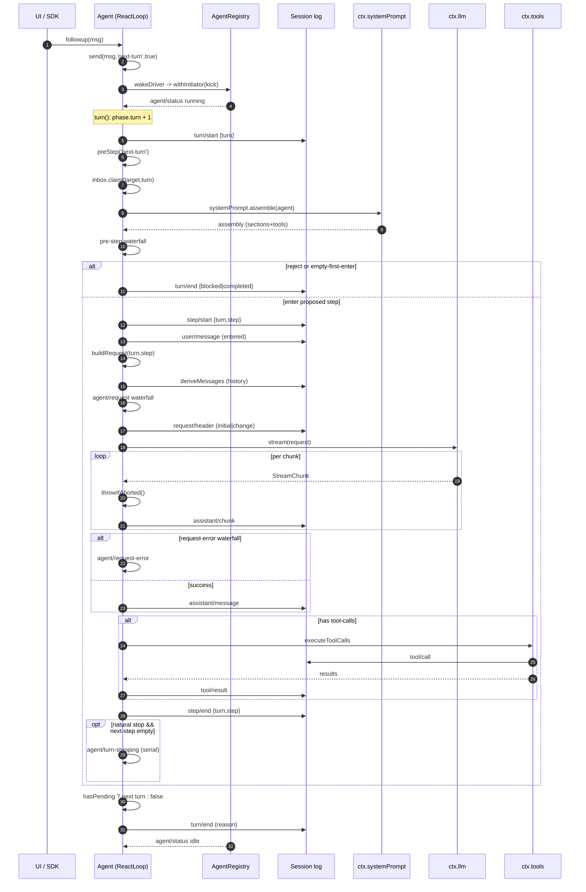

# 主 Agent 循环 + Runtime：turn/step 与 waterfall 拦截

> 子文档之一，聚焦「循环（策略）」与「Runtime（执行引擎）」的分离。覆盖 `packages/core/agent-loop` 与 `packages/core/agent`。整体哲学见 [README](README.md)；本文上承 [session.md](session.md)（从日志 derive 模型历史）、下启 [tools.md](tools.md)（循环驱动的工具执行管道）。

叙事位置：本模块把 session（从日志 derive 历史）当作唯一事实源，把 tools（注册表）当作执行管道，中间靠一组 waterfall 事件让所有插件参与决策——「主循环也是可替换插件」正是 `一切皆插件` 哲学的集中体现。

## 在项目中的角色

`core/agent-loop` 是唯一一个实现了公共 `Agent` 契约的**具体**驱动（driver），`core/agent` 则声明 `Agent` 接口、live 注册表与 `agent/*` 事件词汇。二者的分离正是"策略（loop）与其执行引擎（runtime）"刻意拆分的落点。

若把本模块整体去掉，系统会怎样：

1. **模型请求永远不会被驱动。** `ctx.agents.create()` 只能查到注册工厂为空而抛 `no agent factory registered (load an agent-loop plugin)` [packages/core/agent/src/index.ts:216-219]()。没有任何代码在 `llm/stream` 上消费，turn/step 计数器永不前进。
<!-- anchor: const NO_FACTORY_MESSAGE = 'no agent factory registered (load an agent-loop plugin)' -->
2. **inbox 没有消费者。** 两条 pending 列表（`next-turn` / `next-step`）的 `splice/claim` 投影仍然存在，但没有任何 driver 去 `claim` 它们，输入永远停在队列里。
3. **任务转向工具。** `tool/*` 事件仍在注册表里，但没有循环驱动它们，工具永远不会被调度执行。

一句话：没有循环的 DeepSeek Harness 是一个"有会话日志、有工具注册表、有模型适配器"但互不咬合的静止集合；循环是那个把它们串成一个可交互产品的唯一胶水。

A `step` = 一次模型请求 + 它所调用的工具；`turn` = 零或多个 step。该定义是 `docs/architecture.md:65` 的权威描述，与 `agent.ts` 的驱动实现严格对应。

<!-- anchor: A **step** is one model request plus the tools it calls. A **turn** is zero or more steps: … closes once nothing is owed. -->
> 注：此为单行区间，锚点取自 `docs/architecture.md:65` 原文（≥80 字符截断后仅保留首行前半，末行同源截断已在省略号处示意）。

---

## 解决什么问题 / 根因

根因是两个相互拉扯的需求：

- **一切皆插件，无特权内核。** 产品哲学是 Cordis 插件树里没有不可替换的内核（`docs/architecture.md:11-13`，谓语句：`There is no privileged core to patch`）。主循环作为产品里最"核心"的逻辑，同样必须是一个可被替换、可被观测的插件。
- **但循环必须唯一、决定性地工作。** 任何一个 session 同一时刻只能有一个 driver 在推进 turn，否则会出现两个线程同时 append `turn/start` 的竞态。

这个矛盾指向一个关键结论：**循环不能由插件各自实现"自己那套"，只能由单个具名插件实现一次，然后把所有可定制点暴露为事件。** 于是出现两个包的分工：

| 包 | 职责 | 可否替换 |
|---|---|---|
| `core/agent`（runtime） | 声明 `Agent` 接口、registry、inbox 投影、`agent/*` 事件词汇、initiator 作用域 | 接口层，可被任何"看似 Agent 的东西"实现 |
| `core/agent-loop`（loop） | `ReactLoopAgent` 具体驱动：turn/step 推进、请求构建、工具调度 | 具体的默认驱动，可被另一 loop 插件整体替换 |

`agent-loop` 作为唯一 factory 通过 `ctx.agents.setFactory()` 注册 [packages/core/agent-loop/src/index.ts:350-351]()，使消费者只依赖 `ctx.agents` 抽象而不依赖具体 loop 包（`packages/core/agent/src/runtime-types.ts` 无 loop 依赖，`packages/core/agent-loop/src/agent.ts:7-18` 从 `dsh-agent` 导入接口）。这是"无特权内核"的直接体现：连内核自己也是被注册进去的。
<!-- anchor: ctx.effect(() => ctx.agents.setFactory(this), 'agentLoop.setFactory()') -->
<!-- anchor: ctx.systemPrompt.variable('provider', context => context.agent?.options.provider) -->

核心的观测力量来自**事件是扩展点**（`docs/architecture.md:55`）：循环内部不再直接调用任何能力，而是通过 Cordis 的 `waterfall` / `serial` / `emit` 三种派发打开拦截缝隙。这保证"主循环可替换"和"插件能拦截每一次交互"同时成立。

---

## 设计思路（方案 / 替代方案 / 核心模式）

### turn/step 双层

`architecture.md:65` 定义了双层：`step` = 一次模型请求 + 它调的工具；`turn` = 零或多个 step。为什么需要两层而不是一层？

- **一层（只有 step）无法表达"一次用户输入应归属到哪个结束点"。** 一个 step 的请求 + 工具往往不止一轮（工具结果要回喂模型再请求），如果每个 step 都算"一次交互"，用户无法知道"我这番话到底跑完了没有"。
- **两层给了停止判定一个边界。** `turn/end` 是稳定的"这轮对话结束了"的事实；`step/end` 只是中间态。代理要回答"何时候我该把手交回给用户"，必须在日志里找到一个可判定的停止点。

`ReactLoopAgent` 用 `Phase` 联合体显式建模两层状态（`packages/core/agent-loop/src/agent.ts:38-46`）：`idle` 之外，`running` 阶段同时携带 `turn` 与 `step` 两个计数器。`turn()` 每次 `turn/start` 后嵌套一层 `while(true)` 迭代 step（`agent.ts:263`），直到满足停止条件。

### waterfall 事件链：拦截而非直调

循环把三种决策点全部开放为 **waterfall**（围绕式中间件，listener 必须调 `next()` 委派）：

```yaml
agent/pre-step      消息批进入前拦截/改写/拒绝      agent.ts:234-240
agent/request       冻结请求配置前替换 provider/model agent.ts:438-441
agent/request-error 请求失败后决定重试或终结          agent.ts:355-365
```

同理还有 `llm/stream`（模型流；由 `dsh-llm` 的适配器层触发）与 `tools/*`（`tools/pre-execute`/`execute`/`post-execute`；在 `dsh-tools` 管道触发），以及 `agent/turn-stopping` 这个串行停止检查点（`agent.ts:296`）。

选用 waterfall 而非"直接调用 + 子类重写"的原因在【关键设计决策】中详述，核心是：**零特权内核要求所有可定制点都以数据为媒、以 next() 委派为序**，让若干插件能以无优先级的洋葱顺序各自贡献。

### inbox 唤醒机制

输入不是直接塞进循环，而是投进 `Inbox` 的两条有序 pending 列表，再由唤醒机制决定 driver 是否启动（`packages/core/agent-loop/src/agent.ts:113-120`）。`send(input, target, wakeup)` 把 wakeup 拆开：`followup`/`steer` 唤醒，`inject` 不唤醒（`agent.ts:122-133`）。唤醒事件如何合流见【关键设计决策】§inbox。

### Runtime 与循环分离

`Agent` 接口只谈"交互契约"（send/cancel/whenIdle/status/runMaintenance，`packages/core/agent/src/runtime-types.ts:64-144`），不谈"如何驱动"。`ReactLoopAgent` 负责驱动策略，`AgentRegistry` 提供执行引擎侧的服务（`packages/core/agent/src/index.ts:256`）：live 存储、initiator 作用域、factory 委托。

分离的好处：测试/自定义 loop 只需实现 `Agent` 接口，复用 registry 与全部 `agent/*` 事件语义；而 `Agent` 接口的稳定性让 UI、hooks、编排器都能稳定地擦除具体 driver。

### 为什么 step 内有一个 `while(true)` 内部循环

`step()` 里除了外层 turn 的 while，`step` 自身又是一个 `while(true)`（`agent.ts:339`）。它承载的是"重试"语义：当 `agent/request-error` 决定 `{ kind: 'retry' }` 时，`continue` 会**在同一个 step 内**重新 `buildRequest` + 重新 `stream`（`agent.ts:367-370`）。这保证一个失败的请求尝试不会污染 turn 边界，重试对模型和日志都像一个 step 内的连续尝试。

---

## 关键数据结构

### `Agent`（公共句柄）

`packages/core/agent/src/runtime-types.ts:64-144`。一句话定位：外部世界（UI、hooks、编排器）接触 session 交互的唯一句柄。六个只读字段（`id`/`options`/`session`/`inbox`/`status`/`ctx`）+ 五个方法（`cancel`/`whenIdle`/`runMaintenance`/`send`/`followup`/`steer`/`inject`）。

```text
<!-- anchor: /** Public live-agent handle. */
<!-- anchor: inject(message: UserMessage): void -->
```
接口层只有一个工厂（`AgentFactory.createAgent`/`resume`，`packages/core/agent/src/index.ts:183-214`），具体 `ReactLoopAgent` 是其实现。

### Phase：turn/step 运行时状态机

`packages/core/agent-loop/src/agent.ts:38-46`。一句话定位：`ReactLoopAgent` 的私有状态机，区分 `idle` / `maintenance`（非 model 的维护任务）/ `running`（携带 `turn`+`step`+共享 `AbortController`）。

```text
<!-- anchor: type Phase =
<!-- anchor:   | { kind: 'running'; abort: AbortController; turn: number; step: number; wakeRequested: boolean } -->
```
`setPhase` 在状态切换时发散 `agent/status`（`agent.ts:104-111`），对外只有 `idle`/`running` 两态（`runtime-types.ts:50`）。

### Inbox：两条 pending 列表的可重放投影

`packages/core/agent/src/inbox.ts:25-220`。一句话定位：把持久化的 `agent/inbox/spliced` 事件流投影成 `next-turn` / `next-step` 两个内存数组，`claim` 供 step 边界消费，`splice` 记录每次规范化变更。

```text
<!-- anchor: /** A replay-once projection that incrementally consumes later inbox splices. */
<!-- anchor:   private readonly state: InboxState = { 'next-turn': [], 'next-step': [] }
```
`claim(target, turn)` 的语义：取全部 next-step + 一个 next-turn（`inbox.ts:71-78`）。

### ConsumedWork：为日志回答"我消耗了什么"

`packages/core/agent/src/consumed-work.ts:18-31`。一句话定位：单遍折叠日志，回答"某个 turn 是否真的把输入跑完了，还是被中断/拒绝"——因为 `turn/end` 本身无法区分"无操作 turn"与"消费后失败的 turn"。

```text
<!-- anchor: /** How one agent log accounts for the work it consumed. */
<!-- anchor:   readonly droppedUnrun: boolean -->
```
`accountsForClaim` 把 `blocked/aborted/interrupted/error` 视为消费了输入、`completed` 视为没有（`consumed-work.ts:42-58`）。

### ModelSelectionRef

`packages/core/agent/src/model-selection.ts:20-25`。一句话定位：把"可变的当前模型选择"与"当前 step 进入 prompt 组装时捕获的快照"耦合，避免并发切换撕裂 provider/model 两个面。

```text
<!-- anchor: export interface ModelSelectionRef {
<!-- anchor:   assembled: ModelSelection | undefined -->
```
通过两个 `waterfall` listener（`system-prompt/assemble` 与 `agent/request`）注入，见 `model-selection.ts:39-75`。

---

## 核心流程：一个 turn 的完整生命周期（sequenceDiagram）

Mermaid 中的 `next()` 归属：每个 waterfall 事件的行内都注明了它是"谁调用 next() / 谁启动这条链"。
- `agent/pre-step`、`agent/request`、`agent/request-error`：由 `ReactLoopAgent`（driver）作为触发方调用 `dispatch.waterfall(...)`，其默认 innermost next 由 driver 提供（agent.ts:236-239, 359-364, 440-441）。
- `llm/stream`、`tools/*`：由 `dsh-llm` / `dsh-tools` 管道触发，循环只是消费者（精确启动点详见 [llm.md](llm.md) / [tools.md](tools.md)）。



关键行内引用与 `next()` 归属，我逐一说明：

| 步骤 | 谁做 | `next()`/委派关系 | 引用 |
|---|---|---|---|
| `turn/start` | 循环 | — | `agent.ts:255` |
| `preStep` | 循环驱动 `agent/pre-step` waterfall，其 innermost `next` 由循环传入 | 外层 listener 调 `next()` 委派到内层 | `agent.ts:234-240` |
| `step/start` | 循环 | — | `agent.ts:279` |
| `buildRequest` 内 `deriveMessages` | 循环从 session 日志衍生历史 | — | `agent.ts:341` |
| `agent/request` waterfall | 循环驱动，innermost `next` 返回 `seedConfig` | listener 可改 provider/model | `agent.ts:438-441` |
| `request/header` 写盘 | 循环，避免重复请求时重写 header | — | `agent.ts:464-470` |
| `llm/stream` | 循环消费，适配器/中间件触发 | — | `agent.ts:345` |
| `assistant/chunk*` | 循环逐块写盘 | — | `agent.ts:347-351` |
| `assistant/message` | 循环聚合 | — | `agent.ts:381-390` |
| `agent/request-error` waterfall | 循环驱动 | `{kind:'retry'}` 则 `continue` 同 step 重试 | `agent.ts:355-365`, `367-370` |
| `executeToolCalls` → `tools/*` | 循环调 `dsh-tools`，其内部 `pre/execute/post` 由 `dsh-tools` 触发（跨界，见 tools 子文档） | — | `agent.ts:395-398`, `tool-calls.ts` |
| `step/end` | 循环，`finally` 保证写入 | — | `agent.ts:292` |
| `agent/turn-stopping` serial | 循环，在无续作时做最终 checkpoint | — | `agent.ts:296` |
| `turn/end` | 循环，`finally` 保证写入 | — | `agent.ts:319` |

---

## 与其他模块的协同

- **session 喂历史**：`deriveMessages()` 从 session 日志派生出每个 step 的模型历史（`agent.ts:341`）。日志是唯一事实源，`Model-visible means logged`（`docs/architecture.md:96`）由 `agent-loop/invariant.ts:39-42` 强制执行——它校验每个 loop 构建的请求的 `messages` 与 `deriveMessages()` 逐字一致，否则 fail `log-reconstruction desync`。

- **tools 管道**：`executeToolCalls` 调用 `ctx.tools.executionMode`、`TOOL_RUNTIME_SCHEDULER.prepare/dispatch/finalize`（`tool-calls.ts:88,152-153,169-173`）。三类调度：exclusive 单发屏障、parallel 有界滚动池（默认并发上限 `DEFAULT_MAX_PARALLEL_TOOL_CALLS = 10`，`constants.ts:6`）、中止时合成结果保持 replay 有效（`tool-calls.ts:40-48,249-259`）。`tools/executionMode` 与 `pre-execute/execute/post-execute` 事件的精确触发点在 `dsh-tools` 包内（见 [tools.md](tools.md)）。

- **system-prompt 组装**：`preStep` 在 `agent/pre-step` 前先调 `loopCtx.systemPrompt.assemble(assembleContextFor(this, signal))`（`agent.ts:230`），`agent-loop` 注册 `provider/model/cwd` 三个 prompt variable（`index.ts:351-353`）。`assemble` 与 `renderContextSections/renderPrompt` 的确切契约在 `dsh-system-prompt` 包（见 [system-prompt.md](system-prompt.md)）。

- **llm 流式**：`buildRequest` 生产冻结请求 `markAgentLoopRequest(deepFreeze({...}))`（`agent.ts:486-493`），再由 `preparedCall?.stream(request) ?? loopCtx.llm.stream(request)` 消费（`agent.ts:345`）。`agent/request` waterfall 在请求前替换配置，`llm/stream` 在请求后在适配器层拦截流式。`PreparedLlmCall`/`prepareCall` 的确切语义在 `dsh-llm` 包（见 [llm.md](llm.md)）。

- **invariants（防御性内观）**：除了上面的请求重建不变量，`agent/invariant.ts:17-23` 校验 `agent/status` 不能有重复的无操作转换（`no-op transition` 会 fail）。这是把"事件是扩展点"再加固一层：连状态机的内部自检都通过事件横切实现。

---

## 关键设计决策

### 决策一：为什么 turn/step 双层

**Why > What**：双层不是给开发者的额外概念负担，而是为了给"交互结束"一个**可判定的、持久化的边界**。单层 step 只能回答"一次请求+工具跑完没有"，无法回答"用户的这一番输入整体有没有跑完"——后者才是 UI、编排器、持久化真正需要的契点。日志也是按此建模：`turn/start` 与 `turn/end` 夹住一个稳定归巢点，`step/start`/`step/end` 只是中间态。`consumed-work.ts` 的存在本身就证明：即便双层，也还需要额外在日志上折叠（[packages/core/agent/src/consumed-work.ts:68-68]()）才能知道一个 turn "真正"消费了什么——说明双层解决的是"何时算完"，而"算不算有效消费"是另一个正交问题。
<!-- anchor: export function foldConsumedWork(events: readonly SessionEvent[]): ConsumedWork { -->

**权衡**：双层引入的复杂度是状态机必须显式处理 `turn`/`step` 双计数器的初始化、回卷（[packages/core/agent-loop/src/agent.ts:324-328]() 在换 turn 时重置 `step = 0`）。代价用一个简单模型换来了清晰的可观察停止语义，值得。
<!-- anchor: if (!this.inbox.hasPending) return false -->
<!-- anchor: phase.step = 0 -->

### 决策二：为什么用 waterfall 事件做拦截，而非直接调用/子类重写

**Why > What**：无特权内核的哲学下，循环不能"知道"有多少插件要拦截，也不能给插件排序。Cordis 的 `waterfall` 用 `next()` 表达洋葱式委派：每个 listener 可以选择改、拒或放行，顺序无关紧要，因为每个节点都能让数据继续往下走。这比"子类重写 `protected` 方法"更彻底地解耦——子类化假设只有一个继承链、一次定制，而事件允许多个正交插件同时拦截同一决策点（例如 compaction 插件拦截 `pre-step` 做压力清理，同步还有另一个插件改写消息）。

同时，`dispatch.ts` 把这些事件做成**融合 dispatcher**（`agentEvents`），把 `agent` 主体注入 payload 并绑定作用域 carrier（[packages/core/agent/src/dispatch.ts:107-149]()），让拦截天然按 agent 隔离。`agent.ts:74` 在构造函数里构建一次 dispatcher，热路径零分配。
<!-- anchor: export function agentEvents(ctx: Context, agent: Agent, carrier: Scoped<Agent> = agentCarrier(agent)): AgentEventDispatch { -->
<!-- anchor:     return waterfall(carrier, name, fused(payload), ...rest) -->

**权衡**：waterfall 要求每个 listener 记得调 `next()`，忘调会截断链。项目用 `agent/invariant` 之类的自检兜底，但这是框架层的约定成本。换取的是"任何人都能成为内核的观察者/改写者"这一产品级的灵活性。

### 决策三：inbox 为何"多数消息即时唤醒，注入内容等待下一条"

**Why > What**：把输入分成"唤醒型"（`followup`/`steer`，wakeup=true）与"非唤醒型"（`inject`，wakeup=false）（`agent.ts:122-133`）。原因：**注入的 context 不是"交互的发起者"，它只应消费在"已经由别的东西开启的 step"里**。若 inject 也唤醒 driver，会导致：中断性的、纯填充的 context 会凭空启动一个 turn，而后端没有任何真实用户意图要响应。而唤醒型输入（真正的提问或转向）才会驱动 turn/step 前进。`architecture.md:86-87` 明确写：`Some messages wake it immediately; injected context waits in the inbox until another message does`。

**权衡**：注入内容的"时效性"被牺牲——如果注入后一直没人唤醒，它就留在队列里。但换来的是"turn 总是由真实意图驱动"的语义稳定性，且可被 `steer` 或 `followup` 在需要时触发。

（补充：`send` 里还有个微妙分支——若 wake 发生在 abort 之后的活跃 phase，`wakingAfterAbort` 会把目标重分类为 `next-turn`（`agent.ts:114-119`），保证唤醒不加入一个已中止的 activity。）

### 决策四：停止条件 / 最大步数

**Why > What**：循环必须能证明"我该停止"，否则 tool 化 agent 会无限自我驱动。停止条件是一个**数据判定**而非一个显式的"最大步数常量"：

1. `agent/pre-step` 返回 `reject` → `turnEnds = blocked`，本轮无 step（`agent.ts:267-269`）。
2. 首个 enter 被改写为空 → `turnEnds = completed`（`agent.ts:274-277`）。
3. `max-tokens` 是"粘性的"：一旦某 step 触发，后续正常完成的 step 不得把 turn 降级（`agent.ts:286-290`）。这是显式的最大输出长度门槛，等价于在 token 维度上的"最大步数"。
4. 工具结果携带 `concludesTurn` → step 返回 `completed`（`tool-calls.ts:157,399`），tool 自身可宣告"到此为止"。
5. `agent/turn-stopping` serial 检查点：当模型无应当响应、无未决工具、无 fresh steering 时最终拦截一次（`agent.ts:296`），等待 listener 可能补投的 steering。
6. 无 pending 工作 → turn 返回 `false`，`kick` 退出（`agent.ts:324,212`）。

没有单一的"最大 steps"硬常量——因为**工具的 `concludesTurn` 和 `turn-stopping` 已经是数据化的停止信号**，比固定计数器更语义化。最大并行工具调用数反而是唯一显式常量（`maxParallelToolCalls`，默认 10，[packages/core/agent-loop/src/constants.ts:5-6]()，`index.ts:301`），它约束的是并发而非总步数。
<!-- anchor: /** Default maximum in-flight parallel-safe calls per agent step. -->
<!-- anchor: export const DEFAULT_MAX_PARALLEL_TOOL_CALLS = 10 -->

**权衡**：依赖事件判定停止意味着"谁来宣告结束"被分散到多个 listener（compaction、tool、UI），需要 `turn-stopping` 这个串行兜底点来汇聚。若某个 listener 一直投 steering，turn 会无限延续——但这正是"代理可被外部持续转向"这一特性的必要代价，而非漏洞。

## 全局关联：循环是「无特权内核」的自证

本模块是全篇哲学最锋利的一处证明：**连主循环都可以被当作插件替换**。`agent-loop` 通过 `ctx.agents.setFactory()` 注册自己是唯一驱动（`packages/core/agent-loop/src/index.ts:350-351`），消费方只依赖 `ctx.agents` 抽象；而所有可定制决策点（`agent/pre-step`、`agent/request`、`agent/request-error`、`agent/turn-stopping`）都以 waterfall 事件开放，让零特权的插件在洋葱式 `next()` 委派下任意拦截。这正实现了第 1 根支柱「无特权内核」：内核自己没有特权，它只是把决策点以数据为媒地暴露出去——这与 [session.md](session.md) 的「日志即事实源」、[tools.md](tools.md) 的「工具也是可换插件」一脉相承。
