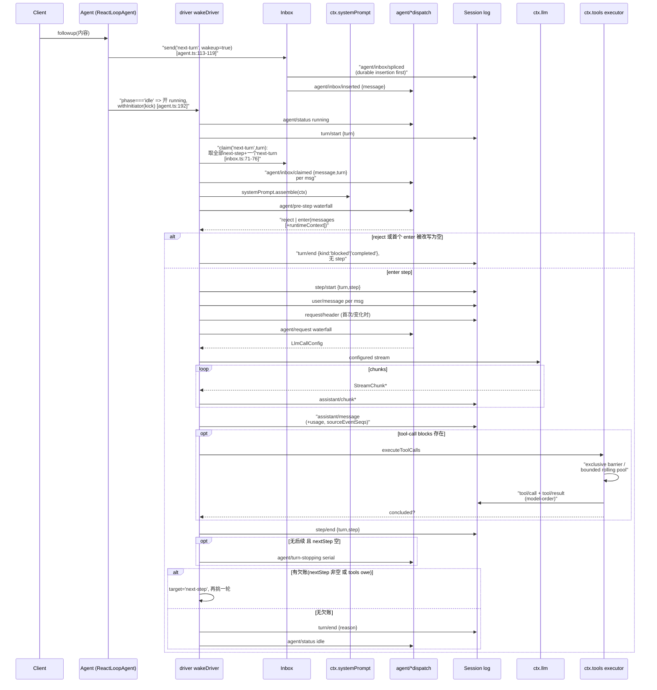
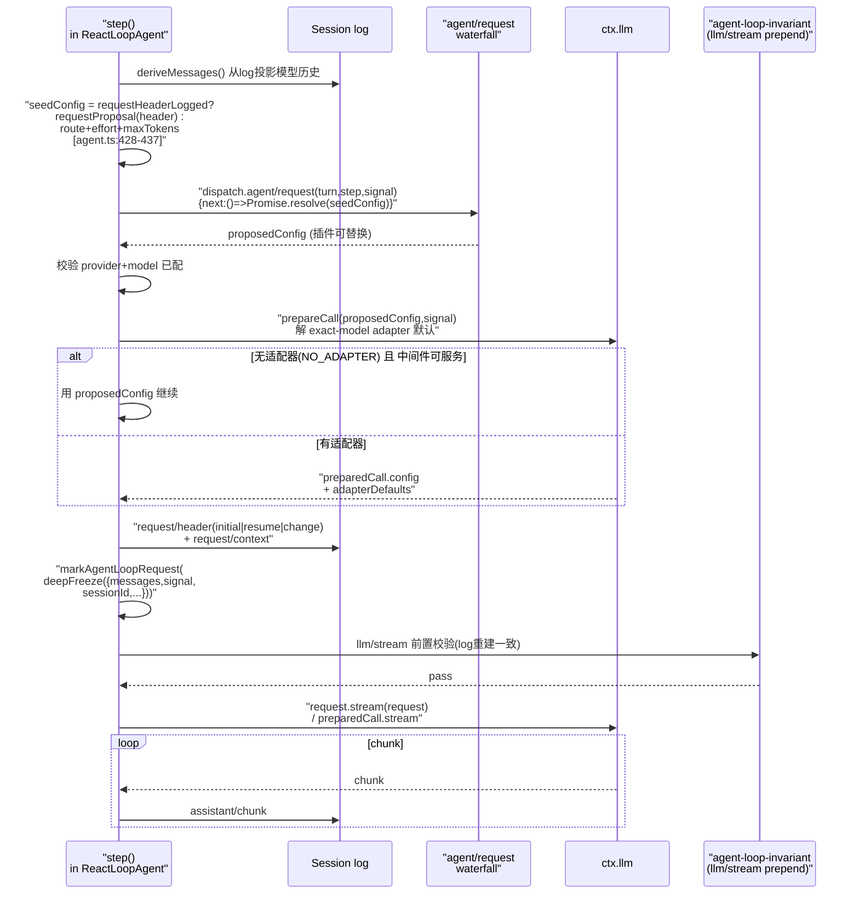

# 主 Agent 循环与 turn flow（agent-loop）

> 对应关注面：Agent 生命周期与所有权、Agent 句柄（send/inject/steer/followup/cancel）、turn/step 流程、`agent/*` 事件、inbox、initiator scope、scope 原语。

## 在项目中的角色：去掉它会怎样

`agent-loop` 是 harness **唯一实现公开 `Agent` 契约**的「策略层」循环驱动器；`agent` 包是它的**服务接口**与 live registry。二者成对咬合：若移除整个 agent-loop/agent 关注面，harness 失去「被驱动做事的 agent」这个核心执行体——`ctx.agents` 没有 `AgentFactory` 可派发、`ctx.agentLoop` 没有驱动器、LLM 请求与工具调用无处被编排、会话 log 永远只停留在 `turn/start` 之前的空壳。

具体后果：

- **无模型循环**：`step = 一次模型请求 + 工具`、`turn = 零或多个 step` 的推进逻辑（`turn()` 主循环）整体消失，LLM 流式消费与工具调度无从触发。
- **无统一交付面**：插件、UI、hooks、orchestrator 面向的 `Agent` handle 不再存在；`send/steer/inject/followup/cancel/whenIdle` 全部是它的方法。
- **无 per-agent scoping**：`scope` 原语失去「按 agent 注册即隔离」的最大消费方——`agent`/`tools`/`system-prompt` 的 scoped registries 建立在它之上。
- **无事件域划分的骨架**：`agent/*` 这一「携带 live Agent 的运行时域」事件（`agent/pre-step`、`agent/request`、`status`、`inbox/*` 等）全部消失，插件扩展点塌掉一半。

反向也成立：`agent` 接口 + `agent-loop` 实现**成对替换即可换循环**——这正是拆包的动机（见下）。

## 解决什么问题、根因

**根因：Agent 循环是天生的「策略层」，与「引擎层」runtime 紧密纠缠，若不抽象，会让 harness 的每一处插件都耦合死的循环实现。**

harness 想做「每个部件都可替换」——model adapter、tool registry、session log、乃至 agent 循环本身。但 agent 循环是唯一既连接 LLM 流、又连接工具注册表、又写会话 log 的地方，若直接暴露，任何想「换一种循环」的扩展都必须依赖它。于是设计把问题拆成两半：

1. **契约与实现分离（`agent` vs `agent-loop`）**：`agent` 包声明 `Agent` 接口（服务接口）+ 事件词汇 + 注册表 + initiator scope，不依赖任何循环实现；`agent-loop` 是它**唯一的**具体 `Agent` 实现，但扩展插件只依赖 `agent`——所以「循环可整体替换」，换循环不用动任何插件。
2. **持久事实与运行时控制分离**：模型看到的一切**必须是 log 可重建的**（model-visible means logged）；而队列/状态/拦截是瞬时的 live 协调。二者分属 `session/event`（持久）与 `agent/*`（live）两个事件域，避免把可重放事实和瞬态控制混在一条事件流里。

一句话根因：**把「做什么的契约」与「怎么驱动的实现」解耦，并把「该被重放的事实」与「只活在内存里的控制」分开，从而在可替换循环的同时保持可重放会话。**

## 设计思路

### 方案

- **双层循环（turn / step）**：`turn = 零或多个 step`，`step = 一次模型请求 + 其工具`。turn 在「认领第一输入」时开、在「无欠账」时闭；step 是请求粒度的最小单位。这让「一次用户输入」与「模型多轮工具调用」自然分层。
- **inbox 作为唯一输入门**：所有输入（followup/steer/inject）都进 inbox，再按 `next-turn`/`next-step` 两个列表排队，driver 按 step 边界认领。注入的 context 不唤醒 driver、排队等待。
- **瀑布（waterfall）与序列（serial）两种拦截**：`agent/pre-step`、`agent/request`、`llm/stream`、`tools/*` 是 around-middleware（监听者必须 `next()` 委托）；`agent/turn-stopping` 是 serial（无 next）。
- **事件分三域**：`session/event`（可重放事实）、`agent/*`（带有 live Agent 的运行时域）、`capability`（`fs/*`、`tools/*`、`telemetry/*`，贴接缝不 import 循环）。
- **scope 承载 per-agent 隔离**：`agent-loop` 用 `createScope(loopCtx, this)` 给每个 agent 造一个它自己当 key 的 scope，通过 `agent.ctx` 注册的东西天然 agent-local、disposal 时随 scope 回滚。

### 放弃的替代方案

- **不把 turn 记成瞬时 agent 事件**：`turn/*`、`step/*` 坚持做 `session/event` 持久事件而非 `agent/*` 发射——因为回放/UI/transcript 都需要它们。
- **不让 `agent/request` 瀑布直接改 messages**：注释明确 model-visible content 必须走 logged channels（此 waterfall 不能 mutate messages）——守住「model-visible means logged」。
- **inbox 的每个 mutate 都是规范化 splice，且 durable event 先 commit**:让同步 `session/event` 观察者能读到 pre-splice 列表重装被移除消息；全量消费者（UI projection）从 durable splices 重建。

### 核心模式

- **接口反依赖**：`agent-loop` 实现 `AgentFactory`，注册到 `ctx.agents.setFactory()`，消费者只碰 `ctx.agents`。
  [packages/core/agent/src/index.ts:372-372]()
  <!-- snippet:   setFactory(factory: AgentFactory): () => void { -->
- **融合分发器（fused dispatcher）**：`agentEvents()` 把「subject agent + scope carrier」绑成一个对象，保证 scope key 与 payload.agent 永不背离；constructor 构建一次、热路径零分配复用。
- **结构化失败**：非 `LlmError` 一律 `errorChain` 展平成 `{ message, code: 'UNKNOWN' }`，让 `turn/end.error` 始终是可序列化 `LlmFailure`。
- **invariant 配偶插件**：请求重建一致性由 `agent-loop-invariant` 断言（frozen、sessionId live、messages == `deriveMessages()`、header 折叠匹配），防止 log 与请求脱钩。

## 关键数据结构

### `Agent` 接口（精简，只列不可绕过的）

[packages/core/agent/src/runtime-types.ts:63-73]()
<!-- snippet: /** Public live-agent handle. */
export interface Agent {
  /** The single identity shared with {@link session}. */
  readonly id: SessionId
  /** The provider route and model this agent's requests use. */
  readonly options: AgentOptions
  /** The live session this agent drives; its log is the durable source of truth. */
  readonly session: Session
  /** The agent-owned projection of durable pending work. */
  readonly inbox: Inbox
  /** The current lifecycle state, mirrored on every `agent/status` transition. -->
  [packages/core/agent/src/runtime-types.ts:74-75]()
  <!-- snippet:   readonly status: AgentStatus
  /** Agent-scoped context; its contributions are agent-local, unwind on disposal, and reject registration afterward. -->
  readonly ctx: Context -->

成员方法 `send` 暴露 target+wakeup 路由，其余三个是**固定预设别名**。
[packages/core/agent-loop/src/agent.ts:122-132]()
<!-- snippet:   followup(input: UserMessage): void {
    this.send(input, 'next-turn', true)
  }

  steer(input: UserMessage): void {
    this.send(input, 'next-step', true)
  }

  inject(input: UserMessage): void {
    this.send(input, 'next-step', false)
  } -->

### `Inbox`

从 durable splices 增量投影的「replay-once」结构，持两个有序列表。
[packages/core/agent/src/inbox.ts:71-74]()
<!-- snippet:   claim(target: InboxTarget, turn: number): UserMessage[] {
    const claimed = this.mutate('next-step', 0, this.nextStep.length, [], false)
    claimed.push(...this.mutate('next-turn', 0, 1, [], false))
    for (const message of claimed) this.notifications.claimed(message, turn) -->

### `AgentStatus`

`'idle' | 'running'`——`running` 是调度器级 drain 区间，可能横跨多个连续 queued turn，不代表 turn 仍开着；disposal 不是第三个可观察状态。
[packages/core/agent/src/runtime-types.ts:50-50]()
<!-- snippet: export type AgentStatus = 'idle' | 'running' -->

### `PreStepDecision`

**`enter` 决定后 Step 的完整 message 批次**（可以改写/替换 claim 的 batch）；`reject` 不开 step。
[packages/core/agent/src/runtime-types.ts:53-55]()
<!-- snippet: export type PreStepDecision =
  | { kind: 'reject' }
  | { kind: 'enter'; messages: UserMessage[] } -->

### `AgentCancelCause`

定义在 session 包（经 agent 包 re-export）。取消是一条 TYPE-LEVEL 强制的同进程输入→运行期信号链。
[packages/core/session/src/types.ts:143-147]()
<!-- snippet: export type AgentCancelCause =
  | { readonly kind: 'user' }
  | { readonly kind: 'parent' }
  | { readonly kind: 'hook'; readonly reason: string }
  | { readonly kind: 'disposed' } -->

## 核心流程（Mermaid）

### 一次完整 turn：inbox claim → turn/end

要点：

- **turn 开在 claim 之前**；**step 在 claim 之后**。`turn()` 主循环先 `turn/start`，再在循环里 `preStep` 认领。
- turn 收口三维：`signal.throwIfAborted()` 守卫每个 await 之后；`max-tokens` 粘滞（一旦某 step 打顶，后续正常完成的 step 不降级 turn 结局）。
- `turn/end` 在 `finally` 里必定 write——任何退出路径都留尾。
  [packages/core/agent-loop/src/agent.ts:246-246]()
  <!-- snippet:   private async turn(): Promise<boolean> { -->

### `agent/request` 瀑布 + `llm/stream`

要点：

- **`agent/request` 拦的是「冻结的调用配置」**，不是 messages——瀑布后置校验冻结点是 header 与 log 的一致性。
- **requestProposal 剥离 adapter 派生值**（reasoningEffort/maxTokens 若来自 adapterDefaults）再交给插件提建议，避免把 adapter 决定当插件提案重复叠加。

## 与其他模块协同

| 协同对象 | 作用点 | 说明 |
|---|---|---|
| `ctx.sessions` | `session.append(...)` | 循环把每个模型可见事实落 log；历史由 `deriveMessages()` 从 log 派生，不另存。turn/step 边界是 durable 事件。 |
| `ctx.systemPrompt` | `loopCtx.systemPrompt.assemble(...)`、`renderPrompt` | 组装 prompt sections + tool schemas；`assembleContextFor` 把 agent+scope 成对塞进组装上下文，防 agent-scoped 贡献被静默跳过。 |
| `ctx.tools` | `executeToolCalls` | 调度一次性模型 step 的工具调用。`ctx.tools[TOOL_RUNTIME_SCHEDULER].{prepare,dispatch,finish,finalize}` 负责 pre/execute/post 瀑布。 |
| `ctx.llm` | `prepareCall` + `stream` | 配置准备 + 流式消费。`markAgentLoopRequest` 给请求打标记，供 invariant 认领。 |
| `ctx.agents` | `withInitiator` / `setFactory` | 循环通过 `withInitiator(this, ...)` 在驱动运行时传播进程内 initiating Agent；通过 `setFactory` 让 `ctx.agents.create/resume` 派发到自己。 |
| `dsh-session-persistence` | `resume` 的 `persistence.prepare` | resume 需先 load 持久 session。 |

## 关键设计决策

### 为什么 step/turn 双层？

单层（每输入 = 一次请求）无法表达「一次输入引出多轮工具→请求」的工具循环。双层让「turn = 用户可感知的一轮交互」与「step = 原子请求」分离：turn 决定何时 claim 下一个 turn 输入、何时 `turn-stopping`、`max-tokens`/`completed` 粘滞发生在 turn 级；step 只负责一次请求+工具。

### 为什么 `agent-loop` 与 `agent` 接口解耦（可替换循环）？

解耦点 =「契约」归 `agent`、「实现」归 `agent-loop`。插件（UI/ACP bridge/hooks）依赖 `agent`（服务接口），拿到的是 `Agent` 对象不是 `ReactLoopAgent`；换循环只要 `ctx.agents.setFactory(另一实现)`。代价是接口必须承载全部循环语义（send/steer/inject/cancel/whenIdle/runMaintenance 的精确契约都用 JSDoc 钉死）。

### 为什么 initiator / `withInitiator` 只是 process-local 因果归属、不做授权？

`withInitiator(agent, op)` 用 AsyncLocalStorage 把「谁引发了这条驱动链」沿调用栈向下继承，供 `ctx.agents.currentInitiator()`/`requireInitiator()` 读取。但注释与文档反复强调：**ambient presence 既不是 liveness 证明、也不是授权**。原因是 AsyncLocalStorage 只能传递进程内因果，跨 worker/进程/持久化/线上的身份要显式传（subject 与 owner 始终显式）。所以 `withInitiator` 只是把「归属」局部化，安全边界仍靠显式参数。
[packages/core/agent/src/index.ts:341-343]()
<!-- snippet:   withInitiator<T>(agent: Agent, operation: () => T): T {
    return this.runWithInitiator(agent, operation)
  } -->

### cancel 机制（`AgentCancelCause` → `AbortSignal.reason`）

取消是一条 TYPE-LEVEL 强制的同进程输入→运行期信号链：

- `Agent.cancel(cause, opts)` 把 cause 传给活动 phase 的 `AbortController.abort(cause)`——**首 cause 胜出**，一个 phase 只有一次 `abort()` 生效。
  [packages/core/agent-loop/src/agent.ts:134-140]()
  <!-- snippet:   cancel(cause: AgentCancelCause, options: CancelOptions = {}): void {
    if (!options.keepInbox) {
      this.inbox.clear()
      if (this.phase.kind !== 'idle') this.phase.wakeRequested = false
    }
    if (this.phase.kind !== 'idle') this.phase.abort.abort(cause)
  } -->
- cause 借 `AbortSignal.reason` 传播给合作监听者，但「信号不授予监听者分类权」——持久化 `turn/end` 只保粗粒度 `{kind:'aborted'}`，不 overload 终态去记「谁要求的」。
- `keepInbox`：活动 turn 仍 abort，但未开始的排队/steering 消息与「取消 splice 日志」都被保留——供后续 turn 使用。

## 亮点与问题

### 亮点

1. **双面解耦（契约/实现 + 事实/控制）**：同一处拆包同时解决了「可替换循环」与「可重放会话」两个独立需求。
2. **事件三域 + 瀑布/序列二分**：扩展点先分类再设计，插件能准确选择拦截方式，避免「重放」与「live 控制」互相污染。
3. **`agent/inbox/spliced` 是规范化 splice 且 durable-first**：让全量重建（UI projection）与单消息追踪各取所需，`Inbox` 因此能「replay-once」从 log 无状态重建。
4. **模型可见即日志 + invariant 强断言**：`deriveMessages` 派生 + `agent-loop-invariant` 冻结比较，把「log 与请求脱钩」这类最隐蔽的 bug 变成构造期确定性失败。
5. **结构化的 turn 收尾**：任何退出路径都落一条 `turn/end.reason`。
6. **融合分发器 + 首建复用**：hot path 零分配，scope 与 subject 永不分离。

### 问题 / 权衡

1. **循环语义被接口咬得很死**：`agent` 接口要承载 `ReactLoopAgent` 的全部行为细节（send 的 abort 重分类、runMaintenance 的 idle-phase 竞赛），换个极简循环实现也得迁就这套接口；代价是「可替换」被接口契约的高耦合稀释。
2. **事件域学习曲线陡**：三域 + 瀑布/serial + 是否 `next()` 的规则繁多，新人容易选错域或忘 `next()`。
3. **`AgentCancelCause` 在 turn/end 里被压扁成 `{kind:'aborted'}`**：谁请求取消的因果在持久层丢失，只能靠 live 信号层（process-local）追溯，"谁取消"无法跨恢复重建。

## 已知的文档-实现漂移

- **`agent-loop/src/tools.ts` 不存在**：任务清单曾列出该文件，实际工具调度在 `tool-calls.ts`；`agent/src/invariant.ts` 存在。已按真实文件定位。
- **send 的 abort 重分类语义**：真实实现（agent.ts:113-117）在 `wakeup && aborted` 时把目标重分类到 `next-turn` 并 latch，这是 bug-fix 闩锁，草稿原文与源码一致。
