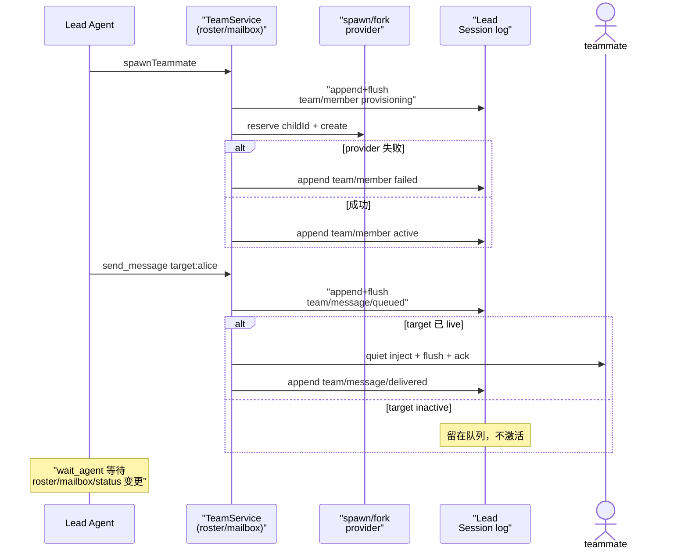

# Agent Teams：隐式根的持久化多 agent 协调域

> 子文档之一（**rc.8 新增关注面**），聚焦 dsh 的 Agent Teams 协调域。覆盖 `packages/experimental/agent-team`（`ctx.agentTeams` 域服务）与 `packages/experimental/tool-agent-team`（模型面向工具）。整体哲学见 [README](README.md)；本文上承 [subagent.md](subagent.md)（同一个 continuable 子 agent 机制的更高层组织）、衔接 [session.md](session.md)（协调状态的唯一事实源仍是 Lead Session 日志）。

> **增量更新说明（rc.8，2026-08）**：本文为新增关注面，对应上游 0.1.0-rc.8 合入的「Agent Teams」能力族（原 `packages/team` 经改名落到 `packages/experimental/agent-team`，服务键由 `team` 改为 `agentTeams`）。**依据代码快照比对 + PR 大标题（worktree/dsh-0.1.0-rc.8），非官方 changelog。**

## 项目中的角色：把「多个 agent 一起干活」从裸委派升级为共享协调态

[subagent.md](subagent.md) 解决的是「父 agent 如何委派一个子 agent 干活」——它是**一对一、父子单向**的能力 seam。Agent Teams 解决的是它的上一层问题：**如何让一个 Lead 与一群具名队友共享一份可重放、可审计的协调状态**（谁在、发给谁什么、每个人在推进哪个任务），并让模型用一组 native 工具参与进来。

去掉它系统会怎样：

- **多 agent 协调只能靠裸 `send_message` 式的临时转发**：没有持久的队形（roster）、没有 durable 的邮件（mailbox）、没有共享任务板（task board），每个队友各自为战，Lead 无法重启后重建"这个团队长什么样"。
- **协调状态无法跨崩溃/恢复重建**：显然这违背"会话事件日志是唯一事实源"的根哲学——协调状态若只在内存，冷启动就全没了。

一句话：Agent Teams = 在 subagent 的 continuable 子 agent 之上，叠加一层**持久化、可重放、模型可操作的共享协调层**；它自己不发明新的 agent 机制，而是把所有协调状态（成员/邮件/任务）都写成 Lead Session 日志里的可折叠事件。

## 根因：子 agent 是单向的，"团队"需要共享而可重放的状态

为什么不是把委派直接叠起来就完事？三个张力催生这个新域：

1. **队形（roster）需要持久身份**。一个队友是可命名（lower-kebab-case）、只进不出（名字永不复用）的 continuable 直接子 agent。名字即授权与寻址身份，一旦 provisioning，就必须在日志里留一个 durable 记录，否则崩溃后"某个名字是否被占了"无从判断（[packages/experimental/agent-team/src/index.ts:136-140]()）。
2. **消息需要 durable 队列 + 投递确认**。队友可能 inactive（live 缺席，需冷恢复）。`sendMessage` 先 `team/message/queued` 落日志、flush 后再尝试投递；投递目标 Session 一旦 durable 持有该消息身份，Lead 日志再记 `team/message/delivered`——"队列"与"确认"都是日志事件，崩溃重放即可重建（[packages/experimental/agent-team/src/types.ts:203-218]()）。
3. **共享任务板需要版本化 CAS**。多个队友可能同时改同一个任务，于是每个任务都是完整版本化快照，任何 mutation 带 `expectedRevision`，乐观并发失败返回 `TEAM_TASK_STALE_REVISION` 而非覆盖新值。

这三个张力共同指向一个方案：**把整个 Team 协调域建模为一组 log-only 的 Session 事件**（`team/member` / `team/task` / `team/message/queued` / `team/message/delivered`），只写在 **Lead Session** 里，由 `foldTeam` 折叠成当前状态——这与 [session.md](session.md)「append-only 日志 + 派生投影」是同一种哲学在"多 agent 协调"上的延伸：协调状态不是旁路可变对象，而是日志的纯函数。

## 设计思路：隐式根 + 四类日志事件 + 三个子状态机

### 隐式根：每个运行 root 天然是 Lead

`TeamId = SessionId`——每个普通运行 root 的 `SessionId` 就是它团队的 id；创建 Team 在"有第一个成员/消息/任务"之前是无状态的（state-free）。队友是具名、continuable 的直接子 agent，记录下来在该 root 的 Session 里（[packages/experimental/agent-team/README.md:26-26]()）。

### 服务装配：依赖既有 seam，不死磕新的 agent 机制

`TeamService` 的 `inject` 是 `['agents', 'sessions', 'sessionPersistence', 'subagents']`——它依赖 Agent 注册表、Session 日志、持久化 seam、以及 continuable-subagent（spawn/fork provider）。没有 durable Session 存储的组合不会激活它（[packages/experimental/agent-team/src/index.ts:57-57]()）。它把工作委托给六个内部对象：`activity`（变更通知）、`lifecycle`（运行时生命周期）、`journal`（日志写及折叠）、`roster`（队形）、`mailbox`（持久消息队列）、`tasks`（版本化任务板）。

> 这一层强约束的语义：Agent Teams **不重新发明** spawn/fork/in-process continuable 机制——`spawnTeammate` 只是"先在 Lead 日志落 provisioning 成员、再问配置的 spawn/fork provider 创建保留的 child id"（[packages/experimental/agent-team/README.md:28-28]()）。它是在 subagent 之上做**状态组织**，而非替换 subagent。

### 四类 log-only 事件 + `foldTeam` 折叠

| 事件 | 载荷 | 意义 |
|------|------|------|
| `team/member` | 完整队员生命周期快照 | 队形：含 provisioning/failed 相位 |
| `team/task` | 完整共享任务快照 | 任务板：版本化、带 revision |
| `team/message/queued` | 待投递消息快照 | durable 入队，先于投递 |
| `team/message/delivered` | messageId + targetId | 目标 Session 已 durable 持有该消息 |

全部 log-only、只写在 Lead Session、不进模型派生历史。`foldTeam` 把旧事件依次折叠成当前队形/任务/邮件状态——冷恢复由 `foldSubagentDescriptor` 之后从 Lead 日志重建（[packages/experimental/agent-team/src/index.ts:33-33]() 导出 `foldTeam`）。

### 三个子状态机

1. **roster（队形）**：provisioning → active/failed。队友名字永不复用（`maxMembers` 数的是每个 provision 过的名字，包括失败成员）。恢复时 provisioning 记录只有在 child（独立持久化）有匹配的 direct-parent + continuable 描述符 + 初始 user message 时才转 active，否则 failed。
2. **mailbox（持久消息队列）**：`queued` 是 durable 的，`delivered` 是目标确认；quiet 投递在目标 inactive 时不激活它（留在队列），wakeup 投递成为目标下一个 FIFO turn 并冷恢复之。投递前折叠 live+persisted inbox/history 防重复。
3. **task board（版本化任务板）**：完整快照 + `expectedRevision` CAS；pending 依赖全完成后 ready；`task-<n>` id 需 safe-integer；delete 保留 tombstone 但不再占 `maxTasks`。

## 核心结构 / 数据

### 部署限制（`ctx.agentTeams` 的静态 Config）

| 键 | 默认 | 约束 |
|----|------|------|
| `maxMembers` | 8 | 数每个 provision 过的名字（含 failed），名字不复用 |
| `maxTasks` | 256 | 数非删除任务 |
| `maxPendingMessagesPerMember` | 64 | 每目标待投递上限 |
| `maxMessageBytes` | 65 536 | 完整封帧投递的字节上限（含稳定 id + sender name） |
| `disposalTimeoutMs` | 5 000 | 约束 admitted 创建/邮箱投递/Team 结算，让 reload/停机 visibly fail |

所有限制必须是正 safe integer；`TeamService.Config` 逐一 `positiveLimit` 校验（[packages/experimental/agent-team/src/index.ts:41-65]()）。

### 模型面向的工具（`tool-agent-team`，scoped-registered）

| 工具 | 谁可调用 | 语义 |
|------|---------|------|
| `spawn_teammate` | 仅 Lead | 创建命名 durable 队友，`fresh`/`fork` 两种 context 模式 |
| `send_message` | 成员→成员/lead | **quiet** 投递（不激活 inactive），inactive 时留在队列 |
| `followup_task` | 成员→成员/lead | **wakeup** 投递，成为目标下一个 FIFO turn，可冷恢复 |
| `list_agents` | 全 | 枚举 Lead + 队友及当前运行时状态 |
| `wait_agent` | 全 | 阻塞观察下一次 roster/mailbox/task/status 变更，不唤醒；返回 `noProgress` |
| `interrupt_agent` | 仅 Lead | 中断队友当前 turn，保留其 pending inbox |
| `team_task_create/list/get/claim/update/complete` | 全（按角色） | 版本化任务板操作 |

这些工具全部经 scoped `ctx.tools.register(defineTool(...))` 安装，且**只在调用方确属某 Team 成员时**才可及——非 Team 的 subagent 看不到它们（[packages/experimental/tool-agent-team/src/index.ts:173-175]()）。

## 核心流程：一次 `spawn_teammate` + `send_message` 的持久协调（sequenceDiagram）

对应源码：`spawn` 走 roster（`roster.ts` 的 `spawn`，service 处见 [[packages/experimental/agent-team/src/index.ts:141-143]()]()），`send` 走 mailbox（[[packages/experimental/agent-team/src/index.ts:151-153]()]()）。队列先后：`queued` 在投递前落盘并 flush（`mailbox.ts`），`delivered` 在目标 durable 持有消息身份后落 Lead 日志。

## 关键设计决策

1. **为什么整个 Team 域都建模成 Lead 日志的 log-only 事件，而非旁路可变状态。**
   - Why：让冷恢复/崩溃重建精确还原——`foldTeam` 从 Lead 日志折叠出队形/任务/邮件，与 [session.md](session.md) 的"日志即唯一事实源"一致。协调状态若在内存，重启就失去团队身份。
   - 权衡：每次状态变更都要 append+flush 一次日志（代价是协调吞吐受日志写速限制），换来可回放、可审计、可 cold-resume。`noProgress`/`wait_agent` 建立在"等待的是日志里下一个事件"之上。

2. **为什么用"版本化任务快照 + expectedRevision CAS"而非锁或增量合并。**
   - Why：多个队友可能同时改任务，锁在分布式/多 agent 场景难收敛；增量合并有合并冲突。整值快照 + CAS 让"谁改了什么"可审计，stale 调用方明确收到 `TEAM_TASK_STALE_REVISION` 而非静默覆盖。
   - 权衡：写放大（每次 mutation 重存整任务），但任务通常小而低频，换取去中心化 + 可重放。

3. **quiet vs wakeup 两条投递路径。**
   - Why：quiet（`send_message`）是"告知但不启动"——目标 inactive 时留在队列，绝不凭空激活一个队友；wakeup（`followup_task`）是"让目标开一个 turn"——成为其下一个 FIFO turn，可冷恢复。与 subagent `inject`/`followup` 的唤醒语义同源。
   - 权衡：quiet 有"时效性牺牲"（没人唤醒就一直躺队列），换来的与 [agent-loop-runtime.md](agent-loop-runtime.md) 决策三一致——turn 总是由真实意图驱动。

4. **为什么实验性包（`experimental/`）+ 服务键改名 `agentTeams`。**
   - Why：rc.8 把 Agent Teams 明确标为 experiment（目录 `packages/experimental/`，包名带 `experimental-` 前缀、服务键 `agentTeams` 与既有 `ctx.subagents` 平级但试验性）——它是"多 agent 协调"这个高潜力的新面，但 pre-release 不承诺 API 稳定。
   - 权衡：让用户能提前试用而不影响稳定面；代价是升级可能破坏实验 API。

## 与其他模块协同

- **subagent / continuable 机制**：`spawnTeammate` 依赖 continuable-subagent 的 spawn/fork provider 创建保留的 child id；`interrupt_agent` 委托 continuable-subagent 的中断路径（只 cancel 当前 turn、保留 inbox）。Agent Teams 是 subagent 之上的**状态组织层**，不是新的委派实现。（跨模块：continuable 的 descriptor/seed 契约见 [subagent.md](subagent.md)。）
- **session / 事件日志**：`team/*` 事件全部 log-only、写在 Lead Session；`foldTeam` 折叠重建。`session/event` / `agent/status` / `agent/session-start` 是触发恢复与通知的观察口（[[packages/experimental/agent-team/src/index.ts:107-114]()]()）。
- **持久化 seam**：需要在 durable Session 存储下才激活；投递前的 `queued`/`delivered` 都依赖 `sessionPersistence` 的 flush 屏障。
- **tools 管道**：模型面向工具经 scoped `ctx.tools.register` 安装，只有 Team 成员可及（[[packages/experimental/tool-agent-team/src/index.ts:173-175]()]()），受 [tools.md](tools.md) 的作用域/可见性治理约束。

## 全局关联：把「协作」也变成可回放的事件

Agent Teams 是 dsh「一切皆插件 + 日志即唯一事实源」在**多 agent 协作**维度的再一次落地：它没有引入任何旁路可变状态，而是把队形、邮件队列、任务板全部写成 Team Lead 的 `team/*` 日志事件，`foldTeam` 折叠重建；队友复用 continuable-subagent 机制，工具复用 `ctx.tools` 作用域，持久化复用 `sessionPersistence` seam——**协调层只是一个新的消费方与一组 log-only 事件，不是特权内核**。这与 [subagent.md](subagent.md)（委派是事件）、[session.md](session.md)（唯一事实源）、[tools.md](tools.md)（受控执行）在主线上汇合，也解释了为什么它被定位为 experiment：它是"无特权内核"哲学向"群体协作"这一更宏问题域的探索性延展。
