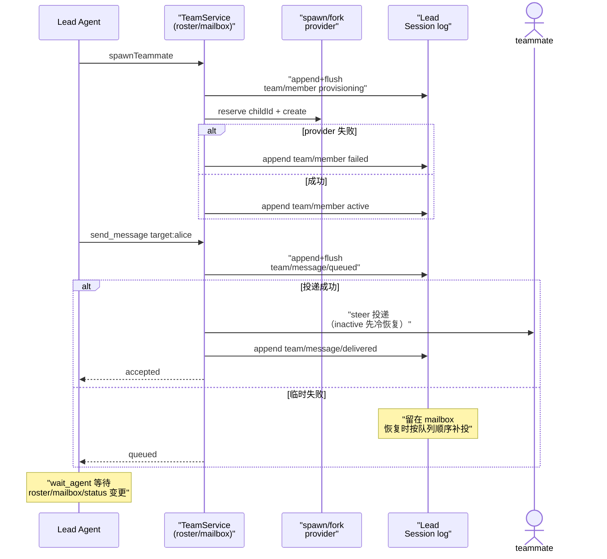

# Agent Teams：隐式根的持久化多 agent 协调域

> 子文档之一（**rc.8 新增关注面**），聚焦 dsh 的 Agent Teams 协调域。覆盖 `packages/experimental/agent-team`（`ctx.agentTeams` 域服务）与 `packages/experimental/tool-agent-team`（模型面向工具）。整体哲学见 [README](README.md)；本文上承 [subagent.md](subagent.md)（同一个 continuable 子 agent 机制的更高层组织）、衔接 [session.md](session.md)（协调状态的唯一事实源仍是 Lead Session 日志）。

> **增量更新说明（rc.8，2026-08）**：本文为新增关注面，对应上游 0.1.0-rc.8 合入的「Agent Teams」能力族（原 `packages/team` 经改名落到 `packages/experimental/agent-team`，服务键由 `team` 改为 `agentTeams`）。**依据代码快照比对 + PR 大标题（worktree/dsh-0.1.0-rc.8），非官方 changelog。**

> **本版增量更新（0.1.2-rc.1 → 0.1.5-rc.2）**：依 `dsh-v0.1.2-rc.1..HEAD` 的 git diff（`git log --format=%s … | grep -iE 'agent.team'` 命中 4 条：三条功能/修复提交 + 1 条合并 PR 标题）与 `verify-references.mjs --diff` 预检（原 12 条引用**全部是无指纹的弱校验**，本次逐条补齐首末行锚点）比对更新，三条主线：
> **(1) 消息统一到 Steer**——`feat(agent-team): unify messages on steer` 删掉 `followup_task` 与模型可选的 quiet/wakeup 调度：Team 工具收敛为九个、投递只有 Steer 一种，`TeamMessageSnapshot` 不再存调度字段。
> **(2) 折叠机制换代**——本文原述的 `foldTeam` 纯函数**已不存在**：Team 状态改由注册式 session 投影（`key: 'agentTeam'`、该版为 `stateVersion: 3`，0.1.7-rc.2 起为 `4`）增量物化，`TeamJournal.state()` 从 `ctx.sessionProjections.stateOf()` 读；四类 `team/*` 事件的 payload 版本升到 `version: 2`。
> **(3) 发布形态变化**——`release: publish experimental Agent Teams packages` 让五个实验包（域服务 / 工具 / Host profile / Web profile / Web UI）**移除 `private`、加 `publishConfig.access: public`、进入 dsh 发行系列**，包名仍保留 `dsh-experimental-` 前缀；另有 `fix(agent-team): preserve mailbox order on cold resume` 把冷恢复补投简化为严格按 durable 队列顺序。
> 依据为上游 git diff + commit message 聚合（该仓库无官方 changelog）。

> **本版增量更新（0.1.5-rc.2 → 0.1.7-rc.2）**：依 `dsh-v0.1.5-rc.2..dsh-v0.1.7-rc.2`（`fb2c4b9e69..477b4f4205`，3 650 个 commit）的代码快照比对更新，四条主线：
> **(1) 投影状态版本升级**——`teamProjectionDefinition.stateVersion` 由 `3` 升到 `4`（`key` 仍是 `'agentTeam'`），投影仍自行严格解码每个 Team 事件。
> **(2) 实验包分发策略反转**——具名公开白名单**已下线**，改为「`packages/experimental/*` 默认公开 + `PRIVATE_EXPERIMENTAL_PACKAGE_DIRECTORIES` 私有名单（当前为空）」；`agent-team-web-profile` 也随之从 workspace 与发布系列中消失，Host/Web 合并为**单一可选 bundle**。
> **(3) Profile 层禁用面扩大**——profile patch 不再把 `subagent` / `subagent_fork` 降级为 `one-shot`，而是把 `tool-subagent` / `tool-subagent-fork` 整插件 `disabled: true`。
> **(4) Team 的生成式 Remote API 下线**——浏览器面板改为直接读共享 Session store 中 Lead Session 的 `agentTeam` 投影，不再走 Team RPC。
> 依据为上游代码与 `.agents/notes/implemented/` 下的决策记录（该仓库无官方 changelog）。

## 项目中的角色：把「多个 agent 一起干活」从裸委派升级为共享协调态

[subagent.md](subagent.md) 解决的是「父 agent 如何委派一个子 agent 干活」——它是**一对一、父子单向**的能力 seam。Agent Teams 解决的是它的上一层问题：**如何让一个 Lead 与一群具名队友共享一份可重放、可审计的协调状态**（谁在、发给谁什么、每个人在推进哪个任务），并让模型用一组 native 工具参与进来。

去掉它系统会怎样：

- **多 agent 协调只能靠裸 `send_message` 式的临时转发**：没有持久的队形（roster）、没有 durable 的邮件（mailbox）、没有共享任务板（task board），每个队友各自为战，Lead 无法重启后重建"这个团队长什么样"。
- **协调状态无法跨崩溃/恢复重建**：显然这违背"会话事件日志是唯一事实源"的根哲学——协调状态若只在内存，冷启动就全没了。

一句话：Agent Teams = 在 subagent 的 continuable 子 agent 之上，叠加一层**持久化、可重放、模型可操作的共享协调层**；它自己不发明新的 agent 机制，而是把所有协调状态（成员/邮件/任务）都写成 Lead Session 日志里的 `team/*` 事件，再由注册的 `agentTeam` session 投影折叠成当前状态。

## 根因：子 agent 是单向的，"团队"需要共享而可重放的状态

为什么不是把委派直接叠起来就完事？三个张力催生这个新域：

1. **队形（roster）需要持久身份**。一个队友是可命名（lower-kebab-case）、只进不出（名字永不复用）的 continuable 直接子 agent。名字即授权与寻址身份，一旦 provisioning 就必须在日志里留一个 durable 记录：`spawnAdmitted` 在同一个 Lead 日志事务里完成"名字是否已被占用"判定、`maxMembers` 上限判定与 `provisioning` 成员的 append+flush，因此崩溃后"某个名字是否被占了"可由日志重放判定，而不是靠内存里的名字表（[packages/experimental/agent-team/src/roster.ts:270-277]()）。
<!-- anchor: const state = this.journal.state(root) … await this.journal.appendAndFlush(root, 'team/member', { version: 2, teamId: Tea -->

2. **消息需要 durable 队列 + 投递确认**。队友可能 inactive（live 缺席，需冷恢复）。`sendMessage` 先 `team/message/queued` 落日志、flush 后再尝试投递；投递目标 Session 一旦 durable 持有该消息身份，Lead 日志再记 `team/message/delivered`——"队列"与"确认"都是日志事件，崩溃重放即可重建（[packages/experimental/agent-team/src/mailbox.ts:117-144]()）。
<!-- anchor: const queued = await this.journal.transact(root.id, async () => { … message: queued, -->

3. **共享任务板需要版本化 CAS**。多个队友可能同时改同一个任务，于是每个任务都是完整版本化快照，任何 mutation 带 `expectedRevision`，乐观并发失败返回 `TEAM_TASK_STALE_REVISION` 而非覆盖新值（[packages/experimental/agent-team/src/task-board.ts:115-118]()）。
<!-- anchor: if (current.revision !== request.expectedRevision) { … 'TEAM_TASK_STALE_REVISION', -->

这三个张力共同指向一个方案：**把整个 Team 协调域建模为一组 log-only 的 Session 事件**（`team/member` / `team/task` / `team/message/queued` / `team/message/delivered`），只写在 **Lead Session** 里，由注册的 `agentTeam` 投影折叠成当前状态——这与 [session.md](session.md)「append-only 日志 + 派生投影」是同一种哲学在"多 agent 协调"上的延伸：协调状态不是旁路可变对象，而是日志的纯函数。

## 设计思路：隐式根 + 四类日志事件 + 三个子状态机

### 隐式根：每个运行 root 天然是 Lead

`TeamId = SessionId`——每个普通运行 root 的 `SessionId` 就是它团队的 id；创建 Team 在"有第一个成员/消息/任务"之前是无状态的（state-free）。队友是具名、continuable 的直接子 agent，记录下来在该 root 的 Session 里（[packages/experimental/agent-team/README.md:128-128]()）。
<!-- anchor: Every ordinary runtime root is the implicit Lead of a Team whose `TeamId` equals -->

### 服务装配：依赖既有 seam，不死磕新的 agent 机制

`TeamService` 的 `inject` 是 `['agents', 'sessions', 'sessionPersistence', 'sessionProjections', 'subagents']`——它依赖 Agent 注册表、Session 日志、持久化 seam、session 投影注册表与 continuable-subagent（spawn/fork provider）；没有 durable Session 存储的组合不会激活它（[packages/experimental/agent-team/src/index.ts:57-57]()）。
<!-- anchor: static inject = ['agents', 'sessions', 'sessionPersistence', 'sessionProjections -->

它把工作委托给六个内部对象：`activity`（变更通知）、`lifecycle`（运行时生命周期）、`journal`（日志写与投影读）、`roster`（队形）、`mailbox`（持久消息队列）、`tasks`（版本化任务板）（[packages/experimental/agent-team/src/index.ts:70-75]()）。
<!-- anchor: private readonly activity: TeamActivity … private readonly tasks: TeamTaskBoard -->

> 这一层强约束的语义：Agent Teams **不重新发明** spawn/fork/in-process continuable 机制——`spawnTeammate` 只是"先在 Lead 日志落 provisioning 成员、再问配置的 spawn/fork provider 创建保留的 child id"（[packages/experimental/agent-team/src/index.ts:150-151]()）。它是在 subagent 之上做**状态组织**，而非替换 subagent。
<!-- anchor: async spawnTeammate(caller: Agent, request: SpawnTeammateRequest): Promise<Spawn … return await this.roster.spawn(caller, request) -->

### 四类 log-only 事件 + session 投影折叠

> **演进说明（0.1.5-rc.2）**：本小节原题为「四类 log-only 事件 + `foldTeam` 折叠」。`foldTeam` 纯折叠函数已不存在——Team 状态改为**注册式 session 投影**，事件 payload 也从 `version: 1` 升到 `version: 2`。

| 事件 | 载荷 | 意义 |
|------|------|------|
| `team/member` | 完整队员生命周期快照 | 队形：含 provisioning/failed 相位 |
| `team/task` | 完整共享任务快照 | 任务板：版本化、带 revision |
| `team/message/queued` | 待投递消息快照 | durable 入队，先于投递 |
| `team/message/delivered` | messageId + targetId | 目标 Session 已 durable 持有该消息 |

全部 log-only、只写在 Lead Session、不进模型派生历史，四类事件的 payload 现均声明为 `version: 2`（[packages/experimental/agent-team/src/types.ts:230-242]()）。
<!-- anchor: interface SessionEventMap { … targetId: SessionId -->

折叠也不再是"读日志跑一遍纯函数"：服务构造时把 `teamProjectionDefinition` 注册进 `ctx.sessionProjections`（[packages/experimental/agent-team/src/index.ts:114-114]()），投影以 `key: 'agentTeam'` / `stateVersion: 4` 声明，并自行严格解码校验每个 Team 事件（[packages/experimental/agent-team/src/projection.ts:387-394]()）。
<!-- anchor: const disposeProjection = ctx.root.sessionProjections.register(teamProjectionDef -->
<!-- anchor: export const teamProjectionDefinition = { … } satisfies ProjectionDefinition<'agentTeam', TeamProjectionState> -->

`TeamJournal.state()` 只从 `ctx.sessionProjections.stateOf(root.session, 'agentTeam')` 取当前状态，投影未注册或恢复失败都直接抛错，绝不静默降级成"空团队"（[packages/experimental/agent-team/src/journal.ts:29-34]()）；冷恢复的入口仍是 `agent/session-start`，先由 roster 对账 provisioning、再由 mailbox 补投（[packages/experimental/agent-team/src/roster.ts:192-196]()）。
<!-- anchor: state(root: Agent): TeamState { … return projection -->
<!-- anchor: async recoverFor(agent: Agent, signal: AbortSignal): Promise<void> { … if (membership?.role === 'lead') await this.reconcileProvisioning(membership.roo -->

### 三个子状态机

1. **roster（队形）**：provisioning → active/failed。队友名字永不复用（`maxMembers` 数的是每个 provision 过的名字，包括失败成员）。恢复时 provisioning 记录只有在 child（独立持久化）有匹配的 direct-parent + continuable 描述符 + 初始 user message 时才转 active，否则 failed。
2. **mailbox（持久消息队列）**：`queued` 是 durable 的，`delivered` 是目标确认；**每条消息都尝试 Steer 投递**——running 目标在最近的步骤边界收到，idle 目标起一个 turn，inactive 队友冷恢复。投递前折叠 live+persisted inbox/history 防重复。持久记录因此只保留 sender / target / content / message identity，不含任何调度字段（[packages/experimental/agent-team/src/types.ts:128-134]()）。
<!-- anchor: export interface TeamMessageSnapshot { … readonly content: ContentBlock[] -->

   > **演进说明（0.1.5-rc.2）**：此处原述「quiet 投递在目标 inactive 时不激活它（留在队列），wakeup 投递成为目标下一个 FIFO turn 并冷恢复之」的双模式模型已被统一 Steer 取代——调用方不再选择调度方式，inactive 队友也会因收到消息而被冷恢复。

3. **task board（版本化任务板）**：完整快照 + `expectedRevision` CAS；pending 依赖全完成后 ready；`task-<n>` id 需 safe-integer；delete 保留 tombstone 但不再占 `maxTasks`。

## 核心结构 / 数据

### 部署限制（`ctx.agentTeams` 的静态 Config）

| 键 | 默认 | 约束 |
|----|------|------|
| `maxMembers` | 8 | 数每个 provision 过的名字（含 failed），名字不复用 |
| `maxTasks` | 256 | 数非删除任务 |
| `maxPendingMessagesPerMember` | 64 | 每目标待投递上限 |
| `maxMessageBytes` | 65 536 | 完整封帧投递的字节上限（含稳定 id + sender name） |
| `disposalTimeoutMs` | 5 000 | 约束 admitted 创建/邮箱投递/Team 结算，让 reload/停机 visibly fail |

所有限制必须是正 safe integer；`TeamService.Config` 用 schemastery 声明默认值，构造时再逐一经 `positiveLimit` 二次校验，越界抛 `TEAM_INVALID_CONFIG`（[packages/experimental/agent-team/src/index.ts:48-64]()）。
<!-- anchor: function positiveLimit(name: string, value: number): number { … disposalTimeoutMs: z.number().step(1).min(1).default(DEFAULT_DISPOSAL_TIMEOUT_MS -->

### 模型面向的工具（`tool-agent-team`，scoped-registered）

| 工具 | 谁可调用 | 语义 |
|------|---------|------|
| `spawn_teammate` | 仅 Lead | 创建命名 durable 队友，`fresh`/`fork` 两种 context 模式 |
| `send_message` | 成员→成员/lead | **统一 Steer** 投递：running 目标在最近步骤边界收到、idle 目标起一个 turn、inactive 队友冷恢复；结果只有 `accepted` / `queued` 两态 |
| `list_agents` | 全 | 枚举 Lead + 队友及当前运行时状态 |
| `wait_agent` | 全 | 阻塞观察下一次 roster/mailbox/task/status 变更，不唤醒成员；无活跃/在 provisioning 的 peer 时立即返回 `noProgress` |
| `interrupt_agent` | 仅 Lead | 中断队友当前 turn，保留其 pending inbox |
| `team_task_create` / `team_task_list` / `team_task_get` / `team_task_update` | 全（按角色） | 版本化任务板；`team_task_update` 用一个 `expected_revision` + `action` 枚举覆盖 claim/release/edit/set_dependencies/complete/reopen/reassign/delete |

九个工具都经 scoped `ctx.tools.register(defineTool(...))` 安装（[packages/experimental/tool-agent-team/src/index.ts:175-177]()）。
<!-- anchor: register(scoped.tools.register(defineTool({ … description: 'Create one named, durable teammate. Only the Team Lead may call th -->

相对 rc.8 的两处收敛值得点出：`send_message` 的入参只剩 `target` + `message`，调度方式不再是模型可见选项（[packages/experimental/tool-agent-team/src/index.ts:216-220]()）；任务板的全部变更收敛为**一个**带 `action` 枚举的 CAS 工具，而不是为每个动作注册一个工具名——工具名是模型的稀缺上下文资源，把动作放进枚举比放进入参名更省（[packages/experimental/tool-agent-team/src/index.ts:366-370]()）。
<!-- anchor: name: 'send_message', … message: { type: 'string', required: true, description: 'Self-contained message -->
<!-- anchor: action: { … description: 'Task transition to apply.', -->

这套工具**只在调用方确属某 Team 成员时**才可及——`apply()` 对每个已存在与后续创建的 Agent 调 `ctx.agentTeams.tryMembership(agent)` 过滤，非 Team 的 subagent 看不到它们（[packages/experimental/tool-agent-team/src/index.ts:408-413]()）。
<!-- anchor: const maybeInstall = (agent: Agent): void => { … ctx.on('agent/created', ({ agent }) => { maybeInstall(agent) }) -->

### 发布形态：五个实验包作为公开例外进入发行系列

> 这是本版增量里最"工程外部可见"的变化：Agent Teams 从"只能在源码 checkout 里试"变成"可从 npm 装完整组合"。

文档早先的定位是"实验面、pre-release 不承诺 API 稳定"——这点没变，变的是**分发面**。上游曾把 `packages/experimental/` 下五个 Agent Teams 相关目录列为显式公开例外：`agent-team`、`agent-team-profile`、`agent-team-web-profile`、`client-ui-agent-team`、`tool-agent-team`。

> **演进说明(0.1.7-rc.2)**：这份具名公开白名单（`PUBLIC_EXPERIMENTAL_PACKAGE_DIRECTORIES`）已下线，现由「实验包默认公开 + 私有名单」承担——`packages/experimental/*` 默认进入 npm baseline 与 dsh 发布系列（[scripts/experimental-package-policy.ts:2-2]()、[scripts/experimental-package-policy.ts:10-17]()）。
<!-- anchor: export const PRIVATE_EXPERIMENTAL_PACKAGE_DIRECTORIES: readonly string[] = [] -->
<!-- anchor: export function isPublicExperimentalPackageDirectory( … && !privateDirectories.includes(directory) -->
> 只有登记在 `PRIVATE_EXPERIMENTAL_PACKAGE_DIRECTORIES` 里的目录才保持私有，而该私有名单当前是**空数组**——决策记录同样写明"all current experimental packages publish"（[.agents/notes/implemented/process/2026-09-12-experimental-publication-denylist.md:13-15]()）。
<!-- anchor: The local npm baseline publisher and the public dsh release family discover … Every experimental directory outside the denylist is public by default. -->

规则是"**省略 `private`、保留 `dsh-experimental-` 前缀、设 `publishConfig.access: public`、加入 dsh 发布系列**"，私有例外只能靠 `PRIVATE_EXPERIMENTAL_PACKAGE_DIRECTORIES` 显式登记（当前为空名单）；同时实验组之外的发布包与 app 不得在 `dependencies`/`optionalDependencies`/`peerDependencies` 里点名实验包（[packages/experimental/AGENTS.md:6-7]()）。
<!-- anchor: - Every package here uses the `@deepseek-ai/dsh-experimental-*` npm prefix … - Release packages and apps outside this group must not name experimental packag -->

落到清单上，域服务包与工具包的包名与发布配置都是公开的（[packages/experimental/agent-team/package.json:2-6]()、[packages/experimental/tool-agent-team/package.json:2-6]()）。
<!-- anchor: "name": "@deepseek-ai/dsh-experimental-agent-team", … "access": "public" -->
<!-- anchor: "name": "@deepseek-ai/dsh-experimental-tool-agent-team", … "access": "public" -->

为什么值得单列：这曾是一次**分发策略上的显式破例**，0.1.7-rc.2 起已改为实验包**默认公开**（见上方演进说明）。收益是用户不必构建源码 checkout 就能装完整 Team 组合；代价是发布系列要长期维护一份私有例外名单（当前为空）。注意"改包名"与"去 private"是两件事——前者关乎兼容性与支持预期，后者才决定是否分发；上游选了"只做后者"，所以 `experimental-` 前缀留着，反向依赖则被约束挡住（实验包可依赖发布包，发布包/app 不得依赖实验包）。

Profile 层怎么接：`agent-team-profile` 以 `cordis.patch.yml` 在 `dsh-base` 之后应用，**禁用与 Team 工具重名的全局 continuable-child 控件**（`tool-subagent-control`、`tool-subagent-list-agents`），并把 `subagent` / `subagent_fork` 设为 `one-shot`（[packages/experimental/agent-team-profile/cordis.patch.yml:4-14]()）。
<!-- anchor: - id: tool-subagent-control … disabled: true -->

> **演进说明(0.1.7-rc.2)**：`one-shot` 降级已下线，同一 patch 现在把四个 continuable-child 插件**整体禁用**——`tool-subagent-control`、`tool-subagent-list-agents`、`tool-subagent`、`tool-subagent-fork` 各占一条 `disabled: true`，不再有 `backgroundMode` 行（[packages/experimental/agent-team-profile/cordis.patch.yml:10-14]()）。
<!-- anchor: - id: tool-subagent … disabled: true -->

这不是洁癖：全局 `send_message` / `interrupt_agent` 由 `tool-subagent-control` 注册（[packages/subagent/tool-subagent-control/src/index.ts:27-29]()），与 Team 工具同名；不先禁用就会出现同名的两套工具，模型无法知道自己调的是"发给 direct child"还是"发给 Team peer"。Web 侧则由 `agent-team-web-profile` + `client-ui-agent-team` 承载：`TeamService` 除域方法外还声明生成式 Remote API（`agentTeams/view` / `createTask` / `updateTask`）供浏览器挂载 Team UI。所有层都保持显式启用，随附 profile 默认不开 Team。
<!-- anchor: export function apply(ctx: Context): void { … name: 'send_message', -->

> **演进说明(0.1.7-rc.2)**：独立的 `agent-team-web-profile` 与 Team 的生成式 Remote API 都已下线——Host/Web 合并为**单一可选 bundle**，`agent-team-profile` 的 patch 直接插入 `agent-team` / `tool-agent-team` / `ui-agent-team` 三行（[packages/experimental/agent-team-profile/cordis.patch.yml:16-33]()）；浏览器面板改为直接读共享 Session store 中 Lead Session 的 `agentTeam` 投影，注册过程"performs no Team RPC"（[packages/experimental/client-ui-agent-team/src/client/mount.ts:25-26]()）。
<!-- anchor: - insert: … name: '@deepseek-ai/dsh-experimental-client-ui-agent-team' -->
<!-- anchor: * The panel reads the Lead Session's `agentTeam` projection from the shared … * Session store; this registration performs no Team RPC. -->
> 该包本身也已"absent from the workspace and release family"（[.agents/notes/implemented/architecture/2026-09-18-agent-teams-single-bundle.md:15-15]()）。
<!-- anchor: The separate `@deepseek-ai/dsh-experimental-agent-team-web-profile` package is absent from the workspace and release family. -->

## 核心流程：一次 `spawn_teammate` + `send_message` 的持久协调（sequenceDiagram）

对应源码：`spawn` 走 roster，service 处只是转发（[packages/experimental/agent-team/src/index.ts:150-151]()）；`send` 走 mailbox（[packages/experimental/agent-team/src/index.ts:160-161]()）。
<!-- anchor: async spawnTeammate(caller: Agent, request: SpawnTeammateRequest): Promise<Spawn … return await this.roster.spawn(caller, request) -->
<!-- anchor: async sendMessage(caller: Agent, request: SendTeamMessageRequest): Promise<SendT … return await this.mailbox.send(caller, request) -->

队列先后：`queued` 在投递前落盘并 flush（`mailbox.ts`），`delivered` 在目标 durable 持有消息身份后落 Lead 日志。投递本身分两条路，但**都是 Steer**：目标就是 Lead 时直接 `root.steer(input)`；目标是队友时走 continuation owner 的 host-only Steer 适配器，由它校验"Lead → 该 direct child"这条精确边并保留原始 `TeamMessageSource`（[packages/experimental/agent-team/src/mailbox.ts:249-265]()）。
<!-- anchor: if (message.targetId === root.id) { … : await this.checkpointDelivered(root, target.session, message.id) -->

## 关键设计决策

1. **为什么整个 Team 域都建模成 Lead 日志的 log-only 事件，而非旁路可变状态。**
   - Why：让冷恢复/崩溃重建精确还原——`agentTeam` 投影从 Lead 日志折叠出队形/任务/邮件，与 [session.md](session.md) 的"日志即唯一事实源"一致。协调状态若在内存，重启就失去团队身份。
   - 权衡：每次状态变更都要 append+flush 一次日志（代价是协调吞吐受日志写速限制），换来可回放、可审计、可 cold-resume。`noProgress`/`wait_agent` 建立在"等待的是日志里下一个事件"之上。

   > **演进说明（0.1.5-rc.2）**：本决策原述"`foldTeam` 从 Lead 日志折叠"，实现已换成注册式 `agentTeam` 投影（当时 `stateVersion: 3`，0.1.7-rc.2 起为 `4`）。判断未变，但协调状态从此进入 session 投影这一通用基础设施——可声明状态版本、可被 projection-cache 处理，而不是每次读都全量重放（[session.md](session.md)）。

2. **为什么用"版本化任务快照 + expectedRevision CAS"而非锁或增量合并。**
   - Why：多个队友可能同时改任务，锁在分布式/多 agent 场景难收敛；增量合并有合并冲突。整值快照 + CAS 让"谁改了什么"可审计，stale 调用方明确收到 `TEAM_TASK_STALE_REVISION` 而非静默覆盖。
   - 权衡：写放大（每次 mutation 重存整任务），但任务通常小而低频，换取去中心化 + 可重放。

3. **为什么模型只有一种通信语义：统一 Steer。**

   > **演进说明（0.1.5-rc.2）**：本决策原为「quiet vs wakeup 两条投递路径」，对应 `send_message`（quiet，不激活 inactive）与 `followup_task`（wakeup，成为目标下一个 FIFO turn）两个模型工具；两者现已合并为一个 Steer 语义的 `send_message`。

   - Why：调用方只需声明"发给谁"，不必选择调度策略。保留独立 Team 名称与投递模式，会让等价通信仅因"target 恰是 direct child 还是 Team peer"而采用不同语义；而 quiet 消息还可能为 inactive 队友持续累积，直到无关工作把它唤醒。统一后：running 在最近步骤边界收到、idle 起一个 turn、inactive 冷恢复。
   - 权衡：一条消息可能拉长目标的当前 turn（因此提示词与测试要求队友"整合新消息但不放弃已进行的工作"），换来的是单一通信原语、没有可有意停放的未读邮件，以及相邻 Agent 消息与 Team 消息语义不分叉。
   - 边界：Team 走**内部** host-only Steer 适配器（授权精确 Lead→direct-child 边、保留真实 sender 归因），人类浏览器 prompt 则保留独立的 Queue/Steer 选择、形成不同 turn，二者共用同一 Agent-loop inbox 但语义分开——见 [subagent.md](subagent.md)。

4. **为什么实验性包（`experimental/`）+ 服务键改名 `agentTeams`。**
   - Why：rc.8 把 Agent Teams 明确标为 experiment（目录 `packages/experimental/`，包名带 `experimental-` 前缀、服务键 `agentTeams` 与既有 `ctx.subagents` 平级但试验性）——它是"多 agent 协调"这个高潜力的新面，但 pre-release 不承诺 API 稳定。服务键就是这层平级声明：`declare module '@deepseek-ai/cordis'` 把 `agentTeams: TeamService` 挂到 Context 上（[packages/experimental/agent-team/src/index.ts:35-37]()），与稳定的 `ctx.subagents` 并列而非取代。
<!-- anchor: declare module '@deepseek-ai/cordis' { … agentTeams: TeamService -->
   - 权衡：让用户能提前试用而不影响稳定面；代价是升级可能破坏实验 API。

   > **演进说明（0.1.5-rc.2）**：本决策原先隐含"实验＝只在源码 checkout 里试"，现已改为**公开发布**：五个实验包进入发行系列（`private` 移除、`publishConfig.access: public`），但实验定位不变——包名保留 `experimental-`、无稳定性承诺、发布包不得反向依赖。详见上文「发布形态」。

5. **为什么冷恢复要按 durable 队列顺序补投，而不是只补被唤醒的那条。**
   - Why：`fix(agent-team): preserve mailbox order on cold resume` 删掉了原先"记下当前在投的那条 + 比较消息先后"的内存记账，改为每次投递都从 queued-minus-delivered 队列头依次投到指定消息（[packages/experimental/agent-team/src/mailbox.ts:211-231]()）。
<!-- anchor: /** Deliver every pending target message through `message` in durable queue orde … return true -->

     同一目标的所有投递仍由一条 per-target tail 串行化，投递与恢复因而共用同一条排序判定（[packages/experimental/agent-team/src/mailbox.ts:193-207]()）。
<!-- anchor: private async serializeDispatch( … if (this.dispatchTails.get(targetId) === tail) this.dispatchTails.delete(targetI -->
   - 权衡：一次投递可能顺带补投多条（写放大），换来"恢复后的到达顺序"与"Lead 日志里 queued 的顺序"恒等，且不引入第二份在途状态——排序判据只有一个来源，就是日志。

## 与其他模块协同

- **subagent / continuable 机制**：`spawnTeammate` 依赖 continuable-subagent 的 spawn/fork provider 创建保留的 child id；`interrupt_agent` 委托 continuable-subagent 的中断路径（只 cancel 当前 turn、保留 inbox）（[packages/experimental/agent-team/src/roster.ts:213-213]()）。
<!-- anchor: this.ctx.subagents.interrupt(target.id, { kind: 'ancestor', agent: caller }) -->

  Agent Teams 是 subagent 之上的**状态组织层**，不是新的委派实现。这条边界在本版增量后更清晰：**通用能力归稳定 Subagent**——continuable child 身份预留、精确 direct-child drain、以及 Team 投递实际使用的 host-only Steer 适配器（[packages/subagent/subagent/src/internal.ts:94-110]()）、parent 自有的 child catalog 事件与投影（[packages/subagent/subagent/src/catalog.ts:125-134]()）。
<!-- anchor: export function steerHostSubagentPrompt( … 'steer', -->
<!-- anchor: export const subagentCatalogProjectionDefinition = { … wire: { viewSchema, view: subagentCatalogEntries }, -->

  目录投影向观察者暴露的公开行 `SubagentCatalogEntry[]` 按 parent 事件顺序物化（[docs/subsystems/subagent.md:11-11]()）；**实验 Team 服务只沿允许的方向消费这些能力**，发布约束同样单向。continuable 的 descriptor/seed 契约、以及人类 inbox 控制（浏览器保留 Queue/Steer 双选，Team 侧固定 Steer）见 [subagent.md](subagent.md)。
<!-- anchor: The `subagentCatalog` projection exposes `SubagentCatalogEntry[]` in parent even -->

- **session / 事件日志**：`team/*` 事件全部 log-only、写在 Lead Session；`agentTeam` 投影折叠重建。`session/event` / `agent/status` / `agent/session-start` 是触发恢复与通知的观察口（[packages/experimental/agent-team/src/index.ts:107-111]()）。
<!-- anchor: ctx.on('session/event', (session, event) => { this.mailbox.observeSessionEvent(s … if (membership !== undefined) this.activity.notify(membership.id) -->
- **持久化 seam**：需要在 durable Session 存储下才激活；投递前的 `queued`/`delivered` 都依赖 `sessionPersistence` 的 flush 屏障。
- **tools 管道**：模型面向工具经 scoped `ctx.tools.register` 安装，只有 Team 成员可及（[packages/experimental/tool-agent-team/src/index.ts:175-177]()），受 [tools.md](tools.md) 的作用域/可见性治理约束；与全局 continuable-child 控件的重名冲突由 profile 层显式禁用解决（见上文「发布形态」）。
<!-- anchor: register(scoped.tools.register(defineTool({ … description: 'Create one named, durable teammate. Only the Team Lead may call th -->

## 全局关联：把「协作」也变成可回放的事件

Agent Teams 是 dsh「一切皆插件 + 日志即唯一事实源」在**多 agent 协作**维度的再一次落地：它没有引入任何旁路可变状态，而是把队形、邮件队列、任务板全部写成 Team Lead 的 `team/*` 日志事件，再由注册的 `agentTeam` session 投影折叠重建；队友复用 continuable-subagent 机制，工具复用 `ctx.tools` 作用域，持久化复用 `sessionPersistence` seam，连"折叠"都复用 `sessionProjections` 这一通用注册表——**协调层只是一个新的消费方与一组 log-only 事件，不是特权内核**。

发布形态的变化同样回扣这条哲学：Team 需要的不是"被搬进稳定包目录"，而是"被允许以实验身份发布"——上游为此在实验包规则里开了一条具名例外（0.1.7-rc.2 起进一步改为实验包**默认公开**、私有例外另设一份当前为空的名单），同时禁止任何稳定包反向依赖它。实验能力的边界由规则而非特权界定。这与 [subagent.md](subagent.md)（委派是事件）、[session.md](session.md)（唯一事实源）、[tools.md](tools.md)（受控执行）在主线上汇合，也解释了为什么它至今仍被定位为 experiment：它是"无特权内核"哲学向"群体协作"这一更大问题域的探索性延展。
