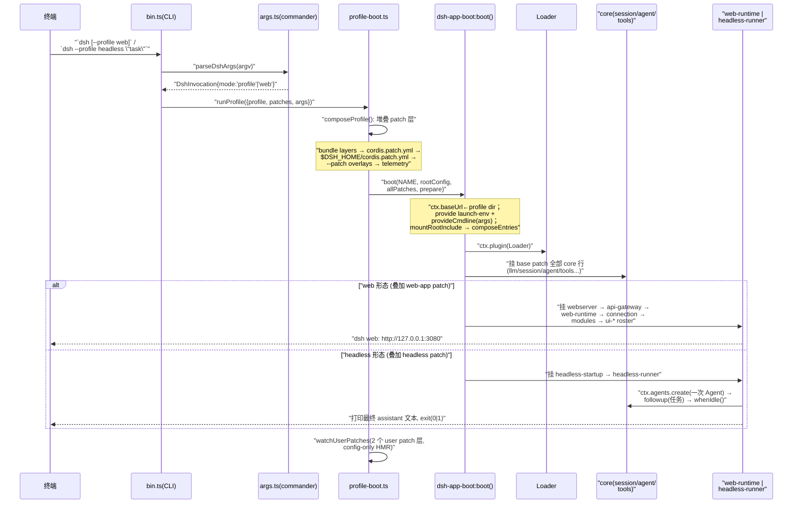
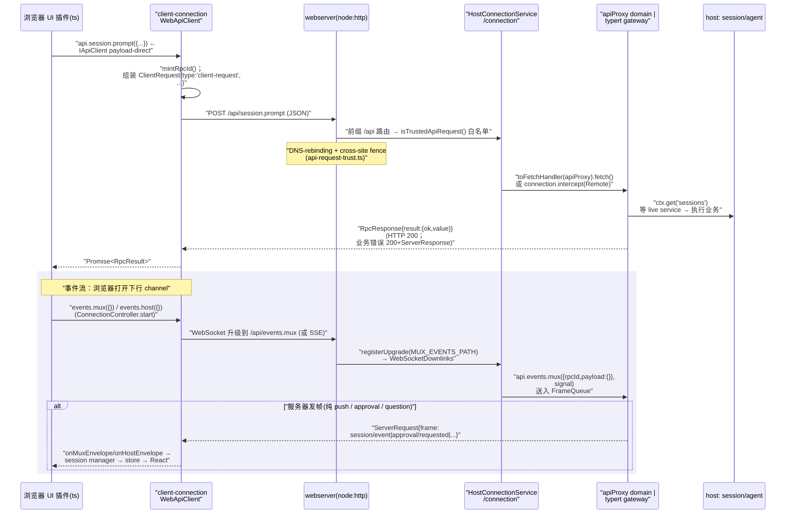

# 应用层：CLI 与 Web UI

> 对应关注面：CLI 入口（`dsh` 命令、profile/patch 旗标、headless 一次性 runner）、Web 前端（React UI）、client-host 通信（apiProxy / webserver / connection / typert RPC）、bundle 组合出 web vs headless 两种形态。
>
> **真实路径校正**：任务书给定的 `packages/connection`、`packages/webserver`、`packages/web/` 子路径在仓库中**不吻合**。实际目录是 `packages/client/connection`（RPC carrier）、`packages/host/webserver`（node:http carrier）、`packages/host/apiproxy`（domain + `/api` + fetch carrier）、`packages/api/remotes` + `packages/api/gateway`（typert Remote RPC）、`packages/client/modules`（clientModules）、`packages/client/hmr`、`packages/client/web`（React shell）+ `apps/web/`（Vite 入口）。本稿全部使用上述**真实相对路径**。

## 在项目中的角色（去掉它会怎样）

应用层是 dsh 的**可触达表面**：没有它，core/session/agent/tools 这些「引擎」存在却没有用户可面对的入口。

拆成四个职责层次：

| 层次 | 包 | 去掉后的后果 |
|---|---|---|
| 进程入口 | `apps/cli` | 没有任何 `dsh` 命令；core 变成无入口的库 |
| 形态组合 | `packages/bundle/{base,web-app,headless}` | 无法用 patch 层声明式拼出 web/headless 差异，每个形态要手写组装 |
| host 通信 | `packages/host/{apiproxy,webserver}`、`packages/client/connection` | host 与 browser 之间没有运输层，agent 事件无法推到 UI |
| browser UI | `apps/web` + `packages/client/{web,modules,hmr,runtime,ui-*}` | 失去 GUI；只剩 headless 与 TUI 一类非图形界面 |

最关键的取舍证据：**去掉 `apps/cli`/`bundle`，web 与 headless 两形态的共享 core 就失去组合点；去掉 `packages/client/connection`+`host/apiproxy`，浏览器里的 agent loop 事件（`turn/start`、`assistant/message`、`tool/call`…）就永远到不了 UI**。UI 渲染是 session/event 的纯 client 侧投影，不是 host 推送过来的成品 DOM。

## 解决什么问题、根因

**根因**：dsh 需要有「浏览器全功能 GUI」和「无服务的一次性 CLI runner」两种反差极大的运行形态，但两者背后是**同一个 agent loop / session / tool 核心**。若为两种形态各写一套 core，会出现双份 agent、双份 session 持久化、双份工具注册；若为 GUI 另发明一套不基于事件的推进方式，又跟 core 的 event-driven 模型脱节。

dsh 的解法是**「一个 core，两个 patch 组合层」**（bundle），并让 CLI 成为**组装器**（compose）+ **启动器**（boot），而非业务实现：

- web 形态：`base`(core) + `web-app`(网络/Web 层/GUI) 叠加出的多层 patch。
- headless 形态：`base`(core) + `headless`(一次性 runner)，根本不装 webserver/connection 等网络层。

第二个根因：**GUI 与 host 是两个不同进程/上下文（浏览器 vs Node host）**，必须有一个 transport-agnostic 的 RPC 边界，让 host 侧的 session/agent 状态以事件流方式流到浏览器。这不是简单的「HTTP API」，而是「四象限 RPC 消息模型 + 服务器发起的事件流」。

第三个根因：**前端 UI 本身也要插件化**。GUI 有几十个 `ui-*` 功能块（侧边栏、对话、设置、权限、goal、jobs…），若全写死在 shell 里则违背整个项目「一切皆可组合」的哲学。于是 dsh 把**前端也做成一个 Cordis 插件系统** —— `dsh.client` 图 + 浏览器侧 lazy-CJS 模块加载器（clientModules）。

## 设计思路

### web vs headless 两形态共享 core

三个 bundle 的 `package.json` 都以 `"dsh": { "bundle": { "patch": "./cordis.patch.yml" } }` 声明自己是「可安装的 profile patch 层」。web 与 headless 的差异**全部收敛在 patch 里**：

- `web-app/cordis.patch.yml`：插入 `webserver`、`api-gateway`、`web-runtime`、`client-hmr`、`connection`、`modules` 和整个 `ui-*` 浏览器 roster；并 **disabled** 一批应由 agent-preset（per-session）拥有的行（`tool-bash`/`tool-pwsh`/`skill`…）。
- `headless/cordis.patch.yml`：仅插 `code-runtime`、`headless-startup`、`headless-runner` 三行；**一条网络/browser 行都不装**。

base 里的行（`llm`/`session`/`agent`/`tools`/`credentials`/`sandbox`…）是共享 core（[packages/bundle/base/cordis.patch.yml:166-166]()，base 共享 core 行全文件见 15-451），两种形态的 overlay 都不重复它们。改 core 一行，两种形态同时受益。
<!-- snippet:     # Every shipped CLI mode starts with the same file-effect boundary. -->

### host/browser 通信分层

分层清晰：

```
[浏览器 UI 插件]  →  ctx.remote.*  /  api.sessions.*(client)
                          ↓  IApiClient（payload-direct 视图）
        [Connection RPC carrier]  ctx.connection.rpc.call('/api', ...)  /  events.mux()/host()
                          ↓  四象限 RpcMessage 全形
        [webserver 前缀路由] /api + SSE/WebSocket 下行
                          ↓  toFetchHandler(api)  /  HostConnectionService.createSharedFetchHandler
        [host: apiProxy domain](/api 兜底)  ◆[typert gateway](Remote 描述符)
                          ↓  ctx.get(service) 取 live Cordis service
        [core: session / agent / goals / ...]
```

每层只懂自己的职责：**apiProxy 是 transport-agnostic host gateway face**（[packages/host/apiproxy/src/api/index.ts:22-22]()）；**connection 是物理 transport 与逻辑 channel 的适配器**；**webserver 只是「命名路由注册 + index transform taps + 单席 fallback」**，完全不认识 harness 概念；**typert 用生成式 Remote 描述符把 live Cordis service 暴露给客户端**。
<!-- snippet: export interface ApiProxy { -->

### 方案 vs 替代

| 决策 | dsh 方案 | 常见替代 | 为什么选 dsh |
|---|---|---|---|
| 双形态共享 core | patch 组合层 | copy core 或分支 | 一次 core 修改两形态生效；patch-last-wins 可精确覆盖 |
| 浏览器↔host 边界 | 四象限 RPC + server-push event stream | 纯请求/响应 REST | agent loop 是事件驱动，UI 要订阅 session 增量而非轮询 |
| UI 插件化 | 浏览器侧 lazy-CJS 模块表（clientModules） | 单一大 bundle | UI 功能块可按 inject 依赖组合，热更单个 `client.js` |
| 事件下行 | SSE（fetch 流）+ WebSocket 双通道都支持 | 只 WebSocket | 契约层 `RpcRequest<Frame>` 不变，物理通道可替换 |

## 关键数据结构（精简）

### 四象限 RpcMessage（[packages/host/apiproxy/src/api/rpc.ts:151-186]()）

四种 wire 全形构成一个 discriminated union，**通道无关**（HTTP/WS/SSE 只是物理 carrier）：
<!-- snippet: export interface ClientRequest {
  readonly type: 'client-request'
  readonly rpcId: RpcId
  readonly method: string
  readonly payload: unknown
} -->
<!-- snippet: export type RpcMessage = ClientRequest | ServerResponse | ServerRequest | ClientResponse -->

语义约定：**initiator 铸 rpcId** —— client-request 由 client 铸、server-request 由 host 铸（answerable 帧用稳定 id，纯 push 每次新铸）；response 永远 echo 发起方 rpcId。`RpcMethodMap` 是**类型唯一真相**，`RpcRequest`/`RpcResponse` 载荷从它派生、client/host 两侧方法签名同源（[packages/host/apiproxy/src/api/rpc-map.ts:24-24]()，RpcMethodMap 完整接口见 24-77（文件 84 行））。
<!-- snippet: export interface RpcMethodMap { -->

### host `ctx.connection`（[packages/client/connection/src/rpc-host.ts:43-44]()）
<!-- snippet: export class HostConnectionService extends Service implements HostConnectionHandle {
  private readonly interceptors = new Map<string, ConnectionRpcInterceptor>() -->

`HostConnectionService` 提供 `ctx.connection.rpc.handle`/`intercept`：注册绝对逻辑 channel（如 `/rpc`）+ `authority: 'trusted-host' | 'loopback'` 信任策略。`intercept` 专用于共享 `/api` channel（`createSharedFetchHandler`），用 `matches` 谓词认领 endpoint，未认领的落回 apiProxy 兜底（[packages/client/connection/src/rpc-host.ts:71-74]()，完整认领逻辑见 69-94）。
<!-- snippet:   createSharedFetchHandler(
    channel: '/api',
    fallback: FetchHandler,
  ): FetchHandler { -->

### client 侧 `IApiClient` / `AbstractApiClient`（[packages/host/apiproxy/src/fetch/client.ts:244-245]()）
<!-- snippet: export abstract class AbstractApiClient implements IApiClient {
  /** Instance-owned observation buffer (module-level state would leak across instances/tests). -->
  private envelopeBatch: RpcMessage[] = [] -->

`ApiProxy`（api/index.ts:22）是 host 实现的 narrow-form 接口；`IApiClient` 是 payload-direct 消费视图（[packages/host/apiproxy/src/fetch/client.ts:87-88]()，完整见同文件 87-166）；`AbstractApiClient`（client.ts:244）桥接两者，把协议不变式（rpcId 铸造、四象限封包/解包、zod 校验、SSE 帧解码）集中一处，**平台差异只落两个 aspect**（`doFetch` transport + `onEnvelope` tap，见同文件 254/类注释 2-5）。
<!-- snippet: export interface IApiClient {
  /** Current project state; only a subset is sent to domain methods. -->
  readonly sessions: SessionsApi -->

### webserver 路由表（[packages/host/webserver/src/index.ts:65-71]()）

`WebServer extends Service`，内含 exact/prefix 两表 + upgrade 表 + indexTaps + 单席 fallback。匹配序：exact → 最长 prefix → fallback（`match`，[packages/host/webserver/src/index.ts:242-251]()）。重复 `(kind,path)` 抛错（[packages/host/webserver/src/index.ts:96-101]()）。

### typert 运行时描述符

`TypertGateway`（[packages/api/gateway/src/index.ts:90-90]()）host 侧维护 `ctx.typert.local.get(endpoint)`（strict 生成）或 **SRC fallback** 推导（`resolveSrcDescriptor`，[packages/api/gateway/src/index.ts:265-357]()）。参数经 lookup provider 把 wire 字段解析成 host 对象（`resolveParameter`，[packages/api/gateway/src/index.ts:407-468]()）。

## 核心流程（Mermaid）

### 流程一：`dsh web` / `dsh headless` 启动

两者共享同一 `apps/cli` 装配链，差异只在最终组合的 patch 集与 runner。



**关键锚点**：
- CLI 解析只认自己该认的旗标，把其余原样交给被 boot 的 app（`args.ts:6-11`；`--patch` 用 repeatable 而非 variadic 避免吞掉内层 args）。`web` 是 `--profile web` 的硬编码别名。
- 应用 command-line 语义由各自的 startup provider 负责：web 是 `packages/bundle/web-app/src/startup.ts`（`--host`/`--port`/`--trusted-host`），headless 是 `packages/bundle/headless/src/startup.ts`（task positional）。launcher 通过 `provideCmdline` 把 `args` 快照注入 `ctx.cmdlineArgs`。
- headless 是**无服务器一次性 runner**（[packages/bundle/headless/src/index.ts:96-97]()，run 完整体见 96-134）：`.get('appExit')` 读 launcher 提供的退出钩子，创建 agent、等 quiescence、flush session、折叠事件区间、打印文本、按 `turn/end` reason 决定 exit code。未提供 `appExit` 则 fail-loud（[packages/bundle/headless/src/index.ts:144-147]()）。
  <!-- snippet: async function run(ctx: Context, task: string, io: HeadlessIo): Promise<void> {
  // Loader siblings mount concurrently. Await the complete application before -->
  <!-- snippet:   const exit = ctx.get('appExit') -->
- web-runtime 打印 URL 行前**等 Loader tree settle**，避免「竞争者行还在挂载时」就宣告一个还没就绪的服务（[packages/bundle/web-app/src/index.ts:160-184]()）。
- `boot()` 的统一装配在 `packages/boot/app-boot/src/index.ts:757-801`：`ctx.baseUrl`←profile dir、`provide('dshHomePath')`、`mountRootInclude(patches)`、`loader.await()`、`assertEntriesActivated`。live 热更由 profile-boot 用 `watchUserPatches` 对两个 user patch 层做 config-only 监听。

### 流程二：浏览器 UI 经 apiProxy/connection 调 host + 订阅 event stream



**关键锚点**：
- 信任边界：浏览器端 `WebApiClient` 实际选 WebSocket 下行（[packages/client/connection/src/client/web-api-client.ts:13-13]()，openMux/openHost 见同文件 18-32）；`InProcessApiClient` 走 SSE 的 `readSse`。同一契约、两种物理通道。
  <!-- snippet: export class WebApiClient extends AbstractApiClient { -->
- host 端下行双通道：`WebSocketDownlinks`（[packages/client/connection/src/websocket-downlink.ts:51-51]()，handleMux/handleHost 双通道见 51-82）`handleMux`/`handleHost` 各开一条；`handleMux`/`handleHost` 的消息（上游流量）一律 `websocket.close(1008, 'downlink only')`（[packages/client/connection/src/websocket-downlink.ts:109-111]()）—— 上行只走 HTTP。
  <!-- snippet: export class WebSocketDownlinks { -->
- 浏览器端 `ConnectionController` 负责**双流握手的严格 readiness**（[packages/client/connection/src/client/connection.ts:61-62]()，完整见 61-169）：`describe` 证明 unary 可达 + 两流 `onOpen` 证明物理通道建立，才 `onConnected`；断线后指数退避重连（`backoffDelay` 在 :91-95）。
  <!-- snippet: export class ConnectionController {
  private generation = 0 -->
- 所有 `mux`/`host` 帧由 `apiProxy.events.mux/host` 从 `FrameQueue` 推送，`subscribeSession` 先推 `session/subscribed` 基线帧，让 client 拿到 lastSeq 做 gap 检测（[packages/host/apiproxy/src/api-proxy.ts:480-481]()，含义见同函数 480-482）。
  <!-- snippet: function subscribeSession(queue: FrameQueue<RpcRequest<MuxFrame>>, session: Session): void {
  queue.push(frame({ type: 'session/subscribed', sessionId: session.id, lastSeq: session.seq - 1 })) -->


## 与其他模块协同

- **依赖 core spine**：`base/cordis.patch.yml` 挂载 `session`/`agent`/`tools`/`agent-default-model`/`credentials`/`sandbox`…（[packages/bundle/base/cordis.patch.yml:15-451]() 全文件）。apiProxy 的实现靠 `ctx.get('sessions')` 等 live service 干活。
- **session/event**：UI 是 session 事件的 client 投影；工具调用经 `ctx.tools.get(name)` 的 presenters 把 tool/call/result 渲染成结构化视图。
- **agent**：apiProxy 用 `createApiProxy` 组装 agent 创建路径，维护 **per-session model selection**。headless 直接 `agents.create`（[packages/bundle/headless/src/index.ts:111-119]()）。
- **UI 渲染回放**：browser 侧 `packages/client/web/src/app.tsx:30-37` 用 `bindSnapshotSelector(sessions.list)` 把 session store 绑定到 React；`app-shell.ts:35-49` 在 slots 安装 React renderer 并 `renderSlot('root')`。真正的会话 store 在 `packages/client/runtime/src/client/sessions/*`（本项目只做架构级覆盖）。

## 关键设计决策

### D1 Why web/headless 两形态不重复 core？

**patch-last-wins** 组合模型让「形态差异」变成声明式 yaml 覆盖，而非复制代码。`web-app/cordis.patch.yml` 与 `headless/cordis.patch.yml` 都只描述**增量**：web 加网络/UI 行并 disabled 一批 agent 平面行；headless 只加一次性运行器三行。base 每一行被两形态共享。

- 证据：`web-app/cordis.patch.yml:283-285` 注释「Disabling rather than deleting is deliberate」—— base 共享，若 surface overlay 删掉一行，未来某天有人重排组合它会在 base 里「悄悄复活」，所以用 `disabled: true` 而非移除。
- **权衡**：overlay 必须**完整重述**要改的行（patch 是 replace 整个 row 的 config，非合并），`web-app/cordis.patch.yml:4-6` —— 写 overlay 容易漏 key。

### D2 Why clientModules 从 `dsh.client` 图组合（前端也插件化）？

`packages/client/modules/src/index.ts` 从 Loader entries 扫描声明 `dsh.client` 的包（`dsh.client.platform==='web'`），组合出 `window.__DSH_BOOT__` 图。**前端被折叠进同一个 Cordis 组合模型**：`ui-*` 各自是 `dsh.client` 包，按 inject 依赖由浏览器侧 Loader 组配。

- 证据：`client/modules/src/index.ts:184-249` —— `ClientModuleRegistry` 构造时订阅 `internal/plugin` 增量扫描（`index.ts:218-228`）+ 注册 `/plugins` prefix 路由 + 挂 `tapIndex` 注入 boot manifest（`index.ts:245-248`）；`client/manifest.ts:159-171` 定义 `DshWindow` 线协议。浏览器侧 lazy-CJS 模块表实现在 `client/system.ts:59`，`immediately` 预取层 + 惰性 materialize + `invalidate`。
- **权衡**：shell 自足规则（`packages/client/web/src/boot.tsx:4-9`）规定 shell 不得 value-import 任何插件包（唯一例外是 modules 自身引导自举）。这让「插件失败时页面仍能展示失败报告」成为可能，也是模块系统无法通过自身加载自身的原因。

### D3 Connection RPC carrier 的价值？

Connection 把「逻辑 channel + 物理 transport」解耦：host `ctx.connection.rpc` 与 client `connection.rpc.call` 都只谈**抽象 channel/endpoint/rpcId**，真正走 HTTP/WS/SSE 由子类 aspect 决定。

- 文档锚点：`docs/api-gateway.md` —— Connection owns transport, RPC ids, response envelopes, and request cancellation, while the Gateway owns only the Remote data protocol and business dispatch。
- **价值**：替换 transport（HTTP→IPC、SSE→WS）不需要改任何 Remote 描述符或 client 编程接口；同时**统一信任边界**（`isTrustedApiRequest`）集中在 connection，业务层不感知安全细节。

### D4 typert 怎么让运行时 schema 跨 host/browser 共享？

typert 采用**生成式严格描述符 + SRC 运行时降级**两段式：
1. **构建期**：`dsh-typert-generator` 从 Host `ts.Program` 分析 `@Remote` 签名，产出 `typert.host.*`（host 加载）与 `typert.remote-client.*`（client 挂载贡献）。
2. **host 运行时**：`api/gateway` 的 `ctx.typertGateway` 用 strict descriptor（`ctx.typert.local.get(endpoint)`）或 **SRC fallback**（`resolveSrcDescriptor`，从 JS 函数源码参数名推断，[packages/api/gateway/src/index.ts:265-357]()）解析 wire 字段 → lookup provider 把 `agentId`/`sessionId` 解析成 host 对象（`resolveParameter`，[packages/api/gateway/src/index.ts:407-468]()）→ 调 live service → 校验返回（`decode`/`assertJsonValue`，[packages/api/gateway/src/index.ts:614-673]()）。
3. **client 运行时**：`api/gateway/src/client/index.ts:88-415` `ClientRemoteService` 在 `remote.<namespace>` 子 service 挂 concrete 方法（**非 JS Proxy**），经 `connection.rpc.call('/api', endpoint, {args})` 发调用。

- 关键点：同一份生成 schema 在 host（校验入参/返回）与 client（校验出参）复用；SRC fallback 只解决 Host dispatch，Client 的 types/codecs 永远来自最新生成的 `typert.remote-client.*` —— 保证构建产物是严格真相。

### D5 hmr 让前端插件热更新的取舍？

`packages/client/hmr/src/index.ts` 用**轮询**（`setInterval(pollWatches, pollIntervalMs)`）stat 每个 graph row 的 bundle，变化 → `clientModules.rebuilt(id)` 重哈希 → SSE `/plugins/events` 广播 graph/rebuilt 帧给浏览器半端（[packages/client/hmr/src/index.ts:148-190]()）。
- **为什么轮询而非 inotify**：`hmr/src/index.ts:4-6` 明言「network mounts deliver no inotify events」。
- **取舍/限制**：`web-app/cordis.patch.yml:21-23` **显式 disabling 共享 HMR 行**（`hmr: true`→`disabled: true`），因 web 的 module-reload 生命周期 untested；取而代之的是 `client-hmr`（前端 bundle 热更）+ `watchUserPatches`（config-only 热更）。所以当前 web 的「无刷新热更新」只对 `pnpm run dev:web` 重写的 client bundle 生效；改 shell/普通包仍需刷新。
- **权衡**：轮询 + 内容哈希组合简单可靠（跨平台、无文件事件依赖），但是**整 bundle 替换**粒度（`invalidate(id)` 后重新 materialize），无 Module Federation 的增量模块替换。

## 亮点与问题

### 亮点

1. **patch 组合的两形态共享**：`base`/`web-app`/`headless` 三个 yaml 精确表达「core 共享 + 形态增量 + per-session agent 平面」，是全项目最优雅的声明式范例。`disabled` 而非删除（防共享 base 复活）+ 完整重述契约（防合并遗漏）都是深思熟虑的防御。
2. **四象限 RPC**：`ClientRequest/ServerResponse/ServerRequest/ClientResponse`（[packages/host/apiproxy/src/api/rpc.ts:151-186]()）区分「客户端发起调用」与「服务器发起推送/问答」；`RpcId` 由 initiator 铸造、response 永远 echo。对应答式帧（approval/question）用稳定 id 可重放。
3. **transport-agnostic**：`apiProxy` 接口 + `connection` carrier + 可换 aspect（fetch/WS/SSE/IPC），host/browser 边界可替换而不动协议与业务；浏览器侧 `readSse` 与 WebSocket 下行产出同一 RPC 契约。
4. **浏览器端 lazy-CJS 模块表**（clientModules）：自举自洽的插件加载器，`immediately` 预取层 + 惰性 materialize，`inject` 边/`loadCache`/`invalidate` 齐备，把前端做成可组合系统。
5. **SRC fallback**：dev 时从函数源码解析签名即可生成弱描述符，构建期生成严格描述符，两段式让「改签名要重建、改实现体不用」成为可预期的开发流。
6. **信任边界集中**：`isTrustedApiRequest`（DNS-rebinding Host fence + cross-site + Origin 三重）、`PRIVILEGED_METHODS` 环回钉回、`trustedHosts` bare-authority 校验，安全考虑内嵌进 carrier 而非散落业务。

### 问题 / 待改进

1. **web 形态 HMR 事实上未完整落地**：共享 `hmr` 行被 disabled，docstring 承认 reload 生命周期 untested —— 「前端插件热更」处于 dev-only、整包替换的折中状态，生产无热更。
2. **`--host 0.0.0.0` 被显式拒绝**（[packages/bundle/web-app/src/startup.ts:69-71]()）：意图安全，但限制非 loopback 部署必须手改 webserver 配置；`trustedHosts` + LAN 快照系统只覆盖「本机 LAN 字面量」一种非环回场景。
3. **`lanAddresses` 是 boot-time 快照**（`web-app/README.md`）：接口变更不重申，打印的 LAN URL 可能与实际信任围墙不一致。
4. **前端契约分散**：`rpc-map.ts` / `UNARY_VALUE_SCHEMAS` / `UNARY_ROUTES` 三表需保持同步（有编译期约束但仍是三份声明）。
5. **`clientModules` 增量扫描的负缓存永不失效**（[packages/client/modules/src/index.ts:109-129]() 注释「plugin-set changes take effect on restart」）：运行中装/卸 `dsh.client` 包不生效，热更 bundle 内容只能走 `rebuilt()`。

## 已知的文档-实现漂移

- **任务书路径 vs 真实路径**：任务书给的 `packages/connection`、`packages/webserver`、`packages/web/` 在仓库**不存在**；真实是 `packages/client/connection`、`packages/host/webserver`、`packages/client/web`（+ `apps/web` Vite 入口）。本稿全部用真实相对路径。
- **`host/apiproxy` 的 api 域文件**（`sessions.workspace/subagents/settings` 等 schema）与 `rpc-map.ts` 的**域错误映射细节**本轮只读了契约与 api-proxy 前端，各 schema 域文件未逐行——跨域细节以契约层为准。
- **`packages/client/runtime/src/client/sessions/*`**（session store/manager/conversation-assembler）如何把 mux 帧 fold 成 React store 只确认了 `bindSnapshotSelector`（app.tsx）与目录结构，fold 算法未逐行。
- **`connection/src/http-bridge.ts` 与 `api-path.ts`** 实现细节未逐行；`PRIVILEGED_METHODS` 与 apiProxy 各域方法的对应关系待核。
- **typert 构建期生成管线**（`typert-protocol`/`typert-generator`/`typert-registry`）本轮未细读，`docs/api-gateway.md` 描述的生成管线依赖它们，待复核。
- **前端 `ui-*` 与 `client/runtime` 是大体量单一关注面**：只读目录结构与入口/boot 内核/slots/session store 绑定，逐个 UI 插件的状态/resizer/样式细节未逐行覆盖（尤其 `ui-conversation`、`runtime/src/client/sessions/*`）。
