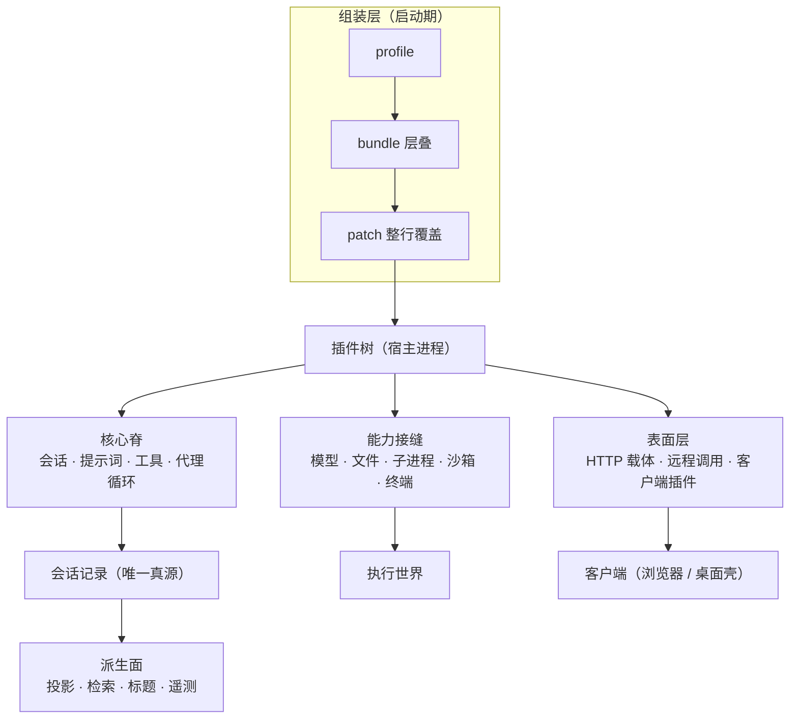
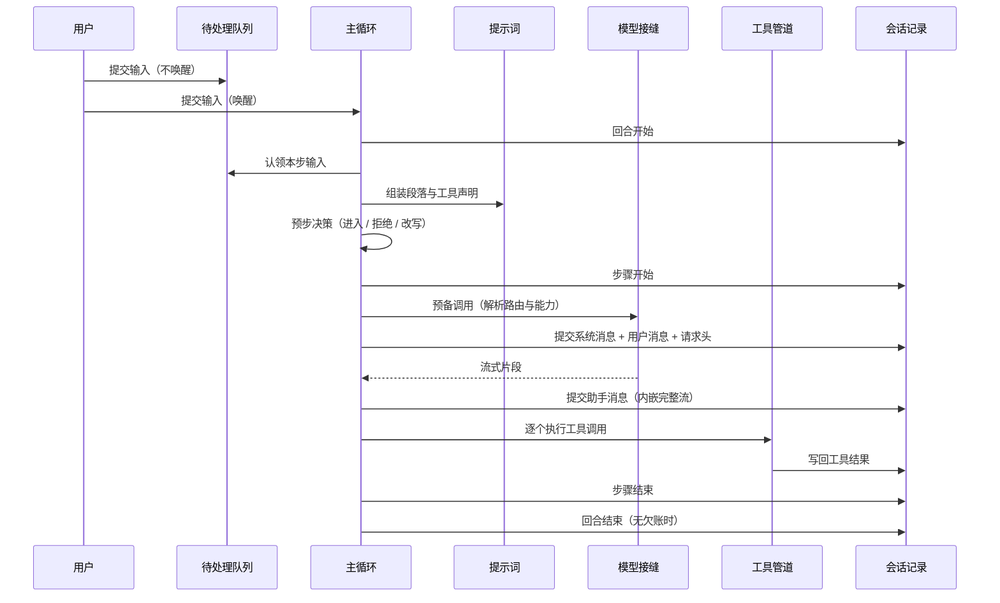

# DeepSeek Harness 架构设计说明

## 一、背景与定位：为什么做、要解决什么问题

### 1.1 产品定位

DeepSeek Harness（下称 dsh）是一个 agent harness——不是"又一个 coding agent 产品"，而是承载 agent 产品的那层骨架。它提供主循环、工具执行、会话状态、模型接入、执行沙箱、多形态外壳（浏览器、桌面、命令行、SDK、编辑器接入），并且把其中每一部分都做成可替换的。

目标用户是三群人：需要定制 agent 行为的团队、需要在同一内核上产出多种交付形态的产品方、以及对"模型到底看到了什么"有审计要求的使用者。

### 1.2 问题的起点

dsh 立项时面对的不是"缺一个 agent"，而是四类结构性缺陷：

- **不可审计**：模型的每一轮输入往往只能靠日志猜，出问题无法回放，只能重试碰运气。
- **不可替换**：主循环、工具注册表、会话存储写死在核心里；想改行为就得 fork，想安全扩展就只能等框架开配置点。
- **无边界**：模型生成的命令直接跑在宿主上；所谓"沙箱"常常只是一组启动参数。
- **单形态**：换一个交付形态（终端 → 浏览器 → 桌面）就要重写一套会话与工具逻辑。

四者叠加的结果是：这类产品的每一次演进都变成"改核心 + 冒回归风险"，而扩展生态始终长不大。

### 1.3 设计信条

dsh 用两句话概括自己的立场，本说明后续所有章节都可回溯到这两句：

> **一切皆插件。** 没有特权内核；扩展方式是"在旁边挂一个插件"，而不是"打补丁进核心"；注册即副作用，插件卸载时连同它注册的一切一起回退。
>
> **模型可见即已记录。** 凡是能进入模型请求的内容，都必须能从会话记录重建；要新增一种模型可见输入，就必须新增一种记录事件。

### 1.4 质量模型

| 质量目标 | 含义 | 在架构中的落点 |
|---|---|---|
| 可回放 | 任意一次模型请求都能被逐字重建 | 会话日志是唯一真源；实时流与持久事实分两条路径 |
| 可替换 | 任一能力都能换成另一种实现而不动调用方 | 能力接缝三角色（定义/提供方/消费者）；执行世界成组迁移 |
| 可撤销 | 扩展退出后系统回到原状 | 注册即副作用；生命周期与所有权绑定 |
| 可诊断 | 出了问题能定位到"哪一层配错了" | 配置分层快照、条目化配置、每行独立可替换 |
| 不静默降级 | 无法满足安全约束时拒绝，而不是放行 | 故障关闭；派生物可丢、真源不可猜 |

注意"可回放"与"不静默降级"在目标上是有张力的：前者要求尽量多记账，后者要求尽量少放行。dsh 的处理是分工——日志管"记全"，沙箱管"拒绝"，两边不互相让步。

## 二、设计输入：约束、非目标与技术选型

### 2.1 需求与约束（证实）

- **交付形态多样**：浏览器、桌面、命令行、SDK、编辑器接入共用同一内核（README 与启动入口的装配文档均明示）。
- **开发者预览**：项目明确声明会有破坏性变更，不提供稳定 API 承诺。
- **本地优先**：默认只监听回环地址，默认把模型执行限制在工作区内。
- **单机可运行**：不需要预装数据库或消息队列；桌面形态甚至要求用户机器不装任何运行时。
- **多平台**：Linux / macOS / Windows 三平台都要能约束子进程（分别走不同的内核机制）。

### 2.2 非目标（证实）

- **不是安全隔离边界**：安全说明明确写出"未做安全审计、不得视为生产就绪"，沙箱与审批"只能降低风险、不保证隔离"。
- **不做多租户**：没有租户概念，默认只有一个本机操作者身份；远程接入是"授权某人看/驱动我的会话"，而不是"托管多个彼此隔离的用户"。
- **不追求格式可降级**：会话格式只承诺"旧数据能被新版本读"，不承诺"新数据能被旧版本读"。
- **不做模型能力评测**：项目不含对模型效果的评测体系，性能门禁只约束自身实现。

### 2.3 无法复原的输入（不可复原）

以下内容在仓库中没有留档，本说明不臆造：

- **立项时的原始指标**：例如"期望的首字节延迟上限""单会话最大长度"没有被记录为可验收目标。
- **读者规模与负载画像**：没有线上流量数据，性能章节只能给口径而不是承诺。
- **为什么选择这个产品边界**（只做 harness 不做托管服务）的商业判断。

### 2.4 技术选型与代价

| 选型 | 换来了什么 | 付出的代价 |
|---|---|---|
| TypeScript + 全 ESM | 类型即契约；跨包重构可靠 | 需要"源码面/产物面"两套平面严格分离，构建步骤成为前置条件 |
| 自研插件运行时（基于上游框架的 vendored 副本） | 可逆副作用、作用域隔离、热重载语义都可控 | 需自行维护上游同步；上游名发布等于占用他人注册表名字，故整体改名 |
| 层叠配置补丁 | 组合关系是"可读的文件"而不是运行期代码 | 补丁是整行替换而非深合并，写补丁必须重述；五个层次的概念负担 |
| 纯文本行式会话存储 + 不可变世代 | 追加写、跨进程可见、可逐行修复 | 没有查询能力，必须另建派生索引；日志体积随会话线性增长 |
| 可选的嵌入式查询索引 | 需要时能全文检索 | 默认关闭，开启即引入第二套存储与第二份派生物 |
| 生成式远程调用契约 | 服务端与客户端契约来自同一份声明 | 必须先构建才能启动界面；两种模式（源码/产物）下严格程度不同 |
| Electron 承载桌面 | 用户机器零运行时依赖 | 包体积、签名与公证流水线复杂度显著上升 |

## 三、总体架构：边界、部件与依赖方向

### 3.1 系统边界

系统边界画在"宿主进程"上：会话记录、工具执行、模型请求、沙箱约束都发生在宿主进程内或其派生的子进程里；浏览器与桌面壳都是**客户端**，只能通过远程调用契约访问宿主，不直接读宿主内部状态。

这条边界决定了两件事：其一，客户端可以随时重连而不影响正在运行的任务；其二，任何"客户端才知道的状态"都不是真源。

### 3.2 部件清单

这张图的读法是"从上往下是启动顺序，从左往右是运行期职责"。组装层只在启动时介入，运行期不再参与；核心脊依赖能力接缝的**定义**而不是具体实现；表面层依赖远程契约而不是宿主内部；派生面只读会话记录。

有一处刻意的不对称：**执行世界不从属于核心脊，而是与它并列**。因为执行世界是安全性质的来源——它必须在架构图上占一个显眼位置，而不是藏在工具实现里。

### 3.3 分层与依赖方向

允许依赖：组装层 → 核心脊 → 能力接缝定义 → 提供方；表面层 → 远程契约 → 宿主服务；派生面 → 会话记录（只读）。

禁止依赖：核心脊依赖具体提供方；表面层绕过远程契约直读宿主内部；派生面反向成为真源；非实验包依赖实验包；任何应用绕过统一启动入口自行装配。

最后两条不是口头约定，而是由脚本门禁强制执行的——这是本项目较有特色的地方：**架构声明尽量落成可执行检查**。

### 3.4 运行形态

同一内核，靠装配差异产生六种形态：浏览器（日常交互）、桌面（零依赖分发）、一次性任务（无服务器跑完即退）、SDK（被别的程序嵌入）、编辑器接入（宿主驱动）、插件管理（安装卸载）。六者共享核心脊、能力接缝与真源，只在"叠了哪些包、覆盖了哪几行配置"上不同。

### 3.5 协作承诺

- 客户端与宿主之间：只有远程契约，没有共享内存；连接断开不影响宿主任务继续。
- 插件与宿主之间：通过服务键与事件协作，不通过 import 彼此实现。
- 提供方与消费者之间：消费者只依赖接缝定义，换提供方不应改消费者代码；若必须改，说明这个接缝没设计完整。

## 四、核心模块与职责

### 4.1 组织原则

模块按**能力家族**划分（会话、工具、模型、执行、表面、存储…），每个家族内部再按"定义 / 提供方 / 消费者"三角色拆包。一个包可以承担多个角色，但**只有单一角色不构成接缝**。这条判据直接限制了"为了分类而建包"的冲动。

### 4.2 模块责任矩阵

| 模块 | 负责 | 对外承诺 | 明确不做什么 | 依赖谁 |
|---|---|---|---|---|
| 组装 | 把 profile/bundle/patch 合成一棵可启动的树 | 最终组合可被导出、被覆盖、被诊断 | 不在运行期干预业务；不持有会话状态 | 装配所需接口 |
| 会话记录 | 追加事实、维护世代与迁移、对外提供读句柄 | "已提交的世代永不被改写" | 不做检索、不做展示、不做摘要 | 存储后端 |
| 主循环 | 驱动 turn/step、决定何时开步何时收尾 | "被接纳的输入一定落日志；没被调用的模型请求不留痕" | 不实现工具、不实现模型协议、不渲染界面 | 提示词、模型接缝、工具管道 |
| 工具管道 | 校验、把关、执行、写回结果 | "每次调用都过同一套把关；失败也有配对的记录" | 不定义具体工具语义 | 工具注册表、审批、沙箱 |
| 提示词 | 组装段落与工具声明 | "最终渲染结果可回放" | 不判断段落内容是否正确 | 注册段落的插件 |
| 模型接缝 | 协议转换、流式组装、重试与结算 | "每次尝试都有可回放的结算记录" | 不管凭据存储、不管 UI | 提供方适配器 |
| 执行世界 | 文件、子进程、终端、语言服务的实际执行 | "所有执行共享同一个世界" | 不做策略判断（那是沙箱与审批的事） | 操作系统 / 远端主机 |
| 沙箱与审批 | 约束执行、在人机之间往返确认 | "无法建立约束时拒绝执行" | 不判断业务正当性 | 执行世界、交互通道 |
| 表面层 | HTTP 载体、远程调用、客户端组合 | "客户端只能通过契约看到宿主" | 不直接访问宿主内部状态 | 远程契约 |
| 存储与配置 | 领域状态、用户设置、凭据引用 | "真源与派生用不同失败策略" | 不解释业务含义 | 文件系统 |

### 4.3 关于"明确不做什么"

这一列比"负责什么"更重要，因为它决定了接缝的位置。举两个具体例子：

- 模型接缝**不管凭据存储**。凭据是另一条接缝，适配器只在调用时拿到一次可用的认证材料。合并两者的后果是"换模型提供方就顺手改了凭据读取路径"，这在多提供方并存时会被放大成难以审计的耦合。
- 沙箱**不判断业务正当性**。它只回答"这个 argv 在当前策略下能否执行"，"该不该执行"由审批与权限预设决定。混在一起会让策略层无法解释自己的决策。

## 五、写入链路：一句话如何变成一个回合

### 5.1 端到端全景

### 5.2 两个核心概念：回合与步骤

一句话概括：**步骤是"一次模型请求加上它引发的工具"，回合是"一次欠账清零"**。区别在收尾条件——步骤以"这次请求及其工具都结束"收尾，回合以"没有谁还欠我一次请求"收尾。工具返回后如果还欠一次模型请求，就在同一回合里开下一步；没有欠账就关回合。

这个划分解决了一个具体问题：**用户连发两句话时，该合成一次请求还是两次？** 答案取决于"前一句是否已经花掉了"——如果模型还没被调用就已经被拒或改写成空，那一轮仍然关闭（零步回合），但输入不会凭空消失。

### 5.3 状态机

一次输入可能经过的状态：未被认领 → 已认领（进入 / 被拒 / 被改写）→ 已提交为模型可见 → 已被结算。关键约束有三条：

- 认领之后即使被拒，也必须留下"这条输入存在过"的记录。
- 提交系统消息与提交用户消息必须在同一提交点，中间取消则两边都不提交。
- 结算分两类：成功的助手消息进入模型历史，失败的尝试只留在记录里、不进历史。

### 5.4 并发控制

工具调用分两类：可并行的与必须排他的。可并行调用受一个上限约束（配置项，默认 10），排他调用作为顺序屏障单独执行。这解决了"工具之间是否需要保序"的常见矛盾：读操作可以并发，写操作不能。

### 5.5 重复投递与幂等

会话追加是"给定位置写入固定事实"，重复投递同一事实会被世代与序号约束挡掉；跨进程写同一会话由写所有权协调。恢复时的原则是"能证明的部分修，不能证明的部分拒绝"——例如中断的尾部会被补上收尾事件，但只在能证明"确实中断"的条件下。

### 5.6 本章边界

本章只讲"输入如何变回合"。压缩（上下文超限时发生什么）、多智能体（回合如何被委派出去）、长时任务（回合之外的存活载体）分别在第八章与第九章之后的专题里处理。

## 六、处理策略：上下文如何被组织成一次请求

### 6.1 策略主张

dsh 的上下文处理有三条主张：

1. **上下文是拼出来的，不是攒出来的。** 每次请求都重新组装段落与工具声明，而不是维护一份不断膨胀的消息数组。
2. **最终渲染结果必须落记录。** 拼装过程可以有插件参与，但拼出来的东西必须是可回放的。
3. **"忘掉"是换一种投影，不是删除记录。** 上下文超限时发生的是"模型看到的视图"变短，记录本身不变。

### 6.2 执行约束

- 段落按声明顺序拼接，插件可以增删段落，但不能绕过顺序规则。
- 提示词在记录里占据"表面节点零号"的位置，因此可以在会话中途被替换；`node 0` 受"头部不变量"保护，压缩永远碰不到它。
- 工具声明的变化与提示词变化都算"请求身份"的一部分；一旦变化，就要写新的请求头，否则缓存前缀会失效而记录上看不出来。

### 6.3 可调参数

| 参数 | 作用 | 可调方式 |
|---|---|---|
| 并行工具调用上限 | 单步内并发数 | 配置项（运行期可变，下一步生效） |
| 压缩触发阈值 | 何时开始压缩 | 压缩插件的配置 |
| 保留窗口 | 压缩后保留多少近期事件原文 | 压缩插件的配置 |
| 工具结果外溢阈值 | 超过多少字节转存为引用 | 外溢插件的配置 |
| 提示词段落顺序 | 段落拼接次序 | 各段落提供者的注册顺序 |

### 6.4 代价

"每次都重新组装"意味着每步都有一次组装开销，且组装是同步路径上的关键点；换来的是"任何配置变化立即生效"与"组装结果可回放"。反过来，如果采用"攒消息数组"，实现更简单、每步开销更小，但任何一次中途修改都会让历史与配置脱节。

## 七、读取链路：从记录到可溯源的回答

### 7.1 运行时视图

读取有两种消费方式：**投影**（把已提交事件增量折叠成一份类型化状态）与**快照**（把一批视图打包给客户端）。宿主内部的消费者用投影，跨进程的载体用快照。这条分工的意义是：宿主不必为每个客户端维护一份状态，客户端也不必重放全部历史。

### 7.2 恢复与检索

- **恢复**：打开会话时选择"数值最高的规范世代"，遇到未来版本拒绝，遇到旧版本按相邻迁移链转换一次。读打开不发布后继，写打开才发布。
- **检索**：可选的嵌入式索引从记录派生，默认关闭。关闭时仍可按会话目录列举与读取。
- **标题与摘要**：都是派生数据，可由提供方异步生成并写回记录。

### 7.3 引用与溯源

可溯源的边界是**模型可见输入**：系统提示词的最终渲染、用户消息、工具调用与结果、助手消息（含产生它的完整流）都可在记录中定位到具体事件。不可溯源的是运行时外围：界面上的一次悬停、客户端的临时筛选状态——这些明确不属于真源。

## 八、执行模型

### 8.1 模型接缝

模型接缝把"协议"与"凭据"分成两条接缝：适配器只负责把内部消息词汇翻译成某家协议的请求、并把流翻译回来；凭据由独立接缝按操作解析。合并的好处是"少一个概念"，坏处是"换提供方就要动凭据路径"，在多提供方并存时不可接受。

调用分两阶段：先"预备调用"（解析路由、确定这次调用具备哪些能力），再"实际请求"。两阶段的意义在于**取消的提交点**——在两阶段之间取消，既不提交系统消息也不提交用户消息。

### 8.2 工具面

工具面由三段把关构成：**守卫**（策略性、单调的拒绝）、**审批**（需要人确认的放行）、**外溢**（大结果转存为引用）。三段次序有意义：守先于审批，避免"守卫已拒却还去打扰人"；审批之后守卫仍可拒绝，因为守卫表达的是不可协商的策略。

### 8.3 记忆

dsh **没有**独立的长期事实库：没有"记住/回忆"这类工具，项目指令（仓库说明文件）被当作普通用户消息注入，因此它会随压缩而失真。真正"离场"的状态只有两种：宿主拥有的定时任务，以及写进文件系统的大结果。

这是一个明确的设计取舍而非疏忽：把"记忆"统一成"历史"，代价是长期事实会随压缩丢失，收益是只有一条真源、没有第二套一致性要求。

### 8.4 多渠道

同一会话可以被多个客户端同时观察（浏览器、桌面、编辑器接入）。它们的共同前提是"所有可观察状态都来自记录"，因此后加入者不需要特殊握手，重连也不需要补发。

## 九、状态与持久化全景

### 9.1 真源划分

| 类别 | 例子 | 失败的后果 | 策略 |
|---|---|---|---|
| 会话记录（真源） | 回合、步骤、消息、工具调用与结果 | 用户历史丢失 | 不可变世代、永不改写、拒绝未来版本 |
| 领域状态（owned） | 工作区登记、定时任务、模块开关 | 需要人工修复 | 版本不符即报错，不静默迁移 |
| 凭据引用（owned，敏感） | 凭据的**引用**而非值 | 需重新授权 | 只存引用，值按操作解析 |
| 派生（可重建） | 投影缓存、检索索引、标题 | 体验退化 | 坏了备份后跳过或重建 |
| 配置（owned，但可读） | 用户设置、配置补丁 | 组合错误 | 分层解析、逐行覆盖、可导出快照 |

### 9.2 幂等

会话追加是"在确定位置写确定事实"，因此天然幂等；领域状态的写路径需要原子替换（写临时文件再改名），以避免半写状态。

### 9.3 迁移策略

- 会话格式：**不可变世代 + 相邻迁移**，只做 N→N+1 一步，每条边独立可审计、独立可测。
- 领域状态：**版本戳 + 精确匹配**为主；只有极少数域声明"可读的旧版本白名单"，且只在有明确业务收益时使用。
- 配置：**分层解析 + 整行覆盖**，不做深合并；读者打开文件即可看到最终值。

## 十、关键设计决策与代价

| 决策 | 选了什么 | 放弃了什么 | 代价 | 复审触发条件 |
|---|---|---|---|---|
| 内核形态 | 空根配置 + 层叠补丁组装插件树 | 一个收敛的配置中心 | 五个层次概念；补丁需重述整行；条目 id 成为字符串契约 | 组装概念继续增加、或补丁冲突成为主要故障来源时 |
| 状态真源 | 会话记录即状态 | 独立的状态数据库 | 日志体积；每加一种模型可见输入都要加事件与迁移 | 日志体积成为用户可感知问题、或迁移链长度失控时 |
| 格式演进 | 不可变世代 + 相邻迁移 | 原地升级 / 一次性大迁移 | 迁移包线性增长；必须流式实现 | 迁移边数超过可维护阈值、或出现无法流式化的格式变化时 |
| 提示词位置 | 提示词作为表面节点零号 | 提示词作为请求的前缀字段 | 永久占用表面预算；变更即写新请求头 | 出现必须"每步完全重写前缀"的路由成为主流时 |
| 上下文压缩 | 换投影（保留原始记录） | 删除历史 | 记录持续增长；摘要不可逆 | 存储成本超过"可回放"的价值时 |
| 执行世界 | 成组 provider + 同一执行世界约束 | 允许任意混搭本地/远端 | 远端能力必须成组实现；不能只换一半 | 出现"只需要远端文件、不需要远端进程"的强需求时 |
| 安全姿态 | 故障关闭 + 审批由人裁决 | 自动降级放行 | 环境不支持时功能不可用；安全依赖用户判断 | 需要无人值守执行不可信负载时（当前明确不支持） |
| 凭据 | 只存引用，值按操作解析 | 存加密值到本地 | 每次使用需解析；离线场景受限 | 出现必须完全离线使用的部署形态时 |
| 远程调用 | 生成式双契约 | 手写 RPC | 必须先构建；两种模式严格程度不同 | 构建时间成为开发体验瓶颈时 |
| 桌面承载 | 桌面壳内回环 HTTP + 应用协议代理 | 自建无端口传输 | 真的开了一个端口（虽然只监听回环） | 出现必须"零监听"的合规要求时 |

### 10.1 备选方案与复审触发条件

上表最后一列就是复审触发条件，这里补充三条最值得警惕的：

- **若"可回放"不再是核心卖点**（例如产品转向纯托管服务、审计由平台侧负责），那么"日志即状态 + 每步重组装"这一整套都可以简化成"存最终消息 + 平台日志"，架构会显著变小。
- **若用户规模从单机走向多人协作**，当前"一个操作者身份 + 审批靠人"的模型会首先失效，需要的是租户隔离与策略服务，而不是再加一层沙箱。
- **若执行环境的异构性继续增长**（更多远端后端、更多操作系统差异），"同一执行世界"这条约束的成组成本会上升，需要考虑把"世界"提升为一等对象而不是靠 bundle 成组。

## 十一、部署形态与运行拓扑

### 11.1 进程与外部依赖

- **进程**：宿主进程（承载插件树）是可选的；命令行与一次性任务形态没有服务器，浏览器与桌面形态有 HTTP 载体，桌面另有壳进程与宿主子进程。
- **外部依赖**：只需 Node 运行时（桌面形态连这个都不需要用户装）。没有数据库、消息队列、对象存储等外部服务。
- **网络**：默认只监听回环；模型与联网工具的出站流量统一走配置代理。

### 11.2 配置分层

配置按"出厂 → 组合包 → 用户补丁 → 启动参数覆盖"的顺序叠加，后层按行覆盖前层。启动期可以导出最终组合，用于诊断"到底哪一层改了这一行"。

### 11.3 启动期易错点

- 补丁目标的行 id 写错会静默失效（只留警告），不会自动回退到默认。
- 补丁整行替换的特性意味着"只写要改的键"会丢掉该行其余配置——这是最常见的一类配置故障。
- 生成式远程调用要求先构建产物，直接跑源码在某些模式下会走宽松路径。

## 十二、容量与性能口径

本章分三档：有上游实测的给实测（标注机器与条件），机制清楚但无实测的给可校准口径，两者都没有的显式声明不可复原。**所有口径都是估算模型，不是承诺。**

### 12.1 A 档：上游实测（可复核）

上游仓库自带性能门禁与基准脚本，下列数字取自其仓库内记录的校准结果（Linux 容器、4 CPU、Node 24.21）：

| 场景 | 规模 | 无内存限制 | 8 GiB 限额 | 4 GiB 限额 |
|---|---|---|---|---|
| 会话列表（首次 / 重复） | 3000 个会话 | 1235 / 1023 ms | 1365 / 1072 ms | 2613 / 1994 ms |
| 全文检索（首次建索引） | 1000 个会话 | 54.0 s | 50.8 s | 61.7 s |
| 浏览器最慢页 / 输入延迟 | 长会话 | 152 / 95 ms | 144 / 91 ms | 187 / 123 ms |
| 进程树峰值内存 | — | 3.54 GB | 3.65 GB | 3.90 GB |

这组数字最有价值的信息不是绝对值，而是**斜率**：4 GiB 限额下列表耗时翻倍，而检索几乎不变（它主要受 CPU 制约而非内存回收）。它同时说明"检索建索引是重操作"——默认关闭是有性能依据的。

另一组可复核的事实来自会话格式迁移的教训：一次 116 MB 的真实会话，在"整文件迁移"实现下耗尽 16 GB 进程内存；改成流式 stage 后，同一操作的中间态从"多份完整副本"降到"逐事件转换"。

### 12.2 B 档：可校准口径（无实测，机制清楚）

对"在日常使用中一次交互要多久"，机制上可拆成四段：

> 单次交互耗时 ≈ 预备调用 + 提示词组装 + 模型首字节延迟 + 模型生成时长 + 工具执行时长（串行部分）+ 落盘时间

| 参数 | 决定因素 | 如何测 |
|---|---|---|
| 预备调用 | 路由解析与能力查询 | 直接在日志里测"请求头写出"到"首个流片段"的间隔 |
| 提示词组装 | 段落数 × 每段渲染成本 + 工具声明数 | 同上，取组装阶段时间戳差 |
| 模型首字节延迟 | 提供方与网络 | 日志中请求与首片段的时间差 |
| 模型生成时长 | 输出 token 数 ÷ 吞吐 | 由流片段计数与总时长估算 |
| 工具执行 | 命令本身 + 沙箱建立开销 | 工具调用事件与结果事件的时间差 |
| 落盘 | 事件数 × 单事件编码成本 + 压缩 | 单事件追加与刷盘计时 |

档位示例（代入不同参数，跨度要大才有信息量）：

| 场景 | 首字节 | 生成 | 工具 | 合计量级 |
|---|---|---|---|---|
| 简短问答，无工具 | 0.5–2 s | 1–3 s | 0 | 2–5 s |
| 一次读文件 + 改一处 | 0.5–2 s | 2–5 s | 0.1–1 s | 3–8 s |
| 多步任务（10 步、含编译） | 每步 0.5–2 s | 每步 2–10 s | 每步 1–60 s（编译/测试主导） | 分钟级，主导项几乎总是工具 |

结论落在最后一行：**多步任务的端到端时间几乎由工具执行决定，模型延迟不是瓶颈**。这也是项目把性能门禁放在"会话加载、列表、检索、浏览器渲染"而不是"模型往返"上的原因。

### 12.3 存储容量口径

> 会话存储量 ≈ Σ(事件数 × 单事件字节) × 压缩系数⁻¹ × 副本数

- 会话长度呈重尾分布：上游实测语料里 p50 只有几十个事件，而最大值达数万至数十万事件，p99 是 p50 的百倍以上——**容量规划必须用 p99，不能用平均值**。
- 单事件字节随"内嵌完整流"增长：助手消息会携带产生它的流，因此 token 数与字节数不是线性关系，长回答的放大更明显。
- 工具结果有外溢机制（超过阈值转存为引用），可把极值削掉，但外溢阈值之下的部分仍完整入日志。
- 压缩系数按文本类内容取值；上游合成语料采用比实测更保守的压缩比，说明规划时不宜乐观。

### 12.4 延误与阻塞口径

- **并发上限**：单步内并行工具数有配置上限，默认 10；排他调用作为屏障阻塞后续。
- **首屏**：客户端首屏依赖"引导注入 + 客户端插件图"，其成本与客户端插件数量相关，而非会话长度。
- **重连**：客户端重连不重放全部历史，依赖快照 + 增量订阅，因此成本与会话长度弱相关（但快照本身与会话长度相关）。

### 12.5 声明

- 12.1 的数字来自上游仓库的校准记录，条件已在表头标注，本说明未独立复测。
- 12.2–12.4 是估算口径，**不是承诺**；任何容量规划都必须先用你自己的会话语料校准参数，并优先用 p95 而非均值。
- 不可复原部分见 2.3：项目没有留下原始指标与负载画像。

## 十三、已知边界与缺口

按对使用者的影响面排序：

- **不是安全边界**。沙箱与审批降低风险但不保证隔离；空白的"信息性强制"（部分强制）状态目前没有任何消费者据此拒绝执行。
- **审批依赖人**。模型可以主动申请更宽权限，判据是"严格更宽 + 有审批通道"，并不校验上一次是否真被拒绝触发。无人值守场景不适用。
- **没有长期记忆**。项目指令会随压缩失真；"记住这件事"没有一等公民的表达方式，只能写进工作区文件。
- **默认关闭的能力比直觉多**。全文检索默认关闭；`str_replace_editor` 之类工具需要显式开启；某些扩展能力只是清单项，安装后才可用。
- **格式不可降级**。升级后回滚旧版本可能读不了新会话；备份必须抓全世代文件。
- **日志体积无硬上限**。会话长度由使用方式决定，超长会话会给加载与渲染带来可见延迟。
- **迁移链线性增长**。格式每升一版就要新增一个相邻迁移包与一条边测试，长期维护成本随时间上升。
- **平台差异有未验证面**。Windows 的进程约束细节、macOS 的逃逸面主要来自文档自述，本次解读未在对应平台实测。

## 十四、验收标准与开放问题

### 14.1 可自动化验收的点

| 验收目标 | 可自动化的判据 |
|---|---|
| "模型可见即已记录" | 从记录重建的请求与发出的请求逐字节一致 |
| "已提交世代永不被改写" | 读取前后源文件哈希不变；写打开只新增后继文件 |
| "注册即副作用" | 插件卸载后其注册项全部消失，无残留监听 |
| "同一执行世界" | 跨世界组合的安装被拒绝或成组存在 |
| "故障关闭" | 约束不可用时执行被拒绝而非放行 |
| "补丁整行替换" | 只写部分键的补丁导致其余键回落到默认（不是继承） |
| "派生可丢" | 删除派生目录后系统仍可启动并重建 |

项目自身已经把其中大部分做成脚本门禁（架构声明脚本化），这也是最值得借鉴的一点。

### 14.2 只能人工抽样的部分

- "提示词是否表达了正确的意图"——只能人读。
- "压缩后的摘要是否保住了关键事实"——只能按场景抽样评估。
- "审批提示是否让人看懂要执行什么"——只能人评。

### 14.3 开放问题

1. **日志体积的长期方案**：目前靠压缩与外溢兜底，没有硬性上限设计。是否需要"分段归档 + 冷热分层"，尚无结论。
2. **迁移链的收敛**：相邻迁移的边数会随时间线性增长，是否需要"定期压缩成快照世代"的策略，尚无结论。
3. **有损桥接的补偿极限**：外部工具协议（如 MCP）桥接到内部工具时，流式进度与认证协商是真实损失，是否有统一的补偿层，尚无结论。
4. **无人值守的可行性**：当前安全模型依赖人，若要支持 CI 或托管执行，需要的是策略服务而不是更严的沙箱，这部分未设计。
5. **默认值的一致性问题**：多处"schema 默认值"与"实际装配默认值"不同（权限模式、检索开关），是否应统一到一处声明，尚无结论。
6. **实测基线的持续性**：现有性能门禁覆盖的是会话加载、列表、检索与浏览器渲染，**模型往返与工具执行没有门禁**，因为它们高度依赖外部条件；是否需要离线重放式的间接基线，尚无结论。

## 附录 A：概念与实现用词对照

| 本文用词 | 实现中的叫法 | 一句话说明 |
|---|---|---|
| 插件树 | 插件加载树 / 条目表 | 启动时由配置层叠出来的插件集合 |
| 组装层 | profile / bundle / patch | 决定"叠哪些包、覆盖哪些行"的三层机制 |
| 能力接缝 | capability seam | 定义 + 提供方 + 消费者三角色构成的完整能力 |
| 会话记录 | 会话事件日志 | 唯一真源，按世代存放 |
| 世代 | session format generation | 一个数值版本的会话文件，并列共存 |
| 相邻迁移 | adjacent migration | 只把 N 版转成 N+1 版的一步转换 |
| 回合 / 步骤 | turn / step | 欠账清零 / 一次模型请求及其工具 |
| 表面 | surface | 模型实际看到的视图 |
| 表面节点零号 | surface node zero | 系统提示词在视图中占据的位置 |
| 预步 | pre-step | 进入模型调用前的决策点 |
| 预备调用 | prepareCall | 解析路由与能力的第一阶段 |
| 三段把关 | guard / approval / spill | 守卫、审批、外溢 |
| 执行世界 | execution world | 文件与进程实际所在的那台机器 |
| 故障关闭 | fail-closed | 无法满足约束时拒绝执行 |
| 投影 | projection | 从事件增量折叠出的类型化状态 |
| 快照 | snapshot | 打包给客户端的一批视图 |
| 领域状态 | domain | 带版本戳的、归属于某处的持久化单元 |
| 派生物 | derived data | 可从真源重建、丢了也无妨的数据 |

## 附录 B：场景索引

| 我要做的事 | 看哪一节 |
|---|---|
| 想搞清楚"为什么这个系统这么大" | 二、四、十 |
| 想改 agent 的行为但不 fork 内核 | 四、八 |
| 想加一种模型可见的输入 | 五、六、九 |
| 想接入一家新的模型提供方 | 八 |
| 想加一个远端执行后端 | 十（执行世界那条决策） |
| 想在 CI 里无人值守运行 | 十三、十四（结论：当前不适用） |
| 想规划存储与备份 | 九、十二 |
| 想评估"能不能上生产" | 一、二、十三 |
| 想知道哪些约束是脚本强制的 | 三、十四 |
| 想理解压缩之后"模型记住了什么" | 六、八 |
