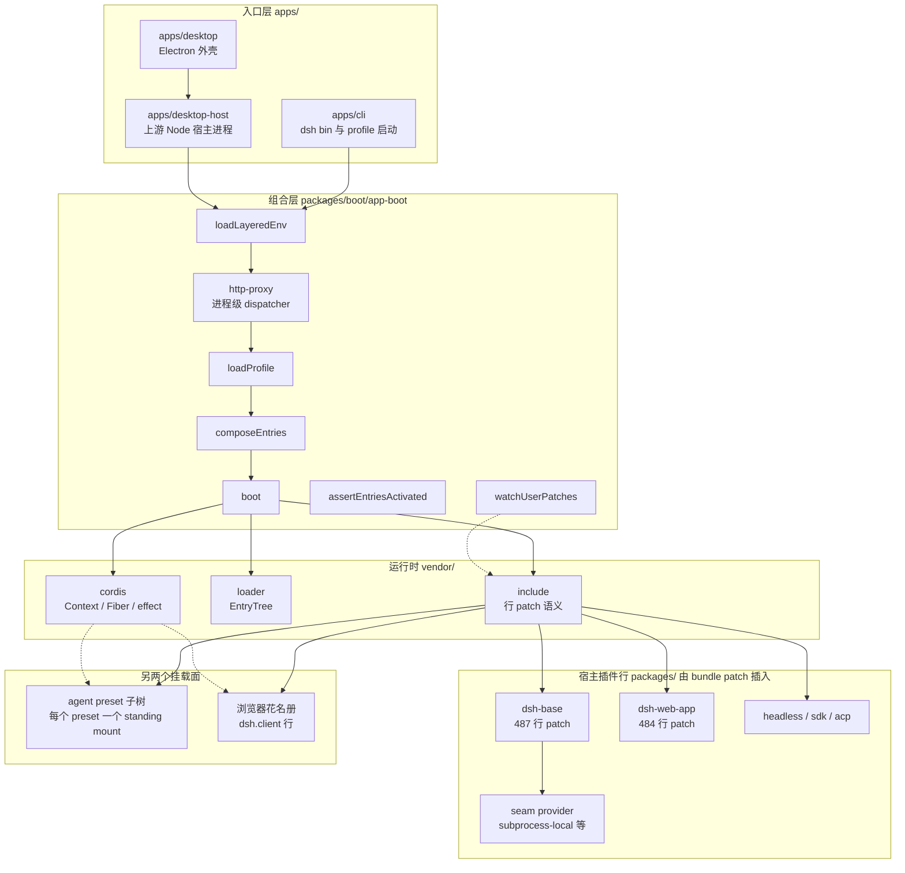
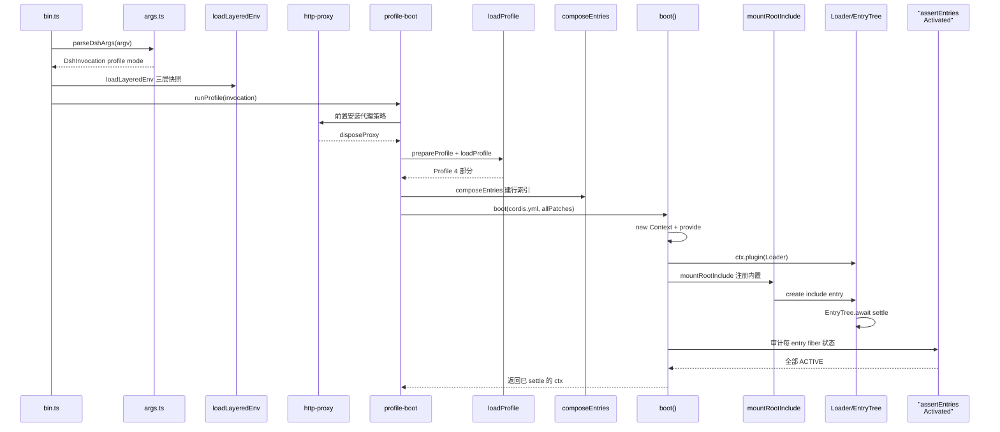

# 架构组合层：Cordis 插件树与启动编排

> 本解读按 **ai-agent ⊗ framework** 类规格产出。子文档之一，聚焦「一切皆插件」如何被装配成可运行的机器（Cordis 插件树与 Profile/Bundle/Patch 分层启动）。覆盖：`packages/boot/app-boot`、`vendor/cordis`、`apps/cli`。相关的整体设计哲学见 [README](README.md)；本层是其他所有子文档（session / agent-loop / tools）挂靠的运行时地基。本版把覆盖范围扩到 `apps/desktop-host` 与另两个挂载面（agent preset 子树、浏览器花名册）。
>
> **本版增量更新（0.1.2-rc.1 → 0.1.5-rc.2）**：依 `dsh-v0.1.2-rc.1..HEAD` git diff 与 `verify-references.mjs --diff` 预检清单比对更新。组合层自身有三项事实值得先摆出来：
>
> **(1) `vendor/` 零 diff。** Cordis / loader / include / hmr / group / timer 在本周期内一个字节都没改（`git diff --stat dsh-v0.1.2-rc.1..HEAD -- vendor/` 为空），`vendor/cordis/src/` 的文件清单也完全一致。因此下文所有**机制**论断（可逆副作用、行 patch 语义、EntryTree settle）仍然成立，本周期变的只是挂进树里的**行**。
> **(2) 上游结构在长，组合引擎没变。** 本周期新增 18 个包、2 个 App（`apps/desktop`、`apps/desktop-host`）、1 次原生家族改名（`native/landlock-run` → `native/system`，包名 `@deepseek-ai/node-addon-system`）；`packages/` 家族数不变（50），成员数 249 → 267。同期还有一次**合入即回滚**的尝试（`packages/visualizer`，PR #3337 → PR #3778），`HEAD` 无该路径，故不入图——判据见 [新子系统如何挂进同一棵插件树](#新子系统如何挂进同一棵插件树) 末尾的演进说明。
> **(3) 组合面从「一棵树」变成「三个挂载面」。** 宿主 Loader 树之外，新增 per-preset **agent 子树**（`agent.cordis.yml`）与浏览器 **`dsh.client` 花名册**（→ `window.__DSH_BOOT__`）；桌面端则证明「新分发形态 = 又一个 patch 层」，没有第二套组合器。新增子系统如何落位见 [新子系统如何挂进同一棵插件树](#新子系统如何挂进同一棵插件树)。

## 在项目中的角色

本项目定位：DeepSeek Harness 是一个**无特权内核**的 agent harness——主循环、工具注册表、会话日志、模型适配器全部以**插件**形式架在 vendored Cordis 插件运行时上（[docs/architecture.md:11-13]()）：
<!-- anchor: [Cordis](cordis-primer.md) is the framework under dsh: plugins contribute servic … There is no privileged core to patch: you extend dsh by mounting a plugin beside -->

> 「There is no privileged core to patch: you extend dsh by mounting a plugin beside the others, and registrations are effects that unwind when their plugin unloads.」

架构组合层就是这个「地基」：**它把空 entry 列表 → 分层 patch → 可运行的 Cordis 插件树**。去掉它，`dsh` 退化为一堆永远无法装配的孤立包——没有任何入口能把 `dsh-base`、`dsh-web-app`、`dsh-headless` 这些 bundle 变成运行中的 agent。

具体来说本层承担四件不可替代的事：

1. **装配**：`boot()` 创建根 Context、安装 Loader 服务、挂载 `cordis:include` 内置，并把整棵配置驱动起来直到 tree settle（[packages/boot/app-boot/src/index.ts:787-832]()）。
<!-- anchor: export async function boot( … throw new Error(`${binName}: ${stage}: ${detail}${stack}`, { cause }) -->
2. **分层组合**：`loadProfile` → `composeEntries` 把「bundle 层 + 用户层 + home 层 + `--patch` 覆盖」压成一份 entry 列表（[packages/boot/app-boot/src/profile.ts:820-835]()、[packages/boot/app-boot/src/profile.ts:846-851]()）。
<!-- anchor: export function loadProfile( … return loadProfileDirectory(binName, dir, installAnchor, options) -->
<!-- anchor: export function composeEntries( … warn(message.replace(/%C/g, () => JSON.stringify(args[index++]))) -->
3. **热更新**：`watchUserPatches` 通过 Cordis HMR 事务性重放用户 patch 层，不重启进程（[packages/boot/app-boot/src/index.ts:250-280]()）。
<!-- anchor: export async function watchUserPatches( … throw error -->
4. **Fail-loud 审计**：`installFailLoud` + `assertEntriesActivated` 把启动失败转成一条带原始栈的诊断并 `exit(1)`（[packages/boot/app-boot/src/index.ts:639-678]()、[packages/boot/app-boot/src/index.ts:722-753]()）。
<!-- anchor: export function installFailLoud( … return uninstall -->
<!-- anchor: export async function assertEntriesActivated(ctx: Context, binName: string): Pro … throw new Error(`${binName}: ${String(failures.length)} ${noun} did not activate -->

> **演进说明（0.1.5-rc.2）**：上面「四件」的清单本身保留原样（装配 / 分层组合 / 热更新 / fail-loud 审计），但本周期出现了一类**刻意不进树**的关注点，故在「三个挂载面」一节补第 5 件：进程级策略先于插件树安装。典型是出站代理——`dsh-http-proxy` 的 README 明说它「没有可挂载的东西」，「是一个库而不是插件，因为传输策略每进程只有一个答案」（[packages/util/http-proxy/README.md:28-28]()），由 launcher 在**第一个插件挂载之前**装成 undici 的全局 dispatcher（[apps/cli/src/profile-boot.ts:287-289]()）。
<!-- anchor: Nothing to mount, and nothing to configure. The `dsh` launcher resolves and inst … Nothing to mount, and nothing to configure. The `dsh` launcher resolves and inst -->
<!-- anchor: const disposeProxy = await installProxyFromEnvironment( … (message) => { process.stderr.write(`${NAME}: ${message}\n`) }, -->

没有这层，所有其他模块（session / agent-loop / tools）没有可以挂靠的运行时。

### 架构总览图：三个挂载面共用同一套 Cordis 机制



读图要点：**实线是装配方向，虚线是复用关系**。桌面端（`apps/desktop` → `apps/desktop-host`）与 CLI 汇入同一个 `boot()`；preset 子树与浏览器花名册不经过 `boot()`，但它们用的是同一套 `Include` 方言与同一套 `Context`/`Fiber` 机制（图底部两条虚线）——这正是本周期最值得记住的结构事实：**组合面的数量在增加，组合引擎的数量没有**。

### 目录与模块职责映射

`packages/` 现有 50 个家族、267 个包，全部以「插件行」或「被行 import 的库」两种身份之一进入这棵树。下面是按**挂载身份**归并的家族地图（只展开组合层直接接触的部分）：

```text
packages/                                     # 267 包 / 50 家族
├── boot/       app-boot · cmdline            # 组合层自身，不挂树（被 apps/ 直接 import）
├── bundle/     base · web-app · headless · sdk-app · sdk-minimal · acp-app
├── core/       agent · agent-loop · agent-tool-presentation · scope · session · system-prompt · tools
├── session/    session-format(-catalog|-v0-to-v1|-v1-to-v2|-v2-to-v3) · session-persistence(-jsonl) · …
├── api/        gateway · remotes · session/settings/workspace-controller · workspace-files
├── host/       webserver · frontend-static · directory-picker(-auto|-browse|-native) · open-in-app · plugin-inventory
├── client/     modules · connection · resources · file-upload · ui-*（44 个浏览器插件 + dockkit 库）
├── subprocess/ subprocess · subprocess-local · win32-process
├── preset/     agent-presets · persona       # 第二个挂载面的引擎
├── util/       http-proxy · package-manifest · chunked-list · workspace-path · …
└── …（其余 40 个家族：llm · fs · shell · sandbox · subagent · workflow · skill · mcp · lsp · storage · e2b · experimental …）
apps/     cli · web · desktop · desktop-host
native/   system（@deepseek-ai/node-addon-system：landlock-run + flock 预编译二进制）
vendor/   cordis · loader · include · hmr · group · timer · cosmokit · schemastery · logger-console
```

| 层 | 家族（包数） | 职责 | 挂载身份 |
|---|---|---|---|
| 组合与运行时 | `boot`(2) `bundle`(6) `preset`(2) `vendor/*`(9) | 把空 entry 列表变成运行中的树；提供 Context/Fiber/行 patch/settle | 被 `apps/` 直接 import，不进树 |
| 内核服务 | `core`(8) | 会话事件日志、Agent 接口与主循环、工具注册表、prompt 装配、agent scope | `dsh-base` bundle 行 |
| 会话与存储 | `session`(19) `storage`(4) `session-query`(4) | 事件日志落盘、格式世代迁移、投影与投影缓存 | `dsh-base` 行 + 被行 import 的库 |
| 模型接入 | `llm`(7) | 消息/流词汇表与适配器 seam、provider、token 计量 | `dsh-base` 行 |
| 执行世界 | `fs`(8) `shell`(10) `subprocess`(3) `terminal`(3) `sandbox`(4) `jobs`(3) `spill`(3) `lsp`(3) | 文件/进程/终端/沙箱 seam 与有界输出 | `dsh-base` 行（provider 一行可换） |
| 交互与策略 | `interaction`(5) `guard`(2) `plan`(1) `todo`(1) `goal`(4) `feedback`(2) | 审批、权限预设、plan/todo/goal、命令反馈 | base 行 + `dsh-web-app` 行 |
| 协作与扩展 | `subagent`(10) `workflow`(4) `skill`(4) `mcp`(1) `hooks`(3) `acp`(1) `extensions`(4) `experimental`(9) | 子 agent、workflow、Skill、MCP、外部 agent 协议、Cordis 自省 | base 行 + **preset 行** |
| 宿主与接入 | `host`(8) `api`(6) `client`(51) `sdk`(3) `typert`(4) `identity`(1) `settings`(2) `credentials`(3) | Web 宿主与路由、Remote 控制器、浏览器插件、SDK/ACP 服务端 | `dsh-web-app` 行 + **`dsh.client` 花名册** |
| 远程与出站 | `e2b`(3) `code-runtime`(2) `web`(6) `webhook`(2) | 远程执行世界、代码运行时、检索/抓取、webhook | base 行 + launcher 前置策略 |
| 支撑 | `util`(15) `context`(6) `attachment`(2) `compaction`(4) `runtime-diagnostics`(1) `schedule`(1) `workspace`(1) `test-support`(6) | 通用库与零散服务 | 多为纯库，少数为行 |

地图依据（可逐条点开核对）：

- 分层的**排版事实**在 workspace 配置里写明：`vendor/*` 与 `packages/*/*` 是包层，`native/system` 是与消费方一起开发、但把原生构建与发布脚本留在自己目录里的原生家族，`apps/*` 是「package 层之上的产品装配」，其中 `apps/cli` 拥有 `dsh` bin（[pnpm-workspace.yaml:1-14]()）。
<!-- anchor: packages: … # closure is what the exe bundles and what the Python runtime distributes. -->
- 原生家族已从 `landlock-run` 改名为 `@deepseek-ai/node-addon-system`，职责从「Linux Landlock 启动器」扩为「Linux 约束 + POSIX 会话写锁」两类预编译系统原语（[native/system/package.json:2-5]()、[native/system/README.md:11-11]()）。
<!-- anchor: "name": "@deepseek-ai/node-addon-system-workspace", … "type": "module", -->
<!-- anchor: Use the Linux `landlock-run` executable to confine subprocesses, or the `./flock … Use the Linux `landlock-run` executable to confine subprocesses, or the `./flock -->
- 组合层的类型面本周期被收拢到一个纯类型包：`DshManifest` 一处声明 `bundle` / `profile` / `client` / `configTrees` / `sessionFormatMigration` / `moduleFallback` 六个角色，`app-boot` 与 `client/modules` 都从这里取形状（[packages/util/package-manifest/src/types.ts:7-23]()）。
<!-- anchor: /** The `dsh` property of an npm manifest; a package may declare several roles.  … moduleFallback?: DshModuleFallbackManifest -->

## 解决什么问题 / 根因

根因是 agent harness 的**可扩展性悖论**：一个「一切皆插件、无特权内核」的产品，必须有某种方式把这些插件**攒成一台能跑起来的机器**——但攒机器这一步如果做成特权内核，就与「无特权」的哲学自相矛盾。

具体分解为三个子问题：

- **装配即副作用注册**：任何插件（模型适配器、工具、会话日志、agent loop）启动时会注册服务、监听事件、挂工具 schema。这些注册必须**可逆**——卸载时撤销，否则 reload / 卸载一个插件会把机器留在半装配状态。Cordis 的 `ctx.effect()` / `ctx.on()` 正是把「注册」建模为可逆副作用（[vendor/cordis/src/fiber.ts:418-441]()）。
<!-- anchor: effect(execute: () => Effect, label = 'anonymous'): any { … return disposalTask = task -->
- **启动顺序不能靠手排**：插件之间靠 `inject` 声明服务依赖，而不是手动编排启动序列——「加载顺序通过服务依赖表达」（[docs/cordis-primer.zh.md:11-11]()）。Loader 的依赖检查（`has`/`inject`）天然处理依赖就绪。
<!-- anchor: - **通过 `inject` 声明服务依赖。** 插件声明所需的服务后，会等待这些服务就绪才启动；加载顺序通过服务依赖表达，而非手动编排启动序列。 … - **通过 `inject` 声明服务依赖。** 插件声明所需的服务后，会等待这些服务就绪才启动；加载顺序通过服务依赖表达，而非手动编排启动序列。 -->
- **机器怎么攒**：`docs/architecture.md:15-27` 定义了 profile/bundle/patch 三层的组合模型——这是本模块要落地的「组装说明」。
- **失败要显式**：插件树并发装载，某个条目 import 失败或激活时 reject，必须 fail-loud 而不是静默挂起。

> **演进说明（0.1.5-rc.2）**：本周期新增第 4 类子问题——**多个挂载面如何共享一套依赖语义**。宿主树的插件写 `inject` 即可；preset 子树与浏览器花名册拿不到 `boot()` 的审计，于是各自补了一道等价的正确性闸门（见「另两个挂载面」）。分发模式表本身没有改（[docs/cordis-primer.zh.md:21-27]()），改的是「谁能用这些模式、作用域多大」。
<!-- anchor: | 模式 | 是否 await？ | 分发顺序 | 是否有返回值？ | … | `bail` | 否 | 监听器按注册顺序观察，直到某个监听器返回 bail 值 | 是 | -->

## 设计思路

### 放弃的替代方案

- **放弃「单一大配置」**：与其把整台 machine 写成一份几千行的覆写式 config，dsh 选择「空树 + 分层 patch」。代价是要解释 patch 语义（id 定位、整 config 替换）；收益是每层（bundle/用户/home/flag）都可叠加、可关闭、可独立发布维护。`docs/architecture.md:27` 明确说了层序：bundle 依次 → 用户 patch → home 层 → `--patch` 覆盖。
- **放弃「自造插件系统」**：选择 vendored Cordis（而非自己从零写 DI + 事件 + 生命周期）。因为可逆副作用、依赖注入、生命周期 fiber、dispatch 模式这四件事是成熟框架才做得对的核心，自造徒增维护量。Cordis 被 vendor 进 `vendor/cordis/`，与 harness 自己的包一起演进。**本周期 `vendor/` 零改动**，正是这个选择被验证的一次：18 个新包、2 个新 App 全部靠既有的 Context/Fiber/Include 语义落地，没有一处需要动框架。

### 核心模式一：Cordis 可逆副作用 registration 模型

每个 Cordis 服务的注册都是一个 **effet**：`ctx.provide(name, value)` 内部调用 `ctx.fiber.effect(...)`，返回的 disposer 负责反注册并 `notify` 唤醒依赖该服务的 fiber（[vendor/cordis/src/reflect.ts:277-304]()）。事件监听 `ctx.on` 同理（[vendor/cordis/src/events.ts:288-301]()）。
<!-- anchor: provide(name: string, value?: any, check?: () => boolean) { … }, `ctx.provide(${JSON.stringify(name)})`) -->
<!-- anchor: on(name: string | symbol, listener: (...args: any) => any, options?: boolean | E … return this.register(label, hooks, listener, options) -->

这就是「扩展 dsh = 在旁边挂插件」的机制基础：挂进去是 effect，卸载时 effect 的 disposer 逆序执行，一切撤销干净。

### 核心模式二：分层 patch 组合（空树 + bundle + 用户 + home + overlay）

`dsh` 跑起来的一棵树是这样组出来的（[apps/cli/src/profile-boot.ts:226-243]()，patch 顺序为 bundle → profile → home → overlay → telemetry 开关）：
<!-- anchor: async function composeProfile( … return { profile, bundlePatches, homePatches, overlays: composedOverlays } -->

- profile 是「命名组合」，装在有 `package.json` + `dsh.profile.bundles` 的目录（[packages/boot/app-boot/src/profile.ts:100-106]()）；上游内置五套模板 `web` / `headless` / `sdk` / `sdk-minimal` / `acp`，只有 `web` 的 `patchReload` 是 `live`，其余都是 `startup`（[packages/boot/app-boot/src/profile.ts:110-129]()）。
<!-- anchor: export function resolveProfileDir(name: string, home: string = resolveDshHome()) … return join(home, PROFILES_DIR, name) -->
<!-- anchor: export const PROFILE_TEMPLATES: Record<string, ProfileTemplate> = { … patchReload: 'startup', -->
- bundle 是「发行格式」，npm 包，`dsh.bundle.patch` 指向它的 patch 文件；解析时若某个被列出的 bundle 没有声明 `dsh.bundle`，直接 fail-loud 而不是当成「没有 patch」（[packages/boot/app-boot/src/profile.ts:789-797]()）。
<!-- anchor: const layers = bundles.map((packageName): ProfileLayer => { … return { packageName, packageDir, patchPath, patches: loadOverlayPatches(binName -->
- patch 是「配置行级覆盖」，逐层打进同一个 `applyEntryPatches`（[packages/boot/app-boot/src/profile.ts:846-851]()）。
<!-- anchor: export function composeEntries( … warn(message.replace(/%C/g, () => JSON.stringify(args[index++]))) -->

### 核心模式三：空树 + include 单次 patch（dump 与 boot 永不漂移）

`boot()` 和 `--dump-config` 共用**同一个** `applyEntryPatches` 语义（[vendor/include/src/index.ts:58-127]()），因此打印出来的树就是实际挂载的树——这是 design philosophy 里「Model-visible means logged」在配置侧的镜像：dump 是「Config-visible means mounted」。
<!-- anchor: export function applyEntryPatches( … return data -->

### 核心模式四：新分发形态 = 又一个 patch 层（桌面端）

本周期新增的 Electron 桌面端没有带来第二套组合器：它复用 `dsh-base` + `dsh-web-app` 的同一批行，只在末尾追加**一层 34 行的 overlay patch**，把「浏览器需要、桌面不需要」的行关掉（`web-startup` / `webserver` / `web-runtime` / `client-hmr` / `open-in-app` / `ui-open-in-app` / `directory-picker`），把传输行重新 `inject` 成桌面自己的形状，再插入一对原生目录选择器行（[apps/desktop-host/config/desktop.cordis.patch.yml:1-34]()）。
<!-- anchor: # Electron reuses the browser composition without its network and browser-launch … name: '@deepseek-ai/dsh-client-ui-directory-picker-native' -->

宿主进程侧的代码路径与 CLI 完全同构——同一个 `loadProfileDirectory` + `composeEntries` + `loadOverlayPatches`，同一个 `boot()`、同一个 `loadLayeredEnv`（[apps/desktop-host/src/index.ts:152-172]()、[apps/desktop-host/src/index.ts:287-295]()）。唯一多出来的一步是它会把桌面自带的 agent preset 根注入 roster 配置，让 `trust: 'system'` 的 presets 目录跟着应用一起发布（同一处 `desktopPatches`）。
<!-- anchor: function desktopPatches(projectDir: string, allowLinkedPackages: boolean): Patch … roots: [{ path: join(dshRoot, 'config', 'agent-presets'), trust: 'system' }], -->
<!-- anchor: const environment = loadLayeredEnv('dsh desktop') … provideCmdline(hostCtx, { args: [], exit: () => {} }) -->

**为什么这个「省略」比新增更值得记**：如果桌面端另建一套组合逻辑，`vendor/` 那套已证明正确的 settle / 审计 / 事务性卸载就要被重新实现一遍，而「桌面能跑」与「CLI 能跑」会变成两个独立的正确性问题；复用 patch 层的代价仅是需要一条约束——桌面 profile 的 bundle 必须解析到 profile 目录之内（`desktopPatches` 里显式检查并在越界时抛错），换来的是任何 bundle 层的修复自动同时惠及两种分发形态。详见 [desktop-app.md](desktop-app.md)。

### 核心模式五：per-session 组合是同一 Include 方言的子树（agent preset）

本周期把「每个会话可以有自己的一套工具与 prompt」做成了第二个挂载面。它的实现方式是**复用 `Include`**：`mountPreset` 把 preset 的 `agent.cordis.yml` 作为一棵新子树的配置交给 `agentCtx.plugin(...)`，子树挂在 agent 的 scope context 下，因此里面每一个 `ctx.tools` / `ctx.systemPrompt` 注册都只落到那个 agent 的层里，并随 agent 一起 unwind（[packages/preset/agent-presets/src/mount.ts:378-411]()）。组合文件名是一等契约常量（[packages/preset/agent-presets/src/discovery.ts:37-37]()）。
<!-- anchor: export async function mountPreset(agentCtx: Context, preset: AgentPreset): Promi … + 'a preset service must sit behind an `isolate` realm or move to the host compo -->
<!-- anchor: export const COMPOSITION_FILE = 'agent.cordis.yml' … export const COMPOSITION_FILE = 'agent.cordis.yml' -->

它刻意**不是** Loader entry：`PresetTree` 构造函数把 EntryTree 挂到父 entry `subtree` 槽后又主动摘掉，就是为了不让 `loader.entries()` 把每个 preset 当成宿主行遍历（否则多个 preset 会互相覆盖）。代价是它拿不到 `boot()` 的收尾审计，所以 mount 自己做两道闸门：**未激活的行**直接拒绝，**向 root realm 发布了服务的行**也直接拒绝——理由写得很直白：那类服务是进程全局的，第二个会话挂同一个 preset 就会撞车（[packages/preset/agent-presets/src/mount.ts:3-13]()）。
<!-- anchor: * result is usable before the agent is published. … * same preset collides with the first. -->

这条边界正好解释了 `core/agent-tool-presentation` 为什么要独立成一个包：工具**注册表**必须留在宿主面（它的消费者横跨 loop 调度器、API 代理的 presenter 和每一个工具插件），preset 能拥有的只是「呈现形式」这一层声明（[packages/core/agent-tool-presentation/src/index.ts:5-11]()）。
<!-- anchor: * The tool registry itself stays on the host plane — the agent loop's … * process. One row per composition, not one per session. -->

## 关键数据结构

- `EntryOptions`：序列化的插件条目——`id` / `name`（模块说明符）/ `config` / `group` / `disabled` / `inject`（[vendor/loader/src/config/entry.ts:9-21]()）。patch 的行级覆盖对象。
<!-- anchor: export interface EntryOptions { … inject?: Inject | null -->
- `PatchOptions`：补丁条目的运行时形状——`id` / `insert` / `name` / `config` / `disabled` 等（[vendor/include/src/index.ts:145-155]()）。
<!-- anchor: export interface PatchOptions { … [key: string]: any -->
- `Profile` / `ProfileLayer`：一个已解析 profile 的 bundle 层列表 + 用户 patch；`patchReload` 决定用户 patch 文件是活重载还是只在启动时应用一次（[packages/boot/app-boot/src/profile.ts:66-91]()）。
<!-- anchor: /** One resolved bundle layer of a profile. */ … patchReload: ProfilePatchReload -->
- `Entry`：Loader 树里的一个运行节点，持有 `fiber`（对应插件 fiber）与 `options`（[vendor/loader/src/config/entry.ts:52-60]()）。
<!-- anchor: export class Entry { … public subgroup?: EntryGroup -->
- `Fiber`：一个插件应用实例——生命周期状态、validated config、effect 集合、disposer（[vendor/cordis/src/fiber.ts:184-203]()）。
<!-- anchor: export class Fiber { … public readonly _disposables = new DisposableList<Disposable>() -->
- `Impl` / `store`：服务实现记录（名字 / 提供 fiber / 值 / 可用性谓词），支撑 `ctx.get`/`ctx.provide`（[vendor/cordis/src/reflect.ts:115-124]()）。
<!-- anchor: /** Concrete service implementation record stored in the root reflect service. * … check?: () => boolean -->
- `DshManifest`（本周期新增的组合层类型面）：`package.json` 的 `dsh` 字段一处声明 bundle / profile / client / configTrees / sessionFormatMigration / moduleFallback 六个角色，各读者自己负责 JSON 校验与默认值（[packages/util/package-manifest/src/types.ts:7-23]()）。
<!-- anchor: /** The `dsh` property of an npm manifest; a package may declare several roles.  … moduleFallback?: DshModuleFallbackManifest -->

## 核心流程与启动链路

### 启动流程（启动一个 `dsh --profile <name>`）



时序图里**代理安装位于 `composeEntries` 之前**是本周期新增的一步：它必须早于第一个插件挂载，因为它改的是 `globalThis.fetch` 的全局 dispatcher，而任何插件都可能在激活期发请求。

### 各环节源位置

- `.env` 三层加载：[packages/boot/app-boot/src/index.ts:195-214]()（继承 > 项目 `.env` > home `.env`，先全部解析校验、后统一赋值，且不覆盖已存在值）。
<!-- anchor: export function loadLayeredEnv( … ...user === undefined ? [] : [{ source: 'user-env' as const, path: user.path, va -->

- profile 解析 + 行索引 + patch 组合：[apps/cli/src/profile-boot.ts:226-243]()。
<!-- anchor: async function composeProfile( … return { profile, bundlePatches, homePatches, overlays: composedOverlays } -->

- profile 加载（bundle 层定位 + 解析 patch）：[packages/boot/app-boot/src/profile.ts:820-835]()。
<!-- anchor: export function loadProfile( … return loadProfileDirectory(binName, dir, installAnchor, options) -->

- 空树组合：[packages/boot/app-boot/src/profile.ts:846-851]()。关键在 `applyEntryPatches([], structuredClone(layers.flat()), …)`——单个 patch 入口，与 boot/dump 同语义（[packages/boot/app-boot/src/profile.ts:849-849]()）。
<!-- anchor: export function composeEntries( … warn(message.replace(/%C/g, () => JSON.stringify(args[index++]))) -->
<!-- anchor: return applyEntryPatches([], structuredClone(layers.flat()), (message: string, . … return applyEntryPatches([], structuredClone(layers.flat()), (message: string, . -->

- 驱动 Loader：[packages/boot/app-boot/src/index.ts:787-832]()，核心是 `await ctx.get('loader')?.await()`，它轮询直到整树无任务（[vendor/loader/src/config/tree.ts:46-62]()）。
<!-- anchor: export async function boot( … throw new Error(`${binName}: ${stage}: ${detail}${stack}`, { cause }) -->
<!-- anchor: async await() { … if (!this.getTasks().length) return -->

- 挂载流程：[packages/boot/app-boot/src/index.ts:516-558]()，`mountRootInclude` 把 Include/Group 注册为 `cordis:` 内置，然后 `ctx.loader.create(rootInclude)`。
<!-- anchor: export async function mountRootInclude( … return entry -->

- 审计：[packages/boot/app-boot/src/index.ts:722-753]()，逐个检查 `ctx.loader.entries()` 的 `fiber.state`（ACTIVE 通过，FAILED 收集原始 rejection，PENDING 报缺失服务）。
<!-- anchor: export async function assertEntriesActivated(ctx: Context, binName: string): Pro … throw new Error(`${binName}: ${String(failures.length)} ${noun} did not activate -->

## 与其他模块协同

- **session / agent-loop / tools 全挂在树上**：这些包是 bundle（`dsh-base`）里的插件行，靠 `inject` 声明依赖、提供 `ctx.sessions` / `ctx.agents` / `ctx.tools` 等服务。本层不感知它们的领域，只负责把它们的行接入 runtime。（跨模块边界：另见相应子文档）session/agent-loop 确有 `inject` 提供与依赖、且由 bundle 层挂载。
- **跨模块结论**：Cordis 的分发模式（emit/waterfall/parallel/serial/bail）是所有领域事件（session/agent/capability）的底层（[docs/cordis-primer.zh.md:21-27]()）；本层鉴证了这些事件的注册-撤销地基。（跨模块边界：另见相应子文档）领域事件走 `ctx.on`（即本层 events effect 机制）——结构上必成立，因为 `ctx.on` 就实现在本层。
<!-- anchor: | 模式 | 是否 await？ | 分发顺序 | 是否有返回值？ | … | `bail` | 否 | 监听器按注册顺序观察，直到某个监听器返回 bail 值 | 是 | -->

### 新子系统如何挂进同一棵插件树

本周期新增/成型的子系统**没有一个是自成体系的运行时**——它们各自选了下面三种落位方式之一：**加一行**（`bundle` patch 或 preset 行）、**当被行 import 的库**、**在树之前安装**。逐项对照：

| 新子系统 / 包 | 落位方式与具体行 | 为什么是这种落位 | 详见 |
|---|---|---|---|
| 会话格式世代迁移链 `session/session-format` · `-catalog` · `-v0-to-v1` · `-v1-to-v2` · `-v2-to-v3` | **不加行**：作为 `session-persistence-jsonl` 这一行的依赖被 import | 世代选择与发布是存储 provider 的**物理**职责；做成独立行会让「当前写哪一代」出现第二个权威 | [session-format-migration.md](session-format-migration.md) |
| 子进程 seam `subprocess/`（`subprocess` · `subprocess-local` · `win32-process`） | `dsh-base` 的 `subprocess` 行挂 provider；seam 定义与 Win32 原语是纯库 | Service Definition / Provider / Consumer 三角要求 provider 可换，但「同一执行世界」又要求 fs 与 subprocess 同步移动 | [subprocess.md](subprocess.md) |
| 工作区文件 API `api/workspace-files` | `dsh-web-app` 的 `workspace-files` 行 | 它是宿主侧只读投影服务，必须与 session/workspace 控制器同层出现、同层可关 | [workspace-files.md](workspace-files.md) |
| 交付声明 `fs/tool-present` + `core/agent-tool-presentation` | **挂 preset 行**（`agent.cordis.yml`），不在任何 bundle 里 | 工具注册表在宿主面（消费者跨 loop、API、每个工具），preset 只能拥有「呈现形式」 | [tools.md](tools.md) |
| 跨会话引用 `context/session-reference`（**基线已存在，非本周期新增**，本周期只被改造成资源地址化） | `dsh-web-app` 的 `session-reference` 行 | 它消费 `ctx.sessionQuery`、只在支持 `@` 提及的宿主里有意义，属可选宿主能力 | [session.md](session.md) |
| 浏览器资源模型与 dock `client/resources` · `client/file-upload` · `client/ui-dockkit` · `client/ui-sidebar-*` | `dsh-web-app` 的 `dsh.client` 行；`ui-dockkit` 是**零 Cordis** 的库，被侧栏静态链接 | 浏览器插件走 `dsh.client` 声明 + 宿主 `modules` 行扫描；dock 引擎不暴露服务接口，做成插件只会多一层壳 | [web-client.md](web-client.md) |
| 宿主打开应用 `host/open-in-app` + `client/ui-open-in-app` | `dsh-web-app` 的 `open-in-app` / `ui-open-in-app` 两行 | 一半是宿主路由、一半是浏览器按钮；拆两行才能各自替换（桌面端就只关掉这一对） | [web-client.md](web-client.md) |
| 出站代理 `util/http-proxy` | **不进树**：launcher 在第一个插件挂载前装成 undici 全局 dispatcher | 传输策略每进程只有一个答案，没有第二个实现可换、也没有比进程更窄的作用域 | [networking-proxy.md](networking-proxy.md) |
| 清单类型面 `util/package-manifest` | 纯类型库：被 `boot/app-boot` 与 `client/modules` import | `dsh.profile` / `dsh.bundle` / `dsh.client` / `sessionFormatMigration` 的形状集中一处，避免组合层与客户端各写一份解析 | — |
| 分块列表 `util/chunked-list` | 纯库：被 `subagent` 消费 | 有界拷贝的持久化追加列表是通用数据结构，没有可换的第二实现 | — |
| 桌面端 `apps/desktop` · `apps/desktop-host` | 复用 `boot/app-boot` + `web-app` 组合，仅追加 `desktop.cordis.patch.yml` 一层 | 见核心模式四 | [desktop-app.md](desktop-app.md) |
| 原生家族 `native/system` | 纯原生库：被 `sandbox-local` / `bash-sandbox` 消费 | 预编译二进制 + 两个入口（`landlock-run` / `flock`），消费者各自持有策略，不进树 | [sandbox-capability-seams.md](sandbox-capability-seams.md) |

几条可核对的落点：

- 子进程行是 `dsh-base` 里的一行 provider 替换（[packages/bundle/base/cordis.patch.yml:199-200]()）；会话持久化行同理（[packages/bundle/base/cordis.patch.yml:110-111]()）。
<!-- anchor: - id: subprocess … name: '@deepseek-ai/dsh-subprocess-local' -->
<!-- anchor: - id: session-persistence-jsonl … name: '@deepseek-ai/dsh-session-persistence-jsonl' -->
- 迁移链以普通 import 进入 jsonl provider：它直接从 `-format` / `-format-catalog` / `-v2-to-v3` 取名字与准入断言（[packages/session/session-persistence-jsonl/src/format.ts:22-26]()）。这就是「迁移链不新增行」的证据：
<!-- anchor: import { parseSessionFormatLogFilename, sessionFormatLogFilename, SessionFormatU … import { assertV3RowAdmission } from '@deepseek-ai/dsh-session-format-v2-to-v3' -->
  `session-format` 的职责自述是「流式相邻迁移机制」（[packages/session/session-format/package.json:3-3]()），`-catalog` 是「构建期静态的一方程编解码与迁移目录」（[packages/session/session-format-catalog/package.json:3-3]()），两者都是库。
<!-- anchor: "description": "Streaming adjacent Session format migration machinery", … "description": "Streaming adjacent Session format migration machinery", -->
<!-- anchor: "description": "Build-static first-party Session format codec and migration cata … "description": "Build-static first-party Session format codec and migration cata -->
- `subprocess` 的自述把它定位成「一个抽象服务背后的受管进程组、有界 spill 输出与升级 kill」（[packages/subprocess/subprocess/package.json:3-3]()）——一句话概括了为什么它必须是 seam 而不是库。
<!-- anchor: "description": "Subprocess seam (ctx.subprocess) for the DeepSeek Harness — mana … "description": "Subprocess seam (ctx.subprocess) for the DeepSeek Harness — mana -->
- web-app 层新增的四组行是「文件能力面」与「客户端形态面」：`workspace-files`（有界读 + 目录列举 + 变更流，[packages/bundle/web-app/cordis.patch.yml:108-111]()）、`open-in-app` 一对（[packages/bundle/web-app/cordis.patch.yml:62-73]()），
<!-- anchor: # Workspace file service: bounded read, directory listing, and the … name: '@deepseek-ai/dsh-api-workspace-files' -->
<!-- anchor: # Session-header "Open In..." split button over the host application … name: '@deepseek-ai/dsh-client-ui-open-in-app' -->
  以及 `file-upload`（[packages/bundle/web-app/cordis.patch.yml:190-193]()）、`resources` 与右侧栏三行（[packages/bundle/web-app/cordis.patch.yml:216-235]()）。
<!-- anchor: # Raw Blob and ReadableStream uploads run independently of Connection's … name: '@deepseek-ai/dsh-client-file-upload' -->
<!-- anchor: # Unified resource model: protocol providers behind the useResource hook. … name: '@deepseek-ai/dsh-client-ui-sidebar-files' -->
- `tool-present` 用与其它工具插件完全一致的写法声明自己的 Loader 身份与依赖：`export const name` + `export const inject = ['tools', 'fs', 'sessionProjections']`，所以它能原样放进 preset 文件（[packages/fs/tool-present/src/index.ts:25-26]()）。
<!-- anchor: /** Services used by the scoped delivery tool. */ … export const inject = ['tools', 'fs', 'sessionProjections'] -->
- `client/resources` 与 `client/ui-dockkit` 分别是「协议 provider → `useResource` 钩子」和「可逆 split-tree 引擎」，后者自述**零 cordis**——这类纯前端引擎刻意不做成插件（[packages/client/resources/package.json:3-3]()、[packages/client/ui-dockkit/package.json:3-3]()）。
<!-- anchor: "description": "Unified client resource model: protocol-registered providers tur … "description": "Unified client resource model: protocol-registered providers tur -->
<!-- anchor: "description": "Docking layout kit: split-tree engine with invertible operations … "description": "Docking layout kit: split-tree engine with invertible operations -->
- 其它新增包的落位同样可逐条核对：`api/workspace-files`（[packages/api/workspace-files/package.json:3-3]()）、`context/session-reference`（[packages/context/session-reference/package.json:3-3]()），
<!-- anchor: "description": "Workspace file service and Client resource provider: bounded rea … "description": "Workspace file service and Client resource provider: bounded rea -->
<!-- anchor: "description": "Cross-session snapshot references and durable untrusted model co … "description": "Cross-session snapshot references and durable untrusted model co -->
  以及 `host/open-in-app`（[packages/host/open-in-app/package.json:3-3]()）、`util/chunked-list`（[packages/util/chunked-list/package.json:3-3]()）。
<!-- anchor: "description": "Host half of open-in-app: resolved application catalog, icons, a … "description": "Host half of open-in-app: resolved application catalog, icons, a -->
<!-- anchor: "description": "Persistent append-only chunked lists with bounded copying and JS … "description": "Persistent append-only chunked lists with bounded copying and JS -->

> **演进说明（0.1.5-rc.2）· 一次「一进一退」与本表的新增判据**：本周期窗口内 `packages/visualizer`（dormant Host capability）曾被合入 PR #3337（commit `b4c69b0f64`），随后被 `Revert "feat(visualizer): add dormant Host capability"`（commit `92b3b02622`，PR #3778）完整回滚，两者都在 `HEAD` 的祖先链上；`git ls-tree HEAD packages/ --name-only | grep -i visual` 为空，全树 `git grep -il visualizer HEAD` 只剩两条 `.agents/notes/` 笔记正文的措辞提及。**因此它不出现在任何架构图或职责映射里**——把「合入过又被回滚」当成现存结构，是本轮最容易犯的错。
>
> 与之配套的新增判据（本表列出的每一项都在 `HEAD` 上逐条 `ls` 过）：真正的新增包用 `git ls-tree -r --name-only <baseline> packages/` 与 `HEAD` 的 `package.json` 路径集合做差集，结果为 **249 → 267、新增 18、删除 0**；`packages/subprocess/*`、`packages/context/session-reference`、`packages/client/ui-sidebar`、`packages/client/modules`、`packages/feedback/message-feedback`、`packages/api/workspace-controller` 在基线**已存在**，本周期只是被改造或换行，不能记为新包（本表已对 `session-reference` 如此标注）。据父 agent 核实，本窗口另有一次同类的功能级回滚（same-session message editing、Markdown 栅栏的 Mermaid/Graphviz/SVG/HTML 预览），本层未涉及，故不展开。

### 另两个挂载面：preset 子树与浏览器花名册

上表里的 preset 行与 `dsh.client` 行都不是宿主树的节点，它们各自是一个**独立的挂载面**，但共用同一套 Cordis 机制：

- **agent preset 子树**：`agent.cordis.yml` 是一份合法的 Loader 行列表，`mountPreset` 用 `Include` 子类把它作为子树 plug 进 agent 的 scope context。子树**不是** Loader entry，所以 `boot()` 的审计看不到它——`mountPreset` 因此自带两道闸门（未激活行、向 root realm 泄漏的服务），见核心模式五。
- **浏览器花名册**：`dsh-web-app` 里的 `dsh.client` 行被 `client/modules` 的 node 半边扫描成 boot graph，再由 Web carrier 以 `/plugins/<id>/client.js` 提供；浏览器内核在 Cordis 存在**之前**构造模块表，然后把它当成一个插件 entry 采纳（[packages/client/modules/src/index.ts:2-23]()）。花名册的产物是页面上的一个全局注入行 `__DSH_BOOT__`（[packages/client/modules/src/index.ts:505-507]()），row 顺序由 `dsh.client.inject` 声明决定，等价于宿主树里的 `inject`。
<!-- anchor: * Node half of the client module system (`dsh.client` dual-face package): scans … * @module @deepseek-ai/dsh-client-modules -->
<!-- anchor: rows.push({ kind: 'script-src', placement: 'head', src: batch.url }) … rows.push({ kind: 'global', name: '__DSH_BOOT__', value: graph }) -->

`dsh-web-app` 的 patch 文件里那段注释就是这个机制的自我描述：`dsh.client` 行是「modules node half 扫进 `window.__DSH_BOOT__` 的浏览器花名册」（[packages/bundle/web-app/cordis.patch.yml:42-44]()）。
<!-- anchor: # `dsh.client` rows are the browser roster the modules node half scans into … - insert: -->

## 关键设计决策

### 决策一：选 Cordis 而非自造插件系统

**权衡**：自造能给完全可控的形状，但 DI（服务依赖解析）、fiber 生命周期、可逆 effect、事件 dispatch 四件事是有成熟实现才做得对的复杂度中心。选 Cordis 意味着接受它的概念税（`ctx` 是 Proxy、`inject` 声明、fiber 状态机），但换来「每个插件启动/卸载都是可逆副作用」这一正确性保障。`restart()` 演示了 Cordis 如何把「卸载+重装」做成一个原语（[vendor/cordis/src/fiber.ts:718-722]()），这正是热更新（`watchUserPatches`）与 fail-loud 的基石。本周期 18 个新包全部靠既有语义落地、`vendor/` 零改动，是这条决策最大规模的一次回归验证。
<!-- anchor: async restart() { … await this.await() -->

### 决策二：为什么 profile/bundle/patch 三层

**权衡**：三层不是层级越多越好，而是把三个不同「所有权」分开：

- **bundle**：发行者（DeepSeek 的包），发布补丁层的「版权层」。
- **profile**：机器（dsh 用户），选择「装哪些 bundle + 自己的 patch」。
- **patch**：行级（任意一层都能覆写任意一行）。

若只有 bundle 一层，用户无法覆写底层行；若只有 patch 一层，deepseek 无法批量发布组件。三层把「谁来定义」与「谁能覆盖」显式化——`docs/architecture.md:21` 说 bundle 是「a distribution format for Cordis config rows... whatever it inserts stays patchable by the layers above it」。

### 决策三：patch by-id 替换整行 config（不深合并）

**权衡**：`applyEntryPatches` 对一个 id 命中后，把 `overrides` 逐 key 打进 `target`——即**整行覆盖**，不做深合并（[vendor/include/src/index.ts:121-123]()）。代价是「上层想改一行的一角，必须重述整行」——base bundle patch 的注释亲口承认「A patch replaces the targeted row's whole config, so each row below restates every key it owns」（[packages/bundle/base/cordis.patch.yml:1-13]()）。
<!-- anchor: for (const [key, value] of Object.entries(overrides)) { … target[key] = value -->
<!-- anchor: # The dsh-base bundle patch: the shared core of each base-backed profile, applie … # driven); the grouping is for readers. -->

收益是 patch 语义**可预测、幂等、可审计**——不需要理解目标插件 config 的内部结构就能覆写，dump-config 能把 patch 后的完整树打给你看，不会因为深合并的隐式规则产生「我以为改了这里」的错觉。`applyEntryPatches` 还刻意 `structuredClone(data)` 保证不改输入，使反复应用（热 reload）能正确回退（[vendor/include/src/index.ts:63-63]()）。
<!-- anchor: data = structuredClone(data) … data = structuredClone(data) -->

### 决策四：preset 子树禁止向 root realm 发布服务

**权衡**：允许 preset 发布进程全局服务，会让「每个会话一套工具」直接退化成「最后一个挂载的 preset 赢」，而且失败要等到第二个会话挂载时才暴露——那是一个距离根因极远的现场。`mountPreset` 因此选择在挂载点立即拒绝：先查未激活行，再用 `leakedServices` 查有没有服务落进 ROOT realm，错误信息直接给出去路（「预设的服务必须待在 `isolate` realm 后面，或移到宿主组合里」）。代价是 preset 作者需要理解 realm 概念、且想贡献进程级能力时必须改宿主 bundle；收益是「per-session 组合」的隔离性在挂载点就被证明，而不是靠约定（[packages/preset/agent-presets/src/mount.ts:378-411]()）。
<!-- anchor: export async function mountPreset(agentCtx: Context, preset: AgentPreset): Promi … + 'a preset service must sit behind an `isolate` realm or move to the host compo -->

这条闸门和 `boot()` 的 `assertEntriesActivated` 是同一思想的两次实现：**组合边界处必须有一次显式的、能命名失败条目的审计**——宿主树由 `boot()` 做，preset 子树只能由 mount 自己做。

## 亮点

- **dump 与 boot 永不漂移**：组合、flag 派生、config dump 共用同一 `applyEntryPatches` 语义（[packages/boot/app-boot/src/index.ts:435-447]()），「看到的 = 跑起来的」。
<!-- anchor: // snapshot_k = ONE application of layers 1..k flattened, using the exact … warnings.push(message.replace(/%C/g, () => JSON.stringify(args[index++]))) -->
- **fail-loud 保留原始栈**：`assertEntriesActivated` 对 FAILED fiber 显式 `await fiber.await()` 取回私有 rejection 原因（[packages/boot/app-boot/src/index.ts:731-738]()），`boot()` 再一层层剥到最深的 `.cause`，让「某插件初始化抛错」的原始站点出现在诊断里（[packages/boot/app-boot/src/index.ts:827-832]()）。
<!-- anchor: if (state === FIBER_FAILED) { … continue -->
<!-- anchor: let deepest: unknown = cause … throw new Error(`${binName}: ${stage}: ${detail}${stack}`, { cause }) -->
- **空树 + 单次 `applyEntryPatches`**：patch 可见性角例（后层 patch 打中间层 insert 的组子行）与 boot/dump 完全一致，不引入第二套组合逻辑（`renderConfigDump` 用「每前缀快照 diff」恢复 provenance，[packages/boot/app-boot/src/index.ts:435-447]()）。
<!-- anchor: // snapshot_k = ONE application of layers 1..k flattened, using the exact … warnings.push(message.replace(/%C/g, () => JSON.stringify(args[index++]))) -->
- **`structuredClone` 防引入别名污染**：patch 对象里的 `insert` 行按引用进树，后续 id-targeted patch 会原地改这些对象；`composeEntries` 每次 `structuredClone`，保证移除覆写能真正回退到 bundle 默认（[packages/boot/app-boot/src/profile.ts:849-849]()）。这是一个极容易被忽略、代码里专门注释的别名陷阱。
<!-- anchor: return applyEntryPatches([], structuredClone(layers.flat()), (message: string, . … return applyEntryPatches([], structuredClone(layers.flat()), (message: string, . -->
- **profile 模块热更新**：`watchUserPatches` + HMR 把用户 `cordis.patch.yml` 的改动事务性重放，不用重启进程（[packages/boot/app-boot/src/index.ts:250-280]()），且 layer 序保证 bundle/overlay 不被用户编辑挤走（[apps/cli/src/profile-boot.ts:231-243]()）。
<!-- anchor: export async function watchUserPatches( … throw error -->
<!-- anchor: const profile = prepareProfile(name, true, fromDefaultProfile) … return { profile, bundlePatches, homePatches, overlays: composedOverlays } -->
- **新分发形态零新增引擎**（本周期新增）：桌面端只加一层 34 行 overlay patch 就复用了整个浏览器组合，`vendor/` 与 `app-boot` 一行未改；把「新形态」的成本压到「列出要关掉的行」这个量级。
- **同一套审计思想覆盖两个挂载面**（本周期新增）：宿主树的 `assertEntriesActivated` 与 preset 子树的 `inactiveRows` + `leakedServices` 是同一问题的两次落地——凡是「直接 plug 的子树不走 `loader.entries()`」的地方，就地补一道能命名失败条目的闸门。
- **库 vs 插件的边界被显式写下来**（本周期新增）：`http-proxy` 自述「是一个库而不是插件，因为每进程只有一个答案」、`ui-dockkit` 自述「零 cordis」。把「为什么不挂树」当作文档的一部分，比让读者从 `cordis.patch.yml` 里找不到某个包去反推要可靠得多。

## 问题

- **patch 缺失静默降级**：一个 patch 命不中树时走 `warn` 计一两行后跳过（[vendor/include/src/index.ts:110-112]()）。跨 surface 共享 overlay 时这被刻意接受（「one overlay shared across surfaces does not have to match every tree」），但拼错 id 的用户 patch 可能长期带 warning 运行而不被注意。
<!-- anchor: const target = entryMap.get(id) … warn('patch: entry %C not found', id) -->
- **整 config 替换的维护税**：bundle 重构字段名会静默「断」上层所有重述该字段的 patch（因为 patch 按 key 打，bundle 改了默认行但用户已显式覆写时）。这个税在决策三里算过账，但对大型 bundle 是真实的耦合面。
- **Cordis `INACTIVE_EFFECT` 需要调用方吞化**：watch 中 `ctx.loader` 先被 surface dispose 时，HMR 注册抛 `INACTIVE_EFFECT`——app-boot 要专门把它当成「正是想要的退出」而非失败（[packages/boot/app-boot/src/index.ts:275-279]()）。这是 framework 抛错与业务语义粘连的脆弱点。
<!-- anchor: // A surface can dispose the whole tree while the watcher is still opening; … if ((error as { code?: string } | null)?.code === 'INACTIVE_EFFECT') return asyn -->
- **同一件事现在是三处实现**（本周期新增）：宿主树的收尾审计在 `boot()`、preset 子树的审计在 `mountPreset`、浏览器花名册的激活顺序靠 `dsh.client.inject` 自己排。三者语义等价但代码不共享，未来任何一处收紧（例如要求「必须声明依赖」）都要在三个地方分别落地，容易出现只改了两处的漂移。
- **两张「行清单」手工同步**（本周期新增）：桌面端 overlay patch 必须逐 id 列出 `web-app` 里要关闭的行（`webserver` / `web-runtime` / `client-hmr` / `open-in-app` / `ui-open-in-app` / `directory-picker`）。`web-app` 新加一个「只在真正的 Web 服务下才有意义」的行时，桌面端不会自动获得对应关闭项，只能靠构建期检查或人工发现。
- **map 的「未成篇」边界**：把组合层写进「目录与模块职责映射」意味着这张表会随每次包增删而过期，而它没有生成器（`docs/` 侧同样如此）。本表已按 `packages/` 家族数与成员数标注基线（50 / 267），下次增量应优先核这几个数字而不是重读表。

## 全局关联：这里的「地基」如何支撑整体设计哲学

整个 dsh 的「一切皆插件」之所以能成立，不是靠写死某个清单，而是靠本层把「如何组合」做成了**可改写的数据**：没有特权内核要做的事，正是因为它把「哪棵树在跑」交给了一层层可叠加、可热重载、可 dump 的 patch 组合。于是 `session`、`agent-loop`、`tools` 这些子文档里的服务，都是挂在 `dsh-base` bundle 行上的插件（由 `inject` 互相声明依赖），本层只负责把它们接入运行时——「配置即装配，装载即注册，卸载即撤销」这三个不变式，就是下文所有模块共同的运行前提。

本周期把这条哲学生长得更彻底了一层：**组合面从一棵树变成了三个，但组合引擎仍然只有一个**。preset 子树用同一个 `Include` 方言与同一套 scope 语义获得 per-session 隔离，浏览器花名册用 `dsh.client` 声明把同一份依赖顺序搬到页面上，桌面端用一层 patch 复用整棵树——三者都不是新的框架，而是同一条不变式在不同作用域上的重复应用。这也解释了本层为何对「一个关注点该不该进树」格外敏感：凡是每进程只有一个答案的（`http-proxy`）、或没有可换第二实现的（`ui-dockkit`、`chunked-list`），上游宁可在 README 里写明「它不是插件」，也不勉强调一行——因为一旦进树，「一切皆插件」就从可组合退化为可配置。
