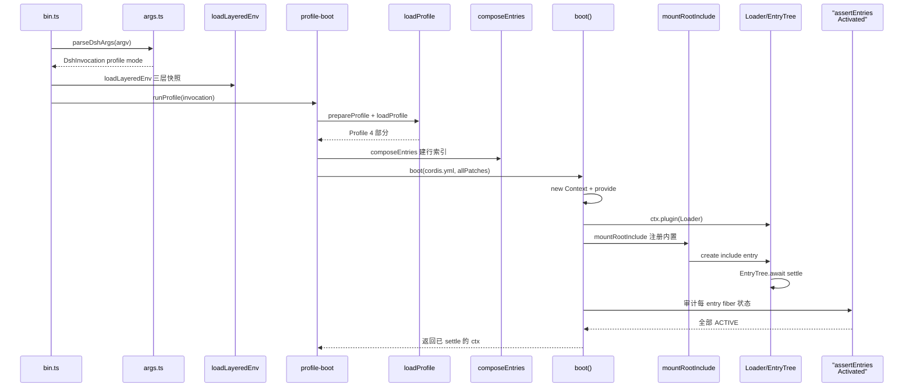

# 架构组合层：Cordis 插件树与启动编排

> 本解读按 **ai-agent ⊗ framework** 类规格产出。子文档之一，聚焦「一切皆插件」如何被装配成可运行的机器（Cordis 插件树与 Profile/Bundle/Patch 分层启动）。覆盖：`packages/boot/app-boot`、`vendor/cordis`、`apps/cli`。相关的整体设计哲学见 [README](README.md)；本层是其他所有子文档（session / agent-loop / tools）挂靠的运行时地基。

## 在项目中的角色

本项目定位：DeepSeek Harness 是一个**无特权内核**的 agent harness——主循环、工具注册表、会话日志、模型适配器全部以**插件**形式架在 vendored Cordis 插件运行时上（`docs/architecture.md:9-13`）：

> 「There is no privileged core to patch: you extend dsh by mounting a plugin beside the others, and registrations are effects that unwind when their plugin unloads.」

```text
<!-- anchor: [Cordis](cordis-primer.md) is the framework under dsh … -->
<!-- anchor: registrations are effects that unwind when their plugin unloads. -->
```

架构组合层就是这个「地基」：**它把空 entry 列表 → 分层 patch → 可运行的 Cordis 插件树**。去掉它，`dsh` 退化为一堆永远无法装配的孤立包——没有任何入口能把 `dsh-base`、`dsh-web-app`、`dsh-headless` 这些 bundle 变成运行中的 agent。

具体来说本层承担四件不可替代的事：

1. **装配**：`boot()` 创建根 Context、安装 Loader 服务、挂载 `cordis:include` 内置，并把整棵配置驱动起来直到 tree settle（`packages/boot/app-boot/src/index.ts:757-802`）。
2. **分层组合**：`loadProfile` → `composeEntries` 把「bundle 层 + 用户层 + home 层 + `--patch` 覆盖」压成一份 entry 列表（`packages/boot/app-boot/src/profile.ts:371-420`）。
3. **热更新**：`watchUserPatches` 通过 Cordis HMR 事务性重放用户 patch 层，不重启进程（`packages/boot/app-boot/src/index.ts:232-265`）。
4. **Fail-loud 审计**：`installFailLoud` + `assertEntriesActivated` 把启动失败转成一条带原始栈的诊断并 `exit(1)`（`packages/boot/app-boot/src/index.ts:609-649`、`692-725`）。

没有这层，所有其他模块（session / agent-loop / tools）没有可以挂靠的运行时。

## 解决什么问题 / 根因

根因是 agent harness 的**可扩展性悖论**：一个「一切皆插件、无特权内核」的产品，必须有某种方式把这些插件**攒成一台能跑起来的机器**——但攒机器这一步如果做成特权内核，就与「无特权」的哲学自相矛盾。

具体分解为三个子问题：

- **装配即副作用注册**：任何插件（模型适配器、工具、会话日志、agent loop）启动时会注册服务、监听事件、挂工具 schema。这些注册必须**可逆**——卸载时撤销，否则 reload / 卸载一个插件会把机器留在半装配状态。Cordis 的 `ctx.effect()` / `ctx.on()` 正是把「注册」建模为可逆副作用（`vendor/cordis/src/fiber.ts:415-561`）。
- **启动顺序不能靠手排**：插件之间靠 `inject` 声明服务依赖，而不是手动编排启动序列——「加载顺序通过服务依赖表达」（`docs/cordis-primer.zh.md:11`）。Loader 的依赖检查（`has`/`inject`）天然处理依赖就绪。
- **机器怎么攒**：`docs/architecture.md:15-27` 定义了 profile/bundle/patch 三层的组合模型——这是本模块要落地的「组装说明」。
- **失败要显式**：插件树并发装载，某个条目 import 失败或激活时 reject，必须 fail-loud 而不是静默挂起。

## 设计思路

### 放弃的替代方案

- **放弃「单一大配置」**：与其把整台 machine 写成一份几千行的覆写式 config，dsh 选择「空树 + 分层 patch」。代价是要解释 patch 语义（id 定位、整 config 替换）；收益是每层（bundle/用户/home/flag）都可叠加、可关闭、可独立发布维护。`docs/architecture.md:27` 明确说了层序：bundle 依次 → 用户 patch → home 层 → `--patch` 覆盖。
- **放弃「自造插件系统」**：选择 vendored Cordis（而非自己从零写 DI + 事件 + 生命周期）。因为可逆副作用、依赖注入、生命周期 fiber、dispatch 模式这四件事是成熟框架才做得对的核心，自造徒增维护量。Cordis 被 vendor 进 `vendor/cordis/`，与 harness 自己的包一起演进。

### 核心模式一：Cordis 可逆副作用 registration 模型

每个 Cordis 服务的注册都是一个 **effet**：`ctx.provide(name, value)` 内部调用 `ctx.fiber.effect(...)`，返回的 disposer 负责反注册并 `notify` 唤醒依赖该服务的 fiber（[vendor/cordis/src/reflect.ts:277-305]()）。事件监听 `ctx.on` 同理（[vendor/cordis/src/events.ts:254-302]()）。

```text
<!-- anchor:  provide(name: string, value?: any, check?: () => boolean) { -->
<!-- anchor:    }, `ctx.provide(${JSON.stringify(name)})`) -->
```

这就是「扩展 dsh = 在旁边挂插件」的机制基础：挂进去是 effect，卸载时 effect 的 disposer 逆序执行，一切撤销干净。

### 核心模式二：分层 patch 组合（空树 + bundle + 用户 + home + overlay）

`dsh` 跑起来的一棵树是这样组出来的（[apps/cli/src/profile-boot.ts:142-171]()、`207-260`）：

```text
<!-- anchor: function composeProfile( -->
<!-- anchor:   return { profile, bundlePatches, homePatches, overlays: composedOverlays, rows } -->
```

- profile 是「命名组合」，装在有 `package.json` + `dsh.profile.bundles` 的目录（`packages/boot/app-boot/src/profile.ts:85-96`）。
- bundle 是「发行格式」，npm 包，`dsh.bundle.patch` 指向它的 patch 文件（`packages/boot/app-boot/src/profile.ts:41-45`）。
- patch 是「配置行级覆盖」，逐层打进同一个 `applyEntryPatches`（`packages/boot/app-boot/src/profile.ts:413-420`）。

### 核心模式三：空树 + include 单次 patch（dump 与 boot 永不漂移）

`boot()` 和 `--dump-config` 共用**同一个** `applyEntryPatches` 语义（`vendor/include/src/index.ts:58-128`），因此打印出来的树就是实际挂载的树——这是 design philosophy 里「Model-visible means logged」在配置侧的镜像：dump 是「Config-visible means mounted」。

## 关键数据结构

- `EntryOptions`：序列化的插件条目——`id` / `name`（模块说明符）/ `config` / `group` / `disabled` / `inject`（`vendor/loader/src/config/entry.ts:9-22`）。patch 的行级覆盖对象。
- `PatchOptions`：补丁条目的运行时形状——`id` / `insert` / `name` / `config` / `disabled` 等（`vendor/include/src/index.ts:144-156`）。
- `Profile` / `ProfileLayer`：一个已解析 profile 的 bundle 层列表 + 用户 patch（`packages/boot/app-boot/src/profile.ts:72-96`）。
- `Entry`：Loader 树里的一个运行节点，持有 `fiber`（对应插件 fiber）与 `options`（`vendor/loader/src/config/entry.ts:52-112`）。
- `Fiber`：一个插件应用实例——生命周期状态、validated config、effect 集合、disposer（`vendor/cordis/src/fiber.ts:184-333`）。
- `Impl` / `store`：服务实现记录（名字 / 提供 fiber / 值 / 可用性谓词），支撑 `ctx.get`/`ctx.provide`（`vendor/cordis/src/reflect.ts:115-125`）。

## 核心流程与启动链路

### 启动流程（启动一个 `dsh --profile <name>`）



### 各环节源位置

- `.env` 三层加载：[packages/boot/app-boot/src/index.ts:177-198]()（继承 > 项目 `.env` > home `.env`，先全部解析校验、后统一赋值，且不覆盖已存在值）。

```text
<!-- anchor: export function loadLayeredEnv( -->
<!-- anchor:   ]) -->
```

- profile 解析 + 行索引 + patch 组合：[apps/cli/src/profile-boot.ts:142-171]()。

```text
<!-- anchor: function composeProfile( -->
<!-- anchor:   return { profile, bundlePatches, homePatches, overlays: composedOverlays, rows } -->
```

- profile 加载（bundle 层定位 + 解析 patch）：[packages/boot/app-boot/src/profile.ts:371-403]()。

```text
<!-- anchor: export function loadProfile( -->
<!-- anchor:   return { name, dir, layers, patchPath, patches } -->
```

- 空树组合：[packages/boot/app-boot/src/profile.ts:413-420]()。关键在 `applyEntryPatches([], structuredClone(layers.flat()))`——单个 patch 入口，与 boot/dump 同语义。

```text
<!-- anchor: export function composeEntries( -->
<!-- anchor:   }) -->
```

- 驱动 Loader：[packages/boot/app-boot/src/index.ts:757-802]()，核心是 `await ctx.get('loader')?.await()`，它轮询直到整树无任务（[vendor/loader/src/config/tree.ts:46-64]()）。

```text
<!-- anchor: export async function boot( -->
<!-- anchor:   } -->
```

- 挂载流程：[packages/boot/app-boot/src/index.ts:486-529]()，`mountRootInclude` 把 Include/Group 注册为 `cordis:` 内置，然后 `ctx.loader.create(rootInclude)`。

```text
<!-- anchor: export async function mountRootInclude( -->
<!-- anchor:   return entry -->
```

- 审计：[packages/boot/app-boot/src/index.ts:692-725]()，逐个检查 `ctx.loader.entries()` 的 `fiber.state`（ACTIVE 通过，FAILED 收集原始 rejection，PENDING 报缺失服务）。

```text
<!-- anchor: export async function assertEntriesActivated(ctx: Context, binName: string): Promise<void> { -->
<!-- anchor:   } -->
```

## 与其他模块协同

- **session / agent-loop / tools 全挂在树上**：这些包是 bundle（`dsh-base`）里的插件行，靠 `inject` 声明依赖、提供 `ctx.sessions` / `ctx.agents` / `ctx.tools` 等服务。本层不感知它们的领域，只负责把它们的行接入 runtime。（跨模块边界：另见相应子文档）session/agent-loop 确有 `inject` 提供与依赖、且由 bundle 层挂载。
- **跨模块结论**：Cordis 三个分发模式（emit/parallel/serial/waterfall）是所有领域事件（session/agent/capability）的底层（`docs/architecture.md:53-61`）；本层鉴证了这些事件的注册-撤销地基。（跨模块边界：另见相应子文档）领域事件走 `ctx.on`（即本层 events effect 机制）——结构上必成立，因为 `ctx.on` 就实现在本层。

## 关键设计决策

### 决策一：选 Cordis 而非自造插件系统

**权衡**：自造能给完全可控的形状，但 DI（服务依赖解析）、fiber 生命周期、可逆 effect、事件 dispatch 四件事是有成熟实现才做得对的复杂度中心。选 Cordis 意味着接受它的概念税（`ctx` 是 Proxy、`inject` 声明、fiber 状态机），但换来「每个插件启动/卸载都是可逆副作用」这一正确性保障。`vendor/cordis/src/fiber.ts:711-723` 的 `restart()` 演示了 Cordis 如何把「卸载+重装」做成一个原语，这正是热更新（`watchUserPatches`）与 fail-loud 的基石。

### 决策二：为什么 profile/bundle/patch 三层

**权衡**：三层不是层级越多越好，而是把三个不同「所有权」分开：

- **bundle**：发行者（DeepSeek 的包），发布补丁层的「版权层」。
- **profile**：机器（dsh 用户），选择「装哪些 bundle + 自己的 patch」。
- **patch**：行级（任意一层都能覆写任意一行）。

若只有 bundle 一层，用户无法覆写底层行；若只有 patch 一层，deepseek 无法批量发布组件。三层把「谁来定义」与「谁能覆盖」显式化——`docs/architecture.md:21` 说 bundle 是「a distribution format for Cordis config rows... whatever it inserts stays patchable by the layers above it」。

### 决策三：patch by-id 替换整行 config（不深合并）

**权衡**：`applyEntryPatches` 对一个 id 命中后，把 `overrides` 逐 key 打进 `target`——即**整行覆盖**，不做深合并（[vendor/include/src/index.ts:116-124]()）。代价是「上层想改一行的一角，必须重述整行」（web-app 的 `cordis.patch.yml` 注释亲口承认：「A patch replaces the targeted row's whole config, so each row below restates every key it owns」）。收益是 patch 语义**可预测、幂等、可审计**——不需要理解目标插件 config 的内部结构就能覆写，dump-config 能把 patch 后的完整树打给你看，不会因为深合并的隐式规则产生「我以为改了这里」的错觉。[vendor/include/src/index.ts:63]() 还刻意 `structuredClone(data)` 保证不改输入，使反复应用（热 reload）能正确回退。

```text
<!-- anchor: export function applyEntryPatches( -->
<!-- anchor:     for (const [key, value] of Object.entries(overrides)) { -->
```

## 亮点

- **dump 与 boot 永不漂移**：组合、flag 派生、config dump 共用同一 `applyEntryPatches` 语义（`packages/boot/app-boot/src/index.ts:349-378`），「看到的 = 跑起来的」。
- **fail-loud 保留原始栈**：`assertEntriesActivated` 对 FAILED fiber 显式 `await fiber.await()` 取回私有 rejection 原因，并一层层剥到最深的 `.cause`，让「某插件初始化抛错」的原始站点出现在诊断里（`packages/boot/app-boot/src/index.ts:696-724`）。
- **空树 + 单次 `applyEntryPatches`**：patch 可见性角例（后层 patch 打中间层 insert 的组子行）与 boot/dump 完全一致，不引入第二套组合逻辑（`packages/boot/app-boot/src/index.ts:400-441` 用「每前缀快照 diff」恢复 provenance）。
- **`structuredClone` 防引入别名污染**：patch 对象里的 `insert` 行按引用进树，后续 id-targeted patch 会原地改这些对象；boot 和 reload 每次 `structuredClone`，保证移除覆写能真正回退到 bundle 默认（`apps/cli/src/profile-boot.ts:235-248`）。这是一个极容易被忽略、代码里专门注释的别名陷阱。
- **profile 模块热更新**：`watchUserPatches` + HMR 把用户 `cordis.patch.yml` 的改动事务性重放，不用重启进程（`packages/boot/app-boot/src/index.ts:232-265`），且 layer 序保证 bundle/overlay 不被用户编辑挤走（`apps/cli/src/profile-boot.ts:228-245`）。

## 问题

- **patch 缺失静默降级**：一个 patch 命不中树时走 `warn` 计一两行后跳过（`vendor/include/src/index.ts:111-115`）。跨 surface 共享 overlay 时这被刻意接受（「one overlay shared across surfaces does not have to match every tree」），但拼错 id 的用户 patch 可能长期带 warning 运行而不被注意。
- **整 config 替换的维护税**：bundle 重构字段名会静默「断」上层所有重述该字段的 patch（因为 patch 按 key 打，bundle 改了默认行但用户已显式覆写时）。这个税在决策三里算过账，但对大型 bundle 是真实的耦合面。
- **Cordis `INACTIVE_EFFECT` 需要调用方吞化**：watch 中 `ctx.loader` 先被 surface dispose 时，HMR 注册抛 `INACTIVE_EFFECT`——app-boot 要专门把它当成「正是想要的退出」而非失败（`packages/boot/app-boot/src/index.ts:262-264`）。这是 framework 抛错与业务语义粘连的脆弱点。

## 全局关联：这里的「地基」如何支撑整体设计哲学

整个 dsh 的「一切皆插件」之所以能成立，不是靠写死某个清单，而是靠本层把「如何组合」做成了**可改写的数据**：没有特权内核要做的事，正是因为它把「哪棵树在跑」交给了一层层可叠加、可热重载、可 dump 的 patch 组合。于是 `session`、`agent-loop`、`tools` 这些子文档里的服务，都是挂在 `dsh-base` bundle 行上的插件（由 `inject` 互相声明依赖），本层只负责把它们接入运行时——「配置即装配，装载即注册，卸载即撤销」这三个不变式，就是下文所有模块共同的运行前提。


