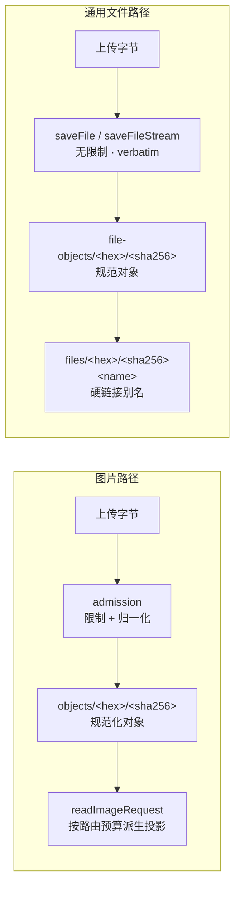
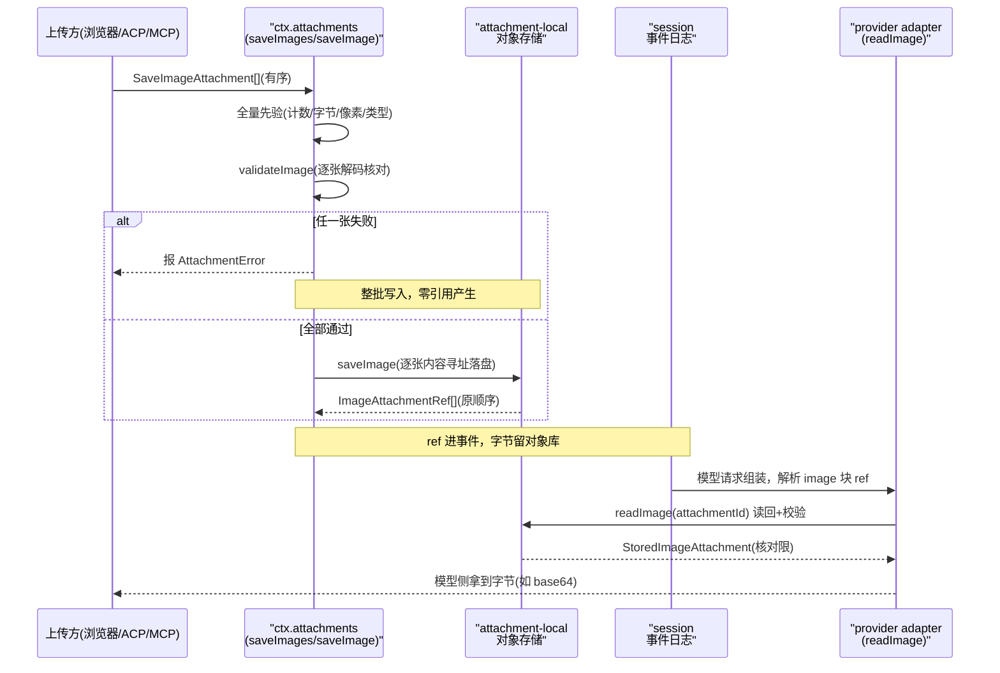
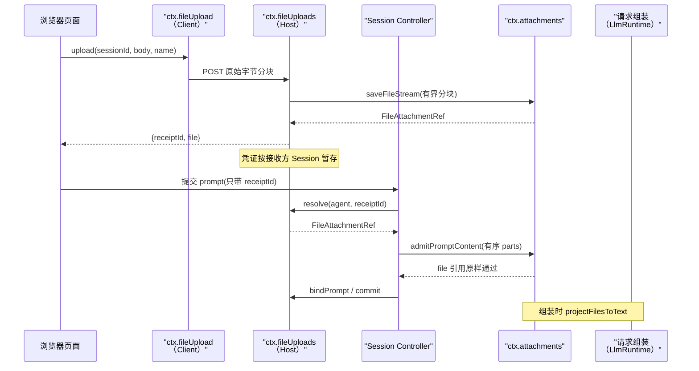

# 持久化附件：durable attachment 能力 seam（`ctx.attachments`）

> 子文档之一，聚焦 dsh 的二进制附件持久化能力（图片与通用文件两条路径）。覆盖 `packages/attachment/attachment`（能力定义）、`packages/attachment/attachment-local`（本地内容寻址实现）、`packages/client/file-upload`（浏览器文件传输与暂存凭证），以及 Host prompt／MCP／LLM 侧的消费。整体哲学见 [README](README.md)；本文与 [llm.md](llm.md)（`image`/`file` ContentBlock）、[data-model.md](data-model.md)（事件日志地面）、[subagent.md](subagent.md)（ACP transport）、[skill-mcp.md](skill-mcp.md)（MCP 桥）、[workspace-files.md](workspace-files.md)（有界文件读取）、[web-client.md](web-client.md)（附件栏与文件卡）互相咬合。
>
> **增量更新说明（rc.7，2026-08）**：本文为新增关注面，对应上游 0.1.0-rc.7 合入的「rich-content bridge / durable multimodal attachments」能力族（`attachment`/`attachment-local` 两个产品包）。既有文档此前仅把 `image` 当作 `ContentBlock` 的一种词汇类型（见 [llm.md](llm.md)），未覆盖其背后的持久化支撑——本文字面补齐这一层。**依据代码快照比对，非官方 changelog。**
>
> **增量更新说明（0.1.5-rc.2，2026-09-11）**：依 `dsh-v0.1.2-rc.1..HEAD` git diff（本关注面相关提交 24 条）与 `verify-references --diff` 预检清单比对更新。本版主题是**附件从"图片专用"泛化为"通用文件"**：同一条 seam 上多了第二条 **verbatim 内容寻址**存储路径（`feat(attachment): store and project generic files`），prompt 准入上收到 service（`refactor(attachment): own prompt admission on service` + `unify prompt content admission`），文件传输/暂存独立为双端 `packages/client/file-upload` 包（`refactor(attachment): isolate file upload service` + `tighten service boundaries` + `keep storage helpers and the HTTP route package-private`），`/api/file` 的字节上限改为复用附件限制（`refactor(api): reuse attachment limits for file responses`）。图片侧的 rc.2 结论（归一化 admission + 对象投影 + Files file-id 首选）经复核**仍成立**，仅投影变换版本号前移。**依据代码快照比对，非官方 changelog。**

## 项目中的角色：把「模型数据源」从内存带字节变为可回放持久引用

此前 dsh 的 session 事件日志能靠 `Model-visible means logged` 重建"模型看到的一切"文本与工具调用，但**图像这类二进制内容**只存在于浏览器对象 URL / provider URL / base64 里，一旦离开内存就无从回放。

dsh 的解法是引入**持久化附件能力面**：一个不变的二进制附件服务（`ctx.attachments`），把「验证并落盘一张图 → 得到一个可序列化的 `ImageAttachmentRef` → 该 ref 进入 session 事件作为模型数据的唯一合法载体」。消费方（浏览器、ACP、MCP、provider adapter）**绝不把原始字节或临时路径写进 session 事件**——写到事件里的只有 ref，字节归能力面的对象存储管；非图片文件走同一 seam 的另一条 verbatim 路径，模型只拿到一条指向只读副本的 handle 文本（[packages/attachment/attachment/README.md:12-12]()
<!-- anchor: Attach images and generic files to prompts and commands, then reuse them after r -->）。

> 这与其说是一个「文件上传组件」，不如说是把「模型看到什么（含二进制部分）都能从日志重建」这条铁律从文本扩展到任意媒体。

## 根因：二进制内容破坏了「事件日志 = 一切模型输入的唯一事实源」

dsh 支柱二「session 日志是唯一事实源」在建 harness 早期只对文本成立。图像进入模型请求的三条通道（浏览器上传、ACP 协议 prompt、MCP 工具结果）各有各的字节源头，若放任它们以 base64/URL 直接进 session 事件，会同时破坏三件事：

- **可回放性**：base64 或临时 URL 进了事件，冷读回放时字节可能已过期/不可达，模型看到的图像无法重建。
- **可审计性**：不可变日志本应只记录"发生了什么"，却塞进了大段二进制负载，膨胀且污染。
- **可交换性**：字节在某个 provider/前端私有形态里，换 provider 或换存储后端时图像就断了。

`ctx.attachments` 就是为这条裂缝而设的**能力 seam**：它不与某个 provider、浏览器或存储绑定，而是让"哪个持久化后端"从"模型请求怎么组"里解耦出来。

## 设计思路：不可变引用 + 内容寻址 + 全量先验后写

### seam 形状：Service Definition / 本地 Provider / 多组 Consumer

遵循 `Capability Seam 三件套`：`AttachmentStore` 是可交换的 Definition（[packages/attachment/attachment/src/index.ts:51-166]()
<!-- anchor: /** Immutable binary attachment service. Implementations validate bytes before p … abstract readImage(ref: ImageAttachmentRef, signal?: AbortSignal): Promise<Store -->），`attachment-local` 是当下唯一的 Provider（本地内容寻址，根在 `DSH_HOME/attachments/v1`），Consumer 是 ACP adapter、MCP client、pi-ai/DeepSeek adapter、Session Controller（浏览器上传）、子代理 prompt 等。

关键词汇 `ImageAttachmentRef` 是持有引用而非持有字节的载体：它只带 `attachmentId`（`sha256:` 前缀）、`mediaType`、`bytes`、`width`/`height`、可选 `name`，**显式承诺"永远不是文件系统路径，也不是带权限的 URL"**（[packages/attachment/attachment/src/types.ts:11-21]()
<!-- anchor: export interface ImageAttachmentRef { …   /** Intrinsic encoded height in pixels. */ -->）。这样 ref 天然可序列化进 session 事件、可随 fork/恢复在会话间共享。
<!-- anchor: /** Durable, serializable metadata for one immutable image object. */ … /** Opaque storage identifier; never a filesystem path or bearer URL. */ -->

### 全量先验后写的 `saveImages`：半途失败不产生任何脏引用

图片是"一条消息里的有序集合"，而非"一张张独立文件"。为此 `AttachmentStore.saveImages` 把整套归纳为**两步原子语义**（[packages/attachment/attachment/src/index.ts:97-102]()
<!-- anchor: async saveImages(inputs: readonly SaveImageAttachment[]): Promise<readonly Image … for (const input of inputs) refs.push(await this.saveImage(input)) -->）：

1. **全量先验**：先在校验阶段就对批里的每一张跑完 `validateImage`（解码 raster、核对声明 mediaType 与字节一致、检查数量/总字节/像素/类型四类上限），**任何一张失败则整批一个字节都不写**。
2. **全量后写**：全部通过后按原顺序逐张落盘，返回 `refs` 的顺序与输入严格一致——避免批内 ref 顺序错乱导致模型看到的图序失真。

这是一个审慎的权衡：把逐张"边验边写"换成"先全验后全写"，牺牲了部分流式吞吐，换来**「要么整批成功、要么什么都不提交」**的事务直觉。代价是批越大，先验阶段的峰值内存越高——但受限（`maxImagesPerMessage` 默认 20），可接受。

### 内容寻址 + fsync 驱动的崩溃安全

本地实现把「不可变」落实为**内容寻址**：`saveImageFile` 先对字节算 SHA-256，以 `objects/<前两hex>/<sha256>` 落盘；对象一旦存在即为不可变、且天然按内容去重——同一张图多次上传只占一份（[packages/attachment/attachment-local/src/store.ts:414-420]()
<!-- anchor: export async function saveImageFile( … return commitPreparedImageFile(root, await prepareImageFile(input, limits, polic -->）。

它比"按 UUID 命名"多一层对崩溃安全的坚持：目标目录的 fsync 边界被显式管理——`syncDirectory` 在目录级 fsync（单文件 sync 不能保证目录项落地），写参考前先同步 `objects` 目录，防止"文件到了但目录项没到"的断电丢引用场景（[packages/attachment/attachment-local/src/store.ts:132-167]()
<!-- anchor: async function syncDirectory(path: string): Promise<void> { … level = parent -->）。单文件写入走 `write→sync→close→link`，用硬链接 + EEXIST 重读比对来并发去重（[packages/attachment/attachment-local/src/store.ts:350-363]()
<!-- anchor: async function publishStagedObject( … if (await digestFile(target) !== staged.sha256) { -->）。

### 通用文件：同一条 seam 上的第二条存储路径（0.1.3-alpha.1 泛化）

图片路径上每一步（逐张解码、归一化到 8-bit sRGB、closed mediaType union、请求级像素/字节预算）都是为"模型要真的看到像素"服务的。通用文件（PDF、数据文件、压缩包……）的消费方式完全不同：**模型不需要把字节塞进 provider 请求，它需要的是一条可以按需读取的稳定地址**。若把文件硬塞进图片流水线，得到的会是"为 provider 端点量身定制的归一化"这种错误耦合——文件既没有 provider 共识的格式，也不该为一次请求而被重编码。

因此 dsh 的解法不是扩大 `ImageAttachmentRef` 的 union，而是在**同一条 seam 上再开一条语义相反的路径**：

- **图片**：admission（限制 + 归一化）→ 内容寻址规范化对象 → 按路由预算派生 `RequestImageAttachment` 投影。
- **通用文件**：**不做任何准入限制、不做归一化**，字节原样内容寻址落盘 → 引用里不带 `mediaType`，只有 digest、清洗后的文件名与字节数（[packages/attachment/attachment/src/types.ts:39-45]()
<!-- anchor: export interface FileAttachmentRef { … bytes: number -->）。

两条路径共用的是**发布机制**而非语义：都在 `tmp/` 暂存、边写边算 SHA-256、`fsync` 文件与目录项、以硬链接发布到内容寻址目标，EEXIST 时重读 digest 比对完成并发去重（[packages/attachment/attachment-local/src/store.ts:309-337]()
<!-- anchor: async function stageImmutableObject( … return { path: temporary, boundary, sha256: hash.digest('hex'), bytes } -->、[packages/attachment/attachment-local/src/store.ts:350-363]()
<!-- anchor: async function publishStagedObject( … if (await digestFile(target) !== staged.sha256) { -->）。

文件侧的存储布局有个值得注意的设计：**规范对象与"人类可读路径"分开**。`file-objects/<前两 hex>/<sha256>` 是每个 digest 唯一一份的规范对象；`files/<前两 hex>/<sha256>/<name>` 是它的硬链接别名（[packages/attachment/attachment-local/src/file-store.ts:75-77]()
<!-- anchor: export function storedFilePath(root: string, ref: FileAttachmentRef): string { … return join(root, 'files', sha256.slice(0, 2), sha256, ref.name) -->）。这样做的收益是双向的：**换个显示名不复制内容**（同一份字节可以以不同文件名出现在不同消息里），而模型拿到的路径又以真实文件名结尾、可以直接喂给现有文件工具；代价是对象目录里出现两个名字，需要靠"别名永远是硬链接"这条不变式维持一致性。

文件名本身是不可信输入（浏览器可以送一条完整的 Windows 本地路径），所以在落盘前先清洗成安全叶子名：手工剥掉 `/` 与 `\` 两种分隔符（POSIX 上 `path.basename` 不认 `\`，会把 Windows 客户端的整条本地路径泄进引用与 session 日志）、替换 Windows 非法字符、剔除保留设备名、按 UTF-8 截到 255 字节（[packages/attachment/attachment-local/src/file-store.ts:45-55]()
<!-- anchor: export function fileLeafName(value: string | undefined): string { … return clean === '' || clean === '.' || clean === '..' ? 'file' : clean -->）。"显示名不是路径"这条约束在两条路径上都成立，只是文件路径上没有 `mediaType` 可供审计，所以把清洗结果**同时**当作存储叶子名，让"引用里的名字"与"磁盘上的名字"恒等、无法漂移。

流式入口是这条路径与图片路径的第二处分野：浏览器可以直接交来 `Blob` 或一次性的 `ReadableStream<Uint8Array>`，因此 service 提供 `saveFileStream`（有界分块、背压、可取消，不把整份文件收进内存）与 `readFileStream`（有界分块读回，最后一 chunk 后复验 digest + 长度）（[packages/attachment/attachment/src/index.ts:202-206]()
<!-- anchor: saveFileStream(input: SaveFileStreamAttachment): Promise<FileAttachmentRef> { … 'ATTACHMENT_FILES_UNSUPPORTED', -->、[packages/attachment/attachment/src/index.ts:218-226]()
<!-- anchor: async *readFileStream( … 'ATTACHMENT_FILES_UNSUPPORTED', -->、[packages/attachment/attachment-local/src/file-store.ts:113-137]()
<!-- anchor: export async function saveFileStreamVerbatim( … return ref -->、[packages/attachment/attachment-local/src/file-store.ts:147-179]()
<!-- anchor: export async function* readFileStreamVerbatim( … throw new AttachmentError('Stored file attachment failed integrity verification. -->）。**为什么不先 base64 再存**：base64 会让页面线程必须聚合整份文件、内存与传输量各膨胀约 33%，而流式载体把内存占用变成"有界分块大小"的函数——上限因此属于磁盘与传输策略，而不是请求安全边界。

## 核心结构 / 数据

持久参考与存储布局如下表：

| 字段 | 类型 / 约束 | 说明 |
|------|------------|------|
| `attachmentId` | `sha256:64hex`，不可变 | 内容寻址标识，非路径、非 URL |
| `mediaType` | `image/png/jpeg/webp/gif`（closed union） | **图片专有**：从存储字节验出的格式 |
| `bytes` / `width` / `height` | number | 逻辑字节长与固有像素；读回时逐项核对 |
| `name` | string? | 可选展示名，剥离本地路径信息 |
| 存储根 | `DSH_HOME/attachments/v1` | 版本化，避免跨版本对象格式互读 |

（图片类型定义见 [packages/attachment/attachment/src/types.ts:1-12]()
<!-- anchor: /** Durable attachment vocabulary. @module @deepseek-ai/dsh-attachment/types */ … export interface ImageAttachmentRef { -->；本地实现见 [packages/attachment/attachment-local/src/store.ts:414-420]()
<!-- anchor: export async function saveImageFile( … return commitPreparedImageFile(root, await prepareImageFile(input, limits, polic -->。）

### 通用文件参考（`FileAttachmentRef`）与双路径布局

通用文件不复用上面这张表——它没有 `mediaType`、没有宽高、也没有归一化后的"第二种字节数"，只有一个 digest、一个叶子名和一个精确长度（[packages/attachment/attachment/src/types.ts:39-45]()
<!-- anchor: export interface FileAttachmentRef { … bytes: number -->）：

| 字段 | 类型 / 约束 | 说明 |
|------|------------|------|
| `attachmentId` | `sha256:64hex` | 就是**原样字节**的 sha256；没有归一化层，故"上传的字节 = 模型按路径读到的字节" |
| `name` | string（必填） | 清洗后的叶子名，同时是展示名与存储叶子名 |
| `bytes` | number | 精确字节数；流式读回时与 digest 一并复验 |

存储布局（都在 `DSH_HOME/attachments/v1` 下）：

| 路径 | 角色 |
|------|------|
| `file-objects/<前两 hex>/<sha256>` | 每个 digest 唯一一份的规范对象；去重的落点 |
| `files/<前两 hex>/<sha256>/<name>` | 规范对象的**硬链接别名**；换显示名不复制字节，且路径以真实文件名结尾 |

图片与文件因此共享同一个版本化存储根、共用同一套暂存/fsync/硬链接发布机制，但**对象目录与引用类型完全分开**——这条边界让"给文件加大小上限"或"给图片换编码器"都不会互相触碰。

## 核心流程：一次图片走完「承诺 → 落盘 → 进入模型请求」的三段链路

- **写侧**：上图中 `saveImages`/`saveImage` 把「承诺何时算数」固定为"写成功才返回 ref"；字节在 durable 之前绝不发布引用，避免"引用了没落盘的对象"。
- **读侧**：`readImage` 返回前会**重读校验**——逐项核对 `mediaType`/`bytes`/`width`/`height` 与 ref 一致（[packages/attachment/attachment-local/src/store.ts:447-453]()
<!-- anchor: if (digest(data) !== sha256) throw new AttachmentError('Stored attachment failed … if (metadata.mediaType !== ref.mediaType || data.byteLength !== ref.bytes -->），`digest` 证明这是 admission 解码过的同一批字节。这使"参考以内容寻址"从写侧扩展到读侧，防篡改、防串对象。文件侧同源：`readFileStream` 在流结束后复验 digest 与字节数（见上文通用文件小节）。
- **进模型**：pi-ai adapter 在请求组装时见到 `image` 块才通过 `attachments.readImageRequest` 解析字节（[packages/llm/llm-pi-ai/src/context.ts:112-112]()
<!-- anchor:     ref => attachments.readImageRequest(ref, policy, signal), -->）；若模型不支持图片，则在组装前用 `contentHasImage` 探到并整体拒绝（[packages/llm/llm/src/content.ts:126-128]()
<!-- anchor: export function contentHasImage(content: readonly ContentBlock[]): boolean { … || (block.type === 'tool-result' && contentHasImage(block.content))) -->）。

### 通用文件：上传 → 暂存凭证 → 提交准入 → handle 投影

图片路径的核心链路是"提交时立即 admission 并落盘"；通用文件多了一个图片没有的阶段——**传输与提交解耦**。文件卡一选中就开始后台上传，完成后拿到一张只在本 Session 的 Agent 作用域内有效的暂存凭证（`receiptId`）；提交 prompt 时只交凭证，Session Controller 再把凭证解析成 `FileAttachmentRef` 交给 service 准入。这条链路的存在理由很实际：浏览器可以在用户还在打字时就把大文件传完，而"哪些凭证属于哪次提交"必须由服务端权威判定——否则直接 RPC 的调用方就能引用一条自己没上传过的字节。

- **传输侧**：`ctx.fileUpload` 收到 `Blob` 或 `ReadableStream` 时组装原始路由请求（`application/octet-stream`），由专用 Worker 发送并回报已消费字节；精确字节与 fixture 输入退化为生成的 Remote 调用（[packages/client/file-upload/src/client/runtime.ts:193-218]()
<!-- anchor: async upload( … const bytes = data instanceof Uint8Array ? data : new Uint8Array(await data.arra -->）。Worker 与页面线程的分工是刻意的：**页面线程不读通用文件字节**——`Blob` 走 Worker 内的 XMLHttpRequest 以便拿到含总量的进度，`ReadableStream` 转移所有权后增量喂给 Fetch（进度只有已消费字节、没有总量）（[packages/client/file-upload/src/client/runtime.ts:78-103]()
<!-- anchor: export function fileUploadWorker( … xhr.send(request.body) -->）。
- **Host 侧**：`handleFileUploadHttp` 只做三项校验（POST、`application/octet-stream`、非空 `sessionId` 查询参数），随后按流式模式把请求体分块交给 `uploadStream`（[packages/client/file-upload/src/http-route.ts:22-44]()
<!-- anchor: export async function handleFileUploadHttp(service: FileUploads, request: Reques … ...(name === undefined ? {} : { name }), -->）；`uploadStream` 再把分块转交 `ctx.attachments.saveFileStream`，因此**字节从不经过 `ctx.fileUploads` 的内存**（[packages/client/file-upload/src/index.ts:119-129]()
<!-- anchor: async uploadStream(request: { … ...(request.name === undefined ? {} : { name: request.name }), -->）。
- **凭证与绑定**：暂存表以接收方 `Session` 对象为 key（[packages/client/file-upload/src/index.ts:60-60]()
<!-- anchor: private readonly stagedFiles = new WeakMap<Session, Map<FileUploadReceiptId, Sta -->），`bindPrompt` 返回一个可回滚绑定——投递失败（dispose）时把每个凭证恢复到上一个 owner，`commit()` 后才保持绑定、并在 queue 或历史观察到该 `rpcId` 时退休（[packages/client/file-upload/src/index.ts:152-168]()
<!-- anchor: bindPrompt( … else upload.requestId = previous -->）。
- **提交与准入**：Session Controller 先解析凭证（未知或异 Session 的凭证直接按 `FILE_NOT_STAGED` 拒绝），再把**完整有序的 part 列表**交给 service（[packages/api/session-controller/src/commands.ts:349-365]()
<!-- anchor: const admission = resolvePromptFileReceipts( … binding.commit() -->）；`admitPromptContent` 只持久化图片 part，file part 的 ref 原样通过（[packages/attachment/attachment/src/index.ts:113-126]()
<!-- anchor: async admitPromptContent( … return { type: 'image', attachment: refs[next++] as ImageAttachmentRef } -->）。
- **投影**：模型侧永远看不到文件字节——每个 `file` 块在请求组装时被换成一行确定性 handle 文本，且**所有路由无条件生效**（[packages/llm/llm/src/index.ts:1043-1051]()
<!-- anchor: // Files are never dispatched natively: every route receives handle text. … projectedMessages = projectImagesForTextModel(projectedMessages) -->）。

## 关键设计决策

### 为什么通用文件不设类型白名单与大小上限，而图片必须归一化 + 限流

两类附件的"模型消费方式"不同，安全边界因此也不同。图片字节要真的进入 provider 请求（或经 Files API 上传），于是必须有一组 provider 共识的 closed mediaType、确定性归一化产物与路由级像素/字节预算；文件的字节**从不进入 provider 请求**，模型只拿到一行 handle 文本、真正的读取发生在文件工具调用里。这意味着文件的风险面是"磁盘与传输"而不是"请求安全"——设白名单/上限的收益（省磁盘、早失败）抵不过成本（拒绝合法工作、把存储策略伪装成安全边界），所以 `saveFile`/`saveFileStream` 的契约明确写着"any byte content and length is accepted"（[packages/attachment/attachment/src/index.ts:187-191]()
<!-- anchor: saveFile(input: SaveFileAttachment): Promise<FileAttachmentRef> { … 'ATTACHMENT_FILES_UNSUPPORTED', -->、[packages/attachment/attachment/src/index.ts:202-206]()
<!-- anchor: saveFileStream(input: SaveFileStreamAttachment): Promise<FileAttachmentRef> { … 'ATTACHMENT_FILES_UNSUPPORTED', -->）。代价被诚实写在 README 的 Known Limitations 里：整个 `DSH_HOME` 因此无界增长（[packages/attachment/attachment/README.md:119-119]()
<!-- anchor: - **Raster image limits apply to images only** — PNG, JPEG, WebP, and GIF are ac -->）。

### 为什么 prompt admission 上收到附件 service

在此之前，"哪些 part 可以进 prompt、图片何时算数、文件凭证何时解析"这套规则散在 Host 侧（Session Controller 与命令平面）；同一件事被两个 package 各写一遍，就会漂移。0.1.3-alpha.1 把 `admitPromptContent` 放到 `AttachmentStore` 上（[packages/attachment/attachment/src/index.ts:113-126]()
<!-- anchor: async admitPromptContent( … return { type: 'image', attachment: refs[next++] as ImageAttachmentRef } -->），输入是 `AttachmentAdmissionPart`——文本、wire 图片、或**已解析成 ref** 的文件三者同列；输出是 `AdmittedPromptContentPart`，其中每个附件都是 durable ref（[packages/attachment/attachment/src/types.ts:100-118]()
<!-- anchor: export type PromptContentPart = … | { readonly type: 'file'; readonly attachment: FileAttachmentRef } -->）。Host 因此只剩两件事：把凭证解析成 ref、把有序列表交给 service。

准入被放在 service 上还有一条更强的理由：`PromptContentPart` 的注释写明"accepting Host promotes image parts ... **before any message is created**, so a wire caller can never cite an attachment it did not upload"——**准入先于消息创建**。若准入发生在消息已入队之后，"引用了不存在或不属于本会话的附件"就会变成日志里一条无法回滚的事件，而不是一次可拒绝的请求。同一动机下 `admitEncodedFile` 与 `isAttachmentError` 也上收到 service（[packages/attachment/attachment/src/index.ts:136-137]()
<!-- anchor: admitEncodedFile(input: EncodedFileAttachment): Promise<FileAttachmentRef> { … return admitFileInput(this, input) -->、[packages/attachment/attachment/src/index.ts:145-146]()
<!-- anchor: isAttachmentError(error: unknown): error is AttachmentError { … return matchesAttachmentError(error) -->）：适配器（ACP/MCP/file-upload）只依赖 `ctx.attachments` 的稳定词汇，不必 import 实现模块——`admission.ts`/`error.ts` 仍在，但降级为 service 的内部实现。

### 为什么把文件传输独立成双端 `file-upload` 包

"传输"和"准入/存储"是两种变化频率完全不同的东西：前者随浏览器环境变（专用 Worker / 页面自有 carrier / fixture Remote），后者随存储 provider 变。揉在一个包里的结果是每次改传输都要动附件核心。0.1.3-alpha.1 的划法是：Host 侧 `ctx.fileUploads` 只拥有**流式路由 + 编码 Remote 兜底 + 命令凭证解析器 + 凭证生命周期**，而"编码准入、附件错误识别、字节存储"全部留在 `ctx.attachments` 之后（[packages/client/file-upload/src/index.ts:57-77]()
<!-- anchor: export class FileUploads extends TypertRemoteService { … fetch: request => handleFileUploadHttp(this, request), -->）。这条边界还解释了为什么这个包放在 `packages/client/` 下却是双端包——它同时提供浏览器 Service 与 Host Service，两者共享同一份协议常量。

边界收紧体现在三处工程动作上：`handleFileUploadHttp` 移入包内非入口模块、verbatim 存储 helper 不再从 `attachment-local` 入口 re-export、Client 入口去掉冗余 hook 类型再导出——即"包的公开面 = 契约，不是实现"；`FileUploads.inject` 则显式声明 `agents`/`attachments`/`commands`/`connection` 四项宿主运行时依赖，让装配缺失在启动期而不是首次上传时暴露（[packages/client/file-upload/src/index.ts:57-77]()
<!-- anchor: export class FileUploads extends TypertRemoteService { … fetch: request => handleFileUploadHttp(this, request), -->）。上传完成后还要再确认接收 Agent 仍然存活（[packages/client/file-upload/src/index.ts:183-213]()
<!-- anchor: private async commit(agent: Agent, save: () => Promise<FileAttachmentRef>): Prom … return { receiptId, file } -->），子代理会话则被显式拒绝（[packages/client/file-upload/src/index.ts:230-236]()
<!-- anchor: private assertOrdinaryAgent(agent: Agent): void { … { reason: 'SUBAGENT_FILE_UNSUPPORTED' } as never, -->）。

> **为什么不"命令成功后自动发送附件"**：状态类命令（`/model`、`/compact`）并不表示"模型可见输入"，自动消费会让无关卡片被静默清空。上游把这条决定权留给命令生产方——只有明确声明收附件的命令才从暂存凭证构造提交，声明不符则报错并保留草稿。

### 为什么"ref 进日志、字节进对象库"而不把 base64 直接塞进事件

最直觉的替代是把 base64 原样写进 session 事件，冷读即自带字节。dsh 没有这么做，因为这会同时污染三个正交性质：**日志体积**（图片是兆级，事件日志会被撑爆且破坏 `readFrom` 按 seq 读的性能假设）、**不可变性**（图要可引用，字节却不可复用——同一图多处引用就是多份）、**可交换**（base64 是 provider 无关的中间态，但仍不提供去重/生命周期管理）。用「不可变内容寻址对象 + 可序列化 ref」取代，让「对象是否可达、何时回收」成为存储层的独立问题，日志本身保持轻量且纯引用。

### 为什么先做「只验不写」与「引用直到写成功才发布」

把「admit（校验）」与「commit（持久化）」拆成两个阶段，是 dsh 反复出现的模式（LLM 错误里的 admit/commit 分离同源，见 [llm.md](llm.md)）。这里的具体收益是：**模型请求是可放弃的、可重试的；但一旦 ref 进日志，它就承诺该对象存在且内容正确。** 若"写失败的部分引用"进入事件，回放时 `readImage` 会在 `ATTACHMENT_NOT_FOUND` 上崩。让校验与提交成对原子化，从根上消除"半批成功"的中间态——这正是「Model-visible means logged」对二进制走廊的自然延伸。

### 为什么用 `ImageAttachmentRef` 的 closed union 而非任意媒体

rc 期只收四种栅格格式（PNG/JPEG/WebP/GIF）。取舍是：`mediaType` 一旦纳入 ref 就成为审计承诺，开放任意类型会把"存储问题"和"provider 能力问题"混在一起。先收窄到 provider（尤其 ACP 的 `image` 块）与 DeepSeek 系模型都共识的格式，音频/视频/通用文件留待独立生命周期契约（[packages/attachment/attachment/README.md:12-12]()
<!-- anchor: Attach images and generic files to prompts and commands, then reuse them after r -->）。

> **演进说明（0.1.5-rc.2）**：0.1.3-alpha.1 兑现了这个"独立契约"，但方式是**不在同一个 ref 里开口子**——通用文件另起 `FileAttachmentRef`（只有 digest/name/bytes，没有 `mediaType`）与一条不做归一化的 verbatim 存储路径（[packages/attachment/attachment/src/types.ts:39-45]()
<!-- anchor: export interface FileAttachmentRef { … bytes: number -->）。因此这条决策**约束的从来只是图片**，至今仍成立；被推翻的只是"通用文件也不做"这一句。

## 与 ACP / MCP / LLM 的接线

附件能力面不是一个孤岛，它被三条外部通道消费，每条都在"字节进 ref、校验失败 map 成协议错误"上做适配：

- **ACP adapter**：把协议内的 `image` 块严格解码（只收规范 base64、mime 限定在四格栅）成 `SaveImageAttachment`，统一喂给 `saveImages`；`isImageAdmissionError` 把这套附件错误词汇 map 成 ACP 的 `invalid` 请求失败（[packages/acp/acp/src/content.ts:5-55]()）。另外还能在初始化前用 `supportsAcpImagePrompts` **诚实宣告**「本路由当前是否真的收图」——必须附件服务存在、模型声明 `image` 输入模态、且媒体类型有交集才为 true，任一项不足即为 false（[packages/acp/acp/src/content.ts:89-99]()）。
<!-- anchor: import { isImageAdmissionError } from '@deepseek-ai/dsh-attachment' … const data = Buffer.from(block.data, 'base64') -->
<!-- anchor: export async function supportsAcpImagePrompts( … const info = await llm.resolveModelInfo(provider, model) -->
- **MCP client**：把工具结果里的图片结果投影成 durable 引用，同样复用 `isImageAdmissionError` 做错误分类（[packages/mcp/mcp-client/src/tools.ts:472-492]()
<!-- anchor: let attachments: AttachmentStore … return projectContent(content, toolName, block => ({ -->）。**通用文件不在此列**：MCP 结果里的非图片富内容仍被投影成文本占位，`read_file` 与文件块只从 Host prompt 的一侧进来。
- **LLM adapter**：pi-ai 在"批含图时才 lazily resolve 附件服务"，并且**模型不支持图则整体拒绝**——`contentHasImage` 探到一个图就抛 `UNSUPPORTED_CONTENT`，绝不把图静默降级成文本（[packages/llm/llm-pi-ai/src/adapter.ts:358-364]()
<!-- anchor: const containsImage = options.messages.some(message => contentHasImage(message.c … throw new LlmError('pi-ai image input requires the durable attachment service',  -->）；文件块则走"无条件投影成 handle 文本"，没有 provider 能原生收它。

> **演进说明（rc.8）**：DeepSeek 官方 adapter 也加入多模态——非纯文本，而是"按模型声明 `inputModalities`（含 `image`）+ 必须存在附件服务"两个条件都满足时才走图像路径；请求含图时经 `serializeRequestWithImages` 把 durable ref 解析为有序 data-URL 段，且同样有 `maxRequestImageBytes` 载荷上限（[packages/llm/llm-deepseek/src/serialize.ts:403-407]()、[packages/llm/llm-deepseek/src/adapter.ts:573-623]()
<!-- anchor: export async function serializeRequestWithImages( … ): Promise<WireRequest> { -->
<!-- anchor: let representation: 'file' | 'base64' = 'file' … representation = 'base64' -->）。deepseek 与 pi-ai 共享同一 `offloadRequestImages`（把最老图像换成确定文本兜底 413），图像能力位校验由此前的"DeepSeek 恒 text-only、pi-ai 收图"演进为两家都收。

这几处接线共同点：**能力位（能不能收图）与存储（ref 而非字节）两个维度都被显式校验**，失败走 `invalid`/`UNSUPPORTED_CONTENT` 而非装作成功——与 [subagent.md](subagent.md) 的「能力位校验先于委派」一脉相承。通用文件的接线沿用同一姿态，但校验对象从"能力位"换成了"凭证归属"。

### 通用文件的三条接线：Host prompt / 子代理 / LLM 请求组装

图片有三条外部通道（ACP / MCP / 浏览器），通用文件目前只有一条半：Host prompt，以及挂在同一准入入口下的子代理。

- **Host prompt**：Session Controller 解析凭证 → `admitPromptContent` → `bindPrompt`（[packages/api/session-controller/src/commands.ts:349-365]()
<!-- anchor: const admission = resolvePromptFileReceipts( … binding.commit() -->）。子代理侧没有独立上传通道，但复用同一准入入口（[packages/subagent/subagent/src/index.ts:448-448]()
<!-- anchor: content = await attachments.admitPromptContent(request.content) -->），并由 `assertOrdinaryAgent` 在 Host 侧挡掉子会话上传。
- **ACP**：仍只有 `image` 词汇——协议侧的通用文件契约尚未落地，这是本版留下的一处不对称。
- **LLM 请求组装**：核心词汇新增 `FileBlock`（与 `ImageBlock` 并列的 `ContentBlockMap` 成员，[packages/llm/llm/src/types.ts:84-87]()
<!-- anchor: export interface FileBlock { … attachment: FileAttachmentRef -->），请求组装阶段对**每条路由**无条件把 file 块换成 handle 文本（[packages/llm/llm/src/index.ts:1043-1051]()
<!-- anchor: // Files are never dispatched natively: every route receives handle text. … projectedMessages = projectImagesForTextModel(projectedMessages) -->）。handle 由 `fileHandleText` 生成：文件名、字节数、digest 前缀、只读保存路径，外加一句"委派文件任务时把该路径写进子任务提示"（[packages/llm/llm/src/content.ts:154-160]()
<!-- anchor: export function fileHandleText(ref: FileAttachmentRef, readonlyPath: string | un … return `[${identity}: verbatim read-only copy saved at ${quoted(readonlyPath)}.  -->）。路径不是从 ref 直接推出的：`fileHostPath` 给出宿主绝对路径，再由当前执行世界映射成模型可用路径（[packages/llm/llm/src/index.ts:990-1003]()
<!-- anchor: private fileReadPath(ref: FileAttachmentRef): string | undefined { … return fs?.processPathFromHostPath(hostPath) -->）；映射不到时 handle 退化为"明确报告无法读取该文件"，而不是让模型假装读过——这是"宁可承认读不到"的一致性设计（[packages/llm/llm/src/content.ts:154-160]()
<!-- anchor: export function fileHandleText(ref: FileAttachmentRef, readonlyPath: string | un … return `[${identity}: verbatim read-only copy saved at ${quoted(readonlyPath)}.  -->）。嵌套在 `tool-result` 里的 file 块同样被替换（[packages/llm/llm/src/content.ts:138-143]()
<!-- anchor: export function contentHasFile(content: readonly ContentBlock[]): boolean { … return false -->），`projectFilesToText` 是这条规则唯一的收敛点（[packages/llm/llm/src/content.ts:196-203]()
<!-- anchor: export function projectFilesToText( … return content === message.content ? message : { ...message, content } -->）。

### 附件限制被 API 侧复用：`/api/file` 的字节上限来自 `imageLimits`

`/api/file` 不再有自己的 `maxImageBytes`/`maxFileBytes` 配置项，而是直接取 `ctx.attachments.imageLimits.maxImageBytes` 作为**唯一**的响应字节上限（[packages/api/session-controller/src/media-references.ts:68-75]()
<!-- anchor: apply(ctx: Context): void { … }), 'session-controller: /api/file') -->），GET 用同一个 `maxBytes` 做有界读取，HEAD 用 `fs.stat` 的 size 预判并返回 413（[packages/api/session-controller/src/media-references.ts:45-47]()
<!-- anchor: const bytes = await fs.readBytes(target, request.signal, maxBytes) … return new Response(bytes.slice(), { headers }) -->）。

这一步值得单独记一笔：它把"多大的文件可以进入一次读取"从两处配置收敛为一处权威——**上传准入（`maxImageBytes`）与文件回显共用同一条上限**，改部署的附件限制会同时约束两侧，避免两条上限各自漂移。代价是图片与非图片响应不再能分别设限（旧版正是为此才拆成两项）。有界读取本身的细节见 [workspace-files.md](workspace-files.md)。

## 演进说明（0.1.1-rc.2）：从"存字节"到"归一化 + 对象投影 + Files 上传"

rc.2 把附件层从"校验后原样存字节、请求时内联 base64"升级为一条**统一的图片管线**，在 [llm.md](llm.md)「决策四」的 provider 侧之上，补充了存储与投影侧的三处实质变化：

> **① canonical admission：落库前归一化，而非逐字节透传。**
> `attachment-local` 新增 `normalizeImage`（[packages/attachment/attachment-local/src/normalization.ts:103-108]()）：上传图先做 `canPassThroughNormalization` 判定（[packages/attachment/attachment-local/src/normalization.ts:35-47]()），只有"干净源"（固定 8-bit sRGB、无元数据、无动画、单帧）才字节级透传对象库。
> <!-- anchor: export async function normalizeImage( … if (canPassThroughNormalization(detected, data.byteLength, policy)) { -->
> <!-- anchor: export function canPassThroughNormalization( … && Math.max(detected.width, detected.height) <= policy.maxDimension -->
> 其余全部重编码 + 降采样到归一化策略声明的总像素预算与长边上限（[packages/attachment/attachment-local/src/index.ts:50-52]()）。
> <!-- anchor: export const DEFAULT_NORMALIZED_IMAGE_MAX_PIXELS = 2048 * 2048 … export const DEFAULT_NORMALIZED_IMAGE_MAX_DIMENSION = 8192 -->
> 这把"admission"从"验格式"推进到"产确定性 provider 无关版本"——长会话里每张 admission 过的图都以同一确定性形态参与后续每一个请求，避免规则漂移。

> **② `readImageRequest` 投影：附件可派生为外部对象存储可寻址的确定性变体。**
> `AttachmentStore` 新增抽象 `readImageRequest(ref, policy, signal)`（[packages/attachment/attachment/src/index.ts:248-258]()）：按模型路由的像素/字节预算（`ImageRequestPolicy.maxPixels/maxBytes`）派生 `RequestImageAttachment`（含 `variantId`/depth/space/hasAlpha），未实现的 provider 抛 `ATTACHMENT_PROJECTION_UNSUPPORTED`。本地实现 `readImage` 走磁盘缓存 + variant 身份（生成为主 + `requestInflight` 去重），variant 身份包含变换版本常量（[packages/attachment/attachment-local/src/request-image.ts:25-25]()）。
> <!-- anchor: readImageRequest( … 'ATTACHMENT_PROJECTION_UNSUPPORTED', -->
> <!-- anchor: export const REQUEST_IMAGE_TRANSFORM_VERSION = 'request-image-v5' -->
>
> **演进说明（0.1.5-rc.2）**：该常量由 rc.2 期的 `'request-image-v4'` 前移至 `'request-image-v5'`（编码器改为按 alpha 选择共享质量梯）。因此 rc.2 期落盘的 v4 变体不会被复用，会按新的 `variantId` 重新生成——这正是把变换版本纳入 variant 身份的目的：编码器一改，缓存自动失效，而不是悄悄返回旧口径的字节。

> **③ DeepSeek Files 接线：file-id 首选、base64 兜底。**
> 投影出的 `RequestImageAttachment` 在 DeepSeek 适配器侧默认走 Files API 上传复用（`representation: 'file'`）而非内联 base64；新增完整 `/files` 客户端与带过期/并发去重的上传索引（[packages/llm/llm-deepseek/src/files-api.ts:128-128]()、[packages/llm/llm-deepseek/src/file-store.ts:142-175]()）。由归一化保证"上传给对象存储的字节 = 模型路由读到的字节"，再由 file-id 复用省去重复传输。详见 [llm.md](llm.md)「决策四」。
> <!-- anchor: export class DeepSeekFilesClient { -->
> <!-- anchor: ensureUploaded( … return waitForUpload(shared, signal) -->

> **④ WebP alpha 兼容**：sharp 可能从全不透明 WebP 输出省略 alpha 平面，校验时把"声明有 alpha 但输出为 WebP 无 alpha"判为兼容（`encodedAlphaIsCompatible`，[packages/attachment/attachment-local/src/image.ts:35-41]()），避免一张全不透明 WebP 在归一化/投影时被误判 alpha 不匹配而失败。
> <!-- anchor: export function encodedAlphaIsCompatible( …     || (sourceHasAlpha && !output.hasAlpha && output.mediaType === 'image/webp') -->

这条管线的整体权衡：**用"确定性归一化 + 对象投影"换"与任意外部对象存储 / provider Files API 的松耦合"**——附件层不再假设消费方只吃内联 base64，而是承认"模型路由按字节预算吃不同变体"，把变体派生收敛进存储侧（生成为主 + 缓存复用）。代价是增加了一次归一化重编码的开销与 Variant 缓存管理，换取图像在长会话、跨 provider、跨存储后端的可重复可交换。

## 演进与未完成

- **GC 与保留策略明确 deferred**：因为恢复/分叉的会话可能共享不可变对象，简单 "没被引用即删" 会误删仍在用的图；`readImage` 前的完整性校验让"对象还在吗"可被探测，但自动回收要等引用感知的 GC——当前官方定位是"存储的图与文件**从不自动删除**"（[packages/attachment/attachment/README.md:120-120]()
<!-- anchor: - **Attachments are never deleted** — stored images and files are retained indef -->）。当前遗漏可能留下不可达对象占磁盘，属已知取舍。
<!-- anchor: - Retention and garbage collection are deferred because resumed and forked sessions may share immutable objects. … - Retention and garbage collection are deferred because resumed and forked sessions may share immutable objects. -->
- **通用文件 / 音频 / 视频 / 未发送草稿**：rc 期判定为"各自需要独立生命周期与 provider 契约，v1 不做"。

> **演进说明（0.1.5-rc.2）**：其中"通用文件"已在 0.1.3-alpha.1 落地——非图片文件按字节原样内容寻址存储、**不设类型与大小上限**，模型只拿到保存路径按需读取（[packages/attachment/attachment/README.md:119-119]()
<!-- anchor: - **Raster image limits apply to images only** — PNG, JPEG, WebP, and GIF are ac -->）。仍然 deferred 的是**音频 / 视频**（无专用处理）与**未发送草稿**（草稿留在浏览器内存）。
- **配置化限制**：五类上限（`saveImages` 先验阶段逐一校验）——单图字节默认 **20 MiB**（提交上限，超则拒绝而非缩放）、单消息 20 张、单消息聚合 200 MiB、单图 6400 万像素、**单图边长 `maxImageDimension=8192px`**，均可经 `LocalAttachmentStore.Config` 调（[packages/attachment/attachment-local/src/index.ts:34-56]()
<!-- anchor: export const DEFAULT_MAX_IMAGE_BYTES = 20 * 1024 * 1024 … export const DEFAULT_IMAGE_COMPRESSION_CONCURRENCY = 2 -->；zod schema 把这些默认值逐一接上（[packages/attachment/attachment-local/src/index.ts:150-158]()
<!-- anchor: maxImageBytes: z.number().step(1).min(1).default(DEFAULT_MAX_IMAGE_BYTES), … imageCompressionConcurrency: z.number().step(1).min(1).max(MAX_IMAGE_COMPRESSION -->）。**通用文件不在这一列**：它没有准入上限，只有流式读写的分块大小。

> **演进说明（0.1.2-alpha）**：默认值随 alpha 演进与 rc.8 不同（rc.8 为单图 3.5 MiB / 边长 2000px / 4000 万像素，当前为 20 MiB / 8192px / 6400 万像素），且归一化存储目标另有一组独立默认（`DEFAULT_NORMALIZED_IMAGE_MAX_PIXELS=2048²`、`DEFAULT_NORMALIZED_IMAGE_MAX_DIMENSION=8192`、`DEFAULT_NORMALIZED_IMAGE_MAX_BYTES=4 MiB`）——"admission 拒绝"与"归一化后存储预算"两条线分离。新增的 `maxImageDimension` 使"admission 拒绝"与"模型路由拒绝"落在同一条线：长会话里每张已 admission 的图都随每个后续请求走一遍，边长超标会导致整个会话请求被拒，故在 admission 时一并拒绝以保 durable 历史可流式。
<!-- anchor: export const DEFAULT_MAX_IMAGE_BYTES = 3.5 * 1024 * 1024 … export const DEFAULT_MAX_IMAGE_DIMENSION = 2000 -->
<!-- anchor: maxImageBytes: z.number().step(1).min(1).default(DEFAULT_MAX_IMAGE_BYTES), … maxImagePixels: z.number().step(1).min(1).default(DEFAULT_MAX_IMAGE_PIXELS), -->
- `readImage` 支持 `AbortSignal` 取消，且在取消时保留"取消原由"而非翻译成存储失败（[packages/attachment/attachment/src/index.ts:166-166]()
<!-- anchor: abstract readImage(ref: ImageAttachmentRef, signal?: AbortSignal): Promise<Store -->）——与 [llm.md](llm.md) 的 `ABORTED` 与 `TIMEOUT` 区别同理。文件侧保留同一语义：流式写与流式读都在每个分块边界 `throwIfAborted`。

### 通用文件的未完成面（0.1.5-rc.2）

- **无界增长**：不设大小上限 + 从不自动删除 = `DSH_HOME` 会一直变大；GC 与图片保留问题绑在一起继续挂起（[packages/attachment/attachment/README.md:120-120]()
<!-- anchor: - **Attachments are never deleted** — stored images and files are retained indef -->）。
- **投影路径只在能映射的执行环境有效**：沙箱或远程文件系统映射不到 `DSH_HOME` 时，模型拿到的是显式的"无路径"handle，必须报告无法读取；基于存储的读取兜底被推迟。
- **暂存是进程内的**：上传与发送之间 Host 重启会出现 `FILE_NOT_STAGED`，客户端重新添加文件即可恢复。
- **重试不是断点续传**：传输是一条无偏移的流式 HTTP 请求，连接失败后从头重传；`ReadableStream` 一次性，重试需要重建。
- **`@` 补全尚未收录已上传文件**：该联动被上游记为后续阶段，当前文件只从附件栏进入。
- **子代理不独立上传**：主 agent 委派时需把保存路径写进子任务提示，只有共享该执行环境的子级能读到。
- **助手侧文件输出无契约**：`FileBlock` 目前只对用户内容合法，与 `ImageBlock` 的"仅用户内容带图"约束一致。

## 全局关联：把「可交换后端」再扩一类，且守住了「一切模型输入都可回放」

`ctx.attachments` 是 [architecture.md](architecture.md) 五支柱既有光谱（LLM / 沙箱 / 会话 / 工具）之外，新加入的一块可交换能力面：它再次证明了 Seam 三件套（Definition / Provider / Consumer）的价值——新增「图片持久化后端」（如换成对象存储、加 TTL）只影响 Provider 一层，Consumer 侧从 ACP/MCP/flow 到 adapter 全部不改，因为大家都只对 ref 说话。

更重要的是它没有为换取"支持图片"而牺牲 dsh 的根本前提：模型看到的每张图都从 session 日志里的 ref 可重建，`Model-visible means logged` 因此在文本之外同样成立。这与 [session.md](session.md) 的唯一事实源、[llm.md](llm.md) 的可交换词汇一脉相承——支持更多媒体类型，不是砍掉可审计，而是把可审计扩展到二进制。

0.1.3-alpha.1 的泛化把这条论证又推进了一步，而且方向值得注意：**通用文件不是被"塞进"附件 seam，而是被"接在"同一个发布机制上**。它证明了这个 seam 真正的可交换单元不是"图片处理器"，而是"内容寻址的不可变对象 + 可序列化引用 + 发布前准入"。图片在这套骨架上加的是"归一化 + provider 投影"，文件加的是"verbatim + 宿主路径投影"——两种 Consumer 需求都能落进同一骨架，说明当初把 `ctx.attachments` 抽成能力面而不是"图片上传组件"是对的。代价也同一处：既然两类对象共享存储根与保留策略，**GC 就必须同时理解图片与文件**，这也是它继续被推迟的原因之一。

## 引用演进记录

> **0.1.5-rc.2 增量**：依 `verify-references --diff` 预检清单逐条重定位。上版遗留的 15 处失配/未解析引用已全部修正：`attachment/README.md` 因整篇重写，原锚点（`12`/`114`）全部失效，改为按新 README 的 Summary、Implementation、Known Limitations 三段重取锚点（`12`/`71`/`75`/`119`/`120`）；`attachment/src/index.ts` 的 Definition 区间 `39-111 → 51-166`、`saveImages` `85-90 → 97-102`、`readImageRequest` `131-141 → 248-258`、`readImage` `111 → 166`；`attachment-local/src/store.ts` 因新增流式发布路径整体下移（`saveImageFile` `264-272 → 414-420`、`staging open` `212-223 → 323-334`、读回校验 `297-303 → 447-453`）；`attachment-local/src/index.ts` 默认值 `28-50 → 34-56`、zod 默认值 `146-149 → 150-158`；`llm/src/content.ts` `contentHasImage` `124-126 → 126-128`；`mcp-client/src/tools.ts` `462-484 → 472-492`（漂移仅因 `syncTools` 新增重复游标防护）；`llm-pi-ai/src/adapter.ts` 的图像能力位校验 `307-320 → 358-364`（并补上原本缺失的指纹注释）。新增引用 30 余处，全部落在本版泛化相关代码上（`file-store.ts`、`file-upload` 包、`admitPromptContent`、`FileBlock` 投影、`/api/file` 限制复用）。

> **0.1.2-alpha.4 增量**：上版（0.1.1-rc.2）遗留的 5 处 `[UNVERIFIED]` 引用已全部重定位到当前源码：`attachment/README.md:5-6 → 12`（durable seam 描述）、`types.ts:10-12 → 12-20`（`ImageAttachmentRef`）、`store.ts:136-190 → 264-272`（`saveImageFile`）、`llm-pi-ai/context.ts:52-56 → 112`（`readImageRequest`）、`attachment-local/src/index.ts:14-28 → 26-44`（配置默认值，且数值随 alpha 更新）。
