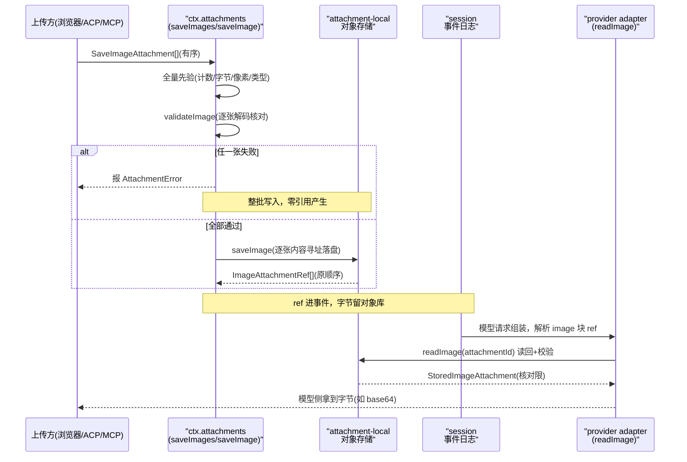

# 持久化附件：durable attachment 能力 seam（`ctx.attachments`）

> 子文档之一，聚焦 dsh 的二进制附件持久化能力。覆盖 `packages/attachment/attachment`（能力定义）、`packages/attachment/attachment-local`（本地内容寻址实现），以及 ACP/MCP/LLM 侧的消费。整体哲学见 [README](README.md)；本文与 [llm.md](llm.md)（`image` ContentBlock）、[data-model.md](data-model.md)（事件日志地面）、[subagent.md](subagent.md)（ACP transport）、[skill-mcp.md](skill-mcp.md)（MCP 桥）互相咬合。
>
> **增量更新说明（rc.7，2026-08）**：本文为新增关注面，对应上游 0.1.0-rc.7 合入的「rich-content bridge / durable multimodal attachments」能力族（`attachment`/`attachment-local` 两个产品包）。既有文档此前仅把 `image` 当作 `ContentBlock` 的一种词汇类型（见 [llm.md](llm.md)），未覆盖其背后的持久化支撑——本文字面补齐这一层。**依据代码快照比对，非官方 changelog。**

## 项目中的角色：把「模型数据源」从内存带字节变为可回放持久引用

此前 dsh 的 session 事件日志能靠 `Model-visible means logged` 重建"模型看到的一切"文本与工具调用，但**图像这类二进制内容**只存在于浏览器对象 URL / provider URL / base64 里，一旦离开内存就无从回放。

dsh 的解法是引入**持久化附件能力面**：一个不变的二进制附件服务（`ctx.attachments`），把「验证并落盘一张图 → 得到一个可序列化的 `ImageAttachmentRef` → 该 ref 进入 session 事件作为模型数据的唯一合法载体」。消费方（浏览器、ACP、MCP、provider adapter）**绝不把原始字节或临时路径写进 session 事件**——写到事件里的只有 ref，字节归能力面的对象存储管（[packages/attachment/attachment/README.md:5-6]()）。
<!-- anchor: The durable attachment seam. `ctx.attachments` validates and durably commits immutable image bytes, then returns a serializable `ImageAttachmentRef`; consumers never persist browser paths, object URLs, provider URLs, or base64 in session events. … The durable attachment seam. `ctx.attachments` validates and durably commits immutable image bytes, then returns a serializable `ImageAttachmentRef`; consumers never persist browser paths, object URLs, provider URLs, or base64 in session events. -->

> 这与其说是一个「文件上传组件」，不如说是把「模型看到什么（含二进制部分）都能从日志重建」这条铁律从文本扩展到任意媒体。

## 根因：二进制内容破坏了「事件日志 = 一切模型输入的唯一事实源」

dsh 支柱二「session 日志是唯一事实源」在建 harness 早期只对文本成立。图像进入模型请求的三条通道（浏览器上传、ACP 协议 prompt、MCP 工具结果）各有各的字节源头，若放任它们以 base64/URL 直接进 session 事件，会同时破坏三件事：

- **可回放性**：base64 或临时 URL 进了事件，冷读回放时字节可能已过期/不可达，模型看到的图像无法重建。
- **可审计性**：不可变日志本应只记录"发生了什么"，却塞进了大段二进制负载，膨胀且污染。
- **可交换性**：字节在某个 provider/前端私有形态里，换 provider 或换存储后端时图像就断了。

`ctx.attachments` 就是为这条裂缝而设的**能力 seam**：它不与某个 provider、浏览器或存储绑定，而是让"哪个持久化后端"从"模型请求怎么组"里解耦出来。

## 设计思路：不可变引用 + 内容寻址 + 全量先验后写

### seam 形状：Service Definition / 本地 Provider / 多组 Consumer

遵循 `Capability Seam 三件套`：`AttachmentStore` 是可交换的 Definition（[packages/attachment/attachment/src/index.ts:30-90]()），`attachment-local` 是当下唯一的 Provider（本地内容寻址，根在 `DSH_HOME/attachments/v1`），Consumer 是 ACP adapter、MCP client、pi-ai/DeepSeek adapter、浏览器上传等。
<!-- anchor: /** Immutable binary attachment service. Implementations validate bytes before publishing a reference. */ … abstract readImage(ref: ImageAttachmentRef, signal?: AbortSignal): Promise<StoredImageAttachment> -->

关键词汇 `ImageAttachmentRef` 是持有引用而非持有字节的载体：它只带 `attachmentId`（`sha256:` 前缀）、`mediaType`、`bytes`、`width`/`height`、可选 `name`，**显式承诺"永远不是文件系统路径，也不是带权限的 URL"**（[packages/attachment/attachment/src/types.ts:10-12]()）。这样 ref 天然可序列化进 session 事件、可随 fork/恢复在会话间共享。
<!-- anchor: /** Durable, serializable metadata for one immutable image object. */ … /** Opaque storage identifier; never a filesystem path or bearer URL. */ -->

### 全量先验后写的 `saveImages`：半途失败不产生任何脏引用

图片是"一条消息里的有序集合"，而非"一张张独立文件"。为此 `AttachmentStore.saveImages` 把整套归纳为**两步原子语义**（[packages/attachment/attachment/src/index.ts:55-74]()）：
<!-- anchor: async saveImages(inputs: readonly SaveImageAttachment[]): Promise<readonly ImageAttachmentRef[]> { … for (const input of inputs) refs.push(await this.saveImage(input)) -->

1. **全量先验**：先在校验阶段就对批里的每一张跑完 `validateImage`（解码 raster、核对声明 mediaType 与字节一致、检查数量/总字节/像素/类型四类上限），**任何一张失败则整批一个字节都不写**。
2. **全量后写**：全部通过后按原顺序逐张落盘，返回 `refs` 的顺序与输入严格一致——避免批内 ref 顺序错乱导致模型看到的图序失真。

这是一个审慎的权衡：把逐张"边验边写"换成"先全验后全写"，牺牲了部分流式吞吐，换来**「要么整批成功、要么什么都不提交」**的事务直觉。代价是批越大，先验阶段的峰值内存越高——但受限（`maxImagesPerMessage` 默认 20），可接受。

### 内容寻址 + fsync 驱动的崩溃安全

本地实现把「不可变」落实为**内容寻址**：`saveImageFile` 先对字节算 SHA-256，以 `objects/<前两hex>/<sha256>` 落盘；对象一旦存在即为不可变、且天然按内容去重——同一张图多次上传只占一份（[packages/attachment/attachment-local/src/store.ts:136-190]()）。
<!-- anchor: export async function saveImageFile(root: string, input: SaveImageAttachment, limits: ImageAttachmentLimits): Promise<ImageAttachmentRef> { … return { -->

它比"按 UUID 命名"多一层对崩溃安全的坚持：目标目录的 fsync 边界被显式管理——`syncDirectory` 在目录级 fsync（单文件 sync 不能保证目录项落地），写参考前先同步 `objects` 目录，防止"文件到了但目录项没到"的断电丢引用场景（[packages/attachment/attachment-local/src/store.ts:76-113]()）。单文件写入走 `write→sync→close→link`，用硬链接 + EEXIST 重读比对来并发去重（[packages/attachment/attachment-local/src/store.ts:152-164]()）。
<!-- anchor: async function syncDirectory(path: string): Promise<void> { … level = parent -->
<!-- anchor: handle = await open(temporary, constants.O_CREAT | constants.O_EXCL | constants.O_WRONLY, 0o600) … if (digest(existing) !== sha256) throw new AttachmentError('Stored attachment failed integrity verification.', 'ATTACHMENT_CORRUPT') -->

## 核心结构 / 数据

持久参考与存储布局如下表：

| 字段 | 类型 / 约束 | 说明 |
|------|------------|------|
| `attachmentId` | `sha256:64hex`，不可变 | 内容寻址标识，非路径、非 URL |
| `mediaType` | `image/png/jpeg/webp/gif`（closed union） | 从存储字节验出的格式 |
| `bytes` / `width` / `height` | number | 逻辑字节长与固有像素；读回时逐项核对 |
| `name` | string? | 可选展示名，剥离本地路径信息 |
| 存储根 | `DSH_HOME/attachments/v1` | 版本化，避免跨版本对象格式互读 |

（类型定义与限制见 [packages/attachment/attachment/src/types.ts:1-12]()；本地实现见 [packages/attachment/attachment-local/src/store.ts:136-190]()。）
<!-- anchor: /** Durable attachment vocabulary. @module @deepseek-ai/dsh-attachment/types */ … /** Opaque storage identifier; never a filesystem path or bearer URL. */ -->
<!-- anchor: export async function saveImageFile(root: string, input: SaveImageAttachment, limits: ImageAttachmentLimits): Promise<ImageAttachmentRef> { … return { -->

## 核心流程：一次图片走完「承诺 → 落盘 → 进入模型请求」的三段链路

- **写侧**：上图中 `saveImages`/`saveImage` 把「承诺何时算数」固定为"写成功才返回 ref"；字节在 durable 之前绝不发布引用，避免"引用了没落盘的对象"。
- **读侧**：`readImage` 返回前会**重读校验**——逐项核对 `mediaType`/`bytes`/`width`/`height` 与 ref 一致（[packages/attachment/attachment-local/src/store.ts:220-226]()），`digest` 证明这是 admission 解码过的同一批字节。这使"参考以内容寻址"从写侧扩展到读侧，防篡改、防串对象。
<!-- anchor: if (digest(data) !== sha256) throw new AttachmentError('Stored attachment failed integrity verification.', 'ATTACHMENT_CORRUPT') … if (metadata.mediaType !== ref.mediaType || data.byteLength !== ref.bytes -->
- **进模型**：pi-ai adapter 在请求组装时见到 `image` 块才通过 `attachments.readImage` 解析字节（[packages/llm/llm-pi-ai/src/context.ts:40-45]()）；若模型不支持图片，则在组装前用 `contentHasImage` 探到并整体拒绝（[packages/llm/llm/src/content.ts:13-15]()）。
<!-- anchor: const stored = await attachments.readImage(block.attachment) … mimeType: stored.ref.mediaType, -->
<!-- anchor: export function contentHasImage(content: readonly ContentBlock[]): boolean { … || (block.type === 'tool-result' && contentHasImage(block.content))) -->

## 关键设计决策

### 为什么"ref 进日志、字节进对象库"而不把 base64 直接塞进事件

最直觉的替代是把 base64 原样写进 session 事件，冷读即自带字节。dsh 没有这么做，因为这会同时污染三个正交性质：**日志体积**（图片是兆级，事件日志会被撑爆且破坏 `readFrom` 按 seq 读的性能假设）、**不可变性**（图要可引用，字节却不可复用——同一图多处引用就是多份）、**可交换**（base64 是 provider 无关的中间态，但仍不提供去重/生命周期管理）。用「不可变内容寻址对象 + 可序列化 ref」取代，让「对象是否可达、何时回收」成为存储层的独立问题，日志本身保持轻量且纯引用。

### 为什么先做「只验不写」与「引用直到写成功才发布」

把「admit（校验）」与「commit（持久化）」拆成两个阶段，是 dsh 反复出现的模式（LLM 错误里的 admit/commit 分离同源，见 [llm.md](llm.md)）。这里的具体收益是：**模型请求是可放弃的、可重试的；但一旦 ref 进日志，它就承诺该对象存在且内容正确。** 若"写失败的部分引用"进入事件，回放时 `readImage` 会在 `ATTACHMENT_NOT_FOUND` 上崩。让校验与提交成对原子化，从根上消除"半批成功"的中间态——这正是「Model-visible means logged」对二进制走廊的自然延伸。

### 为什么用 `ImageAttachmentRef` 的 closed union 而非任意媒体

v1 只收四种栅格格式（PNG/JPEG/WebP/GIF）。取舍是：`mediaType` 一旦纳入 ref 就成为审计承诺，开放任意类型会把"存储问题"和"provider 能力问题"混在一起。先收窄到 provider（尤其 ACP 的 `image` 块）与 DeepSeek 系模型都共识的格式，音频/视频/通用文件留待独立生命周期契约（[packages/attachment/attachment/README.md:19-21]() 记为 deferred work）。
<!-- anchor: - Version one accepts PNG, JPEG, WebP, and GIF only. … - Generic files, audio, video, and persistent unsent drafts require separate lifecycle and provider contracts. -->

## 与 ACP / MCP / LLM 的接线

附件能力面不是一个孤岛，它被三条外部通道消费，每条都在"字节进 ref、校验失败 map 成协议错误"上做适配：

- **ACP adapter**：把协议内的 `image` 块严格解码（只收规范 base64、mime 限定在四格栅）成 `SaveImageAttachment`，统一喂给 `saveImages`；`isImageAdmissionError` 把这套附件错误词汇 map 成 ACP 的 `invalid` 请求失败（[packages/acp/acp/src/content.ts:5-55]()）。另外还能在初始化前用 `supportsAcpImagePrompts` **诚实宣告**「本路由当前是否真的收图」——必须附件服务存在、模型声明 `image` 输入模态、且媒体类型有交集才为 true，任一项不足即为 false（[packages/acp/acp/src/content.ts:90-100]()）。
<!-- anchor: import { isImageAdmissionError } from '@deepseek-ai/dsh-attachment' … const data = Buffer.from(block.data, 'base64') -->
<!-- anchor: export async function supportsAcpImagePrompts( … const info = await llm.resolveModelInfo(provider, model) -->
- **MCP client**：把工具结果里的图片结果投影成 durable 引用，同样复用 `isImageAdmissionError` 做错误分类（[packages/mcp/mcp-client/src/tools.ts:462-484]()）。
<!-- anchor: let attachments: AttachmentStore … return projectContent(content, toolName, block => ({ -->
<!-- anchor: const refs = await attachments.saveImages(decoded) … const reason = isImageAdmissionError(error) -->
- **LLM adapter**：pi-ai 在“批含图时才 lazily resolve 附件服务”，并且**模型不支持图则整体拒绝**——`contentHasImage` 探到一个图就抛 `UNSUPPORTED_CONTENT`，绝不把图静默降级成文本（[packages/llm/llm-pi-ai/src/adapter.ts:307-320]()）。DeepSeek 的 chat-completions 路由则显式声明 text-only，让未知模型也走"图会被拒绝"的负路径，而非悄悄吞掉（[packages/llm/llm-deepseek/src/adapter.ts:184-194]()）。
<!-- anchor: const containsImage = options.messages.some(message => contentHasImage(message.content)) … : await toPiContext(options, attachments, onReplayDegrade) -->
<!-- anchor: const contextWindow = configured?.contextWindow … context: { contextWindow }, -->

这几处接线共同点：**能力位（能不能收图）与存储（ref 而非字节）两个维度都被显式校验**，失败走 `invalid`/`UNSUPPORTED_CONTENT` 而非装作成功——与 [subagent.md](subagent.md) 的「能力位校验先于委派」一脉相承。

## 演进与未完成

- **GC 与保留策略明确 deferred**：因为恢复/分叉的会话可能共享不可变对象，简单 "没被引用即删" 会误删仍在用的图；`readImage` 前的完整性校验让"对象还在吗"可被探测，但自动回收要等引用感知的 GC（[packages/attachment/attachment/README.md:20-20]()）。当前遗漏可能留下不可达对象占磁盘，属已知取舍。
<!-- anchor: - Retention and garbage collection are deferred because resumed and forked sessions may share immutable objects. … - Retention and garbage collection are deferred because resumed and forked sessions may share immutable objects. -->
- **通用文件 / 音频 / 视频 / 未发送草稿**：各自需要独立生命周期与 provider 契约，v1 不做（[packages/attachment/attachment/README.md:21-21]()）。
<!-- anchor: - Generic files, audio, video, and persistent unsent drafts require separate lifecycle and provider contracts. … - Generic files, audio, video, and persistent unsent drafts require separate lifecycle and provider contracts. -->
- **配置化限制**：单图字节默认 5 MiB、单消息 20 张、单消息聚合 100 MiB、单图 4000 万像素，均可经 `LocalAttachmentStore.Config` 调（[packages/attachment/attachment-local/src/index.ts:15-21]()、[packages/attachment/attachment-local/src/index.ts:41-44]()）——四类上限正好对应 `saveImages` 的先验阶段。
<!-- anchor: export const DEFAULT_MAX_IMAGE_BYTES = 5 * 1024 * 1024 … export const DEFAULT_MAX_IMAGE_PIXELS = 40_000_000 -->
<!-- anchor: maxImageBytes: z.number().step(1).min(1).default(DEFAULT_MAX_IMAGE_BYTES), … maxImagePixels: z.number().step(1).min(1).default(DEFAULT_MAX_IMAGE_PIXELS), -->
- `readImage` 支持 `AbortSignal` 取消，且在取消时保留"取消原由"而非翻译成存储失败（[packages/attachment/attachment/src/index.ts:90-90]()）——与 [llm.md](llm.md) 的 `ABORTED` 与 `TIMEOUT` 区别同理。
<!-- anchor: abstract readImage(ref: ImageAttachmentRef, signal?: AbortSignal): Promise<StoredImageAttachment> … abstract readImage(ref: ImageAttachmentRef, signal?: AbortSignal): Promise<StoredImageAttachment> -->

## 全局关联：把「可交换后端」再扩一类，且守住了「一切模型输入都可回放」

`ctx.attachments` 是 [architecture.md](architecture.md) 五支柱既有光谱（LLM / 沙箱 / 会话 / 工具）之外，新加入的一块可交换能力面：它再次证明了 Seam 三件套（Definition / Provider / Consumer）的价值——新增「图片持久化后端」（如换成对象存储、加 TTL）只影响 Provider 一层，Consumer 侧从 ACP/MCP/flow 到 adapter 全部不改，因为大家都只对 ref 说话。

更重要的是它没有为换取"支持图片"而牺牲 dsh 的根本前提：模型看到的每张图都从 session 日志里的 ref 可重建，`Model-visible means logged` 因此在文本之外同样成立。这与 [session.md](session.md) 的唯一事实源、[llm.md](llm.md) 的可交换词汇一脉相承——支持更多媒体类型，不是砍掉可审计，而是把可审计扩展到二进制。
