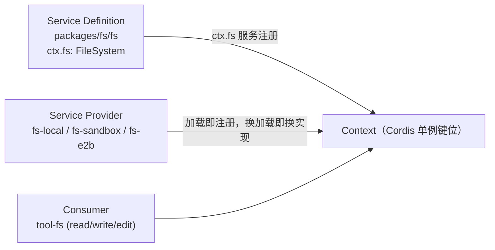
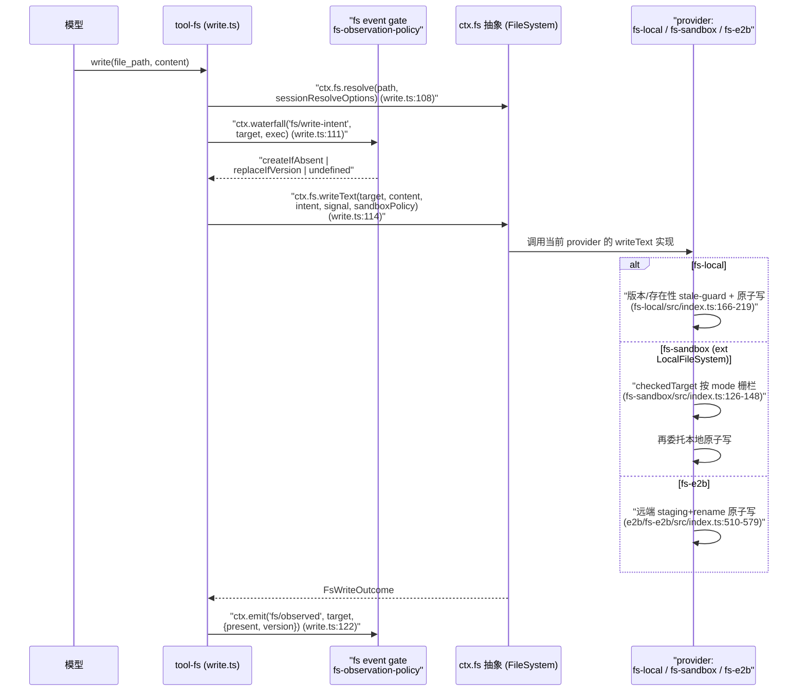
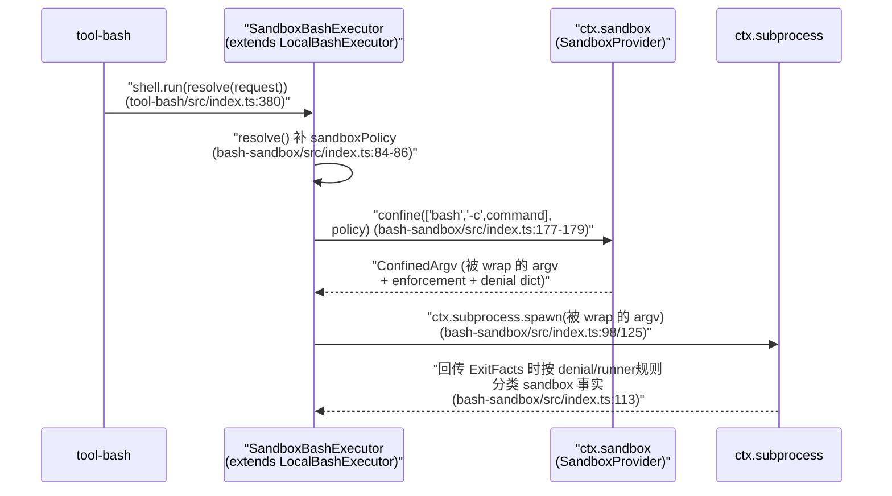

# Capability Seams：可交换能力边界

> 对应关注面：seam 三角色模型（Service Definition / Service Provider / Consumer）、六族可交换后端（fs / subprocess / shell / terminal / sandbox / lsp）、「同一执行世界使 provider 交换改变整个产品」。官方能力图 `docs/capability-seams.md` 是理解入口。

## 在项目中的角色：去掉它会发生什么

如果把这六个 seam **全部去掉**，`dsh` 会退化成「一个只会跟模型对话、但既读不了文件也跑不了命令的空壳」：

- 模型侧最重要的能力（读/写文件、跑 bash、起 PTY、用语言服务器跳转）全部消失——`tool-fs`、`tool-bash`、`tool-terminal`、`tool-lsp` 这些 model-facing 工具都直接消费这六族 seam 之一。
- `ctx.subprocess` 的消费者远不止 bash：**bash executor、PTY shell 后端、LSP 进程、out-of-process 的 ACP/Codex/Claude Code 子代理后端**，全部经它 spawn（`docs/capability-seams.md:447` 的表行明确列出）。去掉它，连子代理、语言服务器都起不来。
- `ctx.sandbox` + `ctx.sandboxPolicy` 去掉，等于把所有权限/沙箱降级成「裸执行」——`bash-sandbox`、`fs-sandbox`、`terminal-bash` 三个 enforcing 家族都会失去共同根，无法统一拒绝模型的文件写入或命令越权。

一句话根因：**一个 seam 是把"这是什么能力"从"如何实现它"中解耦出来的接缝**——同一种 model-facing 工具，可以在不碰工具代码的前提下，被后端实现整体替换。这是 `dsh`「可交换能力」设计哲学在文件/进程领域的落地。

## 解决的问题与根因

`dsh` 要同时支持多种运行形态：本地跑（用户自己的机器）、受限跑（bubblewrap/Seatbelt/Landlock 沙箱）、远端跑（E2B 云沙箱的 Linux 世界）、跨平台（POSIX + Windows PowerShell）。如果每个工具都直接调用系统 API，那么：

| 形态 | 读文件 | 跑一条命令 | 起一个 PTY | 跳转定义 |
|------|--------|-----------|-----------|---------|
| 本地 | `fs.readFile` | `child_process` | `node-pty` | 直接 spawn LSP |
| 沙箱 | + 容器检查 | + wrap argv | + wrap argv | 同左 |
| E2B 远端 | SDK `files.read` | SDK `commands.run` | SDK PTY | SDK 远程起 |

**根因**：文件读写、进程 spawn、终端、沙箱、LSP 的「语义」稳定（读哪个文件、跑什么命令），但「实现的执行世界」会变（本机内核 vs 沙箱内核 vs 远端 Linux）。若不设 seam，每种形态都要复制一份工具栈；设了 seam，工具栈只依赖抽象的 `ctx.fs`/`ctx.subprocess`/`ctx.shell`…，而「执行世界」由 provider 承载。

「执行世界」是要点：`ctx.fs` 与 `ctx.subprocess` **共享同一套坐标**（`FileSystem.processPath(target)` 产出的路径，就是 `subprocess` spawn 时的 `cwd`/`argv` 能用的路径），`docs/subsystems` 下的 fs/subprocess 文档无独立文件但 `capability-seams.md:447` 明确写「The bash executors, the PTY shell backend, the LSP host … spawn through ctx.subprocess」。所以当把 `fs-local`+`subprocess-local` 一起换成 `fs-e2b`+`subprocess-e2b` 时，**bash、PTY、LSP 全部跟着移动，无需各自的 provider fork**——因为它们都只认抽象 seam，而抽象 seam 的坐标来自同一 provider 组合。

## 设计思路：seam 三角色模型

一个 seam 有三个角色，`dsh` 用**包名后缀**显式区分（见 `docs/capability-seams.md` 的图与表）：

1. **Service Definition**（声明接口）——定义抽象服务契约
   - `packages/fs/fs`（`ctx.fs`，抽象 `FileSystem`）
   - `packages/subprocess/subprocess`（`ctx.subprocess`，抽象 `SubprocessRuntime`）
   - `packages/shell/shell`（`ctx.shell`，抽象 `ShellExecutor`）
   - `packages/terminal/terminal`（`ctx.terminals`，`TerminalSessionService`）
   - `packages/sandbox/sandbox`（`ctx.sandbox`，抽象 `SandboxProvider`）
   - `packages/lsp/lsp`（`ctx.lsp`，`Lsp`/`LspService`）
2. **Service Provider**（实现它）——`*-local` / `*-sandbox` / `*-e2b` 后缀
   - fs：`fs-local`、`fs-sandbox`、`e2b/fs-e2b`
   - subprocess：`subprocess-local`、`e2b/subprocess-e2b`
   - shell：`bash-local`、`bash-sandbox`、`pwsh-local`（+ `pwsh-sandbox`）
   - terminal：`terminal-bash`
   - sandbox：`sandbox-local`（+ `sandbox-policy` / `sandbox-windows-acl`）
   - lsp：`lsp-stdio`（文档名 `lsp-local`，见【待主 agent 验证】）
3. **Consumer**（用它，通常是 model-facing tool）——`tool-*` 后缀
   - `tool-fs`、`tool-fs-search`、`tool-str-replace-editor`
   - `tool-bash`、`tool-pwsh`
   - `tool-terminal`
   - `tool-lsp`

**为何一个包可兼任角色？** 因为一个包只是"能力单元"，角色是它在某个 seam 上承担的位置。例如：

- `packages/fs/fs-local` **既是 fs seam 的 Service Provider，又是某些场景下 shell/subprocess 的坐标来源**（`processPath`）；
- `tools` 包（`ctx.tools`）虽是 core，但它调用各 `tool-*`，而 tool 才是 seam 的直接消费者；
- `bash-local` 同时是 shell 的 provider **和** subprocess 的 consumer（它 `inject ['subprocess']`）。

**加能力 = 设计全部三角色**：想给 fs 加"追加写"，必须同时在 `FileSystem`（Definition）、各 provider（`fs-local`/`fs-sandbox`/`fs-e2b`）、以及消费它的 `tool-fs` 三处一起改，任何一处缺了都不算加成功。这解释了为什么 lsp 把 operation 定义成**封闭 union**（`LspOperation` 只有四种，加一种需跨界全改，`packages/lsp/lsp/src/types.ts:17`）。

### 一个包一角色为什么"不成 seam"（Why）

只有 Service Definition 没有 Provider 或 Consumer，只是一个抽象类；只有 Provider 没有 Definition，只是把能力写死在一个实现上；只有 Consumer 没有 Definition，就只能消费具体实现、无法切换。**三角色齐全 + 通过 Cordis 服务注册抽象**才算 seam——因为 Cordis 保证"一个 context 只能装一个 `ctx.fs` service，装第二个抛重复服务错误"（`packages/fs/fs/src/index.ts:44-47`、`packages/subprocess/subprocess/src/index.ts:68-72`），这正是"provider 交换"的执行机制：加载 `fs-local` 就注册成 `ctx.fs`，换加载 `fs-sandbox` 就换掉同一个键位，消费者无感知。

## 关键数据结构（六族 Seam 接口的核心签名）

以下为每个 Service Definition 的精简声明（完整代码在源引用处）。

### 4.1 `ctx.fs` — 抽象 `FileSystem`

`packages/fs/fs/src/index.ts:86-250` —— 抽象 filesystem provider：

```ts
export abstract class FileSystem extends Service {
  get sandboxMode(): SandboxMode | undefined   // 该后端默认执行的沙箱模式；未confine返回undefined
  abstract resolve(path: string, opts?): Promise<FsTarget>          // 稳定目标身份（targetKey）
  abstract processPath(target: FsTarget): string                    // 执行世界中可被subprocess打开的绝对路径
  abstract fileUrl(target: FsTarget): string
  abstract contains(parent: FsTarget, child: FsTarget): boolean     // 规范包含测试
  abstract stat(target, signal?): Promise<FsInfo | undefined>
  abstract readText / streamText / readBytes / listDir
  abstract writeText(target, content, expected?, signal?, sandboxPolicy?): Promise<FsWriteOutcome>
  abstract editText(target, edit, expected?, signal?, sandboxPolicy?): Promise<FsEditOutcome>
}
```

关键词汇（`packages/fs/fs/src/types.ts`）：`FsTargetKey`/`FsVersion` 是 branded 不透明身份；`FsWriteIntent = {createIfAbsent} | {replaceIfVersion}`（`types.ts:123-125`）；`FsErrorCode` 枚举含 `FS_STALE_VERSION`/`FS_NOT_OBSERVED`/`FS_SANDBOX_DENIED`（`types.ts:175-188`）。事件 gate（`index.ts:49-77`）：`fs/write-intent`、`fs/edit-intent`（waterfall，单决定）、`fs/observed`（emit，同步记录）。

### 4.2 `ctx.subprocess` — 抽象 `SubprocessRuntime`

`packages/subprocess/subprocess/src/index.ts:102-140`：

```ts
export abstract class SubprocessRuntime extends Service {
  abstract resolveExecutable(command, env?, signal?): Promise<string>
  abstract spawn(spec: SubprocessSpawnSpec): SubprocessHandle
  abstract spawnTerminal(spec: SubprocessTerminalSpawnSpec): Promise<SubprocessTerminalHandle>
}
```

`SubprocessSpawnSpec`（`types.ts:75-104`）是**全字段显式**：`argv`/`cwd`/每流 `stdio`/`graceMs`/`signal`/`env`，seam 不应用任何默认。`SubprocessHandle`（`types.ts:167-194`）：`terminate()` 唯一终止动词（SIGTERM→grace→SIGKILL，树级），`waitForExit` 观察整树 quiescence。附带环境净化：`scrubbedParentEnv()` 剥掉 `KEY|PASSWORD|SECRET|TOKEN` 与 `DSH_*`（`index.ts:44-66`）。

### 4.3 `ctx.shell` — 抽象 `ShellExecutor`

`packages/shell/shell/src/index.ts:65-101`：

```ts
export abstract class ShellExecutor extends Service {
  get sandboxMode(): SandboxMode | undefined
  abstract resolve(request: ShellExecRequest): ShellExecSpec
  abstract run(spec: ShellExecSpec): Promise<ShellRunResult>     // 前台，非零退出不 reject
  abstract start(spec: ShellExecSpec): ShellProcess              // 后台，立即返回句柄
}
```

`ShellExecSpec`（`types.ts:86-110`）携带 `sandboxPolicy`；`ShellRunResult` 携带 `sandbox?: ShellSandboxInfo`（`mode`/`denied`/`enforcement`/`runnerFailed`，`types.ts:21-30`）。

### 4.4 `ctx.terminals` — `TerminalSessionService`（registry，Not 抽象服务，而是"有逻辑的服务"）

`packages/terminal/terminal/src/index.ts:105-476` —— 一个**有实际状态的 registry**：持有 `backends`/`sessions`/`reservedNames`/`pendingSpawns`，对外暴露 `spawn`/`startSend`/`read`/`signal`/`kill`/`list`。**它自己也要确保注册的 backend 只有唯一 type**（`DUPLICATE_BACKEND`，`index.ts:127-128`）。真正可替换的 Provider 是 `TerminalBackend` 接口：

`packages/terminal/terminal/src/types.ts:166-171`：

```ts
export interface TerminalBackend {
  readonly type: string
  spawn(spec: TerminalBackendSpawnSpec): Promise<TerminalBackendSession>
}
```

`TerminalBackendSession`（`types.ts:148-163`）：`startSend`/`read`/`signal`/`status`/`close`。

### 4.5 `ctx.sandbox` — 抽象 `SandboxProvider`

`packages/sandbox/sandbox/src/index.ts:158-176`：

```ts
export abstract class SandboxProvider extends Service {
  abstract confine(argv: readonly string[], policy: SandboxPolicy): ConfinedArgv
}
```

`SandboxMode = 'read-only' | 'workspace-write' | 'danger-full-access'`（`index.ts:29`）；`SandboxExecutionPolicy`（`index.ts:39-52`）携带 `mode`/`workspaceRoot`/`sessionId?`，**PER CALL 传递**（不是 provider 固定）；`ConfinedArgv`（`index.ts:95-116`）返回 `argv`（被 wrap 的）+ `enforcement` + `denialSignatures` + `runnerFailureRules`。`SandboxUnavailableError` 携带 `SANDBOX_UNAVAILABLE` 失败关闭（`index.ts:124-144`）。

### 4.6 `ctx.lsp` — `Lsp`/`LspService` registry

`packages/lsp/lsp/src/index.ts:82-150` —— registry 持有 `providerIds` + `routes`（ext→Route），`registerProvider` 原子校验（brand id 唯一 + ext 无冲突），`query` 按文件扩展名路由。可替换的 Provider 是 `LspProvider`：

`packages/lsp/lsp/src/types.ts:95-107`：

```ts
export interface LspProvider {
  readonly id: LspProviderId
  readonly extensionToLanguage: Readonly<Record<string, string>>
  query(request: LspProviderQuery, signal?): Promise<LspQueryResult>
}
```

`LspOperation` 是封闭 union（`types.ts:17`），`LspQueryResult` 也是封闭 union（`types.ts:85-87`）。

## 核心流程（Mermaid）

### 5.1 一个 seam 的三角色关系图（以 fs 为例，全族同构）



### 5.2 具体 seam 的调用链：tool-fs write → `ctx.fs` provider 交换 → 本地 vs 沙箱 vs 远端



关键：`write.ts:111` 的 intent 来自**事件 gate**（waterfall 单决定），`write.ts:114` 把 per-call `sandboxPolicy` 一起传下去——本地后端忽略它、`fs-sandbox` 用它栅栏、`fs-e2b` 天然远端隔离。**同一个 `tool-fs` 一行不改，只因为 provider 交换就获得了完全不同的文件执行世界**。

### 5.3 sandbox wrap argv 的时序（`SandboxBashExecutor` 把命令交给 `ctx.sandbox`）



## 与其他模块协同

- **agent-loop → tools → 各 seam**：`agent-loop` 消费 `ctx.tools`（`ctx.toolResultPruner`/`gratrol` 等能力图边，见 `docs/capability-seams.md:389`），`ctx.tools` 注册各 `tool-*`，工具体内才直接消费具体 seam。所以 agent 主循环完全不感知 provider 是谁。
- **`sandboxPolicy` 是 bash 和 fs 的共同根**：`ctx.sandboxPolicy`（`packages/sandbox/sandbox-policy/src/index.ts`）是**唯一的政策归属地**（deployment 默认 mode + workspace root + 会话 override）。`bash-sandbox`、`fs-sandbox`、`terminal-bash` 三个 enforcing 家族都注入 `sandboxPolicy` 读取同一份解析结果（`capability-seams.md:452` 的表行明确写出这正是避免二者 confined 到不同根）。
- **`approval` 与 `sandbox` 协同**：escalation 是"被拒 → 用户批准 → 同一轮更宽重试"，`tool-bash` 与 `tool-fs` 复用同一个 `approveEscalation`/`ESCALATION_TARGETS`/`sandboxDenialMarker` 词汇（`packages/sandbox/sandbox/src/escalation.ts` 导出；`tool-fs/src/sandbox.ts:16` 导入同一套），保证 bash 和 fs 的拒绝/升级体验完全一致。
- **subprocess 是众多后端的共同底层**：`LocalBashExecutor` inject `['subprocess']`（`bash-local/src/index.ts:103`）、`terminal-bash` inject `['terminals','sandboxPolicy','subprocess']`（`terminal-bash/src/index.ts:25`）、lsp-stdio 通过 `ConnectionSpawner = (spec) => ctx.subprocess.spawn(spec)`（`lsp-stdio/src/connection.ts:59`）、`subagent-acp/codex/claude-code` 也经 subprocess（`capability-seams.md:377-379`）。

## 关键设计决策（Why）

**Q1：一个包一角色为什么不算 seam？**
因为交易的单位是"**能力**"不是"包"。A 角色隔离只是把抽象类放好了；只有配上 Provider 能被加载成 `ctx.fs`、配上 Consumer 能通过 `ctx.fs` 走通业务，才形成"相同工具代码、不同执行世界"的切换能力。所以"加能力 = 同时设计三角色"（见第三节）。`fs-sandbox` 是最好例证：它 extends `LocalFileSystem`，只新增每调用 policy 栅栏（`fs-sandbox/src/index.ts:59`），说明**实现可以跨 provider 复用**（是三角色模型的自然推论），一个包可以同时是"继承某个 provider 的新 provider"。

**Q2：fs 与 subprocess 为什么共享执行世界？provider 交换为何级联？**
因为 `FileSystem.processPath(target)` 的语义就是"该文件系统执行世界里、子进程能打开的绝对路径"（`packages/fs/fs/src/index.ts:116-126`）。`fs-local` 返回本机 path、`fs-e2b` 返回远端 Linux path（`e2b/fs-e2b/src/index.ts:190-192`）。当 `ctx.subprocess` 也是同一个 provider 组合（`subprocess-e2b` 注入 `['e2b']`，`e2b/subprocess-e2b/src/index.ts:53`），二者的坐标就落在**同一个 `ctx.e2b` 共享 sandbox**（`e2b/e2b/src/index.ts:74,130-137`）。所以 bash（`-c` 命令）、terminal（PTY）、lsp（spawn server）这些经 subprocess + 用 fs 坐标的东西，一次交换就整体迁到远端——这正是"同一个执行世界使 provider 交换改变整个产品"的机制，也是 README/能力图自述点名的卖点。

**Q3：sandbox 为什么不自己 spawn，而让消费者 wrap argv？**
因为沙箱的职责只有"把 argv 变成被限定的 argv"（`confine(argv, policy): ConfinedArgv`），**spawn 是 subprocess 的职责**。分开的好处：
- sandbox 不用管输出采集/超时/进程树，`bash-sandbox` 复用 `LocalBashExecutor` 的全部 spawn/collect 逻辑；
- 同一个 `ctx.sandbox` 可被 bash（wrap `['bash','-c',cmd]`）、fs 没有 spawn、（terminal-bash wrap PTY argv，`terminal-bash/src/index.ts:79`）同时消费；
- 换沙箱后端（bwrap→Landlock→Seatbelt→windows-acl）只换 `ctx.sandbox` 的 provider，spawn 逻辑（在 bash/term）完全不动。
这也是 `SandboxProvider` 只声明 `confine` 一个抽象方法的原因（`packages/sandbox/sandbox/src/index.ts:175`）。

**Q4：sandbox-policy 为什么是 bash 与 fs 唯一共同根？**
如果沙箱 mode/root 由各自配置，bash 可能允许 `workspace-write` 写某目录而 fs 只允许 `read-only`，形成"同一会话两种权限面"的混乱，且模型难以解释。`sandbox-policy` 集中解析**一次**提供 `defaultMode`/`workspaceRoot`/会话 override（`sandbox-policy/src/index.ts:135-142`），bash 与 fs（乃至 terminal）都读同一份，`capability-seams.md:452` 直接点名这是"The one home … so bash and fs cannot confine to different roots"。`writableRoots(policy)` 这条函数也被 bash 与 fs 复用（`fs-sandbox/src/index.ts:38` 导入）、`sandbox-local` 的 Seatbelt `read-only` 用同套 root 词汇——保证"能写哪些根"唯一定义。

**Q5：fs-local 读 vs 写的区分？**
读（`readText`/`streamText`/`listDir`）**没有任何沙箱判断**直接透传（`fs-local/src/index.ts:143-164`），因为读不改变状态、任何 mode 都允许。写（`writeText`/`editText`）才做 stale-guard（`FS_STALE_VERSION`/`FS_NOT_OBSERVED`，`fs-local/src/index.ts:178-186,232-239`）并原子化（per-target lock，`index.ts:91-104`）。`fs-sandbox` 借此只 override 这两个 mutation、用 per-call policy 栅栏（`fs-sandbox/src/index.ts:84-113`），读路径一行不改。

**Q6：fs/write-intent 门（waterfall）的意义？**
`tool-fs` 的 write 不自己决定"要不要 createIfAbsent / replaceIfVersion"，而是 `ctx.waterfall('fs/write-intent', …)`（`tool-fs/src/write.ts:111`）让事件 listener 来定。`fs-observation-policy` 占住这个单槽，返回"读过的版本 → replaceIfVersion，未读或确认缺失 → createIfAbsent"（`fs-observation-policy/src/index.ts:65-71`），从而实现**写前必须读**。不装这个插件，工具就退化为 unconditional 写（`fs-observation-policy/src/index.ts:4-6`）。`fs/observed`（emit）在每次成功读/写后记录，是同一份观察状态 feed（`fs-observation-policy/src/index.ts:91-94`）。这展示了**能力可以纯靠事件 gate 叠加、无须改 provider**。

**Q7：terminal 为什么需要 exact-Agent session 身份？**
PTY 是长期存活、有状态的交互对象，且可能被多个 agent（主 agent、子代理）共享同一 context。若只用 owner 姓名或随便一个 id，一个 agent 就能读/关掉另一个 agent 的会话。registry 里每个 `SessionRecord` 绑定 `owner: Agent`（`terminal/src/index.ts:82-90`），`expectOwned` 校验 `record.owner !== owner` 抛 `FOREIGN_SESSION`（`index.ts:387-392`），`tool-terminal` 每个操作都 `requireAgent(exec.agent)`（`tool-terminal/src/index.ts:117,184,277,320`）。同时 `hasOwnerActivity` 让"模式切换时若还有 PTY 打开就拒绝"（`terminal-bash/src/index.ts:34-53`），避免沙箱 mode 在存活终端下被悄悄改掉。

## 亮点与问题

### 亮点

1. **"同一执行世界"思想是最值钱的洞察**：`FileSystem.processPath` 与 `SubprocessRuntime` 同坐标系 + `e2b` 共享 sandbox，使一次 provider 交换级联迁移 bash/PTY/LSP/子代理，这是 `docs/capability-seams.md` 与 README 自述最浓的一点，也是其它工具链少见的干净解耦。
2. **Provider 之间可用继承复用实现语义**：`fs-sandbox extends LocalFileSystem`、`bash-sandbox extends LocalBashExecutor`——沙箱只增量加"栅栏/wrap + 事实上报"，过程机制完全复用，极大压缩了维护面。
3. **事件 gate 让"能力"可叠加而无需改 provider**：`fs-observation-policy` 纯靠三个 `fs/*` event 实现写前必须读；工具与 provider 都无感知。这是"加能力 = 设计三角色"的高弹性侧面。
4. **封闭 union + 无协议逃逸保证切换安全**：lsp 只暴露四种 operation（`LspOperation`）、`LspQueryResult` 亦封闭，Provider 无法携带 JSON-RPC 逃逸，切换实现时消费者不被协议细节绑架。
5. **失败关闭 + 结构化分类贯穿**：`SandboxUnavailableError`/`SANDBOX_UNAVAILABLE`（`sandbox/src/index.ts:124`）、`FS_SANDBOX_DENIED`、`ShellSandboxInfo` 同时携带 `denied`/`runnerFailed`——模型能区分"命令失败"跟"沙箱拒绝"跟"runner 没跑起来"。

### 问题 / 风险

1. **文档与实现的 provider 命名漂移**：`capability-seams.md` 表把 lsp 的实现列为 `lsp-local`（`capability-seams.md:190`），但**文件系统里没有 `lsp-local` 这个包**，真实存在且经 subprocess 的是 `lsp-stdio`。【待主 agent 验证 1】。若读者按文档去找 `lsp-local` 会落空。
2. **`docs/subprocess.md`/`filesystem.md`/`shell.md` 等独立文件并不存在**，官方只有 `capability-seams.md` 一张总图 + 各包 README。阅读入口单一，对"六族各自内部机制"的文档覆盖相对薄。
3. **三角色全改是双刃剑**：封闭 union 让 lsp 加 operation 是编译级跨界工作，安全但也抬高演进成本（`lsp/src/types.ts:17` 注释明说 adding an operation 要跨 seam/provider/tool）。
4. **fs-sandbox 的 TOCTOU 被显式接受**（`fs-sandbox/src/index.ts:14-18`：ancestor symlink 在检查与系统调用之间被换会漏判），靠"系统调用前立刻重正则化"收窄。这是文档明说的残余风险，对高安全场景需警惕。
5. **e2b 路径靠 `commands.run`（`/bin/bash -l -c`）模拟多文件操作**（`e2b/fs-e2b/src/index.ts:445-448` 的 `realpath -mz`、`writeAtomic` 的 shell) —— 相对本地 fs 的纯文件系统调用，多了 shell 层与往返，远端原子性依赖 staging+rename 协议（`fs-e2b/src/index.ts:510-579`），复杂度明显高于本地。

## 真源引用锚点

以下为文中最关键论点的真源锚点，每条经 `verify-references.mjs` 用 `[path:start-end]()` 定位，snippet 为源码逐字复制指纹、不进入正文（任务硬性要求）。

- 共享执行世界：`e2b/e2b/src/index.ts:130-137` — E2B 单例 sandbox handle，fs/subprocess 两 provider 都 `await getSandbox()`。[packages/e2b/e2b/src/index.ts:130-132]()
  <!-- snippet: async getSandbox(): Promise<Sandbox> {
    if (this.disposed) throw new Error('E2B sandbox service is disposing')
    const sandbox = await this.ready -->

- `ctx.fs` 抽象定义：`fs/fs/src/index.ts:86-89` — FileSystem extends Service，abstract class 无实现。[packages/fs/fs/src/index.ts:86-89]()
  <!-- snippet: export abstract class FileSystem extends Service {
  constructor(ctx: Context) {
    super(ctx, 'fs')
  } -->

- fs 事件 gate 三事件：`fs/fs/src/index.ts:49-58` — `fs/write-intent` 为 waterfall。[packages/fs/fs/src/index.ts:49-52]()
  <!-- snippet: interface Events {
    /**
     * Single-slot decision for the next {@link FileSystem.writeText}. Calling
     * `next()` yields the bare provider's unconditional write -->

- `ctx.subprocess` 抽象定义：`subprocess/subprocess/src/index.ts:102-105` — abstract SubprocessRuntime extends Service。[packages/subprocess/subprocess/src/index.ts:102-105]()
  <!-- snippet: export abstract class SubprocessRuntime extends Service {
  constructor(ctx: Context) {
    super(ctx, 'subprocess')
  } -->

- 环境净化：`subprocess/subprocess/src/index.ts:44,60-66` — `scrubbedParentEnv` 剥敏感与 DSH_*。[packages/subprocess/subprocess/src/index.ts:60-62]()
  <!-- snippet: export function scrubbedParentEnv(): Record<string, string> {
  const env: Record<string, string> = {}
  for (const [key, value] of Object.entries(process.env)) { -->

- `SandboxProvider` 只声明 confine：`sandbox/sandbox/src/index.ts:175`。[packages/sandbox/sandbox/src/index.ts:175-175]()
  <!-- snippet: abstract confine(argv: readonly string[], policy: SandboxPolicy): ConfinedArgv -->

- `SandboxBashExecutor extends LocalBashExecutor`：`shell/bash-sandbox/src/index.ts:44-45` — inject `subprocess/sandbox/sandboxPolicy`。[packages/shell/bash-sandbox/src/index.ts:44-45]()
  <!-- snippet: export class SandboxBashExecutor extends LocalBashExecutor {
  static override inject = ['subprocess', 'sandbox', 'sandboxPolicy'] -->

- `SandboxedFileSystem extends LocalFileSystem`：`fs/fs-sandbox/src/index.ts:59-60` — inject `sandboxPolicy`。[packages/fs/fs-sandbox/src/index.ts:59-60]()
  <!-- snippet: export class SandboxedFileSystem extends LocalFileSystem {
  static inject = ['sandboxPolicy'] -->

- write 经 `ctx.waterfall('fs/write-intent')`：`fs/tool-fs/src/write.ts:111-122`。[packages/fs/tool-fs/src/write.ts:111-112]()
  <!-- snippet: const intent = await ctx.waterfall('fs/write-intent', target, exec, () => undefined)
      let outcome: FsWriteOutcome -->

- `fs-observation-policy` 写前必须读：`fs/fs-observation-policy/src/index.ts:65-71` — `writeIntent` 依观察决定。[packages/fs/fs-observation-policy/src/index.ts:65-68]()
  <!-- snippet: writeIntent(target: FsTarget, actor: object | undefined): FsWriteIntent {
    const owner = this.owner(actor)
    const prior = owner ? this.get(owner, target.targetKey) : undefined
    return prior?.kind === 'present' -->

- `terminal-bash` inject 与 sandbox wrap：`terminal/terminal-bash/src/index.ts:25,71-80`。[packages/terminal/terminal-bash/src/index.ts:71-73]()
  <!-- snippet: function spawnArgv(ctx: Context, config: ResolvedConfig, policy: SandboxExecutionPolicy): string[] {
  const argv = [config.shellPath, ...config.shellArgs]
  if (policy.mode === 'danger-full-access') return argv -->

- lsp 封闭 union：`lsp/lsp/src/types.ts:17`。[packages/lsp/lsp/src/types.ts:17-17]()
  <!-- snippet: export type LspOperation = 'goToDefinition' | 'findReferences' | 'goToImplementation' | 'hover' -->

- lsp server 经 subprocess spawn：`lsp/lsp-stdio/src/connection.ts:58-59` — `ConnectionSpawner`。[packages/lsp/lsp-stdio/src/connection.ts:58-59]()
  <!-- snippet: /** Spawn one subprocess for this connection (the provider passes `ctx.subprocess.spawn`). */
export type ConnectionSpawner = (spec: SubprocessSpawnSpec) => SubprocessHandle -->

- 组合点（provider 选择）：`bundle/base/cordis.patch.yml:163-179`。[packages/bundle/base/cordis.patch.yml:163-166]()
  <!-- snippet: - id: subprocess
      name: '@deepseek-ai/dsh-subprocess-local'

    # Every shipped CLI mode starts with the same file-effect boundary. -->

## 已知的文档-实现漂移

- **`lsp-local` 包不存在**：官方能力图 `docs/capability-seams.md` 把 `ctx.lsp` 实现列为 `lsp-local`，但仓库实际只有 `lsp/lsp-stdio`（经 `ctx.subprocess` spawn 语言服务器、用 `ctx.fs` 读源）。读者按文档去找 `lsp-local` 会落空，是文档与实现命名漂移。
- **子系统文档缺独立文件**：`docs/subsystems` 下没有 `filesystem.md`/`shell.md`/`subprocess.md`/`terminal.md`/`sandbox.md`/`lsp.md`（`capability-seams.md` 一张总图承载六族），阅读入口相对单一，六族各自内部机制的文档覆盖偏薄。
