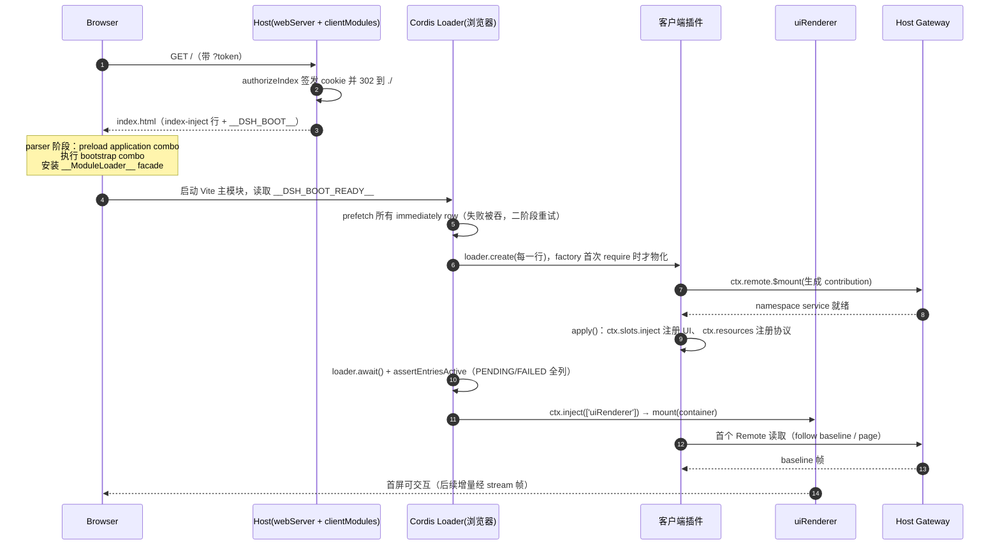
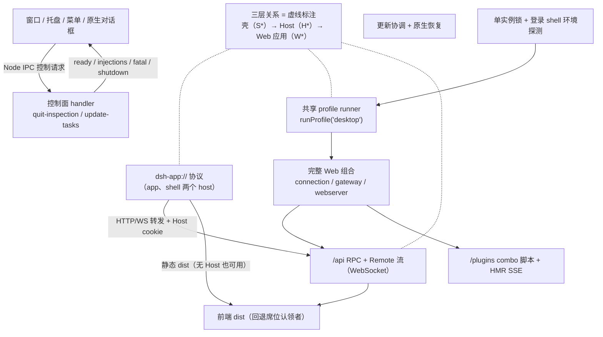

# 客户端与分发：Web 浏览器客户端、Typert 生成式 RPC 与 Electron 桌面

> 本关注面回答一个问题：**同一个 agent 后端，如何以「一切皆插件」的方式驱动一个浏览器客户端、把它打成桌面应用、并且让用户机器上什么都不用装**。源码基线 `dsh-v0.2.1-rc.3`（`1f81c047fc`）。

## 这一层在系统里的位置

dsh 的 Host 是一棵 Cordis 插件树，Session 日志是唯一事实源（Model-visible means logged）。客户端与分发层做的所有事，都可以压缩成两条不变式：

1. **浏览器侧也是一棵 Cordis 树**，插件来自同一个 package manifest（`dsh.client`），因此「装一个插件」在 Host 与浏览器两侧是同一个动作；
2. **浏览器只通过生成出来的类型化契约访问 Host**，物理载体可以被替换（HTTP/WebSocket、进程内 fetch、桌面壳转发），业务代码不知道载体存在。

去掉这一层，dsh 就只是一个 Node CLI：没有可复用的 Web GUI，也就没有「同一份 Web 应用既是网页也是桌面应用」这个分发前提。反过来，这一层的全部复杂度都来自这两条不变式——凡是为保持它们而付的代价，后面都会逐项记账。

## 先厘清一个命名陷阱：两个 `web`

- `docs/subsystems/web.zh.md` 讲的 **Web 访问 seam**（`ctx.web`，search / fetch 两个操作、多个 provider、`web_search`/`web_fetch` 工具）是**模型联网能力**，与网页服务毫无关系。[docs/subsystems/web.zh.md:5]()
<!-- anchor: Web 访问 seam 是一个[能力 seam](../../.agents/notes/implemented/architecture/2026-06-24 -->
- 本关注面讲的 Web **服务端载体**是 `ctx.webServer`（`packages/host/webserver`），它「不了解任何 harness 概念」，也不属于能力 seam。[packages/host/webserver/src/index.ts:2-6]()
<!-- anchor: * @deepseek-ai/dsh-host-webserver — node:http route registration — node:https … * instead, and this package never prints the URL. -->

两条线在系统里几乎不相交：把 web 搜索的 provider 换掉，网页照常启动；把 webServer 换成桌面壳转发，模型照样能联网。**下文若出现「Web」，一律指浏览器应用这一侧。**

## HTTP 服务器：一个刻意"无知"的载体

`WebServer` 的设计约束只有一句：它是 GUI Host 的 HTTP 载体，不是能力 seam，不做认证，不懂 harness 语义。它提供的东西少得可疑——具名路由表、可选 gzip、index 注入、**一个可认领的回退席位**。

### 匹配顺序是固定语义，不是注册顺序

路由只有两种 kind：`exact`（逐字匹配）与 `prefix`（`p` 与 `p/<anything>`）。[packages/host/webserver/src/index.ts:43-43]()
<!-- anchor: /** Route match kind: 'exact' matches the pathname verbatim; 'prefix' p matches  -->

请求处理顺序被写死为三级：先查 exact 表，未命中则在 prefix 表里取**最长匹配**，再未命中才交给回退席位。[packages/host/webserver/src/index.ts:542-551]()
<!-- anchor: /** Longest-prefix-wins over the prefix table after an exact-table miss. */ … return best -->

这个选择的意义不在性能，而在**组合**：路由注册顺序不携带面向请求的语义，所以任意两个插件注册的路由在组合上互不相交；重复的 `(kind, path)` 直接抛错，因为「路由模式是组合层约定，冲突即配置错误」。最长前缀让 `/plugins/??a/client.js,b/client.js` 这类生成的脚本 URL 能和 `/plugins/events`（HMR 的 SSE 通道）共存而不必关注册顺序。

### 回退席位：SPA 的优雅降级点

未被具名路由认领的请求由回退处理器应答，**席位只有一个所有者，第二次注册抛错**——「两个回退无法组合」。[packages/host/webserver/src/index.ts:397-402]()
<!-- anchor: registerFallback(handler: WebRoute['handler']): () => void { … return () => { this.fallback = undefined } -->

随附的 Web 组合让 `dsh-host-frontend-static` 认领这个席位，即一个遵循固定语义的 dist 服务器：非 GET/HEAD 返回 405，越出 dist 根返回 403，缺失目标返回空 404，根路径的 index.html 在读取前先过 `ctx.connection.authorizeIndex`。[packages/host/frontend-static/src/index.ts:121]()
<!-- anchor:   ctx.effect(() => ctx.webServer.registerFallback(async (req, res) => { -->

这个「一个席位 + 明确的越界语义」是该层最值得借鉴的地方：它把 Web 应用与「谁提供文件」解耦，代价是只允许一种文件服务策略；想在同一个端口上同时提供 SPA 与另一种兜底路由，只能改认领者，不能叠加。

### index 渲染挂接点：结构化行优先，字符串 tap 留作逃生口

`renderIndex(html)` 分两步：先做一次 `webserver/index-inject` emit 收集结构化 `IndexInjection` 行并渲染，再按注册顺序应用 `tapIndex` 注册的原始 html→html 变换。[packages/host/webserver/src/index.ts:560-563]()
<!-- anchor: applyIndexTaps(html: string): string { … return out -->

结构化行（`script`、`script-src`、`script-preload`、`global`）让插件声明「我要向 `<head>` 注入什么」而不必接触 HTML；`global` 行在渲染时把 `<` 转成 `\u003c`，于是 `__DSH_BOOT__` 里任何插件可控的字符串都无法逃出 script 元素。[packages/host/webserver/src/injections.ts:49-56]()
<!-- anchor: case 'global': { … return { placement: 'head', markup: `<script>globalThis[${name}] = ${value}</scr -->

`tapIndex` 是给表达不了成结构化行的标记留的口子；`frontend-static` 正是用它插入 `<base href="./">`，使整个客户端可以在任意 mount 前缀下工作（这也是桌面壳用 `dsh-app://app/` 承载同一份 dist 的前提）。

### 生命周期上的两处硬约束

- 监听失败（EADDRINUSE）与 TLS 材料不可读/不匹配都会让初始化**拒绝**，而不是回退到 HTTP——启动进程会报告失败的 fiber；
- dispose 必须同时 `close()` 和 `closeAllConnections()`，并显式销毁 upgraded 与 TLS socket，因为 SSE 这类响应会一直保持连接，而 Node 的 `closeAllConnections()` 不含已升级的 socket。[packages/host/webserver/src/index.ts:525-527]()
<!-- anchor: // Node does not include upgraded sockets in closeAllConnections(), and a TLS … // kinds with the other connections, so it tracks and destroys them explicitly. -->

第二点看似细节，实际上是「桌面壳要能在两秒内干净退出」的前置条件之一：任何一条悬挂的 WS 都会把进程关停拖成超时。

## Typert：用构建期生成的双契约替掉手写 RPC

### 问题：apiproxy 把三种生命周期塞进一个包

旧的 Host API Proxy 同时承担直接方法调用、带状态交互（permission/approval）和 Session 事件流，业务 Service、传输协议、状态机与客户端类型互相耦合；加一个方法要在中央接口、路由表、参数转换表、客户端 stub、Zod schema 五处同步。Typert 的目标是把「一次请求一次结果」的定向调用抽出来，让**契约属于实现该行为的业务 Service**：开发者只声明哪些方法可远程调用。[.agents/notes/implemented/architecture/2026-08-02-typert-remote-method-calls.zh.md:9]()
<!-- anchor: Host API Proxy 当时在一个包里同时承担直接方法调用、带状态交互和 Session 事件流。三者的生命周期、路由语义和客户端编程界面不同，继续共用一 -->

### 声明侧：`@Remote` / `@RemoteScope` 只表达"参与"，不表达类型

```ts
export class GoalService extends TypertRemoteService {
  constructor(ctx: Context) { super(ctx, 'goals') }

  @Remote('create')
  remoteExportCreate(agent: Agent, request: CreateGoalRequest): CreateGoalResult { /* … */ }
}
```

decorator 的选项只有 `name` 与 `mode: 'stream'`；它不做运行时反射，也不向 constructor 注入隐藏 symbol，只在 prototype 上按稳定的字符串属性名写一个带版本的描述符。原因是硬性的：JavaScript decorator 无法恢复擦除后的 TypeScript 类型、公共符号身份和完整 Zod codec，而这些必须由编译器给出。[.agents/notes/implemented/architecture/2026-08-02-typert-remote-method-calls.zh.md:90]()
<!-- anchor: Decorator 表达 Remote 参与、可选导出名称和流式投递；`@Remote` 选项仅包含 `name` 和 `mode`。它不负责运行时类型反射，也 -->

### 生成侧：三个产物、两个 Program

Host 与 Client 必须分成两个 TypeScript Program，因为两侧会用不同类型合并同名 Cordis `Context`（`ctx.sessions`、`ctx.loader` 两侧含义不同）。于是同一份 Host Program 出两个 emitter：

| 产物 | 归属 | 内容 |
|---|---|---|
| `typert.host.{js,d.ts}` | Host Program | Host 自身 Service/Event/Object/schema 与入站 Gateway 信息 |
| `typert.remote-client.{js,d.ts,d.ts.map}` | Host Program | Remote 方法对**任意**消费环境的 wire 投影（不含 Host Cordis merge、不含实现） |
| `typert.client.{js,d.ts}` | Client Program | Client 自身反射 |

业务包以 `./remote` 子路径发布第二列，消费方 `import goalsRemote from '@deepseek-ai/dsh-goal/remote'` 同时拿到类型增强与运行时 descriptor；`import type {}` 只增强类型、不注册任何东西。**这解释了为什么"生成式 RPC"不是"代码生成器跑一遍"**：类型与运行时贡献是同一次投影的两半，缺任一半都会退化成 Proxy 或第二份手写注册表。

### 边界侧：descriptor 不上线，只在两端本地存在

`InvocationDescriptor` 是本地反射信息，不是 wire message；请求只发 endpoint 与具名 `args`。[docs/subsystems/typert.zh.md:41]()
<!-- anchor: `InvocationDescriptor` 是本地反射信息，不是 wire message。Host 与消费方构建会生成彼此对应的 descriptor；请求 -->

一个带 Agent lookup 的调用链：

```text
ctx.remote.goals.create(sessionId, request)
→ Client descriptor 把位置参数映射为 { args: { agentId, request } }
→ ctx.connection.rpc.call('/api', 'goals/create', { args }, signal)
→ POST /api/goals/create（当前物理映射）
→ Connection 验 trust/认证 → 复合 FetchHandler 判 endpoint ownership
→ Typert interceptor → ctx.typertGateway.invoke(...)
→ Host descriptor 解码 → lookup 把 agentId 解析成活 Agent → Reflect.apply(receiver)
```

三个边界因此各司其职：**Client Remote** 负责 contribution 挂载与位置参数映射；**Host Gateway** 负责 descriptor、lookup、Context receiver 与调用；**Connection** 负责 `/api` 唯一 route、rpcId、序列化、trust 与错误传输，且「不理解 Goal、Agent、lookup 或 descriptor」。Gateway 只向 Connection 注册 ownership matcher 与 RPC handler，**不注册 HTTP route**——这是「换载体不改业务」的结构保证。

### Stream 与取消：类型层的单向标记

`RemoteStream<Out, In>` 的 `In` 只是类型级标记，host 方法通过 `this.ctx.invocation.uplink()` 读取客户端后续发送的项，因此 uplink 项**不进入参数列表**；取消同理，`signal` 是保留的最后一个 Host 参数，由 carrier 在业务参数之后注入，绝不进入 `args`。[docs/subsystems/typert.zh.md:133-140]()
<!-- anchor: readonly uplink?: { … readonly parameter: 'signal' -->

这两个"绕过参数表"的设计，让同一份 descriptor 同时服务一元调用、双向流和可取消调用，而不必为每种组合生成不同签名。

### 代价：构建步骤、调试难度、版本漂移

| 换来的 | 付出的 |
|---|---|
| 加方法只改业务 Service 一处 | 构建顺序被锁死：Host 约定 pass → Remote 产物 → Client 编译 → Vite；干净构建不能依赖上次残留 |
| 类型、codec、runtime descriptor 同源 | 没有增量 contract watcher：改 Host 签名后必须重跑 lib build，否则 Web 用的是旧契约 |
| 编辑器可从 `ctx.remote.goals.create` 跳到 Host 方法 | 依赖发布 declaration map 与 map 指向的 `src`；`files` 漏一项则类型能编但跳转停在生成文件 |
| Client 只见被标记的方法 | 业务 DTO 必须有**纯类型出口**；实现入口混着 Host 类型的包会被构建拒绝 |
| 无 Proxy、无手写 stub | SRC（源码启动）模式只能做弱解析，不校验 JSON 对象内部结构，失败推迟到首次调用 |

最后一行的取舍值得单说：dsh 给了两种运行模式——

- **SRC**（本地源码启动）：prototype 描述符 + JavaScript 函数签名弱解析，不启动 `ts.Program`、不改写源码；遇到解构、默认参数、rest、嵌套 lookup 等无法明确解析的签名会在首次调用解析 descriptor 时失败；
- **LIB**（CI / 发布 / Web 前置构建）：扫描完整 Host project，检查 decorator、service key、endpoint 冲突、lookup/Context 声明、公共符号可达性、JSON codec，以及保留的 `signal` 是否为全局 `AbortSignal`。

两者共用同一个 Gateway 调用路径，代价是「严格」只在 LIB 下成立。这也是 Web 启动必须先完整 `build:lib` 的原因——**客户端的类型安全依赖 Host 侧有一次成功的编译**。

## 浏览器客户端：`dsh.client` 声明出来的插件树

### 为什么客户端也做成插件树

先看反面：常规前端工程在构建期消化全部依赖，单 bundle，external 由打包器解决，运行时无物可管。dsh 的需求不同——**同一份 Host 组合里启用哪些插件，浏览器就该加载哪些插件**，否则插件市场装上的东西在 GUI 里没有入口。

于是客户端拆成两层：上层是同一份 vendored `@cordisjs/plugin-loader`（与 Host 逐字节相同的治理代码），下层是模块系统 `dsh-client-modules`——它坐在 Host 侧「Node 内部 ESM loader」占据的那个席位上。分工一句话说尽：**模块系统拥有模块身份与字节，Loader 拥有插件生命周期**。[.agents/notes/implemented/architecture/2026-07-23-client-plugin-loading-model.zh.md:35]()
<!-- anchor: 浏览器复刻 host 侧的分工。`dsh-client-modules`（`ClientModuleSystem`）坐上 host 侧由 Node 内部 ESM -->

包加入这张表的唯一方式，是在自己的 `package.json` 里声明 `dsh.client`（`platform: 'web'`、可选 `inject` 边、可选 `immediately`）并导出 `./client` 构建产物。Host 的 Node 半边扫描 **Loader 实际挂载的 entry**，而不是扫描整个 `packages/` 目录——「哪些插件组合进一次部署是组合决策，不是包属性」。扫描是**单包增量**的：每次 cordis `internal/plugin` 发射把该 fiber 的 entry 名标脏，一次微任务 flush 对账，初扫与稳态共用一条实现。[packages/client/modules/src/index.ts:640-640]()
<!-- anchor: ctx.on('internal/plugin', (fiber) => { -->

同一个服务有四个面（扫描、图组合、bundle 路由、index 注入行），并且它是**可选**的：`ctx.clientModules` 在构造里同步跑激活扫描，把畸形声明或缺失 bundle 聚合成一个 `AggregateError` 并让 fiber FAILED；稳态下损坏的包只记一条警告，不得殃及别的包。这个"激活时大声失败、稳态下隔离失败"的双姿态是刻意的不对称——启动期的错误必须挡住启动，运行期的错误不能让一个坏插件拖垮整个页面。
### 线上格式：`WebBootGraph`

| 字段 | 含义 | 为什么需要它 |
|---|---|---|
| `entries[].id` | 包名即 entry 名 | 浏览器模块身份 = 包身份，避免 overlay 路径泄漏 |
| `entries[].inject` | 包名依赖边 | 决定 factory 到达顺序**与** Cordis 组合边 |
| `entries[].immediately` | 一阶段预取标记 | registration barrier，不是包身份 |
| `entries[].external` | 请求的非基线模块 | 让 bundle 里的 `require` 解析到外壳 seed |
| `batches[]` | bootstrap / application 两个调度阶段 | parser-blocking 与 preload 的区别 |
| `rev` | entry 与 batch descriptor 的哈希 | 一致性锚点 |
| `release` | Host 版本 + commit | 不计入 `rev`，却决定页面能否应用新图 |

图的解析是**拒绝式**的：畸形 row、未知成员、未恰好归属一个初始 combo 的 entry 都让页面无法启动。这是「wire 单一真源」的直接后果——两侧只有一处类型定义（modules 包的 `./client` 出口），webserver 对图一无所知。

`release` 的处理最能说明这套设计的克制：`ReleaseChangeGate` 在**校验图其余部分之前**先比较 release，来自另一个 release 的图不被应用，只触发一次「需要刷新」的提示。[packages/client/modules/src/client/entries.ts:104-110]()
<!-- anchor: * The release is compared before the rest of the graph is validated: a graph of  … if (!this.release.observe(readRelease(graph))) return Promise.resolve() -->

理由很实在：另一个 release 的图可能用了本页读不懂的格式，先比 release 能避免把「版本漂移」误报成「malformed graph」。

### bundle 路由与 combo

`GET /plugins/??<pkg-a>/client.js,<pkg-b>/client.js&rev=<rev>` 寻址一份生成的 script；单资源形式是 HMR 路径。脚本只在首次 GET 时拼接一次，以 `sourceMappingURL` 结尾；map 文件在首次 map GET 时才读取并合成 Indexed Source Map v3。每个启动请求 URL 按 UTF-8 字节不超过 3 KiB，超过就贪心切分成多条 descriptor——**用更多请求换掉超长 URL**。

值得对照的替代方案：把响应文本塞进内联 `<script>`。那样模块系统要缓冲整份源码、维护 fetch/execute 两条路径，且动态执行的源码切断了「网络资源 → 生成 bundle → TS/TSX 源码」的标准映射链。[.agents/notes/implemented/architecture/2026-07-23-client-plugin-loading-model.zh.md:19]()
<!-- anchor: 插件 bundle 独立构建在 Vite 模块图之外。若把响应文本塞进内联 script，浏览器只能看到一次动态源码执行：网络资源、生成 bundle、Type -->

### 启动到首屏可交互



三个容易忽略的点：

1. **预取失败被吞**，因为第二阶段的 import 会重试并拥有那次大声失败；`immediately` 只是让脚本传输提前开始；
2. **图顺序只治理同步 import 能否物化，激活顺序由 Cordis 服务等待决定**——两者刻意解耦，代价是「图里写了 inject 边但服务不匹配」的问题要等到 settled 扫描才浮现；
3. **`assertEntriesActive` 是兜底**：Cordis 的 inject 等待没有超时，PENDING 会永远等下去，所以内核在 `loader.await()` 之后做一次全 ACTIVE 扫描并列出每个失败 entry 及其缺失的服务。[packages/client/web/src/boot-client.ts:56]()
<!-- anchor:   assertEntriesActive(ctx, options.modules) -->

桌面壳复用了这条链路，只改了两处：`index.html` 由壳自己从 `dsh-app://app/` 提供，并在 `<head>` 注入 `__DSH_BOOT_READY__` 延迟量；`apps/web` 的 `main.ts` 检测到 `dshDesktopBoot` 后，把 Host 经 IPC 送来的 injections **异步**应用完再 resolve 这个延迟量。[apps/web/src/main.ts:21-35]()
<!-- anchor: if (desktop !== undefined) { … }).catch((error: unknown) => { gate.reject(error) }) -->

于是 `AppWebEntry.run()` 里那一句 `await ...__DSH_BOOT_READY__?.promise` 在浏览器里是"下一个微任务"，在桌面里是"等 IPC"——**同一个内核，两种注入时机，零分支**。

## Slots：类型化的 UI 组合点

Slots 解决的是一类具体问题：功能插件要向别的插件拥有的位置塞 UI，但不能 import 对方的组件。机制是一张编译期注册表 `SlotMap`（声明合并写入 key、cardinality、scope、owner props），加一套运行时声明与 Cordis effect 生命周期绑定的注册。

| 维度 | 值 | 语义要点 |
|---|---|---|
| cardinality | `single` / `list` / `keyed` / `chain` | `single` 是替换点，`list` 按 `order` 排序，`keyed` 由 owner 传 key，`chain` 每个 entry 给纯 `select(owner)` 并渲染第一个非 null |
| scope | `root` / `session-maybe` / `session` | `session` 在 binding generation 变化时重挂载；`session-maybe` 首次获得 binding 不重挂载 |
| 输入来源 | owner props / 注册项 `inject` / slot 级 `inject` / 声明 store | 分别对应"一次渲染时 owner 已知的值"/"单 entry 私有"/"所有 occupant 共享"/"跨重挂载保留" |

组件**绝不会收到 `ctx`**：service 与 model 留在 `apply` 闭包里，只向组件投影 callback 或裸 observable source，由 renderer 用 `useSyncExternalStore` 绑定。这条纪律的收益是可测试性与可替换性，代价是每个数据通路都要多一段"投影代码"。

`root` 是唯一内建且由 Cordis 服务自身渲染的 key；`ui-renderer` 调用一次 `ctx.slots.renderSlot('root', {})` 之后就只做绑定。这也是为什么桌面壳可以在 Host 没起来之前就显示 loading 页：**渲染入口不依赖任何 Remote**。

`scope` 的三档不是装饰：`session` 声明「这个位置必须有会话」并在 binding generation 变化时重挂载；`session-maybe` 让同一棵子树在有无会话绑定两种状态下都能渲染，且**首次获得 binding 时故意不重挂载**——否则「打开第一个会话」会把整个侧栏的组件状态清空。这条细节是判断一个 slot 系统是否真正可用的分水岭：多数实现只提供 `session`，于是在首屏没有会话时只能整体卸载。

## 客户端资源：把"地址"变成活数据

右侧 Sidebar 的 tab、聊天卡片、将来的终端，都需要"只凭一个地址就能读到活数据"。资源模型的定义只有三条：

- 地址是 `dsh-resource://<type>/…`，host 是协议键，路径归协议拥有者逐段编码；`sidebar://guide` 这类其它 scheme 是**导航地址**，读作 `none`。[docs/subsystems/client-resources.zh.md:11]()
<!-- anchor: 资源地址是 `dsh-resource://<type>/ -->
- 一个协议恰有一个提供方（第二次注册抛错），`open(address, { signal })` 返回 `RemoteResult` 帧流：首帧当前状态，之后每次变化一帧。
- 状态是四值：`none` / `loading` / `live` / `failed`；失败**保留上一个值**，由消费方决定要不要带着旧内容提示。

"持有"与"值"是分开的两件事：持有者 = 订阅的 `useResource` + `pin(address, signal)`；第一个持有者开流，最后一个释放时中止并丢弃值，记录本身**永不删除**。原因很具体：记录随地址删除会让 `source(address)` 在 React「渲染→订阅」窗口与 StrictMode 重挂载之间失去引用稳定性，每次渲染都重订阅、重开流。[packages/client/resources/src/client/resources.ts:5-9]()
<!-- anchor: * A record is kept for every address ever sourced and is never dropped; what … * recreated record would make every render resubscribe and restart the stream. -->

代价写在限制里：内存随读过的不同地址数增长；拼错协议或畸形地址静默读作 `none`，没有别的诊断。Sidebar 用 `pin` 解决"切 tab 卸载正文就丢数据"——每条打开的 tab 在其记录存续期内钉住地址，所以切回来读到的是最新值而非重开流。

## Conversation：把事件窗口组装成各 target 自己的渲染节点

Conversation 是 Client `SessionEventLikeEntry` window 与视图之间的 target-neutral 组装层。核心是一条 `ConversationNodeDefinition`：`match(event)` 只做身份提取（返回内部 id + start/update 角色），`start`/`update` 折叠出 State，`buildViewNode` 产出该 target 的节点。

增量渲染的来源被明确拆成两路：

| 来源 | 载体 | 用途 |
|---|---|---|
| 持久事件 | `assistant/message` / `assistant/attempt` 内嵌的紧凑 stream | 历史回放、重连、分页 |
| 实时增量 | Client-only 的 `assistant/live-chunk` 瞬态事件 | 流式输出 |

`ui-chat` 与 `ui-trajectory` 同时解释这两种形态，所以**重连与分页历史无需持久 token 行即可复现相同 Assistant 状态**；而历史分页不会把已结束消息展开成实时 delta。[docs/subsystems/conversation.zh.md:72]()
<!-- anchor: 实时 Assistant delta 作为 Client-only `assistant/live-chunk` event 到达。重连 baseline 会把 -->

性能约束写成了硬规则：注册 `D` 个 Definition 时，一条新事件只做 `D` 次"仅当前 input"匹配，命中后的 Context 查找是常数时间；Definition 代码不得在正常 append 热路径上遍历完整窗口、所有 Context 或已渲染节点集合。[docs/subsystems/conversation.zh.md:286]()
<!-- anchor: 注册 `D` 个 Definition 时，一条新 scalar event 或 packed run 会进行 `D` 次仅当前 input 匹配；命中后的 C -->

配套的分页机制也值得记一笔：只有 update 而没有 start 的窗口会保持 pending Context，等 prepend 补齐 start 才构造 State；反过来，若产品必须立刻渲染，terminal/checkpoint 事件就要自带完整 fallback 状态。**这是"日志是唯一事实源"在 UI 侧的必付成本。**

## 重连语义：物理恢复与逻辑恢复分开

dsh 没有统一的 `Runtime`、`HostFrame`、`resync()`；恢复方式由数据语义决定：

- 物理层：Gateway mux 恢复 WebSocket，Connection 发布可用 generation；
- 逻辑层：每个 `RemoteStream` 各自重开自己的逻辑 source；
- 持久 Session journal 校验逻辑 seq range，并按每个 generation 的 opening snapshot **原子替换**窗口，`page()` 补更早历史并修复 gap；
- Session control / Workspace stream 断开期间保留最后发布值，再用新 baseline 替换；
- **普通 forwarded notification 不 replay**——需要可靠恢复的领域必须自带 baseline/cursor 或显式 query。[docs/subsystems/web-client.zh.md:79-87]()
<!-- anchor: 物理恢复与逻辑恢复彼此独立。Gateway mux 恢复物理 WebSocket；Connection 发布可用 generation 后，每个 `Remote … 架构中没有统一的 Client `Runtime`、`HostFrame`、`events.mux`、`events.host` 或通用 `resync()`  -->

这套"没有统一 resync"的选择，让每个领域可以选最便宜的正确做法（session 用 seq 校验、workspace 用 baseline 替换），代价是**重连正确性是逐领域责任**，新领域忘了写 baseline 就会静默丢更新。

## 桌面端：一个"加载自己的网页"的 Electron 壳

### 三层关系

桌面不是"另一套后端"，而是**同一 Web 应用的第二个载体**。三层职责如下（≤12 节点）：



关键在最后一条边的方向：**Electron 从不直接调用 Host 的业务逻辑**。所有业务请求都变成真实 HTTP 打到回环端口，再由 Electron 的 `protocol.handle` 转发。于是「桌面端有没有 Web 功能」不是问题——它跑的就是 Web。

### 启动顺序：先显示，再启动

Electron 在**任何 profile 准备或 Host 启动之前**就创建主窗口，从打包静态资源加载共享 loading 页；页面里注入的 `__DSH_BOOT_READY__` 延迟量让内核在 Host 就绪后才继续。[apps/desktop/src/web-document.ts:10]()
<!-- anchor: const BOOT = '<script>globalThis.__DSH_BOOT_READY__ = Promise.withResolvers()</s -->

被放弃的替代方案是"完整 staging 健康检查 + 就绪后再建窗口"：那样会在服务进程启动前把后端跑两遍，仍不能保证服务进程能起来。实际 Host 的结果才是可靠的诊断来源。[.agents/notes/archived/architecture/2026-09-09-desktop-immediate-window-and-direct-start.zh.md:12]()
<!-- anchor: 等待后端就绪会让用户在准备 profile 和加载模块期间看不到窗口。完整的 staging 健康检查进程会在应用启动服务进程前重复启动后端，而插件在实际服务进 -->

Host 侧对应的一段很短，一眼能看完它的"全部职责"：

```ts
const application = runProfile({ profile: 'desktop', /* … */,
  args: ['--no-open', '--host', '127.0.0.1', '--port', '0'] })
// …
const url = ctx.connection.authenticatedUrl(`${ctx.webServer.protocol}//127.0.0.1:${ctx.webServer.port}`)
process.send?.({ type: 'ready', url, injections: ctx.webServer.collectIndexInjections() })
```

`--port 0` 让 OS 分配端口（与 Web 的 3080 及保留端口永不冲突），`authenticatedUrl` 产出带一次性 token 的登录 URL，`collectIndexInjections()` 把**同一张注入表**送给壳。[apps/desktop-host/src/index.ts:30]()
<!-- anchor:     args: ['--no-open', '--host', '127.0.0.1', '--port', '0'], -->

有意思的是注入表的双重用途：浏览器里由 `webServer.renderIndex` 渲染进 HTML；桌面里经 IPC 送到渲染进程，由 `apps/web` 在 `desktop.ready()` 之后用 `applyIndexInjections` 依次插入 script。**同一个数据结构、两条投递路径，客户端内核无感。**

### 回环端口 + `dsh-app://` 代理

渲染进程看到的 origin 是 `dsh-app://app`。HTTP 与 WebSocket 都被转到已认证的 Host：

- **Host cookie 由壳持有**。壳用 `fetch(url, { redirect: 'manual' })` 拿到 `303` 与 `set-cookie`，截出 cookie 值；转发时删掉页面的 `cookie`、`host`、`origin`、`sec-fetch-site`，再设回 Host cookie。[apps/desktop/src/web-document.ts:43-49]()
<!-- anchor: export async function authenticateWebHost(url: string): Promise<string> { … return end < 0 ? cookie : cookie.slice(0, end) -->
- **响应头过滤**：`set-cookie` 与全部连接级头（`content-encoding`、`content-length`、`transfer-encoding`、`connection` 等）不回传——`set-cookie` 若进页面 cookie jar 就等于把 Host 凭据交给页面，其余头描述的是 Node `fetch` 的连接，Chromium 从未见过。[apps/desktop/src/web-document.ts:43-49]()
<!-- anchor: export async function authenticateWebHost(url: string): Promise<string> { … return end < 0 ? cookie : cookie.slice(0, end) -->
- **插件 bundle 强制 `no-store`**：Host 给它们打的 immutable 缓存头按「每次启动都变的 revision」生效，放进 Chromium 磁盘缓存只会不断堆积无法复用的字节。[apps/desktop/src/web-document.ts:90-91]()
<!-- anchor: for (const name of WITHHELD_RESPONSE_HEADERS) outgoing.delete(name) … if (PLUGIN_BUNDLE_PATH.test(source.pathname)) outgoing.set('cache-control', 'no- -->
- **来源校验**：带 `Origin` 的请求必须恰为 `dsh-app://app`，否则 403。[apps/desktop/src/web-document.ts:80]()
<!-- anchor:   if (origin !== null && origin !== 'dsh-app://app') return new Response(null, { -->

### 历史：曾经的无端口分帧管道，以及它为什么被换掉

早期桌面设计**刻意不监听端口**：Electron 与 Host 之间走一条分帧字节管道，以避免 Base64 膨胀和跨版本 V8 序列化。薄壳决策部分取代了它：共享 HTTP 放弃无端口保证，把服务与认证交给已有 Web 实现。[.agents/notes/implemented/architecture/2026-09-10-desktop-web-wrapper.zh.md:27]()
<!-- anchor: 本记录部分取代[打包决策](2026-08-25-electron-desktop-packaging-and-updates.zh.md)中的私有组合与无端口 -->

打包决策里保留了当年被否的两个方案：用 JSON IPC + Base64 承载 fetch（膨胀、大字符串、分派前缓冲）、保留原始分帧管道（避免膨胀，但**要维护第二套传输**）。[.agents/notes/implemented/architecture/2026-08-25-electron-desktop-packaging-and-updates.zh.md:115]()
<!-- anchor: **通过 JSON IPC 以 Base64 承载 Fetch 消息体。** 这会膨胀请求与响应消息体、在两个进程中构造大字符串，并在分派前缓冲请求。原始分帧管 -->

**这说明的架构约束比决策本身更重要**：Web 应用不是"一组 RPC 方法"，而是**一批以真实 HTTP 语义表达的契约**——SSE 增量帧、WebSocket 升级、multipart 附件、响应缓存头、`abort` 传播、`HEAD` 语义、精确 Fetch 路由与 404 兜底。自建管道要为每一条重新实现并逐一保持语义等价，而其中任何一条漏掉，都表现为"桌面上某个功能悄悄不工作"。于是成本函数是：**第二套传输的维护成本 ∝ Web 路由数量**，而它是持续增长的。

代价写进决策账本：

| 代价 | 具体表现 |
|---|---|
| 放弃"零端口"保证 | 桌面进程会监听一个回环端口；端口被 OS 分配，无法在配置里固定（`webserver.config.port` patch 可覆盖） |
| 认证由 Web 承担 | 壳必须自己换取并持有 cookie，且在转发时改写/剥离一组头 |
| 引入一层可出错的代理 | 响应头过滤、`Origin` 校验、`no-store` 覆盖都需要逐条维护 |
| 调试面变大 | 排查链路从"一条管道"变成"渲染进程 → 协议处理器 → HTTP → Host" |

换来的是：Web 每加一条路由、一种流式响应、一个认证改进，桌面自动获得——这条收益与"两套后端"的持续成本相比几乎是单向的。

### Node IPC 只承载生命周期与控制

IPC 只有一小撮消息类型，并且全部经过**逐字段结构校验**：`ready`（url + injections）、`fatal`（message + 至多 64Ki 的诊断）、`platform-session`、`shutdown-complete`，以及两个带 `requestId` 的控制请求应答。

```ts
switch (candidate.type) {
  case 'shutdown-complete': return true
  case 'ready': return typeof candidate.url === 'string'
  // … 其余分支逐字段校验，未知类型一律 false
}
```

未知消息直接视为非法并杀掉子进程——「Host 发送了无效 IPC 事件」。[apps/desktop/src/host-process.ts:206-214]()
<!-- anchor: child.on('message', (message: unknown) => { … else if (message.type === 'shutdown-complete') { -->

**为什么业务流量不走 IPC、控制流量却必须走？** 因为控制消息回答的是"壳能不能安全地杀掉 Host"这种**进程生命周期问题**，它必须在 HTTP 服务已经不可用时仍然可达；反过来业务流量若走 IPC，就回到了上一节被否的方案。二者的分界是「这个信息是否关于进程本身」：

| 走 IPC | 走 HTTP |
|---|---|
| 启动注入、就绪、致命错误、关闭确认 | `/api` RPC、Remote 流、插件 bundle、CRUD |
| `quit-inspection`（退出会打断什么） | 会话读写、设置、文件预览 |
| `update-tasks`（inspect / lock / unlock） | 插件安装（走共享 Web 插件管理器的 HTTP API） |
| `platform-session`（嵌入式账号凭据） | 账号与更新策略请求 |

`quit-inspection` 超时是 2 秒，超时按"有任务在跑"处理；`update-tasks` 超时 10 秒，超时拒绝安装。[apps/desktop/src/host-process.ts:49]()
<!-- anchor: export const QUIT_INSPECTION_DEADLINE_MS = 2_000 -->

这种"失败方向要选对"的设计在关停路径上随处可见：`stop(requireGraceful)` 先发 `shutdown` 等 10 秒，再 SIGTERM 等 5 秒，再 SIGKILL 等 5 秒；若要求 graceful 而实际被强杀，抛 `DesktopHostUncleanExitError` 拒绝安装更新——**且诊断里不含插件 stderr**，因为那段文本可能带凭据。[apps/desktop/src/host-process.ts:304-306]()
<!-- anchor: if (requireGraceful && (!graceful || child.exitCode !== 0 || !this.shutdownCompl … throw new DesktopHostUncleanExitError(`desktop update: Host did not complete gra -->

### 托盘与退出语义

- **关窗 = 隐藏**：页面与 Host 都继续跑，任务继续；下次 show 呈现同一文档（session、草稿、滚动位置都在）。Windows 首次隐藏前用共享更新对话框样式解释"任务继续、可从托盘唤回"，确认后写入 `background-close-confirmed`；Esc 或取消则保持可见且不记录。
- **托盘只在 Windows**：整个运行期常驻，单击显示并聚焦，右键菜单 Open / Quit；macOS 无菜单栏图标（Dock + 二次启动 + `dsh://open`）。
- **退出前必问**：每个普通退出入口都先问 Host "会打断什么"——活跃任务（含 subagent、审批等待、队列消息、运行中 job）与已武装的定时提醒。两项皆无才静默退出；Host 未就绪或已失败也静默退出（它跑不了任务）；检查失败或超 2 秒视为有任务。
- **跳过询问的例外**都写明了理由：安装器重启已确认过、原生恢复、开发模式重启、OS 关机（Windows 以 session-end 为准，macOS 以 power-off 为准且下次聚焦时清除——因为别的应用还能取消关机）。

这套语义的可借鉴点是把「进程是否退出」与「窗口是否关闭」彻底解耦，代价是**生命周期的所有边界都要显式枚举**，这也是 README 里那一节异常冗长的原因。

### 欢迎窗与登录

首次启动先出现独立欢迎窗（600×700，本地 React 入口，不加载主 Web 应用），打开前就读共享的 `locale.preference`。流程是：Host 启动后检查已配置的 model API-key 引用 → 没有则显示 API-key 页 → `Save and continue` 走既有 credential service 写入 → 进入工作区；`Set up later` 不保存草稿直接进工作区，下次启动再检查一次。

应用预加载脚本（preload）对外只暴露很窄的一组：启动就绪/失败上报、原生目录选择、`__DSH_HOST_PATHS__` 桥、受限的 Browser bridge、以及**产品文档不能越权的**更新 API ——「产品文档无法提供更新版本、包 URL 或安装授权」。[apps/desktop/src/ipc.ts:71]()
<!-- anchor: /** Product documents cannot supply update versions, package URLs, or installati -->

所有 IPC 都先过 `assertDesktopSender`：sender frame 必须是 `dsh-app:` 且 hostname 在允许列表里。[apps/desktop/src/ipc.ts:101]()
<!-- anchor:   if (url.protocol !== `${SCHEME}:` || !hostnames.includes(url.hostname)) { -->

### 双更新通道：普通与强制

| | 普通更新 | 强制更新（mandatory policy） |
|---|---|---|
| 来源 | `electron-updater` + electron-builder 产物 | 打包时嵌入的 policy origin（test / production 二选一） |
| 轮询 | 启动异步检查；基础 10 分钟 ±20% 抖动，失败退避加倍到 1 小时 | `intervalMs` 默认 600000，独立于业务请求 |
| 强制力 | 用户可推迟 | `40005` 打开壳拥有的模态，**拒绝后续插件变更**（已运行任务不停） |
| 认证 | 无 | test 走 `feishu-test` 登录（cookie 进程内、仅测试构建）；production 匿名 |
| 载体 | 壳静态 origin `dsh-app://shell/` | 同上（Host 未就绪时也要能显示） |

两条通道的**共同前提**是「更新确认必须由壳拥有的静态 origin 提供」：更新对话框要在 Host 还没起来（或已经坏掉）的时候显示，因此不能由 Web 应用渲染。这也解释了为什么 `dsh-app://shell/` 与 `dsh-app://app/` 是两个 host：前者永不联系 Host。

强制更新的权限边界写得很克制：「共享 DOM 是呈现约束，不是安全边界：产品脚本可以隐藏覆盖层，但无法清除主进程策略或通过它授权安装」。**能挡住脚本的是主进程状态，不是 DOM。**

### Windows 目录式安装器

Windows 的替换策略是**目录式安装**：用能返回失败状态的命令行工具解压到目标旁边，再在同卷内改名替换整个目录；暂存期间保留旧目录，正式替换失败则回滚。安装限制在当前用户，目标为盘符根一律拒绝（规范化后仍拒绝），非空目录必须是已注册安装；运行时正在被占用的可执行文件会弹原生提示且不阻塞安装；静默更新最多等 10 秒，仍占用则以退出码 2 失败。

这个形状是 NSIS 的直接约束所致：单文件安装器 + 原地覆盖无法做到"失败可回滚"，而 electron-builder 的注册信息、快捷方式、卸载器仍然保留。

### 签名流水线

发布资格验证的严格程度值得单独记录：

- **macOS**：运行时准备阶段验证每个嵌入 Mach-O 的精确 Authority 与 Team ID、时间戳与 hardened runtime；签名后跑 Apple 深度严格验证，要求同一叶证书 Authority/Team ID 完全匹配；DMG 的完成钩子要求配置身份、有效票据、Gatekeeper 通过；固定目标用隔离 App 副本并行公证。PAK 文件由外层 bundle 签名记录完整性——**逐个签名只增加串行时间戳请求，不增加资源完整性保护**。
- **Windows**：EV 证书只提供公开叶证书，私钥留在 USB Token 上，SignTool 用 `/csp`+`/kc` 定位；签名器在清理过的 CMD 环境里只拿到校验过的字段，启动 SignTool 前清除变量，只在必要参数里保留 PIN；所有对外诊断替换 PIN；SignTool/证书/容器/PIN/Token 任一不可用即失败，**绝不产出未签名产物**。
- **PE 扫描**：包装前扫描 primary runtime 与生产依赖里的 PE 内容（含无常规扩展名的文件），最终扫描覆盖整个解包目录；目录链接、畸形 `MZ`、非 PE 的 `.exe/.dll/.pyd` 都中止打包。

这些措施共同说明一个事实：**桌面的"零依赖"承诺，是把复杂度从用户机器搬到了发布流水线上。**

## 零依赖：用户机器上不需要 Node / pnpm / Python

### "不需要装"是怎么做到的

| 需要的东西 | 提供方式 |
|---|---|
| JS 运行时 | **Electron 自己**：`ELECTRON_RUN_AS_NODE=1` + `--expose-internals` 启动 Host 与内置 pnpm |
| 包管理器 | `resources/runtime/primary-runtime/dependencies/pnpm` 一份完整 pnpm，包操作不要求 PATH 上有 pnpm |
| Python + 科学库 | primary-runtime 载荷：numpy / pandas / python-docx / python-pptx / openpyxl / Pillow / lxml / XlsxWriter 及其完整依赖 |
| 核心 dsh 依赖 | `resources/app.asar/dsh` 里一份完整生产依赖树，**首次启动不安装任何核心包** |
| 原生 addon | 预编译随包（Windows 打包还会对每个 PE 重新签名并校验字节） |
| shell 环境 | macOS/Linux 启动前跑一次 `<login shell> -ilc env -0`，让 `~/.zprofile`、`~/.zshrc` 对 Host、agent shell、终端生效 |

`--expose-internals` 不是随手加的：内置 Cordis 加载器用 Node 内部 ESM loader，而它的 native builtin 访问器在 Electron 44 上找不到所需符号；显式传参让加载器可用，而不必改 Cordis。[.agents/notes/archived/architecture/2026-09-11-desktop-electron-node-runtime.zh.md:20]()
<!-- anchor: Host 和 pnpm 启动时传入 `--expose-internals`：内置 Cordis 加载器使用 Node 内部 ESM 加载器，而其原生 buil -->

那次决策同时否决了"另带一份上游 Node 可执行文件"：它能让 Host 与 Electron 运行时分离，但会多出一份二进制、一次下载、一次签名和一套版本选择。

### `desktop-runtime.json`：签名资源的完整性清单

运行时的根目录里有一份 JSON，记录 `schemaVersion`、`release`（shell 版本、Electron 的 Node 版本、pnpm 版本）、`platform`、`arch`、`sharedPackages`（提供给外部插件解析的 Host 拥有包，路径固定为 `node_modules/<name>`），以及**最终文件清单**（路径、字节数、sha256、是否可执行）。[apps/desktop/src/runtime-tree.ts:30]()
<!-- anchor: export interface DesktopRuntimeDescriptor { -->

清单的生成有一条容易忽略的约束：条目按**码位比较**排序（`a < b ? -1 : …`）后再写入并参与校验——不是 `localeCompare`。[apps/desktop/src/runtime-tree.ts:87-89]()
<!-- anchor: export function inventoryDesktopRuntime(root: string): DesktopRuntimeFile[] { … .sort((a, b) => a.path < b.path ? -1 : a.path > b.path ? 1 : 0) -->

排序结果是清单内容的一部分，而 `localeCompare` 依赖 ICU 语言环境：CI 机器与开发者机器的 locale 不同就会排出不同顺序，校验时被判为"完整性问题"。这类**跨机器确定性**是打包系统里最容易被忽略、也最难查的一类缺陷。

校验发生在**打包期**：`verifyDesktopRuntime` 逐文件重算并按同样顺序比较，平台、架构与期望版本不符即失败。启动时只读元数据、核对 `sharedPackages` 的 `package.json` 与 release 版本一致——README 对此的理由是「重新引入启动期 release 比较需要一个打包校验与实际 Host 诊断都无法解释的具体安装失败」。换句话说：**每一个启动期校验都是一次启动延迟，只有它能抓住打包期抓不到的失败时才值得存在**；文件被篡改属于签名机制的责任，不属于启动检查。

### 代价：包体积与签名复杂度

| 代价 | 具体量级 / 表现 |
|---|---|
| 包体积 | 同时携带 Python（含 8 个科学库）、Node、pnpm 与完整生产依赖树；差分更新靠 blockmap 缓解，但首次下载无法避免 |
| 签名复杂度 | entitlement 按架构区分（JIT 普遍需要，`allow-unsigned-executable-memory` 只有 x64 需要）；Windows 硬件 Token 签名串行执行 + 每个新签名都必须匹配配置证书并带时间戳；跨目标执行与签名安装必须在目标发布机上完成 |
| 清单维护 | 任何运行时文件改动都要重新封装哈希；用户新增的 Python 包只在载荷标识匹配期间保留 |
| 调试难度 | `tests` 目录在 NumPy/pandas 下被剔除并改写 `RECORD`，上游完整测试套件不可用，只能靠原生检查兜底 |

最后一行很像"节省几个 MB"，其实是为了让签名阶段不去触碰成千上万个不会被导入的测试文件——**每一个被签名的文件都是一次失败机会**。

## 与 npm CLI：共享产品数据，隔离可执行包

这是整个分发设计里最值得单独讨论的取舍。

| 共享 | 隔离 |
|---|---|
| `$DSH_HOME` 下的会话、设置、凭据、工作区、storage | 可执行包（dsh / Cordis / 插件 / 原生模块版本） |
| 各自 owner 的锁与格式版本 | `node_modules`、lockfile、插件激活状态 |
| 支持的 profile 模板与 patch 语义 | `$DSH_HOME/profiles/desktop`（Electron 独占，CLI 拒绝 boot/dump/plugin 管理） |

决策理由写得很直白：共享可执行依赖图会让 CLI 与 Desktop 互相改变对方的 dsh、Cordis、插件或原生模块版本，而两个桌面进程还会争抢同一个 profile。[apps/desktop/README.md:118]()
<!-- anchor: | State ownership | Sharing executable dependency graphs would let CLI and Deskt -->

同一个表格里还有一条同样重要的判断：**发布身份不可拆**——壳 API、Web 客户端、后端与插件图必须作为一个组合被资格验证，独立版本会产生未经验证的组合与含糊的更新可用性，所以 Electron 与 `@deepseek-ai/dsh` 永远同版本，**即使壳代码没变，dsh 升级也是一次桌面发布**。

反过来的代价也很清楚：

- **一个用户装两次**：npm CLI 与 Desktop 各有一份 dsh 与插件，磁盘上和"我装的插件在哪"这个问题上都要多解释一次；
- **共享数据必须做版本兼容**：两个产品可能用不同 dsh 版本读写同一份会话/设置数据，因此每个共享 owner 都必须在读、迁移、写之前执行格式版本与进程锁；
- **插件管理的边界要写进 CLI**：`desktop` 这个 profile 名被保留，CLI 的所有大小写变体都拒绝；要管理桌面插件只能用 Desktop 随包安装的 `dsh` 命令，且必须先启动一次初始化 profile、再完全退出应用。

值得注意的是，Desktop **没有**采用更严格的插件策略：registry、store、Git、tarball、本地路径安装都交给 pnpm，遵循正常用户与 profile 配置。理由是"独立安装归属不需要这些限制仍然有用；Desktop 专用限制需要独立的产品需求"。[.agents/notes/implemented/architecture/2026-09-10-desktop-web-wrapper.zh.md:43]()
<!-- anchor: **固定 registry 与 store、过滤运行时环境，并仅允许批准的插件来源。** 这些规则限制执行和包选择，却使同一用户配置在 Desktop 与 We -->

这条判断有风险但诚实：**签名的核心运行时不为用户安装的插件代码背书**，因此"签名应用"的安全性边界止于核心资源树。

## 其它运行形态：共享什么、不共享什么

| 形态 | 入口 | 与 Web/Desktop 共享 | 不共享 |
|---|---|---|---|
| CLI / Web | `dsh web` | 全部：Host 组合、webserver、前端 dist、Typert 契约 | — |
| Headless | `dsh --profile headless "job"` | 核心服务、会话持久化、Typert 生成的 Host 侧 | 不挂 Host/HTTP/浏览器层 |
| SDK（TS / Python） | `dsh --profile sdk` / `sdk-minimal`，JSON-RPC over stdio | profile/patch 机制；Python 运行时 wheel 直接打包同一个 `dsh` CLI | 无 Web 前端；Python 暴露 profile 选择而非完整 Cordis 树 |
| ACP | `dsh --profile acp`，stdio | core 暴露给外部生态 | 不走 fetch 载体 |
| WebWorker 预览 | `packages/experimental/webworker-runtime` | **与正式 profile 相同的启动链路**（packer 跑真正的 `--dump-config` 之外改走 app-boot 的 `loadProfile`） | 无 pnpm、无进程级代理与信号处理；Node internal 模块接口用 stub 顶替 |

WebWorker 预览的修订是这一层的反面教材：第一版把 `dsh --profile web --dump-config` 的输出整份塞回 Worker 当 profile 补丁，实测导致 11 个默认关闭的 optional bundle 在插件页里根本不存在、bundle 层排到基础行之前（4 条 `entry not found`）、镜像 12.79 MiB。[.agents/notes/implemented/architecture/2026-10-14-webworker-preview-profile-parity.zh.md:9-15]()
<!-- anchor: 浏览器 Preview（[webworker-runtime](../../../../packages/experimental/webworker-runt … | 镜像 12.79 MiB | 4 个懒加载 chunk（documentpreview 的 pdf、excel、frontmatter，sidebar-te -->

修法是**复现正式启动链路**而不是复现其输出：镜像只放清单，Worker 用 app-boot 的 `loadProfile` 从模板初始化 profile，再按 `readProfilePatches` 组合。教训很通用：**把"配置的快照"当成"配置的规则"，一定会随着分层语义演进失配。**

## 设计判断与问题

### 为什么客户端也做成插件树：收益与代价

收益是三条一致性的直接结果：

1. **启停一致**：Host 里禁用一个 bundle，浏览器那张图就不含它的 row——不存在"后端没装、前端有入口"；
2. **契约一致**：插件 bundle 里的 `require` 只能解析到外壳 seed 的固定模块表（React、Cordis、zod、几个 UI 库），跨界值用 Cordis 服务、跨界 UI 用 Slots；
3. **开发一致**：Host 侧与浏览器侧跑同一份 vendored Loader，HMR 只替换模块字节与 fiber，治理代码逐字节相同。

代价同样明确：

| 代价 | 表现 |
|---|---|
| 构建编排脆弱 | 每个 bundle 都是独立产物 + sourcemap；改一个插件包要付一次 bundle 重建加 fiber 重挂 |
| 图与激活两套顺序 | `inject` 边只保证 factory 到达，服务可用性才是激活权威；不匹配要等 settled 扫描才报 |
| 浏览器背着闲置机件 | vendored Loader 的 EntryTree 持久化在浏览器是 no-op，分组/隔离未用 |
| 诊断粒度粗 | 外部 script 的 `error` 事件没有状态码与响应体，失败只能报 URL |
| 内存随图增长 | Host 为当前图与上一代启动图保留 bundle 快照与惰性响应计划 |

我认为这套设计的**净值是正的，但它把成本集中在"构建与门禁"一侧**：纯度门禁、`verify-client-packages`、settled 扫描、combo URL 长度上限——每一个都是为这条不变式补的护栏。若一个项目没有"插件必须能在运行时按部署组合"的需求（多数产品没有），这套机制就是纯粹的过度设计。

### 生成式 RPC 取代手写：换来了什么

一句话：**把"五处手动同步"换成"一次 Host 约定 pass"**。得利方是业务开发者（只写 `@Remote`）与使用者（编辑器能跳到 Host 方法定义、缺失的方法根本不在类型里）；付账方是构建系统（顺序、缓存、无 watch）与包边界（必须提供纯类型出口、必须发布 declaration map）。

一个容易被忽略的收益点：**descriptor 不上线**。host 与消费方各自本地持有 descriptor，wire 上只有 endpoint 与具名 `args`。这让"Host 与 Client 版本不同"退化为"方法不存在"或"参数校验失败"这类可诊断错误，而不是一个需要版本协商的协议。[packages/api/gateway/src/index.ts:2-4]()
<!-- anchor: * Live Typert Remote dispatch over Cordis Services and registered providers. … * streams use the Gateway-owned WebSocket mux. -->

### 桌面换回回环 HTTP 与协议代理，说明什么约束

**Web 应用的契约面是 HTTP 语义，不是 RPC 方法集合。** 只要产品还要复用完整 Web 应用（而不是另写一套桌面 UI），就必须提供一个真实的 HTTP 载体——否则每加一种流式响应、一种附件传输、一条精确 Fetch 路由，都要在自建管道里重新实现一次。

这也解释了 Node IPC 为何被压缩到只剩生命周期与控制：**凡是不关于"进程本身"的信息，都不该占用 IPC**。

### 桌面与 CLI 隔离包/激活/lockfile 的取舍

隔离的理由是"防互相破坏"，代价是"用户装两份"。dsh 选择把兼容性负担放在**共享数据 owner** 上（格式版本 + 进程锁），而不是放在"共享依赖图"上。这个方向的判断我认同：可执行依赖图是**语义版本最难约束、故障最隐蔽**的部分（原生 ABI、peer 依赖、Cordis 版本），把它隔离掉的收益远大于磁盘节省。风险点是"签名应用不为插件代码背书"这条边界若用户不理解，会把企业级信任误加到第三方插件上。

### 不吹不黑：与同类做法的对比

| 维度 | dsh 的做法 | 常见替代 | 判断 |
|---|---|---|---|
| 前端插件化 | 运行时图 + 惰性 CJS 表 + 同一 Loader | Module Federation / import map | 独立构建的远端 bundle 恰是 Federation 不擅长的形态；import map 无法表达 DI require 表 |
| RPC 契约 | 构建期双契约生成 | tRPC / GraphQL codegen / 手写 OpenAPI | dsh 的独特约束是**两个 TypeScript Program**（两侧同名 Cordis Context 合并冲突），生成是绕开它的唯一干净解法 |
| 桌面载 Web | 回环 HTTP + 自定义协议代理 | 内嵌 Node 服务 + 直连 localhost / 自建 IPC 传输 | dsh 的取舍更保守，换来全功能等价 |
| 运行时自带 | Electron as Node + primary-runtime 载荷 | 自带 Node 二进制 / 要求系统 Node | 少一份二进制与一套版本选择，但绑定 Electron 的 Node 补丁与原生 ABI |
| 更新 | 单一发布流（Electron + 精确 dsh + pnpm） | 壳与核心独立更新 | dsh 的理由是"GUI 协议绑定客户端与后端版本"；代价是改一行 dsh 也要发一次桌面版 |

### 仍然存在的粗糙处

- `desktop-runtime.json` 的启动期只核对 `sharedPackages` 记录、不校验文件完整性——打包期校验是唯一防线；
- `quit-inspection` 2 秒、`update-tasks` 10 秒都是经验值，慢机器上会退化为"按最坏情况处理"；
- 强制更新策略不跨应用重启持久化，重启后需重新取一次决策；
- 客户端资源模型的记录永不回收，长会话下内存随地址数增长；
- `web-server` 的回退席位只有单一所有者，想在同一端口叠加第二种兜底策略必须替换认领者。

## 与其他部分的连接

客户端与分发层把「一切皆插件」从 Host 推到了浏览器，把「Model-visible means logged」推到了 UI（历史从日志回放、实时从 live 流），并用生成式契约把两侧钉在同一个类型模型上。接下来若要继续往下读，建议按这条线走：先看 **Session 与投影**（`docs/subsystems/session.zh.md`、会话投影 seam）以理解客户端 `follow`/`page` 与 Conversation 增量渲染的数据来源；再看 **Cordis 运行时与插件治理**（`packages/boot/*`、plugin-manager、profile/patch 分层）以理解「为什么客户端与服务端能共用同一套装载语义」；最后看 **能力 seam 图与工具流水线**，判断哪些能力值得像 Web 搜索那样做成 seam、哪些（如 webserver）应当刻意保持"无知"。
