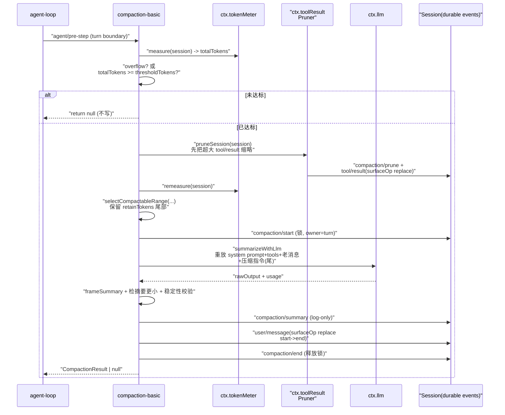
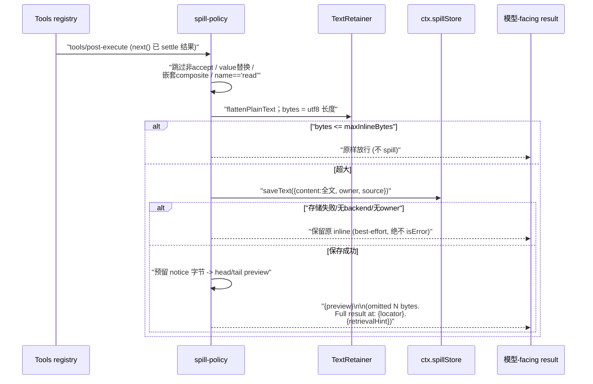

# 上下文管理与压缩（Context & Compaction）

> 对应关注面：agent 记忆/上下文机制——`compaction` 族（seam + basic + tool-result-pruner）、`llm/token-meter`、`spill` 族、`context` 家族注入。

## 在项目中的角色：记忆不是知识库，是"日志里的可重放改写"

如果把 dsh 拆掉这一族，会出现一个很具体的断层：**agent 跑不了几个回合就撞上模型上下文上限**。

- 丢掉 `ctx.compaction`（seam），agent 的历史只能无限累积，长会话直接 OOM 于 token 窗口——没有机制把"太老的对话"折叠成摘要。
- 丢掉 `ctx.tokenMeter`，就没有统一的"当前压力"读数——compaction 不知何时触发，`agent/pre-step` 也不知还有多少预算。压力**只能在每次请求后从日志重放算出来**，因为 dsh 从不维护一个并行的"当前对话缓冲"。
- 丢掉 `ctx.toolResultPruner`，一个 `read` 返回的几十 KB 日志会原样顶进上下文，summary compaction 要连它一起折叠，过早丢失细节。
- 丢掉 `spill` 族，超大 tool output 没有任何旁路，要么撑爆上下文要么被粗暴截断。
- 丢掉 `context` 家族（agent-instructions / session-reference / time-context），工作区指令、跨会话引用、时间感知都无法作为**注入的上下文**进入模型。

一句话：**dsh 的"记忆/上下文"不是一个独立 RAG 知识库，而是一套围绕 SessionEvent 日志的上下文生命周期管理**。模型历史从来都是从日志 derive 出来的；因此压缩 = 在日志里做可重放的改写（`surfaceOp 'replace'` 折叠历史），而不是进程内维护一份可变的历史数组然后敲定一个"摘要放进去"。

## 解决什么问题、根因

三个**根本性约束**（决定整个设计）：

1. **日志即唯一事实**。`Session` 是一串不可变的 durable events；模型看到的"历史"是从日志重放/projection 出来的当前表面（surface）。任何"改历史"都必须是**新增事件 + surfaceOp `replace`**，绝不能回删旧事件——否则 crash recover 后重放就和改写前不一致。
2. **压缩必须可重放**。既然历史由日志 derive，那么压缩也必须是"日志内的一步可重放改写"：`compaction/summary` 事件记录摘要与影子范围，随后一个 `user/message` 事件以 `surfaceOp: { op: 'replace', start, end }` 把老范围折叠成一个摘要节点。重建时重放日志即得压缩后的表面。
3. **token 计量必须也是日志的纯函数**。因为表面是派生值，预算也只能从日志重放算——没有"当前上下文"黑盒缓存。这倒逼出一套按需重放（lazy replay fold）的 token-meter。

## 设计思路：为何"日志内改写"而非"独立记忆库"

### 为什么不用"独立记忆/知识库"

独立记忆库（如向量库、KV 记忆）引入的问题是**一致性与优先级的割裂**：

- 记忆库与主对话历史是两个事实源，agent 需要在两者间"挑选最重要的"，这是两套取舍，模型难以稳定。
- 独立存储需要单独的读写路径、单独的压缩策略、单独的失效管理——三套复杂度。
- 最关键的是**重建性**：dsh 希望"从日志 + 代码可重建一切"（reconstructability 原则）。`compaction/summary` 事件注释直接声明日志要能重建出那一次摘要请求（`model` 字段注释写明 "logged so the one-shot request is reconstructable from log + code"）。一个进程外记忆库破坏这条铁律。

### dsh 的替代思路：记忆 = 日志的可重放压缩

选"日志内改写"，让摘要与历史共享同一套 `SessionEvent` 词汇、同一套 replay 机制、同一套 token 计量。

- **摘要也是日志事件**（`compaction/summary`，log-only 不进表面），替换摘要是表面事件（`user/message` + `surfaceOp replace`）。消费者统一按日志理解。
- **压缩的"锁"也是日志事件**（`compaction/start` / `compaction/end` bracketing）。崩溃后一个 unmatched `compaction/start` 即可探测出"压缩进行到一半"，而不是靠内存锁。
- **代价也是从日志算**：新摘要节点的 token 预算通过 `ctx.tokenMeter.estimateMessage()` 定价，与影子内容（`measurement.nodes` 求和）比较，保证"摘要必须更小"，否则拒绝提交：
  [packages/compaction/compaction-basic/src/region.ts:373-378]()
  <!-- snippet:   const framedSummaryTokenCount = dependencies.meter.estimateMessage(checkpointMessage)
  if (framedSummaryTokenCount >= prepared.shadowedTokenCount) {
    throw new Error(
      `summary is not smaller than the shadowed content (${framedSummaryTokenCount} estimated framed tokens >= ${prepared.shadowedTokenCount})`,
    )
  } -->

### 关于"prefix-summary"（给历史开头挂一条摘要）的权衡

一个朴素的替代是"不改历史，只在前面追加一条总结"。dsh 明确不用：

- **会破坏 KV cache 前缀**。append 前缀改变所有后续请求的 message 前缀，provider 缓存全失效；而 replacement 保持 message 顺序不变（只把中间一段替换成更短的摘要节点），前缀稳定。
- **长度不收敛**。历史无限增长，前缀摘要也会跟着变老、失效，仍需定期重写前缀——绕回改写。
- **surface 不"折叠"**。对 token 计量和下游投影来说，节点数不降，只是一个新节点叠加在流上。

所以 dsh 选了**真正的替换**：选一段范围（`selectCompactableRange`），保留一个 token 预算的近期 tail，把整段折叠进一个摘要节点。

## 关键数据结构

### compaction seam 接口

`CompactionEngine`（抽象 seam）三个动词：
[packages/compaction/compaction/src/index.ts:96-99]()
<!-- snippet: export abstract class CompactionEngine extends Service {
  constructor(ctx: Context) {
    super(ctx, 'compaction')
  } -->

- `compactIfNeeded`：自动策略（step-boundary 压力 / 模型确认的上下文溢出）。
- `compactNow`：手动（`/compact` 命令），standalone `turn: null` 锁。
- `compactRegion`：显式给定表面位置范围。

四个 `compaction/*` 日志事件（declaration-merged 进 `SessionEventMap`）：
[packages/compaction/compaction/src/types.ts:16-23]()
<!-- snippet: declare module '@deepseek-ai/dsh-session/types' {
  interface SessionEventMap {
    /**
     * Marks the start of a compaction — log-only, holds the lock until
     * `compaction/end`. A numbered owner is strictly enclosed by that open turn;
     * `null` identifies a standalone manual transaction between turns.
     */
    'compaction/start': { compactionId: CompactionId; sourceCommandId?: CommandId; turn: number | null } -->

- `compaction/start` / `compaction/end` 成对给压缩上"日志锁"（owner = turn 号或 `null`）。
- `compaction/summary` 记录摘要 + 影子范围/seqs/token + provider/model + 可选 `llmStreamCall`（标记它确实走了一次 `ctx.llm.stream()`，便于日志重建）。
- `compaction/prune`：pruner 的"影子定价"事件，供 model-free 裁剪定价。

`CompactionResult`：
[packages/compaction/compaction/src/types.ts:93-97]()
<!-- snippet: export interface CompactionResult {
  /** Stable identity shared by this compaction's complete durable lifecycle. */
  compactionId: CompactionId
  /** Human command that initiated this compaction, when it was manual. */
  sourceCommandId?: CommandId -->

- `startSeq`/`summarySeq`/`endSeq`：锁 bracket 的三个 seq。
- `shadowedRange: { start, end }`：**表面位置对**，不是数值间隔（replace 后 `start` 可大于 `end`）。
- `shadowedSeqs`：被影子节点的 seq 集合（表面序）。
- `shadowedTokenCount`：被影子内容的估 token。

可替换范围是表面位置对、可见 seq 可非单调。
[packages/compaction/compaction/src/types.ts:106-115]()
<!-- snippet:   /**
   * The surface-boundary pair that was shadowed: the seqs of the first
   * (`start`) and last (`end`) surface nodes of the replaced range. A
   * surface-POSITION span, not a numeric seq interval — after a prior replace
   * lands a fresh high-seq summary node at an older range's position, `start`
   * can be GREATER than `end`. {@link CompactionResult.shadowedSeqs} is the
   * authoritative set of shadowed nodes, in surface order.
   */
  shadowedRange: { start: number; end: number }
  /** The seqs of all shadowed surface nodes, in surface order. -->

- `startSeq`/`summarySeq`/`endSeq`：锁 bracket 的三个 seq。
- `shadowedRange: { start, end }`：**表面位置对**，不是数值间隔（replace 后 `start` 可大于 `end`）。
- `shadowedSeqs`：被影子节点的 seq 集合（表面序）。
- `shadowedTokenCount`：被影子内容的估 token。

### token 测量

`TokenMeasurement` 是 detached 不可变快照，每次 `measure()` 深冻结：
[packages/llm/token-meter/src/types.ts:21-26]()
<!-- snippet: export interface TokenMeasurement {
  /** Number of durable events consumed; equal to the next unread event seq. */
  readonly logRevision: number
  /** Provider or heuristic anchor used for this measurement. */
  readonly baseline: TokenMeasurementBaseline
  /** Signed repricing of current surface content relative to the baseline anchor. -->
  [packages/llm/token-meter/src/types.ts:37-38]()
  <!-- snippet: export interface TokenSurfaceNode {
  /** Durable sequence number of the surface event. -->
  readonly seq: number
  /** Heuristic tokens for the exact message projected by this node. -->
  readonly tokens: number
} -->

- `totalTokens` = request+response 压力，`surfaceTokens` = 表面积，`nodes` = 表面序上的带价节点。
- 测量是 detached 不可变快照（每 `measure()` 深冻结），多个压力消费者共享同一个 rev 的读数而不互相污染。

### spill（超大文本旁路）

`ctx.spillStore` 唯一操作 `saveText()`，**只存不读**，无检索 API。`spill-policy` 挂 `tools/post-execute` 决定"保存 vs 回注"，`spill-local` 提供安全写路径（0700 独享目录 + `open(path,'wx',0o600)` 防重定向写）。

## 核心流程（Mermaid）

### compaction：trigger → pruner → summary → surface replace

范围选择是**从后往前累加 token 直到凑满 retain**，再回退到 `toolPairingBalancedBefore` 为真的切割点（不劈开 tool-call/result 对）：
[packages/compaction/compaction-basic/src/region.ts:98-126]()
<!-- snippet: export function selectCompactableRange(
  session: Session,
  measurement: TokenMeasurement,
  retainTokens: number,
): { start: number; end: number } | null {
  const pricedNodes = measurement.nodes
  if (pricedNodes.length === 0) return null

  const surfaceNodes = session.surface.nodes
  if (surfaceNodes.length !== pricedNodes.length
    || surfaceNodes.some((seq, index) => seq !== pricedNodes[index]?.seq)) {
    throw new Error('compaction: token-meter surface does not match the current session surface')
  }

  let accumulated = 0
  let keepFromIdx = pricedNodes.length
  for (let index = pricedNodes.length - 1; index >= 0; index -= 1) {
    // oxlint-disable-next-line typescript/no-non-null-assertion
    accumulated += pricedNodes[index]!.tokens
    keepFromIdx = index
    if (accumulated >= retainTokens) break
  }
  if (keepFromIdx === 0) return null

  while (keepFromIdx > 0) {
    // oxlint-disable-next-line typescript/no-non-null-assertion
    if (toolPairingBalancedBefore(session, surfaceNodes[keepFromIdx]!)) break
    keepFromIdx -= 1
  } -->

核心提交点 `commitCompactionBody`：先 append `compaction/summary`（log-only），再 append `user/message` 携带 checkpoint 内容并附 `surfaceOp: { op: 'replace', start, end }` + `sourceEventSeqs`（指向 start/summary/shadowed）。这是 summary compaction 对表面做的**唯一** surface mutation。
[packages/compaction/compaction-basic/src/region.ts:427-447]()
<!-- snippet: function commitCompactionBody(
  session: Session,
  startEvent: SessionEvent<'compaction/start'>,
  summarized: SummarizedCompaction,
): Omit<CompactionResult, 'endSeq'> {
  const {
    start,
    end,
    shadowedSeqs,
    shadowedTokenCount,
    summary,
    provider,
    model,
    maxTokens,
    usage,
    checkpointMessage,
  } = summarized
  const callProvenance = summarized.llmStreamCall === true
    ? { rawOutput: summarized.rawOutput, llmStreamCall: true as const }
    : summarized.rawOutput === undefined ? {} : { rawOutput: summarized.rawOutput }
  const summaryEvent = session.append('compaction/summary', { -->
  [packages/compaction/compaction-basic/src/region.ts:462-465]()
  <!-- snippet:   session.append('user/message', checkpointMessage, {
    surfaceOp: { op: 'replace', start, end },
    sourceEventSeqs: [startEvent.seq, summaryEvent.seq, ...shadowedSeqs],
  }) -->

### spill 决策：tools/post-execute 决定保存 vs 回注

## 与其他模块协同

- **`ctx.sessions` 日志**：压缩的唯一事实源。`surfaceOp: { op: 'replace' }` 是 summary compaction 和 pruner 对表面做的唯一改写；所有 `compaction/*` 事件都是 log-only，靠 declaration merging 扩展 `SessionEventMap`。
- **`ctx.tools` post-execute / code-dispatch-log**：spill 的挂载点。spill-policy 注册 `tools/post-execute`（`prepend: true`，先 `next()` 再界定）两个 waterfall listener。
- **`ctx.llm`**：摘要调用复用主对话的 provider 路由与 KV cache 前缀（summarize 重放系统 prompt + tools + 老消息前缀+尾部压缩指令，KV 友好）；`llmStreamCall: true` 标记让结果可重建。
- **`ctx.tokenMeter`**：向投影注册表注册压力投影 unit，使 checkpoint 持久化时不必携带每节点价格。

## 关键设计决策

### 为何无 model-facing compact 工具（自动触发）

dsh 刻意不给模型一个"调用压缩工具"的能力：

- **确定性预算**。压缩的触发不该依赖模型自行判断"我快满了吗"——那是不稳定的启发。改为程序在 `agent/pre-step` / `agent/request-error` 上自动测压力，阈值是**配置的确定性 policy**。
- **不干扰 agent 的推理流**。若压缩是"agent 决策中的一步"，它会和任务判断耦合、甚至被调用的时机不恰当；自动压缩发生在 step 边界，是透明的维护。
- **可预测性**。模型不需要"考虑"上下文，只管推理；手动 `/compact` 只作为人类显式控制的补充，仍走同一 seam。

换句话说，压缩被设计成**基础设施**而非**工具调用**，seam 是可选后端（compaction-basic 只是默认实现），且 `compactIfNeeded` 保持动态分发以支持多实现共存。

### 为何压缩用日志可回放替换而不是截断

- **不破坏可重建性**。截断（直接删掉前面的 events）会永久丢失数据——后续 crash 恢复、session-reference 引用、审计都拿不回原文。替换则所有旧 events 仍在日志里，只是被折叠出当前表面。
- **surface 单调性**。append-only 日志保证 seq 单调；replace 是"新增高 seq 事件 `user/message` shadow 老范围"，仍 append-only，重建即得压缩后表面。若改历史中间还会破坏 seq 连续性。
- **摘要必须更小**。`estimateMessage(checkpoint) >= shadowedTokenCount` 即拒绝提交（region.ts:373-378），防止无意义的压缩，也保证收敛——每次 replace 都严格降低表面积。

### 为什么压缩的"锁"也用日志事件

崩溃后一个 unmatched `compaction/start` 即可探测出"压缩进行到一半"。内存锁（in-process）会被 crash 清零，无法表达"进行到一半"这个持久事实；日志锁把并发保护的语义也变成可重放状态。

## 亮点与问题

### 亮点

1. **改写在日志内、可重放为核心**。`surfaceOp 'replace'` + log-only `compaction/*` events 把"压缩"做成纯 append。好处是 crash-safety、可审计、下游投影零特判。
2. **"摘要必须更小"的硬校验**，防止无意义压缩并保证收敛。
3. **KV cache 前缀重用**。summarize 补充压缩指令到前缀尾部，复用主对话 warm prefix——省 token 又省延迟。
4. **tool-pairing 边界而非 step 边界**。replace 已重新编号位置，step 标记不可靠，配对是 surface 位置的线性函数——用配对准确定义可切割点。
5. **token 计量是纯重放、无并行状态**。无"当前上下文"黑盒，所有压力都由日志推导，任何消费者可独立 replay 核对。
6. **best-effort spill 永不伤任务**。存储失败保持 inline 且不置 `isError`，工具调用语义不被上下文管理策略污染。

### 问题 / 风险

1. **启发式 token 是固定字符密度**：对代码、JSON、表格这类高 token/字符比的内容低估明显（用 provider usage baseline 做部分校正）。
2. **溢出恢复依赖 provider 报错**：`context-overflow` 靠 `CONTEXT_WINDOW_EXCEEDED_CODE` 的 `request-error` 触发；若 provider 不报这个 code，溢出只能等惰性 pressure 阈值，可能已发生一次失败请求。
3. **spill 的孤儿文件无即时清理**（cleanup deferred）：notice 超 cap 时已写入的文件成为孤儿，spill seam 本身不定义 per-session 清理策略。
4. **compaction 摘要是一次性重放调用**，`MAX_TOKENS` 截断会直接判失败——长会话的极长前缀虽 KV 缓存友好，但单次摘要调用超生成上限无法分片。

## 已知的文档-实现漂移

- **"独立记忆库"仅存在于设计对比中**：dsh 并未实现任何向量/KV 记忆槽位，草稿中的对比是设计论证而非可引用的产物，本文以日志内改写为准。
- **`compaction/summary` 的 `llmStreamCall` 是可选的 union 分支**：不是所有摘要都经 `ctx.llm.stream()`（unmarked template/remote summarizer 不走该 seam），描述时须区分，避免把 `llmStreamCall: true` 当作必然。
