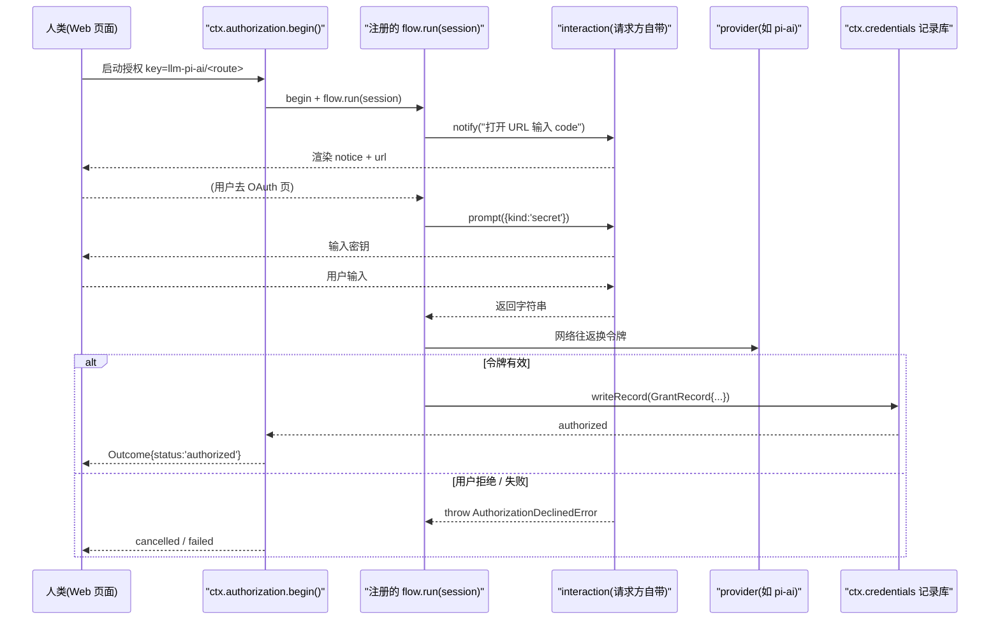

# 凭据系统：可交互授权与持久化记录（`ctx.credentials` / `ctx.authorization`）

> 子文档之一，聚焦 dsh 的凭据能力面。覆盖 `packages/credentials/credentials`（能力定义与双键空间）、`packages/credentials/credentials-local`（`$DSH_HOME/.credentials.yaml` 本地实现）、`packages/credentials/authorization`（人机交互授权平面），以及 pi-ai/DeepSeek 适配器侧的登录接线。整体哲学见 [README](README.md)；本文与 [llm.md](llm.md)（provider 路由用哪个凭据）、[deployment.md](deployment.md)（`DSH_HOME` 布局）、[architecture.md](architecture.md)（Capability Seam 三件套）互相咬合。
>
> **增量更新说明（0.1.1-rc.1，2026-08-23）**：本文为新增关注面，对应上游 0.1.0-rc.8 → 0.1.1-rc.1 合入的「authorization subsystem + credential records」能力族（`credentials`/`credentials-local`/`authorization` 三产品包）。此前 dsh 的凭据只有"读环境变量引用"一种形态（见 [deployment.md](deployment.md)），未覆盖交互登录与记录存储——本文字面补齐这一层。**依据上游 rc.8→rc.1 git diff 比对，非官方 changelog。**

## 根因：只读环境变量引用撑不起"可登录、可审计"的模型接入

早期 dsh 只认 **`CredentialRef`**——一个 POSIX 风格的环境变量名（如 `DEEPSEEK_API_KEY`），harness 在调用时到环境里取值。这套形态有三个硬伤：

- **无法交互**：OAuth / device-code / 需要点击授权的 API Key 流程必须有人机往返，环境变量是静态的，provider 只能"读"不能"问"。
- **不可持久**：登录取到的令牌（尤其短期刷新的 refresh token）无处安放，进程一退就丢，无法跨会话复用。
- **不可审计**：环境里发生了什么不在 harness 视野内，没有"谁在何时授权了什么"的记录，也没法把凭据按 owner 隔离。

rc.1 的升级方向是把凭据从"环境变量引用"抬升为一个**正式的 Capability Seam**：`ctx.credentials`（双键空间的读写平面）+ `ctx.authorization`（把"授权一个凭据"做成可注册、可交互、可单调回放的流程）。它不取代环境变量（那些仍是"本进程显式意图"的最高层），而是新增**持久的、带归属的、可交互获得的**凭据记录位。

## 双键空间：为什么 `CredentialRef` 和 `CredentialKey` 必须分开

`credentials/src/types.ts` 同时定义了两种"凭据的地址"（[packages/credentials/credentials/src/types.ts:13-29]()）：
<!-- anchor: /** Nominal reference to one credential: a POSIX-style environment-variable name. */ … export type CredentialKey = Branded<'CredentialKey'> -->

- **`CredentialRef`**：就是一个环境变量名，继承旧的"读环境"语义，保持向后兼容。
- **`CredentialKey`**：`<scope>/<id>` 两段式，`scope` 是**拥有这条记录的插件**的名字、`id` 是 owner 自己的寻址单元（LLM 适配器用 provider 路由键）。`/` 把两个键空间在语法上彻底隔离，永不碰撞。

把 `scope` 定为 **owner 而非领域**是刻意的（`credentials/src/types.ts:16-27` 注释给出理由）：
<!-- anchor:  * The scope is the owner rather than the domain because a record's payload is …  * space can never collide. -->

> 记录 payload 用 owner 的格式书写：两个服务同一 provider 名的插件会读到彼此的 payload；一个被卸载插件留下的记录也无法和在线的一眼区分。以 owner 命名，天然保证"只有写它的人能懂它"。

这带来一个事件层的推论：由于两个键空间语法不相交，commit 事件也必须分开——`credentials/reference-updated`（ref 变了）与 `credentials/record-updated`（key 变了）是两条独立事件，因为"收到同一个事件的监听者无法分辨主体属于哪个空间"（[packages/credentials/credentials/src/types.ts:90-102]()）。
<!-- anchor:     'credentials/reference-updated'(ref: CredentialRef): void …     'credentials/record-updated'(key: CredentialKey): void -->

## 记录二态：`ApiKeyRecord` 与 opaque 的 `GrantRecord`

持久化记录只有两种（`CredentialRecord`），靠 `kind` 判别（[packages/credentials/credentials/src/types.ts:37-60]()）：
<!-- anchor: export interface ApiKeyRecord { … export type CredentialRecord = ApiKeyRecord | GrantRecord -->

- **`ApiKeyRecord`**：`kind: 'api-key'`，含 `key`（非空密钥）与 `env`（如 `AWS_PROFILE` 这类 provider 环境采样）。两者都可缺省——一条二者皆无的记录表达的是"owner 确认这条 route 用自身环境发现即可认证"，这和有记录是**两个不同的事实**。
- **`GrantRecord`**：`kind: 'grant'`，只有 `payload: unknown`。seam 对这个 payload **完全不透明**：不校验、不reshape，唯一约束是能 JSON 往返。它写的是 owner 的格式、只有 owner 能解释。

opaque payload 是一个关键权衡：把"grant 里装什么"完全下放给 owner，换取 seam 不必理解任何厂商的令牌格式（OAuth token、refresh token、签名、缓存校验码都成了 owner 的私有 JSON）。代价是"两个插件服务同一 provider、彼此读不懂对方记录的 payload"——而双键空间已用 owner scope 把这种冲突在语法上消解了。

## Authorization：把"授权一次凭据"做成可注册、可交互、可回放的流程

`ctx.authorization` 是一个 `AuthorizationService`，维护"**一个 key → 一个 flow**"的注册表（[packages/credentials/authorization/src/index.ts:177-184]()）：
<!-- anchor:  * `ctx.authorization`: a registry of credential-obtaining flows, one attempt at …   static inject = ['credentials'] -->

### flow 形状：`run()` 是唯一的义务

一个 `AuthorizationFlow` 声明它写给哪个 `key`、用什么 `methods`（OAuth / API-Key，按偏好排序）、以及唯一必须实现的 `run(session)`（[packages/credentials/authorization/src/index.ts:119-137]()）：
<!-- anchor: export interface AuthorizationFlow { …   run(session: AuthorizationSession): Promise<void> -->

- **`registerFlow(flow)`** 用 `ctx.effect()` 包裹：注册是**可逆副作用**——卸载时撤销，且若 flow 中途被撤，其正在跑的 attempt 也被 abort（"runner 属于正在消失的插件，继续让它提问会活过那个能回答它的 fiber"）（[packages/credentials/authorization/src/index.ts:202-218]()）。
<!-- anchor:   registerFlow(flow: AuthorizationFlow): () => void { …   registerFlow(flow: AuthorizationFlow): () => void { -->
- **每个 key 只许一个 flow**：两个插件抢同一 key，各写各格式的记录，后跑的那个会让先的读到解析不了的 payload——`DUPLICATE_FLOW` 拒绝（同上 `:204-207`）。

### interaction 由请求方供给，而非注册时绑定

这是授权设计里最反直觉、也最关键的一点：**surface 半身（`AuthorizationInteraction`）是随请求传入的，不是随 flow 注册的**（[packages/credentials/authorization/src/index.ts:145-158]()）：
<!-- anchor: export interface AuthorizationInteraction { …   prompt(prompt: AuthorizationPrompt): Promise<string> -->

```ts
interface AuthorizationInteraction {
  notify(notice: AuthorizationNotice): void
  prompt(prompt: AuthorizationPrompt): Promise<string>
}
```

`notify` 汇报"人类下一步该做什么"（如"去这个页面输这个 code"），`prompt` 把人机提问摆给人类并等待（`text`/`secret`/`select` 三态，含 `AbortSignal` 以便撤回单个提问而不终止整个授权，见 [packages/credentials/authorization/src/types.ts:43-59]()）。
<!-- anchor: export type AuthorizationPrompt = { …   kind: 'select' -->

**为什么 interaction 要随请求给而不是随 flow 存**：启动授权的那个调用方，才是能跟人类对话的那个——prompt 必须精确落到"发出请求的那个页面"，headless 调用方则传一个永远拒签的 interaction。若把 surface 绑在 flow 上，头less 和 Web 会互相踩踏。`AuthorizationNotice`/`AuthorizationPrompt` 被设计成 **wire-safe（不含 secret）**，浏览器侧类型链可直接消费而不用加载服务包（[packages/credentials/authorization/src/types.ts:1-6]()）。
<!-- anchor:  * Wire-safe authorization types, free of cordis/service imports so browser type …  * @module @deepseek-ai/dsh-authorization/types -->

`begin()` 一次只允许一个在途 attempt（`running` Map 按 key 记 `InFlight`，`InFlight` 只持一个 `AbortController`），保证同一 key 不会并发跑两个授权去写入同一记录（[packages/credentials/authorization/src/index.ts:275-277]()，`:173-176`）。
<!-- anchor:   async begin(request: AuthorizationRequest): Promise<AuthorizationOutcome> { …   async begin(request: AuthorizationRequest): Promise<AuthorizationOutcome> { -->
<!-- anchor: interface InFlight { …   readonly controller: AbortController -->

### 结果如何闭环：授权完成即"提交一条记录"

`run()` 里跑完网络往返后，owner 通过 `ctx.credentials` 写一条 `GrantRecord`（`ApiKeyRecord` 同理），commit 时发出 `credentials/record-updated`。整个授权面的**最终事实就是这条持久记录**——这与 dsh 支柱二"日志=唯一事实源"一脉相承：授权不是"内存里 bool 翻转一下"，而是"落一条可回放、可审计、可随会话共享的记录"。

## 存储：`.credentials.yaml` 的版本化文档、0600、跨进程写锁

`credentials-local` 把记录与引用落在一个文件：`$DSH_HOME/.credentials.yaml`（[packages/credentials/credentials-local/src/index.ts:60-61]()）。
<!-- anchor: export const CREDENTIALS_FILENAME = '.credentials.yaml' … export const CREDENTIALS_FILENAME = '.credentials.yaml' -->

同一个文件里还住着一条与 API 密钥性质迥异的记录：`client-connection/browser-session`——Web 浏览器会话 cookie 的 HMAC 签名密钥。删掉它并重启进程，就等于一次性吊销全部浏览器会话，机制见 [web-remote-access.md](web-remote-access.md)。

### 来源优先级：显式环境 > 托管文档 > 项目 `.env`

实现顶部用一段注释把四个来源按信任程度排序（[packages/credentials/credentials-local/src/index.ts:6-21]()）：
<!-- anchor:  * inherited process environment      (read-only, wins) …  * through the Models page is never displaced by one a checkout happens to carry. -->

> 继承的环境变量最高（CI secret / 容器 `-e` 是本进程的显式意图，且不可从内部编辑，必须**可见地**只读而非静默遮蔽写）；其下一切输给托管文档，所以 Models 写的 key 能即时生效，即使更老的 key 躺在项目 `.env` 里。项目可背书 key 但排文档之后，防止 checkout 顺带的 key 顶掉用户明确存储的。

### strict 解析 + 版本化使"宁拒绝、不静默"

`parseCredentialsDocument`（[packages/credentials/credentials-local/src/index.ts:188-227]()）对文档**全量拒绝而非跳过**——未版本化的根、未知顶层 key、不可寻址的 key、错误类型的值、未知的记录 tag 或字段一律抛错：
<!-- anchor: export function parseCredentialsDocument(text: string, filename: string): CredentialsDocument { …   return { refs: parseRefs(fields['refs'], filename), records: parseRecords(fields['records'], filename) } -->

> 这个文件里只有凭据，一条被静默忽略的条目读起来就是"我存的凭据没生效"——所以宁可整篇报错。重复 key 直接按解析错误暴露。

- 文档头要求 `version: 1`（`DOCUMENT_VERSION`，[packages/credentials/credentials-local/src/index.ts:167]()），旧扁平布局在 boot 时被 `migrateFlatDocument()` 一次性搬进 `refs:` 下的新结构，原文逐字保留（注释、空行、值拼写都原样存活），无法证明能懂的文档绝不重写（`:229-239`）。
- 诊断信息绝不把秘密带出：YAML 解析错误只报 `code + 行/列`，而 `describeYamlError` 明确**不回引源行**，因为解析器引用的那行文本是秘密（[packages/credentials/credentials-local/src/index.ts:154-163]()）。
<!-- anchor:  * Describe one YAML parse failure without quoting the source. The parser's own …   return `${error.code}${where}` -->

### 0600 权限 + 跨进程写锁

- `assertOwnerOnly`（[packages/credentials/credentials-local/src/index.ts:127-143]()）
<!-- anchor: async function assertOwnerOnly(filename: string): Promise<void> { …     + ` run "chmod 600 ${filename}" before starting again`, -->在读文档前先拒掉"其他 OS 用户可读"的文件——provider 创建/替换时固定 `0600`，但手写或外部生成的文件带着生成它的 umask；承诺 `0600` 却从一个世界可读的文件里秒速出秘密，等于没承诺。POSIX-only，Windows 跳过（其 ACL 无法在这种表达）。
- 每次写文档前取**跨进程 writer lock**（`DOCUMENT_LOCK_WAIT_MS = 30_000`，[packages/credentials/credentials-local/src/index.ts:112]()），并在锁内"只 patch 自己的 key、保留未动条目原样"；外部编辑经 chokidar 观察热发布，重载整份快照使"被删的条目绝不在内存残留"。

这个 30s 锁等待是打磨过的权衡：`modifyRecord` 的 owner 侧决策可能含网络往返（刷新过期 token），文件层默认锁会让这段时间内同一文档的所有其他写者全挂，故把等待窗口按"最长的持锁者"（一次 provider 请求的代价）来定 —— 这是写协议本身的鲁棒性上界，而非可部署调节项（[packages/credentials/credentials-local/src/index.ts:100-112]()）。
<!-- anchor:  * How long a record write waits for the cross-process writer lock. A record …  * is sized by what a provider request costs, which no deployment varies. -->

## 与 provider 的接线：pi-ai 从「读环境」变为「能登录」

rc.1 里 `llm-pi-ai` 补上了 authorization 侧连接：一个安装的提供商注册一个授权 flow，把 pi-ai 的 OAuth / device-code 认证桥接进 harness 的通用授权平面，并为该适配器家族定义凭据记录的命名空间 `RECORD_SCOPE = 'llm-pi-ai'`（[packages/llm/llm-pi-ai/src/auth.ts:24]()、`…/login.ts:112-138` 的 `ctx.authorization.registerFlow` 接线）。
<!-- anchor: export const RECORD_SCOPE = 'llm-pi-ai' … export const RECORD_SCOPE = 'llm-pi-ai' -->

结合 [llm.md](llm.md) 的 Provider 层：provider 现在可以有两条路获得凭据——继承环境变量（`CredentialRef`，仍是"本进程显式意图"最高层）或持久记录（`CredentialKey`，交互授权或 owner 直写）。`ctx.credentials` 负责在两者间做读取解析，路由选择依赖 provider 的适配逻辑。

## 核心流程：一次交互式登录的完整链路



无官方 changelog，此图依据 [packages/credentials/authorization/src/index.ts:202-277]() 与 [packages/credentials/credentials-local/src/index.ts:188-226]() 的实现归纳。
<!-- anchor:   registerFlow(flow: AuthorizationFlow): () => void { …     const flow = this.flows.get(key) -->
<!-- anchor: export function parseCredentialsDocument(text: string, filename: string): CredentialsDocument { …   return { refs: parseRefs(fields['refs'], filename), records: parseRecords(fields['records'], filename) } -->

## 关键设计决策

### 为什么授权要"交给 owner 的 record"，而不是让 seam 记住令牌

把授权的产物定为"一条 owner 自解释的持久记录"，而非 seam 缓存一个字符串令牌，换来三层收益：

- **可交换**：grant 的 payload 格式完全是 owner 的私有 JSON，seam 不耦合任何厂商令牌方言；换存储后端（本地文件 → 密钥管理服务）只碰 Provider 一层。
- **可审计/可回放**：授权 = "写一条记录 + emit 一个事件"，与 dsh"事件日志是唯一事实源"的支柱一致；"谁、何时、对哪个 key 授权了什么"可溯。
- **可跨会话**：刷新/复用的 token 落盘持久，恢复会话时凭据仍可用，不必每次重登。

代价是 seam 必须信任 owner 的 `run()` 正确地写了记录，并把"是不是真授权成功"的判断部分交给 owner 侧的错误语义（`AuthorizationDeclinedError` vs 失败）。

### 为什么 `interaction` 随请求不随 flow

**Why**：授权流程是 host 提供的，但能跟人类对话的是调用方。把 surface 声明在请求端，让"web 页面发起 → prompt 精确落回该页""headless 发起 → 传一个永远拒签的 interaction"成为结构，而非靠注册时绑定 + 路由回传去猜。这避免了两类调方在表面上的互相污染，也与 dsh"调用方自持能力位"的普遍立场（见 [subagent.md](subagent.md)）一脉相承。

### 为什么每个 key 只许一个 flow

**Why**：记录 payload 由 owner 格式书写，两个 flow 抢同一 key 会各自写入无法互读的格式，后写者覆盖先写者，先写者的记录变成"读不懂但存在"的悬案。`registerFlow` 的 `DUPLICATE_FLOW` 拒绝 + effect-based 可逆注册，把这个冲突从运行时灾难提前到注册期的强约束。

## 全局关联：凭据就是又一个「可交换、以记录为事实」的 seam

`ctx.credentials` + `ctx.authorization` 是 [architecture.md](architecture.md) 支柱一「无特权内核」与支柱二「日志即事实源」在安全和接入层的又一次贯彻：凭据不是一个 `env` 读取助手，而是一个 Definition（双键空间 + 记录联合）/ Provider（`credentials-local` 的 YAML 文档）/ Consumer（`llm-pi-ai` 等适配器）俱全的 Capability Seam。它同样以「**可回放的持久制品**（一条 record + 一个 commit 事件）而非内存可变值」为最终事实，与 [session.md](session.md) 的事件溯源、[llm.md](llm.md) 的 provider 路由、[deployment.md](deployment.md) 的 `DSH_HOME` 布局在同一条设计哲学线上。

## 演进与未完成

- **仍兼容环境变量**：`CredentialRef` 保留为最高层"显式意图"，record 是叠加的新位，未移除旧通道（见 [deployment.md](deployment.md) 的环境层）。
- **record 的可达性管理 deferred**：`records` 文档目前无 owner 卸载即清理的策略，卸载插件的记录会滞留（owner scope 靠命名区分而非自动回收）——与 [attachments.md](attachments.md) 的对象 GC deferred 属同类取舍。
- **permission 变更见 [CHANGELOG.md](CHANGELOG.md)**：rc.1 曾短暂引入 `reuseWorkspaceBlank` 空白会话继承默认权限、并在 rc.2 整体回滚；凭据记录位本身在两个版本间保持稳定。
