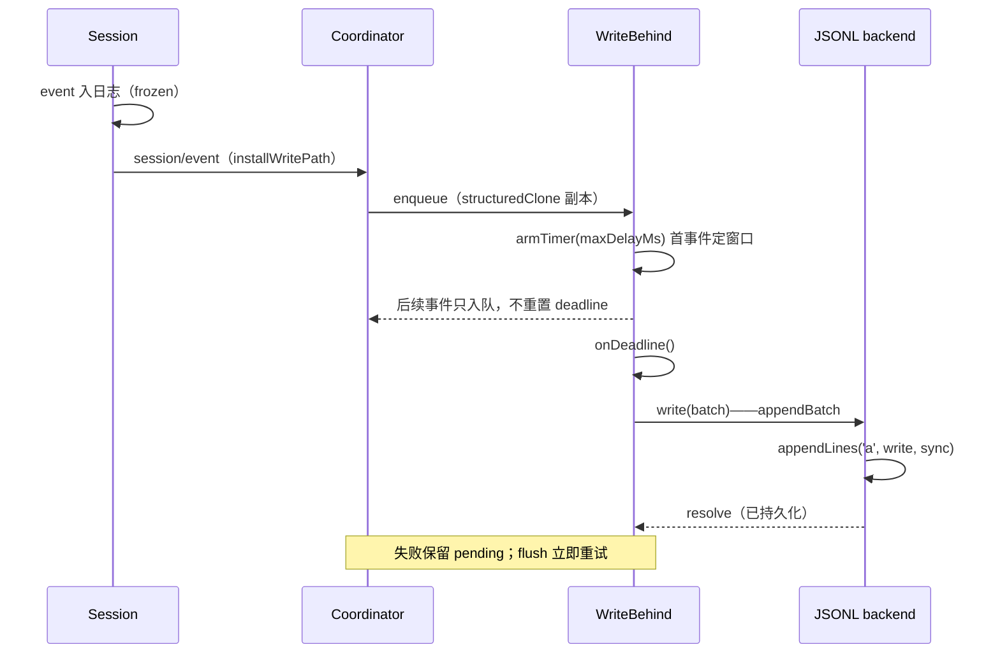
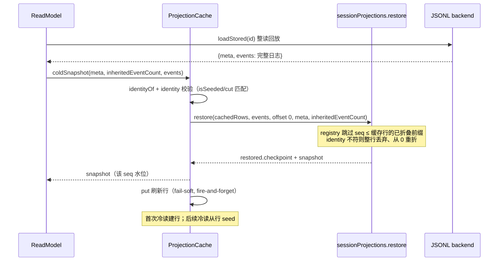
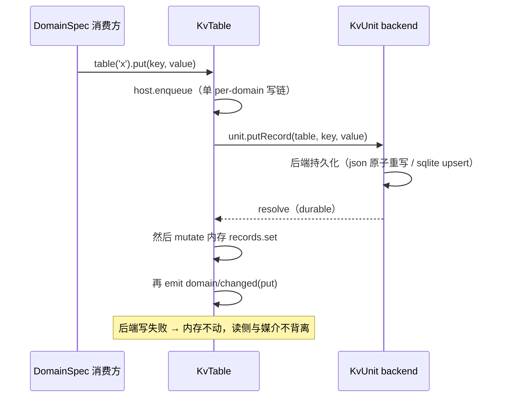

# 数据模型：事件日志的地面实现（持久化层）

> 子文档之一，聚焦 dsh 的持久化数据模型。覆盖事件日志持久化（`session-persistence`* 双后端）、非日志 KV 存储（`storage`* 可交换 backend + `storage-domain` 域表单）、派生投影缓存（`session-projection-cache`）。整体哲学见 [README](README.md)；本文上承 [session.md](session.md)（事件日志的落盘形态）、衔接 [deployment.md](deployment.md)（部署时的数据落地）。

核心论点：**这套「数据模型」不是一张 ER 图能讲完的业务表集合，而是两层可交换持久化的「事件溯源日志的地面实现」**——不可变事件日志是唯一事实源，KV 存储只是其上的投影底座；schema 演进被刻意做成「不迁移、只拒绝」。

## 根因：为什么持久化要长成两层可交换式

Dsh 的 Session 本质是一条不可变、append-only 的 `SessionEvent` 事件日志（内存态的事实源），见 `docs/subsystems/persistence.md` 首句[[docs/subsystems/persistence.md:5-5]()]()。这把"什么需要落地持久化"分成两个性质完全不同的集合，也因此长出两套独立的可交换 seam：

1. **事件日志本身**（真相）——必须按时间顺序、逐事件、连续 seq 地落地，崩溃后还能精确回放到"最后一个完整 turn"。它是追加写多、随机读少、需流式回放的数据。
2. **一切非事件的东西**（投影/键值状态）——工作区键值、投影缓存、各类域表。它们是"从真相推导出来的当前值"，改变频繁、需要按 key 随机读。

dsh 对这两类各给了一个服务抽象（`SessionPersistence` 与 `Storage`），又各配了可交换实现，这正是"Capability Seam 三件套"在持久化上的落地：接口（Service Definition）、提供方（backend）、消费方（domain 表单 / 投影缓存）。全部独立于 agent-loop 脊椎，无特权内核。

## 存储选型与理由

### JSONL：真相日志的"忠实回放"形态

事件日志后端以 append-only、不可变为核心。`session-persistence-jsonl` 把它实现为每会话一个 JSONL 逻辑日志，物理上用 zstd 压缩的拼接帧写入（编码名 `zstd`/`none`）[[packages/session/session-persistence-jsonl/src/format.ts:17-17]()]()。

选择 JSONL 的理由根植于"事件日志 = 可流式回放的真相"这一定位：

- **追加语义**天然贴合事件溯源：每次 append 只往文件尾写一行/一段，`appendLines` 用 `'a'` 打开、写后 `sync()` 即达持久化，崩溃后 `scanLog`/`SessionLogScanner` 按换行符增量切分、只解码完整记录，把"写一半"的尾部当 torn tail 容忍[[docs/subsystems/persistence.md:235-235]()]()。
- **流式回放**：回放不要求随机寻址，顺序扫一行解一行即可恢复，正好匹配真相日志"从头重演"的语义。
- **人可读与可压缩兼得**（`zstd` 关闭时）——一个会话一个文件、头部首行即 `SessionHeader`，`parseHeaderMeta` 只读首行即可做列表而不整日志解析[[packages/session/session-persistence-jsonl/src/format.ts:404-404]()]()。这让"会话文件就是事实源"在运维上可直接触达。

代价与权衡：没有 seek-by-seq，`readFrom(id, fromSeq)` 在 JSONL 上仍要解析整文件再跳过。这是真相日志甘愿付的代价——回放本来就要从头，按 seq 随机读不是它服务的场景。

### 单一后端：一个真相、一类读法

> **演进说明（0.1.2-alpha.1）**：0.1.2-alpha.1 整体移除 SQLite 会话持久化后端（`refactor(session)!: remove SQLite persistence backend`，`packages/session/session-persistence-sqlite` 目录自此从仓库消失），本节原「SQLite 作为可交换投影底座」的论述被本次移除取代；原 SQLite 会话后端的 Schema 17 打包物理行、`readFrom` 尾读、`SCHEMA_VERSION=17` 相关叙述一并失效（下文的表格与 Schema 演进章节已相应删除）。

SQLite 后端移除后，dsh 的事件持久化收敛为**一个真相、一类读法**：JSONL 的 append-only 顺序介质同时承担「忠实回放」与「后缀续读」。当前 shipped provider 只有 JSONL 一个实现，`SessionPersistence` 抽象明确声明 "the abstract `SessionPersistence` service, its provider model and shipped JSONL backend"[[docs/subsystems/persistence.md:5-5]()]()
<!-- anchor: The **durability seam** for the event log. [session.md](session.md) describes the in-memory `Session` -->。

注意区分：被移除的是**会话日志**的 SQLite 后端（`packages/session/session-persistence-sqlite`）；KV 层 `storage-sqlite`（`packages/storage/storage-sqlite`）依然存在、仍是投影/KV 状态的可用媒介。即「事件日志层收敛到 JSONL 单后端，KV 层保持可交换」——真相层简化，投影层保留选择。

为什么移除可行：会话日志一旦确立「追加写、顺序读、整文件可重放」的真相定位，SQLite 双后端的差异化收益（按 seq 随机寻址）就被 `readFrom` 的**物理后缀语义**消解——该原语只承诺"返回/折叠 `seq>=fromSeq` 段"，不限定每个 backend 的物理读，JSONL 顺序扫描但只返回匹配段即等价满足[[docs/subsystems/persistence.md:404-407]()]()
<!-- anchor: * A backend whose medium can seek by seq may read only the suffix; -->。保留双后端则需持续维护同一 `runPersistenceContract` 契约在两种媒介上的行为等价，pre-release 阶段判定为「维护成本 > 读侧收益」（此权衡为本解读依据代码变动推断，非官方 changelog 陈述）。

### 非日志 KV 存储：为何也要可交换

`storage` 子系统的存在则服务于"一切不是 SessionEvent 的持久化"。它同样是可交换的：hub `ctx.storage` 只是一个注册表 + 表单挂载点，本身不做任何 IO，backend 持有媒介，domain 表单持有语义[[packages/storage/storage/src/index.ts:3-3]()]()。

对应两个实现：

- `storage-json`：**人可读 JSON backend，双布局可选**——`single` 布局一 unit 一个可读 JSON 文件 `<root>/<unit>.json`、整文件原子重写（"可读性就是它存在的理由"[[packages/storage/storage-json/src/format.ts:4-4]()]()
<!-- anchor: * legibility is this backend's reason to exist. `single`-layout units are -->）；`per-record` 布局一 unit 一个目录、每记录一份版本化文档 `<root>/<unit>/<table>/<key>.json` + `global.json`，一次写只原子重写一条记录，坏/旧版本记录读取为缺席、绝不 brick 整个 unit[[packages/storage/storage-json/src/per-record-unit.ts:12-16]()]()
<!-- anchor: * Per-record contract: a record document that is malformed or stamped with a -->。`single` 适合低频改、需要人工审查的整份状态（如 `workspace.json`）；`per-record` 适合高频单记录写（如逐会话的投影缓存）。
- `storage-sqlite`：**一库多 unit、每行一文档**（`key`/`value` JSON 文本），适合频繁更新、需要随机访问的数据[[docs/subsystems/storage.md:47-47]()]()。每个 unit 一张 `u_<unit>_<table>` 表 + `units`/`unit_globals` 元数据表[[packages/storage/storage-sqlite/src/unit.ts:1-1]()]()。

两条 backend 共享同一个 `KvFacet`/`KvUnit` 契约，并都通过 domain 表单（`ctx.storageDomain`）暴露给消费方。可交换的意义在这里与"不可变事件日志"哲学呼应：**真相（事件日志）与投影（KV 状态）分层，投影落在哪个媒介可随时换，但真相的语义不会因媒介而改变**。

## 实体关系总览

下面按"两类存储媒介 + 其上数据形态"给出关系图。事件日志是文档型/追加型，投影缓存与 KV 域是键值型，故用 `graph TB` 而非 `erDiagram`（键值/文档型实体用扁平有向图 + 配色分组表示三层归属）。

```mermaid
graph TB
    SE[SessionEvent 序列]
    SH[SessionHeader]
    COORD[PersistenceCoordinator]
    JSONL[jsonl 会话后端<br>唯一事件后端]
    B1[scanLog 整读回放]
    B2[readFrom 后缀读]
    REG[ProjectionRegistry]
    CACHE[session_projcache 域]
    SNAPSHOT[ProjectionSnapshot]
    DOMAIN[storage-domain]
    JSONKV[json backend<br>single / per-record]
    SQLKV[sqlite backend]
    HUB[Storage hub ctx.storage]
    SE --> JSONL
    SH --> JSONL
    COORD --> JSONL
    JSONL --> B1
    JSONL --> B2
    B1 --> REG
    B2 --> REG
    REG --> CACHE
    REG --> SNAPSHOT
    CACHE --- DOMAIN
    DOMAIN --> JSONKV
    DOMAIN --> SQLKV
    DOMAIN --- HUB
    classDef ev fill:#1e2a3a,stroke:#4db6ac;
    classDef pd fill:#2e1e3a,stroke:#ba68c8;
    classDef kv fill:#3a2e1e,stroke:#d4a04d;
    classDef br fill:#202020,stroke:#666;
    class SE,SH,JSONL,COORD ev;
    class REG,SNAPSHOT,CACHE pd;
    class DOMAIN,JSONKV,SQLKV,HUB kv;
    class B1,B2 br;
```

图例：青色组 = 事件日志真相层（session-persistence），紫色组 = 派生读取层（session-projection / projection-cache），褐色组 = 非日志存储层（storage），灰色 = 跨层桥接原语。

关系要点：

- 事件日志真相层（左）与派生读取层（中）之间靠 `PersistenceBackend.readFrom`（watermark 续读）和 `scanLog`/`load`（整读回放）两种桥接——0.1.2-alpha.1 起两种桥接都由 JSONL 一个后端提供（SQLite 会话后端已移除，见「单一后端」）；
- 投影缓存是存储层（右）的消费方——它打开 `session_projcache` 域，经 domain 表单落到 json 或 sqlite backend（0.1.2-alpha 起默认走 storage-json 的 `per-record` 布局，每会话一个文档）；
- 图右即"一切非事件"的 KV 底座，domain 表单是唯一消费入口，`domain/changed` 事件在每次 durable 写后发出。

## 核心表 / 实体设计

下面按"真相日志 + 非日志 KV + 投影缓存"三大块拆表。字段表是更结构化的叙述，精确 DDL 以括号内行号为准。

### SessionEvent 邮箱信封（内存事实源）

职责：一条会话内不可变事件。信封是判别联合（type 与 data 的联合由编译器保证类型收窄），surface 字段为条件存在（仅 `user/message`/`assistant/message`/`tool/result` 三类型携带）[[packages/core/session/src/types.ts:336-336]()]()。

| 字段 | 类型 | 约束 | 说明 |
|------|------|------|------|
| type | SessionEventType | 判别 key | 事件类型，`SessionEventMap` 可被插件合并扩展 |
| seq | SessionSeq | branded number | 会话内单调连续；`SessionSeq` 标识**一条已存在事件**，与标识"间隙/前缀长度/读偏移"的 `SessionLogOffset` 分离，编译期禁止互换[[packages/core/session/src/types.ts:29-51]()]()
<!-- anchor: export type SessionSeq = BrandedNumber<'SessionSeq'> … export function SessionLogOffset(value: number): SessionLogOffset { --> |
| time | number | Unix epoch ms | 事件时间戳 |
| data | SessionEventMap[K] | JSON-serializable | 负载，构造期强制 `isJsonValue` |
| ignorable | true(可选) | 仅日志型 | 未知类型的"可跳过"标记；缺省=必需，遇未知类型须拒绝而非静默丢弃 |
| sourceEventSeqs | number | 仅 surface 事件 | 引用的先前事件 seq（assistant chunk→message、compaction 遮蔽） |
| surfaceOp | SurfaceOp(可选) | 仅 surface 事件 | 'append' 或 { op:'replace', start, end }，记录如何进 surface |

### SessionHeader（真相日志旁的元数据）

职责：**存储元数据，不是会话事件**——format version、cwd、lineage、seed 边界都对模型不可见，不进入 `deriveMessages()`，挂在 `session.header`[[packages/core/session/src/types.ts:61-61]()]()。

| 字段 | 类型 | 约束 | 说明 |
|------|------|------|------|
| version | number | 写时从 SESSION_FORMAT_VERSION 盖章 | 后端加载时拒绝其它版本（不迁移） |
| id | SessionId | branded | 会话 id，与 Session 镜像 |
| createdAt | number | 非负 safe-integer epoch ms | 创建时刻 |
| cwd | string(可选) | 绝对路径 | 创建时工作目录 |
| parentSession | SessionId(可选) | | 被 fork 的来源，seed 谱系 |
| isSeeded | boolean | 无此字段视为 false | fork 谱系标记；替代旧 `seedLength` 的存储坐标语义（见「演进说明」）[[packages/core/session/src/types.ts:111-111]()]()
<!-- anchor:   readonly isSeeded: boolean --> |
| inheritedEventCount | SessionLogOffset(可选) | body-bearing 观测携带 | 精确继承前缀长度，随 header 之外显式传递，header-only 读者无需打开日志体即可知谱系[[packages/core/session/src/types.ts:141-144]()]()
<!-- anchor:   * Exact fork-inherited prefix length when `meta.isSeeded` is true. A …   readonly inheritedEventCount?: SessionLogOffset --> |
| origin | 'subagent'(可选) | | 由 subagent 子创建的产品粗分类（展示用） |
| delegationDepth | number(可选) | | 代理深度，持久化使递归预算跨重启存活 |
| agentPreset | string(可选) | deployment 按会话组合时置 | preset 决定工具的 prompt，持久化避免 resume 换组合重放 |

### JSONL 会话文件（真相物理形态）

职责：每会话一个物理文件，首行 `type:'session'` 头记录，随后的 JSONL 行或打包块为事件。路径布局 `root/<projectKey>/<encoded:sessionId>/session.jsonl[.zstd]`，sessionId 经 `encodeSegment` 单段安全编码[[packages/session/session-persistence-jsonl/src/format.ts:201-201]()]()。

| 位置 | 内容 | 说明 |
|------|------|------|
| 首行 | HeaderLine(`type:'session'` + header 字段) | 头即 storage 元数据；列表只读首行 |
| 后续行 | event 逐行 JSON 或 `packChunkRuns` 打包块 | 布局无关读：`scanLog` 恒按记录解码 |
| 物理编码 | zstd 拼接帧（默认）/ 明文 | 由 `JsonlCompression` 决定，后缀对应 |

### 会话后端物理布局：JSONL 唯一形态（演进：SQLite 已移除）

> **演进说明（0.1.2-alpha.1）**：0.1.2-alpha.1 移除 SQLite 会话持久化后端。本节原「`session-persistence-sqlite` 的 `sessions` / `events` 表、Schema 17 打包物理行、`incarnation`/`revision`」整节已被删除，此处仅保留演进轨迹摘要：rc.8 曾把 SQLite 后端从「一事件一行」重写为 Schema 17 打包物理行（`packChunkRuns` 把连续同块 `assistant/chunk` 压成一行、varint+ZigZag delta 编码 `source_event_seqs`、大 payload zstd 压缩为 BLOB），并配套 `sessions` 表的 `incarnation`（物化时 randomUUID）与 `revision`（单调变更 token）——这些机制随后端一并移除，不进入 alpha.4 代码。

打包的职责已全部收敛进 JSONL 后端：`packChunkRuns` 打包块仍是 JSONL 会话文件的物理形态之一（见上表「后续行」），`decodeStorageRecord` 无损展开，存储编码词汇（`text-chunks`/`reasoning-chunks`/`tool-call-chunks`）不打进 `SessionEventMap`、编码器白名单精确形状、不认识即逐条存（丢压缩不丢数据）[[packages/core/session/src/chunk-rows.ts:9-16]()]()
<!-- anchor: * Packed rows are an encoding vocabulary, NOT session events: they never enter … * before expanding and fails loud on a malformed row-tagged value instead of -->。zstd 物理编码在 alpha 期间拆分出「核心扫描 + 双解码器」：`zstd.ts` 负责拼接帧的字节范围扫描与 torn 尾识别，解码交给 Node 私有 API 的流式解码器与公共 API 的单发解码回退（`zstd-private-decoder` / `zstd-public-decoder`），使同一压缩容器在受限环境下也有可用的回退实现[[packages/session/session-persistence-jsonl/src/zstd.ts:4-12]()]()
<!-- anchor: * without exposing compression mechanics through the persistence seam. … import { NodePrivateZstdFrameDecoder } from './zstd-private-decoder.ts' -->。

### storage-sqlite：`units` / `unit_globals` / `u_<unit>_<table>`

职责：一库多 unit 的 KV 底座；记录值以 JSON 文本存 `value` 列，每原语单条 SQL（原子性交给 SQLite，无显式事务、无写队列）[[packages/storage/storage-sqlite/src/unit.ts:1-1]()]()。

| 表 | 字段 | 约束 | 说明 |
|----|------|------|------|
| units | name(unit/table) | (name,version) | unit 名 PK + 每 unit 版本盖章 |
| unit_globals | unit/value | PK→units, value TEXT | unit 全局单例槽 |
| u_<unit>_<table> | key/value | key PK, value TEXT NOT NULL | 每 unit 每 table 泛化记录表，value 为 JSON 文本 |

### storage-json：single（一 unit 单文档）与 per-record（一记录一文档）

> **演进说明（0.1.2-alpha）**：storage-json 从单一「整文件」布局演进为 **single / per-record 双布局**，本小节反映当前形态；原「一 unit 一个可读 JSON 文件」的单一布局论述已成为 `single` 分支。

`single` 布局：整文件即 unit 的"当前净状态"，人读优先（pretty-print + 插入序稳定 key order），全局为 `null` 直到首写[[packages/storage/storage-json/src/format.ts:11-11]()]()。

| 字段 | 类型 | 说明 |
|------|------|------|
| unit.name / unit.version | 对象 | 文件头，标 unit 身份与版本 |
| global | any | `null`="从未写"哨兵 |
| tables | Record<tableName, Record<key,value>> | 各表记录；`null` 原型避免 `__proto__` 污染 |

写入为原子整文件替换（temp+fsync+rename+目录 fsync）[[packages/storage/storage-json/src/atomic.ts:24-24]()]()。

`per-record` 布局：unit 是一个目录，`<dir>/<table>/<key>.json` 每记录一个版本化文档 + `global.json` 承载全局槽。该 unit 设计为**无内存状态**——`loadAll` 重读目录树、每次写就是一次 durable 文件操作，写失败文件与域内存双双不变、无需回滚[[packages/storage/storage-json/src/per-record-unit.ts:3-10]()]()
<!-- anchor: /**
 * One opened JSON unit in `per-record` layout: the unit is a directory at -->。键会成为路径段，必须 path-safe（`[a-zA-Z0-9_-]+`），不安全键在写时拒绝[[packages/storage/storage-json/src/per-record-unit.ts:270-271]()]()
<!-- anchor: /** Reject a record key that would be unsafe as a path segment. */ … function assertSafeKey(unit: string, key: string): void { -->。既有 `single` 布局的整文件在首次打开时被自动 bootstrap 进 per-record 树（legacy 文件保留不改动），任何新文档路径存在即抑制整 unit 的 bootstrap[[packages/storage/storage-json/src/per-record-unit.ts:18-22]()]()
<!-- anchor: * Legacy bootstrap: when the new tree has no document path, a legacy -->。

### session-projection-cache：`session_projcache` 域（per-record 落盘 + 身份含谱系）

> **演进说明（0.1.2-alpha）**：投影缓存 alpha 期间随 storage-json per-record 布局落盘——每会话一个文档 `<root>/session_projcache/sessions/<sessionId>.json`，一次 checkpoint 写只重写该会话的文档而非整 unit[[packages/session/session-projection-cache/src/spec.ts:3-9]()]()
<!-- anchor: /**
 * The projection-cache domain declaration: one `sessions` table keyed by -->；同时 `checkpointIdentity` 扩展进 seq/offset 分离后的谱系字段。

职责：投影检查点持久化，`(sessionId, key, ver, seq, val)` 的 RFC 形态；`row 从不错误，只可能过期`——ver 不匹配即丢弃（从非迁移）[[packages/session/session-projection-cache/src/spec.ts:24-24]()]()。日志身份绑定（createdAt/cwd）防止"同 id 不同生命周期"的旧行通过水位检查[[packages/session/session-projection-cache/src/spec.ts:42-42]()]()。

| 字段 | 类型 | 约束 | 说明 |
|------|------|------|------|
| createdAt / cwd | z.number/z.string.optional | checkpointIdentity | 日志身份（列表/冷读时对 live header 校验） |
| isSeeded / inheritedEventCount | z.boolean / SessionLogOffset | checkpointIdentity | 0.1.2-alpha 起加入的谱系位：同 id 不同谱系的旧记录读时即弃[[packages/session/session-projection-cache/src/spec.ts:45-46]()]()
<!-- anchor:   isSeeded: z.boolean(), …   inheritedEventCount: z.number().int().nonnegative().transform(SessionLogOffset), --> |
| rows | Record<key, row> | rows 键为投影 key | 每 key 一个 checkpoint |
| row.ver | int≥0 | | 该 unit 的 stateVersion，不匹配即弃 |
| row.seq | SessionSeqCursor | int≥-1 转 SessionSeq | 投影最后一次折叠的 seq；`-1` 表示首事件前的 watermark[[packages/session/session-projection-cache/src/spec.ts:26-28]()]()
<!-- anchor: export const checkpointRow = z.object({ … seq: z.number().int().gte(-1).transform((value): SessionSeqCursor => --> |
| row.val | z.json() | | 该投影 unit 的内部状态，纯 JSON |

写为整记录替换（whole-value 纪律）；域 spec `version:3` 升级即报废整个媒介[[packages/session/session-projection-cache/src/spec.ts:66-66]()]()。alpha 期间新增**冷读播种**：冷会话从缓存种子直接折 fold 而非全量重放，写回在持久化后异步进行——缓存从「只读捷径」升级为「可播种的折叠捷径」（`session-projection-cache` 的 `loadAndFold` 路径）。

### 附件对象库：`DSH_HOME/attachments/v1`（内容寻址二进制存储）

> **演进说明（rc.7）**：这是事件日志之外新增的**独立持久化面**——图片等二进制内容不进事件，字节落在内容寻址对象库，事件只存 `ImageAttachmentRef` 引用。完整能力面在 [attachments.md](attachments.md)。

职责：不可变二进制对象的持久化底座，与"事件日志存 ref、对象库存字节"严格分工。根目录 `DSH_HOME/attachments/v1`（版本化，跨版本对象格式互读靠目录切分），下分 `objects/<前两hex>/<sha256>` 内容寻址对象与 `tmp` 暂存区，`images` 对象以 `objects` 双层前缀摊开避免单目录过载。

其"不可变 + 防篡改"由双重机制保证（[attachments.md](attachments.md) 详述）：

- **内容寻址**：对象以字节 SHA-256 命名，`attachmentId` 形如 `sha256:...`，同一内容天然去重共享；`readImage` 回读时重算 digest 并逐项核对 `mediaType`/`bytes`/`width`/`height`，不匹配即报 `ATTACHMENT_CORRUPT`[[packages/attachment/attachment-local/src/store.ts:220-226]()]()。
- **崩溃安全**：写入走 `stage→write→sync→fsync目录→link→sync目录`，参考发布前同步 `objects` 目录，防"文件到目录项没到"的断电丢引用[[packages/attachment/attachment-local/src/store.ts:76-113]()]()、[[packages/attachment/attachment-local/src/store.ts:152-169]()]()。

| 字段 | 类型 / 约束 | 说明 |
|------|------------|------|
| `attachmentId` | `sha256:<64hex>`，不可变 | 内容寻址标识，非路径非 URL |
| `mediaType` | closed union `image/png/jpeg/webp/gif` | 从字节验出的格式 |
| `bytes`/`width`/`height` | number | 读回时逐项核对 |
| 对象路径 | `objects/<前2hex>/<sha256>` | 内容寻址摊开 |
| 暂存区 | `tmp/<uuid>` | 写入中暂存再 link 原子发布 |

**演进与 GC**：因恢复/分叉会话可能共享不可变对象，"没被引用即删"会误删仍在用的图，因此**对象 GC 与保留策略明确 deferred**（`readImage` 校验让"对象是否还在"可探测，但自动回收待引用感知 GC 落地[[packages/attachment/attachment/README.md:20-20]()]()）。v1 仅收四种栅格格式，音频/视频/通用文件留待各自生命周期契约[[packages/attachment/attachment/README.md:19-21]()]()。这不是数据模型妥协，而是「先保格式正确审计、后加媒体类型」的演进顺序。

## Schema 演进策略：刻意"不迁移，只拒绝"

dsh 的 schema 演进哲学与多数系统相反——**pre-release，无兼容承诺，宁可拒绝也不猜测迁移**。主要体现在几个单调版本号：

- `SESSION_FORMAT_VERSION = 0`：单一单调整数，无 major/minor 拆分[[packages/core/session/src/types.ts:56-56]()]()。决定是否 bump 看 **writer 发什么**，而非新 reader 能否接受——只有结构性变化才 bump（header 形态、Event 信封、core 事件语义、surface 机制/SurfaceEventType 集）；普通加事件类型不 bump，用 `ignorable` 防词汇增长[[packages/core/session/src/types.ts:40-40]()]()。
  - bump 的代价权衡见 constant 注释："near-identity 升级几乎免费，漏 bump 会让旧 runtime 静默读错新日志"——宁可过度拒绝也不静默重演被掏空的会话。
- 会话级版本：JSONL 后端从**首行 header** 就拒绝外来格式版本，`refuseForeignFormatVersion` 先于校验今日 header 形态与解码任何事件行，所以未来结构性格式仍报"升级方向"而非"corrupt"[[packages/session/session-persistence-jsonl/src/format.ts:240-240]()]()（原 SQLite 的 `SCHEMA_VERSION` pragma 拒绝逻辑已随后端一并移除，见上条）。
- ~~`SCHEMA_VERSION = 17`（SQLite 会话后端）~~ **0.1.2-alpha.1 随 SQLite 后端一并移除**（原 rc.8 自 15 bump 到 17 的 `PRAGMA user_version` 校验、openDatabase 盖章/拒绝逻辑不再存在于仓库）；会话日志的格式拒绝现收敛为 `SESSION_FORMAT_VERSION` 单一版本号。
- `STORAGE_SQLITE_SCHEMA_VERSION = 1`（KV sqlite）：`PRAGMA user_version`，与每 unit 版本正交；非当前拒绝，不迁移[[packages/storage/storage-sqlite/src/schema.ts:20-20]()]()。
- 域级版本：DomainSpec.version 被拒即拒绝打开[[packages/storage/storage-domain/src/spec.ts:35-35]()]()；投影 projcache 域 version 被拒即报废——cache 语义是"stale/不可读 cache 只花一次长尾重放，绝不产出错值"[[packages/session/session-projection-cache/src/spec.ts:62-62]()]()。

**回滚/灰度**：由于"拒绝不迁移"，上线前必须保证磁盘格式与代码版本配套；投影缓存依赖 `stateVersion` 的版本不匹配就地丢弃，是唯一"自动回滚"点（重读重放即可）。JSONL 改压缩编码需独立/全新 root 或选 legacy raw mode（见其 README）——因为格式版本无迁移。

## 读写路径

写路径有两条汇聚线，都以 `PersistenceCoordinator` 为编排中枢。下面给出 JSONL 后端（0.1.2-alpha.1 起的唯一 shipped 事件后端）的写路径时序；投影缓存侧另有独立的 write-behind（见「session-projection-cache」）。

### 活会话写路径：session/event → write-behind 批量落地

`installWritePath` 由 coordinator 构造时注册：`session/created` 记录头、`session/event` 拷贝冻结事件并入队、`session/flush` 作为即时持久化屏障、`session/disposed` 拉出 retirement 排水[[docs/subsystems/persistence.md:11-11]()]()。`session/event` 是同步通知，插件不阻塞生产者拷贝事件；`flush` 取消等待并排水至 quiescence[[packages/session/session-persistence/src/write-behind.ts:1-1]()]()。

seq contiguity 契约在 `appendCore` 强制：每个事件 seq 必须接续 `state.cursor`，`backend.appendBatch` 成功后 cursor/materialized 同步推进、invalidates 缓存[[docs/subsystems/persistence.md:296-296]()]()。

### 冷会话 / 冷读路径：load / inspect / readFrom

命中派生读取（投影缓存）时，从缓存行 seed 折叠（见下方「冷读播种」图）；无缓存或身份不符则走 JSONL 的 `loadStored`/`scanLog` 整读回放。恢复打断的 turn：backend 发现 `turn/start` 无 `turn/end`，**不截断**（单 turn 可能巨大），而是以合成 `turn/end { reason:{kind:'interrupted'} }` 收尾，不改变其前后任何独立事件[[docs/subsystems/persistence.md:15-15]()]()。仅当最后一条物理记录是残缺 fragment 时才丢弃 torn tail。

冷读 + 投影缓存播种（0.1.2-alpha 新增，`session-projection-cache` 的 `coldSnapshot`）：

关键语义：`readFrom` 返回的是**物理后缀**，`fromSeq >= 存储前缀` 时返回空事件而非报错；JSONL（顺序媒介）即使它仍解析整文件也保证只**返回/折叠** `seq>=fromSeq` 段——该原语限定"返回什么、折叠什么"，不限定每个 backend 的物理读[[docs/subsystems/persistence.md:404-407]()]()
<!-- anchor:  * A backend whose medium can seek by seq may read only the suffix; …  * backend's physical read. -->。冷读播种让 `row 从不错误，只可能过期`的哲学延伸到读侧：缓存在行身份（含谱系位）匹配时折叠到 row.seq、剩余尾部补重放，绝不产出越过日志的幻影值[[packages/session/session-projection-cache/src/index.ts:224-254]()]()
<!-- anchor:    * Cold-read one session's projections from its complete log. Each unit is …     return restored.snapshot -->。

### 非日志 KV 写路径：domain 写 → backend 持久化 → domain/changed

读写路径的全局连接：内存是权威（读同步自内存）、媒介先行持久化、事件在 durable 之后按写链顺序发出；`delete` 对缺席 key 返回 `false` 且不写不发事件；`update` 是写链槽位上的原子 read-modify-write[[docs/subsystems/persistence.md:98-98]()]()。

## 全局关联：数据模型是「不可变日志 + 可交换 seam」的物理载体

dsh 把「什么需要落地」拆成两类：事件日志（真相，需顺序 append + 崩溃回放）与投影/KV 状态（派生值，需随机读）。事件日志层在 0.1.2-alpha.1 收敛为 **JSONL 单一后端**（SQLite 会话后端移除），投影/KV 层仍保持可交换（storage-json 人读、single/per-record 双布局 + storage-sqlite 频繁读写），由 `PersistenceCoordinator` 编排写路径。schema 演进「不迁移、只拒绝」——`SESSION_FORMAT_VERSION`/`STORAGE_SQLITE_SCHEMA_VERSION`/域级 version 一律单调盖章、非当前即拒，宁可过度拒绝也不静默重演被掏空的会话——这与其说是保守，不如说是「不可变事实源」哲学的自然后果：既然历史不可改，那演进就只能靠版本拒绝而非就地迁移。而 seq/offset 分离（`SessionSeq` vs `SessionLogOffset`）是这一哲学在类型层的又一次硬化：**「标识一条事件」与「标识日志中的位置」从此不可互换**。它把 [session.md](session.md) 的「Model-visible means logged」从内存典故落到磁盘形态，是 [architecture.md](architecture.md) 可交换后端哲学的又一实例。
