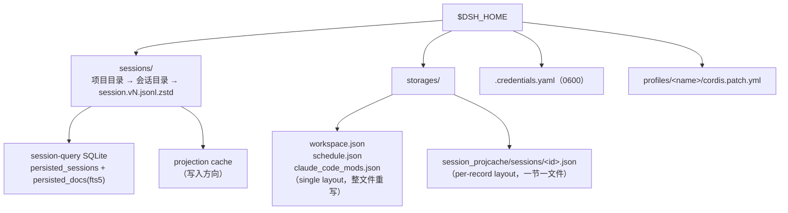
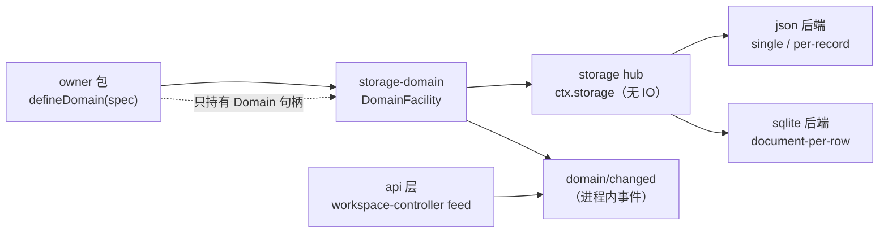
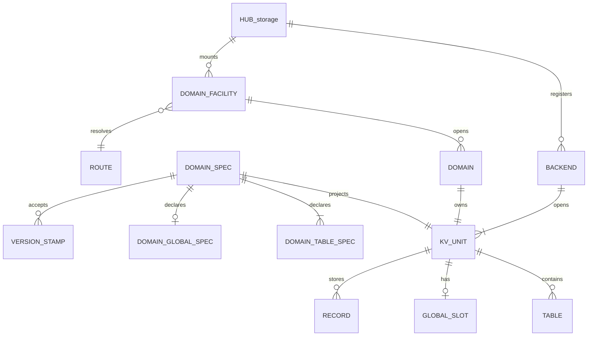
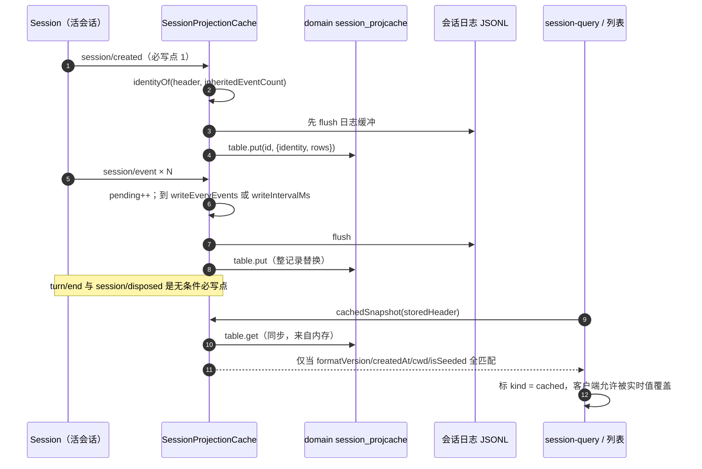
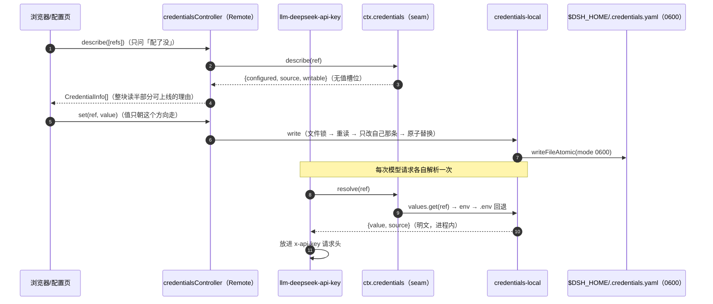

# 数据模型与配置存储

> 关注面：dsh 把「持久状态」拆成了四种介质（会话 JSONL 日志、领域 KV、Cordis profile patch、`.credentials.yaml`），本篇只回答一个问题——**哪种状态是谁的真源、用哪条介质承载、版本变了怎么办**。

## 为什么先问「谁是真源」

dsh 的招牌承诺是「Model-visible means logged」：凡是模型看得见的东西都必须先落进 append-only 的会话事件日志。这条承诺一旦成立，就顺手划定了一条极清晰的所有权边界——**会话日志是唯一事实源，其他一切持久化都是它的派生物或它的邻居**。问题在于「邻居」比想象中多：工作区列表、定时任务、会话标题、投影缓存、插件配置、API Key，没有一个是某个会话的事件，硬塞进日志反而违反语义。

dsh 对这一堆东西给出的答案不是「上一个关系库」，而是四层分割：会话日志（append-only JSONL）→ 领域 KV（每域一份带版本戳的文档）→ 查询索引（可丢弃的 SQLite FTS5）→ 配置文件（Cordis patch 与凭据文件）。每一层都按「能不能重建」来决定容错姿态：能重建的就允许丢弃，不能重建的就宁可拒绝打开。**整篇的判断都从这条容错轴长出来**：存储选型、`compatibleVersions`、`backup-and-skip`、`invalidRecords`，全都是「这份数据丢了以后，用户会损失什么」的函数。

去掉领域 KV 这一层会发生什么？workspace 会退回「按 cwd 分组的侧边栏视觉效果」，没有真正的实体（归属关系无处可写）；冷会话列表拿不到标题与终态（header 只是创建时的不可变快照）；升级一次缓存版本就得整库重扫。这些正是 [领域 KV 存储 Agent Note](.agents/notes/proposed/architecture/2026-07-24-domain-kv-storage-and-workspace.md) 立项时点明的两个现成需求。

## 四层介质与目录布局

一层层看下去，`$DSH_HOME`（默认 `~/.dsh`）下的布局本身就是这张分层图的物理投影：

| 层 | 介质与路径 | 谁拥有 | 可否重建 | 版本机制 |
|---|---|---|---|---|
| 会话事件日志 | `<root>/--<cwd-slug>--/<encoded-id>/session.vN.jsonl[.zstd]` | `session-persistence-jsonl` | 否（用户对话的唯一副本） | 文件名里的 `vN` + 格式迁移链 |
| 领域 KV | `<root>/<domain>.json`（single）或 `<root>/<domain>/<table>/<key>.json`（per-record） | `storage-domain` + 各域 owner 包 | 分域而定（见「真源 vs 派生」） | 域 `version` + `compatibleVersions` |
| 查询索引 | `<path>`（默认 `:memory:`） | `session-query-sqlite` | 是 | `user_version` 不匹配则整表 DROP 重建 |
| 配置 patch | profile 目录下的 `cordis.patch.yml` | `config-editor` / Loader | 否（用户意图） | 无版本，靠 schema 校验 |
| 凭据 | `$DSH_HOME/.credentials.yaml`（`0600`） | `credentials-local` | 否（值只有用户知道） | 无版本，靠 0600 权限门禁 |

shipped 组合把前两层的根都挂在 harness home 下：会话根是 `dshHomePath('sessions')`，领域 KV 根是 `dshHomePath('storages')`，领域层默认路由 `backend: json` [packages/bundle/base/cordis.patch.yml:141-141]()
<!-- anchor:         root: !!js dshHomePath('sessions') -->



## 存储选型：三包一条 seam，后端只碰介质

存储子系统的骨架是能力 seam 的标准三段式：hub（`ctx.storage`，纯注册表，不碰 IO）、provider（`json` / `sqlite`，各自拥有介质）、consumer 数据形态（`storage-domain`，唯一直接接触后端契约的包）。这条 seam 的价值不在抽象本身，而在**它把「介质长什么样」和「数据意味着什么」彻底解耦**，于是同一个 `workspace` 域可以今天落 JSON、明天落 SQLite，而 owner 包一行不改。



后端契约 (`StorageBackend` / `KvFacet` / `KvUnit`) 是整层最容易写歪的地方，dsh 把它写成了**逐条款的规范性文本 + 一份共享一致性套件**（`tests/contract.ts` 对两个后端跑同一组用例）。契约里两条最有信息量：

- **顺序不是后端的责任**。「The unit does NOT serialize concurrent writes — write ordering is the caller's responsibility (the domain layer runs one write chain per unit); the unit only guarantees that each single call is atomic on the medium and durable once resolved」[packages/storage/storage/src/backend.ts:81-83]()
<!-- anchor:  * atomic on the medium and durable once resolved (a crash after resolution …  * rejects with `closed`. -->
- **两种 layout 的失败姿态相反**。`single` 整单元一份文档，版本不符就 `version-mismatch` 整个拒绝；`per-record` 一记录一份文档，版本不在接受集合内就**静默读作不存在** [packages/storage/storage/src/backend.ts:55-63]()
<!-- anchor:   /** …   readonly layout?: 'single' | 'per-record' -->

```ts
export interface KvUnitDescriptor {
  readonly name: string
  readonly version: number
  readonly tables: readonly string[]
  readonly hasGlobal: boolean
  readonly layout?: 'single' | 'per-record'
  readonly compatibleVersions?: readonly number[]
}
```

这个 descriptor 是「数据形态」的全部形状输入：注意它不含任何 schema、任何业务字段——backend 眼里的记录永远是 opaque JSON。`version` 是**单元格式版本**，写到介质上（JSON 的 `unit.version` 头、SQLite 的 `units` 行），和 SQLite 自己的物理布局版本 `PRAGMA user_version` 互相独立 [packages/storage/storage-sqlite/src/schema.ts:14-20]()
<!-- anchor: /** … export const STORAGE_SQLITE_SCHEMA_VERSION = 1 -->

### 为什么放弃关系库

把 workspace / schedule / projcache 都建成表、上外键、写 SQL 查询，是最省心的选择，dsh 没这么做的理由可以逐条对上代码：

| 维度 | 单库关系模型 | dsh 的选择 | 换来 / 付出 |
|---|---|---|---|
| 数据量级 | 中小（每域几十到几千条） | 每域一份文档 / 一棵文件树 | 换来零迁移成本、可读文件、易排查；付出全量重写开销 |
| 查询需求 | 需要 join / 聚合 | **几乎为零**：所有跨实体查询由内存态（registry、projection）承担，唯一的重查询需求被单独外包给 SQLite FTS5 | 关系库的核心卖点在这儿用不上 |
| 演进 | ALTER TABLE + 迁移脚本 | 域版本戳 + 拒绝或丢弃 | 换来无需迁移代码；付出「旧版本读不了」的用户体验债 |
| 损坏面 | 单文件损坏 = 全库不可用 | 域/记录粒度隔离 | 一份坏文档只影响一条记录 |
| 可读性 | 二进制 | pretty-print JSON（json 后端的存在理由） | 用户能直接看/改/备份 |

真正把「关系库」这条路堵死的，是 `storage-domain` README 里那条限制：「**没有跨表事务、二级索引或多段键**」。dsh 根本没有给领域层配事务原语，而领域层唯一一处跨两份文档的写（workspace 的 `pendingMutation`）是靠**业务级两阶段标记**手写的。

## 领域 KV 的实体关系与核心实体

### 实体关系总览

域的粒度很粗：一个域 = 一个命名单元（`UNIT_NAME_RE` 约束 `^[a-z][a-z0-9_]*$`，同时兼作文件名与 SQL 标识符片段），域内有 N 张表 + 至多一个 global 单例。**global 是唯一的「域级状态位」**，这也是版本校验里最锋利的一条规则所在：`defineDomain` 拒绝任何能接受 `null` 的 global schema，因为 `null` 是介质上的「从未写入」哨兵 [packages/storage/storage-domain/src/spec.ts:95-103]()
<!-- anchor: /** …  * (a stored `null` silently reverts to `initial`). -->



下面分别落字段。**先说明一点**：dsh 里没有「表 DDL」这种对象，字段表的真源是各 owner 包里的 zod schema；下面的「约束」列是从 schema 与介质规则推出的可观察约束，不是原样抄写。

### 领域声明（`DomainSpec`，每域一行）

| 字段 | 类型 | 约束 | 说明 |
|---|---|---|---|
| `name` | `string` | `^[a-z][a-z0-9_]*$`，模块加载期校验 | 同时是后端 unit 名、文件名、SQL 标识符片段，所以字符集被压到最小 |
| `version` | `number` | 非负整数 | 当前域格式版本，写入永远盖这个戳 |
| `layout` | `'single' \| 'per-record'` | 默认 `single` | 决定介质形态，也决定版本不符时是「整单元被拒」还是「单条丢弃」 |
| `compatibleVersions` | `readonly number[]` | 每项必须是 `< version` 的非负整数 | owner 以本包名誉担保「旧记录用新 schema 也读得动」 |
| `invalidRecords` | `'backup-and-skip'` | 仅此一个合法值 | 派生数据专用：坏记录搬到 `.bak.<stamp>` 后继续打开 |
| `global` | `{ schema, initial }` | schema 不得接受 `null` | 域级单例；未写入时服务 `initial` 而不落盘 |
| `tables` | `Record<string, DomainTableSpec>` | 表名同 `name` 字符集 | 每张表一个 zod `valueSchema` + 一个编译期 phantom 键类型 |

`version` / `compatibleVersions` / `invalidRecords` 这三个字段是整篇的「演进三件套」，它们各自的语义差异（不是同义反复）在后面的「演进策略」一节展开。

### `domain: workspace`（v2，single layout + global）

工作区是领域 KV 的第一个真实消费者，也是唯一一个**同时用到表和 global 单例**的域，值得当模板。

| 实体 | 字段 | 类型 | 约束 | 说明 |
|---|---|---|---|---|
| global<br/>`workspaceDomainState` | `initialized` | `boolean` | 必填 | 区分「合法的空注册表」与「还需要 header 引导」 |
| | `defaultWorkspaceId` | `WorkspaceId?` | 可选 | 首用时铸造的工作区身份，删除注册后仍保留 |
| | `workspaceIds` | `WorkspaceId[]` | 必填 | **权威显示顺序**，不含已删除项 |
| | `archivedSessionIds` | `SessionId[]` | 缺省为 `[]` | 全局归档集；归档不动 `sessionIds` 槽位，解档可原位恢复 |
| | `pinnedSessionIds` | `SessionId[]` | 缺省为 `[]` | 全局置顶集（最近置顶在前）；与归档互斥 |
| | `pendingMutation` | `{operation:'create'\|'delete', workspaceId}` | 可选 | 两写操作的可恢复标记 |
| table `workspaces`<br/>key = `WorkspaceId` | `path` | `string` | 必填 | 创建时 `fs.realpath` 规范化后的路径 |
| | `title` | `string` | 必填 | 显示名 |
| | `sessionIds` | `SessionId[]` | 必填，有序 | 归属账本，数组顺序即显示顺序 |
| | `createdAt` / `updatedAt` | `string` | ISO-8601 | 时间戳用字符串而非毫秒数，直读友好 |

两个新增会话集合都带 `.default([])` 不是随手写的——它们是为了**让 v1 时代写下的记录在 v2 schema 下原样解析通过**，这正是 `compatibleVersions` 白名单得以成立的前提（owner 用 optional/default 字段「接住」旧记录）。[packages/workspace/workspace/src/spec.ts:57-65]()
<!-- anchor: export const workspaceDomainState = z.object({ … }) -->

值得注意的是 workspace 域**没有**声明 `compatibleVersions`，却把 `version` 从 1 提到了 2 [packages/workspace/workspace/src/spec.ts:76-84]()
<!-- anchor: export const workspaceDomainSpec = defineDomain({ … }) -->

### `domain: schedule`（v1，single layout，Host-owned）

| 字段 | 类型 | 约束 | 说明 |
|---|---|---|---|
| key | `ScheduleId` | 与 `record.id` 必须一致 | 打开时逐条比对，不一致直接抛错并关闭域 |
| `sessionId` | `SessionId` | 非空 | 任务绑定的原会话；Schedule 独立于会话加载状态存活 |
| `record` | `ScheduleRecord` 联合 | 由 `decodeScheduleRecord` 解码 | `after`/`at`/`every`/`daily`/`weekly`/`cron` 六种判别式 |
| `status` | `'active' \| 'inactive'` | 缺省为 `active` | 缺失状态解码为 active，不扫描/重建历史会话 |
| `lastDelivery` | `{scheduledAt, deliveredAt, messageId}` | 可选，禁止额外键 | 最近一次投递回执 |
| `deliveryHistory` | `{records[], earlierRecordsUnavailable, earlierRecordsPruned?}` | 可选，禁止额外键 + 跨字段 refine | 投递历史；`messageId` 必须唯一，且最后一条必须等于 `lastDelivery` |

这张表的信息量在**两个 refine**：它们把「回执与历史必须对得上」写成介质边界校验，于是一条被外部工具改坏的任务记录会让整个域打不开——schedule 域刻意没有声明 `backup-and-skip`，因为「静默丢一条用户设定的提醒」比「启动失败并报出是哪条」糟糕得多 [packages/schedule/schedule/src/storage.ts:37-60]()
<!-- anchor: export const scheduleTaskSchema = z.object({ … }) -->

### `domain: session_projcache`（v7，per-record，派生）

这张表最能体现「派生数据」的字段设计——每条记录不是一个业务对象，而是一份**折叠快照 + 它的血统证明**。

| 字段 | 类型 | 约束 | 说明 |
|---|---|---|---|
| key | `SessionId` | `[a-zA-Z0-9_-]+`（per-record 布局变成路径段） | 一条记录 = 一个会话的完整检查点 |
| `identity.formatVersion` | `number?` | 非负整数 | 折叠时的 Session 格式代；**缺失即不可用于播种** |
| `identity.createdAt` | `number` | 非负整数 | 会话生命周期身份 |
| `identity.cwd` | `string?` | 可选 | 生命周期身份 |
| `identity.isSeeded` | `boolean?` | 可选 | fork 谱系位 |
| `identity.inheritedEventCount` | `SessionLogOffset?` | 非负整数 | 精确继承切断点；只有 fold 面要求它 |
| `rows[key].ver` | `number` | 非负整数 | 产生该行的 projection 单元 `stateVersion`，不符即在读时丢弃 |
| `rows[key].seq` | `number` | `>= -1` | 该行折叠到的事件序号；`-1` 表示空日志 |
| `rows[key].val` | `JsonValue` | 无损 JSON 往返 | 单元内部状态，不透明 |

`rows` 是 `z.record(string, checkpointRow)`，整个记录**每次写都整体替换**（whole-value discipline）[packages/session/session-projection-cache/src/spec.ts:20-72]()
<!-- anchor: /** … }) -->

### 其余域的速览

| 域 id | 版本 | layout | owner 包 | 内容与真源地位 |
|---|---|---|---|---|
| `workspace` | 2 | single + global | `packages/workspace/workspace` | 工作区实体 + 全局注册表；**owned**，不可重建 |
| `schedule` | 1 | single | `packages/schedule/schedule` | 定时任务 + 投递回执；**owned**（Host 拥有） |
| `session_projcache` | 7（compat 3–6） | per-record | `packages/session/session-projection-cache` | 每会话投影检查点；**派生**，可丢弃 |
| `claude_code_mods` | 1 | single | `packages/experimental/claude-code-mods` | 第三方 mod 的 `$.store` 键值；**owned**（实验性） |

全仓 `defineDomain(` 只有这四处（加上测试与 fixture）。`session_projcache` 的 `compatibleVersions: [3, 4, 5, 6]` 是目前唯一在生产里用上版本白名单的域，它走过 v3（整单元）→ v4（per-record）→ v7 的格式转换，测试目录里躺着每个已发布代的 fixture 文件 [packages/session/session-projection-cache/tests/fixtures.spec.ts:2-13]()
<!-- anchor:  * Cross-version recovery and lossless checkpoint JSON validation. The released …  * writer and contains opaque keys and arrays, independent of Session messages -->

```ts
export const projectionCacheDomainSpec = defineDomain({
  name: 'session_projcache',
  version: 7,
  compatibleVersions: [3, 4, 5, 6],
  invalidRecords: 'backup-and-skip',
  layout: 'per-record',
  tables: { sessions: domainTable<SessionId, CheckpointRecord>(checkpointRecord) },
})
```

这 8 行是整个存储栈的缩影：`per-record` 把版本冲击面从「整个域」缩到「一个会话的缓存」，`compatibleVersions` 让老记录还能被结构性读取，`backup-and-skip` 保证再烂的记录也不会让启动失败。

## 会话侧的数据形态：header、代际与派生索引

会话日志的数据形态值得单独看一眼，因为它和领域 KV 是**两套完全不同的版本策略**，对比之下才看得清 dsh 的判断标准。

### 目录布局与单射转义

```
<root>/
  --Users-morehao-src-demo--/        # 项目目录：cwd 的可读投影，分隔符换成 '-'
    0b3f...c1/                       # 会话目录：会话 id 的单射转义
      session.v1.jsonl.zstd
      session.v2.jsonl.zstd
      session.v3.jsonl.zstd
      session.v4.jsonl.zstd          # 当前写入代际（SESSION_FORMAT_VERSION = 4）
```

两层命名各有讲究。项目目录（`projectKey`）是**故意有损**的：它只负责人类可导航，冲突无所谓，因为会话目录名才是身份。会话目录名（`encodeSegment`）相反，必须**单射**——`SessionId` 只是一个品牌化字符串、不经校验，直接拼路径就等于把 `../` 交给用户 [packages/session/session-persistence-jsonl/src/format.ts:196-213]()
<!-- anchor:  * @param raw - the string to encode; must be non-empty (throws on `''`). …   return out -->

旧代际文件**永不删除也不被改写**：升级只是在旁边多写一个 `session.v4.jsonl.zstd`，`open` 永远选数值最高的规范代际。这是 dsh 在会话侧的「不可变代际」策略——和领域 KV 的「原地覆盖」正好相反，因为会话日志是不可重建的用户数据。

### 物理 header 帧

第一行是带 `type: 'session'` 标记的 header 帧，后续每个事件一行（或一个压缩帧）。

| 字段 | 类型 | 约束 | 说明 |
|---|---|---|---|
| `type` | `'session'` | 字面量 | 帧判别式，区分 header 与事件行 |
| `version` | `number` | 必填 | 物理代际版本 |
| `id` | `SessionId` | 必填 | 逻辑 id |
| `createdAt` | `number` | 安全非负整数，且不为 `-0` | 会话创建时刻 |
| `cwd` | `string?` | 必须为绝对路径 | 决定项目目录 |
| `parentSession` | `SessionId?` | 可选 | fork 来源 |
| `isSeeded` | `boolean` | 必填 | 是否含 fork 继承前缀 |
| `delegationDepth` | `number` | 安全非负整数，缺省 0 | 委派深度；**持久化**才能让递归预算跨重启存活 |
| `agentPreset` | `string?` | 可选 | 组装该 agent 的 preset；恢复时若换了一套工具/提示就无法继续 |

`HEADER_REQUIRED_KEYS` / `HEADER_OPTIONAL_KEYS` 是两个白名单集合，未知键一律拒绝；`sandboxMode` / `approvalPolicy` 这两个**已退役**的字段被显式判死 [packages/session/session-persistence-jsonl/src/format.ts:96-100]()
<!-- anchor: const HEADER_REQUIRED_KEYS = ['type', 'version', 'id', 'createdAt', 'isSeeded' … /** -->

精确的 fork 切断点（`inheritedEventCount`）**不在 header 里**——它在最后一个带标记的 `session/end-seed` 事件上，因为它是会话状态而不是创建时元数据。这条区分直接反映到 projection cache 的两种身份比对（下面细说）。

### 派生索引：会话查询确实有 SQLite

这一点必须说清楚，因为很容易被「默认 `openAt: never`」误读成「SQLite 已被移除」。**事实是反过来的**：`session-query-sqlite` 是随产品交付的全文检索提供方，只是**默认不打开**。

| 事实 | 证据 |
|---|---|
| schema 真实存在：`search_state`、`persisted_sessions`、`persisted_docs`（FTS5，`unicode61` 分词）+ `temp.live_docs` | 建表语句在 `ensurePersistentSchema` |
| 索引是**可丢弃读模型**：`user_version` 不符就 `DROP` 全部表重建；`application_id` 不符直接拒绝动别人的库 | 打开序列的版本判定分支 |
| 打开时机三档：`startup`（默认）/ `first-search` / `never` | `Config.openAt` |
| shipped base bundle 显式覆写为 `openAt: never` + `path: ':memory:'`，web-app 再覆写一次同值 | `cordis.patch.yml` 行 |
| `never` 时仍挂载 `ctx.sessionQuery`：精确读、标题、血缘照样可用，只有 `searchSessions`/`searchEvents` 报 `SESSION_QUERY_SEARCH_DISABLED` | 同上注释 |

建表与丢弃逻辑分别在 `ensurePersistentSchema` 与打开序列的版本判定里 [packages/session-query/session-query-sqlite/src/schema.ts:103-169]()
<!-- anchor: function ensurePersistentSchema(db: DatabaseSync): void { … } -->
，`application_id` 守卫与整表重建是同一段 [packages/session-query/session-query-sqlite/src/schema.ts:64-67]()
<!-- anchor:     if (applicationId === SESSION_QUERY_SQLITE_APPLICATION_ID) { …     } -->
。三档 `openAt` 的定义与默认值 [packages/session-query/session-query-sqlite/src/index.ts:96-106]()
<!-- anchor:    * POSIX filesystems; existing modes are preserved. …   openAt?: OpenAt -->
，以及 shipped 组合里那次显式覆写 [packages/bundle/base/cordis.patch.yml:150-161]()
<!-- anchor:     # ctx.sessionQuery mounted — exact reads, titles, and lineage traces …         openAt: never -->
，加 web-app 的第二道同值覆写 [packages/bundle/web-app/cordis.patch.yml:29-29]()，共同说明「默认关闭但确实存在」。
<!-- anchor:     path: ':memory:' -->

所以正确的描述是：**会话查询走 SQLite 全文索引，但这是一个默认关闭、且关掉后其他能力不受影响的可选读模型**。`first-search` 的意义正在于「把 `node:sqlite` 的导入和句柄推迟到第一次搜索」，Node 22 启动时不会因为加载 SQLite 而报警。

## 两类派生数据怎么「自我失效」

聊完介质，回到本篇的核心判断：**派生数据允许过期，绝不允许出错**。dsh 有两条完全不同的派生链路，各自用不同手段保证这一点。

### projection cache：血统身份 + 行版本 + 水位

投影缓存把「每个会话的客户端视图」写成一份检查点。它的失效判据有三层，缺一层就会播下错误的折叠状态：



三层判据分别是：

1. **生命周期身份**：`formatVersion` + `createdAt` + `cwd` + `isSeeded`。会话 id 只是一个「槽位」，删了重建、或者存储根被换掉，都会让同一个 id 指向另一段历史。「An absent format generation cannot prove the fold semantics and never matches.」[packages/session/session-projection-cache/src/index.ts:446-446]()
<!-- anchor: function currentLifecycleMatches(stored: CheckpointIdentity, expected: Lifecyc -->
2. **精确切断点**：只有 fold 面（真正要把缓存当作折叠起点）才额外要求 `inheritedEventCount` 相等——因为 `schedule`、`subagentCatalog`、`permissions` 这些单元的状态里**编码了切断点**，切点不同就播错了 [packages/session/session-projection-cache/src/index.ts:433-438]()
<!-- anchor:  * an unseeded caller, while a seeded caller fails the match. … } -->
3. **行版本 + 水位**：每行带 `ver`（单元 `stateVersion`）与 `seq`，版本不符在读时丢弃，`seq` 超出日志末尾也丢弃——「A row is never wrong, only possibly stale」（行永远不做迁移）。

写入节奏是三个无条件必写点（创建、`turn/end`、释放）加两档节流（事件条数 200 / 间隔 5000ms）[packages/session/session-projection-cache/src/index.ts:309-319]()
<!-- anchor:   // --- write-behind (throttle + mandatory points) --- …       } -->

### 查询索引：可丢弃 + 世代号

SQLite 读模型走的是另一套更粗暴的失效策略。`search_state.global_generation` 是一张单行表的世代号，schema 版本不符时整表 DROP 重建——这对索引完全正确，对真源则是灾难。两者的差别不是技术，而是**「重建一次要付多少代价」**：重建索引只要重扫文件，重建 workspace 注册表等于让用户的工作区列表消失。

## Schema 演进：三套机制各管一段

dsh 没有统一的「数据库迁移框架」，而是按数据性质分了三套：

| 机制 | 作用对象 | 版本不符时 | 适用数据 | 代码位置 |
|---|---|---|---|---|
| 不可变代际 + 迁移链 | 会话日志物理格式（v0→v4） | 只读 open 单遍迁移并返回；写 open 排他发布新代际，源文件逐字节不动 | 不可重建的用户历史 | `packages/session/session-format-v*-to-v*` |
| 域版本戳 + `compatibleVersions` | 领域 KV | `single`：整单元拒绝；`per-record`：白名单外单条丢弃 | 半结构化宿主状态 | `packages/storage/storage-domain/src/spec.ts` |
| 类型指纹 + 变更记录 | 持久化类型声明 | 不拦截，只要求**评审时**留下兼容性决策 | 契约治理（不是运行时） | `docs/persistence-changes/` |

第三套值得单说，因为它的思路很少见：`docs/persistence-schema.json` 为每个可达类型算规范化 SHA-256，任何结构变化都必须配一条 `docs/persistence-changes/YYYY-MM-DD-slug.zh.md`，声明「哪个根、前驱记录、变更后指纹、decision」。decision 只有两种：`same-version`（旧记录仍可读、旧读取器仍安全）或 `version-bump`（必须自带 `SessionHeader.version` 递增转换）。CI 校验的是「声明与类型结构一致」，明确**不证明**有人真的评审过。

```yaml
changes:
  - root: "event:session/title-llm-request"
    previous: "2026-10-05-working-directory-attribution"
    after: "b33545b3244861bcbf73b407d24b53402710f5acacab7ae939537e5504a68dc6"
    decision: same-version
```

这段取自 `docs/persistence-changes/2026-10-07-title-reasoning-effort.zh.md`：加了一个可选 `reasoningEffort` 字段，因此不需要升格式版本。它的价值不在自动拦截（它拦不住语义变更），而在于**把「兼容性是人的判断」这件事固化成一份可 diff 的账本**——一次 PR 里如果动了持久化类型却没有对应记录，验证器直接失败。

## 配置与密钥：值存在哪、何时解密、谁能读

这是本篇的安全边界部分，也是唯一需要区分「Host 进程内」和「浏览器」的地方。

### 配置：settings 只是 profile patch 的一张投影视图

`ctx.settings` 的定位很容易被高估：它**不拥有存储**。真正的持久化载体是 Cordis profile patch（`cordis.patch.yml`），由 `config-editor` 写；settings 只做三件事：把插件 `Config` schema 投影成表单、算出分层解析结果、在写之前按完整 Config 校验。

分层是三层：**schema 默认值 → 组合 base（`inherited`）→ profile 覆盖（`override`）**。`describe()` 把三层各自投影一遍返回（`value` / `base` / `user`），UI 才能表达「这一项是继承来的，重置就该回到这里」 [packages/settings/settings/src/index.ts:302-332]()
<!-- anchor:   describe(options?: SettingsDescribeOptions): SettingsDescriptor[] { …     }) -->

几个设计点：

- **秘密按角色擦除，但存在性保留**。`redactSecrets` 把 `role('secret')` 字段从 value/base/user 三层里都摘掉，另发一个 `secrets` 存在性标记数组。
- **`mutate` 存在的唯一理由就是秘密**。路径编辑的注释写得很直白：从擦除过的文档重建整段的 `replace` 会**静默删掉所有线上从未返回的秘密** [packages/settings/settings/src/index.ts:73-79]()
<!-- anchor: /** …  * document silently deletes every secret the wire never returned. -->
- **乐观并发靠 revision**，且 revision 是「schema + config 的 hash 变了才 +1」——不是每次读都变，否则表单永远提交不上。
- **写路径会剥掉非 volatile 字段**：`write()` 里先 `strip(raw, form)` 把普通配置原样保留，再合并新值，然后校验「所有被写到的路径都是 volatile」——这是表单插件不能越权改插件普通配置的硬门槛 [packages/settings/settings/src/index.ts:377-421]()
<!-- anchor:   private async write( …     }) -->

历史包袱也在这层：老的 `settings.yaml` 会在 Loader settle 后被**一次性导入**每个 section，导入前先 `rename` 成 `settings.yaml.imported`，所以半途失败不会重复执行。

### 凭据：只存引用，值只在操作发生的那一刻被解出

这是整篇最该讲清楚的安全边界。dsh 的做法是**引用与值分离的双 key 空间**：

| 空间 | 键 | 存什么 | 值在哪 | 谁能读 |
|---|---|---|---|---|
| 引用 | `CredentialRef`（POSIX 环境变量名） | settings / `cordis.yml` 只写引用，如 `DEEPSEEK_API_KEY` | 提供方管理（`credentials-local` 的 `.credentials.yaml`）+ 环境层回退 | 任何能调 `ctx.credentials.resolve()` 的 Host 侧插件；**每次操作重新解析** |
| 记录 | `CredentialKey`（`<scope>/<id>`） | 授权流程的产物（`GrantRecord.payload`，owner 私有格式）或 API Key 记录 | 同一个文件 | 持有该 scope 的 owner 插件；写入只能走 `modifyRecord` 的排他读改写 |



必须回答三个问题：

**值存在哪？** `$DSH_HOME/.credentials.yaml`，`0600`，原子写 + 跨进程文件锁，优先级高于进程环境、高于 `<cwd>/.env`、高于 `$DSH_HOME/.env`——「用户在产品里显式保存的凭据必须稳定生效于每一个 provider」 [packages/credentials/credentials-local/src/index.ts:1-15]()
<!-- anchor: /** …  * value for the reference. See -->

**何时解密？** 没有「解密」这个动作——文件里就是明文 YAML，只是权限是 0600。真正的门禁在**读取入口**：provider 在读书之前先 `stat` 检查 group/other 位，任何外泄权限直接拒绝启动并提示 `chmod 600` [packages/credentials/credentials-local/src/index.ts:114-130]()
<!-- anchor: /** …     mode = (await stat(filename)).mode -->

**谁能读？** 引用空间的值：任何 Host 侧插件在需要时 `resolve` 一次（LLM 适配器在每个请求里解析，这正是「轮换后无需重启」的实现方式）[packages/llm/llm-deepseek-api-key/src/index.ts:34-39]()
<!-- anchor:     const ref = connection.apiKeyEnv …     } else { -->

**明文最终落在哪？** 三处，且都是有意为之：① 进程内存的凭据快照；② HTTP 请求头（`x-api-key`）；③ 如果该请求头被记进会话日志的 `request/header`，那么它就以**引用名**而不是明文的形式落盘——这是「只存引用」在日志侧的同一条不变式。

## 真源 vs 派生

这是本篇的核心判断表。判据只有一条：**删掉这份数据，用户会损失什么**。

| 数据 | 承载位置 | 归类 | 删除代价 | 失效姿态 |
|---|---|---|---|---|
| 会话事件日志 | `sessions/**/session.vN.jsonl[.zstd]` | **真源** | 对话永久丢失 | 撕裂尾只丢不完整碎片；格式不支持则拒绝 |
| `SessionHeader` | 日志第一帧 | **真源**（不可变） | 丢失会话身份/血缘/深度/preset | 未知键、退役字段一律拒绝 |
| `workspace` 域 | `storages/workspace.json` | **owned** | 工作区列表、归档/置顶、归属账本消失 | `version-mismatch`/`invalid-record` 整体拒绝；`pendingMutation` 做两写恢复 |
| `schedule` 域 | `storages/schedule.json` | **owned**（Host 拥有） | 用户的提醒与投递回执消失 | 拒绝打开（无 `backup-and-skip`） |
| `claude_code_mods` 域 | `storages/claude_code_mods.json` | **owned**（实验性） | 第三方 mod 的持久键值消失 | 拒绝打开 |
| projection cache | `storages/session_projcache/sessions/<id>.json` | **派生** | 只是冷读变慢（重放更长） | 身份/版本/水位不符即丢弃；坏记录 `backup-and-skip` |
| session-query 索引 | SQLite（默认 `:memory:` / `never`） | **派生** | 全文搜索不可用，其余不受影响 | `user_version` 不符整表重建 |
| 会话标题 | **日志**里的 `session/title` 事件 | **真源（但记录在日志）** | 标题丢失 | 最新一条胜出；cache 只做列表提示 |
| goal 状态 | **日志**里的 `goal/change` 事件 | **真源（记录在日志）** | 目标消失 | 纯 fold；`activation` 进程内、**不持久化** |
| todo | **日志**里的 `todo/write` 事件 | **真源（记录在日志）** | 待办消失 | 纯 fold |
| message feedback | **日志**里的 `feedback/message-put/delete` | **真源（记录在日志）** | 评价消失 | 纯 fold，log-only 不进模型历史 |
| jobs 运行态 | **内存**（`jobs-local`） | **进程内**，非持久 | 重启后无处可查 | 边界事件 `job/registered`/`job/settled` 落日志；缺 settled 即区间不完整 |
| 插件配置 | profile `cordis.patch.yml` | **owned** | 用户配置意图消失 | 无版本，靠 Config schema 校验 |
| 凭据 | `.credentials.yaml`（0600） | **owned** | 需重新输入 Key | 权限位检查 + 空值即不存在 |
| 客户端 UI 偏好 | 浏览器 `localStorage` | **客户端缓存** | 无所谓 | try/catch 静默降级 |

三条从表里读出来的结论：

1. **「真源」不等于「在某张表里」**。标题、目标、待办、评价、job 生命周期这五类状态的真源都在**会话日志**里，领域 KV 一个都没碰。原因是它们都天然具备「按会话、按事件递增、最新一条胜出」的形状，写进日志既免费获得追加语义，又免费获得回放与迁移。领域 KV 只接那些**归属关系不在任何单个会话内**的状态。
2. **Host 拥有的状态（schedule、jobs）必须脱离会话激活**。schedule 域在 service 构造时就打开，与任何会话是否 loaded 无关；jobs 的运行态则干脆只在内存，落盘的只有日志里的两个边界事件。
3. **凡是派生的，代码里都能找到显式的「丢弃」分支**；凡是 owned 的，都能找到显式的「拒绝」分支。这条对称性是刻意维护的：`invalidRecords: 'backup-and-skip'` 在 `single` 布局上会**静默失效**（后端没有 `backupRecord` 就回退到拒绝），这在代码里是显式 fallback，不是意外。

## 三个设计决策的权衡与代价

### 决策一：每域一份 JSON + 版本戳，而不是全关系库

**收益**：零迁移框架、人类可读可改可备份、单域损坏不影响其他域、`single`/`per-record` 两种布局按数据形状自由选。

**代价与补偿**：

- **写放大**。`single` 布局每次写都整文件重发布。dsh 的补偿是**布局而非事务**：把高频写、大记录、可丢弃的域（projcache）推到 `per-record`，一次检查点只重写一个会话的文档。剩下的域（workspace、schedule）写入频率本身就是人工操作级别，重写一个小文件完全够用。
- **没有查询能力**。补偿是**把查询放到内存**：`KvTable.get/entries` 都是同步的内存态读取（domain open 时 `loadAll` 一次性灌满），`domain/changed` 事件让 API 层能把内存变更推成 RPC 增量帧（`workspace-controller` 的 feed 就是这么做的）。真正的重查询需求只有全文检索，被单独外包给 SQLite。
- **并发**。后端明确不做写串行化，补偿是领域层**每域一条写链**：`put`/`delete`/`update`/`global.set` 全部入链，`update` 的变换在自己的链槽位上运行，因此读改写绝不交错 [packages/storage/storage-domain/src/domain.ts:332-346]()
<!-- anchor:   update(key: K, fn: (current: V) => V): Promise<V> { …   } -->
- **跨进程不可见**。`domain/changed` 只是进程内事件——README 里列为已知限制：「在跨进程修订模式落地前，第二个主机进程或重新连接的 GUI 无法观察变更」。这是当前最实的一个缺口，也解释了为什么 workspace 的恢复要额外依赖 `pendingMutation` 这种**自愈式**标记，而不是依赖能观测到别的进程的广播。

### 决策二：`compatibleVersions` 白名单

**它解决的问题**：`single` 布局的版本不符是**全或无**的，一次 schema 变更会让所有旧文件读不了。白名单给 owner 一个显式的「我担保这个旧版本我读得动」的表达。

**失效场景**（这些是真实的坑，不是理论）：

- **担保错了就是静默错算**。白名单的语义是「旧记录在新 schema 下解析通过」，它**不校验语义**。如果旧记录里某个字段的含义在新版本里变了，解析照样通过，值却是错的。dsh 用 `compatibleVersions` 时总配合 `.default()`/`.optional()` 字段（workspace 的两个会话集合就是这么写的），本质是把「缺失」而非「变了」作为唯一允许的差异。
- **`single` 布局根本用不上**。`KvUnitDescriptor` 的注释明说「`single`-layout reads stay exact-version」，所以 workspace 的 v2 白名单想法在实际介质上不生效。
- **对 projcache 这种派生数据，白名单仍然不够**。它的记录就算在结构上通过了，也会因为 `identity.formatVersion` 缺失或不匹配而**不能当折叠起点**——「Records without `formatVersion` remain unusable as fold shortcuts」。所以白名单在这里的收益被压缩成只剩「标题的列表提示」这一条窄用途。这是我在代码里能找到的最清楚的「白名单机制收益远低于预期」的案例。

### 决策三：`invalidRecords: 'backup-and-skip'`

**它解决的问题**：一条派生记录坏了，不该让整个域（进而整个启动）失败。

**失效场景**：

- **`single` 布局上失效**。`backupRecord` 是 `KvUnit` 的可选成员，`single` 实现没有它，于是 `open` 里回退到拒绝。换句话说，同一个 spec 字段的语义**取决于布局**——这属于文档化了的、但仍容易踩的边界。
- **global slot 永远拒绝**。代码里 global 走的是另一条分支，不受 `invalidRecords` 影响 [packages/storage/storage-domain/src/index.ts:144-151]()
<!-- anchor:         // A null stored global means "never written": serve `initial` without …             : parseRecord(spec.name, '', '', () => globalSpec.schema.parse(snaps -->
- **它掩盖的是 bug**。备份文件 `<key>.json.bak.<YYYYMMDDHHmm>` 里的字节会永留在磁盘上（同分钟同 key 的备份会被覆盖），日志里只有一条 `logger.error`。如果一条记录**因为代码 bug** 长期无法通过校验，那么每次启动都会搬一次备份并重建一次——现象是「一切正常，只是慢」，根因被埋掉了。

### 一个额外判断：SQLite 后端的现状

`storage-sqlite` 实现完整（STRICT 表、`units` 版本戳、`unit_globals`、per-unit 记录表、WAL 默认），也通过同一套契约测试，但 **shipped 组合里没有任何 bundle 挂载它**。这不是「SQLite 被移除」——真正在跑的 SQLite 是 `session-query-sqlite` 的全文索引——它在 shipped 组合里默认 `openAt: never`，走 `:memory:`，但那是一处**可被配置打开**的开关，与领域 KV 的 `sqlite` 后端是两套独立实现。准确的读法是：领域 KV 层预留了 per-row 介质与路由表（`routes: { domain: 'sqlite' }`），但产品默认全走 JSON，因为领域数据的写入频率与规模还配不上引入一个需要关心 journal mode、网络文件系统、`node:sqlite` 版本的介质。（这是从组合配置与 README 反推的动机判断，代码里没有写明理由。）

## 亮点与问题

**值得学的**：

- **容错姿态由数据性质决定，而非由技术偏好决定**。同一份 `DomainSpec` 用 `layout` + `invalidRecords` + `compatibleVersions` 三个字段就能表达「可丢 / 不可丢 / 半可读」三种立场，比在每处 `try/catch` 里拍脑袋要可靠得多。
- **派生物必须自带血统证明**。projcache 的 `identity` 五个字段是这个系统里最精妙的局部设计：它用一个「槽位 id + 生命周期快照」的组合，把「删了重建」「换了存储根」「fork 切点不同」三种串档全部挡在折叠之前。
- **契约写成可执行的**。后端契约的每一句都在 `tests/contract.ts` 里有对应用例，两个后端共享同一份——这让「加第三个后端」从冒险变成一个填表任务。
- **秘密不进 wire 是类型层面的**。`CredentialInfo` 没有值字段这一点被写进了注释理由；settings 的擦除 + `mutate` 路径编辑是一对配套设计，缺一个就会产生「保存一次配置，秘密全没了」的经典事故。

**问题与代价**：

- **JSON 域没有真正的崩溃恢复**。`writeAtomic` 用「临时文件 + fsync + rename + 目录 fsync」保证单次替换原子，但一个跨两次替换的业务操作（workspace 的 create/delete）只能靠 `pendingMutation` 事后修补，而且 `recoverPendingMutation` 在「标记存在但 id 仍在顺序里」时直接抛错，不尝试推理。也就是说：**能恢复的只是那一条显式命名的操作，其余不一致一律 fail loud**。这是有意的取舍（不猜），但恢复覆盖率确实只有这么宽。
- **`domain/changed` 的跨进程缺口把「别的进程看到的域状态」变成未定义**。README 坦承了这一点，但在 Web 场景里（多标签、Host 重启后重连）这会转成用户可感知的「列表不刷新」类问题。
- **版本白名单在本仓几乎是库存而非主力**。只有 projcache 一个域在用，且收益被压在很窄的路径上；真正的「旧数据可读」重担全在会话日志的迁移链上。如果读者想学「怎么优雅升级 schema」，dsh 的答案其实在 `session-format-v*-to-v*` 那串包里，而不是领域层。
- **`storage-sqlite` 是纯库存**。写完、测完、没挂载。它证明了这个抽象确实允许第二个后端，但也说明一个未上线的后端需要长期维护（`jscpd` 注释里坦承它的 open 序列是复制 `session-query-sqlite` 的）。

## 与其他部分的连接

本篇只交代了「状态存在哪、谁是真源、版本怎么变」，**没有**讲事件在日志里意味着什么、`surfaceOp` 怎么被折叠成模型历史、`SessionHeader` 的 `isSeeded` 如何影响一次 fork 的回放——那些属于会话事件日志那一篇。接下来读它：所有派生数据的「可丢弃」都建立在「日志可完整重放」这个前提上，而那个前提的边界（什么算撕裂尾、什么算未知类型、什么算不支持的格式）正是下一篇的主题。
