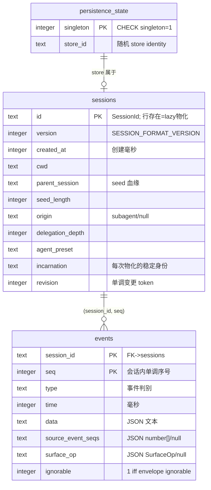
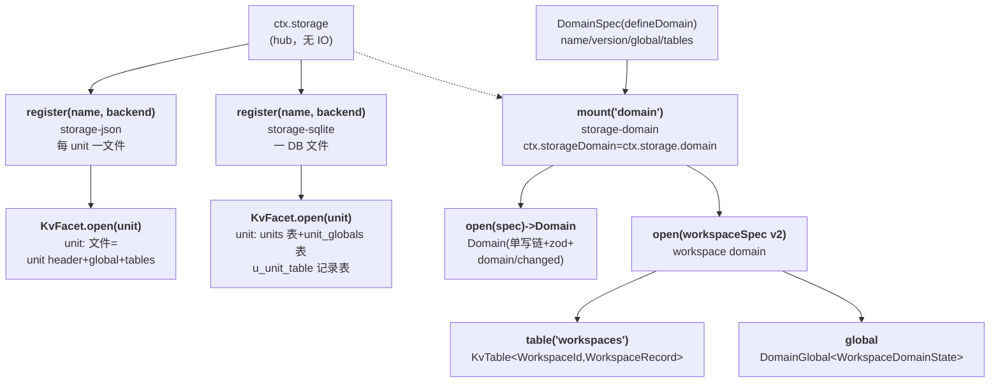
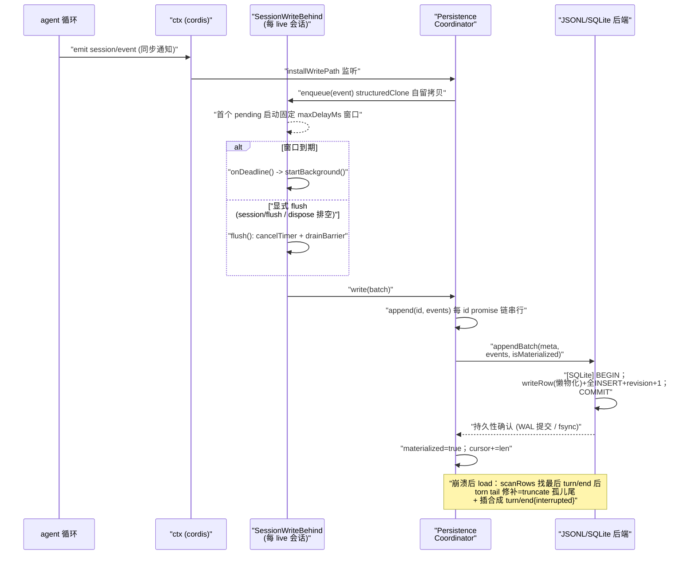

# 持久化数据模型（Data Model / SQLite & KV Storage）

> 对应关注面：SessionEvent 日志的持久化 seam（JSONL / SQLite 后端）、KV storage seam（domain form → 不透明 KV-unit primitives）、session-query 全文索引、无迁移层的演进防御。

## 在项目中的角色

去掉这一整套存储层，dsh 会退化成「一次性的、内存里跑完就丢」的 agent 壳：

- **没有 `session-persistence`**：进程内 append-only `SessionEvent` 日志（Source of Truth）无法落盘，重启即丢失全部对话历史，`resume` / 回放 / 投影重建全部失去数据来源。
- **没有 `storage` / `storage-domain`**：workspace 清单、message-feedback 等非会话 domain 数据失去持久化，产品层无法跨进程留存。
- **没有 `session-query`**：历史语料的全文检索、事件追踪、血缘追溯无从谈起。

一句话根因：**dsh 的「数据」首先是 append-only SessionEvent 日志的持久化——它是重建、查询、回放的权威来源；外加一张通用的、与日志解耦的 KV 存储，用来存 workspace / feedback 等「非会话」domain 数据。**「数据模型」不是一套固定表结构，而是一组决策：**在哪个抽象边界选哪种存储、如何让多种后端在同一个语义契约下互换、以及不做迁移层时靠什么机制保证演进安全。**

**两个 capability seam（都由 app 组合时选定后端）：**

| Seam | 抽象层 | 具体实现 | 组合方式 |
|------|--------|---------|---------|
| `ctx.sessionPersistence` | SessionEvent 日志持久化 | `session-persistence-jsonl`、`session-persistence-sqlite` | 按需装一个 |
| `ctx.storage`（hub）+ `ctx.storageDomain`（domain form） | 非日志 KV 数据 | `storage-json`、`storage-sqlite` + `storage-domain` | 后端按名注册，domain form 路由后端 |

## 存储选型与理由

### 为什么 SQLite 与 JSONL 并存：同一事件词汇表，两种物理后端

两个后端实现同一个 `SessionPersistence` 抽象，差异全在物理介质。

**SQLite 的代价与回报**：代价是引入 `node:sqlite` 依赖、文件不可读、单库承载所有会话（不支持 `readRaw`）；回报是 `readFrom` 按 seq 只读后缀、事务即原子性+持久性边界、WAL 崩溃安全、单事务 append/修复。

**JSONL 的代价与回报**：代价是顺序介质——`readFrom` 仍需解析整个 artifact 再向前跳、无索引/事务、崩溃剪尾要逐字节 trunk 修复；回报是纯文件、零第三方依赖、按会话一个文件（默认 Zstandard 压缩）、`readRaw` 返回字节一致的原文。

**关键设计观点：「一行一个 `SessionEvent`、字段 1:1 映射」意味着没有第二套「被持久化的事件 schema」需要与内存词表同步**——直接消灭了传统 CRUD 持久化最痛的「ORM 对象 ≠ 数据库行」漂移。数据就是事件本身，不是事件的投影。

### KV storage vs 关系表：为什么用「表-键值」而不是「通用关系表」

`KvFacet` 是**不透明 KV**：unit 只认识 `(table, key) → JSON value`，「没有 schema、没有事件、没有 domain 意义」。所有语义（zod 校验、写链事件、domain 含义）都上浮到 `storage-domain` 层。

- **为什么不是一个全局关系表**：domain 数据结构差异极大（workspace 一张表+全局状态、feedback 完全不同），「通用表」会强制把异构记录塞进窄 schema，丢失每类数据的索引/约束语义。
- **为什么 KV 而非文档库**：数据形态就是「按 key 取回对象」，无需跨记录 join。KV 把「快照 + 单记录原子写」这个最小能力表达清楚，且可同时映射到 SQLite（一行一文档）和 JSON（一文件一层）两种物理介质。

### 崩溃安全的两个模式

同一目标、两种物理手段，但**修复语义完全一致**（守护「日志 = 一个平衡的 turn 序列」）：

- **SQLite**：WAL 保事务原子；尾部 torn tail（最后 `turn/end` 之后无法解析的行 / seq 空洞）load 时被识别、物理删除+补合成 closers。
- **JSONL**：temp + fsync + `rename`（原子替换）+ 父目录 fsync；读取按字节定位 torn tail offset 修复。

两者殊途同归：**修补只作用于「最后一个 `turn/end` 之后」的孤儿尾巴，绝不改写已提交的事件。**

## 实体关系总览

### 会话日志侧（SQLite 后端真实表）

### KV storage 侧（hub → domain → table）

## 核心表 / 实体设计

### `sessions` 表（SQLite 会话持久化）

职责：承载 `SessionHeader`（**存在于事件日志之外**的存储元数据：格式版本 / cwd / 血缘 / seed 边界）。行**存在性 = 物化信号**——只有第一次 append 才写行，所以「创建但从未 append」的会话无行、不出现在 `list`。

[packages/session/session-persistence-sqlite/src/schema.ts:122-134]()
<!-- snippet:       CREATE TABLE IF NOT EXISTS sessions (
        id               TEXT PRIMARY KEY,
        version          INTEGER NOT NULL,
        created_at       INTEGER NOT NULL,
        cwd              TEXT,
        parent_session   TEXT,
        seed_length      INTEGER,
        origin           TEXT,
        delegation_depth INTEGER,
        agent_preset    TEXT,
        incarnation      TEXT NOT NULL,
        revision         INTEGER NOT NULL
      ) STRICT; -->

**设计要点：`revision` 是最重要的读优化字段**——它让 `listSnapshots` / `readStoredRevision` 无需加载完整事件日志就能比较「某日志变没变」，是派生 read model（session-query、projection-cache）做「只补 tail 增量」的前提。revision **源限定**（storeIdentity + incarnation + revision），保证不同持久化源的同形 counter 永不相等。
[packages/session/session-persistence-sqlite/src/index.ts:47-48]()
<!-- snippet: function sqliteRevision(storeIdentity: string, row: SessionRow): PersistenceRevision {
  return PersistenceRevision(`file:${storeIdentity}:incarnation:${row.incarnation}:revision:${row.revision as number}`) -->

> 注：`sqliteRevision` 的 `file:` 前缀拼接实际由调用侧 `sqliteRevision(this.storeIdentity, row)`（index.ts:212-217）经完整 `storeIdentity`（含 `file:<dev>:<ino>:<birthtimeNs>:store:<store_id>`）组合。

### `events` 表（SQLite 会话持久化）

职责：每行对应一个 `SessionEvent`，字段 1:1 映射，**无平行持久化 schema**；`data` 为 JSON 文本，surface 元数据列可空。
[packages/session/session-persistence-sqlite/src/schema.ts:136-146]()
<!-- snippet:       CREATE TABLE IF NOT EXISTS events (
        session_id        TEXT NOT NULL REFERENCES sessions(id) ON DELETE CASCADE,
        seq               INTEGER NOT NULL,
        type              TEXT NOT NULL,
        time              INTEGER NOT NULL,
        data              TEXT NOT NULL,
        source_event_seqs TEXT,
        surface_op        TEXT,
        ignorable         INTEGER,
        PRIMARY KEY (session_id, seq)
      ) STRICT -->

**设计要点：复合主键 `(session_id, seq)` 顺带就是按会话 seq 排序的索引**——读后缀、读全量 `ORDER BY seq` 都走主键，无需旁路索引。

### `persistence_state` 表（单例）

[packages/session/session-persistence-sqlite/src/schema.ts:117-120]()
<!-- snippet:       CREATE TABLE IF NOT EXISTS persistence_state (
        singleton INTEGER PRIMARY KEY CHECK (singleton = 1),
        store_id  TEXT NOT NULL
      ) STRICT; -->

- `singleton` 单例行守卫；`store_id` 是随机 UUID。
- `openDatabase` 每新库初始化 `INSERT OR IGNORE` 一个随机 `store_id`，随后所有 revision 以源限定 token 承载——即使两个库文件内容相同也互不相同；派生 read model 依赖此区分「不同持久化源」。

### KV storage domain（单写链 + durability-first）

Domain 是「单写链 + zod 校验 + domain/changed 事件」的门面；每个 KV 原语挂在该链上串行，保证 `update(key, fn)` 是原子 read-modify-write。
[packages/storage/storage-sqlite/src/schema.ts:90-101]()
<!-- snippet:   db.exec(`
    CREATE TABLE IF NOT EXISTS units (
      name    TEXT PRIMARY KEY,
      version INTEGER NOT NULL
    ) STRICT
  `)
  db.exec(`
    CREATE TABLE IF NOT EXISTS unit_globals (
      unit  TEXT PRIMARY KEY REFERENCES units(name),
      value TEXT NOT NULL
    ) STRICT
  `) -->

物理表名 `u_<unit>_<table>` 两段都先经 `UNIT_NAME_RE` 校验——**同一条约束同时满足「作为文件名」和「作为 SQL 标识符段」两种介质的安全**。每个 KV 原语是单条 SQL，原子性来自 SQLite 本身；**与 sessions/events 的差异是架构性的**：KV unit 不做崩溃修复、不做事件、不做 schema，是最小能力面，复杂度全部上浮到 domain。
[packages/storage/storage-sqlite/src/schema.ts:20-20]()
<!-- snippet: export const STORAGE_SQLITE_SCHEMA_VERSION = 1 -->

## Schema 演进策略

这是本关注面最反直觉、最有辨识度的设计：**dsh 有意识地不写迁移层，用「格式版本号 + 后端 schema gate + 词汇表 + ignorable 标记」四件套守住演进安全。**

### 两层版本，互不混淆

- **事件词汇表版本 `SESSION_FORMAT_VERSION`**：单一单调整数，无 major/minor 分裂。是否 bump 由**写入方**决定——「一个旧运行时能否用完整语义正确性处理新日志」。仅结构性变更才 bump；**新增普通事件类型不 bump**，由 per-event `ignorable` 守卫承载词表增长。
- **物理表 schema 版本 `SCHEMA_VERSION`**：仅表布局破坏性变更时 bump，与会话自己的 version 正交。
  [packages/session/session-persistence-sqlite/src/schema.ts:20-20]()
  <!-- snippet: export const SCHEMA_VERSION = 15 -->

### 拒绝方向（双向，各有措辞）

- **新于读者**：「written by a newer harness — upgrade」，是 `SessionFormatUnsupportedError`，**区别于损坏错误**——「没坏，只是看不懂」。
- **旧于读者**：「this build ships no upgrade path」。upgrader 链（n→n+1 内存视图转换）**延迟实现**直到第一个真实 v0→v1 步骤存在来测试。
- JSONL 从**原始 header 行**拒绝外国版本；SQLite 先用自己的 `SCHEMA_VERSION` pragma 门控整个文件结构。
  [packages/session/session-persistence-sqlite/src/schema.ts:108-115]()
  <!-- snippet:     if (onDisk !== 0 && onDisk !== SCHEMA_VERSION) {
      throw new Error(`session database at "${path}" has schema version ${onDisk}, incompatible with this build (${SCHEMA_VERSION})`)
    }
    if (onDisk === SCHEMA_VERSION && applicationId !== SESSION_PERSISTENCE_SQLITE_APPLICATION_ID) {
      throw new Error(
        `session database at "${path}" has application id ${applicationId}, expected ${SESSION_PERSISTENCE_SQLITE_APPLICATION_ID}`,
      )
    } -->

### 词汇表 + ignorable：词表增长不 bump 版本

`KNOWN_SESSION_EVENT_TYPES` 是生成文件（`gen-persistence-catalog` 从全部 `SessionEventMap` merge 生成）。读端判据：未知类型若不带 `ignorable: true` 就拒绝解释。**默认 required（不 ignorable）**——忘记标记 → 过度拒绝（不便）；默认 ignorable → 同样错误会**静默续一个被掏空的会话**（安全失败）。**「过度拒绝优于静默错读」是显式择优。**

**词汇守卫只在读端**：append 拒绝退休 legacy 形态但**不做词表检查**——append 时拒绝会卡住 live 会话进行中的持久化，比「下次 load 时响亮拒绝」代价高。

### 物理媒介的版本门

- **SQLite 会话库**：`PRAGMA application_id=0x44534850` 防对无关库写入、`PRAGMA user_version` 承载 `SCHEMA_VERSION`。整体校验在 `BEGIN IMMEDIATE` 写锁内做；新鲜库**先建表、最后才润色版本戳**——中途失败留下未 stamp 库，重开重新物化。
- **storage-sqlite 库**：同构 gating（`STORAGE_SQLITE_SCHEMA_VERSION=1`），描述明说「this unreleased format has no migrations」。
- **JSON unit**：单文件 unit header version 与 spec 比对，不符 `version-mismatch`。

### 正在物化的 `events` 表 vs 派生读模型

`session-query` 的 FTS5 索引是**可丢弃的派生索引**——其 schema 版本哲学与持久化 schema 相反：**版本不符直接 DROP 全部 user 表重建**，因为是派生（可从日志重算），重建成本可接受；而 sessions/events 是 Source of Truth，只能拒绝不能丢。

## 读写路径

### 会话事件写入：`session/event` → 有界批窗口 → flush → 单事务落盘 → 崩溃恢复

### KV domain 写读：durability-first 写链

「durability-first」是关键：**写先达后端耐久，再改内存，再发事件**；后端写被拒则内存保持不动——读永不与媒介分叉。读是同步的从权威内存态 `get`/`entries`/`keys`（快照迭代器，排队写落盘期间保持稳定）。
[packages/storage/storage-domain/src/domain.ts:66-72]()
<!-- snippet:   /**
   * Insert or overwrite one record durably.
   * @param key - Record key.
   * @param value - The full new record (no partial merge).
   * @returns resolution after durability and event emission.
   */
  put(key: K, value: V): Promise<void> -->

## 全局关联 + 亮点问题

### 全局关联：三件事连回一个设计哲学

1. **「事件即数据」的 Source of Truth 原则下，storage 是多与少的另一半。** 事件日志是权威、可重建，所以 `session-query` 的 FTS 索引可以是**可丢弃派生索引**（版本不符就 DROP）——这是「有 Source of Truth 敢用可重算派生物」的直接后果。
2. **两种 seam 共用一套「不做迁移、拒绝优于猜」的防御姿态**：会话日志靠 `SCHEMA_VERSION`+词汇表+ignorable 拒，KV domain 靠 unit header version + zod 拒。
3. **revision/incarnation 的「源限定 token」横贯三端**：`sessions.revision` 供持久化自身判变更，projection-cache 用它做 readFrom tail 回放，session-query 用它对比索引 freshness。一个 token 统一了「谁变了」的全部判据。

### 亮点问题

- **upgrader 链延迟的兼容悬崖**：第一版发布的读者成为所有后续读法的地板——任何漏掉的拒收行为都无法事后补进已发布的拷贝。当前 `SESSION_FORMAT_VERSION=0`、尚无 v0→v1 step 可测，这份延迟是务实取舍，但 v1 一旦落地升级链成本随语义复杂度上升。
- **`readFrom` 的顺序介质代价是显式接受的**：读模型共享一个"只补尾部"的增量接口，代价由 JSONL 后端每次全量解析承担——语义统一，物理代价可量化。
- **KV unit 的单写入者假设**：unit 不串行化并发写（写顺序归调用者），多进程并发写需应用层协调，是记录在案的限制。

## 已知的文档-实现漂移

- **`SCHEMA_VERSION=15` 的演进史无迁移脚本可循**：git 历史仅 1 个提交（squash/浅克隆），无法从 `git log` 追逐版演进；唯一确定节点是 version-mechanism Agent Note 声明 `SCHEMA_VERSION 15` 专门为新增 `ignorable` 信封列引入。当前快照：`SCHEMA_VERSION=15`、`SESSION_FORMAT_VERSION=0`、`STORAGE_SQLITE_SCHEMA_VERSION=1`。
- **`sqliteRevision` 前缀拼串细节**：草稿把完整 `file:<dev>:<ino>:<birthtimeNs>:store:<store_id>` 前缀描成 `sqliteRevision` 内部拼串；实际 `sqliteRevision` 接收完整 `storeIdentity` 后在其上追加 `:incarnation:...:revision:...`。文档以调用侧（index.ts:212-217）为准。
- **拒绝方向措辞**：`SessionFormatUnsupportedError` 用于「新于读者」、`SessionPersistenceCorruptionError` 用于损坏，二者须区分，避免把「看不懂」误写为「损坏」。
EOF
echo done