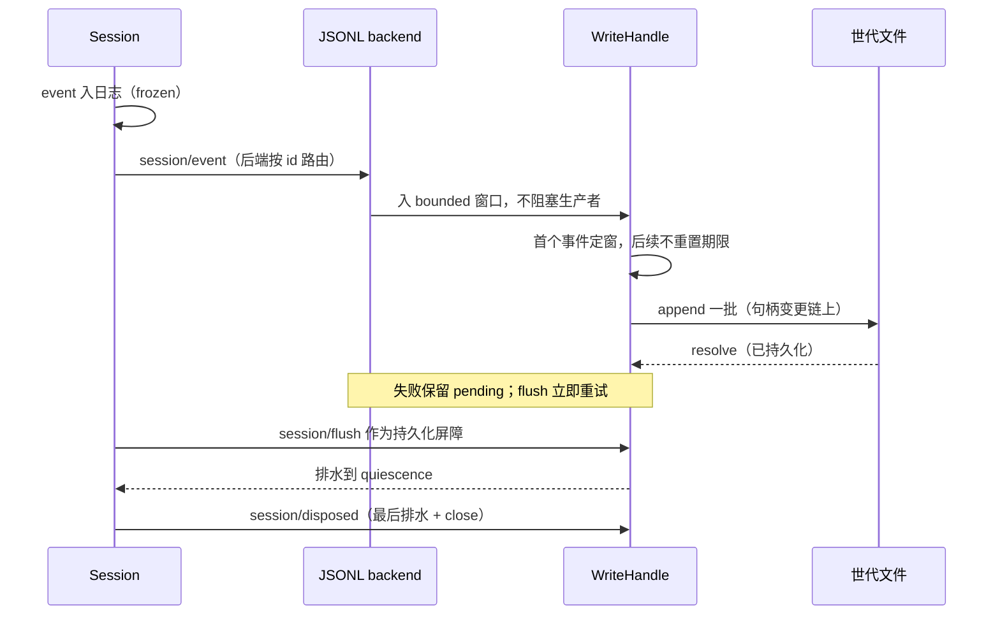
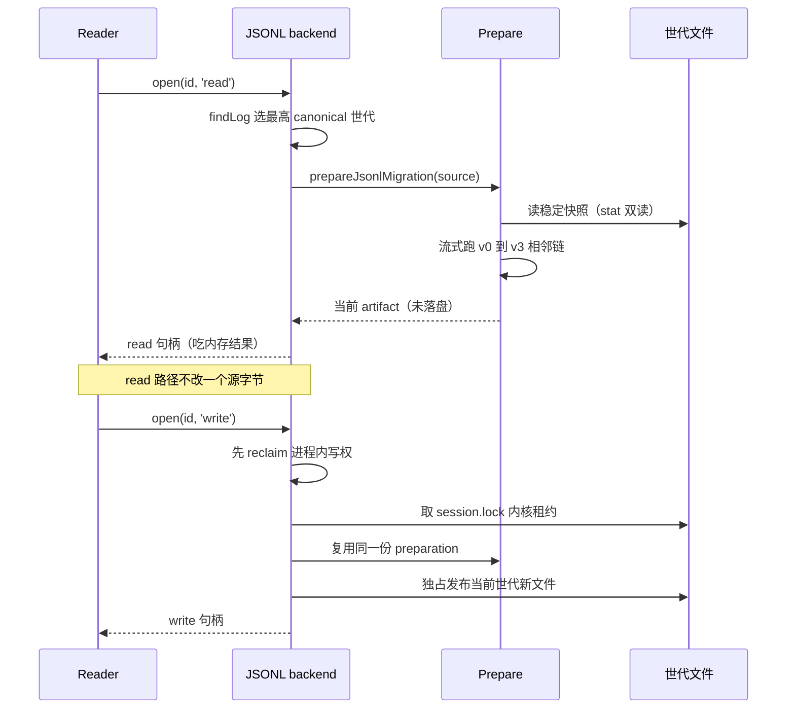
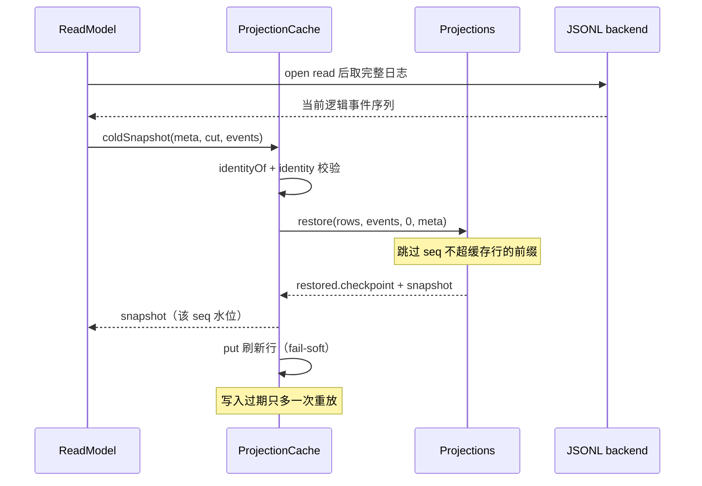
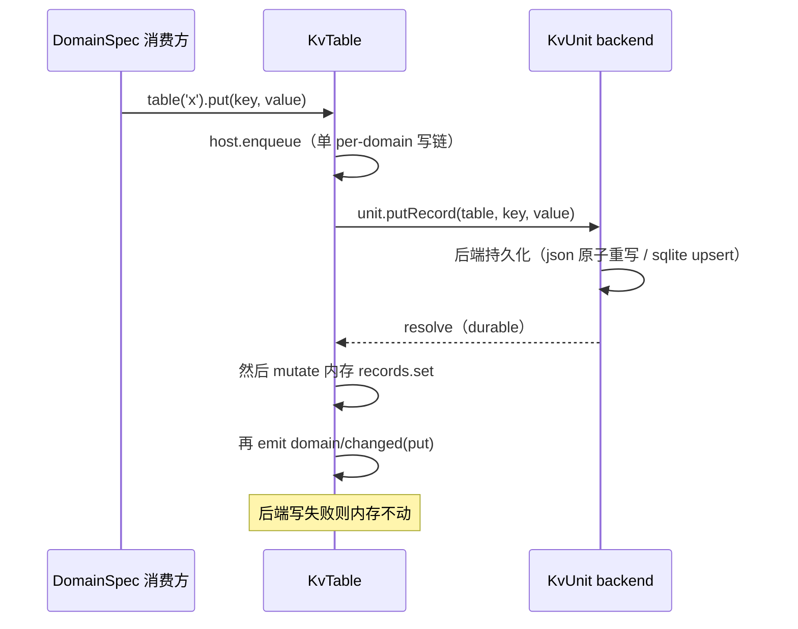

> **本轮增量复核补充（0.1.5-rc.2 → 0.1.7-rc.2 @ 477b4f4205 / 2026-09-24）**：本关注面在本次增量窗口内没有需要改写的论断，引用随新基线重锚后全部通过校验；上一版解读基线为 `dsh-v0.1.5-rc.2`。

# 数据模型：事件日志的地面实现（持久化层）

> 子文档之一，聚焦 dsh 的持久化数据模型。覆盖事件日志持久化（`session-persistence` 的 handle 化 seam + `session-persistence-jsonl` 唯一 shipped 后端 + `session-format*` 世代与迁移链）、非日志 KV 存储（`storage`* 可交换 backend + `storage-domain` 域表单）、派生投影缓存（`session-projection-cache`）、投影状态里的持久长列表（`util/chunked-list`）。整体哲学见 [README](README.md)；本文上承 [session.md](session.md)（事件日志的落盘形态）、衔接 [deployment.md](deployment.md)（部署时的数据落地）。**边界声明**：格式版本的语义细节（世代是什么、release record 归谁、迁移边怎么写）归 [session-format-migration.md](session-format-migration.md)，本文只讲这些世代**怎么落到磁盘、旧世代怎么被读、迁移后怎么落盘**；`dsh-session:` 这类可寻址资源的地址面归 [workspace-files.md](workspace-files.md)，本文只在数据模型里给它一个位置。
>
> **本版增量更新（0.1.2-rc.1 → 0.1.5-rc.2 / 2026-09-11）**：依 `dsh-v0.1.2-rc.1..HEAD` git diff（1490 commits）与 `verify-references --diff` 预检清单比对更新。持久化面本次有**两处破坏性变更 + 三处语义细化**：
> **(1) seam handle 化（破坏性）**——`refactor(session-persistence)!: handle-based seam with a lifecycle-owned write path`：`PersistenceCoordinator` 与 `write-behind.ts` 整体消失，服务收敛为 `create`/`open`/`stat`/`list`/`flush` 五个方法，每次 open 返回一个**每会话 `SessionHandle`**（`read`/`append`/`flush`/`close`）；写路径改由 agent 生命周期持有，后端只按 id 把已发布会话的活事件路由进"持有写句柄的窗口"。
> **(2) 跨进程写所有权**——`feat(session-persistence-jsonl): cross-process write-ownership lease`：会话目录里的 `session.lock` 交给**内核**仲裁（POSIX `flock(2)` / Windows 具名信号量），进程死亡即释放，故意不做 TTL 过期回收。
> **(3) 已发布世代 + 相邻迁移链（破坏性）**——`feat(session)!: add released format migration` / `feat(session)!: embed assistant streams in format v2` / `feat(session): add identity V2-to-V3 migration and writer skeleton`：`SESSION_FORMAT_VERSION` 由 `0` 升到 **3**，磁盘上出现**不可变世代文件名** `session.vN.jsonl`，旧世代**读时迁移、写时发布**，源文件原样保留。
> **(4) projection-cache 域 v5 → v7**——`compatibleVersions:[3,4,5,6]`，身份新增 `formatVersion`：缓存行要当折叠捷径，必须先证明它折的是当前 Session 世代；该版本号与 Session V3 **刻意解耦**（`docs(token-meter): distinguish projection cache from Session V3`）。
> **(5) subagent child catalog + chunked-list**——`feat(subagent): record and observe parent-owned child catalogs` + `refactor(subagent): extract persistent chunked list utility`：父会话日志新增必填事件 `subagent/catalog`，其投影状态改用 `util/chunked-list` 的 64 值分块持久列表承载。

核心论点：**这套「数据模型」不是一张 ER 图能讲完的业务表集合，而是两层可交换持久化的「事件溯源日志的地面实现」**——不可变事件日志是唯一事实源，KV 存储只是其上的投影底座。schema 演进现在分两档：**会话格式世代**只增不改，旧世代经 build-static 相邻迁移链读成当前世代；**KV 投影域**多数仍是「不迁移、只拒绝」，只有 `session_projcache` 由 owner 显式声明跨版本读兼容，并给失效派生数据配 `backup-and-skip`。

## 根因：为什么持久化要长成两层可交换式

Dsh 的 Session 本质是一条不可变、append-only 的 `SessionEvent` 事件日志（内存态的事实源），见 `docs/subsystems/persistence.md` 首段[[docs/subsystems/persistence.md:5-5]()]()
<!-- anchor: The **durability seam** for the event log. [session.md](session.md) describes th -->。这把"什么需要落地持久化"分成两个性质完全不同的集合，也因此长出两套独立的可交换 seam：

1. **事件日志本身**（真相）——必须按时间顺序、逐事件、连续 seq 地落地，崩溃后还能精确回放到"最后一个完整 turn"。它是追加写多、随机读少、需流式回放的数据。
2. **一切非事件的东西**（投影/键值状态）——工作区键值、投影缓存、各类域表。它们是"从真相推导出来的当前值"，改变频繁、需要按 key 随机读。

dsh 对这两类各给了一个服务抽象（`SessionPersistence` 与 `Storage`），又各配了可交换实现，这正是"Capability Seam 三件套"在持久化上的落地：接口（Service Definition）、提供方（backend）、消费方（domain 表单 / 投影缓存）。全部独立于 agent-loop 脊椎，无特权内核。

### seam 形状的改变：从全局协调者到每会话句柄

> **演进说明（0.1.3-alpha.1）**：0.1.2-rc.1 以前，`SessionPersistence` 是一个**十二方法的全局服务**，配一个订阅 `session/created`/`session/event`/`session/flush`/`session/disposed` 的 `PersistenceCoordinator`（`packages/session/session-persistence/src/coordinator.ts`）与一个批量写缓冲 `write-behind.ts`；协调者会"认领"任何已发布会话（ownerless claim、HMR 重播种、stored-prefix 采纳）。这两个文件在本次增量中**从仓库消失**。

替代它的形状是「服务只发句柄，句柄拥有日志」：`create` 存一个新会话并交出**它自己的写句柄**，`open(id, 'read' | 'write')` 打开已存在的会话，`stat`/`list` 只观察快照（`header`、不透明 `revision`、可选的 `eventCount`/`sizeBytes` 提示）而不读日志，服务级 `flush()` 是一次"后端全局持久化屏障"[[packages/session/session-persistence/src/index.ts:116-133]()]()
<!-- anchor: * Durable append-only session storage addressed through per-session handles. … * on this backend instance observe at least that prefix. -->，`create` 的返回值就是一个 `write` 句柄[[packages/session/session-persistence/src/index.ts:144-150]()]()
<!-- anchor: * Create a new stored session and take its write ownership. … abstract create(header: SessionHeader, options?: SessionPersistenceCreateOptions -->。

为什么必须换？因为**跨进程写所有权没有诚实的落点**：所有权属于"一个有 owner 的 explicit per-session 通道"，而不属于一个全局监听者——旧形状里用"乐观 revision read/check/read 循环"冒充所有权，连续的外部写者可以把读方活锁住，而且没有任何机制排除第二个写者。句柄化把"写权"变成一次显式获取，后端据此**只按 id 路由**（进程内一个 id 只有一个活跃写句柄），于是"加一层跨进程租约"就只需要在句柄这一扇门上做检查。代价是：后端插件在活会话期间热重载会让旧句柄失效、写入**响亮失败**而不是像 adopt 那样静默重接。

## 存储选型与理由

### JSONL：真相日志的"忠实回放"形态

事件日志后端以 append-only、不可变为核心。`session-persistence-jsonl` 把它实现为每会话一个 JSONL 逻辑日志，物理上用 zstd 压缩的拼接帧写入（编码名 `zstd`/`none`）[[packages/session/session-persistence-jsonl/src/format.ts:34-42]()]()
<!-- anchor: /** Physical encoding selected for JSONL session artifacts. */ … export function logSuffix(compression: JsonlCompression): '.jsonl.zstd' | '.json -->。

选择 JSONL 的理由根植于"事件日志 = 可流式回放的真相"这一定位：

- **追加语义**天然贴合事件溯源：每次 append 只往文件尾写一段，写后 `sync()` 即达持久化；崩溃后 `SessionLogScanner` 按换行符增量切分、只解码完整记录，把"写一半"的尾部当 torn tail 容忍[[packages/session/session-persistence-jsonl/src/format.ts:381-384]()]()
<!-- anchor: * Incrementally scan complete JSONL event records after an independently … * copied because a decoder may reuse its output buffer after `write()` returns. -->。
- **流式回放**：回放不要求随机寻址，顺序扫一行解一行即可恢复，正好匹配真相日志"从头重演"的语义。
- **人可读与可压缩兼得**（`zstd` 关闭时）——一个会话一个文件、头部首行即物理头记录，只读首行即可做列表而不整日志解析（`parseHeaderRecord`）[[packages/session/session-persistence-jsonl/src/format.ts:348-377]()]()
<!-- anchor: /** Parse one complete header record supplied independently from event rows. */ …   return { meta: fromHeaderLine(parsed).meta, restore } -->。

代价与权衡：没有 seek-by-seq。句柄的 `read(offset, length)` 在 JSONL 上仍要解到目标偏移再切片——该原语只承诺"返回合法连续前缀的一段、绝不返回 torn tail、同一句柄上重复读不会看到更旧的状态"[[packages/session/session-persistence/src/handle.ts:74-83]()]()
<!-- anchor: * Read a slice of the valid contiguous logical log. The slice is a legal log … read(offset?: number, length?: number, options?: SessionHandleReadOptions): Prom -->。这是真相日志甘愿付的代价——回放本来就要从头，按 seq 随机寻址不是它服务的场景。

### 会话目录与不可变世代文件

> **演进说明（0.1.3-alpha.1）**：0.1.2-rc.1 及以前，一个会话目录里只有一个 `session.jsonl[.zstd]`，格式版本撞车时只能整体拒绝。本次增量把它改成**按世代命名、只增不改**的多文件布局：v0 沿用原名的 `session.jsonl`，此后每一代带小写数字分量 `session.vN.jsonl`[[packages/session/session-format/src/filename.ts:8-16]()]()
<!-- anchor: * Name the raw JSONL log of one immutable Session format generation. Version … return generation === 0 ? 'session.jsonl' : `session.v${generation}.jsonl` -->。

物理布局因此变成三层：

| 层级 | 形态 | 说明 |
|------|------|------|
| 项目目录 | `root/<projectKey>/` | `projectKey` 由 cwd 派生（分隔符转 `-`、不安全码元转 `~XXXX`、截断到 251 字符并加 `--` 包裹）；无 cwd 落到 `_no-cwd`[[packages/session/session-persistence-jsonl/src/format.ts:224-256]()]() <!-- anchor: export function projectKey(cwd: string): string { …   return join(root, projectKey(cwd)) --> |
| 会话目录 | `<projectDir>/<encodeSegment(sessionId)>/` | `SessionId` 是未校验的 branded string，必须先经 `encodeSegment` 单段安全编码才能进路径（中和 `../`、绝对路径、NUL、分隔符）[[packages/session/session-persistence-jsonl/src/format.ts:198-213]()]() <!-- anchor: export function encodeSegment(raw: string): string { …   return out --> |
| 世代文件 | `session.vN.jsonl[.zstd]` | 内容寻址的"世代"以**文件名为准**，与文件内 header 的 `version` 独立复核（不一致即报错）；当前世代由 `SESSION_FORMAT_VERSION` 决定写入路径[[packages/session/session-persistence-jsonl/src/format.ts:63-76]()]() <!-- anchor: * Parse one canonical generation filename for the selected physical encoding. … return parseSessionFormatLogFilename(filename.slice(0, filename.length - suffix. --> |

**为什么用文件名而不是"就地升级文件内容"**：世代文件一旦发布即不可变，于是"读者看到一个旧世代"和"写者发布新世代"可以并存而互不干扰——迁移不再是一次危险的原地重写，而是一次**新文件的独占发布**。临时文件（`session.migration.<token>.tmp`）、大写、前导零、带 `.v0` 的名字都不算 canonical 世代，因此中介状态永远不会被误读成已提交的世代。

### 跨进程写所有权租约：内核仲裁而非 TTL 记录

单写者如果只靠进程内注册表，两个进程（两个 CLI 会话，或宿主与 SDK runtime 并存）仍能同时写开同一个会话、交错 append、撕坏压缩帧并破坏 seq 连续性。JSONL 后端的解法是**内核锁**：写句柄在会话目录持有一个 `session.lock`，POSIX 走非阻塞 `flock(2)`，Windows 持一个由 canonical 锁路径派生的具名内核信号量（count 1，无文件系统足迹）[[packages/session/session-persistence-jsonl/src/lease.ts:39-45]()]()
<!-- anchor: /** Base name of the kernel lock file inside a session's directory. */ … | { readonly kind: 'win32'; readonly handle: number } -->。争用映射成 `SessionAlreadyOwnedError`；持有者描述符/句柄一关（**包括进程死亡**）内核就放锁，因此崩溃的持有者从不会挡住继任者，也**不存在过期记账**。

两个刻意的取舍值得记下：

- **不做 TTL + renewal + 抢锁**。上游先实现了那套（提交信息里还留着 `session.lock.json` 的 owner token / expiry 描述），随后在 review 中被内核方案整体替换。理由是 TTL 方案本质是一个"微型分布式算法"：续约定时器、失效探测、过期接管要重新判定并可能"还给"原主，而它残余的多方竞争仍允许**一个有界的双写窗口**。内核仲裁把这一族机制连同它们的竞争一起删掉了，代价是一个原生构建依赖 + "活但卡死"的持有者会挡到进程退出为止（POSIX 上删掉锁文件是唯一显式弃权方式，harness 自身从不这么做）。
- **POSIX 锁锁的是 inode 不是路径**，所以取得锁之后要复核"被锁的 inode 仍是锁路径上的那个文件"，否则重试；释放时**故意不删锁文件**，好让后来者能对着稳定的 inode 复核。浏览器 worker 部署把原生 flock 入口 stub 成立即成功——它单进程，进程内写权声明已经排除了所有写者。

### 单一后端：一个真相、一类读法

> **演进说明（0.1.2-alpha.1）**：0.1.2-alpha.1 整体移除 SQLite 会话持久化后端（`refactor(session)!: remove SQLite persistence backend`，`packages/session/session-persistence-sqlite` 目录自此从仓库消失），本节原「SQLite 作为可交换投影底座」的论述被本次移除取代；原 SQLite 会话后端的 Schema 17 打包物理行、`readFrom` 尾读、`SCHEMA_VERSION=17` 相关叙述一并失效（下文的表格与 Schema 演进章节已相应删除）。

SQLite 后端移除后，dsh 的事件持久化收敛为**一个真相、一类读法**：JSONL 的 append-only 顺序介质同时承担「忠实回放」与「后缀续读」。当前 shipped provider 只有 JSONL 一个实现，`SessionPersistence` 抽象明确声明它只提供 service + handle 契约、每个后端自持完整存储运行时[[packages/session/session-persistence-jsonl/src/storage.ts:2-7]()]()
<!-- anchor: * The JSONL provider's session storage runtime: its concrete write/read … * contracts, and the shared contract suites pin equivalent observable -->。

注意区分：被移除的是**会话日志**的 SQLite 后端（`packages/session/session-persistence-sqlite`）；KV 层 `storage-sqlite`（`packages/storage/storage-sqlite`）依然存在、仍是投影/KV 状态的可用媒介。即「事件日志层收敛到 JSONL 单后端，KV 层保持可交换」——真相层简化，投影层保留选择。

为什么移除可行：会话日志一旦确立「追加写、顺序读、整文件可重放」的真相定位，SQLite 双后端的差异化收益（按 seq 随机寻址）就被句柄读原语消解——`read(offset, length)` 只承诺"返回合法连续前缀的一段"，不限定每个 backend 的物理读法，JSONL 顺序扫描再切片即等价满足[[packages/session/session-persistence/src/handle.ts:74-83]()]()
<!-- anchor: * Read a slice of the valid contiguous logical log. The slice is a legal log … read(offset?: number, length?: number, options?: SessionHandleReadOptions): Prom -->。保留双后端则需持续维护同一契约在两种媒介上的行为等价，pre-release 阶段判定为「维护成本 > 读侧收益」（此权衡为本解读依据代码变动推断，非官方 changelog 陈述）。

### 非日志 KV 存储：为何也要可交换

`storage` 子系统的存在则服务于"一切不是 SessionEvent 的持久化"。它同样是可交换的：hub `ctx.storage` 只是一个注册表 + 表单挂载点，本身不做任何 IO，backend 持有媒介，domain 表单持有语义[[docs/subsystems/storage.md:47-47]()]()
<!-- anchor: A backend owns one medium (a file-tree root, a database file) and exposes option -->。

对应两个实现：

- `storage-json`：**人可读 JSON backend，双布局可选**——`single` 布局一 unit 一个可读 JSON 文件 `<root>/<unit>.json`、整文件原子重写（"可读性就是它存在的理由"[[packages/storage/storage-json/src/format.ts:4-4]()]()
<!-- anchor: * legibility is this backend's reason to exist. `single`-layout units are -->）；`per-record` 布局一 unit 一个目录、每记录一份版本化文档 `<root>/<unit>/<table>/<key>.json` + `global.json`，一次写只原子重写一条记录，坏/旧版本记录读取为缺席、绝不 brick 整个 unit[[packages/storage/storage-json/src/per-record-unit.ts:12-16]()]()
<!-- anchor: * Per-record contract: a record document that is malformed or stamped with a … * the record instead of migrating it. Record keys become path segments, so -->。`single` 适合低频改、需要人工审查的整份状态（如 `workspace.json`）；`per-record` 适合高频单记录写（如逐会话的投影缓存）。
- `storage-sqlite`：**一库多 unit、每行一文档**（`key`/`value` JSON 文本），适合频繁更新、需要随机访问的数据[[docs/subsystems/storage.md:47-47]()]()
<!-- anchor: A backend owns one medium (a file-tree root, a database file) and exposes option -->。每个 unit 一张 `u_<unit>_<table>` 表 + `units`/`unit_globals` 元数据表[[packages/storage/storage-sqlite/src/unit.ts:2-6]()]()
<!-- anchor: * One opened SQLite KV unit: prepared per-table statements over the … * (write ordering is the caller's responsibility per the KV contract). -->。

两条 backend 共享同一个 `KvFacet`/`KvUnit` 契约，并都通过 domain 表单（`ctx.storageDomain`）暴露给消费方。可交换的意义在这里与"不可变事件日志"哲学呼应：**真相（事件日志）与投影（KV 状态）分层，投影落在哪个媒介可随时换，但真相的语义不会因媒介而改变**。

## 实体关系总览

下面按"两类存储媒介 + 其上数据形态"给出关系图。事件日志是"世代文件 + 句柄"型，投影缓存与 KV 域是键值型，故用 `graph TB` 而非 `erDiagram`（键值/文档型实体用扁平有向图 + 配色分组表示三层归属）。

```mermaid
graph TB
    SE["SessionEvent 序列"]
    SH["SessionHeader"]
    H["SessionHandle<br>read/append/flush/close"]
    LEASE["SessionWriteLease<br>session.lock"]
    GEN["世代文件<br>session.vN.jsonl"]
    CHAIN["session-format<br>v0 到 v3 相邻链"]
    COLD["冷读准备<br>PreparedMigration"]
    REG["ProjectionRegistry"]
    CACHE["session_projcache 域"]
    SNAP["ProjectionSnapshot"]
    CHUNK["chunked-list"]
    SUCAT["subagent/catalog 投影"]
    DOMAIN["storage-domain"]
    JSONKV["json backend<br>single / per-record"]
    SQLKV["sqlite backend"]
    HUB["Storage hub<br>ctx.storage"]
    REF["session-reference<br>URI 与 spill"]
    SE --> GEN
    SH --> GEN
    GEN --> CHAIN
    CHAIN --> COLD
    COLD --> H
    H --> LEASE
    H --> REG
    REG --> CACHE
    REG --> SNAP
    REG --> SUCAT
    SUCAT --> CHUNK
    CACHE --- DOMAIN
    CHUNK --- DOMAIN
    DOMAIN --> JSONKV
    DOMAIN --> SQLKV
    DOMAIN --- HUB
    REF -.-> REG
    classDef ev fill:#1e2a3a,stroke:#4db6ac;
    classDef pd fill:#2e1e3a,stroke:#ba68c8;
    classDef kv fill:#3a2e1e,stroke:#d4a04d;
    classDef br fill:#202020,stroke:#666;
    class SE,SH,H,LEASE,GEN,CHAIN ev;
    class REG,SNAP,CACHE,SUCAT,CHUNK pd;
    class DOMAIN,JSONKV,SQLKV,HUB kv;
    class COLD,REF br;
```

图例：青色组 = 事件日志真相层（session-persistence + session-format 世代/迁移），紫色组 = 派生读取层（session-projection / projection-cache / chunked-list），褐色组 = 非日志存储层（storage），灰色 = 跨层桥接原语（冷读准备、可寻址资源）。

关系要点：

- 事件日志真相层（左上）现在是**"句柄 + 租约 + 不可变世代文件"三者绑定**：句柄是唯一入口，`SessionWriteLease` 是它的跨进程排他凭证，世代文件是它读写的物理对象；0.1.2-rc.1 的 `PersistenceCoordinator` 与 `readFrom` 双桥接已不存在（见「seam 形状的改变」）；
- `session-format` 的相邻迁移链（v0→v1→v2→v3）在真相层内部工作：`stat`/`list` 只**翻译历史 header**而不读 body，历史 `open` 走 `PreparedMigration`（先把整套链跑成一个当前 artifact），read 句柄直接吃内存结果、**不落盘**；write 句柄才把这份 artifact **独占发布**成当前世代文件（见「读写路径」）；
- 投影缓存是存储层（右下）的消费方——它打开 `session_projcache` 域，经 domain 表单落到 json 或 sqlite backend（默认走 storage-json 的 `per-record` 布局，每会话一个文档）；
- 图右即"一切非事件"的 KV 底座，domain 表单是唯一消费入口，`domain/changed` 事件在每次 durable 写后发出；
- 虚线是"可寻址资源"：`session-reference` 不存会话副本，它只把别的会话**捕获成不可信背景快照**（见下节）。

### 可寻址资源不是第三类存储

一个容易误读的点：`session-reference` 看着像"第三种持久化"，其实它不引入任何新的事实源。它做的事是把宿主文本里的 `@label` 提及规范化成一个**无损 URI**（`dsh-session:` + base64url(JSON 字符串 id)），再向 `sessionQuery` 取目标会话的快照，裁剪成有界、只读、带固定警告的"不可信背景"消息[[packages/context/session-reference/src/uri.ts:9-17]()]()
<!-- anchor: export const SESSION_REFERENCE_SCHEME = 'dsh-session:' … const payload = Buffer.from(JSON.stringify(sessionId), 'utf8').toString('base64url') -->。它的持久化足迹只是"普通会话事件"（引用消息 + 快照消息），因此在本数据模型里它是**日志的消费者**而不是第三层存储：数据面唯一性没有被破坏，`Model-visible means logged` 依然成立。完整地址面与 spill 检索见 [workspace-files.md](workspace-files.md)。

## 核心表 / 实体设计

下面按"真相日志 + 非日志 KV + 投影缓存"三大块拆表。字段表是更结构化的叙述，精确 DDL/类型以括号内行号为准。

### SessionEvent 邮箱信封（内存事实源）

职责：一条会话内不可变事件。信封是判别联合（type 与 data 的联合由编译器保证类型收窄），surface 字段为条件存在——**0.1.5-alpha.1 起 `system/message` 也是 surface 事件**，因此携带 `surfaceOp`/`sourceEventSeqs` 的类型从三种变四种[[packages/core/session/src/types.ts:439-444]()]()
<!-- anchor: export type SurfaceEventType = … | 'tool/result' -->[[packages/core/session/src/types.ts:481-514]()]()
<!-- anchor: * One immutable entry in the session log. … sourceEventSeqs?: never -->。

| 字段 | 类型 | 约束 | 说明 |
|------|------|------|------|
| type | SessionEventType | 判别 key | 事件类型，`SessionEventMap` 可被插件合并扩展 |
| seq | SessionSeq | branded number | 会话内单调连续；`SessionSeq` 标识**一条已存在事件**，与标识"间隙/前缀长度/读偏移"的 `SessionLogOffset` 分离，编译期禁止互换[[packages/core/session/src/types.ts:32-47]()]() <!-- anchor: export type SessionSeq = BrandedNumber<'SessionSeq'> … export type SessionLogOffset = BrandedNumber<'SessionLogOffset'> --> |
| time | number | Unix epoch ms | 事件时间戳 |
| data | SessionEventMap[K] | JSON-serializable | 负载，构造期强制 `isJsonValue` |
| ignorable | true(可选) | 仅日志型 | 未知类型的"可跳过"标记；缺省=必需，遇未知类型须拒绝而非静默丢弃 |
| sourceEventSeqs | SessionSeq | 仅 surface 事件 | 引用的先前事件 seq（compaction 遮蔽等）；`assistant/message` 显式声明为 `never`——它内嵌自己的流 |
| surfaceOp | SurfaceOp(可选) | 仅 surface 事件 | `'append'` 或 `{ op:'replace', startSeq, endSeq }`，记录如何进 surface[[packages/core/session/src/types.ts:450-464]()]() <!-- anchor: * How a session event entered the ordered surface. Only valid on … | { op: 'replace'; startSeq: SessionSeq; endSeq: SessionSeq } --> |

> **演进说明（0.1.5-alpha.1）**：本表原写"surface 字段仅 `user/message`/`assistant/message`/`tool/result` 三类型携带"、`surfaceOp` 形如 `{ op:'replace', start, end }`、`sourceEventSeqs` 用来表达"assistant chunk→message"。本次增量后：`system/message` 提升为 **surface node zero** 并加入该集合；replace 的坐标字段改名为 `startSeq`/`endSeq`；`assistant/message` 的 provider 流改为**内嵌**（`AssistantStreamRecord[]`），不再靠 `sourceEventSeqs` 反查 chunk。格式版本语义见 [session-format-migration.md](session-format-migration.md)。

### SessionHeader（真相日志旁的元数据）

职责：**存储元数据，不是会话事件**——format version、cwd、lineage、seed 标记都对模型不可见，不进入 `deriveMessages()`，挂在 `session.header`[[packages/core/session/src/types.ts:92-112]()]()
<!-- anchor: * Immutable validated storage metadata, kept outside the conversation event log. … readonly isSeeded: boolean -->。

| 字段 | 类型 | 约束 | 说明 |
|------|------|------|------|
| version | number | 写时从 SESSION_FORMAT_VERSION 盖章 | 当前世代为 3；历史物理 header 在进入该接口前已被翻译成当前世代 |
| id | SessionId | branded | 会话 id，与 Session 镜像 |
| createdAt | number | 非负 safe-integer epoch ms | 创建时刻 |
| cwd | string(可选) | 绝对路径 | 创建时工作目录 |
| parentSession | SessionId(可选) | | 被 fork 的来源，seed 谱系 |
| isSeeded | boolean | 无此字段视为 false | fork 谱系标记；取代旧 `seedLength` 的"存储坐标"用法，只回答"这个会话是否含继承前缀" |
| origin | 'subagent'(可选) | | 由 subagent 子创建的产品粗分类（展示用） |
| delegationDepth | number(可选) | | 代理深度，持久化使递归预算跨重启存活 |
| agentPreset | string(可选) | deployment 按会话组合时置 | preset 决定工具的 prompt，持久化避免 resume 换组合重放 |

**`inheritedEventCount` 不在 header 里**（这是一处容易记错的边界）：它已经变成"随 header 一起走的会话状态"，由读写操作的 options 显式传入、由句柄作为只读属性回传[[packages/core/session/src/types.ts:134-146]()]()
<!-- anchor: * Options for creating a {@link Session} via the store. `seed` replays/forks … readonly inheritedEventCount?: SessionLogOffset -->。所以三种读者看到三种东西：**只读 header**（`stat`/`list`）完全看不到这个数字；**body-bearing 读**（`SessionStorageMetadata`/`SessionInspection`/`SessionHandle.inheritedEventCount`）拿到 `meta` + 精确 cut；**物理行**里它由最后一个带 tag 的 `session/end-seed` 事件承载。这正是"精确前缀长度不是可重放事件、但也不是普通元数据"的折中：放进 header 会让 header-only 读者被迫重建 body，放进事件又会让它变成可被重放的模型历史。

> **演进说明（0.1.2-rc.1）**：本表原有一行 `inheritedEventCount | SessionLogOffset(可选) | body-bearing 观测携带`。本次增量确认它已从 `SessionHeader` 接口移除（对照 `types.ts:91-111` 的字段全集），改挂到 `CreateSessionOptions` / `SessionPersistenceCreateOptions` / 句柄属性上；语义不变（`isSeeded` 为 true 时必需、否则必须为 0，后端在 create 时拒绝不匹配），位置变了。

### JSONL 会话文件（真相物理形态）

职责：每会话目录一个当前世代文件，首行 `type:'session'` 头记录，随后**一行一个事件**。路径布局 `root/<projectKey>/<encoded:sessionId>/session.v3.jsonl[.zstd]`，sessionId 经 `encodeSegment` 单段安全编码[[packages/session/session-persistence-jsonl/src/format.ts:198-213]()]()
<!-- anchor: export function encodeSegment(raw: string): string { …   return out -->。

| 位置 | 内容 | 说明 |
|------|------|------|
| 首行 | HeaderLine(`type:'session'` + header 字段 + `delegationDepth` 必填) | 头即 storage 元数据；列表只读首行 |
| 后续行 | **一个事件一行 JSON** | 内嵌的 assistant 流是事件负载里的嵌套数据（`AssistantStreamRecord[]`），不再是独立打包行[[packages/llm/llm/src/assistant-stream.ts:19-44]()]() <!-- anchor: /** Lossless compact records embedded in durable Assistant attempt events. */ … | { readonly type: 'chunk'; readonly time: number; readonly chunk: StreamChunk } --> |
| 物理编码 | zstd 拼接帧（默认）/ 明文 | 由 `JsonlCompression` 决定，后缀对应；zstd 下首帧恒为"恰好一行 header" |

> **演进说明（0.1.5-alpha.1）**：本表原写"后续行 = event 逐行 JSON **或** `packChunkRuns` 打包块"。当前世代（v3）已不存在打包物理行：助手流被内嵌进 `assistant/message`/`assistant/attempt` 的事件负载（`feat(session)!: embed assistant streams in format v2`），因此每个逻辑事件恒占一行。打包行词汇（`text-chunks`/`reasoning-chunks`/`tool-call-chunks`）**只作为历史 v0/v1 的物理词汇保留**在 v0→v1 解码器里[[packages/session/session-format-v0-to-v1/src/codec.ts:23-23]()]()
<!-- anchor: const PACKED_TAGS = new Set(['text-chunks', 'reasoning-chunks', 'tool-call-chunk -->[[packages/session/session-format-v0-to-v1/src/codec.ts:25-33]()]()
<!-- anchor: /** A released packed Assistant row retained until v1-to-v2 embeds its compact s … readonly stream: SessionFormatJsonObject -->，由 v1→v2 迁移边把它们折成内嵌流。

### 会话后端物理布局：JSONL 唯一形态（演进：SQLite 已移除）

> **演进说明（0.1.2-alpha.1）**：0.1.2-alpha.1 移除 SQLite 会话持久化后端。本节原「`session-persistence-sqlite` 的 `sessions` / `events` 表、Schema 17 打包物理行、`incarnation`/`revision`」整节已被删除，此处仅保留演进轨迹摘要：rc.8 曾把 SQLite 后端从「一事件一行」重写为 Schema 17 打包物理行（`packChunkRuns` 把连续同块 `assistant/chunk` 压成一行、varint+ZigZag delta 编码 `source_event_seqs`、大 payload zstd 压缩为 BLOB），并配套 `sessions` 表的 `incarnation`（物化时 randomUUID）与 `revision`（单调变更 token）——这些机制随后端一并移除，不进入当前代码。

> **演进说明（0.1.5-alpha.1）**：`packages/core/session/src/chunk-rows.ts` 这个"存储编码词汇不进入 `SessionEventMap`"的归属文件**已不存在**。它原先承载的两件事各自换了归属：(1) **当前世代不再有打包行**，见上表与「JSONL 会话文件」的演进说明；(2) **历史打包行的解码**下沉到格式包——`session-format-v0-to-v1` 的释放词汇表 + `ReleasedAssistantChunkRun` 运行项[[packages/session/session-format-v0-to-v1/src/codec.ts:25-33]()]()
<!-- anchor: /** A released packed Assistant row retained until v1-to-v2 embeds its compact s … readonly stream: SessionFormatJsonObject -->。

zstd 物理编码在 alpha 期间拆分出「核心扫描 + 双解码器」：`zstd.ts` 负责拼接帧的字节范围扫描与 torn 尾识别，解码交给 Node 私有 API 的流式解码器与公共 API 的单发解码回退（`zstd-private-decoder` / `zstd-public-decoder`），使同一压缩容器在受限环境下也有可用的回退实现[[packages/session/session-persistence-jsonl/src/zstd.ts:4-12]()]()
<!-- anchor: * without exposing compression mechanics through the persistence seam. … import { NodePrivateZstdFrameDecoder } from './zstd-private-decoder.ts' -->。

### storage-sqlite：`units` / `unit_globals` / `u_<unit>_<table>`

职责：一库多 unit 的 KV 底座；记录值以 JSON 文本存 `value` 列，每原语单条 SQL（原子性交给 SQLite，无显式事务、无写队列）[[packages/storage/storage-sqlite/src/unit.ts:2-6]()]()
<!-- anchor: * One opened SQLite KV unit: prepared per-table statements over the … * (write ordering is the caller's responsibility per the KV contract). -->。

| 表 | 字段 | 约束 | 说明 |
|----|------|------|------|
| units | name(unit/table) | (name,version) | unit 名 PK + 每 unit 版本盖章 |
| unit_globals | unit/value | PK→units, value TEXT | unit 全局单例槽 |
| u_<unit>_<table> | key/value | key PK, value TEXT NOT NULL | 每 unit 每 table 泛化记录表，value 为 JSON 文本 |

### storage-json：single（一 unit 单文档）与 per-record（一记录一文档）

> **演进说明（0.1.2-alpha）**：storage-json 从单一「整文件」布局演进为 **single / per-record 双布局**，本小节反映当前形态；原「一 unit 一个可读 JSON 文件」的单一布局论述已成为 `single` 分支。

`single` 布局：整文件即 unit 的"当前净状态"，人读优先（pretty-print + 插入序稳定 key order）[[packages/storage/storage-json/src/format.ts:2-8]()]()
<!-- anchor: * On-disk JSON unit format: the file is always the current net state, kept … * of the whole unit. -->，且全局为 `null` 直到首写（`null` 是"从未写"哨兵，因此 unit 的 global schema 不允许 `null`）[[packages/storage/storage-json/src/format.ts:15-16]()]()
<!-- anchor: /** In-memory authoritative state of one unit; the file is its projection. `glob … export interface UnitState { -->。

| 字段 | 类型 | 说明 |
|------|------|------|
| unit.name / unit.version | 对象 | 文件头，标 unit 身份与版本 |
| global | any | `null`="从未写"哨兵 |
| tables | Record<tableName, Record<key,value>> | 各表记录；`null` 原型避免 `__proto__` 污染 |

写入为原子整文件替换：同目录 `.tmp` 独占新建 → 写入 → `sync` → `rename` → 目录 `fsync`，任一步失败即清掉临时文件，因此崩溃只会留下"旧的"或"新的"整文件[[packages/storage/storage-json/src/atomic.ts:19-35]()]()
<!-- anchor: * Durably replace `path` with `data`. … await fsyncDirectory(dirname(path)) -->。

`per-record` 布局：unit 是一个目录，`<dir>/<table>/<key>.json` 每记录一个版本化文档 + `global.json` 承载全局槽。该 unit 设计为**无内存状态**——`loadAll` 重读目录树、每次写就是一次 durable 文件操作，写失败文件与域内存双双不变、无需回滚[[packages/storage/storage-json/src/per-record-unit.ts:12-16]()]()
<!-- anchor: * Per-record contract: a record document that is malformed or stamped with a … * the record instead of migrating it. Record keys become path segments, so -->。键会成为路径段，必须 path-safe（`[a-zA-Z0-9_-]+`），不安全键在写时拒绝[[packages/storage/storage-json/src/per-record-unit.ts:307-308]()]()
<!-- anchor: /** Reject a record key that would be unsafe as a path segment. */ … function assertSafeKey(unit: string, key: string): void { -->。既有 `single` 布局的整文件在首次打开时被自动 bootstrap 进 per-record 树（legacy 文件保留不改动），任何新文档路径存在即抑制整 unit 的 bootstrap[[packages/storage/storage-json/src/per-record-unit.ts:18-22]()]()
<!-- anchor: * Legacy bootstrap: when the new tree has no document path, a legacy -->。**rc.1 起 bootstrap 前先校验 legacy 整文件的 stored unit version 是否在接受集（当前版本 + `compatibleVersions`）内**——未背书的旧版本遗留文件被原样保留、整 unit 读作空，避免"迁移一条 owner 从未担保的 stale 缓存 → 盖章成当前版本 → 域层 schema 失败"[[packages/storage/storage-json/src/per-record-unit.ts:142-143]()]()
<!-- anchor: const stamped = document.unit.version … if (typeof stamped !== 'number' || !acceptedStamps(descriptor).includes(stamped) -->

> **演进说明（0.1.2-rc.1）**：`DomainSpec` 新增两个「读侧策略」字段，把"版本戳拒收"从唯一出口降为兜底——`compatibleVersions` 声明旧版本戳可读（跨版本读兼容），`invalidRecords: 'backup-and-skip'` 声明某条记录 schema 校验失败时如何续开。`single` 布局仍 exact-version、失效即整体拒绝；`per-record` 布局因记录各自成文档，才能逐条「移走续开」：`KvUnit.backupRecord` 把 `<key>.json` rename 成 `<key>.json.bak.<YYYYMMDDHHmm>`（改名后不再以 `.json` 结尾，后续读自动忽略，字节留盘可检视）[[packages/storage/storage-json/src/per-record-unit.ts:238-244]()]()
<!-- anchor: async backupRecord(table: string, key: string): Promise<string> { … return moved -->。域层 open 循环到某条记录校验失败时，若 spec 声明 `backup-and-skip` 且后端实现了 `backupRecord`，就移走该文档、记日志、按缺席续开；后端不能移文档（如 `single`/行存）或未声明策略时回落整体拒绝（`invalid-record`）[[packages/storage/storage-domain/src/index.ts:124-140]()]()
<!-- anchor: let parsed: unknown … records.set(key, parsed) -->。语义分界在 spec 注释里写得很直白：**权威数据用默认的整体拒绝，可丢弃的派生数据才声明 backup-and-skip**[[packages/storage/storage-domain/src/spec.ts:58-67]()]()
<!-- anchor: * What `open` does with a stored table record that fails its zod schema. … readonly invalidRecords?: 'backup-and-skip' -->。

### session-projection-cache：`session_projcache` 域（per-record 落盘 + 身份含格式世代与谱系）

> **演进说明（0.1.2-alpha）**：投影缓存 alpha 期间随 storage-json per-record 布局落盘——每会话一个文档 `<root>/session_projcache/sessions/<sessionId>.json`，一次 checkpoint 写只重写该会话的文档而非整 unit[[packages/session/session-projection-cache/src/spec.ts:1-11]()]()
<!-- anchor: * The projection-cache domain declaration: one `sessions` table keyed by -->；同时 `checkpointIdentity` 扩展进 seq/offset 分离后的谱系字段。

> **演进说明（0.1.2-rc.1）**：projcache 域 spec 从「单一当前版本戳、升级即报废」演进出**跨版本读兼容**与**失效记录 backup-and-skip**。这是 storage 层「schema 不迁移、只拒绝」哲学的一次软化：拒绝从"一刀切版本门槛"细化为"owner 显式背书的白名单 + 失效派生数据可移走"，而非自动迁移。

> **演进说明（0.1.5-rc.2）**：本次增量把域从 `version:5 + compatibleVersions:[3,4]` 推进到 **`version:7 + compatibleVersions:[3,4,5,6] + invalidRecords:'backup-and-skip'`**，并在 `checkpointIdentity` 里新增 `formatVersion`——**Session 格式世代**。这个字段是一次语义收紧：v3~v6 的缓存行结构上仍可解析，但它们的身份缺 `formatVersion`，因此**永远不能当折叠捷径**（缓存行的折叠语义无法证明源自当前 Session 事件语义）；能继续服务的只剩"生命周期匹配的前代记录里的 title 列表提示"——列表页的零 IO hint，用 `asOfSeq: -1` 哨兵避免复用可能被基数变化迁移重映射过的 seq，其余前代投影一律不暴露[[packages/session/session-projection-cache/src/index.ts:172-178]()]()
<!-- anchor: * Read only a predecessor checkpoint's title as a zero-I/O listing hint. … * projection's row version and schema. No other predecessor projection is -->。注意**它不等于 Session V3**：域版本号是投影缓存自己的世代，字面量 7 与 Session 的 3 互不相干，`docs(token-meter): distinguish projection cache from Session V3` 专门点了这个区分。

职责：投影检查点持久化，`(sessionId, key, ver, seq, val)` 的 RFC 形态；`row 从不错误，只可能过期`——ver 不匹配即丢弃（从非迁移）[[packages/session/session-projection-cache/src/spec.ts:27-27]()]()
<!-- anchor: * discards it at read time (never a migration). -->。日志身份绑定（`formatVersion`/createdAt/cwd/谱系）防止"同 id 不同生命周期"或"不同格式世代"的旧行通过水位检查[[packages/session/session-projection-cache/src/spec.ts:37-57]()]()
<!-- anchor: * The stored-log identity a record is bound to: the immutable header fields … inheritedEventCount: z.number().int().nonnegative().transform(SessionLogOffset). -->。

| 字段 | 类型 | 约束 | 说明 |
|------|------|------|------|
| formatVersion | z.number(可选) | checkpointIdentity | **0.1.5-rc.2 起加入**：记录折自哪一代 Session 事件语义；缺席（前代记录）即拒绝当折叠捷径[[packages/session/session-projection-cache/src/spec.ts:52-57]()]() <!-- anchor: export const checkpointIdentity = z.object({ … inheritedEventCount: z.number().int().nonnegative().transform(SessionLogOffset). --> |
| createdAt / cwd | z.number/z.string.optional | checkpointIdentity | 日志身份（列表/冷读时对 live header 校验） |
| isSeeded / inheritedEventCount | z.boolean(可选) / SessionLogOffset(可选) | checkpointIdentity | 0.1.2-alpha 起加入的谱系位；**rc.1 起变为可选**——经 `compatibleVersions` 放进来的旧版本记录本就缺失这两字段，缺席在 `identityMatches` 读作「unseeded 谱系」，对 seeded 期望则不匹配、整行丢弃走冷重建 |
| rows | Record<key, row> | rows 键为投影 key | 每 key 一个 checkpoint |
| row.ver | int≥0 | | 该 unit 的 **stateVersion**，不匹配即弃。它与域版本、Session 格式版本都不同层：`fix(token-meter): invalidate header-based breakdown caches` 把 `contextBreakdown` 的 `stateVersion` 2→**4**、`fix(token-meter): distinguish compact caches from parent scalar version` 把 compact 层的 `contextPressure` 也定为 4，靠的就是这个 per-row 数字而非域版本[[packages/llm/token-meter/src/breakdown-projection.ts:48-51]()]() <!-- anchor: export const contextBreakdownProjectionDefinition = { … stateSchema: contextBreakdownStateSchema, --> |
| row.seq | SessionSeqCursor | int≥-1 转 SessionSeq | 投影最后一次折叠的 seq；`-1` 表示首事件前的 watermark[[packages/session/session-projection-cache/src/spec.ts:29-31]()]() <!-- anchor: export const checkpointRow = z.object({ … seq: z.number().int().gte(-1).transform((value): SessionSeqCursor => --> |
| row.val | z.json() | | 该投影 unit 的内部状态，纯 JSON |

写为整记录替换（whole-value 纪律）。域 spec 的当前声明是 `version:7`、`compatibleVersions:[3,4,5,6]`、`invalidRecords:'backup-and-skip'`、`layout:'per-record'`[[packages/session/session-projection-cache/src/spec.ts:101-107]()]()
<!-- anchor: export const projectionCacheDomainSpec = defineDomain({ … tables: { sessions: domainTable<SessionId, CheckpointRecord>(checkpointRecord) } -->。

**为什么"接受结构"与"接受语义"要分成两层**：`compatibleVersions` 让 V7 的 schema 能**解析** v3~v6 的记录（做法是把前代缺的字段声明为 optional），于是升级后的 home 不会因为一条旧缓存而拒绝整个域；但"能解析"不等于"能信它的值"——一个在旧 Session 事件语义下折出来的 `val` 可能因为中途经过基数改变的历史迁移而与当前 fold 不等价。因此 `identityMatches` 是比结构接纳**更严的第二道门**：`formatVersion` 缺席直接判不匹配，谱系缺席只在格式匹配后归一化为 unseeded。代价是升级后每个会话的首个投影要冷重建一次；换来的是"缓存只可能过期、绝不可能错值"这条不变式不被格式演进击穿。三档版本号各司其职的对照见下表。

| 版本号 | 载体 | 当前值 | 拒绝行为 |
|--------|------|--------|----------|
| Session 格式世代 | `SessionHeader.version` / 世代文件名 | 3 | 未知更高世代即拒；更低世代走迁移链 |
| 域版本 | `DomainSpec.version` / medium 戳 | projcache 7 | 不在接受集即丢该记录（per-record）或整体拒绝（single） |
| 投影 unit 状态版本 | `row.ver`（= `ProjectionDefinition.stateVersion`） | 如 contextBreakdown 4 | 该行丢弃、走冷重放 |

`invalidRecords: 'backup-and-skip'` 是最后一道兜底：前两道门都通过、却在 schema 校验时才炸的记录，被移成 `<key>.json.bak.<stamp>` 后按缺席续开[[packages/session/session-projection-cache/src/spec.ts:95-99]()]()
<!-- anchor: * `invalidRecords: 'backup-and-skip'`: a stored record that fails the schema … * cold read rebuilds and rewrites it). -->。该策略**只由本域声明**，默认仍是 fail-loud。alpha 期间新增的**冷读播种**仍在：冷会话从缓存行 seed 折叠而非全量重放，写回在持久化后异步进行——缓存从「只读捷径」升级为「可播种的折叠捷径」（`session-projection-cache` 的 `coldSnapshot` 路径，见下文「读写路径」）。

### chunked-list：投影状态里的持久长列表（subagent catalog）

职责：**给投影状态一个"append 成本有界"的不可变列表**。`util/chunked-list` 提供 `ChunkedList<T>`（值数组 + 指向前一块的 `previous`）、`appendChunkedList`（最多只拷最新一块，容量常量 `CHUNK_CAPACITY = 64`）、`iterateChunkedList`（按插入序遍历，O(N) 时间 / O(N/64) 暂存）与 `chunkedListSchema`（校验非空、块长、未知字段）[[packages/util/chunked-list/src/index.ts:8-17]()]()
<!-- anchor: const CHUNK_CAPACITY = 64 … readonly previous?: ChunkedList<T> | undefined -->[[packages/util/chunked-list/src/index.ts:21-31]()]()
<!-- anchor: * Append without modifying the input, copying at most one 64-value chunk. … values: [...head.values, value], -->。

它出现在数据模型里的理由是**投影检查点必须能被 JSON 序列化且 append 不能是 O(D)**：一个扁平数组 `[...facts, fact]` 每次追加拷贝 D 个元素；一个每事实一节点的链表虽然 O(1) 追加，却会把检查点变成 JSON 嵌套 D 层。64 值分块保住了渐近成本又压平了嵌套深度。

消费方是 subagent 的**父方拥有 child catalog**（`feat(subagent): record and observe parent-owned child catalogs`）：父会话日志新增必填事件 `subagent/catalog`（每条是一次成功创建的事实：`childId`/`childCreatedAt`/mode/label），子代理发现从此不再扫全仓库 + 每个子日志[[packages/subagent/subagent/src/catalog.ts:37-50]()]()
<!-- anchor: declare module '@deepseek-ai/dsh-session/types' { … readonly head?: ChunkedList<SubagentCatalogEvent> | undefined -->。其投影状态 `SubagentCatalogState` 就是 `{ inheritedEventCount, head?: ChunkedList<SubagentCatalogEvent> }`，checkpoint 校验直接用 `chunkedListSchema`[[packages/subagent/subagent/src/catalog.ts:88-90]()]()
<!-- anchor: const stateSchema: z.ZodType<SubagentCatalogState> = z.object({ … head: chunkedListSchema(eventDataSchema).optional(), -->。两处细节值得注意：**fork 隔离**靠投影初始化时拿到的 `Session.inheritedEventCount`，fold 忽略该偏移以下的 `subagent/catalog`，所以被 seed 的父日志不会继承原会话的孩子；**顺序权威**是"成功 append 的顺序"，与子会话时间戳/uid 无关，因此 `childCreatedAt` 在快照归一化里被清零（它源自进程时钟）。

**权衡**：视图每次 O(D)，于是 D 次创建会累计 O(D²) 的视图工作——这是既有投影机制的既有代价，换来的是"发现事实只有一份、就在父日志里"，不必为它另建一个 durable 索引与配套的对账/补偿协议。

### 附件对象库：`DSH_HOME/attachments/v1`（内容寻址二进制存储）

> **演进说明（rc.7）**：这是事件日志之外新增的**独立持久化面**——图片等二进制内容不进事件，字节落在内容寻址对象库，事件只存 `ImageAttachmentRef` 引用。完整能力面在 [attachments.md](attachments.md)。

职责：不可变二进制对象的持久化底座，与"事件日志存 ref、对象库存字节"严格分工。根目录 `DSH_HOME/attachments/v1`（版本化，跨版本对象格式互读靠目录切分），下分 `objects/<前两hex>/<sha256>` 内容寻址对象与 `tmp` 暂存区，`images` 对象以 `objects` 双层前缀摊开避免单目录过载。

其"不可变 + 防篡改"由双重机制保证（[attachments.md](attachments.md) 详述）：

- **内容寻址**：对象以字节 SHA-256 命名，`attachmentId` 形如 `sha256:...`，同一内容天然去重共享；`readImage` 回读时重算 digest 并逐项核对 `mediaType`/`bytes`/`width`/`height`，不匹配即报 `ATTACHMENT_CORRUPT`[[packages/attachment/attachment-local/src/store.ts:447-455]()]()
<!-- anchor: if (digest(data) !== sha256) throw new AttachmentError('Stored attachment failed … throw new AttachmentError('Stored attachment metadata does not match its reference.', 'ATTACHMENT_CORRUPT') -->。
- **崩溃安全**：写入走 `stage→write→sync→fsync目录→link→sync目录`，参考发布前同步 `objects` 目录，防"文件到目录项没到"的断电丢引用[[packages/attachment/attachment-local/src/store.ts:76-113]()]()
<!-- anchor: export async function validateImageFile( … data: normalized.data, -->、[[packages/attachment/attachment-local/src/store.ts:152-167]()]()
<!-- anchor: * entry is harmless; skipping an unsynced one is not. … level = parent -->。

| 字段 | 类型 / 约束 | 说明 |
|------|------------|------|
| `attachmentId` | `sha256:<64hex>`，不可变 | 内容寻址标识，非路径非 URL |
| `mediaType` | closed union `image/png/jpeg/webp/gif` | 从字节验出的格式 |
| `bytes`/`width`/`height` | number | 读回时逐项核对 |
| 对象路径 | `objects/<前2hex>/<sha256>` | 内容寻址摊开 |
| 暂存区 | `tmp/<uuid>` | 写入中暂存再 link 原子发布 |

**演进与 GC**：因恢复/分叉会话可能共享不可变对象，"没被引用即删"会误删仍在用的图，因此**对象 GC 与保留策略明确 deferred**（`readImage` 校验让"对象是否还在"可探测，但自动回收待引用感知 GC 落地[[packages/attachment/attachment/README.md:20-20]()]()
<!-- anchor: - [Known Limitations and Deferred Work](#known-limitations-and-deferred-work) -->）。v1 仅收四种栅格格式，音频/视频/通用文件留待各自生命周期契约[[packages/attachment/attachment/README.md:19-21]()]()
<!-- anchor: - [Model Experience](#model-experience) … - [Dev Note](#dev-note) -->。这不是数据模型妥协，而是「先保格式正确审计、后加媒体类型」的演进顺序。

## Schema 演进策略：刻意"不迁移，只拒绝"

> **演进说明（0.1.3-alpha.1）**：本节的标题陈述在本次增量后需要分档理解。**会话格式世代已经不再是"只拒绝"**——`feat(session)!: add released format migration` 把它改成"不可变世代 + 相邻 N→N+1 迁移链"，旧世代读时转换、写时发布当前世代；只有**KV 投影域**这一层仍完整保留"不迁移、只拒绝"（唯一软化是 projcache 的跨版本读兼容 + backup-and-skip，且那也只是"读旧、写新"，从不就地改写）。

dsh 的 schema 演进哲学与多数系统相反——**pre-release，无兼容承诺，宁可拒绝也不猜测迁移**。主要体现在几个单调版本号：

- `SESSION_FORMAT_VERSION = 4`：单一单调整数，无 major/minor 拆分。当前会话格式世代不再由手写常量单独定义，而是由**代码常量 + 生成式 catalog + release record 三方共同背书**；bump 的判据是 **writer 发什么**，而非新 reader 能否接受——只有结构性变化才 bump（header 形态、Event 信封、core 事件语义、surface 机制/SurfaceEventType 集）；普通加事件类型不 bump，用 `ignorable` 防词汇增长[[packages/core/session/src/types.ts:68-89]()]()
<!-- anchor: * Current logical Session format version, stamped into every newly written … export const SESSION_FORMAT_VERSION = 4 -->。
  - bump 的代价权衡见 constant 注释："near-identity 升级几乎一步到位，漏 bump 会让旧 runtime 静默读错新日志"——宁可过度拒绝也不静默重演被掏空的会话。
- 会话级版本：JSONL 后端从**首行 header** 就分类世代，`refuseForeignFormatVersion` 先于校验当前 header 形态与解码任何事件行，所以未来世代报的是"升级方向"而非"corrupt"。
- **世代解析与迁移是两件事**：`stat`/`list` 只按 canonical 文件名选出"最高可用世代"并翻译其 header，**不读 body、不改字节**；body-bearing 的 `open` 才把历史世代跑成当前 artifact，read 句柄吃内存结果、write 句柄独占发布当前世代文件[[packages/session/session-persistence-jsonl/src/index.ts:513-517]()]()
<!-- anchor: /** Resolve and read one stored log, refusing loudly when the artifact is absent … if (selected.sourceVersion < SESSION_FORMAT_VERSION) { -->[[docs/subsystems/persistence.md:189-189]()]()
<!-- anchor: A backend refuses a log it cannot faithfully interpret with `SessionFormatUnsupp -->。迁移链本身是 build-static 的：catalog 一次性声明 `currentVersion: 4`、五个物理 codec（v0/v1/v2/v3/v4）与四条相邻边 v0→v1→v2→v3→v4[[packages/session/session-format-catalog/src/generated.ts:16-30]()]()
<!-- anchor: export const sessionFormatCatalogOptions: SessionFormatCatalogOptions = { … sessionFormatV3ToV4, -->。
- ~~`SCHEMA_VERSION = 17`（SQLite 会话后端）~~ **0.1.2-alpha.1 随 SQLite 后端一并移除**（原 rc.8 自 15 bump 到 17 的 `PRAGMA user_version` 校验、openDatabase 盖章/拒绝逻辑不再存在于仓库）；会话日志的格式拒绝现收敛为 `SESSION_FORMAT_VERSION` + 世代分类。
- `STORAGE_SQLITE_SCHEMA_VERSION = 1`（KV sqlite）：`PRAGMA user_version`，与每 unit 版本正交；非当前拒绝，不迁移[[packages/storage/storage-sqlite/src/schema.ts:20-20]()]()
<!-- anchor: export const STORAGE_SQLITE_SCHEMA_VERSION = 1 -->
- 域级版本：`DomainSpec.version` 是"当前盖章"，medium 版本戳不在接受集时按布局处理[[packages/storage/storage-domain/src/spec.ts:34-39]()]()
<!-- anchor: /** Static declaration of one domain: identity, version, and record layout. */ … readonly version: number -->；**rc.1 起 per-record 布局读侧接受 `compatibleVersions` 白名单内的旧戳**（`acceptedStamps = [current, ...compatibleVersions]`[[packages/storage/storage-json/src/per-record-unit.ts:104-106]()]()
<!-- anchor: /** The version stamps this unit reads as its own: current plus declared compati … return [descriptor.version, ...descriptor.compatibleVersions ?? []] -->），owner 声明"旧版记录我的当前 schema 也认"（靠把旧版缺的字段声明为 optional）[[packages/storage/storage-domain/src/spec.ts:49-56]()]()
<!-- anchor: * Older domain versions whose stored records the current record schemas … readonly compatibleVersions?: readonly number[] -->、契约面同义[[packages/storage/storage/src/backend.ts:65-73]()]()
<!-- anchor: * Older unit versions whose stored records are also readable under the … readonly compatibleVersions?: readonly number[] -->；`single` 布局仍 exact-version 拒绝。投影 projcache 域正是借此声明 `compatibleVersions:[3,4,5,6]` 让升级 home 不拒开，并配 `invalidRecords:'backup-and-skip'` 兜底——cache 语义是"stale/不可读 cache 只花一次长尾重放，绝不产出错值"[[packages/session/session-projection-cache/src/spec.ts:95-99]()]()
<!-- anchor: * `invalidRecords: 'backup-and-skip'`: a stored record that fails the schema … * cold read rebuilds and rewrites it). -->。

**回滚/灰度**：会话日志层因为**源世代文件永久保留**，回滚到旧 build 仍能读到旧世代（它不认的更新世代会被拒绝，但不会损坏）——这是"不可变世代"相对"就地迁移"最大的运维优势。KV 层由于"拒绝不迁移"，上线前必须保证磁盘格式与代码版本配套；投影缓存依赖 `row.ver` 的版本不匹配就地丢弃，是唯一"自动回滚"点（重读重放即可）。压缩编码则**没有级联回退**：一个 root 只属于一种编码，`zstd` 与 `none` 的世代文件互不发现，换编码要换 root，且保留的前代世代不提供自动降级[[packages/session/session-persistence-jsonl/README.md:160-162]()]()
<!-- anchor: - **Format migration preserves the configured encoding and supports only the cat … - **Compressed files are not directly line-readable** — use the backend to load  -->。

## 读写路径

写路径现在只有一条、且**入口唯一**：所有日志读写都流经"当前会话的句柄"（`refactor(session-persistence)!: handle-based seam with a lifecycle-owned write path`）。下面先给出活会话的写路径（JSONL 是唯一 shipped 事件后端），再给出冷会话的历史世代准备/发布，然后是投影缓存播种，最后是 KV 域写路径。

### 活会话写路径：session/event → handle 路由窗口批量落地

关键点与旧形状的差别：

- **后端安装一次监听、按 id 路由**，而不是协调者去"认领"任何已发布会话；活事件进入**持有写句柄的 bounded write-behind 窗口**（窗口上限是 provider 常量，不是配置项[[packages/session/session-persistence-jsonl/src/storage.ts:35-36]()]()
<!-- anchor: /** Maximum intentional wait before a routed live session batch starts writing.  … export const LIVE_WRITE_BATCH_MAX_DELAY_MS = 200 -->）。窗口只界定"有意的批量等待"，不界定事件循环调度或后端持久化时延[[docs/subsystems/persistence.md:106-106]()]()
<!-- anchor: `session/event` is a *synchronous* notification; the mounted backend routes it b -->。
- **句柄是单写者状态**，per-handle mutation chain 串行化它自己的 append/flush/close；`append` 先在排队前就把批次**深快照校验**成"将要落盘的正是被检查过的值"[[packages/session/session-persistence-jsonl/src/storage.ts:183-194]()]()
<!-- anchor: * Durably append a contiguous batch; see the seam contract. … await this.persistContiguous(batch) -->。
- **durability 语义变了**：`append` 是 best-effort（返回即"已接受、已排序、本进程可见"），`flush` 才是唯一的持久化承诺——"ack 过的 append 全部 durable，且会话对其他进程物化可见"；一个空的已创建会话也只能靠 flush 变得可列[[packages/session/session-persistence/src/handle.ts:100-109]()]()
<!-- anchor: * The durability barrier — the one operation that promises storage: on … flush(options?: SessionHandleFlushOptions): Promise<void> -->。
- **崩溃修复搬出了持久化层**：log 在 turn 中途崩掉（有 `turn/start` 无 `turn/end`）时，持久化**不截断**（单 turn 可能极大），只丢掉 torn tail 那一段；完整记录若从残缺 zstd 帧里被部分解出，写路径会在句柄首次新 append 前把它**durably 重写**。真正的修复由 resume 负责：它经写句柄读日志、算出 `interruptedTurnClosers`，再用**同一个句柄当普通批次**追加[[docs/subsystems/persistence.md:110-110]()]()
<!-- anchor: A log crashed mid-turn ends with an open `turn/start` and no `turn/end`. Persist -->。只读观察者（session-query）只在内存里平衡中断日志，且自持按 `stat().revision` 键控的冷缓存——持久化侧那份 prepared Session LRU 已被删除。

### 冷会话 / 冷读路径：open(read) / stat / 世代准备与发布

这是 `perf(session-persistence): prepare historical reads before publication` 与 `perf(session): transfer frozen persistence reads into restore` 两条提交合起来的数据模型含义：

- **准备与发布解耦**。`prepareJsonlMigration()` 只读一个稳定 revision、把整条 Stage 链跑一遍、返回当前 artifact **而不编码不写盘**；`publish()` 幂等（并发/后续调用共享同一个终态 Promise）[[packages/session/session-persistence-jsonl/src/generation.ts:1003-1009]()]()
<!-- anchor: * Decode and migrate one historical generation without writing its successor. … ): Promise<PreparedJsonlMigration> { -->。read open **只等准备**——因为分页、投影准备、导出、`session.follow` 的开场快照只需要"合法化的当前逻辑 artifact"，而旧的串行实现会为了显示历史先建临时文件、起 Worker 校验、发布、再重开，白等约 2.2 秒还改了存储。
- **write open 才发布**，且发布是**独占新建**：read 句柄停在内存 artifact 上，既拿到了逻辑历史又不动源文件；write 句柄拿到租约后复用同一份 preparation，把当前世代写成新文件并发布[[packages/session/session-persistence-jsonl/src/index.ts:691-696]()]()
<!-- anchor: /** Publish a prepared historical log before granting write access. */ … identity = await migration.value.publish() -->。发布前会复核源身份（变了就报 `JsonlGenerationSourceChangedError`，不重跑迁移），发布后用 Worker 在隔离环境校验 staged 文件；竞争失败者要能证明"胜者字节以我 staged 的迁移前缀开头"。
- **读侧语义不再是"整文件截断"，而是"合法连续前缀"**：句柄 `read` 保证 slice 是合法日志前缀段、永不返回 torn tail、同一句柄重复读不会变旧[[packages/session/session-persistence/src/handle.ts:74-83]()]()
<!-- anchor: * Read a slice of the valid contiguous logical log. The slice is a legal log … read(offset?: number, length?: number, options?: SessionHandleReadOptions): Prom -->。
- **读取值的所有权是显式携带的**：`SessionHandle.read` 的返回带 `eventState`，声明事件值"独占自有"还是"深冻结后共享"；切片长度不改变这个状态，由生产者确立。这正是 `perf(session): transfer frozen persistence reads into restore` 把 `seedSource:'persistence'` 换成 `SessionSeedEventState` 的原因——恢复路径据此**省掉一次拷贝与冻结遍历**[[packages/core/session/src/types.ts:163-166]()]()
<!-- anchor: * Aliasing state of an adoptable Session seed. `shared-frozen` permits deeply … export type SessionSeedEventState = 'detached' | 'shared-frozen' -->。同时，assistant 流的"重放校验"也从 core 的恢复路径搬到了**隔离的世代校验 Worker**里，只有写发布这条路才会付出全量重放流的代价。

冷读 + 投影缓存播种（0.1.2-alpha 新增，`session-projection-cache` 的 `coldSnapshot`）：

关键语义：`row 从不错误，只可能过期`，这条哲学在本次增量里被延伸到读侧并**加了格式世代门槛**——缓存在行身份（含 `formatVersion` 与谱系位）匹配时折叠到 `row.seq`、剩余尾部补重放；身份不符（尤其缺席 `formatVersion`）就整行丢弃、从 0 重折，绝不产出越过日志的幻影值[[packages/session/session-projection-cache/src/index.ts:275-287]()]()
<!-- anchor: * Cold-read one session's projections from its complete log. Each unit is … coldSnapshot( -->[[packages/session/session-projection-cache/src/index.ts:293-305]()]()
<!-- anchor: const restored = this.ctx.sessionProjections.restore( … return restored.snapshot -->。

另一个本次增量引入的形状约束是**投影视图收敛为 all-or-none**，而且这个开关最终**落在了观测层而不是投影层**。过程值得记一笔：`refactor(session): limit hydration views to all or none` 先把 `hydratePrepared`/`hydrate`/`restore` 的 `keys?: Key[]` 换成 `projectionMode: 'all' | 'none'`，随后 `refactor(session-query): return all projection states by default` 又把它从投影 registry 彻底删掉——registry 的 `restore`/`hydrate` 现在**无条件算出全部视图**，`'all' | 'none'` 上移成 session-query 观测选项[[packages/session-query/session-query/src/observation.ts:44-48]()]()
<!-- anchor: export interface SessionObservationOptions { … readonly projectionMode?: 'all' | 'none' -->，`'none'` 的含义也从"算状态不算视图"变成"**干脆不做投影**、不产出 `ProjectionSnapshot`"[[packages/session-query/session-query/src/observation.ts:151-153]()]()
<!-- anchor: let projections: ProjectionSnapshot | undefined … projections = projectionMode === 'none' ? undefined : this.preparedProjections(e -->。为什么砍掉"只算我关心的几个视图"：投影状态（state）本来就必须全部折叠（否则 checkpoint 不完整），可选的只有"客户端视图（wire）算不算"。"list of keys"让调用方以为能省掉折叠，实际只省掉了 `wire` 计算，却让每个调用点都要维护一份 key 清单、并把"哪些 key 算视图"的知识泄漏到消费方；先收敛成布尔、再上移一层之后，语义只剩两种真实意图——"我要一份完整快照"与"我连投影都不需要"。

### 非日志 KV 写路径：domain 写 → backend 持久化 → domain/changed

读写路径的全局连接：内存是权威（读同步自内存）、媒介先行持久化、事件在 durable 之后按写链顺序发出；`delete` 对缺席 key 返回 `false` 且不写不发事件；`update` 是写链槽位上的原子 read-modify-write。

## 全局关联：数据模型是「不可变日志 + 可交换 seam」的物理载体

dsh 把「什么需要落地」拆成两类：事件日志（真相，需顺序 append + 崩溃回放）与投影/KV 状态（派生值，需随机读）。事件日志层在 0.1.2-alpha.1 收敛为 **JSONL 单一后端**（SQLite 会话后端移除），在 0.1.3-alpha.1 又把"访问方式"收敛为**每会话句柄**（`refactor(session-persistence)!: handle-based seam with a lifecycle-owned write path`），并把"跨进程单写者"交给**内核租约**（`feat(session-persistence-jsonl): cross-process write-ownership lease`）；投影/KV 层仍保持可交换（storage-json 人读、single/per-record 双布局 + storage-sqlite 频繁读写），由 domain 表单统一暴露。

schema 演进则明确分成两档：**会话格式世代**只增不改、旧世代经 build-static 相邻链读成当前世代、源文件永久保留——这与其说是"允许迁移"，不如说是"把迁移变成一次新文件的独占发布"，让"不可变事实源"这条哲学在磁盘上真正成立（历史字节从不会被就地覆盖）；**KV 投影域**保持"不迁移、只拒绝"，唯一软化的 projcache 也只是"读旧、写新"。

而 seq/offset 分离（`SessionSeq` vs `SessionLogOffset`）是这一哲学在类型层的又一次硬化：**「标识一条事件」与「标识日志中的位置」从此不可互换**。本次增量把这条线又推进了两步：句柄读原语用 offset/length 表达"位置"，`inheritedEventCount` 从 header 里搬出来成为"随 header 走的会话状态"，而 `checkpointIdentity` 新加的 `formatVersion` 则把"这份派生值折自哪一代事件语义"变成可校验的身份位——**版本号不再是给自己看的单调戳，而是跨层引用必须携带的出处**。它把 [session.md](session.md) 的「Model-visible means logged」从内存典故落到磁盘形态，是 [architecture.md](architecture.md) 可交换后端哲学的又一实例。
