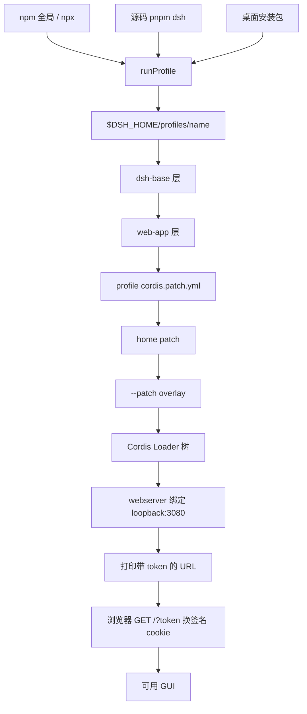
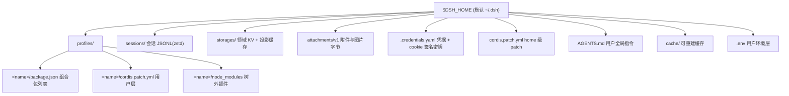

# 部署与运维：运行形态、数据分层与自托管边界

> 这一面回答的问题不是「怎么装」，而是**装完之后你实际持有了什么、哪些东西会静默改变、出事时靠什么判断**。基线 `dsh-v0.2.1-rc.3`（`1f81c047fc`）。

## 为什么部署是这个项目最容易被低估的一面

dsh 把「一切皆插件」推到了进程最外层：**一次 `dsh web` 不是启动一个程序，而是现场组装一棵插件树**——profile 目录里有序的组合包、profile 自己的 patch、home 级 patch、`--patch` overlay 依次压在空条目列表上，一条 patch 按 id 定位条目并替换其整个 config。[docs/architecture.zh.md:25]()
<!-- anchor-base64: 5ZCE5bGC5L6d5qyh5bqU55So5Zyo56m65p2h55uu5YiX6KGo5LmL5LiK77yacHJvZmlsZSDkuK3mnInluo/nmoTnu4TlkIjljIXjgIHlhbYgYGNvcmRpcw== -->

这条组装规则直接生成了四类运维后果，本文剩下的部分基本都在展开它们：

- **没有"二进制版本"这一个旋钮。** 运行行为同时由 npm 包版本、`$DSH_HOME/profiles/<name>/package.json` 的组合包列表、若干 YAML 层、`.env` 层、环境变量、以及平台沙箱后端共同决定。回滚包版本不会回滚插件树。
- **用户态数据全压在一个根下**（`$DSH_HOME`，默认 `~/.dsh`），其中真源与派生物混居，误删代价差别巨大。
- **默认只听回环**，所以"多人共享一个 dsh"不是配置问题而是产品决策问题；项目给的替代路径是"代理 + authority 白名单 + 进程令牌换签名 cookie"，不是账号体系。
- **项目自认开发者预览**，破坏性变更写进契约。运维策略必须按"随时可能变"来设计，而不是按"等它稳了我再锁版本"。

## 运行形态全景：四条入口，一棵树

从外部看有四种进入方式，但它们最后都落到同一个 `runProfile`：

| 入口 | 命令 | 适用 | 关键差异 |
|---|---|---|---|
| npm 一次性 | `npx @deepseek-ai/dsh web` | 评估、临时用 | 走 npm 缓存，每次可能拉新版本 |
| npm 全局 | `npm i -g @deepseek-ai/dsh` | 日常长期用 | 与源同版，`dsh plugin` 可改 profile |
| 源码 | `pnpm install && pnpm run build` 后 `pnpm dsh web` | 开发、改插件 | `pnpm dsh` 是 `node --import tsx/esm apps/cli/src/bin.ts`，需要先 `build` 出前端 dist |
| 桌面 | 安装包（macOS dmg / Windows NSIS） | 非开发者 | 自带 Node/pnpm/Python，独占 `profiles/desktop` |

`npx` 那条的默认行为写在 README 里：监听 `http://127.0.0.1:3080` 并在本地启动时打开默认浏览器；**SSH 启动只打印 URL**，因为转发后的本地地址归 SSH 客户端或编辑器所有；`--no-open` 只关浏览器。[README.md:27]()
<!-- anchor-base64: VGhlIGNvbW1hbmQgc3RhcnRzIHRoZSBXZWIgVUkgYXQgYGh0dHA6Lw== -->

值得读一下这个判断是怎么落地的：网络层插件完全不碰浏览器，是 `web-app` 这一行在拼邀请：

```ts
const handoffBrowser = config.openBrowser && !launchedThroughSsh(launchEnvironmentOf(ctx))
```
[packages/bundle/web-app/src/index.ts:201-202]()
<!-- anchor: // through a local forwarding address that this process cannot derive. … const handoffBrowser = config.openBrowser && !launchedThroughSsh( -->

`launchedThroughSsh` 只认**继承的进程环境**里的非空 `SSH_CONNECTION` 或 `SSH_TTY`，项目 `.env` 与用户 `.env` 写这两个名字不算数。[packages/util/launch-environment/src/index.ts:119-122]()
<!-- anchor: /** … * @param environment - the launcher's environment snapshot. -->

这个细节的取舍很干净：SSH 判断是"我是否能把浏览器推到你屏幕上"，属于载体的物理事实，不能由一个带进仓库的 `.env` 文件声明。代价是 tmux / `mosh` / VS Code Remote 这类间接会话只要继承了标记就一律不弹浏览器（保守但安全），而容器里经 `docker exec` 启动、没有 SSH 变量时会尝试弹一个不存在的浏览器——失败路径只是往 stderr 写一行诊断，服务器继续跑，这一点 `web-app` 与 CLI 是分开处理的。

还有一条容易被误读的：`--host` 不接受通配地址。它只接受**一个具体的本机 IPv4/IPv6 字面量**，`0.0.0.0` 这类写法在加载时就被拒。[docs/cli-help.zh.md:178-179]()
<!-- anchor: --host <host>                  bind address: one concrete IPv4 or IPv6 literal … of a local interface; wildcard addresses are -->

这不是保守默认值，而是明确拒绝一种运维习惯：`0.0.0.0` 把"能执行模型生成的命令的接口"暴露给机器加入的每一个网络，而且让 Host 校验无法回答"浏览器到底用哪个地址访问我"。



三条路径的差别只在"树从哪来"与"谁来装配前端 dist"：npm/源码走 `apps/cli` 的 profile 解析，桌面走 `resources/app.asar/dsh` 的 runtime resolution，**并且刻意不用 pnpm 在启动时链接核心包**（见桌面一节）。

## npm 包形态：一个版本号锁住整个家族

根 `package.json` 给的是 `engines: ^22.19.0 || >=24.0.0`、`packageManager: pnpm@11.28.5`、以及 `vendor/*`、`packages/*/*`、`native/*`、`apps/*` 的 workspace 布局。真正决定运维行为的是发布脚本里的家族定义：

- `DshFamily` 匹配 `packages/*/*/package.json` 与 `apps/*/package.json`，tag 前缀 `dsh-v`，并且**要求所有成员共享同一个版本号**，因为一个 tag 必须能命名整棵树。[scripts/release/families.ts:347-357]()
<!-- anchor: /** Release packages and apps: one shared version across the whole family. */ … override verifyBuildArtifacts(root: string): void { -->
- `vendor/*`（Cordis 及其基础库）是**独立的发布家族**，有自己的版本基线与 tag 前缀 `vendor-`。也就是说 `@deepseek-ai/dsh` 的版本号不覆盖 Cordis 的版本号，二者可以独立前进。
- 发布顺序按依赖求拓扑序，**peer 边只排序不阻断**（npm 把未满足的 peer 当警告），被丢掉的 peer 边会打印出来让操作者判断——这点对升级排查有用：如果你看到 `@deepseek-ai/cordis` 出现在 dsh 之后发布，那不是 bug。

对运维的推论很直接：**`@deepseek-ai/dsh` 的版本号是一棵树的版本号，不是"CLI 的版本号"。** 混装两个 dsh 版本（比如全局旧版 + 项目内 `npx` 新版）时，npm 的 hoisted 放置会为不相容的版本做嵌套，仓库专门有一个门禁在模拟这个双版本图——实测一个含 277 个包、2524 条内部边的图要花约 180 秒给 npm 做放置决策，说明这条路本身就是慢且脆的。**不要在同一台机器上用两种装法管理同一个 profile。**

许可证披露走 `THIRD_PARTY_NOTICES.md`：它由 `scripts/gen-third-party-notices.ts` 生成，只覆盖 workspace 直接依赖、显式披露的 Claude Code 平台载荷闭包、以及随包 Python 分发；完整 npm 传递闭包在 `pnpm-lock.yaml`（可用 `pnpm licenses list` 查），Python 闭包在 `python/sdk/uv.lock`。**"这个发行物里到底有什么许可证"这个问题，答案在 lockfile 不在 NOTICES**，企业合规扫描请扫后者。

## Harness home：一个根、三类数据、两种命运

唯一的解析器是 `dsh-home-paths` 的 `resolveDshHome`，优先级是"显式配置 > `$DSH_HOME` > `~/.dsh`"，空白值视为未设置——否则 `resolve('')` 会把 home 落到当前工作目录。[packages/util/home-paths/src/index.ts:127-136]()
<!-- anchor: * Precedence, highest first: an explicit configured path, `$DSH_HOME`, then … return resolveRoot(configured, env, DSH_HOME_ENV, defaultDshHome) -->

决策笔记里明确放弃了 XDG split（config/data/cache 分三棵树），理由是"一个根、一个事实"更像 `~/.claude` / `~/.aws`，也不需要给每个 `~/.dsh` 消费者重新做分类。代价就是本节要处理的问题：**冷备份会把大量可重建内容一起带走，而随手 `rm -rf` 又会带走真源。**



各目录的归属都能在源码里指到：sessions 与 storages 是 `dsh-base` 行里用 `!!js dshHomePath(...)` 派生的根。[packages/bundle/base/cordis.patch.yml:141]()
<!-- anchor: root: !!js dshHomePath('sessions') -->
配置行直接写死的后果是：**改 sessions 根就等于换一份会话库**，不存在"迁移"命令，也没有按 profile 分离会话的开关——所有 profile 共享 `sessions/`。

profile 目录自身的形状由 `initProfile` 决定：`package.json`（`dsh.profile.bundles` 列表）、`cordis.patch.yml`（用户层，附带一段注释模板）、`pnpm-workspace.yaml`（`nodeLinker: hoisted`、`autoInstallPeers: false`）。[packages/boot/app-boot/src/profile.ts:3-7]()
<!-- anchor: * `dsh --profile` launcher family. … * `dsh.profile` with its ordered `bundles` list) and a `cordis.patch.yml` -->

### 真源 vs 派生物

| 路径 | 内容 | 丢了的后果 | 结论 |
|---|---|---|---|
| `sessions/` | append-only Session 日志（zstd 帧或原始 JSONL） | 会话历史与可续跑的 agent 上下文全失 | **必备份**，且**不可当作可丢弃数据** |
| `storages/` | 领域 KV：工作区、提醒、投影缓存等 | 工作区列表、定时任务重建不了 | **必备份** |
| `profiles/<name>/` | 组合包列表 + 用户 patch + 树外插件 `node_modules` | 插件选择、模型/工具覆盖全失 | **必备份**（`node_modules` 可重装，`package.json`/patch 必留） |
| `cordis.patch.yml`（home 级） | 跨 profile 的覆盖层 | 全局行为改变，难从别处恢复 | **必备份** |
| `.credentials.yaml` | API key **以及** cookie 签名密钥 | key 需重配；cookie 全体失效（会被迫重新登录） | **必备份**，且按密钥级别保护 |
| `attachments/v1/` | 图片等附件字节（内容寻址） | 历史消息里的附件变空白 | 建议备份 |
| `AGENTS.md` | 用户全局指令 | 跨项目的 agent 约定丢失 | 建议备份 |
| `.env` | 用户环境层（含四个代理变量） | 代理/端点配置丢失 | 建议备份（不入库） |
| `.anonymous-user-id` | 随机 UUID 单行 | 遥测身份变化 | 可丢 |
| `cache/attachments/` | 请求图变体的派生缓存 | 下次请求重新生成 | **可删** |
| `sessions/` 内的旧 generation 文件 | 历史格式的源日志（v0–v3） | 新版本可能不再能读它 | **不可删**，见升级一节 |
| `profiles/<name>/node_modules` | pnpm 装出来的树外插件 | 重新 `dsh plugin add` 即可 | 可重建 |

有两个"看着像缓存、其实是真源"的陷阱值得单独点出来。

**其一：`sessions/` 里并存多个 generation 文件。** 磁盘布局是每个会话一个目录，同名不同版本号的文件并列（`session.jsonl.zstd`、`session.v1.jsonl.zstd`……直到当前版本），**写 open 会发布后继但源文件逐字节不变**。[packages/session/session-persistence-jsonl/README.zh.md:70]()
<!-- anchor-base64: c2Vzc2lvbi52My5qc29ubCAgICAgICAgICAgIyByZWxlYXNlZCB2Mw== -->

这意味着"迁移"不是一个批量任务，而是每会话在第一次被写打开时按需发生。所以：备份必须整目录抓（别只抓最高版本号），清理旧 generation 等于主动放弃回滚读取；而**只读打开也会迁移到内存但不发布**，看起来"能读"并不代表文件已经升级。

**其二：投影缓存不是事实源。** `session-projection-cache` 是写后写的节流缓存（`writeEveryEvents: 200`、`writeIntervalMs: 5000`），删掉列表会短暂变慢，重建自日志。判断标准很简单：**能不能由 `sessions/` 重算出来**——能，就是派生物。

## 自托管：默认回环挡掉了什么，替代路径的代价是什么

默认只听回环挡掉的不是"安全性"这么抽象的东西，而是一个非常具体的场景：**一台机器上多人共用一个工具**。dsh 的进程身份就是操作系统用户，工具拥有该用户的文件权限；一旦 A 的浏览器能连上 B 启动的 dsh，B 的 agent 就能读 A 的文件、跑 A 的命令。项目没有做多租户，也不打算做——它给的是"把远程访问收敛成一个可信通道"。

### 三层边界，各管一件事

| 层 | 机制 | 防的是什么 | 不防什么 |
|---|---|---|---|
| 可达性 | `--host` 一个具体字面量；通配被拒 | 意外把所有接口暴露给机器所在的每个网络 | 同网段任何人连上该字面量端口 |
| 载体信任栅栏 | `Host` 必须回环/绑定字面量/`trustedHosts`；附带的 `Origin` 必须同 authority；`sec-fetch-site: cross-site` 一律拒 | DNS rebinding、跨站"简单请求"这两类 confused deputy | 不是身份，不区分是谁 |
| 身份 | 进程级随机 token → 签名 cookie | 未认证的调用者 | 拿到 cookie 的人（cookie 就是完整权限） |

三道检查是**有序**的：栅栏先跑并返回 403，栅栏通过但没凭据返回 401。栅栏的注释把"为什么每个请求都要查 Host"说得很清楚——纯 HTTP 下浏览器给读取类请求（图片、导航）不带 `Origin` 也不带 Fetch-Metadata，所以看似"未标记"的请求可能正是一次被 rebinding 的读取，而 Host 是 rebinding 唯一伪造不了的头部。[packages/client/connection/src/api-request-trust.ts:122-137]()
<!-- anchor: request: ConnectionTrustRequest, … if (hostUrl === undefined) return false -->

同样的原因让 `--trusted-host` 的校验极其苛刻：任何经 WHATWG 解析会被悄悄改写的东西（带路径、带 `user@`、前导零端口、未加括号的 IPv6、IDN）都会让插件**加载失败**而不是被忽略——否则一个"看起来只授权了一个端口"的条目可能悄悄放宽成任意端口。[packages/client/connection/src/index.ts:96-107]()
<!-- anchor: export interface ConnectionConfig { … cookieMaxAgeDays?: number -->

### token 换 cookie 的具体形状

每个 Host 进程生成一个随机启动 token，只保留在内存；`dsh-web-app` 启动时打印并打开带 `?token=` 的 URL。只有 `GET /` 会用这个 token 换 cookie 并 303 到干净的 `./`。

```ts
if (req.method === 'GET' && url.pathname === '/' && tokens.length === 1
  && authority !== undefined && tokenMatches(tokens.join(''), this.launchToken)) {
```
[packages/client/connection/src/browser-auth.ts:269-271]()
<!-- anchor: if (req.method === 'GET' && url.pathname === '/' && tokens.length === 1 … const issuedAt = Date.now() -->

cookie 是 HMAC 签名的 bearer，名字与载荷都带**归一化的 hostname+port**，所以同一个 home 上跑两个端口的 Web 不会互相踩 cookie；默认绝对生命期 30 天（`cookieMaxAgeDays` 是 connection 行的配置项），`HttpOnly` + `SameSite=Strict` + host-only + `Path=/`，**只有监听器自己提供 TLS 时才加 `Secure`**——`publicUrl` 或转发头都不算数，因为它们描述的是本进程没有终止的那一跳。

### 代价清单（这才是要写进运维文档的部分）

- **打印出来的 URL 是一条凭据。** 它带进程 token，会被终端回滚缓冲、tmux 会话日志、CI 日志、截图带走。项目给的缓解是 `printUrl: false` 且 token 永不进入模型上下文与 `DSH_WEB_URL`——但**默认是打印的**，所以"共享终端"本身就是一种风险面。
- **没有登出。** 撤销单个浏览器会话只能靠浏览器的站点数据清理；**全局撤销是删掉 `.credentials.yaml` 里的签名记录并重启进程**（签名密钥换掉，旧 cookie 全废）。但删凭据文件同时会删掉模型 API key，运维上要分开处理。
- **cookie 就是完整权限。** 认证后的浏览器是 owner，方法级 ACL 放过 owner；所以"只读分享"这类需求不属于这套机制。
- **`--public-url` 不授予任何信任。** 它只是公告（打印的 URL、`DSH_WEB_URL`、运行时上下文里的 GUI URL），浏览器可见的 authority 仍必须用 `--trusted-host` 点名。两个 flag 都配错方向是最常见的远程访问故障：页面能打开、每个 API 调用 403。
- **端口本身没人保护。** 栅栏和公告都不保护监听端口，所以要靠网络层（安全组、反代、端口转发限定）兜住。

### `PeerScope.principal` 与 Remote 方法级访问控制

上面那套是**载体**层。真正的"谁在调用、能调什么"是另一层：`PeerScope.principal` 由进程内的 Host 代码在创建 Peer 时固定，**任何线字段（args、信封、header、query、cookie）都不能设置或覆盖它**；Gateway 没有默认 Peer，缺 Peer 是编译期错误。权限判定集中在 `@deepseek-ai/dsh-api-remote-access`：每个非 owner 的 principal kind 至多一份 policy，policy 只产出 bindings（role + resource + 可选 condition），默认拒绝，`global` 授权不隐含任何 session/workspace 授权，Gateway 在解析 lookup **之前**就判权限（避免未授权调用激活 Agent 产生副作用）。（依据：`.agents/notes/implemented/architecture/2026-10-12-peer-principal-and-remote-access.md`。）

这套机制在本基线里**并不用于 Web 远程访问**：通过浏览器认证的连接拿到的 Peer 一律是 owner。它存在是为了给 liveshare 之类的"共享单个会话"场景做准备。所以对自托管者的现实结论是：**你要么是本机的 owner，要么进不来；中间没有"有限的协作者"这一档。**

## 桌面端运维：发布单元、更新通道与退出语义

桌面的特殊之处在于它把一整棵运行时封进了安装包：Electron 壳、匹配版本的 dsh、内置 pnpm、以及一份私有 Python/Node 运行时。几个对运维有直接影响的设计：

| 维度 | 设计 | 运维含义 |
|---|---|---|
| 发布身份 | Electron 与 `@deepseek-ai/dsh` **永远同一精确版本**；壳代码没变也要发新版 Desktop | 不存在"只升 dsh 不升桌面"；桌面版本号即整棵树版本号 |
| 状态归属 | Electron 拿进程级单实例锁，独占 `$DSH_HOME/profiles/desktop` 及包管理器状态 | CLI 与 Desktop 共享数据但**绝不共享可执行包**；npm 装的 dsh 改不了 desktop profile |
| 安装包 | macOS `dmg`（+ 更新用的 `zip`）、Windows `nsis`（`oneClick: false`、`perMachine: false`、`allowElevation: false`） | Windows 仅当前用户安装；静默更新不弹 UAC |
| 卸载 | Windows 卸载会删 Electron userData 与更新缓存，**但不动 `~/.dsh` 或 `DSH_HOME`** | 卸载不带走会话与凭据，重装可续 |
| 后端运行时 | `app.asar/dsh/desktop-runtime.json` 绑定壳版本、Electron 的 Node 版本、平台、架构与文件清单；打包时校验 | 首次启动**不跑 pnpm** 装核心包，只初始化 profile 文件 |

macOS 那条打包流水线值得单拎出来：它先把签名后的 App 复制成两份，**并行**跑"Zip 通道（公证 App → 打 ZIP）"与"DMG 通道（打 DMG → 随 DMG 公证）"，两条都落定才算成功，任何一条失败就抛 AggregateError。[apps/desktop/scripts/package-macos.ts:95-104]()
<!-- anchor: const results = await Promise.allSettled([ … ]) -->

用并行换时间，代价是可诊断性：失败会以聚合错误返回，读日志时必须先分清是哪条通道；且清理逻辑在 `finally` 里删临时目录，失败后现场只剩产物与日志。

### 双更新通道

1. **常规更新**：electron-builder 的 `generic` provider，启动后异步检查，基础间隔 10 分钟，**每次独立采样 ±20% 抖动**，失败指数退避翻倍、上限 1 小时，成功归零；`DSH_DESKTOP_UPDATE_CHECK_INTERVAL_MS` / `_MAX_BACKOFF_MS` / `_JITTER` 可调。自动检查**从不弹窗、从不下载**。
2. **强制更新策略**：`DesktopMandatoryUpdatePolicy` 独立于业务流量与 updater 产物，向部署方的 `/api/v0/check_client_update` 轮询。

强制更新策略的调度是这份代码里最有运维价值的一段：

```ts
const base = Math.min(maxBackoffMs, intervalMs * 2 ** Math.min(failures, 20))
const delay = Math.min(maxBackoffMs, Math.round(base * (1 + random() * jitter)))
```
[apps/desktop/src/mandatory-update-policy.ts:211-212]()
<!-- anchor: }).finally(() => { … this.pending = undefined -->

默认 `intervalMs` 600000、`maxBackoffMs` 3600000、`timeoutMs` 15000、`jitter` 0.2，且构造时强制 `maxBackoffMs >= intervalMs`、时长必须落在 1000–2147483647 的整数毫秒区间。[apps/desktop/src/mandatory-update-policy.ts:64-68]()
<!-- anchor: const duration = fields[key] ?? fallback … return duration -->

三个设计判断值得学：

- **`2 ** Math.min(this.failures, 20)` 的上限是先夹指数再取 min**，不是先乘后夹。否则 `failures` 一大整数乘就溢出成 `Infinity`，`Math.min` 虽然还能救回来，但中间值不可观测；先夹指数让最坏情况的算式仍然可读。
- **抖动是"加上去"而不是"上下摆动"**：`base * (1 + random*jitter)` 只会让间隔变长，最大 `maxBackoffMs`。这保证退避是单调不短于 base 的——对一台被墙的客户端来说，"最短重试间隔"这个性质比"均值正确"更重要。
- **失败不抹掉已知的强更决定**：catch 只把 `error` 置成 `unavailable` 并保留 `blocking`。也就是说策略服务挂了，已经确认必须升级的客户端仍然被挡住——只在收到一次新的"无需强更"有效响应时才解除。[apps/desktop/src/mandatory-update-policy.ts:202-205]()
<!-- anchor: } catch { … this.setState({ ...this.current, checking: false, error: 'unavailable' }) -->

代价也很明确：**一个配置错误的策略源会把所有客户端永久锁死**，而且是"客户端连不上服务端也照样锁"的那种锁死。策略源必须按关键基础设施运维（多副本、变更前灰度、回滚预案），这跟"一个可选的分析端点"完全不是一个等级的东西。

### 托盘常驻与退出语义

Windows 整个运行期常驻托盘；关闭主窗口只是隐藏，首次隐藏前要确认一次并把 `background-close-confirmed` 写进 Electron userData。所有普通退出入口（⌘Q、菜单、Dock、托盘）都会先向 Host 查询"退出会中断什么"——运行中的 agent（含子代理、等待审批的回合）、排队消息、运行中/停止中的后台任务、以及已加载会话里挂着的定时提醒；都没有就直接退，有就弹原生确认框。

细节里有三个值得记的边界：**查询失败或 Host 超过 2 秒未答复，按"有任务在跑"处理**（宁可多问一次）；**操作系统关机/重启/注销跳过确认**；**取消由欢迎窗口引起的退出会让欢迎窗口重新出现**。

## 可观测性与诊断：先分清"日志在哪"和"看什么"

dsh 没有集中日志文件（桌面端除外）。日常排障的正确顺序是：

| 现象 | 先看 | 再看 |
|---|---|---|
| 起不来 / 插件缺失 | 启动失败报告（stderr 上完整的启动诊断，含失败 fiber） | `dsh --profile web --dump-config` 看合成树、`--dump-config-schema` 单看 schema |
| 某个条目被"改回默认" | patch 层顺序：bundle → profile patch → **home patch** → `--patch` | `--dump-default-config` 对比"没有用户层"的树 |
| 页面能开但 API 403/401 | 403 = 栅栏（`Host`/`Origin`/`--trusted-host`）；401 = 没凭据或 cookie 无效 | 是否用了 `--public-url` 却没配 `--trusted-host` |
| 插件装不上 | pnpm 输出与注册表顺序 | profile 是否存在写锁、`pnpm-workspace.yaml` 是否被改 |
| 装完不生效 | 是否需要重启（`restart-required`） | 有没有更高优先级层覆盖（`overridden`） |

`--dump-config` 是这套体系里被低估的工具：它按 bundle → profile → home → argv 的层序把各层标签和各层 patch 原样列出而不合成、也不启动任何插件，所以**它是唯一能回答"这台机器上的树到底由哪些层拼成"的接口**。[apps/cli/src/dump-config.ts:56-68]()
<!-- anchor: const layers: ConfigDumpLayer[] = loaded.layers.map(layer => ({ … } -->

home 级 patch 的位置不在 profile 里，而在 `$DSH_HOME/cordis.patch.yml`，由 `homePatchPath()` 解析并叠在**每个** profile 的用户层之上。[apps/cli/src/profile-boot.ts:68-69]()
<!-- anchor: * The home-level user patch layer (`$DSH_HOME/cordis.patch.yml`), applied … * over every profile's own layer. Resolved per call, not at module load: -->

这是一条很容易被忘掉的层：你改了 profile 的 patch 却没效果，多半是 home 那条又把它改回去了。`--dump-default-config` 不带 home 与 overlay，正好用来二分。

遥测方面分三条独立通道，各自可关闭：

- **Session 遥测**：只在**用户显式提交反馈**后才授权捕获该会话的日志前缀，脱敏后按 4 MB 上限分批上报，走独立队列，有 3 秒关闭期限；普通活动不触发捕获。
- **产品埋点**：只有桌面端消费；普通 Web 客户端不采集产品事件。
- **OTel 服务**：`ctx.otel` 只是一个传输与聚合工厂，挂载它不分配 provider、不发任何请求。

关闭开关是启动期的 `DSH_TELEMETRY_DISABLED`（**任何非空值，包括 `'0'`/`'false'`** 都算开启关闭）——因为 launcher 是把它翻译成"禁用该行"，而 YAML 配置无法禁用行。这是一个容易踩的坑：写 `DSH_TELEMETRY_DISABLED=0` 以为"关掉关闭开关"的人会把遥测关掉。

### 出站代理：一处安装，全网受益，也全网同亡

Node 内置 `fetch` 不读 `HTTP_PROXY`，而 curl/git/npm/pip 都读，所以用户导出一次代理变量后，dsh 曾经是**唯一静默直连**的那个。现在的做法是：`runProfile` 在任何插件挂载之前解析一份 `ProxyPolicy` 并安装成 undici 全局 dispatcher。[apps/cli/src/profile-boot.ts:272-276]()
<!-- anchor: // Before the first plugin mounts and before anything can issue a request: … const disposeProxy = await installProxyFromEnvironment( -->

```ts
export function proxyForUrl(policy: ProxyPolicy, url: URL): string | undefined {
  const proxy = url.protocol === 'https:' ? policy.httpsProxy : url.protocol === 'http:' ? policy.httpProxy : undefined
  if (proxy === undefined) return undefined
  if (isLoopbackHost(url.hostname)) return undefined
  return bypassesProxy(policy.noProxy, url) ? undefined : proxy
}
```
[packages/util/http-proxy/src/policy.ts:338-343]()
<!-- anchor: export function proxyForUrl(policy: ProxyPolicy, url: URL): string | undefined { … } -->

去掉这一层会发生什么：模型请求、`web_fetch`、MCP over HTTP、子进程、搜索后端全部直连，而且**没有任何诊断**——这是文档里记录的"曾经失而复得"的历史（一个删除 launcher 的重构悄悄带走了 `NODE_USE_ENV_PROXY`）。

**可控性收益**：
- 一处策略、全进程生效，包括未来新增的 `fetch` 调用点；`util/` 层不依赖具体传输或插件，任何 group 都能依赖它。
- 解析读的是**启动环境快照**而不是 `process.env`，因此 `$DSH_HOME/.env` 里声明的代理能生效（`NODE_USE_ENV_PROXY` 做不到，它在进程启动时就采样完了）。
- 回环**永远**绕过代理，且同时列 `::1` 与 `[::1]`——因为 undici 自己的匹配器会把裸 `::1` 读成 host `:` port `1`，永远不豁免。[packages/util/http-proxy/src/policy.ts:33]()
<!-- anchor: export const LOOPBACK_NO_PROXY: readonly string[] = -->

**新的故障点**（这些才是运维要盯的）：
1. **被拒的 scheme 静默降级为直连。** SOCKS URL、无法解析的字符串、不支持协议只在 stderr 打一行然后跳过——"代理没生效"可能是这个原因，需要去看启动日志开头。
2. **走代理的 `web_fetch` 不再做地址解析与锁定。** 直连路径会把连接钉在已校验的公共地址上以防 SSRF/DNS 重绑定；走代理时目标 DNS 由代理做，没有可钉的东西，**配置代理等于声明"我信任这个代理来选择目的地"**。
3. **子进程继承的是用户写的值，不是解析后的值。** 这是刻意的（`curl` 可能要靠 `socks4://`），代价是 Node 22/24 在 `NODE_USE_ENV_PROXY` 下遇到非 http(s) scheme 会**在跑第一行前退出**，所以当子进程会拿到被拒值时必须扣下这个 flag，让子进程直连。
4. **遥测刻意直连**（OTLP exporter 走 `node:http`，绕过全局 fetch dispatcher）。对"必须走代理才出网"的环境，遥测会静默失败——这是权衡后的选择：遥测是唯一"丢了也不损失任何用户能力"的出站通道。
5. **loopback 探测与本地服务**：绕过是必须的，否则 Web UI、Connection 传输、本地测试服务器都会绕回代理成环。

## 升级与兼容：把"会坏"当成规格写下来

项目在 README 第一屏就写明开发者预览与"会有破坏性变更"。[README.md:13]()
<!-- anchor: DeepSeek Harness is in _developer preview_ and iterating rapidly. -->

但这句话背后的机制比口号实在得多：

**会话格式是单向的。** `SESSION_FORMAT_VERSION` 是唯一手工维护的写入器版本（当前 4），门禁会检查相邻迁移是否到达该版本；版本号是**单调整数**，没有 major/minor。升版本的判据不是"结构变了"，而是"现有判别器无法阻止不安全解读"。[packages/core/session/src/types.ts:90]()
<!-- anchor: export const SESSION_FORMAT_VERSION = 4 -->

更关键的是发布状态的定义：发布记录里 `latestReleasedVersion: 4`、`evidenceTag: dsh-v0.2.0-rc.2`。[docs/session-format-status.zh.md:44-47]()
<!-- anchor: ```yaml session-format-release … ``` -->
<!-- anchor-base64: bGF0ZXN0UmVsZWFzZWRWZXJzaW9uOiA0 … ZXZpZGVuY2VUYWc6IGRzaC12MC4yLjAtcmMuMg== -->

文档明确写了：**alpha/beta/rc 发布都会确立"已发布格式"的义务，GitHub 的 prerelease 标记不会让持久化用户数据成为可丢弃数据**。对运维的直接含义——**升级 dsh 之后，会话库就是一个更高版本写出的库，回滚到旧版本可能读不了。** 备份要在升级前做，且要连同旧 generation 文件一起。

**破坏性变更的登记方式是升级指南。** `docs/upgrade-guide/v<version>/<item>/guide.md` 只写**外部可观测**的破坏面（CLI 命令与 flag、profile 名、`cordis.yml`/patch/overlay/settings 键与取值、持久化用户数据、SDK/JSON-RPC/HTTP/ACP 消息、已发布包名与入口），固定两节 `## Change` / `## Migration`（中文 `## 变更`/`## 迁移`），英文正文含 frontmatter **不超过 500 词**，超过就把道理搬去 Agent Note、把机械步骤变成脚本。版本目录在版本号 bump 之后冻结，新的破坏项进新目录。

本基线能读到的一批真实破坏项，正好覆盖上文几个关注面：

| 升级项 | 破坏内容 | 迁移面 |
|---|---|---|
| `v0.2.0-rc.2/remove-runtime-invariants` | 删除 `@deepseek-ai/dsh-invariants` 与所有 `<package>/invariant` 子路径导出 | `cordis.yml`/patch/overlay 里指名的模块会加载失败；patch 指向被删的 5 个 id 会告警 `entry <id> not found` |
| `v0.2.0-rc.2/schedule-bundle-retired` | 自动化任务组合包退役，Web 组合自己挂 `schedule`/`ui-schedule` | 起一次 dsh 由代码自动改写 `dsh.profile.bundles`，存下来的任务与投递记录留在磁盘上 |
| `v0.2.1-alpha.1/web-listener-trust-config` | Web 监听的信任配置形态变化 | `--trusted-host` 与 home patch 层 |
| `v0.2.1-alpha.1/new-session-generations` | 会话 generation 变更 | 只读访问不发布升级，写打开才发布后继 |

其中 `schedule-bundle-retired` 那一条展示了"可自动迁移"的写法：`RETIRED_BUNDLES` 是一个常量集合，加载 profile 时把它从 `dsh.profile.bundles` 里剔除并写回 `package.json`，其它字段保留。[packages/boot/app-boot/src/profile.ts:206-210]()
<!-- anchor: const RETIRED_BUNDLES: ReadonlySet<string> = new Set([ … ]) -->

这是我在这个仓库里看到的最好的迁移模式：**迁移逻辑住在代码里、幂等、只在真的列出时才写盘，而升级指南只负责告诉人"起一次就够"以及"第三方写 profile 的场景要自己改"**。

**profile / bundle 版本漂移。** 三种现实的漂移要分开看：

1. **组合包被新版本删除或改名** → 由 `RETIRED_BUNDLES` 一类代码迁移兜住，起一次即修。
2. **树外插件与新 dsh 不兼容** → 插件管理器有版本豁免（`listVersionExemptions` / `setVersionExemption`），且授予豁免时必须显式 `acceptRisk: true`，理由是"可能崩溃与数据丢失"。这是把一个危险开关做成了需要主动勾选的动作。
3. **多装载来源（全局 npm + 桌面 + npx）** → 桌面用单实例锁独占自己的 profile 与包管理器状态，CLI 不能启动 desktop profile；反过来 npm 装的 dsh 也改不了 desktop profile。**这条边界不是安全边界，是"别让两个可执行依赖图互相改写"的工程边界。**

## 安全须知：逐条转述并给判断

`SAFETY.md` 只有 27 行，四段：

| 原文主张 | 我的核对 |
|---|---|
| 未经安全审计，不得视为安全或可用于生产 | 与代码一致：认证是"本地单用户"模型（cookie = owner = 全部权限，无登出，无 RBAC 用于 Web） |
| 会执行模型生成的代码与命令、加载第三方插件、访问网络/进程/凭据/文件 | 与代码一致：`dsh-base` 默认挂 bash/pwsh 工具、fs 工具、MCP client、插件管理器（含 `dsh plugin` 的 pnpm 通道） |
| 沙箱、审批、权限控制能降低风险但不能保证隔离 | **与代码一致，而且是代码自己承认的**：`SandboxMode` 只管控文件效果，网络与进程可见性不在其词汇内；后端会报告 `full`/`partial` 强制执行完整性，旧 Landlock ABI 与 Windows ACL 后端存在已知部分执行情形 |
| 不要把它当成不可信负载的唯一安全控制 | 判断：同意，且这条最该被执行。审批策略的默认是 `workspace-write` + `ask`，两个预设之外还有一个 `danger-full-access` = `approval: never` |

三处需要读者自己补上的认知（文档没直说，但代码是这样）：

- **"审批"与"沙箱"是两件事**：`workspace-write` 限制的是文件写到哪里，不限制 `bash` 能起什么进程、能连哪些地址。所以"我没开 danger-full-access，所以安全"是错的推论。
- **`workspaceRoot` 取的是 `process.cwd()`**。你在哪个目录起 `dsh`，写权限边界就在哪；在 `$HOME` 起 web 就等于把整个家目录划进写入区。
- **远程访问会把上述一切放大一个数量级**：默认回环是这套安全模型的一部分，把它打开就要自己补认证之外的边界（网络分段、反代鉴权、独立虚拟机）。

## 必须回答的四个问题

### 一、对"开发者预览 + 明示破坏性变更"的项目，运维策略怎么定

我的判断是：**不要指望它稳，要让它"坏了可以精确回退"，并且把"升级"当成一个有前置条件的事件而不是日常操作。**

1. **锁版本，但锁的是"树"而不是"包"。** 用 `npm i -g @deepseek-ai/dsh@<exact>` 或 `npx @deepseek-ai/dsh@<exact>`，同时把 `$DSH_HOME/profiles/<name>/package.json` 和所有 patch 文件纳入版本控制（它们才是你实际的组合）。`^0.2.1` 这种范围写法在这个项目里等于"下次启动可能是另一棵树"。
2. **一个关注面一个 `$DSH_HOME`。** `DSH_HOME` 是唯一且最强的隔离旋钮：它同时隔离会话库、凭据、profile、storage。做实验用 `DSH_HOME=/tmp/dsh-exp`，不要把实验插件装进日常 home——因为**会话格式是单向的**，一次实验性升级会把日常会话库整体推进到新 generation。
3. **会话格式绝不当可丢弃数据。** 它不是缓存而是事实源（Model-visible means logged）。升级前冷备份整个 `sessions/`（含全部 generation 文件）；把"能读旧会话"当成回滚预案的一部分来验证，而不是假设。
4. **升级前跑一次 `--dump-config` 存档。** 破坏项常常以"某个条目被新层覆盖"的形式出现，事后没有旧树可比对时就只能猜。
5. **把 `docs/upgrade-guide/v<next>/` 当 changelog 读**，尤其是带持久化数据的项；指南的 Migration 步骤就是 SOP。
6. **接受"不要混装"。** 同一台机器上不要同时用全局 npm、npx、桌面三种入口管理同一份数据。

一句话：**这个项目的运维成本不在安装，在于"你的配置和你的数据是两套独立的版本化对象"。**

### 二、默认回环挡掉了"多人共享一个 dsh"，替代路径是什么，代价是什么

**挡掉的是多租户。** 它给出的替代路径不是账号体系，而是三条：

1. **SSH 端口转发**（默认路径，零配置）：监听保持回环，token URL 照常打印，你自己把端口转到本地。
2. **反代 + `--public-url` + `--trusted-host`**：代理保留浏览器可见 `Host`、剥离挂载前缀、转发 upgrade、改写 cookie `Path`（监听器 HTTPS 时再补 `Secure`）；`--public-url` 只公告，`--trusted-host` 才准入。
3. **原生 TLS 监听器**（`--tls-cert`/`--tls-key`）：不需要代理，但**不签不发不续证**，没有 ACME，没有自签名兜底；证书不匹配直接启动失败而不是回退 HTTP。

代价可以列清：

| 代价 | 具体表现 |
|---|---|
| 身份粒度 = 1 | 拿到 cookie 就是 owner；没有登出、没有只读角色、没有审计日志 |
| 撤销很粗 | 全局撤销 = 删签名记录 + 重启；单浏览器会话靠浏览器清站点数据 |
| 凭据在 URL 里传递 | token 走 query string，会进历史/日志；`printUrl:false` 只是关掉打印 |
| 每个请求都要过栅栏 | 反代必须原样转发 `Host`/`Origin`/`Upgrade`，任何"贴心"改写（改写 Host、加 `X-Forwarded-*` 就以为生效）都会 403 |
| 端口本身无保护 | 网络层是唯一的安全边界 |
| 多人协作的真正答案不在这一层 | `PeerScope.principal` + 方法级 RBAC 已经在底座上，但本基线的 Web 连接一律 owner |

结论：**dsh 的"远程访问"应被理解为"把一台机器的单用户工具安全地拖到自己面前"，而不是"部署一个多人服务"。** 需要多人时，正确做法是每人一个 `$DSH_HOME` + 各自的进程，或者等 liveshare 那类"共享单个会话"的能力落地。

### 三、哪些数据必须备份、哪些重建即可

判断准则只有一条：**能否由 `sessions/` 重算出来。** 能，就是派生物。

| 类别 | 具体 | 备份策略 |
|---|---|---|
| 真源（不可重建） | `sessions/`（全 generation）、`storages/`、`profiles/*/package.json` + `cordis.patch.yml` + 各级 `--patch` 文件、home `cordis.patch.yml`、`AGENTS.md`、`.env` | **必须**；配置类同时进版本库 |
| 秘密（不可重建且有安全属性） | `.credentials.yaml`（API key + cookie 签名密钥） | **必须**，加密存放；泄露后删记录并重启即可全局失效 cookie |
| 附件 | `attachments/v1/` | 建议；丢了历史消息里的图片变空白 |
| 可重建 | `profiles/*/node_modules`、`cache/`、会话投影缓存、`.anonymous-user-id` | 不做 |
| 不要动 | `sessions/` 里的旧 generation 文件 | 不删；这是回滚读取的唯一依据 |
| 平台另外一份 | 桌面：Electron userData（`settings.json`、`keybindings.json`、`background-close-confirmed`）、`app.getPath('logs')` 下的崩溃报告 | 与 `$DSH_HOME` 分开备份 |

桌面端还有两个"看起来像数据其实不是"的：`desktop/settings.json` 只在缺失时创建、已有文件不覆盖，且**`DSH_HOME` 不改变它的位置**；更新下载缓存删了只会让下次更新重新下载。

### 四、出站代理统一化带来的可控性与新的故障点

**可控性**：一个进程一份策略、一次解析、一处安装；`util/` 层不引入插件，任何 group 都能依赖；代理可以声明在 `$DSH_HOME/.env` 里（因为解析读启动快照而不是 `process.env`）；有门禁脚本禁止在拥有者包之外直接构造 undici agent 或传显式 `dispatcher`，把"未来的调用点忘了走代理"变成构建失败。

**新故障点**：被拒 scheme 静默直连（只有 stderr 一行）、代理场景下 `web_fetch` 放弃地址锁定、子进程拿用户原值因此可能要扣下 `NODE_USE_ENV_PROXY`、遥测刻意直连（强制代理环境里会静默丢）、回环绕过是硬编码不可关。

**我的判断**：这是一次正确的"把隐式依赖显式化"的重构——它的最大价值不是"能走代理了"，而是**"代理这件事从此只有一个答案"**。它最脆弱的地方是**诊断**：所有失败都发生在进程最开始的几十毫秒，而症状（某个工具连不上、某个 MCP 起不来）出现在几分钟之后。运维上唯一有效的手段是把启动 stderr 的开头几行也纳入日志采集，而不是只看业务报错。

## 亮点与问题

**值得学的三件事**

1. **把"发布状态"做成可验证的记录而不是口号。** 会话格式的发布记录带 `evidenceTag`，门禁检查"文档里的已发布版本不高于工作区写入器"，并且明确规定 prerelease 不能免除持久化义务。这个耦合（代码常量 ↔ 发布记录 ↔ 证据 tag）在同类项目里很少见。
2. **迁移逻辑住在代码里。** `RETIRED_BUNDLES` 让"退役一个组合包"不需要用户手工改 JSON，升级指南只需写"起一次即可"。这是把"破坏性变更"从文档承诺降级为可执行路径的范式。
3. **危险开关必须显式承认风险。** 版本豁免要 `acceptRisk: true`；`danger-full-access` 是独立预设而不是散落的 flag；`--host 0.0.0.0` 直接拒绝而不是警告。安全默认值不是靠文档提醒，是靠 API 形状。

**值得质疑的三件事**

1. **撤销模型太粗。** "删签名记录 + 重启"是全局核弹，而它和"删 API key"共用一个文件，运维上很难只做前者。没有登出、没有会话列表、没有按设备撤销，对一个会把完整 shell 权限暴露给浏览器的工具来说，这是最该补的一块。
2. **凭据在 URL 里。** token 走 query string 是浏览器里最省事的交换方式，但它与"打印到终端"叠加，等于把凭据放进了终端回滚缓冲与 CI 日志。`printUrl:false` 是个缓解，不是解决；`#fragment` 或一次性 POST 表单会更好（代价是代理路径改写更复杂）。
3. **日志是分散的。** CLI/Web 没有落盘日志，只有 stderr；桌面端才有 `app.getPath('logs')` 下的崩溃报告（保留最新十份）。对"跑在服务器上、用 systemd 启动"的部署，这意味着**你必须自己接管 stdout/stderr 的收集**，否则崩溃后什么都拿不到。这一点应该在部署文档的第一屏而不是最后。

## 与其他部分的连接

本文只说了"树怎么装、数据怎么存、边界在哪里"；**这棵树里到底挂了些什么、每个插件贡献哪种能力 seam、Session 日志如何成为唯一事实源**，属于[插件内核](plugin-kernel.md)与[会话事件日志](session-event-log.md)的话题——理解了那两篇再回来看本文的"真源 vs 派生物"表，你会更容易判断某个新目录该归到哪一栏。
