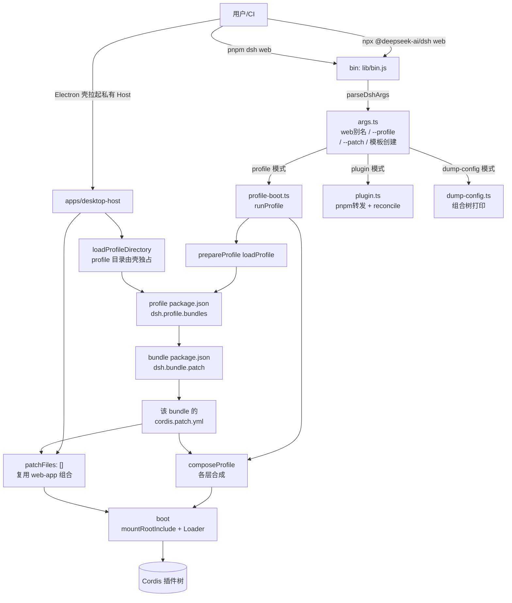
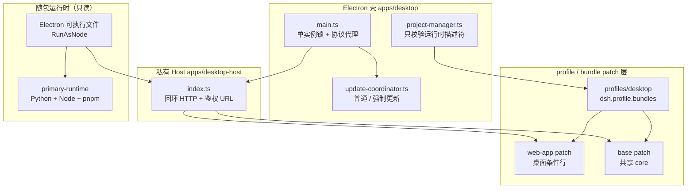
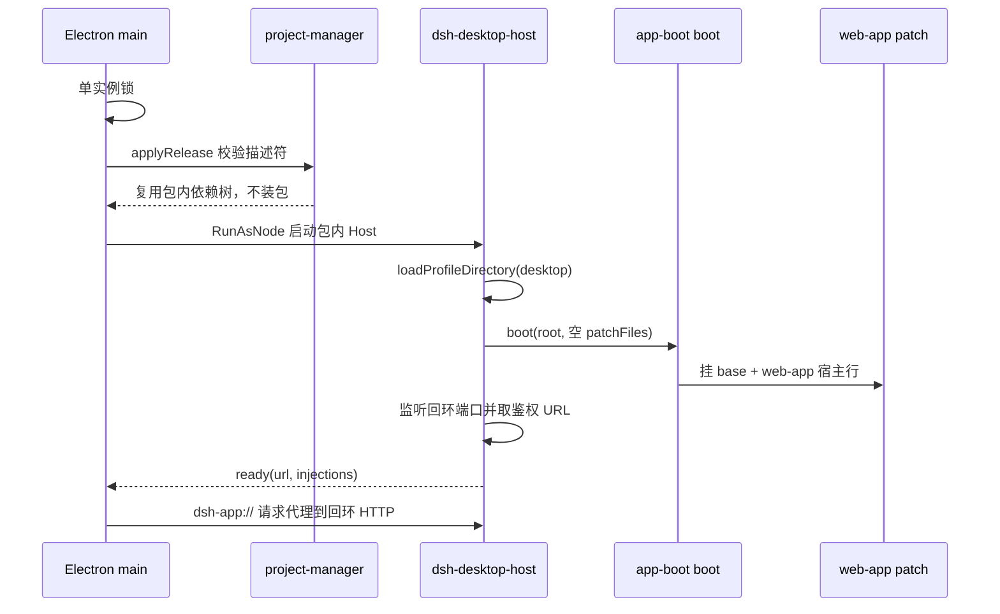
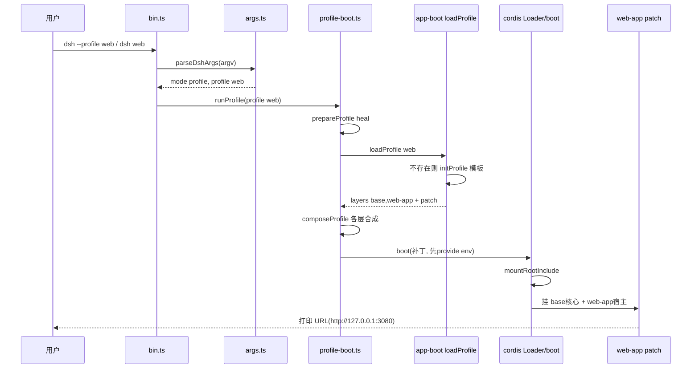

# 部署形态：Profile/Bundle/Patch 分层与 web/headless/desktop 三形态

> 子文档之一，聚焦用户如何安装、运行、扩展 dsh。覆盖 `apps/cli`（`dsh` bin）、`apps/desktop` + `apps/desktop-host`（Electron 壳与私有 Host 进程）、`packages/boot/app-boot`、`packages/bundle/{base,web-app,headless,sdk-app,sdk-minimal,acp-app}`、`python/`（SDK 单文件运行时）与 `native/landlock-run`。整体哲学见 [README](README.md)；本文上承 [data-model.md](data-model.md)（数据落地）、回扣 [architecture.md](architecture.md)（部署即组成插件树）；桌面的打包/签名/自动更新细节下放 [desktop-app.md](desktop-app.md)，工具 roster 的裁剪见 [tools.md](tools.md)。

> **本版增量更新（0.1.5-rc.2 → 0.1.7-rc.2）**：本次增量集中在桌面形态的部署面，三条线索。**(1) 桌面不再持有私有 overlay**：`apps/desktop-host/config/desktop.cordis.patch.yml` 已删除，Host 以 `patchFiles: []` 启动、复用完整 Web 组合（HTTP 服务器一起保留），桌面差异只剩共享 `web-app` patch 里一条按 profile 名判断的条件行。**(2) 传输面换成回环 HTTP + 协议代理**：Host 在 `127.0.0.1` 上监听并回报带鉴权信息的 URL，壳侧用 `dsh-app://` 承载页面、把 API 流量代理过去——原先"无端口 + 分帧字节管道"的保证被显式放弃，换来与 Web 零重复的路由/鉴权/流式实现。**(3) 核心依赖不再在首次启动安装**：`seed`（本地 tarball + 离线 store 分片）与 staging 激活事务下线，改为随包物化的生产依赖树 + `desktop-runtime.json` 完整性清单，启动只做校验；Python/Node/pnpm 另由 primary-runtime 载荷承担（细节见 [desktop-zero-dependency.md](desktop-zero-dependency.md)）。
>
> **引用复核范围**：本轮先重锚定上述桌面相关章节，随后对全库做了一次程序化重锚定（只改行号、不改论断），本文另有 **27 条**引用因此被机械修正。在此基础上又逐条读源码修掉了剩余失效引用：`reconcilePlugins` 已迁入插件管理器、profile manifest 的 `patchReload` 字段被整体删除（重载改由 base 的 `hmr` 行承担）、`web` 硬编码别名改为通用位置参数展开、headless runner 的签名与落点整体位移等语义变化，均已按 0.1.7-rc.2 的真实代码改写。当前全文状态为 **OK=95 / WEAK=0 / MISMATCH=0 / UNVERIFIED=0 / TRAVERSAL=0**（`verify-references.mjs` 输出，全部通过）。

> **本版增量更新（0.1.2-rc.1 → 0.1.5-rc.2）**：相比上一版，部署面新增三条线索。**(1) 第三种发行形态**：Electron 桌面端并入分发矩阵，但它**不新造 bundle**——桌面端把 `web` 那一套 `base + web-app` 组合原样装进独占 profile，再用一层私有 patch 把传输面从 HTTP 换成进程内管道（细节见 [desktop-app.md](desktop-app.md)）。**(2) profile 的创建入口显式化**：新增 `--from-default-profile`，把"模板 profile 首次自动初始化"这一隐式行为升级为可指名创建、独占占位的显式动作。**(3) 分发单元继续下沉**：Python SDK 的单文件运行时补上 macOS x64 目标，并把 SEA 入口 dispatcher 收回到 `python/sdk-runtime/` 自有打包面；`sdk-minimal` 组合与 `minimal` preset 同步移除 `str_replace_editor`、把持久 shell 的输出契约对齐一次性 shell。

部署层是对外唯一安装/运行入口：profile（命名组合）、bundle（分发单元）、patch（行为切片）把「一切皆插件」落地为可一键跑起、又可零侵入定制。

## 项目中的角色：去掉它则用户无法启动、也几乎无法扩展

`dsh` 命令行产品对外唯一的安装与运行入口就是一个部署层。没有任何其他面向用户的启动面：库包（core/session/agent 等）只是可组合部件，只有 profile 启动把它们的 Cordis 配置行列成一颗真实可跑的树；`dsh plugin` 是"安装插件"这一动作的实现者；bundle patch 揭示了"插件如何带着自己的配置行一起分发"。

启动入口分派到四个模式：`profile`（跑指定 profile）、`plugin`（管理插件）、`dump-config`（诊断组合树，不启动）与 `dump-config-schema`（只打印条目与补丁的 JSON Schema），四者都落在 `dsh` 这个 bin 下（[apps/cli/src/bin.ts:22-62]()
<!-- anchor: switch (invocation.mode) { … throw new Error(`dsh: unhandled invocation mode ${JSON.stringify(invocation)}`) -->）。0.1.7-rc.2 移除了硬编码的 `web` 子命令，改为通用的位置参数展开：首 token 既不是选项也不是 `plugin` 时自动前置 `--profile`，所以 `dsh web` 与 `dsh --profile web` 仍收敛到同一个 mode（[apps/cli/src/args.ts:201-204]()
<!-- anchor: const expanded = first !== undefined && !first.startsWith('-') … program.parse(expanded, { from: 'user' }) -->）；0.1.5 新增的 `--from-default-profile` 复用同一套解析（[apps/cli/src/args.ts:168-168]()
<!-- anchor-base64:Lm9wdGlvbignLS1mcm9tLWRlZmF1bHQtcHJvZmlsZSA8bmFtZT4nLCAnaW5pdGlhbGl6ZSBhIG5ldyBjdXN0b20gcHJvZmlsZSBmcm9tIGE= -->）。同版本还加了一条**反向门禁**：CLI 显式拒绝 `--profile desktop`，把那个 profile 判定为 Electron 壳独占（[apps/cli/src/args.ts:83-85]()
<!-- anchor: function rejectElectronProfile(program: Command, profile: string): void { … program.error('error: profile "desktop" is managed exclusively by the Electron a -->）——部署层在这里第一次承认"存在一个自己不该碰的 profile"。

任何一个普通开发者安装一个第三方 bundle 后想真正跑起来，路径上必经两件事：插件管理器里的 `reconcile` 把新装依赖按 `dsh.bundle` 声明写回 `dsh.profile.bundles`（[packages/boot/plugin-manager/src/operations.ts:88-112]()
<!-- anchor: /** Reconcile package removals and newly installed bundles without re-enabling … await saveManifest(dir, after) -->），CLI 侧只把 pnpm 参数转发给这个管理器（[apps/cli/src/plugin.ts:63-85]()
<!-- anchor: const versionResult = await versionCommand(profile, args) … return result.exitCode -->），以及 `readProfilePatches` 按层把 bundle / profile / home / `--patch` / telemetry 开关合成待应用序列（[packages/boot/app-boot/src/profile-context.ts:65-74]()
<!-- anchor: const patches = structuredClone([ … return patches -->）。没有这个部署层，一切皆插件只是一个不可运行的类型系统。

## 根因：怎么让"一切皆插件"既可一键跑起来，又允许零侵入定制

系统主张"无特权内核"，即运行时的组合（哪些服务、以什么配置装配）必须是数据而非代码。但要真能用，"组合"就得有落点：谁来写这份数据、写完怎么执行、怎么不污染共享代码。根因拆成三层矛盾统一：

- **一切皆插件与开箱即用的矛盾**：纯插件系统若要求用户先学会 Cordis patch 语法才能启动就不可用。部署层用"模板化 profile"化解：内置五套模板（`acp`/`web`/`headless`/`sdk`/`sdk-minimal`，各自只带 bundle 列表；`patchReload` 开关已从 manifest 整体删除，用户 patch 的重载改由 base 层常驻的 `hmr` 行统一承担——[packages/bundle/base/cordis.patch.yml:27-32]()
<!-- anchor: # Profile configuration reloads by default; module roots are opt-in. … root: [] -->），首次使用自动初始化，让 `dsh web` 无需任何配置即能跑起完整 Web 形态（[packages/boot/app-boot/src/profile.ts:179-193]()
<!-- anchor: export const PROFILE_TEMPLATES: Record<string, ProfileTemplate> = { … bundles: ['@deepseek-ai/dsh-sdk-minimal'], -->）。
- **零侵入定制与共享 base 的矛盾**：用户改行为但不破坏"core 是同一份"的共享性。方案是分层 patch：base bundle 是所有 base 系 profile 的第一层、把整个 core 作为**一个 insert** 应用（[packages/bundle/base/cordis.patch.yml:15-25]()
<!-- anchor: - insert: … name: '@deepseek-ai/cordis-plugin-timer' -->），用户写在 profile 自己的 `cordis.patch.yml`、home 级 `$DSH_HOME/cordis.patch.yml`、`--patch` 覆盖层里——后层按 `id` 覆盖前层、**整块替换 `config`**而非深合并（`apps/cli/reference/README.md:9`）。"禁用而非删除"刻意保留半成品行，防止重排组合时静默复活（[packages/bundle/web-app/cordis.patch.yml:434-436]()
<!-- anchor: # Disabling rather than deleting is deliberate: the base is shared, and a row … # the composition. -->）。
- **安装插件与内核无特权的矛盾**：内核不该知道"npm 里的某个包是插件"。部署层用 manifest 契约翻译：bundle 是 npm 包，其 `dsh.bundle.patch` 声明 patch 文件；profile 是含 `dsh.profile.bundles` 顺序列表的目录（[packages/util/package-manifest/src/types.ts:68-71]()
<!-- anchor: /** The configuration layer exported by a bundle package. */ … patch: string -->）。于是"安装 = 加依赖，激活 = 打 patch"，插件的代码与配置行一起随 npm 包分发，内核只需消费契约而不知道 npm。

> **演进说明（0.1.5-rc.2）**：这两个 manifest 接口在 0.1.2 时定义在 `packages/boot/app-boot/src/profile.ts` 内（`DshBundleManifest`/`DshProfileManifest`），现已抽成独立包 `@deepseek-ai/dsh-package-manifest`，与 `client`/`configTrees`/`sessionFormatMigration` 等其它 `package.json.dsh` 角色共享同一个 `DshManifest` 聚合类型——契约从"launcher 私有"变成"全家共享"。

概括：**"部署即组成插件树"**——profile 命名组合、bundle 提供配置行+代码、patch 分层允许任意覆盖；内核只负责按层把 patch 应用成树，对"从哪来、谁来安装"保持无特权。

## 设计思路：双形态、三个实体、两种分发、一个诊断面

> **演进说明（0.1.5-rc.2）**：标题里的"双形态"指 0.1.2 时的 `web`/`headless` 两个随附模板；0.1.5 加入 Electron 桌面端后，分发矩阵实际是**三形态**。三者的差异依旧全部落在 patch 组合上，所以本节标题保留原文，新增 `### 桌面形态：Electron 复用同一套 bundle` 说明第三种发行如何复用既有分层。

### web vs headless 双形态：何时用哪个

两个随附模板 profile，路径都在 `$DSH_HOME/profiles/<name>`：

| 形态 | bundle 组合 | patchReload | 面向 | 进程生命周期 |
|---|---|---|---|---|
| `web` | base + web-app | `live`（用户 patch 热重载） | 长驻服务、浏览器 GUI | 常驻 http 服务，SIGINT/SIGTERM 优雅退出 |
| `headless` | base + headless | `startup` | 一次性任务 runner | 跑完打印结果即退出 |

> **演进说明(0.1.7-rc.2)**：表内的 `patchReload` 列是 0.1.5 的机制，该字段现已从 profile manifest（`dsh.profile.patchReload`）整体删除，`web`/`headless` 的差异也只剩 bundle 列表。用户 patch 的重载不再由 profile 声明，而由 base 层常驻的 `hmr` 行承担——profile 配置默认热重载，模块根（源码模块替换）仍是显式 opt-in（[packages/bundle/base/cordis.patch.yml:27-32]()
<!-- anchor: # Profile configuration reloads by default; module roots are opt-in. … root: [] -->）。

- web 形态透传**宿主机行**与**前端（浏览器）插件 roster**：一个 `insert` 挂起 webserver、api-gateway、web-runtime、以及整套 `dsh-client-ui-*` 浏览器端插件行（[packages/bundle/web-app/cordis.patch.yml:44-206]()
<!-- anchor: - insert: … name: '@deepseek-ai/dsh-client-modules' -->）。默认 `http://127.0.0.1:3080`，端口来自 `ctx.webStartup.port ?? 3080`（[packages/bundle/web-app/cordis.patch.yml:163-168]()
<!-- anchor: - id: webserver … port: !!js ctx.webStartup.port ?? 3080 -->）。这里的 `webserver.host` 也是远端访问能否用上 `Settings` 的分水岭：CLI 拒绝 `--host 0.0.0.0`，patch 却能绕过它，而客户端只认 loopback 页面（见 [web-remote-access.md](web-remote-access.md)）。
- headless 形态**不挂 Host、HTTP、Web runtime、浏览器插件**：只插 `code-runtime` + `headless-startup` + `headless-runner` 三行（[packages/bundle/headless/cordis.patch.yml:18-31]()
<!-- anchor: - insert: … task: !!js ctx.headlessStartup.task -->）。运行逻辑：先 `ctx.get('loader')?.await()` 等整棵树装完，再 `agents.create` 建 Agent → `agent.followup` 发任务 → `agent.whenIdle` 等静默 → `sessions.flush` 持久化 → `summarize` 取最后一条 assistant 文本 → `ctx.get('appExit')` 退出（[packages/bundle/headless/src/index.ts:309-380]()
<!-- anchor: async function run(ctx: Context, config: Config, io: HeadlessIo): Promise<void> … io.exit(outcome.reason?.kind === 'completed' ? 0 : 1) -->）。
- 何时用哪个不是架构强加，而是 bundle 组合的选择：`web` 想更轻不想要 HTTP，就在 profile 的 `cordis.patch.yml` disable webserver 行；headless 想要浏览器交互，就在 bundle 层加 web-app。双形态其实是"同一套 patch 组合谱系的两端样板"。

### 桌面形态：Electron 复用同一套 bundle，只换传输面

第三种发行是 `apps/desktop`（Electron 壳）+ `apps/desktop-host`（私有 Host 进程）。它对部署层提出的问题很尖锐：**要不要为桌面再造一个 bundle？** 答案是不——桌面端把 `web` 的组合原封不动装进一个独占 profile，只在共享 patch 里留一条按 profile 名判断的条件行，宿主差异全部落在 Electron 外壳这一侧。

- **同一份 bundle 列表**：桌面 profile 直接把 `web` 模板取作自己的 bundle 列表（[apps/desktop/src/project-manager.ts:32-32]()
<!-- anchor: const WEB_PROFILE = PROFILE_TEMPLATES.web as ProfileTemplate -->），并把同一份列表写进运行时与开发态 profile manifest 的 `dsh.profile.bundles`（[apps/desktop/src/project-manager.ts:140-142]()
<!-- anchor: version: '0.0.0', … dsh: { profile: { bundles: [...WEB_PROFILE.bundles] } }, -->）。区别只在 profile 目录（`$DSH_HOME/profiles/desktop`）由 Electron 独占，CLI 被门禁挡在外面（见上文 `rejectElectronProfile`），因此 CLI 与桌面可以共享 `$DSH_HOME` 下的会话/设置/凭据，却不共享可执行包、插件激活与 lockfile。
- **桌面差异退回共享 patch 里的一条条件行，私有 overlay 已下线**：Host 以空 patch 列表启动（[apps/desktop-host/src/index.ts:29-29]()
<!-- anchor: patchFiles: [], -->），整套差异只剩共享 `web-app` patch 里一条按 profile 名判断的条件——桌面保留沙箱化 HTTP(S) 浏览器标签页，Web profile 反而启用它（[packages/bundle/web-app/cordis.patch.yml:271-274]()
<!-- anchor: # Web profiles opt in; Desktop retains sandboxed HTTP(S) Browser tabs. … disabled: !!js "ctx.get('profileContext')?.name !== 'desktop'" -->）。

  > **演进说明(0.1.7-rc.2)**：0.1.5-rc.2 时桌面持有一份私有 overlay `apps/desktop-host/config/desktop.cordis.patch.yml`，用来 disable `web-startup`/`webserver`/`web-runtime`/`client-hmr` 与 `open-in-app`/`directory-picker`、再 insert 一对原生目录选择器。该文件在本次增量窗口内被删除，桌面改为**完整复用 Web 组合（HTTP 服务器一起保留）**，`open-in-app` 与自动目录选择也回到共享实现（[apps/desktop/README.md:85-85]()
<!-- anchor: The product UI retains Web actions, including "Open In..." through the shared au -->）。这笔交换的代价被决策笔记写得很直白——"Shared HTTP gives up the portless guarantee"，收益是 Web 的每条路由、每次鉴权变更、每种流式能力都不再需要一份桌面实现（[.agents/notes/implemented/architecture/2026-09-10-desktop-web-wrapper.md:27-27]()
<!-- anchor: This partially supersedes the private composition and portless transport in the -->）。
- **传输面：回环 HTTP + 自定义协议代理**。Host 现在真的监听 `127.0.0.1` 上的端口，并把带鉴权信息的 URL 回报给壳（[apps/desktop-host/src/index.ts:103-104]()
<!-- anchor: const url = ctx.connection.authenticatedUrl(`http://127.0.0.1:${String(ctx.webSe … if (process.connected) process.send?.({ type: 'ready', url, injections: ctx.webS -->）；壳侧用 `dsh-app://` 特权协议承接页面流量，把 API 请求代理到该回环 Host。
- **运行时也被钉住，但钉的是 Electron 自己**：Host 入口由 Electron 可执行文件以 RunAsNode 方式 spawn（[apps/desktop/src/host-process.ts:188-189]()
<!-- anchor: const entry = join(this.runtimeDir, 'node_modules', '@deepseek-ai', 'dsh-desktop -->），不再随包携带上游 Node 可执行文件；发布事实（Electron 与 dsh 共用同一个精确版本号、Host 协议代、Node 与 pnpm 版本）写进随包运行时描述符（[apps/desktop/src/release.ts:6-13]()
<!-- anchor: /** Release facts embedded in the bundled runtime descriptor. */ … readonly pnpmVersion: string -->）。这条链的完整解构见 [desktop-zero-dependency.md](desktop-zero-dependency.md)。
- **打包与更新走通用 provider**：electron-builder 配置已迁到 `apps/desktop/scripts/`，mac 目标 `dmg`+`zip`（hardened runtime + 公证）、Windows 目标 `nsis`（强制代码签名）（[apps/desktop/scripts/electron-builder-config.mjs:157-162]()
<!-- anchor: hardenedRuntime: true, … target: ['dmg', 'zip'], -->、[apps/desktop/scripts/electron-builder-config.mjs:226-229]()
<!-- anchor: publisherName: windowsSigner === undefined ? undefined : resolveWindowsUpdatePub … target: ['nsis'], -->），发布通道是单一 `generic` provider（[apps/desktop/scripts/electron-builder-config.mjs:247-247]()
<!-- anchor: publish: update === undefined ? null : [{ provider: 'generic', url: update.publi -->）。自动更新拆成**普通更新与强制更新**两条流，默认既不自动下载也不自动安装，下载与安装是两个分离的授权动作（[apps/desktop/src/update-coordinator.ts:15-22]()
<!-- anchor: export class DesktopUpdateCoordinator { … private installOperation: Promise<DesktopUpdateState> | undefined -->、[apps/desktop/src/update-coordinator.ts:65-66]()
<!-- anchor: this.updater.autoDownload = false … this.updater.autoInstallOnAppQuit = false -->）。

桌面的 launch 链路因此比 web 多一次"宿主换面"，其余阶段完全共用：

> 桌面的签名、公证、安装器、更新通道与"用户零依赖运行时"细节属另一个关注面，见 [desktop-app.md](desktop-app.md) 与 [desktop-zero-dependency.md](desktop-zero-dependency.md)。

### profile / bundle / patch：安装插件 = 加 bundle + 打 patch

三个实体层层负责：

1. **Profile（命名组合）**：`$DSH_HOME/profiles/<name>` 目录，含 package.json（依赖 + `dsh.profile.bundles` 顺序列表）与 `cordis.patch.yml`（用户层）。模块头注释是权威描述，点明 bundle 是 `dsh.bundle.patch` 声明的 npm 包、profile 是含该顺序列表的目录（[packages/boot/app-boot/src/profile.ts:5-23]()
<!-- anchor-base64:KiBBIHByb2ZpbGUgaXMgYSBkaXJlY3RvcnkgdW5kZXIgYCREU0hfSE9NRS9wcm9maWxlcy88bmFtZT5gIGhvbGRpbmcgYSDigKYgKiBAbW9kdWxlIEBkZWVwc2Vlay1haS9kc2gtYXBwLWJvb3QvcHJvZmlsZQ== -->）。
2. **Bundle（分发单元）**：npm 包，其 `dsh.bundle.patch` 声明 patch 文件（[packages/util/package-manifest/src/types.ts:68-71]()
<!-- anchor: /** The configuration layer exported by a bundle package. */ … patch: string -->）。`dsh.profile.bundles` 里按名字引用，顺序即应用顺序。
3. **Patch（行为切片）**：顶层 YAML 数组的 Loader 补丁条目，支持按 id 覆盖 config、disable、insert，复用 include 的 `entryListSchema` 用户方言（[packages/boot/app-boot/src/index.ts:259-264]()
<!-- anchor: // The include's YAML dialect (`!!js` scalars become expression nodes the … const userPatchesSchema = entryListSchema -->）；`parsePatchList` 强校验顶层数组与条目映射形态（[packages/boot/app-boot/src/index.ts:370-387]()
<!-- anchor: function parsePatchList( … return anchorInsertedPluginNames(parsed as PatchOptions[], file) -->）。

**0.1.5 新增：模板创建变成一条显式命令。** 此前"模板 profile 首次使用时自动初始化"只发生在 `loadProfile` 内部（缺目录就按 `PROFILE_TEMPLATES[name]` 建），用户无法中途改名、也无从复用模板；现在 `--from-default-profile <template>` 把同一件事提前成独立动作（[apps/cli/src/profile-boot.ts:101-151]()
<!-- anchor: export function initializeProfileFromDefault( … throw error -->）。它的设计要点在**拒绝语义**而非复制语义：

- 目标名不能是随附模板名，目标目录必须不存在——`mkdirSync` 独占创建，抢不到就按"已有 package.json / 仅有残留目录"分别报错，**绝不覆盖**已有 profile（[apps/cli/src/profile-boot.ts:116-135]()
<!-- anchor: if (Object.hasOwn(PROFILE_TEMPLATES, name)) { … `${NAME}: profile directory ${dir} already exists; choose an unused profile -->）。
- 只复制模板的 bundle 列表（`patchReload` 字段已随 manifest 一起删除，不再有可复制的重载策略），不读同名本地 profile 的依赖与 patch，也不持久化"继承自谁"——所以后续模板表变化不会倒灌已建 profile。
- 初始化提交在 bundle 解析与 boot 之前：后续失败时新 profile 留在盘上，重试时省略该选项即可。

**"安装插件 = 加 bundle + 打 patch"一体两面**：`dsh plugin add` 先把包装进 profile 目录，插件管理器的 `reconcile` 再按 `dsh.bundle` 声明自动把包名补进 `dsh.profile.bundles`（[packages/boot/plugin-manager/src/operations.ts:88-112]()
<!-- anchor: /** Reconcile package removals and newly installed bundles without re-enabling … await saveManifest(dir, after) -->）；用户想改行为时只在 patch 层写几行 id 覆盖，无需改 package 或重装。dsh 不区分"依赖"与"插件"——有 `dsh.bundle` 的依赖就是插件，`update` 后新增该声明的包会自动激活。

### sdk-minimal：刻意不复用 base 的独立组合

`sdk-minimal` 是分发表上的异类：它**不叠在 `dsh-base` 之上**，自己那一份 insert 就是完整 Cordis 树（[packages/bundle/sdk-minimal/cordis.patch.yml:1-3]()
<!-- anchor: # Standalone minimal SDK application. Unlike the ordinary SDK profile, this … # User profile, home, and invocation patches still apply above it. -->）。这是有意的正交：base 是"全产品基础"，而 SDK 极简组合要的是**模型可见面最小化**，任何 `base` 行的加入都必须显式重述一遍，而不是被动继承。

> **演进说明（0.1.2-alpha）**：`sdk-minimal` 是随 0.1.2-alpha 新增的**刻意独立于 base bundle 的「双工具 SDK 编码 agent」极简组合**（`dsh --profile sdk-minimal`）：只带平台选择持久 shell + `str_replace_editor`、session 以未压缩 JSONL 持久化、模型由 SDK 初始化请求选择；**显式排除** base/Web/settings/managed credentials/telemetry/compaction/workspace instructions/skills/jobs/subagents，并以 danger-full-access 权限策略运行（[packages/bundle/sdk-minimal/README.md:2-3]()
<!-- anchor: description: "Standalone SDK profile with one default shell tool for users … kind: "package-bundle" --> 的 standalone 自述；该行的工具计数已在下一版由 two-tool 改为 single-tool）。配套另新增 SDK application bundle（`profiles/sdk-app`）与 ACP application bundle（`profiles/acp-app`）两种预置 profile 组合。

> **演进说明（0.1.5-alpha.2）**：上述"双工具"已收窄为**单工具**。`feat(minimal): remove str_replace_editor from minimal profiles`、`feat(base): remove str_replace_editor from default tools`、`feat(sdk): disable str_replace_editor by default` 三个提交把编辑器从 `minimal` preset、`sdk-minimal` bundle 与 `dsh-base` 默认 roster 里同时摘掉：默认文件编辑改由 `read`/`write`/`edit` 承担，`str_replace_editor` 退为显式 opt-in 行（在 profile/home/`--patch` 里把 `tool-str-replace-editor` 设为 `disabled: false` 即可加回）。同一时期 `feat(minimal): align persistent bash output with the one-shot shell contract` 让持久 shell 的可见输出对齐一次性 shell 契约：每条命令都以 `[Command finished with exit code N]` 收尾（含 0），超时追 `[Command timed out or OOM]`，并把描述里的两句固定网络声明换成一句依赖环境的表述。理由写得很直白——这些极简组合服务的模型是照一次性 `bash` 训练出来的，任何表面差异都是白送的分布偏移。工具 roster 的完整语义见 [tools.md](tools.md)。

### npm 分发 vs 源码构建：两种运行同一份入口代码

`dsh` bin 包发布时只带 `lib/*.js` + `config`，装到 npm 后由 `node lib/bin.js` 直接跑（bin: `dsh` → `lib/bin.js`，`apps/cli/package.json`）。源码开发则用仓库根的 `dsh` script `node --import tsx/esm apps/cli/src/bin.ts`（根 `package.json` scripts）免构建直跑 TS。两者共用同一份 `parseDshArgs`/`runProfile` 逻辑，只差模块解析管线（`apps/cli/reference/README.md:136`）。

浏览器前端 dist 作为 `web-app` bundle 的普通依赖 `@deepseek-ai/dsh-web-frontend` 随包分发，所以部署态下 `npx @deepseek-ai/dsh web` 也能直接 serve 到 UI，不必在消费者侧跑构建；`resolveDistIndex` 从该包 exports resolve dist 入口（[packages/bundle/web-app/src/index.ts:162-165]()
<!-- anchor: function resolveDistIndex(): string { … return join(dirname(require.resolve('@deepseek-ai/dsh-web-frontend/package.json' -->）。桌面端复用了同一个前端包，但改由**壳侧**的 `dsh-app://` 处理器按请求逐文件读取，并对 `distRoot` 做 resolve + realpath 两道越界校验（[apps/desktop/src/web-document.ts:18-34]()
<!-- anchor: export async function serveWebDocument(request: Request, root: string): Promise … headers: { 'content-type': MIME[extname(target)] ?? 'application/octet-stream' } -->），只有 API 流量才代理回 Host 的 HTTP server。

### Python SDK 的单文件运行时：分发单元下沉到打包面

部署层还有一条不走 npm 的发行路径：Python SDK 需要把一个完整 dsh 塞进单个可执行文件。这条链路的关键抉择出现在 0.1.5——**谁拥有"同一个可执行文件既是 dsh、又是沙箱 runner"的 dispatcher**。

打包后的运行时用私有环境变量 `DSH_SUBPROCESS_RUNNER` 选择"这次进程是 CLI 还是 native runner 引导器"（父进程侧定义见 [packages/subprocess/subprocess-local/src/runner-launch.ts:12-12]()
<!-- anchor: export const SUBPROCESS_RUNNER_ENV = 'DSH_SUBPROCESS_RUNNER' as const -->）。0.1.5 之前这个 dispatcher 位于 CLI 包内（`apps/cli/src/runtime-bootstrap.ts` → `lib/runtime-bootstrap.js`），于是"按环境变量分派"变成了**可发布 CLI 入口**的行为：打包运行时 spawn 出去的 node 命令只要走到这个入口，就先被那道判断接管。`fix(subprocess): move SEA bootstrap to runtime packaging` 把它搬成 Python 打包面自有的入口（[python/sdk-runtime/runtime-bootstrap.mjs:1-42]()
<!-- anchor: #!/usr/bin/env node … await runSelectedSubprocessRunner(selection) -->）：无选择器时动态 import `@deepseek-ai/dsh/lib/bin.js` 跑 `runCli()`；有选择器时**先从 `process.env` 删除该变量**再进 runner，嵌套进程因此不会再次命中 dispatcher。配套地，`@deepseek-ai/dsh-subprocess-local` 从 CLI 的运行时依赖降级为 devDependency（只留给 patch 层测试），改由运行时包声明为真依赖。

平台目标同时补齐 macOS x64：目标表从四个变五个（Linux x64/arm64、macOS arm64/x64、Windows x64），每项给出 wheel tag 与可执行文件名（[python/sdk-runtime/platforms.json:14-16]()
<!-- anchor: "macos-x64": { … "executable": "deepseek-harness-sdk-runtime-macos-x64" -->；发布矩阵的说明见 [python/development.md:82-82]()
<!-- anchor: The runtime distribution is wheel-only. The release pipeline publishes five plat -->）。运行时仍是**自包含**的：`dsh` console 命令只把它自己的参数转发给内置可执行文件，且强制要求显式 `DSH_HOME`，从不回落到 `~/.dsh`。

### `--dump-config` 诊断面：boot-free 看组合树

`--dump-config`/`--dump-default-config`/`--dump-config-schema` 是部署层自身的可观测工具：不启动、不解析 app 参数，把 bundle 层、用户层、home 层逐一应用（[apps/cli/src/dump-config.ts:32-41]()
<!-- anchor: export function runDumpConfig( … process.stdout.write(renderConfigDump(NAME, join(loaded.dir, PROFILE_ROOT_FILENA -->），每个连续区间标注来源文件与覆盖它的 layer（[packages/boot/app-boot/src/index.ts:430-492]()
<!-- anchor: export function renderConfigDump( … return groupedDump(composed, entryOrigins) --> 的 `renderConfigDump` 与 [packages/boot/app-boot/src/index.ts:496-505]()
<!-- anchor: function groupedDump( … lines.push(`# == ${currentLabel}`) --> 的 `groupedDump`），`!!js` 表达式保持不求值原样打印。`--dump-default-config` 专用于"用户层已坏但仍想看 bundle 原始组合"的恢复诊断——`userLayer:false` 跳过解析坏掉的 `cordis.patch.yml`（[packages/boot/app-boot/src/profile.ts:698-701]()
<!-- anchor: * @param options - `userLayer: false` skips reading `cordis.patch.yml`, so a … * @returns the loaded profile (empty `patches` when the user layer is skipped). --> 的参数注释）。0.1.5 起它同样接受 `--from-default-profile`：可以"先建目标 profile、再打印它的默认树、但不 boot"。

## 关键数据结构

### Profile manifest（profile 目录 package.json）

一句定位：声明一个 profile "由哪些 bundle 按什么顺序组合"的包级清单，`dsh.profile.bundles` 是该顺序列表（原 `dsh.profile.patchReload` 字段已删除，见上文演进说明）（[packages/util/package-manifest/src/types.ts:74-77]()
<!-- anchor: /** The bundle composition declared by a profile directory. */ … bundles?: string[] --> 的 `DshProfileManifest`）。

`loadProfileDirectory` 按 `dsh.profile.bundles` 顺序读取每个 bundle 的补丁层、并带上 profile 自身 patchPath，是这条数据结构的实际消费方（[packages/boot/app-boot/src/profile.ts:89-102]()
<!-- anchor: /** A loaded profile: resolved bundle layers plus the user's own patch layer. */ … skippedBundles: SkippedBundle[] --> 的 `Profile` 与 [packages/boot/app-boot/src/profile.ts:78-86]()
<!-- anchor: export interface ProfileLayer { … patches: PatchOptions[] --> 的 `ProfileLayer`，后者 0.1.7-rc.2 起另记 `patchPaths`）；组装点在 bundle 循环里（[packages/boot/app-boot/src/profile.ts:660-687]()
<!-- anchor: const manifest = readProfileManifest(binName, dir) … return { name: basename(dir), dir, layers, patchPath, patches, skippedBundles } -->），消费点是 app-boot 的 `readProfilePatches`（[packages/boot/app-boot/src/profile-context.ts:65-74]()
<!-- anchor: const patches = structuredClone([ … return patches -->）。

### Bundle manifest（bundle 包 package.json）

一句定位：一个 npm 包如何自证"我是插件并携带配置行"，`dsh.bundle.patch` 指向相对其根目录的 patch 文件（[packages/util/package-manifest/src/types.ts:68-71]()
<!-- anchor: /** The configuration layer exported by a bundle package. */ … patch: string -->）。六个内置 bundle `dsh-base`/`dsh-web-app`/`dsh-headless`/`dsh-sdk-app`/`dsh-sdk-minimal`/`dsh-acp-app` 的 package.json 都声明同一形态；`loadProfileDirectory` 在应用前解析每个 bundle 的 patch 并用 `loadOverlayPatches` 加载，**声明缺失即 fail-loud**（不是"无 patch"），因为把一个没有 bundle 声明的包写进层列表属于配置错误（[packages/boot/app-boot/src/profile.ts:660-678]()
<!-- anchor: const manifest = readProfileManifest(binName, dir) … layers.push({ packageName, packageDir, patchPaths, patches }) -->）。

### Patch 格式（cordis.patch.yml）

一句定位：顶层 YAML 数组的 Loader 补丁条目——id 覆盖 config / disable / insert 列表，允许 `!!js` 表达式，配 include 的 `entryListSchema` 用户方言解析（[packages/boot/app-boot/src/index.ts:259-264]()
<!-- anchor: // The include's YAML dialect (`!!js` scalars become expression nodes the … const userPatchesSchema = entryListSchema --> 的 `userPatchesSchema = entryListSchema`；[packages/boot/app-boot/src/index.ts:370-387]()
<!-- anchor: function parsePatchList( … return anchorInsertedPluginNames(parsed as PatchOptions[], file) --> 的 `parsePatchList` 强校验顶层数组与条目映射形态）。

### patch 应用顺序（组合优先级）

`loadProfile` 把 bundle 层按 `dsh.profile.bundles` 顺序解析，profile 层在 bundle 层之后、home 层与 `--patch` 覆盖在最上（[packages/boot/app-boot/src/profile.ts:703-719]()
<!-- anchor: export function loadProfile( … return loadProfileDirectory(binName, dir, installAnchor, options) --> 的 `loadProfile`；缺 profile 目录时按模板 `initProfile`，见 [packages/boot/app-boot/src/profile.ts:708-715]()
<!-- anchor: if (!existsSync(join(dir, 'package.json'))) { … initProfile(dir, template.bundles) -->）。`apps/cli` 侧由 app-boot 的 `readProfilePatches` 汇总成完整待应用序列（[packages/boot/app-boot/src/profile-context.ts:65-74]()
<!-- anchor: const patches = structuredClone([ … return patches -->）。整块 config 替换而非深合并（`apps/cli/reference/README.md:9`）。桌面端不再自持 overlay，差异收敛到共享 `web-app` patch 里按 profile 名判断的条件行（见上文演进说明）。

## 核心流程：`dsh --profile web` 启动（CLI → loadProfile → 组合 → boot → web-app 挂 Browser UI）

流程要点（均带真实引用）：

1. **解析**：`bin.ts` 调用 `parseDshArgs` 取得 invocation，`--profile web` 与被展开的 `dsh web` 收敛到同一 mode（[apps/cli/src/bin.ts:20-31]()
<!-- anchor: const invocation = parseDshArgs(process.argv.slice(2), version) … args: invocation.args, -->、[apps/cli/src/args.ts:145-173]()
<!-- anchor: export function parseDshArgs(argv: readonly string[], version: string): DshInvoc … .action((args: string[], options: BootOptions & { profile?: string }) => { -->）。
2. **prepareProfile**：先按需 `initializeProfileFromDefault`，再 `loadProfile`、报告被跳过的 bundle、并重写空 patch 根文件（[apps/cli/src/profile-boot.ts:167-172]()
<!-- anchor: export function prepareProfile(name: string, userLayer = true, fromDefaultProfil … return profile -->）。
3. **loadProfile**：web 目录不存在则按模板 `initProfile` 为 base+web-app 两个 bundle（[packages/boot/app-boot/src/profile.ts:708-715]()
<!-- anchor: if (!existsSync(join(dir, 'package.json'))) { … initProfile(dir, template.bundles) -->）；随后逐个 resolve bundle、加载其 patch layer、解析用户 patch（[packages/boot/app-boot/src/profile.ts:660-678]()
<!-- anchor: const manifest = readProfileManifest(binName, dir) … layers.push({ packageName, packageDir, patchPaths, patches }) -->）。
4. **组合**：CLI 侧 `composeProfile` 只准备 profile 与 `--patch` 覆盖层（[apps/cli/src/profile-boot.ts:197-208]()
<!-- anchor: async function composeProfile( … return { profile, resolution, overlays } -->），真正的合成是 app-boot 的 `readProfilePatches`：bundle 层、profile 层、home 层、覆盖层、telemetry patch 依序拼接（[packages/boot/app-boot/src/profile-context.ts:65-74]()
<!-- anchor: const patches = structuredClone([ … return patches -->）。
5. **boot**：造空 Context，装 Loader，`mountRootInclude` 挂根 include 并把补丁一次 `applyEntryPatches`（[packages/boot/app-boot/src/index.ts:972-1004]()
<!-- anchor: export async function boot( … await mountRootInclude(ctx, absoluteConfigPath, patches, bareModuleBaseUrl --> 的 `boot`；[packages/boot/app-boot/src/index.ts:538-584]()
<!-- anchor: export async function mountRootInclude( … return entry --> 的 `mountRootInclude`）。app 参数与环境以 `ctx.cmdlineArgs`/env 服务在树挂载前提供（[packages/boot/cmdline/src/index.ts:84-88]()
<!-- anchor: export function provideCmdline(ctx: Context, host: CmdlineHost): void { … if (host.ready !== undefined) ctx.provide('appReady', host.ready) --> 的 `provideCmdline`）。
6. **web-app 挂 Browser UI**：web-app patch 的 `insert` 挂 webserver（默认 3080）、api-gateway、web-runtime、以及整套 `dsh-client-*` 浏览器端 roster 行（[packages/bundle/web-app/cordis.patch.yml:44-206]()
<!-- anchor: - insert: … name: '@deepseek-ai/dsh-client-modules' -->）；`web-app` 运行时插件 resolve 前端 dist 并挂 `frontend-static` fallback、注册 web-surface prompt 与 `DSH_WEB_URL` bash 变量、打印 URL line（[packages/bundle/web-app/src/index.ts:225-248]()
<!-- anchor: export function apply(ctx: Context, config: Config): void { … resolve: () => ({ [DSH_WEB_URL]: localWebUrl(runtimeCtx) }), --> 的 `apply`）。浏览器端 `modules` 行 node 半区扫描树、浏览器半区作为 shell kernel 插件表构造（[packages/bundle/web-app/cordis.patch.yml:199-206]()
<!-- anchor: # ── browser plugin roster (dsh.client rows; node halves are layer-2 hosts) ── … name: '@deepseek-ai/dsh-client-modules' -->）。

### headless 的一次性流程（同部署层不同叶子）

`dsh --profile headless "run the tests"`：profile-boot 走同一组合，但 headless patch 只插三行（[packages/bundle/headless/cordis.patch.yml:18-31]()
<!-- anchor: - insert: … task: !!js ctx.headlessStartup.task -->），`headless-startup` 用 `parseCmdline` 把 task positional 发布为 service（[packages/bundle/headless/src/startup.ts:78-120]()
<!-- anchor: export function apply(ctx: Context): void { … parseCmdline(ctx, program) -->），`headless-runner` 作为该 service 的消费行跑完整轮并退出（[packages/bundle/headless/src/index.ts:309-380]()
<!-- anchor: async function run(ctx: Context, config: Config, io: HeadlessIo): Promise<void> … io.exit(outcome.reason?.kind === 'completed' ? 0 : 1) -->）。

### 桌面形态的启动链路（同部署层，另一层宿主）

桌面端复用 `loadProfileDirectory` 而非 `loadProfile`，并把 `installAnchor` 指向应用包内的 dsh——profile 目录由应用自己的包工程拥有，模块解析则直接复用随包的生产依赖树，不该再经 `$DSH_HOME` 重新解析一遍（[apps/desktop-host/src/index.ts:21-23]()
<!-- anchor: installOfficeEngineResolution(runtimeDir) … const profile = loadProfileDirectory('dsh', projectDir, installAnchor) -->）。它额外挂四件桌面专属能力：更新任务闸门、退出检查、Platform 会话发布与 Office 运行时解析（[apps/desktop-host/src/index.ts:93-98]()
<!-- anchor: control.updateTasks = installDesktopUpdateTaskControl(ctx) … root: join(resolveDshHome(), 'dsh-runtimes', 'dsh-primary-runtime'), -->），其余 boot 阶段与 web 完全同一份 `boot`/`mountRootInclude`——补丁列表为空，差异只在共享 `web-app` patch 的桌面条件行里。

## 与其他模块协同

- **复用 app-boot 的 boot/profile**：本模块的启动引擎 100% 复用 `packages/boot` 的 `boot`/`loadProfile`/`composeEntries`，deployment 只是其上的薄 CLI 层——`profile-boot.ts` 的 import 一次命中全套（[apps/cli/src/profile-boot.ts:13-34]()
<!-- anchor: import { existsSync, mkdirSync, rmSync, writeFileSync } from 'node:fs' … } from '@deepseek-ai/dsh-app-boot' -->）。桌面端换的是**调用方**（Electron 壳 + 私有 Host）而不是引擎：`apps/desktop-host` 同样只 import app-boot 的 `boot`/`composeEntries`/`loadProfileDirectory`，自己不再实现一套组合逻辑。（跨模块边界：另见相应子文档）`boot` 具体挂载细节归 app-boot/boot 侧。
- **client/web 前端消费 `ctx.remote.<namespace>` + session/event**：0.1.2-alpha 起，web 形态浏览器端插件经 `dsh-client-connection`（node 半区把 gateway 绑到 webserver 的 `/api` 路由，浏览器半区是 fetch/SSE 客户端）与 `dsh-api-remotes`（显式挂载业务包的 `/remote` 贡献）把 host 面 Remote 控制器桥到浏览器——旧 apiproxy RPC（settings/credentials/directory-picker）已移除并由 Typert Remote 控制器取代（[packages/bundle/web-app/cordis.patch.yml:208-225]()
<!-- anchor: # Owns both ends of the web transport: node half binds the gateway to the … name: '@deepseek-ai/dsh-api-remotes' --> 的 connection 与 api-remotes 行）。（跨模块边界：Remote 体系的编程模型、生成管线与运行时调用见 [remote-controllers.md](remote-controllers.md)。）桌面端不再改 `connection` 行的 `inject`，也与 web 共用同一条 `connection` 行——私有字节管道已下线，改由回环 HTTP + `dsh-app://` 协议代理承载请求/响应（见上文演进说明）。
- **Capability Seam**：部署层是 prompt/agent-preset 的落点——base patch 统一注入 system-prompt/agent-loop，web profile 暴露 agent-presets roster（[packages/bundle/base/cordis.patch.yml:503-525]()
<!-- anchor: - id: system-prompt … name: '@deepseek-ai/dsh-llm-deepseek-api-key' -->；[packages/bundle/web-app/cordis.patch.yml:44-562]()
<!-- anchor: - insert: … default: standard -->）。（跨模块边界：另见相应子文档）Seam 具体语义由 capability-seams 模块把关。0.1.5 起 base 的 persona 配置键从 `persona` 拆成 `personaPrefix`/`personaSuffix`，让"身份前缀"与"运行时上下文后缀"分别可换——headless 与 sdk-minimal 都靠它把 `{{cwd}}` 放到后缀位（[packages/bundle/headless/cordis.patch.yml:9-13]()
<!-- anchor: - id: system-prompt … You are a coding agent powered by the {{model}} model. -->）。
- **环境与凭据**：`loadLayeredEnv` 提供 frozen 环境快照，且禁止 `.env` 写 bootstrap 级变量（[packages/boot/app-boot/src/index.ts:131-176]()
<!-- anchor: /** Exact names no discovered file may set. */ … return BOOTSTRAP_NAMES.has(upper) || BOOTSTRAP_PREFIXES.some(prefix => upper.sta --> 的 `BOOTSTRAP_NAMES`/`BOOTSTRAP_PREFIXES`/`isBootstrapOnly`）；base 挂 `dsh-credentials-local` 行消费凭据（[packages/bundle/base/cordis.patch.yml:117-118]()
<!-- anchor: - id: credentials … name: '@deepseek-ai/dsh-credentials-local' -->）。0.1.5 给代理类变量开了唯一一个口子：`HTTP_PROXY`/`HTTPS_PROXY`/`ALL_PROXY`/`NO_PROXY` 可由 **Harness home 的 `.env`** 设置（调用目录的 `.env` 仍被拒），理由是代理决定每个请求的走向、而 home 文件是用户自己的（[packages/boot/app-boot/src/index.ts:131-176]()
<!-- anchor: /** Exact names no discovered file may set. */ … return BOOTSTRAP_NAMES.has(upper) || BOOTSTRAP_PREFIXES.some(prefix => upper.sta -->）。（跨模块边界：另见相应子文档）凭据解析链路属 credentials/data-model 侧。
- **Python SDK 运行时同样是部署产物**：`python/sdk-runtime` 是仓库的 pnpm workspace 成员，但它的分发形态是 **Python wheel + 单文件可执行文件**，不是 npm 包；其依赖闭包由 `scripts/build-exe-for-python-sdk.ts` 打包，入口 dispatcher 与平台表由该目录自有（[python/sdk-runtime/runtime-bootstrap.mjs:1-42]()
<!-- anchor: #!/usr/bin/env node … await runSelectedSubprocessRunner(selection) -->）。（跨模块边界：另见相应子文档）沙箱 runner 的语义归 sandbox/subprocess 侧。
- **Landlock 原生 addon 打包**：`native/landlock-run` 独立于本 workspace 但仍作为成员（根 `pnpm-workspace.yaml` 显式列 `native/landlock-run` 与其 `packages/*`）；提供 `landlock-run` 自限制后 exec 的沙箱二进制，按平台 npm optional 分发包，`probe` 探测不可用则调用方 fail-closed（`native/landlock-run/README.md` "Install"/"Usage" 段、[packages/bundle/base/cordis.patch.yml:234-272]()
<!-- anchor: - id: bash-sandbox … disabled: !!js process.platform !== 'win32' --> 的 bash-sandbox 行）。（跨模块边界：另见相应子文档）Landlock 与 sandbox 行在 Linux 上如何联同。

## 关键设计决策

### 决策一：为什么 web/headless 双形态而非单形态

- **Why**：headless 形态是"无服务器"的极简 runner——无 HTTP、API、浏览器，进程生命周期即一次任务的开始与结束，模块头直接声明 "no Host, HTTP server, Web runtime, or browser plugin"（[packages/bundle/headless/cordis.patch.yml:1-2]()
<!-- anchor: # The dsh-headless bundle patch: one-shot task mode directly over dsh-base. … # It mounts no Host, HTTP server, Web runtime, or browser plugin. An ordinary -->）。它输出一个即席 Agent 的最终文本并返回 0/1 退出码（[packages/bundle/headless/src/index.ts:375-380]()
<!-- anchor: if (projection === undefined) io.stdout.write(outcome.text + '\n') … io.exit(outcome.reason?.kind === 'completed' ? 0 : 1) -->）。
- **权衡**：headless 不持久长驻、无交互授权面，适合无人值守批处理；web 形态提供 GUI/交互/权限提示，适合人工。二者不是两套独立实现，而是同一 base 上的**两种 overlay**——单形态语法上也表达得出这份差异，但将其固化为两个随附模板，把"我要哪种部署"变成 profile 层组合选择而不用写进内核。
- **连接哲学**：双形态正是"部署即组成插件树"的直观果实——同一内核既可长驻服务、又可跑完即退，行为差异完全由 patch 组合定义，内核零特权。

### 决策二：为什么 profile/bundle/patch 作为部署分发机制

- **Why**：把"软件能跑"拆成三个正交维度——**组合的命名**（profile）、**配置行+代码的分发**（bundle，随 npm 走）、**覆盖行为**（patch，用户侧零重装）。升级插件/换默认模型/改权限策略都退化为一个 patch 条目或一个 dependency 版本变化，无需触碰共享内核。
- **权衡**：代价是学习曲线与诊断复杂度——三实体须严格区分，否则"该改 profile 还是 bundle 还是 patch"困扰用户。项目用 `--dump-config`/`--dump-default-config` + reference 文档缓解；0.1.5 又把 profile 创建单列一条 `--from-default-profile`，正是把"新建一个 profile"从"猜它会不会自动出现"变成一条可读的命令。另一面收益是可靠的分发边界——bundle 解析先安装锚点后 profile 目录（[packages/boot/app-boot/src/profile.ts:629-636]()
<!-- anchor: export function resolveBundleDir( … throw new Error( --> 的 `resolveBundleDir`，先试安装锚点再试 profile 目录），保证内置 bundle 永远来自同一安装。
- **连接哲学**：无特权内核的必然推论——"怎么组合"必须是运行时可改写的数据，profile/bundle/patch 就是这份数据的标准化形态。

### 决策三：headless 无服务器一次性 runner 的取舍

- **Why**：一次性 runner 允许**丢弃型进程**——每次调用一个全新 Agent 与全新 Session，做完即死。无 HTTP、无持久绑定、无交互授权，天然适合 CI/无头/批处理。
- **取舍**：好处是零网络暴露、退出码语义简单、无状态可重复（每跑一次持久化一条 session）。代价是每次任务都要完整装配 core（Agent、模型选择、会话）后再跑（[packages/bundle/headless/src/index.ts:309-340]()
<!-- anchor: async function run(ctx: Context, config: Config, io: HeadlessIo): Promise<void> … installModelSelection(agentCtx, selected) --> 先 `ctx.get('loader')?.await()` 再 `agents.create`），冷启动成本高、无长驻缓存、无交互协商。
- **连接哲学**：headless 证明"内核可作库"——一次调用就是 `agents.create` + followup + whenIdle 的裸循环（[packages/bundle/headless/src/index.ts:345-369]()
<!-- anchor: const agent = config.sessionId === undefined … await agent.whenIdle() -->），这正是 capability/事件抽象把"跑一个 Agent"做成普通 API 的回报。

### 决策四：桌面端为什么不新造一个 bundle

- **Why**：桌面端真正独特的只有两件事——**传输面**（用 `dsh-app://` 协议代理回环 HTTP，而不是让浏览器直连）与**无法共享的原生外壳**（窗口、菜单、托盘、退出确认、更新对话框）。其余（core、Agent、会话、模型适配器、前端 roster、agent-presets、`open-in-app`、自动目录选择）与 web 形态逐字相同。为这点差异新写一个 `dsh-desktop-app` bundle，等于把 `web-app` 那份近 500 行的 patch（含整套浏览器 roster）复制一份并从此双份维护。
- **权衡**：代价是桌面端必须理解并覆盖一层别人的组合——差异行写在共享 patch 里、按 profile 名判断（如 `ui-sidebar-browser` 只在桌面启用），任何一次 `web-app` 行 id 改名都会打到桌面端；收益是**新增宿主环境的成本被压到一条条件行**，且"桌面到底跑了什么"仍可用 `--dump-config` 之类的手段按同一套层级读出。这是典型的"配置耦合换实现复用"，项目选了后者。
  > **演进说明(0.1.7-rc.2)**：0.1.5-rc.2 时的差异面更大——私有 overlay 要 disable 7 个 id（`webserver`/`web-runtime`/`web-startup`/`client-hmr`/`open-in-app`/`ui-open-in-app`/`directory-picker`）并 insert 一对原生目录选择器。窗口内该 overlay 被删除，桌面连 `webserver` 一起复用，差异面收敛到浏览器标签页一条。
- **连接哲学**：与 base 被所有 profile 共享同构——**共享的是组合，不是代码**。桌面端证明 patch 分层不仅能做"用户微调"，也能承载一个完整发行形态的宿主差异。

### 决策五：SDK 运行时为什么把 dispatcher 收回到自己的打包面

- **Why**：一个单文件可执行文件要同时扮演"dsh CLI"和"沙箱 runner 引导器"，必须有个入口 dispatcher。这个 dispatcher 一旦长在**可发布的 CLI 包**里，"按 `DSH_SUBPROCESS_RUNNER` 分派"就不再只是 Python 打包面的私有行为——它是那个入口本身的语义，任何走到该入口的进程都要先过这道判断，包括 SDK 运行时 spawn 出去的 node 命令。
- **取舍**：搬到 Python 打包面后，CLI 包少了一个内部入口、多了一条"运行时依赖不得含 subprocess-local"的约束（改由 devDependency 承担测试职责）；换来的是 dispatcher 在进入 runner 前显式从环境删除选择器，**权责边界与环境清理都收敛到真正拥有它的那一层**。这是一次"把隐式全局行为改成显式局部行为"的重构，而不是功能变更。
- **连接哲学**：与 patch 分层同源——**谁产生差异，谁负责表达差异**；下游消费者不该替上游擦屁股。

## 全局关联：部署即「组成插件树」的外向面孔

三形态（web/headless/desktop）不是三套实现，而是同一 base 上的三种宿主形态——长驻 GUI、一次性 runner、回环 HTTP + `dsh-app://` 协议代理的桌面壳，差异全由 patch 组合与宿主外壳定义，同一条 `boot` 让「内核可作库」（headless 的 `agents.create`+followup+whenIdle）、「内核可作服务」（web 的常驻 HTTP）与「内核可作桌面后端」（Host 的回环 HTTP + 壳侧协议代理）同时成立。profile/bundle/patch 三个实体把「组合命名」「配置行+代码分发」「行为覆盖」正交拆开，升级/换默认/改权限都退化为一个 patch 或依赖版本变化；`--dump-config` 让「看到的 = 跑起来的」，`--from-default-profile` 让「新建一个组合」也成为一条可读的命令。分发边界同样是这条哲学的延伸：npm 侧的 bundle、Python 侧的单文件运行时、原生侧的 Landlock addon，各自只消费同一份 manifest 契约与 patch 方言。这正是 [architecture.md](architecture.md) 的「空树 + 分层 patch」哲学的落地——所有子文档里被分析的那些服务，最终都由这层数据化的组合决定是否、以什么形状出现在一次实际启动里。

> 部署相关但跨界较宽的实现（浏览器侧 `window.__DSH_BOOT__` 的注入/消费、浏览器 RPC 捆绑、桌面端的签名公证与零依赖运行时载荷、Landlock addon 三方包 manifest）其边界定义见 `packages/client`、`apps/desktop` 侧，本子文档聚焦部署形态本身。
