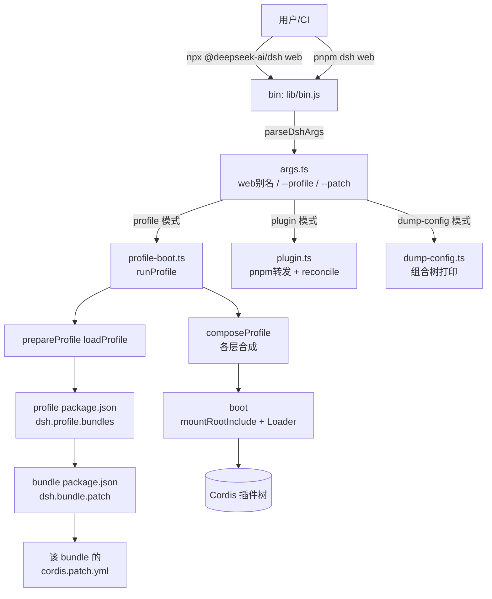
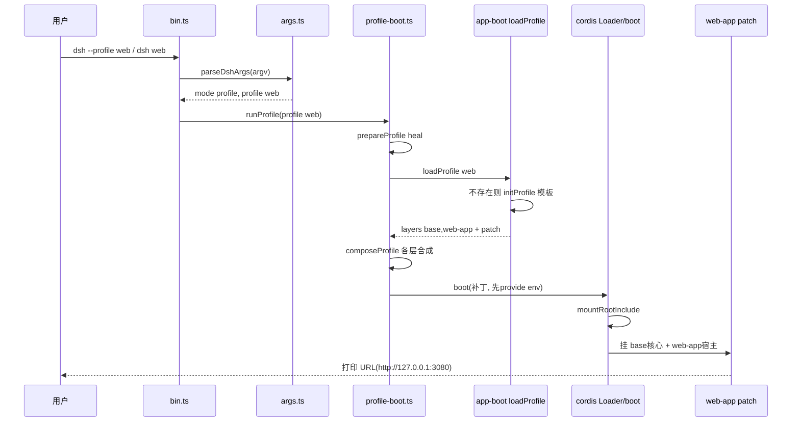

# 部署形态：Profile/Bundle/Patch 分层与 web/headless 双形态

> 子文档之一，聚焦用户如何安装、运行、扩展 dsh。覆盖 `apps/cli`（`dsh` bin）、`packages/boot/app-boot`、`packages/bundle/{base,web-app,headless}`、`native/landlock-run`。整体哲学见 [README](README.md)；本文上承 [data-model.md](data-model.md)（数据落地）、回扣 [architecture.md](architecture.md)（部署即组成插件树）。

部署层是对外唯一安装/运行入口：profile（命名组合）、bundle（分发单元）、patch（行为切片）把「一切皆插件」落地为可一键跑起、又可零侵入定制。

## 项目中的角色：去掉它则用户无法启动、也几乎无法扩展

`dsh` 命令行产品对外唯一的安装与运行入口就是一个部署层。没有任何其他面向用户的启动面：库包（core/session/agent 等）只是可组合部件，只有 profile 启动把它们的 Cordis 配置行列成一颗真实可跑的树；`dsh plugin` 是"安装插件"这一动作的实现者；bundle patch 揭示了"插件如何带着自己的配置行一起分发"。

启动入口分派到三个模式：`profile`（跑指定 profile）、`plugin`（管理插件）、`dump-config`（诊断组合树，不启动），三者都落在 `dsh` 这个 bin 下（[apps/cli/src/bin.ts:29-49]()
<!-- anchor: switch (invocation.mode) { … } -->）。`web` 是 `--profile web` 的硬编码别名，所以"启动 Web 形态"本身就是部署层的一个子命令（[apps/cli/src/args.ts:156-169]()
<!-- anchor-base64:Y29uc3Qgd2ViID0gcHJvZ3JhbS5jb21tYW5kKCd3ZWInKS5kZXNjcmlwdGlvbignYm9vdCB0aGUgd2ViIHByb2ZpbGUgKGFsaWFzIG9mIC0tcHJvZmlsZSB3ZWIpOyB0aGUgd2ViIGFwcFwncyBvd24gZmxhZ3MgZm9sbG93Jykg4oCmIH0p -->）。

任何一个普通开发者安装一个第三方 bundle 后想真正跑起来，路径上必经两件事：`reconcilePlugins` 把安装的依赖按 `dsh.bundle` 声明写回 `dsh.profile.bundles`（[apps/cli/src/plugin.ts:59-91]()
<!-- anchor-base64:ZnVuY3Rpb24gcmVjb25jaWxlUGx1Z2lucyhiZWZvcmU6IFByb2ZpbGVNYW5pZmVzdCwgcHJvZmlsZURpcjogc3RyaW5nKTogdm9pZCB7IOKApiB9 -->），以及 `composeProfile` 按层组合 patch（[apps/cli/src/profile-boot.ts:142-171]()
<!-- anchor: function composeProfile( … } -->）。没有这个部署层，一切皆插件只是一个不可运行的类型系统。

## 根因：怎么让"一切皆插件"既可一键跑起来，又允许零侵入定制

系统主张"无特权内核"，即运行时的组合（哪些服务、以什么配置装配）必须是数据而非代码。但要真能用，"组合"就得有落点：谁来写这份数据、写完怎么执行、怎么不污染共享代码。根因拆成三层矛盾统一：

- **一切皆插件与开箱即用的矛盾**：纯插件系统若要求用户先学会 Cordis patch 语法才能启动就不可用。部署层用"模板化 profile"化解：内置 `web`/`headless` 模板，首次使用自动初始化，让 `dsh web` 无需任何配置即能跑起完整 Web 形态（[packages/boot/app-boot/src/profile.ts:114-117]()
<!-- anchor: export const PROFILE_TEMPLATES: Record<string, readonly string[]> = { … } -->）。
- **零侵入定制与共享 base 的矛盾**：用户改行为但不破坏"core 是同一份"的共享性。方案是分层 patch：base bundle 是所有 profile 的第一层、把整个 core 作为**一个 insert** 应用（[packages/bundle/base/cordis.patch.yml:15-17]()
<!-- anchor: - insert: … name: '@deepseek-ai/cordis-plugin-timer' -->），用户写在 profile 自己的 `cordis.patch.yml`、home 级 `$DSH_HOME/cordis.patch.yml`、`--patch` 覆盖层里——后层按 `id` 覆盖前层、**整块替换 `config`**而非深合并（`apps/cli/reference/README.md:9`）。"禁用而非删除"刻意保留半成品行，防止重排组合时静默复活（[packages/bundle/web-app/cordis.patch.yml:315-317]()
<!-- anchor-base64:IyBEaXNhYmxpbmcgcmF0aGVyIHRoYW4gZGVsZXRpbmcgaXMgZGVsaWJlcmF0ZTogdGhlIGJhc2UgaXMgc2hhcmVkLCBhbmQgYSByb3cg4oCmICMgdGhlIGNvbXBvc2l0aW9uLg== -->）。
- **安装插件与内核无特权的矛盾**：内核不该知道"npm 里的某个包是插件"。部署层用 manifest 契约翻译：bundle 是 npm 包，其 `dsh.bundle.patch` 声明 patch 文件；profile 是含 `dsh.profile.bundles` 顺序列表的目录（[packages/boot/app-boot/src/profile.ts:42-51]()
<!-- anchor: export interface DshBundleManifest { … } -->）。于是"安装 = 加依赖，激活 = 打 patch"，插件的代码与配置行一起随 npm 包分发，内核只需消费契约而不知道 npm。

概括：**"部署即组成插件树"**——profile 命名组合、bundle 提供配置行+代码、patch 分层允许任意覆盖；内核只负责按层把 patch 应用成树，对"从哪来、谁来安装"保持无特权。

## 设计思路：双形态、三个实体、两种分发、一个诊断面

### web vs headless 双形态：何时用哪个

两个随附模板 profile，路径都在 `$DSH_HOME/profiles/<name>`：

| 形态 | bundle 组合 | 面向 | 进程生命周期 |
|---|---|---|---|
| `web` | base + web-app | 长驻服务、浏览器 GUI | 常驻 http 服务，SIGINT/SIGTERM 优雅退出 |
| `headless` | base + headless | 一次性任务 runner | 跑完打印结果即退出 |

- web 形态透传**宿主机行**与**前端（浏览器）插件 roster**：一个 `insert` 挂起 webserver、api-gateway、web-runtime、以及整套 `dsh-client-ui-*` 浏览器端插件行（[packages/bundle/web-app/cordis.patch.yml:43-158]()
<!-- anchor: - insert: … name: '@deepseek-ai/dsh-client-modules' -->）。默认 `http://127.0.0.1:3080`，端口来自 `ctx.webStartup.port ?? 3080`（[packages/bundle/web-app/cordis.patch.yml:116-121]()
<!-- anchor: - id: webserver … port: !!js ctx.webStartup.port ?? 3080 -->）。
- headless 形态**不挂 Host、HTTP、Web runtime、浏览器插件**：只插 `code-runtime` + `headless-startup` + `headless-runner` 三行（[packages/bundle/headless/cordis.patch.yml:17-30]()
<!-- anchor: - insert: … task: !!js ctx.headlessStartup.task -->）。运行逻辑：`agents.create` 建 Agent → `agent.followup` 发任务 → `agent.whenIdle` 等静默 → `sessions.flush` 持久化 → `summarize` 取最后一条 assistant 文本 → `ctx.get('appExit')` 退出（[packages/bundle/headless/src/index.ts:96-134]()
<!-- anchor-base64:YXN5bmMgZnVuY3Rpb24gcnVuKGN0eDogQ29udGV4dCwgdGFzazogc3RyaW5nLCBpbzogSGVhZGxlc3NJbyk6IFByb21pc2U8dm9pZD4geyDigKYgfQ== -->）。
- 何时用哪个不是架构强加，而是 bundle 组合的选择：`web` 想更轻不想要 HTTP，就在 profile 的 `cordis.patch.yml` disable webserver 行；headless 想要浏览器交互，就在 bundle 层加 web-app。双形态其实是"同一套 patch 组合谱系的两端样板"。

### profile / bundle / patch：安装插件 = 加 bundle + 打 patch

三个实体层层负责：

1. **Profile（命名组合）**：`$DSH_HOME/profiles/<name>` 目录，含 package.json（依赖 + `dsh.profile.bundles` 顺序列表）与 `cordis.patch.yml`（用户层）。模块头注释是权威描述，点明 bundle 是 `dsh.bundle.patch` 声明的 npm 包、profile 是含该顺序列表的目录（[packages/boot/app-boot/src/profile.ts:5-23]()
<!-- anchor-base64:KiBBIHByb2ZpbGUgaXMgYSBkaXJlY3RvcnkgdW5kZXIgYCREU0hfSE9NRS9wcm9maWxlcy88bmFtZT5gIGhvbGRpbmcgYSDigKYgKiBAbW9kdWxlIEBkZWVwc2Vlay1haS9kc2gtYXBwLWJvb3QvcHJvZmlsZQ== -->）。
2. **Bundle（分发单元）**：npm 包，其 `dsh.bundle.patch` 声明 patch 文件（[packages/boot/app-boot/src/profile.ts:42-45]()
<!-- anchor: export interface DshBundleManifest { … } -->）。`dsh.profile.bundles` 里按名字引用，顺序即应用顺序。
3. **Patch（行为切片）**：顶层 YAML 数组的 Loader 补丁条目，支持按 id 覆盖 config、disable、insert，复用 include 的 `entryListSchema` 用户方言（[packages/boot/app-boot/src/index.ts:205-210]()
<!-- anchor-base64:Ly8gVGhlIGluY2x1ZGUncyBZQU1MIGRpYWxlY3QgKGAhIWpzYCBzY2FsYXJzIGJlY29tZSBleHByZXNzaW9uIG5vZGVzIHRoZSDigKYgY29uc3QgdXNlclBhdGNoZXNTY2hlbWEgPSBlbnRyeUxpc3RTY2hlbWE= -->）；`parsePatchList` 强校验顶层数组与条目映射形态（[packages/boot/app-boot/src/index.ts:320-338]()
<!-- anchor: function parsePatchList( … } -->）。

"安装插件 = 加 bundle + 打 patch"一体两面：`dsh plugin add` 先把包装进 profile 目录，再按 `dsh.bundle` 声明自动把包名补进 `dsh.profile.bundles`（[apps/cli/src/plugin.ts:59-91]()
<!-- anchor-base64:ZnVuY3Rpb24gcmVjb25jaWxlUGx1Z2lucyhiZWZvcmU6IFByb2ZpbGVNYW5pZmVzdCwgcHJvZmlsZURpcjogc3RyaW5nKTogdm9pZCB7IOKApiB9 -->）；用户想改行为时只在 patch 层写几行 id 覆盖，无需改 package 或重装。dsh 不区分"依赖"与"插件"——有 `dsh.bundle` 的依赖就是插件，`update` 后新增该声明的包会自动激活。

### npm 分发 vs 源码构建：两种运行同一份入口代码

`dsh` bin 包发布时只带 `lib/*.js` + `config`，装到 npm 后由 `node lib/bin.js` 直接跑（bin: `dsh` → `lib/bin.js`，`apps/cli/package.json`）。源码开发则用仓库根的 `dsh` script `node --import tsx/esm apps/cli/src/bin.ts`（根 `package.json` scripts）免构建直跑 TS。两者共用同一份 `parseDshArgs`/`runProfile` 逻辑，只差模块解析管线（`apps/cli/reference/README.md:84`）。

浏览器前端 dist 作为 `web-app` bundle 的普通依赖 `@deepseek-ai/dsh-web-frontend` 随包分发，所以部署态下 `npx @deepseek-ai/dsh web` 也能直接 serve 到 UI，不必在消费者侧跑构建；`resolveDistIndex` 从该包 exports resolve dist 入口（[packages/bundle/web-app/src/index.ts:116-124]()
<!-- anchor: function resolveDistIndex(): string { … } -->）。

> **演进说明（0.1.2-alpha）**：新增 **`sdk-minimal` profile**——一个刻意独立于 base bundle 的「双工具 SDK 编码 agent」极简组合（`dsh --profile sdk-minimal`）：只带平台选择持久 shell + `str_replace_editor`、session 以未压缩 JSONL 持久化、模型由 SDK 初始化请求选择；**显式排除** base/Web/settings/managed credentials/telemetry/compaction/workspace instructions/skills/jobs/subagents，并以 danger-full-access 权限策略运行（[packages/bundle/sdk-minimal/README.md:1-4]()
<!-- anchor: description: "Standalone two-tool SDK profile for users who need a minimal cross-platform coding agent without the shared base bundle." … kind: "package-bundle" -->）。配套另新增 SDK application bundle（`profiles/sdk-app`，供 Python/TS SDK 以显式 `DSH_HOME` 启动 dsh profiles）与 ACP application bundle（`profiles/acp-app`）两种预置 profile 组合，进一步把「什么形态的 harness 出现在哪次启动」变成 profile 层选择。

### `--dump-config` 诊断面：boot-free 看组合树

`--dump-config`/`--dump-default-config` 是部署层自身的可观测工具：不启动、不解析 app 参数，把 bundle 层、用户层、home 层逐一应用（[apps/cli/src/dump-config.ts:30-52]()
<!-- anchor-base64:ZXhwb3J0IGZ1bmN0aW9uIHJ1bkR1bXBDb25maWcocHJvZmlsZTogc3RyaW5nLCBkZWZhdWx0T25seTogYm9vbGVhbiwgcGF0Y2hlczogcmVhZG9ubHkgc3RyaW5nW10pOiB2b2lkIHsg4oCmIH0= -->），每个连续区间标注来源文件与覆盖它的 layer（[packages/boot/app-boot/src/index.ts:444-473]()
<!-- anchor-base64:LyoqIFJlbmRlciB0aGUgY29tcG9zZWQgcm93cyBncm91cGVkIHVuZGVyIG9uZSBzb3VyY2UtYW5kLXBhdGNoZXMgY29tbWVudCBwZXIgY29udGlndW91cyBydW4uICovIOKApiB9 --> 的 `groupedDump`），`!!js` 表达式保持不求值原样打印。`--dump-default-config` 专用于"用户层已坏但仍想看 bundle 原始组合"的恢复诊断——`userLayer:false` 跳过解析坏掉的 `cordis.patch.yml`（[packages/boot/app-boot/src/profile.ts:800-803]()
<!-- anchor-base64:KiBAcGFyYW0gb3B0aW9ucyAtIGB1c2VyTGF5ZXI6IGZhbHNlYCBza2lwcyByZWFkaW5nIGBjb3JkaXMucGF0Y2gueW1sYCwgc28gYSDigKYgKiBAcmV0dXJucyB0aGUgbG9hZGVkIHByb2ZpbGUgKGVtcHR5IGBwYXRjaGVzYCB3aGVuIHRoZSB1c2VyIGxheWVyIGlzIHNraXBwZWQpLg== --> 的参数注释）。

## 关键数据结构

### Profile manifest（profile 目录 package.json）

一句定位：声明一个 profile "由哪些 bundle 按什么顺序组合"的包级清单，`dsh.profile.bundles` 是该顺序列表（[packages/boot/app-boot/src/profile.ts:47-51]()
<!-- anchor-base64:LyoqIFRoZSBwcm9maWxlIGhhbGYgb2YgdGhlIGBkc2hgIG1hbmlmZXN0IHNlY3Rpb246IHdoYXQgYSBwcm9maWxlIGRpcmVjdG9yeSBjb21wb3Nlcy4gKi8g4oCmIH0= --> 的 `DshProfileManifest`）。

`apps/cli/` 里 `composeProfile` 读取 `profile.layers`（每个 bundle 解析出的补丁层 + profile 自身 patchPath）来逐层组合，是这条数据结构的实际消费方（[packages/boot/app-boot/src/profile.ts:84-96]()
<!-- anchor-base64:LyoqIEEgbG9hZGVkIHByb2ZpbGU6IHJlc29sdmVkIGJ1bmRsZSBsYXllcnMgcGx1cyB0aGUgdXNlcidzIG93biBwYXRjaCBsYXllci4gKi8g4oCmIH0= --> 与 [apps/cli/src/profile-boot.ts:160-164]()
<!-- anchor-base64:Y29uc3QgcHJvZmlsZSA9IHByZXBhcmVQcm9maWxlKG5hbWUpIOKApiBjb25zdCBidW5kbGVQYXRjaGVzID0gcHJvZmlsZS5sYXllcnMuZmxhdE1hcChsYXllciA9PiBsYXllci5wYXRjaGVzKQ== -->）。

### Bundle manifest（bundle 包 package.json）

一句定位：一个 npm 包如何自证"我是插件并携带配置行"，`dsh.bundle.patch` 指向相对其根目录的 patch 文件（[packages/boot/app-boot/src/profile.ts:42-45]()
<!-- anchor: export interface DshBundleManifest { … } -->）。三个内置 bundle `dsh-base`/`dsh-web-app`/`dsh-headless` 的 package.json 都声明同一形态；`loadProfile` 在应用前解析每个 bundle 的 patch 并用 `loadOverlayPatches` 加载（[packages/boot/app-boot/src/profile.ts:388-397]()
<!-- anchor: const layers = bundles.map((packageName): ProfileLayer => { … }) -->）。

### Patch 格式（cordis.patch.yml）

一句定位：顶层 YAML 数组的 Loader 补丁条目——id 覆盖 config / disable / insert 列表，允许 `!!js` 表达式，配 include 的 `entryListSchema` 用户方言解析（[packages/boot/app-boot/src/index.ts:205-210]()
<!-- anchor-base64:Ly8gVGhlIGluY2x1ZGUncyBZQU1MIGRpYWxlY3QgKGAhIWpzYCBzY2FsYXJzIGJlY29tZSBleHByZXNzaW9uIG5vZGVzIHRoZSDigKYgY29uc3QgdXNlclBhdGNoZXNTY2hlbWEgPSBlbnRyeUxpc3RTY2hlbWE= --> 的 `userPatchesSchema = entryListSchema`；`320-338` 的 `parsePatchList` 强校验顶层数组与会话语法）。

### patch 应用顺序（组合优先级）

`loadProfile` 把 bundle 层按 `dsh.profile.bundles` 顺序解析，profile 层在 bundle 层之后、home 层与 `--patch` 覆盖在最上（[packages/boot/app-boot/src/profile.ts:371-403]()
<!-- anchor: export function loadProfile( … } --> 的 `loadProfile` 组装 layers；[apps/cli/src/profile-boot.ts:121-129]()
<!-- anchor: /** The full patch stack of one composed profile, in application order. */ … } --> 的 `allPatches` 汇总成完整待应用序列）。整块 config 替换而非深合并（`apps/cli/reference/README.md:9`）。

## 核心流程：`dsh --profile web` 启动（CLI → loadProfile → 组合 → boot → web-app 挂 Browser UI）

流程要点（均带真实引用）：

1. **解析**：`bin.ts` 调用 `parseDshArgs`，`--profile web` 与 `web` 别名都收敛到同一 mode（[apps/cli/src/bin.ts:27-39]()
<!-- anchor: const invocation = parseDshArgs(process.argv.slice(2), readVersion()) … } -->、[apps/cli/src/args.ts:135-169]()
<!-- anchor: .action((args: string[], options: BootOptions & { profile?: string }) => { … }) -->）。
2. **prepareProfile**：`healProfilesModuleFallback` 重建 `$DSH_HOME/profiles/node_modules` flat symlink 回退目录，再 `loadProfile`（[apps/cli/src/profile-boot.ts:98-103]()
<!-- anchor: export function prepareProfile(name: string, userLayer = true): Profile { … } -->）。
3. **loadProfile**：web 目录不存在则按模板 `initProfile` 为 base+web-app 两个 bundle（[packages/boot/app-boot/src/profile.ts:375-384]()
<!-- anchor: const dir = resolveProfileDir(name, home) … } -->）；随后逐个 resolve bundle、加载其 patch layer、解析用户 patch（[packages/boot/app-boot/src/profile.ts:829-843]()
<!-- anchor-base64:Y29uc3QgbGF5ZXJzID0gYnVuZGxlcy5tYXAoKHBhY2thZ2VOYW1lKTogUHJvZmlsZUxheWVyID0+IHsg4oCmIHJldHVybiB7IG5hbWUsIGRpciwgbGF5ZXJzLCBwYXRjaFBhdGgsIHBhdGNoZXMsIHBhdGNoUmVsb2FkIH0= -->）。
4. **composeProfile**：把 bundle 层、profile 层、home 层、`--patch` 覆盖、telemetry patch 合成应用序列（[apps/cli/src/profile-boot.ts:142-171]()
<!-- anchor: function composeProfile( … } -->）。
5. **boot**：造空 Context，装 Loader，`mountRootInclude` 挂根 include 并把补丁一次 `applyEntryPatches`（[packages/boot/app-boot/src/index.ts:772-789]()
<!-- anchor-base64:ZXhwb3J0IGFzeW5jIGZ1bmN0aW9uIGJvb3QoIOKApiBhd2FpdCBtb3VudFJvb3RJbmNsdWRlKGN0eCwgYWJzb2x1dGVDb25maWdQYXRoLCBwYXRjaGVzLCBiYXJlTW9kdWxlQmFzZVVybCk= --> 的 `boot`；`486-529` 的 `mountRootInclude`）。app 参数与环境以 `ctx.cmdlineArgs`/env 服务在树挂载前提供（[packages/boot/cmdline/src/index.ts:68-72]()
<!-- anchor: export function provideCmdline(ctx: Context, host: CmdlineHost): void { … } --> 的 `provideCmdline`）。
6. **web-app 挂 Browser UI**：web-app patch 的 `insert` 挂 webserver（默认 3080）、api-gateway、web-runtime、以及整套 `dsh-client-*` 浏览器端 roster 行（[packages/bundle/web-app/cordis.patch.yml:43-158]()
<!-- anchor: - insert: … name: '@deepseek-ai/dsh-client-modules' -->）；`web-app` 运行时插件 resolve 前端 dist 并挂 `frontend-static` fallback、注册 web-surface prompt 与 `DSH_WEB_URL` bash 变量、打印 URL line（[packages/bundle/web-app/src/index.ts:135-185]()
<!-- anchor: export function apply(ctx: Context, config: Config): void { … } --> 的 `apply`）。浏览器端 `modules` 行 node 半区扫描树、浏览器半区作为 shell kernel 插件表构造（[packages/bundle/web-app/cordis.patch.yml:151-158]()
<!-- anchor-base64:IyDilIDilIAgYnJvd3NlciBwbHVnaW4gcm9zdGVyIChkc2guY2xpZW50IHJvd3M7IG5vZGUgaGFsdmVzIGFyZSBsYXllci0yIGhvc3RzKSDilIDilIAg4oCmIG5hbWU6ICdAZGVlcHNlZWstYWkvZHNoLWNsaWVudC1tb2R1bGVzJw== -->）。

### headless 的一次性流程（同部署层不同叶子）

`dsh --profile headless "run the tests"`：profile-boot 走同一组合，但 headless patch 只插三行（[packages/bundle/headless/cordis.patch.yml:17-30]()
<!-- anchor: - insert: … task: !!js ctx.headlessStartup.task -->），`headless-startup` 用 `parseCmdline` 把 task positional 发布为 service（[packages/bundle/headless/src/startup.ts:49-57]()
<!-- anchor: export function apply(ctx: Context): void { … } -->），`headless-runner` 作为该 service 的消费行跑完整轮并退出（[packages/bundle/headless/src/index.ts:96-134]()
<!-- anchor-base64:YXN5bmMgZnVuY3Rpb24gcnVuKGN0eDogQ29udGV4dCwgdGFzazogc3RyaW5nLCBpbzogSGVhZGxlc3NJbyk6IFByb21pc2U8dm9pZD4geyDigKYgfQ== -->）。

## 与其他模块协同

- **复用 app-boot 的 boot/profile**：本模块的启动引擎 100% 复用 `packages/boot` 的 `boot`/`loadProfile`/`composeEntries`，deployment 只是其上的薄 CLI 层——`profile-boot.ts` 的 import 一次命中全套（[apps/cli/src/profile-boot.ts:20-31]()
<!-- anchor: import { … } from '@deepseek-ai/dsh-app-boot' -->）。（跨模块边界：另见相应子文档）`boot` 具体挂载细节归 app-boot/boot 侧。
- **client/web 前端消费 `ctx.remote.<namespace>` + session/event**：0.1.2-alpha 起，web 形态浏览器端插件经 `dsh-client-connection`（node 半区把 gateway 绑到 webserver 的 `/api` 路由，浏览器半区是 fetch/SSE 客户端）与 `dsh-api-remotes`（显式挂载业务包的 `/remote` 贡献）把 host 面 Remote 控制器桥到浏览器——旧 apiproxy RPC（settings/credentials/directory-picker）已移除并由 Typert Remote 控制器取代（[packages/bundle/web-app/cordis.patch.yml:160-172]()
<!-- anchor:     # Owns both ends of the web transport: node half binds the gateway to the …       name: '@deepseek-ai/dsh-api-remotes' --> 的 connection 与 api-remotes 行）。（跨模块边界：Remote 体系的编程模型、生成管线与运行时调用见 [remote-controllers.md](remote-controllers.md)。）
- **Capability Seam**：部署层是 prompt/agent-preset 的落点——base patch 统一注入 system-prompt/agent-loop，web profile 暴露 agent-presets roster（[packages/bundle/base/cordis.patch.yml:476-498]()
<!-- anchor: - id: system-prompt … name: '@deepseek-ai/dsh-llm-deepseek' -->；[packages/bundle/web-app/cordis.patch.yml:43-444]()
<!-- anchor: - insert: … default: standard -->）。（跨模块边界：另见相应子文档）Seam 具体语义由 capability-seams 模块把关。
- **环境与凭据**：`loadLayeredEnv` 提供 frozen 环境快照，且禁止 `.env` 写 bootstrap 级变量（[packages/boot/app-boot/src/index.ts:92-128]()
<!-- anchor: /** Exact names no discovered file may set. */ … } --> 的 `BOOTSTRAP_NAMES`/`isBootstrapOnly`）；base 挂 `dsh-credentials-local` 行消费凭据（[packages/bundle/base/cordis.patch.yml:97-98]()
<!-- anchor: - id: credentials … name: '@deepseek-ai/dsh-credentials-local' -->）。（跨模块边界：另见相应子文档）凭据解析链路属 credentials/data-model 侧。
- **Landlock 原生 addon 打包**：`native/landlock-run` 独立于本 workspace 但仍作为成员（根 `pnpm-workspace.yaml` 显式列 `native/landlock-run` 与其 `packages/*`）；提供 `landlock-run` 自限制后 exec 的沙箱二进制，按平台 npm optional 分发包，`probe` 探测不可用则调用方 fail-closed（`native/landlock-run/README.md` "Install"/"Usage" 段、[packages/bundle/base/cordis.patch.yml:220-258]()
<!-- anchor: - id: bash-sandbox … disabled: !!js process.platform !== 'win32' --> 的 bash-sandbox 行）。（跨模块边界：另见相应子文档）Landlock 与 sandbox 行在 Linux 上如何联同。

## 关键设计决策

### 决策一：为什么 web/headless 双形态而非单形态

- **Why**：headless 形态是"无服务器"的极简 runner——无 HTTP、API、浏览器，进程生命周期即一次任务的开始与结束，模块头直接声明 "no Host, HTTP runner, Web runtime, or browser plugin"（[packages/bundle/headless/cordis.patch.yml:1-5]()
<!-- anchor-base64:IyBUaGUgZHNoLWhlYWRsZXNzIGJ1bmRsZSBwYXRjaDogb25lLXNob3QgdGFzayBtb2RlIGRpcmVjdGx5IG92ZXIgZHNoLWJhc2UuIOKApiAjIGRyaXZlciBjcmVhdGVzIGFuIEFnZW50IHRocm91Z2ggdGhlIGNvcmUgcmVnaXN0cnkgYW5kIHByaW50cyBpdHMgZHVyYWJsZSByZXN1bHQu -->）。它输出一个即席 Agent 的最终文本并返回 0/1 退出码（[packages/bundle/headless/src/index.ts:206-210]()
<!-- anchor-base64:aW8uc3Rkb3V0LndyaXRlKG91dGNvbWUudGV4dCArICdcbicpIOKApiBpby5leGl0KG91dGNvbWUucmVhc29uPy5raW5kID09PSAnY29tcGxldGVkJyA/IDAgOiAxKQ== -->）。
- **权衡**：headless 不持久长驻、无交互授权面，适合无人值守批处理；web 形态提供 GUI/交互/权限提示，适合人工。二者不是两套独立实现，而是同一 base 上的**两种 overlay**——单形态语法上也表达得出这份差异，但将其固化为两个随附模板，把"我要哪种部署"变成 profile 层组合选择而不用写进内核。
- **连接哲学**：双形态正是"部署即组成插件树"的直观果实——同一内核既可长驻服务、又可跑完即退，行为差异完全由 patch 组合定义，内核零特权。

### 决策二：为什么 profile/bundle/patch 作为部署分发机制

- **Why**：把"软件能跑"拆成三个正交维度——**组合的命名**（profile）、**配置行+代码的分发**（bundle，随 npm 走）、**覆盖行为**（patch，用户侧零重装）。升级插件/换默认模型/改权限策略都退化为一个 patch 条目或一个 dependency 版本变化，无需触碰共享内核。
- **权衡**：代价是学习曲线与诊断复杂度——三实体须严格区分，否则"该改 profile 还是 bundle 还是 patch"困扰用户。项目用 `--dump-config`/`--dump-default-config` + reference 文档缓解；另一面收益是可靠的分发边界——bundle 解析先安装后 profile（[packages/boot/app-boot/src/profile.ts:344-355]()
<!-- anchor: export function resolveBundleDir( … } --> 的 `resolveBundleDir`），保证内置 bundle 永远来自同一安装。
- **连接哲学**：无特权内核的必然推论——"怎么组合"必须是运行时可改写的数据，profile/bundle/patch 就是这份数据的标准化形态。

### 决策三：headless 无服务器一次性 runner 的取舍

- **Why**：一次性 runner 允许**丢弃型进程**——每次调用一个全新 Agent 与全新 Session，做完即死。无 HTTP、无持久绑定、无交互授权，天然适合 CI/无头/批处理。
- **取舍**：好处是零网络暴露、退出码语义简单、无状态可重复（每跑一次持久化一条 session）。代价是每次任务都要完整装配 core（Agent、模型选择、会话）后再跑（[packages/bundle/headless/src/index.ts:96-119]()
<!-- anchor-base64:YXN5bmMgZnVuY3Rpb24gcnVuKGN0eDogQ29udGV4dCwgdGFzazogc3RyaW5nLCBpbzogSGVhZGxlc3NJbyk6IFByb21pc2U8dm9pZD4geyDigKYgfSk= --> 先 `loader.await()` 再 `agents.create`），冷启动成本高、无长驻缓存、无交互协商。
- **连接哲学**：headless 证明"内核可作库"——一次调用就是 `agents.create` + followup + whenIdle 的裸循环（[packages/bundle/headless/src/index.ts:183-200]()
<!-- anchor: const { agent } = await agents.create({ … await agent.whenIdle() -->），这正是 capability/事件抽象把"跑一个 Agent"做成普通 API 的回报。

## 全局关联：部署即「组成插件树」的外向面孔

双形态（web/headless）不是两套实现，而是同一 base 上的两种 overlay——长驻 GUI 与一次性 runner 的差异全由 patch 组合定义，同一条 `boot` 让「内核可作库」（headless 的 `agents.create`+followup+whenIdle）与「内核可作服务」（web 的常驻 HTTP）同时成立。profile/bundle/patch 三个实体把「组合命名」「配置行+代码分发」「行为覆盖」正交拆开，升级/换默认/改权限都退化为一个 patch 或依赖版本变化；`--dump-config` 让「看到的 = 跑起来的」。这正是 [architecture.md](architecture.md) 的「空树 + 分层 patch」哲学的落地——所有子文档里被分析的那些服务，最终都由这层数据化的组合决定是否、以什么形状出现在一次实际启动里。

> 部署相关但跨界较宽的实现（浏览器侧 `window.__DSH_BOOT__` 的注入/消费、浏览器 RPC 捆绑、Landlock addon 三方包 manifest）其边界定义见 `packages/client` 侧，本子文档聚焦部署形态本身。

