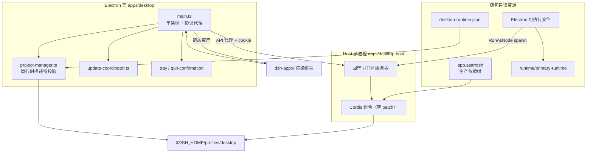
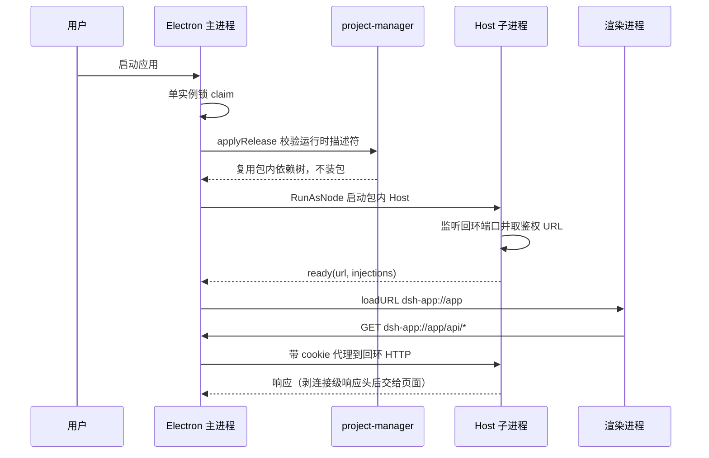
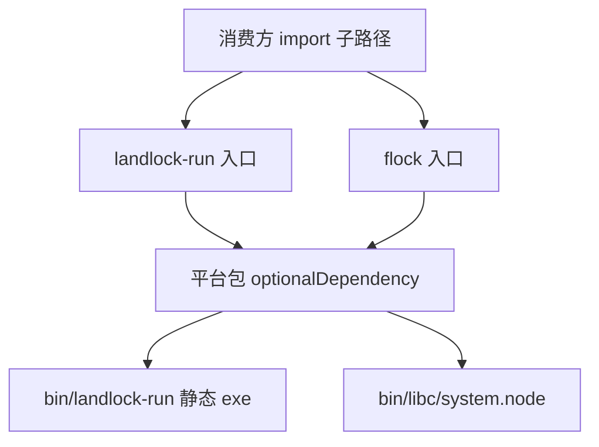

# 桌面形态：Electron 打包、回环 HTTP 传输、零依赖运行时与原生 addon 家族

> 子文档之一，聚焦 `apps/desktop` / `apps/desktop-host` 这两个包、随包分发的原生 addon 家族 `native/system`（`@deepseek-ai/node-addon-system`），以及 Web UI 侧的 `packages/host/open-in-app`。部署与 profile/bundle/patch 的通用机制见 [deployment.md](deployment.md)；"用户机器零依赖"的四条供给线在 [desktop-zero-dependency.md](desktop-zero-dependency.md) 单独拆解；Landlock 作为沙箱后端在能力缝中的位置见 [sandbox-capability-seams.md](sandbox-capability-seams.md)；整体哲学见 [README](README.md)。
>
> **本版增量更新（0.1.5-rc.2 → 0.1.7-rc.2）**：桌面端有三条旧结论被直接反转，本文按新基线重写相应章节，旧实现一律以 `> **演进说明(0.1.7-rc.2)**` 保留轨迹。**(1) 传输面**——"无端口 + 分帧字节管道"被换成"回环 HTTP + `dsh-app://` 协议代理"，Host 不再是被动的字节端点，而是一台真正的本地 HTTP 服务器。**(2) 运行时**——不再随包携带上游 Node，改为让 Electron 自己以 `ELECTRON_RUN_AS_NODE` 当 Node（`--expose-internals` 补上 Electron 缺的内部 ESM loader 符号），Node/pnpm/Python 版本另由 primary-runtime 载荷承担。**(3) 安装模型**——`seed`（本地 tarball + 离线 store 分片）与 profile staging/激活事务整体删除，改成构建期物化的生产依赖树 + `desktop-runtime.json` 完整性清单，启动只做校验。此外补入托盘常驻/退出确认、欢迎窗、普通与强制双更新通道、Windows 目录式安装器与签名流水线工程化。

dsh 已经有 `dsh web`：本地起一个 HTTP 服务、浏览器打开 Web UI。桌面端要回答的第一个问题因此不是"怎么把网页塞进窗口"，而是**Web 形态天生拿不到的那几样东西由谁负责**——进程所有权、包所有权、分发与更新所有权。桌面壳的答案是：把 Web UI 的渲染进程当成唯一复用面，其余全部另立一套交付流水线。

## 根因：Web UI 已经有了，桌面壳补的是"进程与分发所有权"

`dsh web` 的形态是「监听端口 + 浏览器 + 用户自己的 Node/pnpm」。桌面壳把这三件事全部收回（**注意第一件事在 0.1.7 改了做法，见下方演进说明**）：

- **网络面从"没有端口"变成"回环端口 + 协议代理"。** 桌面应用仍用一个自定义协议 `dsh-app://` 承载页面与 Fetch 流量，自注册为带 `codeCache` 的特权方案（[apps/desktop/src/main.ts:128-136]()
<!-- anchor: protocol.registerSchemesAsPrivileged([{ … codeCache: true, -->）；但 Host 侧现在真的监听回环端口，壳只保留静态资产与协议转发（[apps/desktop/src/main.ts:617-631]()
<!-- anchor: protocol.handle(SCHEME, (request) => { … return Promise.resolve(new Response(null, { status: 404 })) -->）。
  > **演进说明(0.1.7-rc.2)**：0.1.5-rc.2 时桌面端**不打开任何监听端口**，请求/响应以 13 字节帧头的字节管道在 fd3/fd4 上双向传输。该设计在本次窗口内被放弃，理由写在决策笔记里——共享 HTTP 让 Web 的每条路由、每次鉴权变更、每种流式能力都不必再写一份桌面实现，代价是"gives up the portless guarantee"。安全边界随之从"结构上不可达"改为"回环 + 一次性鉴权 cookie + 响应头过滤"三层显式约束（见下文「传输」）。
- **渲染进程拿不到任何宿主能力。** 主窗口以 `nodeIntegration` 关闭、`contextIsolation` 与 `sandbox` 同时开启的方式创建，所有原生能力只经 preload 白名单 IPC 暴露（[apps/desktop/src/main.ts:203-229]()
<!-- anchor: const window = new BrowserWindow({ … sandbox: true, -->）。安全边界由进程模型而非页面内检查保证。
- **运行时自带，不用系统 Node/pnpm。** 打包后的应用从 `process.resourcesPath` 解析随包资源，其中 Node 位置实际指向 **Electron 可执行文件自身**——壳用 RunAsNode 模式把它当 Node 用（[apps/desktop/src/main.ts:147-156]()
<!-- anchor: function runtimeResources(): RuntimeResources { … return { node, nodeBin, pnpm, dsh } -->）。
  > **演进说明(0.1.7-rc.2)**：旧版 `runtimeResources()` 返回 `{ node, pnpm, seed }`，Node 是一份随包的上游 Node 24.17，并在首次启动时用 pnpm 把 seed 离线安装成 profile。0.1.7 起 Node 由 Electron 兼任、seed 由构建期物化的依赖树取代，返回值也不再出现 `seed`。
- **独占一个受保留的 profile。** Electron 拥有 `$DSH_HOME/profiles/desktop` 及其锁文件，CLI 则被显式拒绝接管该名字的 profile（[apps/cli/src/args.ts:83-85]()
<!-- anchor: function rejectElectronProfile(program: Command, profile: string): void { … program.error('error: profile "desktop" is managed exclusively by the Electron a -->）；桌面只新增 `profiles/desktop` 与 `lock` 两个路径，其余数据根沿用共享 `$DSH_HOME`（[apps/desktop/src/paths.ts:17-20]()
<!-- anchor: export function resolveDesktopPaths(dshHome: string = resolveDshHome()): Desktop … lock: join(dshHome, 'profiles', 'desktop', 'lock'), -->）。

一句话根因：**桌面形态的本质增量不是"多一个窗口"，而是"多一个可签名、可离线安装、可自更新、拥有进程与包所有权边界的交付单元"。** 这件事在 Web 形态里分别由浏览器、用户环境和用户包管理器代管，因此无法由 dsh 自己保证。

与 `dsh web`/`headless` 的 profile 机制对照见 [deployment.md](deployment.md)：桌面端复用同一套 profile manifest（`dsh.profile.bundles`）与 bundle 概念，但把"谁可以写这个 profile"收窄到 Electron 一个进程。

## 概览：桌面端能力清单与技术栈

| 能力面 | 实现落点 | 不可替代性 |
|---|---|---|
| 本地 UI 载体 | `dsh-app://` 特权协议 + `protocol.handle` 分流（静态资产 / API 代理） | 页面与 API 同源，无需 CORS；Host 端口不暴露给页面 |
| 回环 HTTP 后端 | `dsh-desktop-host` 监听回环端口并回报带鉴权信息的 URL | 与 Web 形态共用路由/鉴权/流式实现，零重复 |
| 零依赖运行时 | 随包只读生产依赖树 + Electron RunAsNode + primary-runtime 载荷 | 不读用户 `PATH`/Node/npm/pnpm 状态 |
| 构建期物化 | `desktop-runtime.json` 逐文件完整性清单，启动只做校验 | 首次启动不安装、不需要网络与包管理器 |
| 单实例所有权 | 进程生命周期 `requestSingleInstanceLock` | 两个进程不会争用同一个 profile |
| 签名与公证 | macOS Developer ID + notarytool + Gatekeeper；Windows SafeNet EV | 供应链可验证，不回退未签名产物 |
| 更新通道 | 普通更新 + 强制更新（策略由服务端下发），下载与安装是两次授权 | 不存在未经验证的"壳 × 后端 × 插件"组合 |
| 原生插件管理 | Electron-only GUI + 内置 pnpm，`allowBuilds` 白名单 | 不暴露原始 pnpm flag，不触碰用户包状态 |
| 会话外壳 | 托盘常驻、关窗到后台、退出前任务检查、欢迎窗与账号登录 | 长驻 GUI 的可用性契约，CLI/Web 形态无从提供 |
| 原生能力 | `@deepseek-ai/node-addon-system`（Landlock + flock） | 预编译、无安装期编译 |

| 技术栈 | 版本/形态 | 用途 |
|---|---|---|
| Electron | `^44.0.0` | 壳：窗口、菜单、原生对话框、自定义协议、单实例、**兼任 Node 运行时** |
| electron-builder | `^26.15.3` | 打包、签名 hook、NSIS/DMG/ZIP 目标、频道元数据 |
| electron-updater | `^6.8.9` | 差分下载与安装重启 |
| 随包 dsh 依赖树 | 构建期物化（Node 24.21.0 / pnpm 11.7.0 作为事实记录） | 运行 dsh 后端与所有包操作，运行时不再安装 |
| primary-runtime 载荷 | Node 24.21.0 + Python 3.12.14 + pnpm，五个目标 | Office/文档与需要外部运行时的能力 |
| 桌面差异 | 共享 `web-app` patch 里按 profile 名判断的条件行（无私有 overlay） | 复用 Web 组合，差异只剩一条 |
| Node-API | v8 稳定 ABI | 原生 flock 绑定，消除 Node 大版本维度 |
| 打包规则 | `asarUnpack` 原生二进制 + `signIgnore` 预签名子树 + `runAsNode` fuse | 让 dlopen/子进程可用，同时不重复签名 |
| 构建 | TypeScript 6 + tsdown + vitest | 壳与 Host 各自的编译入口 |

## 架构总览：三个执行体、两个包、一份 profile

三层的职责边界是这里最值得学的部分：**Electron 壳只管进程、窗口、协议、托盘与发布校准；Host 子进程只管"把一颗 Cordis 插件树跑起来并把 Web 的 HTTP 语义原样提供出来"；已安装的 dsh profile 才是后端与 Web UI 的真正所在。** 壳本身不含任何 agent 逻辑，因此壳的更新可以只是一次签名产物的替换，而 dsh 的更新必然携带同版本的壳（原因见下文版本对齐）。

### 为什么 Host 要单独成包：`fix(desktop): move host out of CLI package`

Host 入口原先位于 `apps/cli/src/desktop-host.ts`、通过 CLI 包的子路径导出并一起打包。随后 `fix(desktop): move host out of CLI package` 把它整体迁到私有包 `apps/desktop-host`：CLI 包删除了该导出与对应 `files` 条目，Host 包声明 `"private": true` 且 `files` 只含运行入口 `lib/index.js`（[apps/desktop-host/package.json:5-10]()
<!-- anchor: "private": true, … "lib/index.js" -->）。

这个动作的架构意图有两层：

1. **公共分发面与宿主专属契约解耦。** CLI 包发布到 npm，其导出面是对所有第三方消费者的承诺；而 Desktop Host 的入口协议（`DESKTOP_HOST_PROTOCOL_VERSION`、控制面 IPC、Electron 专属宿主行为）只对同一个签名发布里的 Electron 壳有意义。把它挂在 CLI 的 `exports` 上，等于把一个"随版本随时可变的私有契约"并入公共 API 面，并让 CLI 的发布节奏被桌面需求拖动。
2. **依赖闭包可以精确收窄。** 打包时会断言 Host 的 tarball 里必需文件齐全，缺一个就拒绝进入签名阶段（[apps/desktop/scripts/prepare-package-set.ts:120-126]()
<!-- anchor: export function assertDesktopHostPackageFiles(files: readonly string[]): void { … throw new Error(`desktop package set: ${DESKTOP_HOST_PACKAGE} tarball omits required file(s): ${ -->）——因为"入口能加载但构件缺失"的发布在启动阶段才会失败，代价高得多。

隔离也体现在子进程环境上：spawn 时不再从父进程继承整份环境，而是由 `desktopNodeEnvironment()` 重新构造（[apps/desktop/src/host-process.ts:186-200]()
<!-- anchor: async start(): Promise<DesktopHostReady> { … stdio: ['ignore', 'pipe', 'pipe', 'ipc'], -->），入口是包内 `app.asar/dsh/node_modules/@deepseek-ai/dsh-desktop-host/lib/index.js`，参数里带上 primary-runtime 目录与包管理器路径（[apps/desktop/src/host-process.ts:188-196]()
<!-- anchor: const entry = join(this.runtimeDir, 'node_modules', '@deepseek-ai', 'dsh-desktop-host', … ...this.packageManager === undefined ? [] : [this.packageManager.pnpm, this.packageManager.nodeBin], -->）。包操作另有固定的 registry 与 workspace 设置（[apps/desktop/src/project-manager.ts:29-33]()
<!-- anchor: const PROJECT_NAME = '@deepseek-ai/dsh-desktop-runtime' … const WORKSPACE_SETTINGS = 'nodeLinker: hoisted\nautoInstallPeers: false\n' -->）。

### Host 的组合：空 patch 列表 + 共享 patch 里的桌面条件行

Host 并不重新实现一个后端。它以共享 profile runner 启动（[apps/desktop-host/src/index.ts:25-31]()
<!-- anchor: const application = runProfile({ … ...(process.argv[5] === undefined ? {} : { -->），其中 `patchFiles` 为空、额外参数是 `--no-open` 与固定端口 19387（[apps/desktop-host/src/index.ts:29-30]()
<!-- anchor-base64:cGF0Y2hGaWxlczogW10sIOKApiBhcmdzOiBbJy0tbm8tb3BlbicsICctLXBvcnQnLCAnMTkzODcnXSw= -->；默认端口 19387 与 Web 的 3080 相互独立，可用 `webserver.config.port` patch 覆盖，见 [apps/desktop/README.md:5-5]()
<!-- anchor: The desktop application is an Electron shell around the complete dsh Web applica -->），然后 `boot` 出完整的插件树。**"桌面换载体"的全部差异因此只剩共享 `web-app` patch 里一条按 profile 名判断的条件行**（[packages/bundle/web-app/cordis.patch.yml:271-274]()
<!-- anchor: # Web profiles opt in; Desktop retains sandboxed HTTP(S) Browser tabs. … disabled: !!js "ctx.get('profileContext')?.name !== 'desktop'" -->）：桌面保留沙箱化 HTTP(S) 浏览器标签页，Web profile 才启用它。

> **演进说明(0.1.7-rc.2)**：0.1.5-rc.2 时桌面持有一份私有 overlay `apps/desktop-host/config/desktop.cordis.patch.yml`，里面 disable `web-startup`/`webserver`/`web-runtime`/`client-hmr` 与 `open-in-app`/`ui-open-in-app`/`directory-picker`、再 insert 一对原生目录选择器。该文件在窗口内被删除。这条收敛是**"一切皆插件"红利被撤回一小步**：桌面不再靠"重写一份 disable/insert 清单"移植宿主，而是直接接受 Web 的完整组合，代价是"无端口"与"原生替换件"两处特化消失（`open-in-app` 反而因此回到桌面，见下文）。

## 启动链路与传输层

### 启动：先校准 profile，再开窗口

入口处先抢进程生命周期单实例锁，只有抢到的进程才允许触碰 profile（[apps/desktop/src/single-instance.ts:16-25]()
<!-- anchor: export function claimDesktopSingleInstance( … return true -->）；后续启动仅聚焦或重建主窗口。打包态随后校准 release（校验随包运行时描述符与版本），开发态跳过该校准直接启动；窗口最后才打开，保证 Web UI 见到的是一个已就绪、版本匹配的后端。

编译期的"钉版本"落在两处：`desktop-runtime.json` 由构建脚本写入并带逐文件完整性清单（[apps/desktop/scripts/prepare-dsh.ts:162-163]()
<!-- anchor: await packagingStep(process.env.DSH_DESKTOP_PACKAGING_RUN_DIR, 'runtime:write-de … const descriptor = await packagingStep(process.env.DSH_DESKTOP_PACKAGING_RUN_DIR -->），运行期则由 `DesktopRelease` 接口声明"壳与 dsh 共用一个精确版本号"（[apps/desktop/src/release.ts:6-13]()
<!-- anchor: /** Release facts embedded in the bundled runtime descriptor. */ … readonly pnpmVersion: string -->）。这就是"一个 Desktop 发布号同时标识壳与后端"的代码级落点。

### profile 不再有激活事务（staging 与 journal 已下线）

> **演进说明(0.1.7-rc.2)**：0.1.5-rc.2 时 profile 由 seed 离线安装而成，安装过程是一条带预写日志的三段式事务（写 `step: 'prepared'` → 移走活跃 profile 到 rollback → `step: 'active-moved'` → staging 入位 → `step: 'staging-activated'`），`recover()` 依日志与实际目录决定恢复还是清理，健康检查还必须在激活前独占启动一次 Host。0.1.7 起**核心依赖随包而来、运行时不再安装**，profile 变成就地维护的可写目录，这套 journal/rollback/staging 机制连同 `seed-store.ts`、`prepare-seed.ts`、`macos-seed-store.ts` 一并从代码里消失。

留下来的只有"校验"这一半：`applyRelease` 比对随包运行时描述符与当前版本，并复用包内已物化的依赖树，不再有任何"安装到一半"的中间态。相应地，"插件变更导致活跃会话短暂断连"这一旧代价也随健康检查一起消失——现在没有需要独占验证的候选 profile。

### 传输：回环 HTTP + `dsh-app://` 协议代理

载体协议本身只剩一个版本常量：`DESKTOP_HOST_PROTOCOL_VERSION`（[apps/desktop/src/host-protocol.ts:4-4]()
<!-- anchor: export const DESKTOP_HOST_PROTOCOL_VERSION = 4 as const -->）；控制面走 Node IPC，只有 `ready`/`fatal`/`platform-session`/`shutdown-complete`/`update-tasks`/`quit-inspection` 这几类无 body 消息（[apps/desktop/src/host-process.ts:206-222]()
<!-- anchor: child.on('message', (message: unknown) => { … else request?.reject(new Error(message.error)) -->）。Host 侧把回环地址与鉴权信息一起回报（[apps/desktop-host/src/index.ts:103-104]()
<!-- anchor: const url = ctx.connection.authenticatedUrl(`http://127.0.0.1:${String(ctx.webSe … if (process.connected) process.send?.({ type: 'ready', url, injections: ctx.webS -->），**凭据不出现在命令行或环境变量里**。

壳侧一次协议拦截兼作静态服务器与反向代理：读包内渲染资源，`/`、`/assets/*`、favicon 与 manifest 走本地 dist，其余转交已认证 Host，未知主机直接 404（[apps/desktop/src/main.ts:617-631]()
<!-- anchor: protocol.handle(SCHEME, (request) => { … return Promise.resolve(new Response(null, { status: 404 })) -->）；静态读取自带 resolve + realpath 两道越界校验（[apps/desktop/src/web-document.ts:18-34]()
<!-- anchor: export async function serveWebDocument(request: Request, root: string): Promise<Response> { … headers: { 'content-type': MIME[extname(target)] ?? 'application/octet-stream' }, -->）。

代理转发是这个设计里唯一需要小心的地方，两条规则被显式写下来：

- **请求头重写 + 回程裁剪。** 转发前重新构造请求头，回程按白名单丢弃连接级响应头（[apps/desktop/src/web-document.ts:58-61]()
<!-- anchor: const WITHHELD_RESPONSE_HEADERS = [ … 'transfer-encoding', 'connection', 'keep-alive', 'te', 'trailer', 'upgrade', 'pr -->），最终 `set-cookie`/`content-encoding`/`content-length` 等由协议层重新决定，而不是照搬 HTTP 服务器的原样字节（[apps/desktop/src/web-document.ts:84-91]()
<!-- anchor: const headers = new Headers(request.headers) … if (PLUGIN_BUNDLE_PATH.test(source.pathname)) outgoing.set('cache-control', 'no- -->）。
- **插件包必须 `no-store`。** 插件的 immutable 键每次启动都会变，缓存到磁盘只会堆积命不中的副本，因此该路径被强制不缓存（[apps/desktop/src/web-document.ts:65-65]()
<!-- anchor: const PLUGIN_BUNDLE_PATH = /^\/plugins\//u -->）。凭据本身由主进程持有：用一次 `redirect: 'manual'` 的 fetch 换取 303 + `set-cookie`（[apps/desktop/src/web-document.ts:43-49]()
<!-- anchor: export async function authenticateWebHost(url: string): Promise<string> { … return end < 0 ? cookie : cookie.slice(0, end) -->），cookie 因此不进页面 cookie jar。

> **演进说明(0.1.7-rc.2)**：0.1.5-rc.2 的传输层是一套自研分帧字节管道——fd3 请求、fd4 响应、fd5 留给 Node 生命周期 IPC，13 字节帧头（magic `0x44534833`、"DSH3"）、64 KiB 分片、两端对称背压（任一 stream 积压就 `pause()` 整条管道）。它的决策依据是"Base64 会膨胀 body 并二次编码图片字节，而原始分帧不要求 Electron 与上游 Node 共享 V8 序列化行为"。**放弃它的直接后果是：安全边界从"没有端口"退回"回环 + cookie + 头裁剪"，性能考量从"自研背压"退回"HTTP 服务器自带的背压"。** 收益是与 Web 形态彻底共用传输实现，避免同一套流式/鉴权/静态服务逻辑维护两份。

### 托盘常驻、关窗到后台与退出确认

长驻应用的可用性契约在这一层被补上，全部落在壳侧：

- **托盘常驻。** `DesktopTray` 在构造时就建立托盘图标，成为"关窗=隐藏"这一状态的可恢复入口（[apps/desktop/src/tray.ts:18-26]()
<!-- anchor: export class DesktopTray { … this.relabel() -->）。
- **关窗默认转为隐藏。** 主窗口的 `close` 事件默认被 `preventDefault` 拦下并改为隐藏，Windows 上首次隐藏还要过一次持久化确认（[apps/desktop/src/main.ts:1019-1027]()
<!-- anchor: window.on('close', (event) => { … else backgroundNotice.close(hide) -->、[apps/desktop/src/background-notice.ts:30-35]()
<!-- anchor: close(hide: () => void): void { … void this.confirm(hide) -->）。
- **退出前先问后端。** 退出检查向 Host 发一次 `quit-inspection` 并带 2 秒上限；超时或应答类型不符即按"未知"处理，外壳把不确定性偏向"先问用户"（[apps/desktop/src/host-process.ts:48-49]()
<!-- anchor: /** Quit inspection deadline; a slower Host counts as unknown work and the shell … export const QUIT_INSPECTION_DEADLINE_MS = 2_000 -->、[apps/desktop/src/host-process.ts:254-257]()
<!-- anchor: async inspectQuit(): Promise<DesktopQuitInspection> { … return { activeTasks: response.activeTasks, scheduledTasks: response.scheduledTa -->），Host 侧对应的安装点在 [apps/desktop-host/src/quit-inspection.ts:23-38]()
<!-- anchor: export function installDesktopQuitInspection(ctx: Context): () => Promise<DesktopQuitInspection> { … return { activeTasks, scheduledTasks } -->）。
- **决策只做一次且失败偏保守。** `decide()` 每次只查一次，检查失败或未知一律当作有活跃任务，按钮顺序按平台区分（[apps/desktop/src/quit-confirmation.ts:68-94]()
<!-- anchor: private async decide(): Promise<boolean> { … return result.response === 0 -->）。

### 欢迎窗与内嵌 Platform 页

冷启动的"第一条路径"不再依赖 Web UI：只有"未登录且没有 API key"时才打开欢迎窗，冷启动与登出复用同一判定（[apps/desktop/src/welcome-api.ts:64-65]()
<!-- anchor: export function needsWelcome(authentication: WelcomeAuthentication): boolean { … return !authentication.loggedIn && !authentication.hasApiKey -->）。欢迎窗只加载包内 HTML、禁止窗口打开与导航，并把 IPC 绑定到唯一活动窗口（[apps/desktop/src/welcome-window.ts:59-60]()
<!-- anchor: export async function openWelcomeWindow(locale: DesktopLocale, operations: Welco … const window = new BrowserWindow(welcomeWindowOptions(process.platform, locale)) -->、[apps/desktop/src/welcome-window.ts:100-104]()
<!-- anchor: window.once('closed', disposeHandlers) … await window.loadFile(join(app.getAppPath(), 'renderer', 'welcome.html')) -->）。

内嵌的 Platform 文档用独立 WebContentsView 承载，会话分区按 `sha256(origin + userId)` 派生：已登录跨启动复用 cookie 与存储，未登录退化为随机 UUID 的纯内存分区（[apps/desktop/src/platform-view.ts:101-103]()
<!-- anchor: const partition = account.userId === null ? `dsh-platform-${randomUUID()}` … const browserSession = session.fromPartition(partition) -->）。

原生目录选择器的桥接同样只对可信调用方开放：调用方必须是主窗口主框架且 scheme 为 app，同一窗口的并发请求由 WeakMap 去重成同一个 promise（[apps/desktop/src/directory-picker.ts:12-28]()
<!-- anchor: ipcMain.handle(DESKTOP_IPC.directoryPick, async (event) => { … return result -->）。

## 打包、签名与分发

### electron-builder 配置即发布契约

打包配置不是一堆产物选项，而是"发布需要哪些身份"的声明。三条规则最能说明它同时是签名契约：

- **原生二进制必须解出 ASAR。** `unpack` 模式覆盖 `*.node`/`*.dylib`/`*.dll`/`*.so`/`*.exe`/`spawn-helper` 以及整个 LibreOffice kit 目录（[apps/desktop/scripts/electron-builder-config.mjs:72-73]()
<!-- anchor: const unpack = ['**/*.{node,dylib,dll,so,exe}', '**/*.so.*', '**/spawn-helper', … `**/node_modules/@deepseek-ai/libreoffice-kit-${resolvedPlatform}-${resolvedArch} -->）——dlopen 与子进程都无法从 asar 内加载，这是体积与签名的最大权衡点。
- **预签名子树不再重签。** `signIgnore` 跳过已由准备阶段签过的 `app.asar.unpacked/dsh` 与 runtime 子树（[apps/desktop/scripts/electron-builder-config.mjs:160-160]()
<!-- anchor: signIgnore: ['/Contents/Resources/app\\.asar\\.unpacked/dsh(?:/|$)', '/Contents/ -->），否则同一个 Mach-O 会在打包阶段被签第二遍，公证记录数也随之翻倍。
- **`runAsNode` fuse 是启动前提。** `electronFuses: { runAsNode: true }`（[apps/desktop/scripts/electron-builder-config.mjs:115-115]()
<!-- anchor: electronFuses: { runAsNode: true }, -->）是壳能把自身当 Node 用来 spawn Host 的开关；关掉它，整个零依赖运行时方案不成立。

`extraResources` 把 primary-runtime 等额外载荷投放到 `process.resourcesPath` 之下（[apps/desktop/scripts/electron-builder-config.mjs:144-148]()
<!-- anchor: extraResources: [ … ...(packagesWindows ? [{ from: fileURLToPath(new URL('../resources/tray-windows. -->），与壳侧的资源解析必须同时改。macOS 目标强制 hardened runtime 并要求公证、产物为 `dmg`+`zip`（[apps/desktop/scripts/electron-builder-config.mjs:157-162]()
<!-- anchor: hardenedRuntime: true, … target: ['dmg', 'zip'], -->）；Windows 目标 `nsis` 并把发布者名与证书绑定（[apps/desktop/scripts/electron-builder-config.mjs:226-229]()
<!-- anchor: publisherName: windowsSigner === undefined ? undefined : resolveWindowsUpdatePub … target: ['nsis'], -->）；唯一的发布通道是 `generic` provider（[apps/desktop/scripts/electron-builder-config.mjs:247-247]()
<!-- anchor: publish: update === undefined ? null : [{ provider: 'generic', url: update.publi -->）。

### target-specific builds：只共享不可变缓存

`feat(desktop): update packaging and auto-update paths for target-specific builds` 把"目标"提升为一等概念。目标名由平台/架构推导（`mac-arm64`/`mac-x64`/`win-x64`/`linux-x64`/`linux-arm64`），每个目标独占一整棵可变目录树；**只有 `downloads` 缓存共享**（[apps/desktop/scripts/desktop-build-paths.mjs:43-59]()
<!-- anchor: export function desktopTargetBuildPaths(target) { … downloads: join(BUILD_ROOT, 'downloads'), -->）。理由是该缓存里的每个归档文件名都带版本、平台与架构并在解包前校验 SHA-256，天然不可变。

`fix(desktop): keep package helpers platform-neutral` 修的是同一件事的边界：`prepare-package-set.ts` 原先在模块顶层就解析目标并把结果固化成常量，导致任何"import 这个模块当库用"的调用方会被环境变量劫持。修复把目标解析移进 `main()`（[apps/desktop/scripts/prepare-package-set.ts:161-174]()
<!-- anchor: function main(): void { … prepareDesktopPackageSet(inputs, output) -->），使该模块在库用法下不产生目标副作用。

### macOS 签名与公证：每个原生对象都要过审

公证会检查归档内的代码，因此 macOS 侧的准备不是"打包 tar"而是**逐个原生对象重签名**：macOS 目标改用预构建的运行时载荷而非 pnpm store，签名阶段的重点是深度严格校验与 DMG 单独公证（[apps/desktop/scripts/electron-builder-config.mjs:157-162]()
<!-- anchor: hardenedRuntime: true, … target: ['dmg', 'zip'], -->）。签名后的应用还要做身份校验：要求叶证书 `Authority=Developer ID Application: <identity>` 与 `TeamIdentifier=<teamId>` 同时命中，缺失即失败（[apps/desktop/scripts/verify-macos-signature.mjs:14-18]()
<!-- anchor: export function assertMacOSSignatureDetails(details, expected) { … const missing = [expectedAuthority, expectedTeam].filter(field => !fields.has( -->），应用级校验用 `codesign --verify --deep --strict --verbose=2`（[apps/desktop/scripts/verify-macos-signature.mjs:150-151]()
<!-- anchor-base64:ZXhwb3J0IGZ1bmN0aW9uIHZlcmlmeU1hY09TU2lnbmF0dXJlKGFwcFBhdGgsIGV4cGVjdGVkKSB7IOKApiBydW5Db2RlU2lnbihbJy0tdmVyaWZ5JywgJy0tZGVlcCcsICctLXN0cmljdCcsICctLXZlcmJvc2U9MicsIGFwcFBhdGhdKQ== -->）。这套设计的意图是**不让证书发现顺序决定发布身份**：App ID、Team ID、签名身份、notarytool 凭据全部必填，空值或含 `Developer ID Application:` 前缀的身份直接拒绝。

> **演进说明(0.1.7-rc.2)**：旧版这里有一整套"连 seed 里的每个 Mach-O 都要过审"的重签名机制（`macos-seed-store.ts`，把 pnpm store 的每个原生 CAS 对象 staging 出来重签并更新 SHA-512 索引）。seed 下线后这套机制随之删除，公证负担从"数万个 store 对象"降为"随包固定的原生载荷"。

### Windows EV 签名：私钥不出 USB Token

Windows 用外部公开叶证书 + SafeNet Token 里的不可导出私钥：签名器校验证书文件、SignTool 路径、PIN 与密钥容器四要素（[apps/desktop/scripts/windows-sign.mjs:166-209]()
<!-- anchor: export function createWindowsTokenSigner(options) { … signTool, -->），并通过一个 CRLF 的 `windows-sign.cmd` 以 `/f` + SafeNet `/kc "[{{PIN}}]=容器"` + `eToken Base Cryptographic Provider` + SHA-256 摘要 + RFC 3161 时间戳调用 SignTool；不重试失败签名、不回退未签名产物。打包编排只把必要字段交给 electron-builder 与签名 CMD。硬约束也照实记录：SafeNet 要求 PIN 出现在 SignTool 命令行，因此只能在连接物理 Token 的受控 self-hosted runner 上以临时 secret 注入。

签名流水线在窗口内被工程化了两处：**Windows 签名调用从 379 次降到 17 次**（对同一批已签名产物做缓存判定，避免重复硬件调用），macOS 公证支持并发提交与 dotenv 形式的凭据配置。这两项都不改变安全边界，只把"发布一小时"压回"发布几分钟"。

### Windows 目录式安装器：staging + 同卷 rename

NSIS 目标不是"逐文件覆盖安装"：真正的安装语义由一段注入的宏实现——先把整套文件解到 `$INSTDIR.new-<GUID>` 的暂存目录（[apps/desktop/scripts/installer-directories.nsh:30-60]()
<!-- anchor: !macro dshStageApplication … !macroend -->），再用**同卷内的两次 rename** 把暂存目录提升为正式目录，失败则走回滚（[apps/desktop/scripts/installer-directories.nsh:95-127]()
<!-- anchor: Function dshPromoteDirectories … FunctionEnd -->）。注入本身由脚本完成，`replaceOnce` 要求目标模板串出现次数恰好为 1，模板漂移即失败（[apps/desktop/scripts/windows-directory-installer.mjs:38-41]()
<!-- anchor: result = replaceOnce(result, '!insertmacro setLinkVars', `!insertmacro setLinkVa … result = replaceOnce(result, '!ifdef UNINSTALLER_ICON\n  File /oname=uninstaller -->）。

这套做法的意义在于：目录替换是 Windows 上唯一"做一半就无法用"的操作，而一次实测的 staging 规模是**约 617 MB / 11735 个文件**（准备记录里的 `616,701,792` 字节与 `11,735` 个条目）——逐文件覆盖在这个体量下几乎必然留下半损坏状态，同卷 rename 则把"安装完成"收敛成一个原子动作。

### 自动更新：通道、版本对齐与上传顺序

更新配置由环境判别（`test` | `production`）同时决定公开 origin 与对象存储凭据，公开 URL 形如 `<origin>/_/harness/desktop/stable/<target>/`（[apps/desktop/scripts/desktop-auto-update-environment.mjs:130-155]()
<!-- anchor: export function resolveDesktopAutoUpdateConfig(env, platform, arch) { … publicUrl: `${origin}/${keyPrefix}/`, -->）。频道本身在 0.1.7 收敛为**一个固定的 `nightly` 通道**：electron-builder 的 publish 定义与 macOS 打包态的 app-update 配置都硬校验 `channel: 'nightly'`（[apps/desktop/scripts/electron-builder-config.mjs:247-247]()
<!-- anchor: publish: update === undefined ? null : [{ provider: 'generic', url: update.publi -->），频道元数据文件名因此固定为 `nightly.yml` / `nightly-mac.yml`（[apps/desktop/scripts/desktop-auto-update-environment.mjs:73-80]()
<!-- anchor: export function desktopUpdateMetadataFilename(version, platform) { … return `nightly${platform === 'darwin' ? '-mac' : ''}.yml` -->）；非预发布构建**额外**上传一份 `latest.yml` 别名的同内容副本（[apps/desktop/scripts/desktop-upload-plan.ts:266-273]()
<!-- anchor: const channelArtifact = { … artifacts.push({ ...channelArtifact, filename: stableFilename, key: `${update.ke -->），让"稳定版"仍有一个语义稳定的名字。

> **演进说明(0.1.7-rc.2)**：旧版频道名由 semver 预发布首段推导——稳定版 `latest.yml`/`latest-mac.yml`，预发布 `alpha.yml`/`alpha-mac.yml`，当时记录在案的已知风险是"版本号预发布段写法不一致 ⇒ 静默换通道"。0.1.7 把通道固定成 `nightly`，这个静默换通道的风险随之消失，代价是 alpha/rc/stable 不再各自拥有独立更新通道，只能靠 `latest.yml` 别名区分。

上传被刻意拆成"先生成计划、再动凭据"两段。计划阶段只做校验，不读任何对象存储密钥：要求根 dsh 版本 == Desktop 版本（[apps/desktop/scripts/desktop-upload-plan.ts:188-191]()
<!-- anchor: const dshVersion = await manifestVersion(join(repositoryRoot, 'package.json'), ' … throw new Error(`desktop upload: desktop version ${desktopVersion} does not matc -->），再要求完成记录、更新元数据版本、产物名、大小与 SHA-512 全部一致；通过后才组装上传清单，其中 macOS 走 DMG + 签名 ZIP + ZIP blockmap，Windows 走带内嵌 blockmap 的 NSIS exe，**频道元数据永远排在最后并以 `no-cache` 上传**（[apps/desktop/scripts/desktop-upload-plan.ts:241-247]()
<!-- anchor: if (target.platform === 'darwin') { … uploadArtifact(blockmapPath, binaryPrefix, 'application/octet-stream'), -->）。DMG 不生成 blockmap 是有意的：它经过公证会钉票，任何事后重打包都会让 blockmap 失效；macOS 的差分载荷是 ZIP。

### 两条更新通道：普通更新与强制更新

运行时侧有**两个**独立机制，这是本窗口新增的设计：

- **普通更新**（用户授权）：协调器保持 `autoDownload = false`、`autoInstallOnAppQuit = false`（[apps/desktop/src/update-coordinator.ts:65-66]()
<!-- anchor: this.updater.autoDownload = false … this.updater.autoInstallOnAppQuit = false -->），下载是单飞的（`??=` 复用同一个 promise），并以用户确认的版本为唯一目标、必须等到 `update-downloaded` 事件才算就绪（[apps/desktop/src/update-coordinator.ts:102-111]()
<!-- anchor: this.downloadOperation ??= Promise.resolve().then(async () => { … return this.setState({ phase: 'ready', version }) -->）；下载超时由独立执行器负责，空闲计时结束即挂起请求（[apps/desktop/src/update-http-executor.ts:34-38]()
<!-- anchor: timer = setTimeout(() => { … }, this.idleTimeoutMs) -->）。
- **强制更新**（服务端策略）：`DesktopMandatoryUpdatePolicy` 从服务端取策略、合并并发调用、按 interval/backoff + jitter 自调度（[apps/desktop/src/mandatory-update-policy.ts:128-135]()
<!-- anchor: export class DesktopMandatoryUpdatePolicy { … private nextCheck = -Infinity -->、[apps/desktop/src/mandatory-update-policy.ts:175-218]()
<!-- anchor: check(scenario: string, manual = false): Promise<DesktopPolicyState> { … return this.pending -->）。关键取舍在失败路径：取不到策略时只置 `error: 'unavailable'` 并**保留上一次已成立的拦截决策**——服务端不可达时宁可继续拦住，也不放行到未知版本。

两条通道的差别因此不是"能不能跳过"，而是**谁拥有决定权**：普通更新由用户点确认弹窗，强制更新由服务端策略决定，而两者的下载/安装动作都仍要各过一次授权。

### 版本对齐与 `allowBuilds`：两处踩坑

**版本对齐**（`fix(desktop): align app versions with release`）：Electron 包、私有 Host 包、根 dsh 包必须同版本，运行期再由 `DesktopRelease` 断言"壳与 dsh 共用一个精确版本号"（[apps/desktop/src/release.ts:6-13]()
<!-- anchor: /** Release facts embedded in the bundled runtime descriptor. */ … readonly pnpmVersion: string -->）。这不是洁癖——GUI 协议绑定客户端与后端版本，独立定版会产生未经验证的"壳 × 后端 × 插件"组合，并让"是否有更新可用"变得无法判断。代价被明确接受：**即使壳代码一行没改，只要 dsh 升级就必须发一个新 Desktop 版本。**

**`fix(desktop): allow fs-ext in generated projects`**：桌面为每个 profile 生成一份 `pnpm-workspace.yaml`，其中 `allowBuilds` 是一个显式白名单（[apps/desktop/src/project-manager.ts:38-48]()
<!-- anchor: function workspaceFile(overrides: Readonly<Record<string, string>> = {}): string { … return `packages:\n  - .\n\n${overrideSection}${WORKSPACE_SETTINGS}allowBuilds:\n  node-pty: true\ -->）。`fs-ext` 必须被列入才允许运行其构建脚本，否则该原生依赖会静默地不编译、在运行期才以加载失败暴露。**默认拒绝 + 逐项放行**是这里唯一可审计的策略。

### 随包依赖树的物理形态（seed 分片已下线）

> **演进说明(0.1.7-rc.2)**：0.1.5-rc.2 时核心依赖以 `seed` 形式随包分发——16 个确定性的未压缩 tar 分片（分片号 = 规范化相对路径的 SHA-256 首 4 字节对分片数取模），压缩交给外层 DMG/ZIP/NSIS，以便差分更新器在稳定的数据区间上复用未变化的分片；副作用是签名记录数从"数万个 store 文件"降为"十几个分片"。

0.1.7 起随包的是**已物化的生产依赖树**：`app.asar` 内的 `dsh/node_modules` 加上一份逐文件完整性清单 `desktop-runtime.json`；只有原生二进制被 `asarUnpack` 解出（[apps/desktop/scripts/electron-builder-config.mjs:72-73]()
<!-- anchor: const unpack = ['**/*.{node,dylib,dll,so,exe}', '**/*.so.*', '**/spawn-helper', … `**/node_modules/@deepseek-ai/libreoffice-kit-${resolvedPlatform}-${resolvedArch} -->）。**"分片"这一层被整体删掉了**，随包内容变成一棵普通目录树，好处是首次启动零安装、坏文件可被清单精确指出，代价是安装包体积固定膨胀（见「权衡与不足」）。四条供给线的完整拆解见 [desktop-zero-dependency.md](desktop-zero-dependency.md)。

## 原生 addon 家族 `node-addon-system`

### 为什么把 Landlock 与 flock 收进同一个家族

`refactor(native): rename package family to node-addon-system` 与 `refactor(native): move Landlock workspace to native/system` 把原 `native/landlock-run` 升级为 `native/system`，家族名从"一个工具"变成"一类机制"。家族成员的共性是**交付形态**而非功能耦合：一个是 Linux 上的静态 confinement 可执行文件，一个是 POSIX 文件锁的 Node-API 绑定；两者互不依赖，但共享同一套"平台包 + `prebuilds.json` 驱动矩阵 + prepack 校验 + 安装产物彩排"的发布基础设施（[native/system/README.zh.md:11-11]()
<!-- anchor: 使用 Linux `landlock-run` 可执行文件限制子进程，或通过 `./flock` 入口获取 POSIX 写锁。平台包包含预编译二进制；消费方安装时不会构建原生代码。Landlock 策略与会话生命周期仍由调用方负责。 -->）。若拆成两个包，就要维护两套构建矩阵、两套发布流程、两份平台支持声明——而它们的支持矩阵本来就高度重合（[native/system/docs/support-matrix.md:3-14]()
<!-- anchor: | Platform package suffix | Builder | Payload | … Windows has neither a Landlock launcher nor this POSIX addon. The Harness retain -->）。

命名规则也一并固化为文档：入口包 `@deepseek-ai/node-addon-system`、平台包 `@deepseek-ai/node-addon-system-<platform>`，二进制固定为 `bin/landlock-run` 与 `bin/system.node`（Linux 下 `bin/glibc/system.node` / `bin/musl/system.node`）（[native/system/docs/naming.md:5-16]()
<!-- anchor: The public package family belongs to the `@deepseek-ai` scope and uses the `node … The Linux launcher remains `bin/landlock-run`. The Node-API addon is `system.nod -->）。

### capability subpath：无根导出 + 可选平台载荷

入口包的 `exports` 只暴露两个能力子路径，**没有根导出**（[native/system/packages/entry/package.json:11-20]()
<!-- anchor: "exports": { … "./package.json": "./package.json" -->），平台载荷则声明为 `optionalDependencies`（[native/system/packages/entry/package.json:40-44]()
<!-- anchor: "optionalDependencies": { … "@deepseek-ai/node-addon-system-linux-x64": "workspace:~" -->）。这个组合很重要，原因是三条：

1. **可选 ≠ 可用，但不影响 import。** npm 的 `os`/`cpu` 字段让安装器只取匹配的平台包，缺失平台包不会让主包安装失败；而两个 JS 入口都被设计成"没有原生载荷也能正常 import"。
2. **能力子路径杜绝了"拿到不确定语义"。** 消费者必须显式写 `.../landlock-run` 或 `.../flock`，不能从根导入一个含义模糊的聚合面。两个子路径各有独立类型声明，契约边界即模块边界。
3. **失败模式被定义成显式拒绝。** Landlock 在可执行文件缺失时探测为 `unusable`（与内核不支持同一答案：不可信），flock 在绑定缺失时拒绝获取，两者都**不编译、不静默授予**（[native/system/docs/packaging.md:5-12]()
<!-- anchor: ## Payloads … `package.json` supplies OS/CPU metadata; `prebuilds.json` supplies tool, binary -->）。

Landlock 入口还额外承担了"契约唯一出处"的角色：launcher 的 CLI 契约（`--ro`/`--rw`/`--probe`、失败退出码 125）由 JS 模块拥有，参数拼装与探测解析都在这里完成，策略仍留给消费方（[native/system/packages/entry/src/index.ts:2-14]()
<!-- anchor:  * The JavaScript API over the prebuilt `landlock-run` launcher: resolve the …  * environment. Test injection is by function parameter. -->）。设计意图写得很直白：**契约与二进制同包同版本，probe 解析与二进制漂移在结构上不可能发生。** 探测是功能性的（真起一个子进程构建并强制最大 ruleset），而不是看 `--version`（[native/system/packages/entry/src/index.ts:116-126]()
<!-- anchor: export function probe( … return /partially enforced/.test(result.stdout) ? 'partial' : 'full' -->）；`launcherPath()` 在平台包不可解析时回退到一个"按 pnpm 布局本该在此、但绝不存在"的绝对路径，并明确不检查存在性——探测是唯一可用性信号（[native/system/packages/entry/src/index.ts:69-81]()
<!-- anchor: export function launcherPath( … return fileURLToPath(new URL(`../node_modules/${platformPackage}/bin/${LAUNCH -->）。

### 预编译 Node-API 解决了什么分发难题

Node-API v8 是稳定 ABI，因此**同一份 `system.node` 二进制可以跨 Node 20/22/24/26 使用**，构建矩阵少掉"Node 大版本"这一维——但 OS、CPU、libc 三维仍在：Linux 需要 glibc 与 musl 两份 addon，macOS 是 Mach-O bundle（[native/system/docs/architecture.md:9-19]()
<!-- anchor: The `./landlock-run` entry owns Landlock path resolution, grant argv, and the fu … The JSONL backend retains its inode check, materialization timing, and close lif -->）。它解决的分发难题是：**用户机器上不再需要编译器，也不再需要安装期脚本。** 平台包不含任何 JavaScript，只装 `bin/` 下的二进制；入口包通过 `require.resolve('@deepseek-ai/node-addon-system-<platform>-<arch>/package.json')` 定位并在 `tryLockExclusive` 首次调用时才加载（[native/system/packages/entry/src/flock.ts:12-31]()
<!-- anchor: function loadBinding(): FlockBinding { … return binding -->）。Linux 的 libc 选择不看环境变量，而看运行进程自身的 `process.report`：有 `glibcVersionRuntime` 走 `bin/glibc/`，否则走 `bin/musl/`；不支持的平台抛 `ERR_FLOCK_UNSUPPORTED_PLATFORM`（[native/system/packages/entry/src/flock.ts:46-55]()
<!-- anchor: export async function tryLockExclusive(fd: number): Promise<void> { … syscall: 'flock', -->）。文档甚至把"运行时不读任何环境变量"列为安全规则而非风格约定。

`prebuilds.json` 是这套矩阵的唯一数据源：每个平台包声明自己的二进制（工具、种类、路径、Node-API 版本、libc），CI 与 release 的工作流矩阵由它派生而不是手写（[native/system/packages/linux-x64/prebuilds.json:2-21]()
<!-- anchor: "platform": "linux-x64", … "path": "bin/musl/system.node" -->；[native/system/scripts/github-matrix.mjs:3-6]()
<!-- anchor:  * Derive the GitHub Actions matrices from the checked-in package matrix …  * package extends CI and Release without editing a workflow. -->）。构建脚本只构建当前宿主声明的产物，明确拒绝在没有原生目标的平台上构建（[native/system/scripts/build.ts:2-4]()
<!-- anchor:  * Build this host's declared system binaries. Landlock is a static musl …  * Node headers come from the Node installation running this script. -->）；`ci(native): consolidate platform compatibility jobs` 则把跨 Node 版本的兼容验证与 Alpine musl 容器合并为更少的作业。

### 消费方：能力缝照旧，只是实现换了

家族的两个消费者都在既有的 capability seam 上，前端代码没有得到任何特殊待遇：

- **沙箱后端** `packages/sandbox/sandbox-local`：从 `/landlock-run` 拿 `launcherPath`、`probe` 与失败退出码，参与 bwrap → Landlock 的 runner 链（[packages/sandbox/sandbox-local/src/index.ts:31-39]()
<!-- anchor: LAUNCHER_FAILURE_EXIT, … import type { SessionId } from '@deepseek-ai/dsh-session' -->）。选型细节见 [sandbox-capability-seams.md](sandbox-capability-seams.md)。
- **会话写租约** `packages/session/session-persistence-jsonl`：POSIX 分支用 `tryLockExclusive(fd)` 对 `session.lock` 做非阻塞独占 flock，Windows 分支用命名内核信号量，两条路都靠"持有者进程死亡即释放"避免陈旧锁（[packages/session/session-persistence-jsonl/src/lease.ts:36-37]()
<!-- anchor: import type { SessionId } from '@deepseek-ai/dsh-session' … import { acquireLockHandleWin32, releaseLockHandleWin32 } from './win32.ts' -->）。浏览器 worker 用单进程替身替换 `/flock` 入口，因为单进程内的写声明已经排除了所有写者。

`feat(native): add prebuilt Node-API flock support` 与 `refactor(native): expose Landlock through its capability subpath` 合起来说明了一件事：**把原生能力做成"可 swap 的实现 + 稳定的子路径契约"，是 capability seam 能从纯 JS 后端一路延伸进 C 代码的前提。**

## open-in-app：从 Web UI 打开本地应用

### 定位与目标应用

`open-in-app` 是 Web profile 里的一对包（host 侧 `packages/host/open-in-app`、client 侧 `ui-open-in-app`），在会话头部放一个 "Open In..." 分体按钮，把当前 workspace 目录在用户本机已安装的编辑器/Git GUI/终端/文件管理器里打开。host 半边的 `inject` 明确只有三个依赖：`webServer`（路由载体）、`connection`（信任栅栏）、`subprocess`（进程内 PATH 解析）（[packages/host/open-in-app/src/index.ts:47-47]()
<!-- anchor: export const inject = ['webServer', 'connection', 'subprocess'] … export const inject = ['webServer', 'connection', 'subprocess'] -->）。

目录是**编译期固定的白名单**（[packages/host/open-in-app/src/catalog.ts:181-188]()
<!-- anchor: export const OPEN_IN_APP_CATALOG: readonly OpenInAppApp[] = [ … iconPath: '/System/Library/CoreServices/Finder.app', -->），覆盖四类：

| 类别 | 目标 |
|---|---|
| 编辑器 / IDE | Cursor、VS Code 与 Insiders、Windsurf、Zed、Sublime Text、Xcode、Android Studio、IntelliJ IDEA、PyCharm、WebStorm、PhpStorm、GoLand、Rider、RustRover |
| Git GUI | Fork、Sourcetree、GitHub Desktop、Tower、GitKraken、SmartGit、Sublime Merge |
| 终端 | Ghostty、Warp、iTerm2、kitty、Terminal、Windows Terminal、Git Bash、GNOME Terminal、Konsole |
| 文件管理器 | Finder、File Explorer、`xdg-open` |

（清单来源 [packages/host/open-in-app/README.md:54-54]()
<!-- anchor: The catalog is a fixed whitelist covering editors and IDEs (Cursor, VS Code and  … The catalog is a fixed whitelist covering editors and IDEs (Cursor, VS Code and  -->。）

关键设计是"**只提供已验证的启动器，绝不提供裸安装记录**"：每个条目声明一条按序尝试的 locator 链，解析结果必须是本机真实持有的产物。平台策略差异由此收敛为一张定位表（[packages/host/open-in-app/README.md:56-58]()
<!-- anchor: - **macOS** checks the known application directories (`/Applications`, `~/Applic … - **Linux and Windows CLI names** resolve in-process through the composition's s -->）：macOS 只查 `/Applications` 与 `~/Applications` 的 bundle 拼写并用 `open -a` 启动（Xcode 跟随 `xcode-select -p`，刻意不做 Launch Services 查询、不做磁盘扫描）；Windows 依次读 `App Paths` 注册表、只在能证明磁盘可执行文件时才采用的 Uninstall 记录、已知路径与最新版本化目录，GitHub Desktop 还额外解析随包 `cli.js` 并走受支持的 `github open`；Linux 与 Windows 的 CLI 名字经 `ctx.subprocess.resolveExecutable()` 进程内解析（PATH/PATHEXT stat，无 shell、不派 `which`），Linux GUI 条目回退到 XDG desktop 条目里验证过的 `TryExec`/`Exec`，`xdg-open` 只在主机声明了 display server 时出现。

### 安全：三道闸门都不在浏览器侧

`open-in-app` 的模块注释明确写了"安全只有这一个家"（[packages/host/open-in-app/src/index.ts:2-20]()
<!-- anchor:  * Host half of open-in-app: three routes on the composition's `webServer` …  * gone (`ENOENT`) invalidates that one entry and re-resolves it once. -->）：

1. **信任栅栏。** 三条路由（`GET /open-in-app/apps`、`GET /open-in-app/icon/<id>`、`POST /open-in-app/open`）在入口处一律先问组合的 `connection` 服务要一个拒绝判定，其 Host/Origin 栅栏挫败 DNS rebinding 与跨站调用、浏览器认证（登录令牌 cookie）再挡一层（apps 路由见 [packages/host/open-in-app/src/index.ts:193-204]()
<!-- anchor: ctx.effect(() => ctx.webServer.register({ … }), `open-in-app: GET ${OPEN_IN_APP_APPS_PATH}`) -->）。
2. **Wire 边界校验。** open 路由在这层栅栏之上再校验：content-type 的 essence 必须精确是 `application/json`、body 上限 64 KiB（超限先排空再回 413）、`app` 必须是**已解析为可用**的目录 id、`path` 必须是非空绝对路径且 `stat` 出来是目录，然后把已解析的启动器直接交给 launcher——**从不按请求内容重新探测，也从不接受命令字符串**（[packages/host/open-in-app/src/index.ts:243-266]()
<!-- anchor: path: OPEN_IN_APP_OPEN_PATH, … sendJson(res, 413, { code: 'payload-too-large', message: 'request body is too large' }) -->）。
3. **执行侧最小化。** 探测与图标命令走 `@deepseek-ai/dsh-native-command`（argv，绝不走 shell），启动以 detached + 凭据清理后的环境派生；SSH 会话（继承层存在非空 `SSH_CONNECTION`/`SSH_TTY`）时应用目录直接为空、按钮隐藏。

这里最值得移植的是**"不要在 Web 端开放任意执行"的具体落法**：不暴露任何"运行这个命令"的参数，只暴露一个封闭 catalog 的 id；可用性判定发生在请求到达之前；启动目标来自解析结果而非请求体。三者缺一，`POST /open` 就会退化成一个远程命令执行端点。

### 桌面端：不再禁用，回到共享路由

> **演进说明(0.1.7-rc.2)**：0.1.5-rc.2 时桌面端显式 disable 了 `open-in-app` 与 `ui-open-in-app`，原因写在当时的已知限制里——该 Host 插件依赖 HTTP 路由，而当时的 Desktop 不提供 `webServer`。桌面因此是唯一没有 "Open In..." 的形态，只能靠原生目录选择器补一半。

0.1.7 起这个缺口自动关闭：桌面 Host 保留了完整的 `webserver`，产品 UI 因此**原样保留 Web 的操作集，包括经共享已认证路由实现的 "Open In..."**（[apps/desktop/README.md:85-85]()
<!-- anchor: The product UI retains Web actions, including "Open In..." through the shared au -->）。这正是"放弃无端口"换回来的东西——把 `webserver` 摘掉省下的那点结构纯粹性，代价是每一个绑定 HTTP 的插件都要在桌面侧另写一份或直接缺失。

## 权衡与不足

**"无端口"保证被显式放弃。** 桌面 Host 现在监听回环端口，安全边界从"结构上不可达"变为三层显式约束（回环地址、一次性鉴权 cookie、响应头白名单裁剪），并把信任建立在 `dsh-app://` 特权协议与主进程持有的凭据上（[apps/desktop/src/web-document.ts:84-91]()
<!-- anchor: const headers = new Headers(request.headers) … if (PLUGIN_BUNDLE_PATH.test(source.pathname)) outgoing.set('cache-control', 'no- -->）。决策笔记对这笔交换的表述很直接：共享 HTTP 让出了 portless guarantee，换来 Web 与桌面共用同一套服务端实现。需要承认的是，**端口一旦存在，就需要持续论证"它为什么仍然安全"**，而旧方案不需要论证。

**零依赖是"构建期成本换运行期成本"。** 核心依赖不再在用户机器上安装，代价是安装包体积固定膨胀、每次依赖变更都要重跑物化与完整性清单，且 `app.asar` 内不可改写意味着任何"运行时补依赖"的做法都被排除（[apps/desktop/scripts/electron-builder-config.mjs:72-73]()
<!-- anchor: const unpack = ['**/*.{node,dylib,dll,so,exe}', '**/*.so.*', '**/spawn-helper', … `**/node_modules/@deepseek-ai/libreoffice-kit-${resolvedPlatform}-${resolvedArch} -->）。Windows 一次 staging 就是约 617 MB / 11735 个文件，发布验证必须分别测量安装包与 Harness home 的磁盘占用。

**签名与公证的供应链门槛。** macOS 需要 Developer ID 私钥、Team ID 与完整 notarytool 凭据；Windows 需要公开 EV 叶证书、已验证 SignTool、SafeNet 容器与 Token PIN，且 PIN 必然出现在 SignTool 命令行，只能在受控 self-hosted runner 上注入（[apps/desktop/scripts/windows-sign.mjs:166-209]()
<!-- anchor: export function createWindowsTokenSigner(options) { … signTool, -->）。二者都要求生产发布基础设施，**只跑仓库测试无法完成认证**——桌面端因此有相当一部分验证成本落在 CI 之外的发布环境。

**原生 addon 的构建矩阵成本。** Node-API 消除了 Node 大版本维度，但没有消除平台维度：多个平台包、Linux 两种 libc、外加跨 Node 版本的兼容性验证与 Alpine musl 容器执行（[native/system/docs/support-matrix.md:3-14]()
<!-- anchor: | Platform package suffix | Builder | Payload | … Windows has neither a Landlock launcher nor this POSIX addon. The Harness retain -->）。新增一个平台需要原生 builder 与安装产物验证，不能靠交叉编译糊过去；Windows 则完全不在家族内，继续用 koffi 信号量。

**pre-release 阶段的版本对齐风险。** 三包必须精确同版本、运行时描述符必须与 Electron 版本一致，否则启动直接失败（[apps/desktop/scripts/desktop-upload-plan.ts:188-191]()
<!-- anchor: const dshVersion = await manifestVersion(join(repositoryRoot, 'package.json'), ' … throw new Error(`desktop upload: desktop version ${desktopVersion} does not matc -->）。这意味着发布序列里任何一次"只升一个包"都会表现为用户侧更新不可达或启动失败，而不是温和降级。换来的是"不存在未经验证的组合"，取舍方向明确。另需注明：旧版"频道名由 semver 预发布首段推导 ⇒ 版本号写法不一致就静默换通道"这条风险，已随窗口内通道固定为 `nightly` + `latest` 别名而消除。

**强制更新把决定权交给服务端。** 策略不可达时保留上一次的拦截决策（[apps/desktop/src/mandatory-update-policy.ts:175-218]()
<!-- anchor: check(scenario: string, manual = false): Promise<DesktopPolicyState> { … return this.pending -->），这在"服务端故障"与"用户被困在旧版本"之间明确选了后者——对安全修复是对的，对一次误配置就是一次不可自愈的停机。

**平台覆盖不均。** Desktop 的发布目标随 primary-runtime 覆盖到 `win-x64`/`mac-arm64`/`mac-x64`/`linux-x64`/`linux-arm64`，但签名与公证的实际验证深度不均；`open-in-app` 的 macOS 检测只认已知路径，新装应用要重启才出现，图标保真度受限于各平台的标准接口（Windows 只有 .NET `ExtractAssociatedIcon` 的 32px）。

## 可借鉴的设计

- **把"宿主专属入口"从公共分发面剥离成 private 包，再用同一版本号锁住组合。** CLI 保持公共 API 面干净，桌面 Host 可以随壳演进，而"同版本 + 完整性清单"保证二者组合可验证（[apps/desktop-host/package.json:5-10]()
<!-- anchor: "private": true, … "lib/index.js" -->）。
- **协议代理 + 回环 HTTP：与其自研传输，不如复用成熟传输并显式处理它的边界。** 请求头重写、回程头裁剪、插件包 `no-store` 三条规则都是"代理"这一角色自带的责任，写成白名单比自研帧格式更容易审计（[apps/desktop/src/web-document.ts:58-61]()
<!-- anchor: const WITHHELD_RESPONSE_HEADERS = [ … 'transfer-encoding', 'connection', 'keep-alive', 'te', 'trailer', 'upgrade', 'pr -->）。
- **让宿主自己当运行时。** `ELECTRON_RUN_AS_NODE` + `runAsNode` fuse 把"随包再带一份 Node"这件事整个删掉，代价是要用 `--expose-internals` 补上 Electron 缺失的内部符号——**用一次显式的参数补齐，换掉一整个运行时副本**。
- **构建期物化 + 逐文件清单。** 把"安装"从事发时搬到构建时，运行期只做校验；坏文件因此可被精确定位，而不是在启动时表现为随机加载失败（[apps/desktop/scripts/prepare-dsh.ts:162-163]()
<!-- anchor: await packagingStep(process.env.DSH_DESKTOP_PACKAGING_RUN_DIR, 'runtime:write-de … const descriptor = await packagingStep(process.env.DSH_DESKTOP_PACKAGING_RUN_DIR -->）。
- **capability subpath + optionalDependencies + 懒加载**：原生能力做成"缺载荷也能 import、调用时才拒绝"的子路径，避免把原生构件变成主包安装的硬失败点。
- **构建矩阵由数据派生**（`prebuilds.json` → CI/release matrix），新增平台只改数据不改 workflow。
- **target-specific 可变目录 + 只共享不可变缓存**：并行构建多个目标时，隔离可变准备状态、共享带校验和的下载缓存。
- **上传计划与凭据读取分离**：先做纯校验（版本/完成记录/大小/SHA-512/URL），全部通过再读密钥并传输；频道元数据永远最后、且 `no-cache`。
- **安装用同卷 rename 而不是逐文件覆盖**：把"可能做一半"的文件系统操作收敛成一个原子动作，失败就回滚（[apps/desktop/scripts/installer-directories.nsh:95-127]()
<!-- anchor: Function dshPromoteDirectories … FunctionEnd -->）。

## 总结：桌面端是"交付单元"而不是"壳"

回到开篇根因：`dsh web` 把 dsh 交给浏览器和用户环境，桌面端把这份托管关系收回自己手里——自带运行时、构建期物化依赖、随包签名分发、版本绑定的双更新通道、以及一个只对桌面开放的会话外壳。这些能力一项都不属于 agent 逻辑，却决定了"dsh 能不能作为一个可安装、可更新、可审计的本地应用被交付"。而 `node-addon-system` 与 `open-in-app` 分别展示了同一哲学在另外两个方向上的延伸：**原生能力沉淀为带子路径契约的预编译家族，宿主能力沉淀为带信任栅栏的封闭 catalog。** 三者的共同点是把自己限制在一个显式声明的边界内——这正是 dsh"一切皆插件 + 能力缝"的哲学在分发层与宿主层的一次对齐。

本窗口最值得记录的一条经验反而是**"减法"**：0.1.7 删掉了三样看起来很有设计感的东西——无端口自研传输、seed 事务化安装、桌面私有 overlay——每一样当初都能讲出漂亮理由，而删除它们的理由更硬：**维护两份实现、两次安装路径、两套差异清单的成本，最终都落在"每次 Web 侧变更都要在桌面侧再验证一遍"上。** 零依赖的收益被保留（用户依然什么都不用装），而实现复杂度被收回到一条主线里。

## 引用核验

本文以 `dsh-v0.1.7-rc.2`（`477b4f4205`）为基线重写桌面相关章节，全文 **103 条** `文件:行号` 引用均以首末行双锚点指纹经 `verify-references.mjs` 对真源 `deepseek-harness` 重定位，结果 `OK=103 WEAK=0 MISMATCH=0 UNVERIFIED=0 TRAVERSAL=0`——覆盖 `apps/desktop`、`apps/desktop-host`、`apps/cli`、`native/system` 与 `packages/host/open-in-app` 五处，**包含 `node-addon-system` 与 `open-in-app` 两章**；Mermaid 图经 `check-mermaid.mjs` 真解析通过。

因此本文没有待人工复核条目。本轮真正未覆盖的是**其他子文档**的引用（全库差集预检为 STALE 751 / UNRESOLVED 199，见 [README.md](README.md) 末节），那些留待下一次增量。
