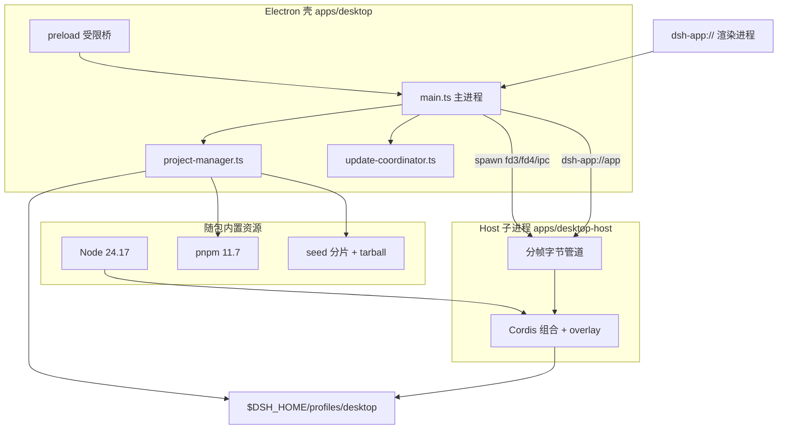
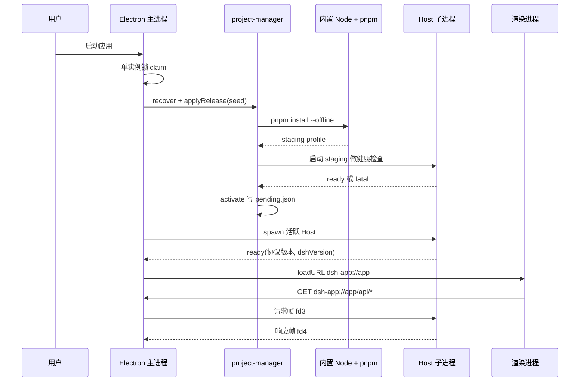
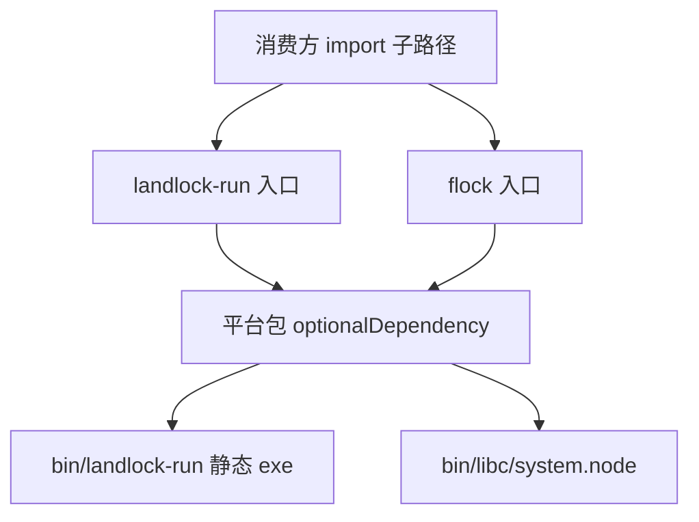

# 桌面形态：Electron 打包、自动更新、原生 addon 家族与 open-in-app

> 子文档之一，聚焦 `apps/desktop` / `apps/desktop-host` 这两个新包、随包分发的原生 addon 家族 `native/system`（`@deepseek-ai/node-addon-system`），以及 Web UI 侧的 `packages/host/open-in-app`。部署与 profile/bundle/patch 的通用机制见 [deployment.md](deployment.md)；Landlock 作为沙箱后端在能力缝中的位置见 [sandbox-capability-seams.md](sandbox-capability-seams.md)；整体哲学见 [README](README.md)。

dsh 已经有 `dsh web`：本地起一个 HTTP 服务、浏览器打开 Web UI。桌面端要回答的第一个问题因此不是"怎么把网页塞进窗口"，而是**Web 形态天生拿不到的那几样东西由谁负责**——进程所有权、包所有权、分发与更新所有权。桌面壳的答案是：把 Web UI 的渲染进程当成唯一复用面，其余全部另立一套交付流水线。

## 根因：Web UI 已经有了，桌面壳补的是"进程与分发所有权"

`dsh web` 的形态是「监听端口 + 浏览器 + 用户自己的 Node/pnpm」。桌面壳把这三件事全部收回：

- **不打开监听端口。** 桌面应用用自定义协议 `dsh-app://` 承载 Web 资源与 Fetch 流量，自注册为 `standard`/`secure`/`supportFetchAPI` 的特权方案（[apps/desktop/src/main.ts:30-38]()
<!-- anchor: protocol.registerSchemesAsPrivileged([{ …     codeCache: true, -->）。没有端口就没有端口归属、认证、CORS 与暴露面问题，这是"本地应用"相对"本地 Web 服务"最实质的差异。
- **渲染进程拿不到任何宿主能力。** 窗口以 `nodeIntegration: false`、`contextIsolation: true`、`sandbox: true` 创建，并拒绝一切非 `dsh-app://` 的导航与新窗口（[apps/desktop/src/main.ts:82-101]()
<!-- anchor: function createWindow(preload: string): BrowserWindow { …   return window -->）。main 主渲染进程只拿到一个协议标记（`apps/desktop/src/preload-app.ts:5`），只有桌面自有的插件管理窗口才拿到结构化操作，两者都拿不到文件系统、原始 `ipcRenderer`、shell 或任意 pnpm 参数。
- **运行时自带，不用系统 Node/pnpm。** 打包后的应用从 `process.resourcesPath` 解析随包内置的 Node 与 pnpm（[apps/desktop/src/main.ts:55-63]()
<!-- anchor: function runtimeResources(): RuntimeResources { …   return { node, pnpm, seed } -->），避免耦合 Electron 的 Node 补丁、fuse、原生 ABI 与系统包管理器状态。
- **独占一个受保留的 profile。** Electron 拥有 `$DSH_HOME/profiles/desktop` 及其私有 pnpm store，CLI 则被显式拒绝接管该名字的 profile（[apps/cli/src/args.ts:66-70]()
<!-- anchor: const collect = (value: string, previous: string[] = []): string[] => [...previo …     program.error('error: profile "desktop" is managed exclusively by the Electr -->）；路径布局见（[apps/desktop/src/paths.ts:29-45]()
<!-- anchor: export function resolveDesktopPaths(dshHome: string = resolveDshHome()): Desktop …       home: join(pnpm, 'home'), -->）。

一句话根因：**桌面形态的本质增量不是"多一个窗口"，而是"多一个可签名、可离线安装、可自更新、拥有进程与包所有权边界的交付单元"。** 这三件事在 Web 形态里分别由浏览器、用户环境和用户包管理器代管，因此无法由 dsh 自己保证。

与 `dsh web`/`headless` 的 profile 机制对照见 [deployment.md](deployment.md)：桌面端复用同一套 profile manifest（`dsh.profile.bundles`）与 bundle 概念，但把"谁可以写这个 profile"收窄到 Electron 一个进程。

## 概览：桌面端能力清单与技术栈

| 能力面 | 实现落点 | 不可替代性 |
|---|---|---|
| 无端口本地 UI | `dsh-app://` 特权协议 + `protocol.handle` | 无端口归属/认证/CORS 面 |
| 自带运行时 | 内置 Node 24.17 + pnpm 11.7，固定 `$DSH_HOME/desktop/pnpm/store` | 不读用户 `PATH`/npm/pnpm 配置 |
| 离线安装 | 包内 seed（本地第一方 tarball + 离线 store 分片），启动时事务化安装 | 发布到 npm 之前即可从同一次源码构建打包 |
| 事务化 profile | staging → 健康检查 → journaled 目录替换 → rollback profile | 安装/插件变更失败不破坏当前可用 profile |
| 版本绑定更新 | 一个 `electron-updater` 流同时更新壳、dsh seed、Node 与 pnpm | 壳/客户端/后端/插件组合始终经过验证 |
| 签名与公证 | macOS Developer ID + notarytool + Gatekeeper；Windows SafeNet EV | 供应链可验证，不回退未签名产物 |
| 原生插件管理 | Electron-only GUI + 内置 pnpm，`allowBuilds` 白名单 | 不暴露原始 pnpm flag，不触碰用户包状态 |
| 单实例所有权 | 进程生命周期 `requestSingleInstanceLock` | 两个进程不会争用同一个 profile |
| 原生能力 | `@deepseek-ai/node-addon-system`（Landlock + flock） | 预编译、无安装期编译 |

| 技术栈 | 版本/形态 | 用途 |
|---|---|---|
| Electron | `^44.0.0` | 壳：窗口、菜单、原生对话框、自定义协议、单实例 |
| electron-builder | `^26.15.3`（`app-builder-lib` 同版本） | 打包、签名 hook、NSIS/DMG/ZIP 目标、频道元数据 |
| electron-updater | `^6.8.9` | 差分下载与安装重启 |
| 内置 Node / pnpm | 24.17.0 / 11.7.0（随包，不发布） | 运行 dsh 后端与所有包操作 |
| Cordis overlay | `desktop.cordis.patch.yml` | 复用 Web 组合、替换载体、换原生目录选择器 |
| Node-API | v8 稳定 ABI | 原生 flock 绑定，消除 Node 大版本维度 |
| seed 传输 | 16 个确定性未压缩 tar 分片 + pnpm SQLite 索引合并 | 外层安装包压缩、差分更新可复用未变化分片 |
| 构建 | TypeScript 6 + tsdown + vitest | 壳与 Host 各自的编译入口 |

## 架构总览：三个执行体、两个包、一份 profile

三层的职责边界是这次新增最值得学的部分：**Electron 壳只管进程、窗口、协议与包事务；Host 子进程只管"把一颗 Cordis 插件树跑起来并把 Fetch 语义映射到字节管道"；已安装的 dsh profile 才是后端与 Web UI 的真正所在。** 壳本身不含任何 agent 逻辑，因此壳的更新可以只是一次签名产物的替换，而 dsh 的更新必然携带同版本的壳（原因见下文版本对齐）。

### 为什么 Host 要单独成包：`fix(desktop): move host out of CLI package`

`feat: optimize ipc perf` 落地时，Host 入口位于 `apps/cli/src/desktop-host.ts`，并通过 CLI 包的 `./desktop-host` 子路径导出、由 `apps/cli/tsdown.config.ts` 一起打包。随后 `fix(desktop): move host out of CLI package` 把它整体迁到私有包 `apps/desktop-host`：CLI 包删除了 `./desktop-host` 导出与对应 `files` 条目，Host 包声明 `"private": true`，`files` 只含运行入口与 overlay（[apps/desktop-host/package.json:9-11]()
<!-- anchor:   "files": [ …     "config/desktop.cordis.patch.yml" -->）。

这个动作的架构意图有两层：

1. **公共分发面与宿主专属契约解耦。** CLI 包发布到 npm，其导出面是对所有第三方消费者的承诺；而 Desktop Host 的入口协议（`DESKTOP_HOST_PROTOCOL_VERSION`、字节管道、Electron 专属 overlay）只对同一个签名发布里的 Electron 壳有意义。把它挂在 CLI 的 `exports` 上，等于把一个"随版本随时可变的私有契约"并入公共 API 面，并让 CLI 的发布节奏被桌面需求拖动。
2. **依赖闭包可以精确收窄。** Host 的 `files` 清单只有 `lib/index.js` 与 `config/desktop.cordis.patch.yml`，打包时会断言这两个文件同时存在，缺一个就拒绝进入签名阶段（[apps/desktop/scripts/prepare-package-set.ts:114-121]()
<!-- anchor: export function assertDesktopHostPackageFiles(files: readonly string[]): void { …     throw new Error(`desktop package set: ${DESKTOP_HOST_PACKAGE} tarball omits required file(s): $ -->）——因为"入口能加载但 overlay 缺失"的发布在健康检查时才会失败，代价高得多。

隔离也体现在运行环境上：spawn Host 时主动剥掉 `NODE_OPTIONS`、所有 `DSH_DESKTOP_*` 与 `npm_`/`pnpm_`/`corepack_` 前缀变量（[apps/desktop/src/host-process.ts:109-112]()
<!-- anchor:       env: Object.fromEntries(Object.entries(process.env).filter(([name]) => ( …       stdio: ['ignore', 'pipe', 'pipe', 'pipe', 'pipe', 'ipc'], -->），Host 进程因此既继承不到调用方的 Node 调优参数，也继承不到桌面私有的打包期变量；包操作另有固定的 registry 与 store 配置（[apps/desktop/src/project-manager.ts:102-110]()
<!-- anchor: const PROJECT_NAME = '@deepseek-ai/dsh-desktop-runtime' … const DESKTOP_REGISTRY = 'https://registry.npmjs.org/' -->）。

### Host 的 Cordis overlay：同一棵插件树，换一个载体

Host 并不重新实现一个后端。它写一份空的根配置，再叠加 profile 的 bundle patch 与打包自带的 overlay，最后 `boot` 出完整的插件树（[apps/desktop-host/src/index.ts:278-303]()
<!-- anchor: export async function runDesktopHost( …     throw new Error('dsh desktop: composition did not provide connection, typert -->）。overlay 的内容正是"桌面换载体"的全部差异（[apps/desktop-host/config/desktop.cordis.patch.yml:1-19]()
<!-- anchor: # Electron reuses the browser composition without its network and browser-launch …   disabled: true -->）：

- 关掉 `web-startup`、`webserver`、`web-runtime`、`client-hmr`——没有监听端口，也就没有 HTTP 服务器与 HMR；
- 关掉 `open-in-app` 与 `ui-open-in-app`（[apps/desktop-host/config/desktop.cordis.patch.yml:15-16]()
<!-- anchor: - id: open-in-app …   disabled: true -->），理由见下文；
- 关掉浏览器的 `directory-picker`，改为插入 `directory-picker-native` 与 `ui-directory-picker-native` 这一对原生实现；
- 给 `connection` 注入 `credentials`，并把配置显式置空。

这是"一切皆插件"在宿主移植上的直接红利：**移植一个宿主 ≠ 重写后端，而是重写一份 disable/insert 清单。** 代价是能力缝里那些绑定了 HTTP 语义的插件（open-in-app、frontend-static）无法原样复用，见「权衡与不足」。

## 启动链路与传输层

### 启动：先校准 profile，再开窗口

入口处先抢进程生命周期单实例锁，只有抢到的进程才允许触碰 profile（[apps/desktop/src/single-instance.ts:16-25]()
<!-- anchor: export function claimDesktopSingleInstance( …   return true -->）；后续启动仅聚焦或重建主窗口。打包态随后先 `recover()` 恢复中断的目录替换、再 `applyRelease` 校准 release，然后才启动活跃 Host；开发态则跳过 release 校准直接启动（[apps/desktop/src/main.ts:205-212]()
<!-- anchor:   if (development === undefined) { …   host = await startHost() -->）。窗口最后才打开，保证 Web UI 见到的是一个已就绪、版本匹配的后端。

`applyRelease` 的准入条件很硬：先校验 seed 完整性、再要求 **seed 记录的版本精确等于 Electron 应用版本**，任一不等直接抛错；若活跃 profile 的 release、dsh、Desktop Host 三处版本都已匹配则直接复用（[apps/desktop/src/project-manager.ts:394-407]()
<!-- anchor:   async applyRelease(seedDir: string, electronVersion: string, hooks: DesktopPro …         return false -->）。这就是"一个 Desktop 发布号同时标识壳与后端"的代码级落点。

### 激活事务：journal + rollback profile

目录替换是这台机器上唯一"做一半就无法用"的操作，因此它被写成带预写日志的三段式（[apps/desktop/src/project-manager.ts:519-547]()
<!-- anchor:   private async activate(stagingProfile: string, hooks: DesktopProjectHooks): Pr …       throw error -->）：写 `step: 'prepared'` → 移走活跃 profile 到 rollback → 写 `step: 'active-moved'` → 把 staging 移入活跃位置 → 写 `step: 'staging-activated'`。任一步崩溃后，`recover()` 结合日志与真实的 active/rollback/staging 目录决定是恢复还是清理（[apps/desktop/src/project-manager.ts:341-363]()
<!-- anchor:   recover(): void { …     unlinkSync(this.paths.pending) -->）。

值得学的是**健康检查被放在激活之前、且要求独占运行**：健康检查回调先停掉活跃 Host，再用 staging 项目单独启动一次 Host 并停止，最后重启活跃 Host（[apps/desktop/src/main.ts:164-201]()
<!-- anchor:   const hooks: DesktopProjectHooks = { …       host = await startHost() -->）。这避免两个桌面后端并发共享 `$DSH_HOME`，代价是每次插件变更都会让活跃会话短暂断连——对"本地单用户桌面应用"这个场景是合理倾斜。

### 分帧字节管道：为什么不用 Node IPC 传 body，以及性能优化在哪

载体协议本身很短：`DESKTOP_HOST_PROTOCOL_VERSION = 3`，请求走 fd 3、响应走 fd 4、fd 5 留给 Node 的生命周期 IPC，单个数据帧上限 64 KiB（[apps/desktop/src/host-protocol.ts:4-16]()
<!-- anchor: export const DESKTOP_HOST_PROTOCOL_VERSION = 3 as const … export const DESKTOP_PIPE_CHUNK_BYTES = 64 * 1024 -->）。帧头固定 13 字节：magic `0x44534833`（"DSH3"）、1 字节类型、4 字节单调 streamId、4 字节负载长度，数据帧与元数据帧共用同一编码（[apps/desktop/src/host-protocol.ts:92-104]()
<!-- anchor: function encodeFrame(type: RequestFrameType, streamId: number, payload: Buffer): …   return frame -->；响应侧镜像实现见 [apps/desktop-host/src/wire.ts:63-75]()
<!-- anchor: function encodeFrame(type: ResponseFrameType, streamId: number, payload: Buffer) …   return frame -->）。

`feat: optimize ipc perf` 的取舍被写进了设计说明：**曾考虑用 JSON IPC 以 Base64 承载 Fetch 消息体，被否决。** 理由是 Base64 会膨胀每个请求与响应消息体、在两个进程中构造大字符串、在分派前缓冲完整请求，还会对 RPC JSON 里已经是 Base64 的图片字节再编码一次；而原始分帧管道不要求 Electron 与上游 Node 共享 V8 序列化行为。于是 Node IPC 被压缩到只承载 `ready`/`fatal`/`shutdown` 三类无负载消息，body 一律走字节管道。

性能不是靠"少一次拷贝"这类微优化，而是靠**两端一致的背压**：

- 发送端串行化写入，写不进就等 `drain`（[apps/desktop/src/host-process.ts:263-270]()
<!-- anchor:   private enqueueRequestFrame(frame: Buffer): Promise<void> { …     return write -->），请求体按 64 KiB 切片逐帧入队（[apps/desktop/src/host-process.ts:222-247]()
<!-- anchor:   private async pumpRequest(streamId: number, request: Request, hasBody: boolean …             next.value.subarray(offset, offset + DESKTOP_PIPE_CHUNK_BYTES), -->）；
- 接收端把每帧交给 `ReadableStream` controller，一旦 `desiredSize <= 0` 就 `pause()` 整条管道（[apps/desktop/src/host-process.ts:317-327]()
<!-- anchor:       case 'data': { …         return -->）；
- Host 侧对称：响应逐块写出（[apps/desktop-host/src/index.ts:344-360]()
<!-- anchor:         await writeResponse(encodeDesktopResponseStart(command.streamId, { …         await writeResponse(encodeDesktopResponseEnd(command.streamId)) -->），请求体反向同理，读端积压时暂停请求管道（[apps/desktop-host/src/index.ts:506-517]()
<!-- anchor:       case 'data': { …         return -->）。

背压是**全局暂停而非 per-stream 限流**：任一 stream 积压就暂停整条管道。实现更简单、不会出现"活跃 stream 饿死被暂停 stream"的调度问题，代价是一个慢消费者会短暂拖慢同管道上的其他请求——对单窗口桌面应用可接受。

`fix(desktop): adapt host fetch handlers` 则暴露了一个容易忽略的接缝：Host 内部的 Fetch handler 必须显式声明请求体模式 `requestBodyMode: () => 'buffered'`（[apps/desktop-host/src/index.ts:195-196]()
<!-- anchor:   return { …     requestBodyMode: () => 'buffered', -->）。`ConnectionFetchHandler` 是 Web 载体与桌面载体共用的抽象，桌面管道没有 HTTP 的流式 body 语义，漏声明会让上层按错误模式分派。

最后，**管道优化并没有绕过 Host capability**：Host 内部仍然用组合的 `connection` 服务创建共享 Fetch handler，并同样经 `clientModules` 取客户端 bundle（[apps/desktop-host/src/index.ts:305-307]()
<!-- anchor:   const api = connection.createSharedFetchHandler('/api') …   const streams = remoteStreamHandler(ctx) -->）；桌面只是在它前面换了一个"把 `Request`/`Response` 映射到字节帧"的载体适配层（[apps/desktop/src/main.ts:224-230]()
<!-- anchor:   protocol.handle(SCHEME, (request) => { …     return active.fetch(request) -->）。这是"换载体不换内核"的又一例。

## 打包、签名与分发

### electron-builder 配置即发布契约

打包配置不是一堆产物选项，而是"发布需要哪些身份"的声明（[apps/desktop/electron-builder.config.mjs:48-58]()
<!-- anchor:   return { …       'package.json', -->）：`asar: true`，应用只装 `lib/*.js` + `renderer/**` + `package.json`，`extraResources` 把准备好的 `runtime` 与 `seed` 两个目录投放到 `process.resourcesPath` 下——这正是 `main.ts` 里 `runtimeResources()` 解析的资源布局，两边必须同时改。

macOS 目标强制签名、强制 hardened runtime、要求公证，并在 `afterSign` 里做深度严格校验、在 `artifactBuildCompleted` 里对 DMG 单独公证（[apps/desktop/electron-builder.config.mjs:64-85]()
<!-- anchor:     mac: { …         macOSSigning ?? resolveMacOSSigningEnvironment(env), -->）。Windows 目标 `forceCodeSigning: true`、SHA-256、NSIS，并把 `publish` 指向由环境变量解析出的 generic provider（[apps/desktop/electron-builder.config.mjs:88-105]()
<!-- anchor:     win: { …     publish: [{ provider: 'generic', url: update.publicUrl }], -->）。

### target-specific builds：只共享不可变缓存

`feat(desktop): update packaging and auto-update paths for target-specific builds` 把"目标"提升为一等概念。目标名由平台/架构推导（`mac-arm64`/`mac-x64`/`win-x64`），每个目标独占一整棵可变目录树：runtime、package-set、seed、seed-pnpm、node-extract、packed、artifacts；**只有 `downloads` 缓存共享**（[apps/desktop/scripts/desktop-build-paths.mjs:36-53]()
<!-- anchor: export function desktopTargetBuildPaths(target) { …     downloads: join(BUILD_ROOT, 'downloads'), -->）。理由是该缓存里的每个归档文件名都带版本、平台与架构并在解包前校验 SHA-256，天然不可变；而 seed 的 pnpm store 会因平台可选依赖而目标专用，共享它就会造成跨目标污染。

`fix(desktop): keep package helpers platform-neutral` 修的是同一件事的边界：`prepare-package-set.ts` 原先在模块顶层就调用 `resolveDesktopTargetBuildPaths()` 并把结果固化成 `OUTPUT_ROOT`/`DEFAULT_INPUTS` 常量，导致任何"import 这个模块当库用"的调用方会被环境里的 `DSH_DESKTOP_TARGET_*` 劫持。修复把目标解析移进 `main()`（[apps/desktop/scripts/prepare-package-set.ts:155-168]()
<!-- anchor: function main(): void { …   prepareDesktopPackageSet(inputs, output) -->），使该模块在库用法下不产生目标副作用。这是"构建脚本同时是库"时必须守的一条纪律。

### macOS 签名与公证：连 seed 里的每个 Mach-O 都要过审

公证会检查归档内的代码，因此 macOS 的 seed 准备不是"打包 tar"而是**逐个原生对象重签名**：把每个 Mach-O CAS 对象 staging 出来、用 Developer ID 签名并更新 pnpm 的 SHA-512 索引，并发度取 `min(上限, availableParallelism())`；签名器拒绝时保持原始 CAS 对象与包索引不变（[apps/desktop/scripts/macos-seed-store.ts:369-379]()
<!-- anchor: export async function signMacOSSeedStore( …     throw new Error(`desktop seed signing: concurrency must be a positive intege -->）。签名后的应用还要做身份校验：要求叶证书 `Authority=Developer ID Application: <identity>` 与 `TeamIdentifier=<teamId>` 同时命中，缺失即失败（[apps/desktop/scripts/verify-macos-signature.mjs:13-17]()
<!-- anchor: export function assertMacOSSignatureDetails(details, expected) { …   const missing = [expectedAuthority, expectedTeam].filter(field => !fields.has( -->），应用级校验用 `codesign --verify --deep --strict --verbose=2`（[apps/desktop/scripts/verify-macos-signature.mjs:144-145]()
<!-- anchor-base64:ZXhwb3J0IGZ1bmN0aW9uIHZlcmlmeU1hY09TU2lnbmF0dXJlKGFwcFBhdGgsIGV4cGVjdGVkKSB7IOKApiAgIHJ1bkNvZGVTaWduKFsnLS12ZXJpZnknLCAnLS1kZWVwJywgJy0tc3RyaWN0JywgJy0tdmVyYm9zZT0yJywgYXBwUGF0aF0p -->）。这套设计的意图是**不让证书发现顺序决定发布身份**：App ID、Team ID、签名身份、notarytool 凭据全部必填，空值或含 `Developer ID Application:` 前缀的身份直接拒绝。

### Windows EV 签名：私钥不出 USB Token

Windows 用外部公开叶证书 + SafeNet Token 里的不可导出私钥：`createWindowsTokenSigner` 校验证书文件、SignTool 路径、PIN 与密钥容器四要素（[apps/desktop/scripts/windows-sign.mjs:142-166]()
<!-- anchor: export function createWindowsTokenSigner(options) { …           signTool, -->），并通过一个 CRLF 的 `windows-sign.cmd` 以 `/f` + SafeNet `/kc "[{{PIN}}]=容器"` + `eToken Base Cryptographic Provider` + SHA-256 摘要 + RFC 3161 时间戳调用 SignTool；不重试失败签名、不回退未签名产物。打包编排只把四个字段交给 electron-builder 与签名 CMD，且会在 SignTool 启动前清除并遮蔽诊断。硬约束也照实记录：SafeNet 要求 PIN 出现在 SignTool 命令行，因此只能在连接物理 Token 的受控 self-hosted runner 上以临时 secret 注入。

### 自动更新：通道、版本对齐与上传顺序

更新配置由 `DSH_DESKTOP_AUTO_UPDATE_ENV`（`test` | `production`，未设置按 `test`）同时决定公开 origin 与 COS bucket 凭据，公开 URL 形如 `<origin>/_/harness/desktop/stable/<target>/`（[apps/desktop/scripts/desktop-auto-update-environment.mjs:132-148]()
<!-- anchor: export function resolveDesktopAutoUpdateConfig(env, platform, arch) { …     publicUrl: `${origin}/${keyPrefix}/`, -->）。频道元数据文件名按 semver 预发布首段决定，稳定版是 `latest.yml`/`latest-mac.yml`，预发布是 `alpha.yml`/`alpha-mac.yml`（[apps/desktop/scripts/desktop-auto-update-environment.mjs:73-82]()
<!-- anchor: export function desktopUpdateMetadataFilename(version, platform) { …   return `${channel}${platform === 'darwin' ? '-mac' : ''}.yml` -->）——这正是"pre-release 阶段版本对齐风险"的来源：通道名由版本号字符串推导，写错就静默换通道。

上传被刻意拆成"先生成计划、再动凭据"两段。计划阶段只做校验，不读任何 COS 密钥：要求根 dsh 版本 == Desktop 版本（[apps/desktop/scripts/desktop-upload-plan.ts:184-200]()
<!-- anchor:   const dshVersion = await manifestVersion(join(repositoryRoot, 'package.json'), …     throw new Error(`desktop upload: ${targetName} package completion record doe -->），再要求完成记录、更新元数据版本、产物名、大小与 SHA-512 全部一致；通过后才组装上传清单，其中 macOS 走 DMG + 签名 ZIP + ZIP blockmap，Windows 走带内嵌 blockmap 的 NSIS exe，**频道元数据永远排在最后并以 `no-cache` 上传**（[apps/desktop/scripts/desktop-upload-plan.ts:227-246]()
<!-- anchor:   if (target.platform === 'darwin') { …   artifacts.push(uploadArtifact(metadataPath, update.keyPrefix, 'application/yam -->）。DMG 不生成 blockmap 是有意的：它经过公证会钉票，任何事后重打包都会让 blockmap 失效；macOS 的差分载荷是 ZIP。

运行时侧只有一个更新协调器：`autoDownload = false`、`autoInstallOnAppQuit = false`，只有在打包态且存在 `app-update.yml` 时才检查（[apps/desktop/src/update-coordinator.ts:26-31]()
<!-- anchor:     private readonly enabled: () => boolean = () => ( …     this.updater.autoInstallOnAppQuit = false -->）；安装路径先下载、再通知 `ready`、再停掉 dsh 子进程、最后 `quitAndInstall`（[apps/desktop/src/update-coordinator.ts:74-86]()
<!-- anchor:   private async doInstall(): Promise<DesktopUpdateState> { …       return ready -->）。主窗口打开 10 秒后自动检查一次，菜单项手动触发同一检查；两者都走原生确认弹窗。

### 版本对齐与 `fs-ext`：两处踩坑

**版本对齐**（`fix(desktop): align app versions with release`）：Electron 包、私有 Host 包、根 dsh 包必须同版本，`applyRelease` 也会在运行时再次断言 seed 版本等于 Electron 版本。这不是洁癖——GUI 协议绑定客户端与后端版本，独立定版会产生未经验证的"壳 × 后端 × 插件"组合，并让"是否有更新可用"变得无法判断。代价被明确接受：**即使壳代码一行没改，只要 dsh 升级就必须发一个新 Desktop 版本。**

**`fix(desktop): allow fs-ext in generated projects`**：桌面为每个 profile 生成一份 `pnpm-workspace.yaml`，其中 `allowBuilds` 是一个显式白名单（[apps/desktop/src/project-manager.ts:124-133]()
<!-- anchor: function workspaceFile(overrides: Readonly<Record<string, string>> = {}): string …   return `packages:\n  - .\n\n${overrideSection}${WORKSPACE_SETTINGS}allowBuilds -->）。`fs-ext` 必须被列入才允许运行其构建脚本，否则该原生依赖会静默地不编译、在运行期才以加载失败暴露。白名单同时把 `node-pty`、`koffi`、`@deepseek-ai/dsh-subprocess-local` 标为允许，把 `@google/genai`、`protobufjs`、`node-addon-require-builtin` 标为禁止——**默认拒绝 + 逐项放行**是这里唯一可审计的策略。

### seed 的物理形态：为什么是 16 个未压缩分片

seed 的 store 被切成 16 个确定性的未压缩 tar，分片号 = 规范化相对路径的 SHA-256 首 4 字节对分片数取模（[apps/desktop/src/seed-store.ts:62-63]()
<!-- anchor: function shardFor(path: string, shardCount: number): number { …   return createHash('sha256').update(path).digest().readUInt32BE(0) % shardCount -->），归档名固定为 `store-<hex>.tar` 且由 `store-archives.json` 声明（[apps/desktop/src/seed-store.ts:19-26]()
<!-- anchor: /** Directory containing the seed's uncompressed pnpm store archives. */ … const ARCHIVE_NAME_PATTERN = /^store-[0-9a-f]{2}\.tar$/u -->）。分片本身不压缩，把压缩交给外层 DMG/ZIP/NSIS，从而让差分更新器能在稳定的数据区间上复用未变化的分片；这也解释了为什么"文件系统占用 ≠ 安装包下载大小"，两者必须分别测量。另一个副作用是签名记录数：签名应用记录的是十几个分片，而不是 pnpm store 里数万个缓存文件。

## 原生 addon 家族 `node-addon-system`

### 为什么把 Landlock 与 flock 收进同一个家族

`refactor(native): rename package family to node-addon-system` 与 `refactor(native): move Landlock workspace to native/system` 把原 `native/landlock-run` 升级为 `native/system`，家族名从"一个工具"变成"一类机制"。家族成员的共性是**交付形态**而非功能耦合：一个是 Linux 上的静态 confinement 可执行文件，一个是 POSIX 文件锁的 Node-API 绑定；两者互不依赖，但共享同一套"平台包 + `prebuilds.json` 驱动矩阵 + prepack 校验 + 安装产物彩排"的发布基础设施（[native/system/README.zh.md:11-11]()
<!-- anchor: 使用 Linux `landlock-run` 可执行文件限制子进程，或通过 `./flock` 入口获取 POSIX 写锁。平台包包含预编译二进制；用户安装时 … 使用 Linux `landlock-run` 可执行文件限制子进程，或通过 `./flock` 入口获取 POSIX 写锁。平台包包含预编译二进制；用户安装时 -->）。若拆成两个包，就要维护两套构建矩阵、两套发布流程、两份平台支持声明——而它们的支持矩阵本来就高度重合（[native/system/docs/support-matrix.md:3-14]()
<!-- anchor: | Platform package suffix | Builder | Payload | … Windows has neither a Landlock launcher nor this POSIX addon. The Harness retain -->）。

命名规则也一并固化为文档：入口包 `@deepseek-ai/node-addon-system`、平台包 `@deepseek-ai/node-addon-system-<platform>`，二进制固定为 `bin/landlock-run` 与 `bin/system.node`（Linux 下 `bin/glibc/system.node` / `bin/musl/system.node`）（[native/system/docs/naming.md:5-16]()
<!-- anchor: The public package family belongs to the `@deepseek-ai` scope and uses the `node … The Linux launcher remains `bin/landlock-run`. The Node-API addon is `system.nod -->）。

### capability subpath：无根导出 + 可选平台载荷

入口包的 `exports` 只暴露两个能力子路径，**没有根导出**（[native/system/packages/entry/package.json:11-20]()
<!-- anchor:   "exports": { …     "./package.json": "./package.json" -->），平台载荷则声明为 `optionalDependencies`（[native/system/packages/entry/package.json:40-44]()
<!-- anchor:   "optionalDependencies": { …     "@deepseek-ai/node-addon-system-linux-x64": "workspace:*" -->）。这个组合很重要，原因是三条：

1. **可选 ≠ 可用，但不影响 import。** npm 的 `os`/`cpu` 字段让安装器只取匹配的平台包，缺失平台包不会让主包安装失败；而两个 JS 入口都被设计成"没有原生载荷也能正常 import"。
2. **能力子路径杜绝了"拿到不确定语义"。** 消费者必须显式写 `.../landlock-run` 或 `.../flock`，不能从根导入一个含义模糊的聚合面。两个子路径各有独立类型声明，契约边界即模块边界。
3. **失败模式被定义成显式拒绝。** Landlock 在可执行文件缺失时探测为 `unusable`（与内核不支持同一答案：不可信），flock 在绑定缺失时拒绝获取，两者都**不编译、不静默授予**（[native/system/docs/packaging.md:3-18]()
<!-- anchor: The family publishes one ESM entry package plus OS/CPU-selected optional platfor … The `./landlock-run` API stays importable without native payloads and reports un -->）。

Landlock 入口还额外承担了"契约唯一出处"的角色：launcher 的 CLI 契约（`--ro`/`--rw`/`--probe`、失败退出码 125）由 JS 模块拥有，参数拼装与探测解析都在这里完成，策略仍留给消费方（[native/system/packages/entry/src/index.ts:2-14]()
<!-- anchor:  * The JavaScript API over the prebuilt `landlock-run` launcher: resolve the …  * environment. Test injection is by function parameter. -->）。设计意图写得很直白：**契约与二进制同包同版本，probe 解析与二进制漂移在结构上不可能发生。** 探测是功能性的（真起一个子进程构建并强制最大 ruleset），而不是看 `--version`（[native/system/packages/entry/src/index.ts:116-126]()
<!-- anchor: export function probe( …   return /partially enforced/.test(result.stdout) ? 'partial' : 'full' -->）；`launcherPath()` 在平台包不可解析时回退到一个"按 pnpm 布局本该在此、但绝不存在"的绝对路径，并明确不检查存在性——探测是唯一可用性信号（[native/system/packages/entry/src/index.ts:69-81]()
<!-- anchor: export function launcherPath( …     return fileURLToPath(new URL(`../node_modules/${platformPackage}/bin/${LAUNCH -->）。

### 预编译 Node-API 解决了什么分发难题

Node-API v8 是稳定 ABI，因此**同一份 `system.node` 二进制可以跨 Node 20/22/24/26 使用**，构建矩阵少掉"Node 大版本"这一维——但 OS、CPU、libc 三维仍在：Linux 需要 glibc 与 musl 两份 addon，macOS 是 Mach-O bundle（[native/system/docs/architecture.md:9-19]()
<!-- anchor: The `./landlock-run` entry owns Landlock path resolution, grant argv, and the fu … The JSONL backend retains its inode check, materialization timing, and close lif -->）。它解决的分发难题是：**用户机器上不再需要编译器，也不再需要安装期脚本。** 平台包不含任何 JavaScript，只装 `bin/` 下的二进制；入口包通过 `require.resolve('@deepseek-ai/node-addon-system-<platform>-<arch>/package.json')` 定位并在 `tryLockExclusive` 首次调用时才加载（[native/system/packages/entry/src/flock.ts:12-31]()
<!-- anchor: function loadBinding(): FlockBinding { …   return binding -->）。Linux 的 libc 选择不看环境变量，而看运行进程自身的 `process.report`：有 `glibcVersionRuntime` 走 `bin/glibc/`，否则走 `bin/musl/`；不支持的平台抛 `ERR_FLOCK_UNSUPPORTED_PLATFORM`（[native/system/packages/entry/src/flock.ts:46-55]()
<!-- anchor: export async function tryLockExclusive(fd: number): Promise<void> { …     syscall: 'flock', -->）。文档甚至把"运行时不读任何环境变量"列为安全规则而非风格约定。

`prebuilds.json` 是这套矩阵的唯一数据源：每个平台包声明自己的二进制（工具、种类、路径、Node-API 版本、libc），CI 与 release 的工作流矩阵由它派生而不是手写（[native/system/packages/linux-x64/prebuilds.json:2-21]()
<!-- anchor:   "platform": "linux-x64", …       "path": "bin/musl/system.node" -->；[native/system/scripts/github-matrix.mjs:1-8]()
<!-- anchor: #!/usr/bin/env node …  *   node scripts/github-matrix.mjs release-prebuild  → one leg per platform pac -->）。构建脚本只构建当前宿主声明的产物，明确拒绝在没有原生目标的平台上构建（[native/system/scripts/build.ts:2-4]()
<!-- anchor:  * Build this host's declared system binaries. Landlock is a static musl …  * Node headers come from the Node installation running this script. -->）；`ci(native): consolidate platform compatibility jobs` 则把跨 Node 版本的兼容验证与 Alpine musl 容器合并为更少的作业。

### 消费方：能力缝照旧，只是实现换了

家族的两个消费者都在既有的 capability seam 上，前端代码没有得到任何特殊待遇：

- **沙箱后端** `packages/sandbox/sandbox-local`：从 `/landlock-run` 拿 `launcherPath`、`probe` 与失败退出码，参与 bwrap → Landlock 的 runner 链（[packages/sandbox/sandbox-local/src/index.ts:30-38]()
<!-- anchor:   LAUNCHER_FAILURE_EXIT, … import type { SessionId } from '@deepseek-ai/dsh-session' -->）。选型细节见 [sandbox-capability-seams.md](sandbox-capability-seams.md)。
- **会话写租约** `packages/session/session-persistence-jsonl`：POSIX 分支用 `tryLockExclusive(fd)` 对 `session.lock` 做非阻塞独占 flock，Windows 分支用命名内核信号量，两条路都靠"持有者进程死亡即释放"避免陈旧锁（[packages/session/session-persistence-jsonl/src/lease.ts:36-37]()
<!-- anchor: import type { SessionId } from '@deepseek-ai/dsh-session' … import { acquireLockHandleWin32, releaseLockHandleWin32 } from './win32.ts' -->）。浏览器 worker 用单进程替身替换 `/flock` 入口，因为单进程内的写声明已经排除了所有写者。

`feat(native): add prebuilt Node-API flock support` 与 `refactor(native): expose Landlock through its capability subpath` 合起来说明了一件事：**把原生能力做成"可 swap 的实现 + 稳定的子路径契约"，是 capability seam 能从纯 JS 后端一路延伸进 C 代码的前提。**

## open-in-app：从 Web UI 打开本地应用

### 定位与目标应用

`open-in-app` 是 Web profile 里的一对包（host 侧 `packages/host/open-in-app`、client 侧 `ui-open-in-app`），在会话头部放一个 "Open In..." 分体按钮，把当前 workspace 目录在用户本机已安装的编辑器/Git GUI/终端/文件管理器里打开。host 半边的 `inject` 明确只有三个依赖：`webServer`（路由载体）、`connection`（信任栅栏）、`subprocess`（进程内 PATH 解析）（[packages/host/open-in-app/src/index.ts:47-47]()
<!-- anchor: export const inject = ['webServer', 'connection', 'subprocess'] … export const inject = ['webServer', 'connection', 'subprocess'] -->）。

目录是**编译期固定的白名单**（[packages/host/open-in-app/src/catalog.ts:181-181]()
<!-- anchor: export const OPEN_IN_APP_CATALOG: readonly OpenInAppApp[] = [ … export const OPEN_IN_APP_CATALOG: readonly OpenInAppApp[] = [ -->），覆盖四类：

| 类别 | 目标 |
|---|---|
| 编辑器 / IDE | Cursor、VS Code 与 Insiders、Windsurf、Zed、Sublime Text、Xcode、Android Studio、IntelliJ IDEA、PyCharm、WebStorm、PhpStorm、GoLand、Rider、RustRover |
| Git GUI | Fork、Sourcetree、GitHub Desktop、Tower、GitKraken、SmartGit、Sublime Merge |
| 终端 | Ghostty、Warp、iTerm2、kitty、Terminal、Windows Terminal、Git Bash、GNOME Terminal、Konsole |
| 文件管理器 | Finder、File Explorer、`xdg-open` |

（清单来源 [packages/host/open-in-app/README.md:54-54]()
<!-- anchor: The catalog is a fixed whitelist covering editors and IDEs (Cursor, VS Code and  … The catalog is a fixed whitelist covering editors and IDEs (Cursor, VS Code and  -->。）

关键设计是"**只提供已验证的启动器，绝不提供裸安装记录**"：每个条目声明一条按序尝试的 locator 链，解析结果必须是本机真实持有的产物。平台策略差异由此收敛为一张定位表（[packages/host/open-in-app/README.md:56-58]()
<!-- anchor: - **macOS** checks the known application directories (`/Applications`, `~/Applic … - **Linux and Windows CLI names** resolve in-process through the composition's s -->）：macOS 只查 `/Applications` 与 `~/Applications` 的 bundle 拼写并用 `open -a` 启动（Xcode 跟随 `xcode-select -p`，刻意不做 Launch Services 查询、不做磁盘扫描）；Windows 依次读 `App Paths` 注册表、只在能证明磁盘可执行文件时才采用的 Uninstall 记录、已知路径与最新版本化目录，GitHub Desktop 还额外解析随包 `cli.js` 并走受支持的 `github open`；Linux 与 Windows 的 CLI 名字经 `ctx.subprocess.resolveExecutable()` 进程内解析（PATH/PATHEXT stat，无 shell、不派 `which`），Linux GUI 条目回退到 XDG desktop 条目里验证过的 `TryExec`/`Exec`，`xdg-open` 只在主机声明了 display server 时出现。

### 安全：三道闸门都不在浏览器侧

`open-in-app` 的模块注释明确写了"安全只有这一个家"（[packages/host/open-in-app/src/index.ts:2-20]()
<!-- anchor:  * Host half of open-in-app: three routes on the composition's `webServer` …  * gone (`ENOENT`) invalidates that one entry and re-resolves it once. -->）：

1. **信任栅栏。** 三条路由（`GET /open-in-app/apps`、`GET /open-in-app/icon/<id>`、`POST /open-in-app/open`）在入口处一律先问组合的 `connection` 服务要一个拒绝判定，其 Host/Origin 栅栏挫败 DNS rebinding 与跨站调用、浏览器认证（登录令牌 cookie）再挡一层（apps 路由见 [packages/host/open-in-app/src/index.ts:193-204]()
<!-- anchor:   ctx.effect(() => ctx.webServer.register({ …   }), `open-in-app: GET ${OPEN_IN_APP_APPS_ROUTE}`) -->）。
2. **Wire 边界校验。** open 路由在这层栅栏之上再校验：content-type 的 essence 必须精确是 `application/json`、body 上限 64 KiB（超限先排空再回 413）、`app` 必须是**已解析为可用**的目录 id、`path` 必须是非空绝对路径且 `stat` 出来是目录，然后把已解析的启动器直接交给 launcher——**从不按请求内容重新探测，也从不接受命令字符串**（[packages/host/open-in-app/src/index.ts:241-310]()
<!-- anchor:   ctx.effect(() => ctx.webServer.register({ …   }), `open-in-app: POST ${OPEN_IN_APP_OPEN_ROUTE}`) -->）。
3. **执行侧最小化。** 探测与图标命令走 `@deepseek-ai/dsh-native-command`（argv，绝不走 shell），启动以 detached + 凭据清理后的环境派生；SSH 会话（继承层存在非空 `SSH_CONNECTION`/`SSH_TTY`）时应用目录直接为空、按钮隐藏。

这里最值得移植的是**"不要在 Web 端开放任意执行"的具体落法**：不暴露任何"运行这个命令"的参数，只暴露一个封闭 catalog 的 id；可用性判定发生在请求到达之前；启动目标来自解析结果而非请求体。三者缺一，`POST /open` 就会退化成一个远程命令执行端点。

### 桌面端为什么禁用它

桌面端显式 disable 了 `open-in-app` 与 `ui-open-in-app`（[apps/desktop-host/config/desktop.cordis.patch.yml:15-16]()
<!-- anchor: - id: open-in-app …   disabled: true -->），原因也写进了已知限制：**该 Host 插件的实现依赖 HTTP 路由，而 Desktop 不提供 `webServer`**（[apps/desktop/README.zh.md:177-180]()
<!-- anchor: - Desktop 禁用 Web 的“在本地应用中打开”操作，因为其 Host 插件依赖 HTTP 路由，而 Desktop 不提供 `webServer`。 … - 桌面壳与 CLI dsh 共享 `$DSH_HOME` 下的会话、设置、凭据、工作区和存储，但可执行包、插件激活、锁文件与包管理器状态彼此隔离。 -->）。这是"换载体"留下的能力缺口，而不是疏漏：桌面已经有原生目录选择器（`directory-picker-native`），但"用哪个本地应用打开"这条路因为契约绑在 HTTP 上而暂时走不通。

## 权衡与不足

**能力重复：桌面 Host 重写了一份静态资源服务。** 因为 `webserver` 被 disable，Host 必须自带 `assetHandler`：自己的 MIME 表（[apps/desktop-host/src/index.ts:122-128]()
<!-- anchor: const MIME: Readonly<Record<string, string>> = { …   '.webmanifest': 'application/manifest+json', -->）、自己的根目录包含与 `realpath` 二次校验、以及"找不到文件就回退到 index.html"的 SPA 语义（[apps/desktop-host/src/index.ts:207-217]()
<!-- anchor:       if (pathname === '/' || pathname === '/index.html') return renderIndex() …         return renderIndex() -->）。这些逻辑在 Web profile 侧由 frontend-static 承担，两份实现需要各自维护路径穿越防护与 index 注入。这是当前分层的真实成本：**overlay 只能复用插件，不能复用"插件背后的 HTTP 层行为"。**

**签名与公证的供应链门槛。** macOS 需要 Developer ID 私钥、Team ID 与完整 notarytool 凭据；Windows 需要公开 EV 叶证书、已验证 SignTool、SafeNet 容器与 Token PIN，且 PIN 必然出现在 SignTool 命令行，只能在受控 self-hosted runner 上注入。二者都要求生产发布基础设施，**只跑仓库测试无法完成认证**——桌面端因此有相当一部分验证成本落在 CI 之外的发布环境。

**原生 addon 的构建矩阵成本。** Node-API 消除了 Node 大版本维度，但没有消除平台维度：4 个平台包、Linux 两种 libc、外加 Node 20/22/24/26 的兼容性验证与 Alpine musl 容器执行（[native/system/docs/support-matrix.md:3-14]()
<!-- anchor: | Platform package suffix | Builder | Payload | … Windows has neither a Landlock launcher nor this POSIX addon. The Harness retain -->）。新增一个平台需要原生 builder 与安装产物验证，不能靠交叉编译糊过去；Windows 则完全不在家族内，继续用 koffi 信号量。

**pre-release 阶段的版本对齐与通道风险。** 三包必须精确同版本、seed 版本必须等于 Electron 版本，否则启动直接失败；同时频道元数据文件名由 semver 预发布首段推导。这意味着发布序列里任何一次"只升一个包"或"版本号预发布段写法不一致"都会表现为用户侧更新不可达或启动失败，而不是温和降级。换来的是"不存在未经验证的组合"，取舍方向明确。

**离线安装的体积与磁盘占用。** 内置 Node 与 pnpm 加上 seed 分片，粗估增加约 35–50 MB 压缩体积与 120–165 MB 安装体积；首次启动还要先把 seed store 解包到 `$DSH_HOME/desktop/pnpm/store` 才安装可写 profile，因此发布验证必须分别测量应用与 Harness home 的磁盘占用。分片不压缩换取差分更新效率，是用体积换更新流量。

**平台覆盖不均。** Desktop 尚无 Linux 发布目标；`open-in-app` 的 macOS 检测只认已知路径，新装应用要重启才出现，图标保真度受限于各平台的标准接口（Windows 只有 .NET `ExtractAssociatedIcon` 的 32px）。

## 可借鉴的设计

- **把"宿主专属入口"从公共分发面剥离成 private 包，再用本地 tarball 锁版本组合。** CLI 保持公共 API 面干净，桌面 Host 可以随壳演进，而"同一版本号 + 本地 tarball + 完整性清单"保证二者组合可验证。
- **capability subpath + optionalDependencies + 懒加载**：原生能力做成"缺载荷也能 import、调用时才拒绝"的子路径，避免把原生构件变成主包安装的硬失败点。
- **换载体不换内核**：宿主移植写成一份 disable/insert overlay，而不是重写后端；能复用的插件原样复用。
- **构建矩阵由数据派生**（`prebuilds.json` → CI/release matrix），新增平台只改数据不改 workflow。
- **target-specific 可变目录 + 只共享不可变缓存**：并行构建多个目标时，隔离可变准备状态、共享带校验和的下载缓存。
- **上传计划与凭据读取分离**：先做纯校验（版本/完成记录/大小/SHA-512/URL），全部通过再读密钥并传输；频道元数据永远最后、且 `no-cache`。
- **目录替换用预写日志 + rollback 副本**：把"可能做一半"的文件系统操作变成可恢复事务。

## 总结：桌面端是"交付单元"而不是"壳"

回到开篇根因：`dsh web` 把 dsh 交给浏览器和用户环境，桌面端把这份托管关系收回自己手里——不监听端口、自带运行时、离线 seed 安装、事务化 profile、签名分发、版本绑定的自动更新、以及一个只对桌面开放的原生插件管理面。这些能力一项都不属于 agent 逻辑，却决定了"dsh 能不能作为一个可安装、可更新、可审计的本地应用被交付"。而 `node-addon-system` 与 `open-in-app` 分别展示了同一哲学在另外两个方向上的延伸：**原生能力沉淀为带子路径契约的预编译家族，宿主能力沉淀为带信任栅栏的封闭 catalog。** 三者的共同点是把自己限制在一个显式声明的边界内——这正是 dsh"一切皆插件 + 能力缝"的哲学在分发层与宿主层的一次对齐。

## 引用核验

本文所有 `文件:行号` 引用均以首末行双锚点指纹经 `verify-references.mjs` 对真源 `deepseek-harness` 重定位，全部 `[GROUNDER-OK]`；Mermaid 图经 `check-mermaid.mjs` 真解析通过。无 `[UNVERIFIED]`、无 `[GROUNDER-MISMATCH]`、无 `[GROUNDER-TRAVERSAL]`，故无待人工复核条目。
