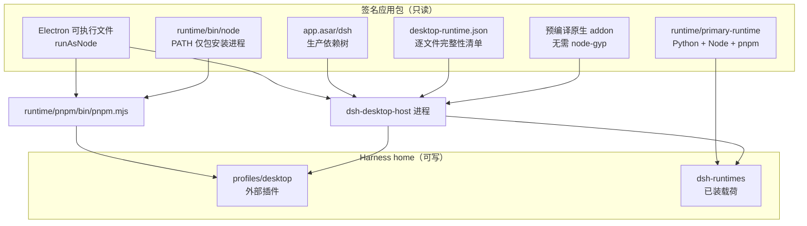
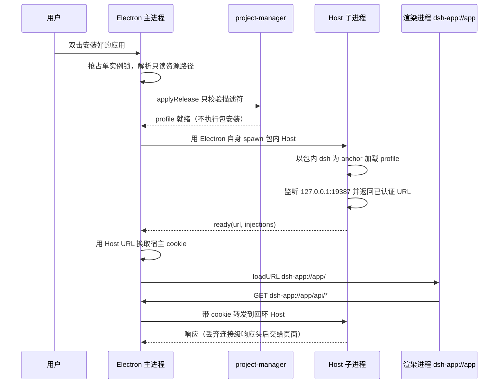

# 桌面端零依赖运行时：用户不装 Node、pnpm、Python 也能跑

> 子文档之一，聚焦"用户本地环境零依赖"这一条供给链：`ELECTRON_RUN_AS_NODE` 兼任 Node、构建期物化的生产依赖树、独立 primary-runtime 载荷（Python/Node/pnpm）、私有 `node` 转发启动器与预编译原生 addon。桌面端的整体形态、打包签名、自动更新与 `open-in-app` 见 [desktop-app.md](desktop-app.md)；profile/bundle/patch 的通用机制见 [deployment.md](deployment.md)；整体哲学见 [README](README.md)。

`npx @deepseek-ai/dsh web` 的隐含前提是"用户机器上已经有 Node"。桌面安装包把这个前提删掉了：它不能要求用户先装 Node、不能要求 `pnpm` 在 `PATH` 上、也不能要求系统里有 Python 才能做 Office 文档——**否则"下载即用"的本地应用就退化成"先配环境再下载"的开发者工具**。这条约束反过来重塑了桌面端的整个打包架构。

## 根因：agent harness 要的不止一个运行时

大多数桌面应用只带一个运行时（Electron 自带 Chromium + Node）。dsh 的进程图比这复杂，因为它要把"给 agent 用的一台小电脑"一起交付：

| 运行需求 | 谁需要 | 用户机器上通常没有的原因 |
|---|---|---|
| Node 运行时 | Cordis 插件树、Web 后端、LLM 适配器 | 用户可能从不写 JS；装了也可能是别的版本 |
| 包管理器 | 安装第三方插件 bundle | pnpm 不是默认安装项；版本与 lockfile 强相关 |
| Python + 科学计算库 | `office-docx`/`office-pptx`/`office-xlsx` 技能 | numpy/pandas/python-docx 等需要 pip 与编译/轮子匹配 |
| 预编译原生模块 | 沙箱（Landlock）、会话写租约（flock）、PTY/FFI | 需要 node-gyp + 平台工具链，且 ABI 必须匹配 |

四类需求各自都能单独解决，难的是**同时解决且互不污染**：把 Python 塞进 `PATH` 会改变用户的包管理器行为，把 Node 版本钉死会与 Electron 的补丁冲突，把原生模块交给用户的编译链就等于把构建失败转嫁给用户。

## 概览：四条供给线

桌面端把它们拆成四条互不重叠的供给线：

| 供给线 | 需求 | 载体 | 落点 | 用户可见的配置成本 |
|---|---|---|---|---|
| 宿主运行时 | Host 进程的 Node | **Electron 可执行文件本身**（RunAsNode） | 应用包内 | 无 |
| 核心依赖 | dsh + Desktop Host 的生产依赖闭包 | 构建期物化的 `app.asar/dsh/node_modules` | 应用包内（只读） | 无 |
| 外部插件 | 第三方插件 bundle | 随包 `pnpm.mjs` | `$DSH_HOME/profiles/desktop` | 无（不改用户 pnpm 配置） |
| 脚本与 Office | Python、独立 Node、pnpm、Office 库 | primary-runtime 载荷 | `$DSH_HOME/dsh-runtimes/dsh-primary-runtime` | 无（不改 `PATH`/环境变量） |
| 原生能力 | Landlock / flock | 预编译平台包 `@deepseek-ai/node-addon-system-<platform>` | 随依赖树 | 无（无安装期编译） |

### 技术栈一览

| 层面 | 形态 | 在零依赖中的角色 |
|---|---|---|
| Electron | `^44.0.0`，打包时打开 `runAsNode` fuse | 同时是浏览器运行时与 Host 的 Node |
| 内置 pnpm | `11.7.0`（与根 `packageManager` 校验一致） | 唯一允许执行外部包安装的入口 |
| primary-runtime | Node `24.21.0` + Python `3.12.14` + pnpm | agent 跑脚本、做 Office 文档的"自带解释器栈" |
| 原生 addon | Node-API v8 预编译，`prebuilds.json` 驱动矩阵 | 免 node-gyp、免安装期脚本 |
| 完整性 | `desktop-runtime.json`（逐文件 sha256 + 可执行位） | 让"随包依赖树"可校验而非盲信 |
| 载荷身份 | `runtime.json` 的 `payloadDigest`（锁定输入摘要） | 让"已装载荷"可判等、可原子替换 |

## 架构总览：签名包只读，Harness home 可写

这张图的关键不对称是：**应用包内的所有东西都是只读且签名过的，可写的只有 Harness home 下的两处**——而这两处恰好是"用户自己的插件"和"用户自己的解释器栈"。把可变面收敛到两个目录，既是零依赖的前提（不需要往系统目录写任何东西），也是卸载与恢复的边界。

## 启动链：从双击图标到 agent 能跑 shell

注意链路里**没有任何一步在用户机器上"安装"东西**：没有 `node` 解析、没有 registry 请求、没有构建脚本。这正是零依赖的可观测判据。

## 供给线一：Host 用 Electron 自己的 Node，而不是再带一个 node 二进制

打包时先把 RunAsNode fuse 打开（[apps/desktop/scripts/electron-builder-config.mjs:115-115]()
<!-- anchor: electronFuses: { runAsNode: true }, -->），运行时给子进程注入 `ELECTRON_RUN_AS_NODE=1`（[apps/desktop/src/node-environment.ts:12-16]()
<!-- anchor: export function desktopNodeEnvironment(executable: string, bin: string | undefin … ...(bin === undefined ? {} : { DSH_DESKTOP_NODE_EXECUTABLE: executable, PATH: `$ -->），然后用 **Electron 可执行文件本身**去 spawn 包内的 Host 入口（[apps/desktop/src/host-process.ts:188-189]()
<!-- anchor: const entry = join(this.runtimeDir, 'node_modules', '@deepseek-ai', 'dsh-desktop -->）。

Host 侧同样把 pnpm 的执行方式写成"用当前进程的 Electron 当 Node"（[apps/desktop-host/src/index.ts:31-38]()
<!-- anchor: ...(process.argv[5] === undefined ? {} : { … PATH: `${process.argv[6] ?? ''}${delimiter}${process.env.PATH ?? ''}`, -->）：`command: process.execPath`、`args: ['--expose-internals', <pnpm.mjs>]`、`env.ELECTRON_RUN_AS_NODE='1'`。**整棵进程树共用同一个可执行文件。**

### 为什么这是"反转"，不是原始设计

这条决策在项目内部有明确的演进记录：早期方案是随包携带一个上游 Node 可执行文件，后来被显式推翻——`2026-09-11` 的决策笔记写明 Desktop 通过自己的 Electron 可执行文件跑 Web Host 与内置 pnpm，"It ships no separate upstream Node executable"，并**显式 supersede** 了此前两条打包决策中的独立 Node 选择（[.agents/notes/implemented/architecture/2026-09-11-desktop-electron-node-runtime.md:13-15]()
<!-- anchor: Desktop runs the shared Web Host and bundled pnpm through its own Electron execu … This supersedes the separate-Node choice in the [packaging decision](2026-08-25- -->）。

理由被记成一句权衡：**独立 Node 能解耦 Electron 运行时，但等于多一个二进制、多一次下载、多一套签名与版本选择**；既然 Electron 本来就带 Node，重复一份是纯冗余。

### 代价被诚实地记在账上

- **绑定 Electron 的 Node 补丁与原生 ABI。** 笔记把它列为发布兼容性义务，用原生 smoke（pnpm 生命脚本、Windows shell、Koffi、Sharp、HTML 转换）兜住。
- **`--expose-internals` 是补丁而非清洁解。** 打包后的 Cordis loader 用 Node 内部 ESM loader，而其在 Electron 44 中取不到所需符号；显式开会话标志让 loader 可用，代价是依赖一个非公开能力面。
- **责任边界写明：** 桌面不模拟上游 OpenSSL 行为，也不自动重建任意第三方原生 addon。零依赖保证的是"dsh 自己带的这棵树能跑"，不是"任何 npm 包都能在你机器上编译"。

## 供给线二：核心依赖树在构建期物化，启动不再安装

这是零依赖里最"重"的一块：桌面不再在首次启动时执行包安装，而是**在构建时把生产依赖图安装一次、物化进应用包**。

构建期执行 `pnpm install --prod --frozen-lockfile --trust-lockfile`（[apps/desktop/scripts/prepare-dsh.ts:130-130]()
<!-- anchor: await packagingStep(process.env.DSH_DESKTOP_PACKAGING_RUN_DIR, 'runtime:install' -->），把成品 `node_modules` 过滤后拷入运行时输出，再由 electron-builder 按显式资源映射投放到 `app.asar/dsh` 与 `app.asar/dsh/node_modules`（[apps/desktop/scripts/electron-builder-config.mjs:139-145]()
<!-- anchor: { from: buildPaths.dsh, to: 'dsh', filter: ['**/*'] }, … { from: buildPaths.runtime, to: 'runtime' }, -->）。注意注释点明的一个坑：electron-builder 默认会漏掉源目录根下的 `node_modules`，所以必须单独再映射一条。

### 完整性清单：让"随包依赖树"可校验

随包依赖树如果没有清单，就只是"一堆恰好在那里的文件"。桌面为它写了一份描述符，绑定 release 版本、平台、架构、共享包版本以及**逐文件的字节数与 sha256**（[apps/desktop/src/runtime-tree.ts:124-141]()
<!-- anchor: export function writeDesktopRuntime( … writeFileSync(join(root, DESKTOP_RUNTIME_FILE), `${JSON.stringify(descriptor, un -->），并在打包期逐文件回验（[apps/desktop/src/runtime-tree.ts:189-213]()
<!-- anchor: export async function verifyDesktopRuntime( … return descriptor -->）：架构/平台/版本不符即拒绝，文件字节或可执行位与清单不一致即 `integrity verification failed`。清单里还强制要求 `@deepseek-ai/dsh` 与私有 Host 包的版本等于 release 版本——**"一个 Desktop 版本号同时标识壳与后端"在数据层被钉死。**

清单覆盖的包集合由 `DesktopCorePackageSet` 定义：以 dsh 与私有 Desktop Host 为根的第一方生产闭包（[apps/desktop/src/core-package-set.ts:30-33]()
<!-- anchor: /** Complete union of the first-party package closures rooted at dsh and its pri … readonly packages: readonly DesktopCorePackageRecord[] -->）。

### 启动只做校验，不做安装

`applyRelease` 的注释把行为写得没有歧义——"prepare the external plugin profile without installing packages"：加载运行时描述符、迁移设置、初始化插件 profile、清掉早期版本留下的链接投影（[apps/desktop/src/project-manager.ts:83-89]()
<!-- anchor: async applyRelease(): Promise<void> { … removeLinkProjections(this.paths.profile) -->）。**没有 `pnpm install`，也没有把核心包拷进 profile。**

Host 侧同理：它以包内 `node_modules/@deepseek-ai/dsh/package.json` 作为 `installAnchor` 去加载 profile（[apps/desktop-host/src/index.ts:21-23]()
<!-- anchor: installOfficeEngineResolution(runtimeDir) … const profile = loadProfileDirectory('dsh', projectDir, installAnchor) -->），也就是**直接复用应用包里那份已安装好的树**，而不是在 profile 里重建一份。

### 演进说明（dsh-v0.1.7-rc.2）：seed 事务化离线安装已被删除

`0.1.5-rc.2` 及更早版本的桌面端用的是另一套模型：随包一份 **seed**（本地第一方 tarball + 离线 pnpm store 的 16 个确定性未压缩分片），启动时在 staging profile 里离线 `pnpm install`、健康检查、写激活 journal、再整目录替换。那条路径的代价是**每台机器、每次核心版本变化都要重放一次解包与安装**，而且它把"启动速度"与"核心依赖版本"绑在了一起。

在本次增量窗口内，`8e4d3bab9f feat: 优化打包方式、启动速度` 一次性删除了 `apps/desktop/src/seed-store.ts`、`apps/desktop/scripts/prepare-seed.ts`、`apps/desktop/scripts/macos-seed-store.ts`，把模型换成上文这套"构建期物化 + 完整性清单"。配合的还有两处收敛：

- profile 不再需要在运行时写核心包，因此**每次生产启动都重跑的 profile core 清理被整体删除**（理由：运行时随应用分发后，新 profile 里已不存在核心包副本）。
- 启动期的描述符/平台/架构/Host 协议兼容校验统一上移到打包期，**启动只留必要读取**。

这条演进值得单独记住：**"离线安装"和"离线可用"不是一回事**——前者把交付问题推到用户第一次启动，后者把它留在构建流水线里。桌面端最终选了后者。

## 供给线三：primary-runtime——把 Python 和"独立解释器栈"也一起交付

核心依赖树解决的是"dsh 自己能跑"；它解决不了"agent 要跑一段 Python、要读写 Office 文档"。这一层由 primary-runtime 载荷承担。

它由 `scripts/primary-runtime/lock.json` 锁定：Node `24.21.0`、Python `3.12.14`（[scripts/primary-runtime/lock.json:2-3]()
<!-- anchor: "nodeVersion": "24.21.0", … "pythonVersion": "3.12.14", -->），每个目标平台各自记录归档文件名与 sha256。构建时 `prepare.ts` 从 `nodejs.org` 与 python-build-standalone 下载锁定归档、校验 sha256、只取 `node`/`node.exe` 与 LICENSE、把 pnpm 整目录拷入、再把锁定 wheel 解到 site-packages（[scripts/primary-runtime/prepare.ts:125-142]()
<!-- anchor: if (!options.pythonOnly) { … await cp(dirname(pnpmManifest), join(dependencies, 'pnpm'), { recursive: true, d -->）。**整个载荷的准备过程不使用宿主机的 Python 或 pip**——这消除了"构建机版本决定产物"的一整类不确定性。

### 载荷身份 = 锁定输入的摘要，而不是目录名

载荷清单里有一个 `payloadDigest`，它对"选定目标 + Python 版本与发布号 + Node 版本 + wheel 记录 + 分发映射 + pnpm 版本 + 装配格式版本"做 sha256（[scripts/primary-runtime/prepare.ts:50-59]()
<!-- anchor: export function primaryRuntimePayloadDigest( … })).digest('hex') -->）。这不是文档字段，而是**安装复用的判据**：装过就不重装，输入变了就整体替换。

安装动作本身是按身份判等的原子替换——先装到临时目录、校验必要条目、把旧目录改名成 `.previous`、新目录改名到位、失败则回滚（[packages/skill/tool-workspace-dependencies/src/index.ts:204-232]()
<!-- anchor: export async function installPrimaryRuntime(source: string, root: string): Promi … return workspaceDependencyPaths(root, manifest) -->）。**失败不会留下半个载荷**，这是"用户自己没法修环境"时的最低保障。

### 消费面：返回绝对路径，绝不改环境

载荷的路径解析是纯函数：`dependencies/node/bin/node(.exe)`、`dependencies/pnpm/bin/pnpm.mjs`、`dependencies/python/bin/python3|python.exe`、以及用 Python 前两位版本号拼出的 site-packages（[packages/skill/tool-workspace-dependencies/src/index.ts:141-154]()
<!-- anchor: export function workspaceDependencyPaths(root: string, manifest: PrimaryRuntimeM … pythonDistributions: manifest.pythonPackages, -->）。Host 启动时把载荷的位置与安装根交给 `desktopOffice` 插件（[apps/desktop-host/src/index.ts:95-98]()
<!-- anchor: await ctx.plugin(desktopOffice, { … root: join(resolveDshHome(), 'dsh-runtimes', 'dsh-primary-runtime'), -->），安装根固定在 Harness home 下。

这套设计的目标问题陈述在决策笔记里写得很直白——"machines without development environments"上要有可预测的 Python 数据处理库与独立 Node 解释器（[.agents/notes/implemented/feature/2026-09-14-desktop-primary-runtime.md:9-9]()
<!-- anchor: Desktop agents need predictable Python data-processing libraries and an independ -->）。被明确否掉的替代方案是"只用系统解释器"，理由是**它们既不可预测地存在，也不保证预装 numpy 与 pandas**。

### 计划外的收益：跨进程边界仍然可用

Office 转换要调用 ASAR 之外的原生引擎，而 Python 与独立 Node 必须被"Electron 之外的子进程"直接执行。因此载荷刻意放在**外部 runtime 资源**里（而不是 ASAR 内），并配一个模块解析钩子把 ASAR 内解析出的引擎路径重定向到 `app.asar.unpacked` 的物理目录（[apps/desktop-host/src/office-engine.ts:23-41]()
<!-- anchor: export function installOfficeEngineResolution(runtimeDir: string): ModuleHooks | … return { ...resolved, url: pathToFileURL(physical).href } -->）。这是"零依赖"在打包格式上的一个隐藏约束：**能被原生进程直接打开的东西，就不能只活在归档里。**

## 供给线四：原生模块以预编译平台包分发，用户机器不需要编译器

Landlock 与 flock 都被收进 `node-addon-system` 家族，其交付承诺是"平台包包含预编译二进制；用户安装时无需编译"。文档层面把三条性质写死（[native/system/docs/packaging.md:14-18]()
<!-- anchor: ## Installation and use … The `./landlock-run` API stays importable without native payloads and reports un -->）：

- 入口包与平台包**都没有安装期生命周期脚本**；
- 载荷按 OS/CPU 选择，由 `prebuilds.json` 描述工具、二进制种类、路径与 Node-API/libc 元数据；
- 能力子路径在没有原生载荷时**仍可 import**，只是在真正调用时显式拒绝（不编译、不静默授予）。

入口包只暴露能力子路径、**没有根导出**（[native/system/packages/entry/package.json:11-20]()
<!-- anchor: "exports": { … "./package.json": "./package.json" -->），平台载荷声明为 `optionalDependencies`。这个组合才是"零依赖"成立的原因：平台包缺失只会让**那一个能力**不可用，而不会让主包安装失败——把"原生构件缺失"从安装期硬失败降级为调用期可解释的拒绝。

Node-API v8 是稳定 ABI，因此同一份 `system.node` 可以跨 Node 大版本使用，构建矩阵少掉一整维；剩下的 OS/CPU/libc 维度由每个 CI 腿只装本平台 `prebuilds.json` 限定。**用户侧因此完全没有 node-gyp、Python 构建脚本或平台工具链的需求。**

## 把 PATH 收窄到只有包安装进程

零依赖的一个隐性风险是"自带运行时污染用户环境"。桌面用两个动作把它挡住：

1. Host 继承调用方的 `PATH`，但**不包含 Desktop 私有的 `bin` 目录**，因此 PTC 与 agent shell 无法通过该目录解析内部启动器；
2. `DSH_DESKTOP_NODE_EXECUTABLE` 只在包安装时注入。

兜底手段是一个极小的 `node` 转发启动器（[apps/desktop/scripts/node-bin/node:1-2]()
<!-- anchor: #!/bin/sh … export ELECTRON_RUN_AS_NODE=1 -->）：它只设置 `ELECTRON_RUN_AS_NODE=1` 然后把参数转交给当前 Electron 可执行文件（`exec "$DSH_DESKTOP_NODE_EXECUTABLE" --expose-internals "$@"`）。这样 npm 包的 shell 生命周期脚本能在**没有系统 Node 的机器上**正常跑起来——因为脚本看到的 `node` 就是 Electron。

代价同样写在笔记里：Windows 上放的是 `node.cmd` 而不是替换掉 `node.exe`，**直接 spawn 字面 `node.exe`（不经 shell）的第三方代码仍然不适用**，必须自己用 `process.execPath`。这是一个被明确声明而非掩盖的缺口。

## 签名、完整性与零依赖的三处咬合

"随包交付"意味着应用包体积里有大量原生对象，签名与公证会直接咬住这条供给线：

- **ASAR 解包与嵌套签名边界。** 原生可执行文件在 ASAR 旁解包（`*.node`/`*.dylib`/`*.dll`/`*.so`/`*.exe`/ripgrep 二进制），而已经预签名的运行时目录被 electron-builder 排除在嵌套重签之外（[apps/desktop/scripts/electron-builder-config.mjs:160-160]()
<!-- anchor: signIgnore: ['/Contents/Resources/app\\.asar\\.unpacked/dsh(?:/|$)', '/Contents/Resource -->）。
- **JIT 权限只给需要它的执行体。** 独立 Node 可执行文件需要 JIT entitlement，否则 V8 无法分配代码区；macOS 上的 LibreOffice UNO 原生辅助程序同理。这不是可选项，缺了就是"签名能过、运行即崩"。
- **打包期断言代替运行期祈祷。** 私有 Host 文件缺失、所需 LibreOffice 引擎的 `prebuilds.json` 缺失，都会在打包阶段直接失败；而 `desktop-bundle-imports` 会在打包前拒绝任何"打包后无法解析"的裸导入（含 `import()`/`require()`），因为 `app.asar` 只会带 manifest 的 `dependencies`。这类断言把"用户机器上第一次启动才发现"的问题前移到了流水线。

Windows 侧的额外成本也来自这条供给线：**运行时全随包 ⇒ 每个原生文件都要签名**。为此引入按内容缓存已签名文件（原始字节 + 证书 + SignTool/Script 字节 + 缓存格式共同决定命中），把硬件令牌调用从 379 次降到 17 次。这是个很好的例子：零依赖的成本最终会以"发布流水线的时间"而不是"用户的时间"出现。

## 权衡与不足

**包体换启动确定性，且这笔账没人替用户省。** 生产依赖树 + primary-runtime（Python 及其 wheel、独立 Node、pnpm）+ 预编译原生 addon 全部进安装包。Windows 侧的一次实测规模是 `616,701,792` 字节 / `11,735` 个文件——文件数本身成了安装性能问题，这也是目录式安装（同卷两次改名）取代逐文件复制的原因。零依赖的收益归用户，体积成本也归用户。

**Electron 成为不可替换的运行时底座。** Host 与 pnpm 都跑在 Electron 的 Node 上，于是 Electron 的 Node 补丁、原生 ABI 与 fuse 设置变成了 dsh 的发布兼容性义务。开发者无法"换一个 Node 版本试试"，用户也无法降级 Electron 而不降级整个应用。

**`--expose-internals` 是一处公开承认的脆弱点。** 它依赖 Node 内部符号在 Electron 里的可得性，属于"上游一改就可能断"的接缝；当前靠显式标志与 smoke 兜住，而不是靠稳定 API。

**两套 Node 语义并存。** Host 用 Electron 的 Node，Office/Python 侧用 primary-runtime 里的独立 Node `24.21.0`。二者版本可能不同，"这段脚本在哪个 Node 下跑"因此成为一个必须靠文档与工具返回值来消歧的问题——`load_workspace_dependencies` 返回绝对解释器路径正是为了让调用方不要靠猜。

**零依赖只覆盖 dsh 自己的闭包。** 第三方插件如果带了需要本地编译的原生依赖，仍然可能在用户机器上失败（桌面不自动重建任意原生 addon）。`allowBuilds` 白名单把"哪些包的构建脚本允许执行"变成显式决策，但这只是可审计，不是免疫。

**平台覆盖仍然不均。** 桌面发布目标是 macOS（arm64/x64）与 Windows x64，**Linux 不是受支持的桌面发布目标**；而原生 addon 家族本身覆盖 Linux glibc/musl，两者的支持矩阵并不重合。

## 可借鉴的设计

- **把"运行时"当成可签名、可校验、可替换的载荷，而不是环境假设。** 一旦承认"用户机器什么都没有"，运行时就必须有版本、有摘要、有落点、有替换语义。
- **构建期物化 > 首次启动安装。** 同样的离线可用性，前者把成本放在流水线（一次），后者放在每台机器（每次）。附带收益是启动路径里不再有网络与构建脚本这两个不确定源。
- **身份用内容摘要而不是路径或版本号。** `payloadDigest` 让"要不要重装"成为一个可计算的判等，而不是靠版本号字符串比较。
- **用"转发启动器"桥接生态假设。** 一个三行的 shell 脚本就能让"必须有 `node` 在 `PATH` 上"的第三方生命周期脚本在无 Node 机器上工作——代价与破绽都写清楚，而不是假装不存在。
- **把可变面收敛到极少数目录。** 只读的签名包 + 两个可写目录（profile、primary-runtime），同时得到易卸载、易备份、易恢复与易审计。
- **失败模式降级而不是升级。** 原生载荷缺失时"可 import、调用时显式拒绝"，比"安装期失败"或"静默授予不受保护的锁"都好。
- **成本显式转移。** 运行时全随包必然带来签名/公证/安装性能压力，用缓存、目录替换、打包期断言把它们各自驯服，而不是把问题推给用户。

## 总结：零依赖是一种架构约束，不是一个打包开关

回到开篇：桌面端要交付的不是"一个 Electron 应用"，而是**一台不需要用户预先配置的小电脑**。它由四层叠加而成——① 构建期物化生产依赖树，让首次启动不做安装；② Electron 自己兼任 Host 与 pnpm 的 Node，消掉重复的运行时二进制；③ Python/Node/pnpm/Office 库作为一个有身份、可原子替换的载荷落到 Harness home；④ 预编译原生 addon 与打包期断言，把"用户机器上会失败的东西"提前到流水线里失败。

这条链上最值得记住的转折是 **seed → 物化依赖树**：两者都能做到"用户不装 Node"，但前者把交付问题推迟到用户第一次启动，后者把它留在构建流水线。同一句需求（"下载即用"）背后其实是两种工程哲学，而 dsh 在 0.1.7 这条发布线上明确选了后者——**能用构建时间换的东西，不要用用户的时间换。**
