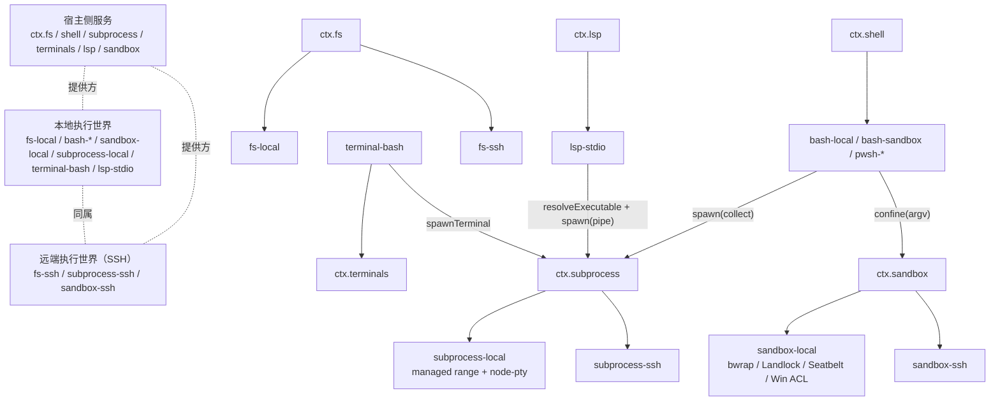
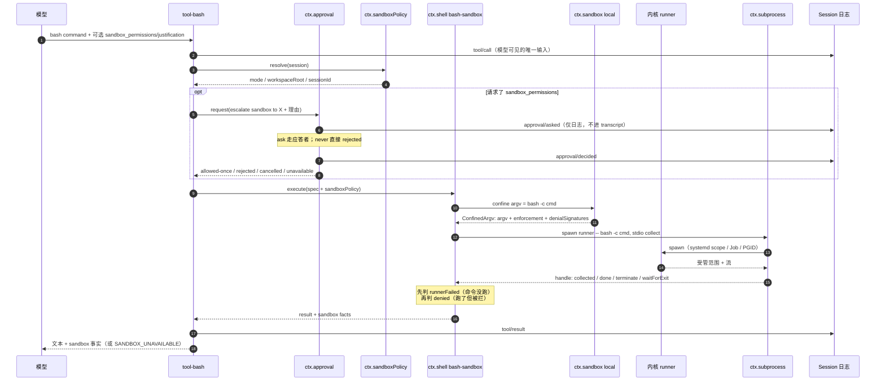
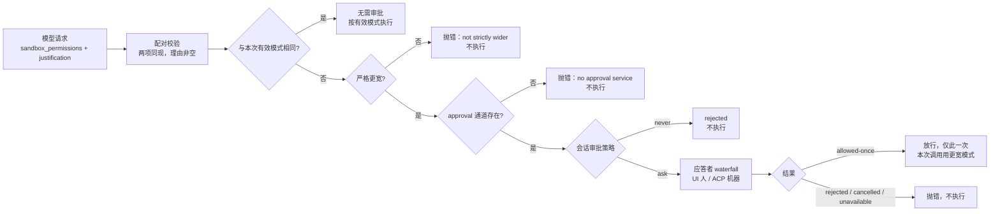

# 执行世界：沙箱、子进程与文件系统

> 关注面：模型的一次"动作"（跑命令、改文件、开终端、问语言服务器）在宿主上真正落到哪台机器的哪个进程里，以及谁有权拒绝它。这是 dsh 里唯一直接触碰用户机器的子系统，也是唯一一处"模型输出"与"操作系统效果"之间只隔着几道检查的地方。

dsh 的主干是 append-only 的 Session 事件日志：模型能看到的，就是被记录下来的。这条主张听起来离操作系统很远，但执行世界是它最硬的落地处——一次 `bash` 调用最终变成日志里的一个 `tool/result` 事件，而那个事件必须如实携带"命令到底跑没跑、被谁拦住、在哪个世界里跑的"。本篇顺着这条线，从 seam 定义读到内核参数。

## 执行世界：为什么"同一台机器"不是实现细节

`ctx.fs` 和 `ctx.subprocess` 是两个独立的能力 seam，各自可以有多个提供方：本地、SSH 远端、沙箱包装。它们却被一条约束绑在一起——**共同挂载的 fs 与 subprocess 提供方必须描述同一个执行世界**：同样的路径命名空间、同样的可执行文件、同样的进程与终端会话。

`SubprocessRuntime` 的类文档把这条约束写在"实现者必须遵守的语义"第一条。[packages/subprocess/subprocess/src/index.ts:95-96]()
<!-- anchor: * - Executable paths belong to one execution world shared with the mounted … *   filesystem provider. -->

对应的文件系统侧则是 `processPath(target)`：把后端不透明的 `FsTarget` 翻译成"子进程能打开的规范化绝对路径"，并明确它与 `targetKey` 是两回事——消费方可以把它交给另一个 OS 能力，但仍然必须把 target key 当作不透明值。[packages/fs/fs/src/index.ts:143]()
<!-- anchor:  -->

### 如果 fs 在本地、subprocess 在远端

这不是"稍微不一致"，而是让**每一个上层工具同时失效**，且失效方式各不相同：

| 消费者 | 依赖的共享前提 | fs 本地 / subprocess 远端时的实际后果 |
| --- | --- | --- |
| `tool-fs` 的 read/write/edit | cwd 与路径在两个世界里指同一处 | 读到的 `README.md` 与 `bash cat README.md` 读到的是两台机器的同名文件，模型会把两个事实当一个用 |
| `bash` 的 `workdir` 解析 | `resolveWorkdir` 只做字符串拼接，不认识世界边界 | 远端命令在远端 cwd 不存在处失败，或更糟：在远端的另一个同名目录里成功 |
| `tool-fs` 的写后报告 | 无（tool-fs 不消费 subprocess） | 最危险的一类：写操作"成功"，但没有任何进程能看见它，回放时日志看起来完全正常 |
| `lsp-stdio` | `ctx.fs.processPath()` 给的文件路径必须能被它 spawn 的语言服务器打开 | LSP 会把本地路径发给远端服务器，诊断全空或指向不存在的文件 |
| `terminal-bash` | PTY 的 cwd 与 fs 的世界一致 | 终端里 `pwd` 与 `read` 工具报告的目录不同，用户以为是 bug |
| `fs-observation-policy` | 只按 `targetKey` 记账 | 观察到的版本与进程实际改动完全无关，"先读后写"守卫形同虚设 |

反过来，本地 fs + 本地 subprocess + 远端 sandbox 也不行：`sandbox-ssh` 会把 argv 拿到远端去包装，返回的 argv 在本机 spawn 时 `argv[0]` 是一个远端才存在的 launcher 路径——而这恰好会撞上故障关闭逻辑（见下文"故障关闭"），以 `SANDBOX_UNAVAILABLE` 收场。这条路径"至少会响亮地失败"，混合世界最糟的情况恰恰是它**安静地成功**。

### 为什么这条约束是架构级的

因为 dsh 的插件模型是"每个能力独立可替换"，而这种自由在**进程与文件**这两个能力上是不可组合的：其他 seam（`llm`、`web`、`session`）换提供方只改变行为，fs/subprocess 换提供方改变的是**坐标系**。设计笔记把结论写得很直白：

> 只有文件操作、命令、终端和语言服务器共享同一个沙箱身份时，远程编码世界才有用。[.agents/notes/implemented/architecture/2026-07-28-portable-execution-world-consumers.zh.md:11]()
<!-- anchor: 只有文件操作、命令、终端和语言服务器共享同一个沙箱身份时，远程编码世界才有用。若把完整 harness 移入该沙箱，还会把提供方实验与插件加载、凭据、模型传输、 -->

同一份笔记里被否决的替代方案恰好覆盖了这条约束的几种"聪明"逃法：为每个远端提供方另写 PTY/LSP 包（否决：在 seam 之上重复实现提供方机制）、给每项能力各配一个沙箱（否决：文件与进程不再共享身份）、把整个 harness 搬进远端（否决：那是另一种部署模型，会把模型调用、会话持久化、凭据搅进来）、新增通用分布式运行时抽象（否决：只是猜测已验证约定之外的持久化问题）。

架构上的后果是**迁移的单位是"一对提供方"**：`fs-ssh` + `subprocess-ssh` + `sandbox-ssh` 一起上，`ctx.ssh` 是它们的共同锚点。`ssh.md` 把执行坐标列成一张清单——文件系统身份、可执行文件查找、进程 cwd、沙箱工作区根、语言服务器 file URL，全部指向 SSH 主机。[docs/subsystems/ssh.zh.md:9]()
<!-- anchor: 文件系统身份、可执行文件查找、进程 cwd、沙箱工作区根目录及语言服务器文件 URL 都指向 SSH 主机。提供方在文件实际存在的位置规范化路径，保留文件系统对 -->

`sandbox-ssh` 更是把"同一主机"写进了类注释第一句：每个约束请求都在与它的 fs、subprocess 提供方相同的主机上解析。[packages/ssh/sandbox-ssh/src/index.ts:9]()
<!-- anchor: /** Resolve each confinement request on the same host as its filesystem and subp -->

这也解释了为什么 E2B 提供方最终被移除而不是修补：只要执行世界要成对迁移，任何只搬一半镜像的实现都是在生产事故里做实验。

## 五族提供方与执行世界的映射

同一个执行世界里挂着五族能力，其中四族通过 `ctx.subprocess`（第五族通过 `ctx.fs`）落到世界两端的同一批机器上：

读法：**箭头只指向 seam，不指向实现**。`lsp-stdio`、`terminal-bash`、`bash-local` 都只认识 `ctx.subprocess`，所以远端化时它们一行不改；变的只有图右下方那两格。`bash-sandbox` 是 `bash-local` 的子类，把 `['bash','-c',command]` 交给 `ctx.sandbox.confine()` 换回被包装的 argv。[packages/shell/bash-sandbox/src/index.ts:187-188]()
<!-- anchor: private confine(command: string, policy: SandboxPolicy, signal?: AbortSignal): P … return this.ctx.sandbox.confine(['bash', '-c', command], policy, signal) -->

值得注意的是**沙箱不进 `ctx.subprocess`**：子进程 seam 完全不知道沙箱存在，约束发生在调用方与 subprocess 之间（代价见"三层分工"一节）。

LSP 这一族只需简述：`ctx.lsp` 是导航 seam（`tool-lsp` 是唯一消费方），`lsp-stdio` 用 `stdin: 'pipe'`、`stdout: 'pipe'`、`stderr: { maxBytes }`（不落 spill）的最小 spec 起每个语言服务器，自己负责 JSON-RPC 分帧与 stderr 诊断尾部。它不经过 `ctx.sandbox`——语言服务器是被信任的开发工具，不是模型生成代码的载体。

`computer-use` / `browser-use` 则**不在**这个执行世界里：它们只注册一个提供方名字，提供方自带工具与资源，"共享服务不提供通用操作 API"，桌面输入与浏览器会话的所有权由提供方按 Session 管，取消也无法撤销已送达的输入。它们与执行世界的关系是"平行世界"——这也是为什么 dsh 没有一套能同时拦住 bash、fs、桌面点击的通用沙箱。

## subprocess seam：把"默认值"全部赶出服务

`SubprocessSpawnSpec` 是这个 seam 最反直觉的部分：**服务端不做任何补全**。argv、cwd、每条流的处置方式、宽限期都是必填；`spawn()` 只在终态发布前做同步校验（宽限期有限且不超过定时器上限、未预先中止、argv[0] 非空），此外一律照办。[packages/subprocess/subprocess/src/types.ts:77-106]()
<!-- anchor: export interface SubprocessSpawnSpec { … env?: NodeJS.ProcessEnv | undefined -->

文档里给的理由是"由调用方自己的配置、而不是某个隐藏的子进程服务默认值来决定它们"，并把 `dsh-shell` 的 request/spec 拆分点名为这一模式的模板。这条选择有传染性：`ShellExecutor.resolve()` 先把面向模型的 `ShellExecRequest`（workdir/timeout 可选）补全成 `ShellExecSpec`（全必填），再由 `bash-local` 的 `spawnSpec()` 映射成完全显式的 `SubprocessSpawnSpec`。**每一层只补自己有权决定的字段**，于是 `maxOutputBytes` 归 bash 执行器、`graceMs` 归 bash 执行器、可执行文件解析顺序归 subprocess 提供方，没有一处"谁都能改的默认值"。

代价也很真实：每个新消费方都要自己写一遍 `stdio` 与 `graceMs`，误配不会有默认值兜底（例如忘写 `spill` 就永久放弃完整流恢复）。换来的是**行为可被叶子配置解释**——这在一个"组合即产品"的框架里比省几行更重要。

### 输出读取：偏移量、尾保留、spill

collect 模式不返回游标式读取器，而是**以整条流的字节偏移为坐标的非消费式读取**：`text` 是自 `fromByte` 起的增量，`nextOffset` 是下一次的起点，`lossy` 表示请求的偏移已经滑出内存尾部窗口（只能去 spill 文件里找回缺口）。[packages/subprocess/subprocess/src/types.ts:124-132]()
<!-- anchor: export interface SubprocessOutputRead { … spillPath?: string -->

原因在类型注释里：多个独立读取器（后台任务 UI、`job_output` 工具、执行器自己的结算投影）不能互相"偷"输出。`bash-local` 正好演示两种读法并存——`readOutput()` 自己维护两个游标做消费式增量读，`observed.stdout/stderr` 把同一批 reader 暴露给外部观察者按自己的偏移读，互不干扰。

内存里保留的是**尾部**，理由写在收集器注释里：错误与最终结果集中在输出末尾，头部交给 spill 文件。[packages/subprocess/subprocess-local/src/output.ts:126-127]()
<!-- anchor: * Tail-keep rationale (pi/OpenCode): errors and final results cluster at the … * end of command output; the spill file covers the head. -->

spill 本身是一个很克制的安全设计：`0700` 私有目录 + 随机名 + `O_EXCL`（`wx`）+ `0600`，专为抵御共享临时目录里的符号链接植入；任何一次打开/写入失败都只是**降级为纯内存尾**，绝不中断收集——因为 `push()` 跑在流的 `'data'` 监听器里，抛出的错误会变成宿主的未捕获异常。[packages/subprocess/subprocess-local/src/output.ts:199-213]()
<!-- anchor: // existing path, symlink or not) + owner-only mode: defeats spill-path … writeSync(this.spillFd, chunk) -->

### 结果只报退出事实

`SubprocessOutcome` 只有 `exitCode` 与 `signal`，**故意不带**超时/取消分类，也不带输出。[packages/subprocess/subprocess/src/types.ts:110-120]()
<!-- anchor: * Exit facts of one closed process — Node's `close`-event vocabulary. … signal: NodeJS.Signals | null -->

"谁设的截止时间，谁知道为什么超时"。`bash-local` 用一条融合的 deadline（`deadline(spec.signal, timeoutMs, 'BASH_TIMEOUT')`）同时驱动 spawn 信号与结果分类，把"超时"与"上游取消"分成互斥的两个布尔值；subprocess 服务只负责在信号触发时升级终止，从不猜原因。这条分工让同一个进程句柄可以被 `job_kill`、工具取消、组合拆卸三方各自持有，而分类不会打架。

### 受管进程范围：比"我的子进程"更大的一圈

`terminate()` 与 `waitForExit()` 操作的是**提供方管理的范围**，不是 spawned 命令本身；`waitForExit()` 的语义是"范围里没有进程了"，不是"命令退出了"。[packages/subprocess/subprocess/src/types.ts:189-195]()
<!-- anchor: * Wait until the same managed range is empty — not just until the spawned … waitForExit(signal?: AbortSignal): Promise<boolean> -->

提供方按平台选范围：

| 平台/情形 | 范围所有者 | 终止语义 | 已知逃逸面 |
| --- | --- | --- | --- |
| Linux + user systemd | 临时 user scope（`systemd-run --user --scope`），经私有 bootstrap 消费 launch request 后 `execve` | `systemctl --user kill --kill-who=all`，TERM→KILL 分级 | 需要 systemd 236+；scope 未建立时走直连回退 |
| Windows（普通命令） | 私有 Job runner 创建的 Job object | 关闭 Job / `TerminateJobObject`，**立即**，无分级 | breakaway 进程不在保证范围 |
| Windows（PTY） | 无 Job（ConPTY 在 Job 之外） | 进程表验证 + 观察 | 观察不到的后代 |
| macOS / 无可用 user manager | detached POSIX 进程组（`kill(-pid)`）+ `/proc` 成员探测 | TERM→KILL 分级 | 调用 `setsid` 或重新设定父进程的后代可能逃出 |
| 全部不可用时 | 同一 fallback | 同上 | 同上，且**只告警一次** |

Linux scope 这条路径的复杂度集中在"范围什么时候才算空"。`SystemdScopeOwner` 用 `TasksCurrent === 0` 加"launch request 已被消费"两个证据判定范围为空——因为 systemd 只在 scope 由有进程变为空时才结束单元，一个在进入 cgroup 前就被杀掉的 payload 会让单元永远 active。[packages/subprocess/subprocess-local/src/linux-scope.ts:393-395]()
<!-- anchor: private emptyRange(tasksCurrent: number | undefined): boolean { … && (!this.direct.running() || !existsSync(this.startup.files.requestPath)) -->

另一处值得学的细节是 `LinuxScopeNotStartedError`：如果 scope 退出了但 launch request 文件还在，说明 bootstrap 从未消费请求、目标从未运行。提供方把这种情况单独分类，**下一命令前重新探测原生约束**，而不是把"命令没跑"误报成"命令失败"。[packages/subprocess/subprocess-local/src/linux-scope.ts:261]()
<!-- anchor: /** A scope launch whose bootstrap never consumed its launch request, so its tar -->

必须承认的是：Windows Job 是立即终止，POSIX 路径是 TERM→KILL 分级，fallback 只是观测。三种语义并不等价，而 `graceMs` 只对分级路径有意义。这是"一套 API 覆盖三种执行基底"绕不开的折价，文档选择把它显式披露而不是抹平。

### fd 7：给协议留一条私有车道

`stdio.control: 'pipe'` 会在子进程里打开 fd 7，父进程拿到一个原始 `Duplex`；子进程通过 `openInheritedControlChannel()` 消费 `DSH_SUBPROCESS_CONTROL` 标记并接管这个描述符。[packages/subprocess/subprocess/src/control.ts:7-10]()
<!-- anchor: export const SUBPROCESS_CONTROL_FD = 7 … export const SUBPROCESS_CONTROL_ENV = 'DSH_SUBPROCESS_CONTROL' as const -->

设计动机是"受管 Node 程序可以往 stdout/stderr 写任意字节"，所以宿主协议不能与程序输出共用流。[.agents/notes/implemented/architecture/2026-09-11-subprocess-control-pipe.zh.md:9]()
<!-- anchor: 受管 Node 程序可以向 stdout 和 stderr 写入任意字节。若宿主协议共用其中任一流，就无法在不限制普通 Node 行为的前提下区分协议字节和程序 -->

被否决的替代方案很说明问题：stdout 分帧（协议完整性将依赖拦截程序输出）、同步 Windows 管道（继承的同步管道上阻塞读会卡住并发写，死锁）、复用 Node IPC（会把 Windows 监督器的管理协议暴露给负载）、各平台用不同描述符编号（增加引导分支却省不掉原生工作）。

安全边界也写得很清楚：**这条通道不授予任何宿主能力**，子进程仍不可信，每条宿主工具请求照常走分发与审批；"独立传输不是 JavaScript 安全边界"。[.agents/notes/implemented/architecture/2026-09-11-subprocess-control-pipe.zh.md:37]()
<!-- anchor: 原生包装器必须显式保留并关闭一条额外管道。subprocess 服务不解释控制消息，也不替调用方缓冲消息，因此协议消费方必须自行限制保留的输入和输出。操作系统沙 -->

父进程侧会拒绝调用方自己设置这个标记（大小写不敏感），把它当保留名。[packages/subprocess/subprocess-local/src/control-spawn.ts:27-33]()
<!-- anchor: export function controlEnvironment<T extends NodeJS.ProcessEnv>(env: T, control? … if (control === 'pipe') Object.assign(env, { [SUBPROCESS_CONTROL_ENV]: 'pipe' }) -->

这是一条小但正确的细节：任何"由环境变量宣告的私有协议"都必须假定调用方会试图伪造它。

### 受管 `DSH_*` 环境词汇

`DSH_*` 是"归 harness 所有的子进程事实"。`scrubbedParentEnv()` 先扔掉环境里所有已有的 `DSH_*` 名称（大小写不敏感，因为 Windows 环境名不区分大小写），再合并调用方显式给出的条目；显式 `undefined` 是墓碑，用来删除一条环境里的普通变量。[packages/subprocess/subprocess/src/index.ts:50-79]()
<!-- anchor: * The ambient parent environment minus credential-shaped names and minus all … return env -->

同一个函数还做第二件事：按 `KEY|PASSWORD|SECRET|TOKEN` 丢弃凭据形状的变量名，并重新注入代理变量（因为子 Node 不认继承来的代理变量，除非带上那个标志）。重点是**顺序**：先净化、后合并，于是"想转发凭据"必须显式写出来——一次有意的动作，而不是默认行为。`ctx.shellEnv` 在此之上再注册受管事实（`DSH_SHELL`、`DSH_SESSION_ID`、`DSH_PROFILE` 等），并保证调用方 `env` 永远压不掉受管键。

## 沙箱：约束发生在哪一层

`ctx.sandbox` 的接口小得不像安全组件：只有一个方法，输入精确 argv，输出"应该 spawn 的替代 argv"加三份事实——`argv`、`enforcement`（完整度）、`denialSignatures`（该后端拒绝时的 stderr 方言）、`runnerFailureRules`（runner 在执行命令前失败的证据）。[packages/sandbox/sandbox/src/index.ts:92-116]()
<!-- anchor: * A {@link SandboxProvider.confine} result: the argv to spawn in place of … runnerFailureRules: readonly RunnerFailureRule[] -->

它不是"包一层函数调用"，而是**argv 包装**：`confine(['bash','-c',cmd], policy)` 返回 `[runner, ...profile, '--', 'bash', '-c', cmd]`。这个形状带来一个关键属性——约束在 `execve` 之后**由内核继承**，所以命令 fork 出来的每个后代都在同一规则里。Landlock launcher 的契约把这点写明：安装 ruleset 后 `exec` 自己，ruleset 跨 `execve` 继承，且每个后代同等受限。[native/system/docs/cli-contract.md:34]()
<!-- anchor: The launcher sets `no_new_privs`, installs the ruleset on itself, and `exec`s th -->

三层的分工与代价：

| 层 | 例子 | 拦得住什么 | 代价 / 逃逸面 |
| --- | --- | --- | --- |
| 解释器/argv 包装（用户态） | `bwrap` 的 mount profile、`sandbox-exec -p` 的 SBPL、Windows ACL runner 的受限令牌 | 只见 `argv` 一次，按策略重写执行基底 | 包装器自身可被信任前提绑架：`runnerCommand` 覆盖路径**跳过探测并宣称 full**；归因靠带内 stderr，理论上可被受限子进程模仿 |
| 内核 LSM / LSM-like | Landlock ruleset、Seatbelt `deny file-write*`、NTFS ACL + Low integrity | 全后代生效，无法被 Python/Node 直接绕过 | Landlock 完整度随内核 ABI（≤5）打折；macOS 依赖 Apple 已弃用但仍交付的 `sandbox-exec`；Windows 有硬链接别名、读取不受限、AppContainer ACL 边界 |
| 进程组 / 会话 | POSIX 进程组、systemd scope、Windows Job、PTY 会话 | "跑完之后还在跑的东西"——清理与完全停稳 | 不是安全边界：同用户进程可以 `setsid` 或改变父进程；fallback 只能观测 |

**档位只描述文件效果**。`SandboxMode` 的三个值（`read-only` / `workspace-write` / `danger-full-access`）明确不覆盖网络与进程可见性。[packages/sandbox/sandbox/src/index.ts:25-30]()
<!-- anchor: * File-effect policy for confined processes. `read-only` permits only required … export type SandboxMode = 'read-only' | 'workspace-write' | 'danger-full-access' -->

一个 Python 脚本照样能 `pip install` 外部包、往任意 IP 发包——dsh 的沙箱对这一点诚实，也不假装。

`workspace-write` 允许写哪里，各后端自己拼参数，但"workspace 根 + `/tmp` + `os.tmpdir()` 都可写"这条规则只在 `writableRoots()` 一处定义（canonical、去重），Seatbelt profile 与进程内 fs 围栏都从这里取，因此不会出现"bash 能写而 write 工具不能写"的漂移。[packages/sandbox/sandbox/src/roots.ts:52-54]()
<!-- anchor: export function writableRoots(policy: SandboxExecutionPolicy): string[] { … return [...new Set([policy.workspaceRoot, '/tmp', tmpdir()].map(canonicalPath))] -->

bwrap 与 Landlock 仍保留自己的拼写（bwrap 用 `--tmpfs /tmp` 造一个临时挂载，语义更接近"每次执行一个空临时区"），差异由测试钉住，而不是靠文档承诺等价。

### 平台链与"探测仲裁"

后端选择是**先按平台，再按需要探测**：链只有一个候选时直接选中（`darwin → seatbelt`、`win32 → windows-acl`），有两个候选时（`linux → bwrap, landlock`）按顺序做功能探测。探测靠"用真实 profile 跑 `true`"判定，而不是查文件是否存在——因为 `bwrap` 恰好在最需要沙箱的主机上不可用（non-root 精简容器、禁用非特权 user namespace）。

`enforcement` 是**后端报告的事实**，不是配置承诺：Seatbelt/bwrap 通过探测即 `full`；Landlock 按 ABI 报 `full`/`partial` 并在每次受限运行时于 stderr 自报 partial；Windows ACL 固定 `partial`。`partial` 的语义是"要求绝对边界者不得当成 full 用"，这是把"做不到"变成可编程事实，而不是日志里的一句话。

### 每调用策略，而不是每提供方策略

`SandboxPolicy` 随调用携带。绑定在 provider 上就表达不了三件事：两个消费者同时用不同策略（bash 在 `read-only`、受约束的子 agent 需要状态目录可写）、一次获批的升级重试、以及会话级覆盖。解析发生在工具层，顺序是固定的三段——获批的显式模式 > 会话日志里最后一条 `sandbox/mode` > 部署默认；root 取会话不可变 cwd，agentless 调用才回落到配置根。[packages/sandbox/sandbox-policy/src/index.ts:164-169]()
<!-- anchor: resolve(request: SandboxPolicyRequest = {}): SandboxExecutionPolicy { … ...session === undefined ? {} : { sessionId: session.id }, -->

注意它**故意保留执行世界里的绝对路径写法**，不做宿主 realpath——规范化留给真正执行的那一端（`LocalSandboxProvider.confine` 里的 `canonicalPath`、`fs-sandbox` 里的 fresh resolve），否则 `symlink/..` 会被宿主解释歪。

部署默认值这里有个需要点出的坑：`SandboxPolicyService` 的 schema 默认是 `read-only`（"fail-safe 默认，想要可写要显式 opt in"），但**随附的 base profile 把默认改成了 `workspace-write`**，并允许 `DSH_PERMISSION_MODE` 覆盖。[packages/bundle/base/cordis.patch.yml:243-247]()
<!-- anchor: - id: sandbox-policy … workspaceRoot: !!js process.cwd() -->

读代码时若只读 schema 会得出"默认只读"的错误结论。

### 故障关闭：在哪些点拒绝执行

"fails closed"在 dsh 里不是一句口号，而是五个具体的拒绝点：

| 触发条件 | 拒绝形态 | 用户/模型体感 |
| --- | --- | --- |
| 平台无链，或多候选全部探测失败 | `SandboxUnavailableError`（code `SANDBOX_UNAVAILABLE`），命令**从不运行** | 工具结果是一条基础设施错误，含"装 bubblewrap / 换内核 / 改 danger-full-access"的指引 |
| 包装后的 runner 在跑目标前失败（`bwrap: `、`landlock-run: ` + exit 125、`sandbox-exec: `、`windows-acl-run: ` + exit 127） | 前台抛 `SANDBOX_UNAVAILABLE`，后台记 `runnerFailed: true` | 与"命令失败"明确区分；无害的 partial 通知被 `informationalLines` 排除，不会误判 |
| 受限模式下 `ctx.sandbox` 未挂载 | 执行器加载/启动即报错（`terminal-bash` 直接抛"requires a ctx.sandbox provider"） | 组合错误在部署期暴露，不是等到第一条命令 |
| 升级请求无审批通道 / 无 agent / `never` 策略 / 目标不与当前严格更宽 | 抛错（**在执行前**） | 模型看到"no approval service is composed"/"用户拒绝"，没有动作发生 |
| 审批通道缺失时 `tools` 流水线的 `ask` 决定 | 降级为 deny | 落在从未审批更安全的一侧 |

`SandboxUnavailableError` 的文案本身就是逃生阀说明——它把四个平台的修法逐条列出来，并补一句"否则把消费者切换到 `danger-full-access`"。[packages/sandbox/sandbox/src/index.ts:133-138]()
<!-- anchor: constructor(mode: ConfinedSandboxMode, detail?: string) { … + 'restricted-token runner can start (Windows) — otherwise switch the consumer t -->

这句话是有意的：故障关闭的目的是防止**静默**无约束执行，不是禁止运维显式选择无约束。

体感上，故障关闭最大的代价是"沙箱坏了 = agent 不能干活"。默认 `workspace-write` + `ask` 意味着用户如果既不装后端也不读错误文本，得到的是一个看起来很笨的 agent。缓解手段是把原因写进错误文本与 `enforcement` 事实，而不是降级重试。

## 一次 Bash 调用：从模型到进程到结果

把上面的部件串起来，一次 `bash` 工具调用要穿过十一道关卡：

几个顺序上的设计判断值得单拎出来：

- **审批在 `confine` 之前、在任何 spawn 之前**。`approveEscalation` 是"在执行任何东西之前"通过审批通道解析 `sandbox_permissions` 请求的闭式序列，而"严格更宽"是对**本次调用的有效模式**做的执行期检查，不写进 schema enum。[packages/sandbox/sandbox/src/escalation.ts:171-177]()
<!-- anchor: export async function approveEscalation<A, C>(request: EscalationRequest, approv … if (!(WIDER_MODES[effectiveMode] ?? []).includes(mode as SandboxMode)) { -->
- **拒绝与 runner 失败先分类再上报**。runner 失败意味着"命令根本没跑"，所以它的判定必须先于"denied"（命令跑了、被拦了）——`bash-sandbox` 的注释把顺序写死：runner failure outranks denial because the command did not run。
- **同一次调用内绝不自动重试**。这条被明确否决过：一个 `tool/call` 产生两次不同策略的执行，在日志里无法重建。升级重试是一次**新调用**，有自己的参数与结果。
- **超时先于分类**。前台调用的 deadline 同时覆盖"异步 confine 准备"与进程执行；准备阶段超时返回一个没有退出事实的空结果，且晚到的 argv 不允许再启动进程（`preparationTimedOut` 之后直接跳过 spawn）。

## 文件系统 seam：按模式围栏，按版本守卫

`ctx.fs` 的核心不是"读写文件"，而是**把模型手里的字符串路径变成后端不透明的目标身份**，再让所有操作都作用在身份上。`resolve()` 可以走 I/O（远端要往返一次换稳定 id），因此是 async。

`fs-sandbox` 只覆写两个方法——`writeText` 与 `editText`，读一律放行（每个模式都允许读）。这层围栏的定位被作者写得很克制：

> 这是**受信任代码里**对**模型控制路径**做的策略检查，不是内核边界……内核级隔离不可信**代码**仍是 `ctx.shell` 的职责。[packages/fs/fs-sandbox/src/index.ts:10-18]()
<!-- anchor: * The fence is a policy check in TRUSTED code over a MODEL-CONTROLLED path, … * is accepted for this threat model. -->

这个自我限定是正确的，因为它面对的确实是"路径"这一窄面：操作是 seam 自己的 `open`/`rename`，唯一不可信的是目标路径，所以"重规范化 + 包含判定"就是完整答案。实现上它先 `resolve()` 出**新鲜**的规范路径，用 `isPathUnder` 在共享的 `writableRoots` 下做包含检查，然后把**这个新鲜 target** 交给父类执行——检查过的身份就是被写的身份。[packages/fs/fs-sandbox/src/index.ts:122-143]()
<!-- anchor: private async checkedTarget(target: FsTarget, sandboxPolicy?: SandboxExecutionPo … return fresh -->

包含判定本身有两级：先比词法前缀（快路径），拼写不同时沿目标祖先逐个 `stat` 比 `dev:ino` 身份，以便识别 Windows 8.3 别名与大小写差异，而不是把包含关系弱化成"文本近似"。[packages/fs/fs-sandbox/src/containment.ts:58-74]()
<!-- anchor: export async function isPathUnder( … ancestor = parent -->

**观测到的文件状态**是另一条独立轴，走的不是服务而是事件：

| 事件 | 模式 | 谁裁决 |
| --- | --- | --- |
| `fs/write-intent` | waterfall，单槽 | 第一个返回 intent 的监听器胜出；`next()` 得到"无条件写" |
| `fs/edit-intent` | waterfall | 同上；未观察过则 `FS_NOT_OBSERVED` |
| `fs/observed` | emit，同步 | 只记录，不 await、不允许抛（变更已提交） |

`fs-observation-policy` 用 `WeakMap<owner, Map<targetKey, FsObservation>>` 记账：看见过（present + version）→ `replaceIfVersion`；没见过或确认不存在 → `createIfAbsent`；编辑要求先读过。整套"先读后写"是**可选插件**，没有它，`write` 无条件覆盖、`edit` 无条件替换——这是 dsh 的一贯做法：策略做成插件，seam 本身只管机制。

`FsVersion` 是本地后端从 `dev:ino:size:mtimeNs:ctimeNs` 拼出的不透明令牌，消费方禁止解释它；远端后端可以换成 revision id。这里有个诚实的边界：版本令牌检测**陈旧**，不防**并发**——两个几乎同时的写可能都通过守卫，代码注释把责任推给"守卫的 mutate 在锁内复查版本"。

**有界字节区间读取**（`readByteRange`）是一个值得单独看的取舍。`readBytes(target, signal, maxBytes)` 的上限是**整个文件**，超限必须 `FS_TOO_LARGE` 而不是截断；`readByteRange` 的上限是**窗口**，后端"最多传输 `length` 字节，永不缓冲整文件"。[packages/fs/fs/src/index.ts:243]()
<!-- anchor: abstract readByteRange(target: FsTarget, range: { offset: number; length: number -->

实现就是一条带 `start`/`end` 的读流。

有意思的是：设计笔记曾**否决**"在 fs seam 里新增稳定的有界读取原语"，理由是只有 LSP 需要完整文档字节上限、第二原语会迫使每个提供方实现稳定句柄与非跟随符号链接机制、远端还要新协议。最终进来的不是那个原语，而是窗口原语，且它的真实消费方是 GUI 侧 `api-workspace-files`（大文件按窗口翻页）与 SSH helper 的 `fs.readRange`——`tool-fs` 自己的 `read` 完全不用它，走的是 `streamText` + 消费侧保留上限。这类"设想的消费方"与"实际的消费方"错位，是读 seam 时最容易误判的地方。

`FsErrorCode` 有 13 个值，其中两个直接服务于沙箱叙事：`FS_SANDBOX_DENIED`（策略拒绝，保留结构化 code 以便重试/观察者分支）与 `FS_NOT_OBSERVED`（编辑前没读过）。`tool-fs` 把前者映射成与 bash **完全相同**的模型可见标记 `[sandbox: file access denied under <mode> mode]` 加同轮升级提示，同时保留 `FsError` 类型——因为 `ToolRuntime` 只对 `HarnessError` 填充 `result.error`，换普通 `Error` 会把 code 抹掉。

fs-local 与 fs-ssh 的差别不在"本地/远端"，而在**谁做原子性**：本地后端自己做 staged temp + `rename`/`link` 发布；SSH 后端把 `write`/`edit` 整体交给远端 helper，在 helper 里用远端本地提供方做同样的原子变更，主机只负责传 target 与 policy。

## 终端与后台任务：持久身份 + 有界观测

终端这一族的形状与前几族不同，因为 PTY 不是"一次性进程"：

- **持久化终端 ID**：`TerminalSessionId` 由服务铸造，所有者是**确切的 `Agent` 对象**；授权比较对象身份，而不是名字或猜的 id。会话在后端或工具插件重载期间存活，但 PTY 状态与原始字节**只活在进程内**——模型输入与有界输出仍通过既有的 `tool/call`、`tool/result` 与任务结果路径落日志，而不另开一套 PTY 事件（这是"Model-visible means logged"的直接推论：不要记录模型看不到的字节流）。
- **发送就绪状态**：一次发送返回 `waitReason`（`stdin_read` / `inferred_idle` / `timeout` / `session_exit`），它与会话状态正交——"发送因超时返回"不等于"shell 退出了"。一个会话同时只允许一个活动发送；取消在写入在途时保留发送预留，避免延迟字节落到下一次发送里。
- **有界读取**：`readOutput()` 消费式增量、`read()` 按"距最新 N 行"分页 scrollback、`TerminalReadResult.truncated` 显式告知丢弃。三个入口各自有界，谁都不返回"整屏"。
- **owner 可见快照**：`list(owner)` 只返回**该 owner** 的会话快照；`hasOwnerActivity(owner)` 覆盖从 spawn 到 close 的全区间（含尚未发布的创建），没有发布空隙。后者被用来做一个很实用的硬约束：**只要该 agent 还有终端会话，就禁止切换 sandbox 模式**（`sandbox/mode` 事件会被拦下并报错），因为一个在 `workspace-write` 下启动的 shell 无法被事后收紧。
- **执行世界归属**：`terminal-bash` 起 PTY 前同样过 `ctx.sandbox.confine()`（受限模式无 `ctx.sandbox` 直接抛错），并把 `DSH_SHELL`、`DSH_SESSION_ID`、`DSH_PTY_SESSION_ID` 显式注入子环境。[packages/terminal/terminal-bash/src/index.ts:101-109]()
<!-- anchor: async function spawnArgv(ctx: Context, config: ResolvedConfig, policy: SandboxEx … return (await sandbox.confine(argv, { ...policy, mode: policy.mode }, signal)).a -->

后台任务不在这个 seam 里：`ctx.shell` 只返回进程句柄，`tool-bash` 把它适配成 `ctx.jobs.start()` 的一个 job。这也解释了"前台/后台"在本项目里是**调用方是否 await** 的属性，而不是 spawn 的属性——同一个句柄，foreground 只是 `result()` 被等着。

## 审批与沙箱：双重把关防的不是同一件事

这是本篇最需要说清的部分。dsh 的"权限"看起来有两个开关（沙箱模式、审批策略），很容易被理解为冗余。事实是它们拦的是两类完全不同的失败。

### 谁先谁后

这张图的重点不在分支多少，而在**位置**：整段判定发生在工具体内、`ctx.shell.execute` 之前，也就是**任何进程被创建之前**。沙箱围栏则在另一处、更下游，与"是否有人批准"完全无关——它每次调用都跑。

### 两者防的事故不同

| | 沙箱（`ctx.sandbox` / fs 围栏） | 审批（`ctx.approval`） |
| --- | --- | --- |
| 拦的对象 | 已获准执行的动作**越出文件边界** | 动作本身**是否该被批准**——包括边界内但有害的动作 |
| 判定依据 | 内核/LSM 事实：`write()` 落在哪个路径 | 人的意图，加一句 `justification` |
| 能否被模型说服 | 不能。模型只能换一条路径，换不了规则 | 能——这正是设计意图：模型提出理由，人决定 |
| 是否事后可查 | 结果里的 `sandbox{denied, enforcement}` | `approval/asked` + `approval/decided` 成对落日志 |
| 拦不住的典型 | `rm -rf ~/project`（在 workspace 内）、`git push --force`、`npm publish`、把内容 POST 出去 | 任何文件效果：一次获批的 `danger-full-access` 重试等于关掉整个文件沙箱 |

所以二者**不重复**：沙箱防"读代码的 agent 顺手改了 `~/.ssh`"，审批防"agent 在合法目录里做了你不同意的事"。`danger-full-access` 这个档位的存在就是证据——它绕过沙箱（消费方直接 spawn 原始 argv，不调 `ctx.sandbox`），但审批策略 `ask` 仍在，于是"完全访问"不等于"为所欲为不问你"。预设表把两者的常见组合命名：`workspace-write` = `workspace-write` + `ask`，`danger-full-access` = `danger-full-access` + `never`（后者在语义上是自洽的：既然全放开了，问也没有意义）。

### 信任边界的三个真实缺口

不吹不黑，这套设计有三处必须知道：

1. **`sandbox_permissions` 是模型填的字段。** 模型可以先故意撞一次拒绝，再以"沙箱拒绝了"为由申请更宽权限。`approveEscalation` 只在 `bash` 与 fs 的工具层被调用，**它不校验"刚才真的被拒绝过"**——代码里没有任何记号把这次申请绑定到上一次 denial。设计笔记明确否决过"把重试硬匹配到先前拒绝"，理由是命令字符串同一性太脆弱（引号、workdir、env 前缀），"真正的边界是人看到命令 + 理由"。所以**人就是边界**：如果 UI 没把完整命令与理由一起呈现在批准提示旁边，这个边界就有损。`ApprovalRequest` 故意不带工具参数，只带 `callId`，靠调用方把提示附着到已经流式输出的工具调用上——这套设计成立的前提是前端真的这么做了。
2. **`workspace-write` 的写权限是"workspace + `/tmp` + `tmpdir()`"。** 这既让 mkstemp 类工具能工作，也让多步骤路径（往共享临时区写一个后续被执行的脚本）成为可能，还让同一宿主上的多个 agent 通过固定路径互相投毒变得可行。
3. **审批的"人"可能是机器。** ACP 桥接注册的 `approval/request` 应答者对客户端只提供两个一次性选项（allow once / reject once），并明确不从未知响应推导持久授权。[packages/acp/acp/src/index.ts:157-161]()
<!-- anchor: // dsh-subagent-acp. The bridge offers one-shot choices only and never infers a … if (record === undefined || request.callId === undefined) return next() -->
在自动化场景里这是正确的保守，但它同时把"人"换成了一个可能被上游策略自动回 `allow-once` 的客户端，此时"人在回路"只是链路形状，不是事实。

另有一个方向上的非对称值得说：**审批无法收紧沙箱**。`WIDER_MODES` 只允许向宽的方向走，`read-only` 会话永远不能通过"审批"变得更严（不需要），而 `danger-full-access` 会话没有任何升级字段可申请（升级目标词汇恒为两个更宽的档）。要收紧只能换预设，或通过会话里的 `sandbox/mode` 事件——而后者又被"有活终端时禁止切模式"拦住。三条杠杆之间的这个缝隙，是用户"误点了完全访问"时唯一的补救路径：关终端、切预设、重试。

## 关键设计判断与代价

**一、沙箱做成"argv 变换器"而不是进程拦截器。**
优点：约束在内核里继承给所有后代，Python/Node 都绕不过；提供方与子进程 seam 解耦，`bash-local` 与 `lsp-stdio` 共享同一 subprocess 实现；`confine()` 是纯函数式的"进 argv、出 argv"，容易测试与替换。
代价：只能约束 `execve` 之后的东西。**进程内的工具（fs/web/todo）根本不在它的射程里**（沙箱设计笔记开篇就承认这一点，`execve` 包装层对闭包了 `ctx` 的函数毫无意义），所以 dsh 不得不再写一套 `fs-sandbox`，并让两套围栏共享 `writableRoots()` 以免出现"write 工具写不了 `/tmp` 但 bash 能"的错位。这层错位风险是 argv 包装路线无法消除的固有成本。

**二、`enforcement: 'partial'` 而不是拒绝。**
Landlock 在旧内核上只能管 ABI 5 以内的访问，Windows ACL 有硬链接与读不受限的洞。选择是"报 partial 继续跑"而不是"拒绝执行"或"谎称 full"。这让备选 runner 在旧内核主机上仍可用，同时把判断权交给消费者（"要求绝对边界者必须拒绝或向上暴露"）。代价：目前没有任何消费者因为 `partial` 拒绝执行——`bash-sandbox` 把 `enforcement` 原样透传进结果，模型/用户看到的是一个字符串，而不是被拦下的命令。也就是说 `partial` 现在是**信息披露**，不是**强制**。

**三、审批只到"一次调用"，且刻意不绑定前次拒绝。**
`allowed-once` 是唯一的放行结果，没有"always allow"；重试是全新调用、全新日志条目。优点：日志可完整重建"每次为什么被放行"。代价：连续被拒三次的模型可能连续申请三次，每次都要打扰人；而 UI 若不醒目地展示"这次与上次是同一命令的重试"，人就会被疲劳压制。项目选择"人 + 理由"作为唯一真实边界，这是诚实但依赖产品实现的选择。

## 亮点与问题

值得学的：

- **`SubprocessSpawnSpec` 的零默认值**与 `dsh-shell` 的 request/spec 拆分是同一思想的两次落地：默认值属于知道上下文的层，不属于机制层。这套纪律可以原样搬到任何"薄 SDK + 多消费方"的子系统。
- **偏移量非消费式读取**是一个小而正确的原语，解决了"多个观察者读同一流"这个常见却少被正视的问题；消费式与非消费式并存（`readOutput` vs `observed`）而不是二选一，是很实用的处理。
- **拒绝与 runner 失败的正交分类**（命令没跑 / 命令跑了被拦 / 命令失败了）把"安全组件的可用性故障"从"任务失败"里剥出来。绝大多数 agent 框架把这三件事混成一个非零退出码。
- **`LinuxScopeNotStartedError`**：把"scope 退出了但请求没被消费"单列一类并触发重新探测。这种对"启动阶段的不确定性"的显式建模比"重试一次"可靠得多。
- 环境净化的**顺序**（先丢凭据与 `DSH_*`，再合并显式条目）与 fd 7 的**保留名检查**，都是安全边界上"默认值站在安全侧、例外必须显式"的具体样本。

不理想的地方：

- **Windows Job 立即终止 / POSIX 分级终止 / fallback 仅观测**三种语义共用一套 API 与一个 `graceMs`。跨平台差异只能靠文档披露，消费方拿不到"我这次的终止是精确的还是尽力而为"的运行时事实。
- **macOS 走观测型 fallback**：没有可用的持久 range owner，`setsid` 或重新设父的后代可以在两次快照之间逃出；README 只把这一点作为"本地提供方限制"列出，但没有向模型或用户暴露"你这次是在较弱容器下跑的"（不像 sandbox 有 `enforcement`）。
- **`partial` 无强制力**、**`/tmp` 可写**、**升级不绑定前次拒绝**：三者单独看都合理，合起来意味着"模型可以说服人关掉文件沙箱，而沙箱本身对网络与进程可见性从不置一词"。与 Codex 的 `--sandbox` / Claude Code 的权限分级相比，dsh 的强项是分类粒度（拒绝 vs runner 失败 vs 超时 vs 取消）与事实上报，弱项是对"软约束"（网络、进程、跨会话）几乎不设防——这是有意识的范围声明，不是遗漏，但读者应当知道边界在哪。
- **`readByteRange` 的真实消费方与设想不一致**（设计笔记的否决理由针对的是 LSP，实际消费者是 GUI 与 SSH helper）。这说明"seam 上多一个方法"的长期成本常被低估：它一旦存在，就会被后来的人以未曾设想的方式使用。

## 与其他部分的连接

执行世界是 dsh"能力 seam + 可逆副作用"哲学里最不浪漫的一章：它没有事件日志的优雅，只有平台差异、内核版本与故障关闭。但它决定了另一件事的下限——**下一次 `tool/result` 里那条 `[sandbox: file access denied under ... mode]`，是整个系统里唯一由内核（而不是提示词）作出的拒绝**。接下来建议读**工具执行管线**（`docs/tool-execution-pipeline.zh.md`）：本篇的审批与沙箱都在工具体的内部，而 `tools/pre-execute` 守卫、`ask` 决定与单调守卫构成了另一层、对**所有**工具生效（包括进程内工具）的入口把关——两层"谁先谁后、谁能绕过"的完整图景，要把两篇接起来看。
